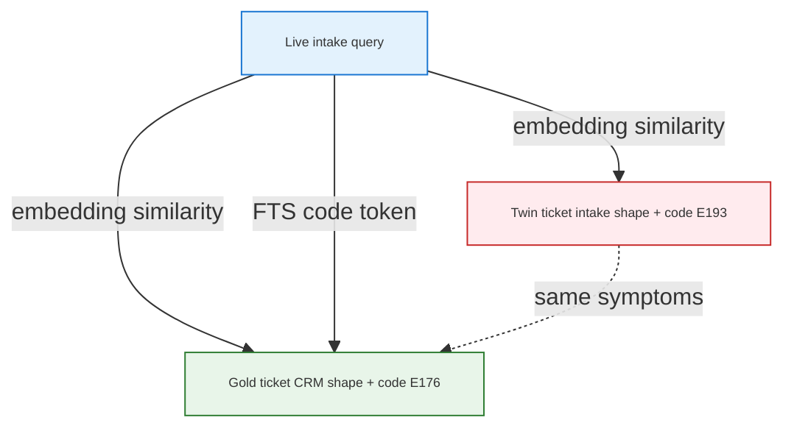
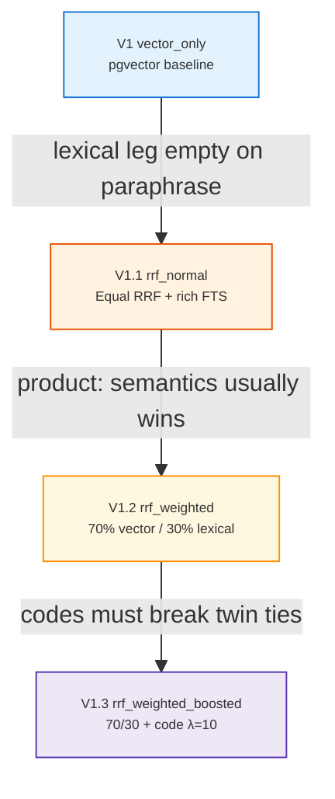
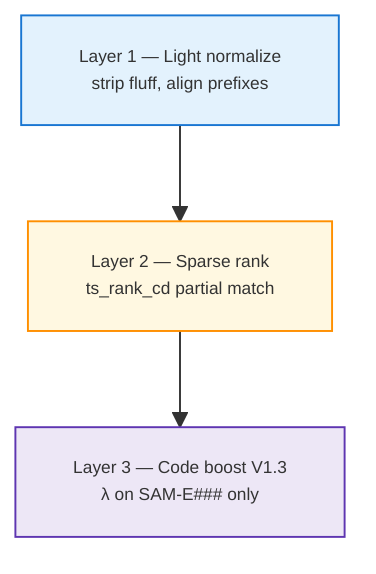
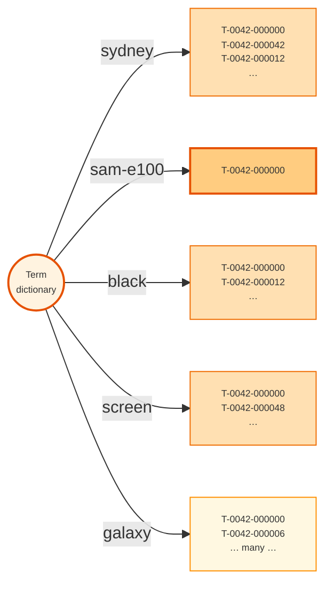
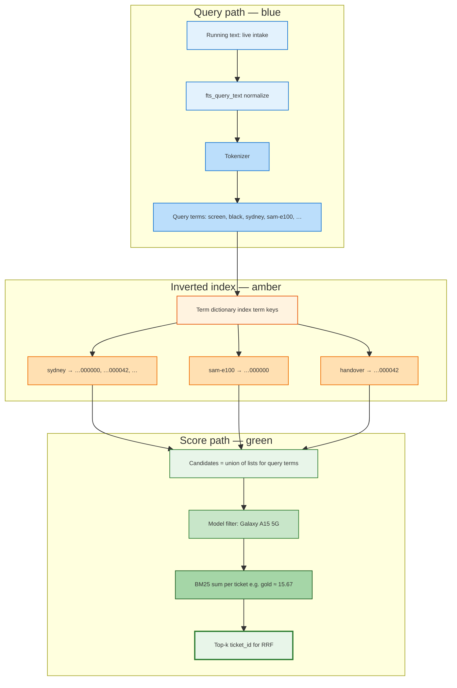

<h1 id="about-search-rrf" style="color:#0d47a1;font-size:1.55em;font-weight:700;border-bottom:3px solid #1976d2;padding-bottom:0.3em;margin-top:0;background:linear-gradient(90deg,#e3f2fd 0%,transparent 55%)">Hybrid ticket search: from vector-only to weighted RRF (a V1 → V1.3 evolution)</h1>

**Audience:** Engineers and product leaders building **repair-desk / retail** retrieval on **Postgres + pgvector**.  
**Purpose:** Publishable narrative — *why* each ticket-search version exists, *what* we measured, and *what* we implement next.  
**Status:** **living document** — V1.x search plan complete ([`REFACTOR_RETAIL_TICKET_SEARCH_V1X.md`](../ref_plan/completed/REFACTOR_RETAIL_TICKET_SEARCH_V1X.md)); lexical backends complete ([`REFACTOR_RETAIL_LEXICAL_BACKENDS.md`](../ref_plan/completed/REFACTOR_RETAIL_LEXICAL_BACKENDS.md)).  
**Last updated:** 2026-10-13  
**Context:** Samsung Australia retail **Second Brain** prototype (`second_brain` repo) — synthetic tickets, real **Gemini** embeddings, operator A/B on Postgres.

<!-- Formulas use HTML (not $LaTeX$) so tables and Cursor preview render correctly. -->
<style>
  .art-formula { background:#f3e5f5;border-left:5px solid #7e57c2;padding:14px 18px;margin:1em 0;font-size:1.08em;line-height:1.7;font-family:Georgia,'Times New Roman',serif;color:#311b92; }
  .art-formula-warm { background:#fff3e0;border-left:5px solid #fb8c00;padding:14px 18px;margin:1em 0;font-size:1.08em;line-height:1.7;font-family:Georgia,serif;color:#e65100; }
  .art-frac { display:inline-block;text-align:center;vertical-align:middle;line-height:1.1;margin:0 2px; }
  .art-frac-num { display:block;border-bottom:1px solid currentColor;padding:0 4px; }
  .art-frac-den { display:block;padding:0 4px;font-size:0.92em; }
</style>

<h2 id="about-outline" style="color:#3949ab;font-size:1.22em;font-weight:650;border-left:5px solid #5c6bc0;padding-left:10px;margin-top:1.1em;background:#e8eaf6">Document outline</h2>

1. [Executive summary](#1-exec) — one-screen takeaway for LinkedIn readers.
2. [The business problem](#2-problem) — paraphrase, twins, error codes.
3. [Two retrieval legs](#3-legs) — semantic (pgvector) vs lexical (BM25 sidecar); why both matter.
4. [Evolution timeline](#4-timeline) — visual journey V1 → V1.3.
5. [Version 0 — baseline V1 (vector only)](#5-v1) — FRU pattern; when it is enough.
6. [Version 1 — V1.1 equal hybrid (`rrf_normal`)](#6-v11) — why add FTS + RRF; demo-era lesson.
7. [Version 2 — V1.2 weighted fusion (`rrf_weighted`)](#7-v12) — 70/30 semantics-first.
8. [Version 3 — V1.3 code boost (`rrf_weighted_boosted`)](#8-v13) — λ on parsed codes.
9. [Mathematics of fusion](#9-math) — RRF, weights, boost, tie-break.
10. [Worked example: `eval-0006`](#10-example) — full query, tickets, scores.
11. [Lexical leg deep dive](#11-lexical) — why lexical + semantic; legacy PG FTS lesson; BM25 backends.
 11.0 [Why lexical similarity still matters](#11-0-why-lexical) — beside pgvector RAG.
 11.4 [Six-way snapshot (100k+ tickets)](#11-4-six-way) — PG FTS vs Tantivy vs bm25x vs ParadeDB vs OpenSearch vs Qdrant; [§11.4.2](#11-4-2-tantivy) term glossary, inverted map, `eval-0001` walkthrough.
12. [Eval design and metrics](#12-eval) — gold, strata, what “win” means.
13. [Results ledger](#13-results) — operator numbers; update after each run.
14. [Config reference](#14-config) — env modes and code paths.
15. [What comes after V1.3](#15-future) — reserved V1.x, not wiki “V2”.

<table>
<thead>
<tr style="background:#37474f;color:white"><th>Section color</th><th>Topics</th></tr>
</thead>
<tbody>
<tr><td style="background:#e3f2fd;color:#0d47a1"><strong>Blue</strong></td><td style="background:#f5f5f5">§1–4 — problem, legs, timeline</td></tr>
<tr><td style="background:#e0f2f1;color:#00695c"><strong>Teal</strong></td><td style="background:#f5f5f5">§5–8 — V1, V1.1, V1.2, V1.3 evolution</td></tr>
<tr><td style="background:#ede7f6;color:#4527a0"><strong>Purple</strong></td><td style="background:#f5f5f5">§9 — formulas (HTML boxes + stacked fractions)</td></tr>
<tr><td style="background:#fff3e0;color:#e65100"><strong>Orange</strong></td><td style="background:#f5f5f5">§10 — worked <code>eval-0006</code> example</td></tr>
<tr><td style="background:#e1f5fe;color:#0277bd"><strong>Light blue</strong></td><td style="background:#f5f5f5">§11–13 — lexical, eval, results</td></tr>
</tbody>
</table>

---

<h2 id="1-exec" style="color:#0d47a1;font-size:1.22em;font-weight:650;border-left:5px solid #1976d2;padding-left:10px;margin-top:1.1em;background:#e3f2fd">1. Executive summary</h2>

We are building **prior-case lookup** for agents: given a live intake (symptoms, model, sometimes an **error code**), return the best matching **resolved ticket**.

<table>
<thead>
<tr style="background:#1565c0;color:white"><th>Insight</th><th>Plain language</th></tr>
</thead>
<tbody>
<tr><td style="background:#e3f2fd"><strong>One leg is not enough</strong></td><td style="background:#fff3e0">Embeddings catch paraphrase; they can pick a <strong>wrong twin</strong> with the same symptoms. Keywords catch exact tokens (e.g. codes) but miss meaning if used naively.</td></tr>
<tr><td style="background:#e3f2fd"><strong>Fusion ≠ rerank</strong></td><td style="background:#e8f5e9">We <strong>merge two ranked lists</strong> (RRF). We do not run a second neural reranker on top (that would be a different, costlier stage).</td></tr>
<tr><td style="background:#e3f2fd"><strong>Stage the story</strong></td><td style="background:#ede7f6"><strong>V1.1</strong> = honest hybrid + rich FTS · <strong>V1.2</strong> = trust semantics more (70/30) · <strong>V1.3</strong> = strong code signal (λ) without requiring a filled DB column.</td></tr>
<tr><td style="background:#e3f2fd"><strong>Measure honestly</strong></td><td style="background:#ffebee">Hybrid “wins” only when <strong>fused rank #1 = gold</strong>, not when lexical merely saw gold somewhere in the list.</td></tr>
</tbody>
</table>

**Demo-era headline (2026-10-11, synthetic 67-case eval):** vector **0.567** → equal hybrid **0.672**, entirely from **`error_code`** stratum (7 hybrid-only wins). That proved the *mechanism*; **V1.1 refactor** moves lexical search toward **production-shaped** token overlap, accepting short-term **`error_code`** regression until **V1.3** λ ships.

---

<h2 id="2-problem" style="color:#0d47a1;font-size:1.22em;font-weight:650;border-left:5px solid #1976d2;padding-left:10px;margin-top:1.1em;background:#e3f2fd">2. The business problem</h2>

<h3 id="2-1-intake" style="color:#1565c0;font-size:1.05em;font-weight:600;margin-top:0.85em">2.1 What the agent sees</h3>

- **Customer language:** “Battery dies by noon,” not the exact phrase stored on last month’s ticket.
- **Structured hints:** model name (`Galaxy A15 5G`), sometimes **`Error code SAM-E176`** from a screenshot.
- **Historical record:** CRM-style stored text plus a **technician line** (`Technician log: diagnostic code …`) that may not appear in the customer’s wording.

<h3 id="2-2-twins" style="color:#1565c0;font-size:1.05em;font-weight:600;margin-top:0.85em">2.2 Twins (the hard case)</h3>

We deliberately seed **pairs** of tickets: **same underlying issue and symptom slots**, **different diagnostic codes**, and (in the demo fixture) **different intake shape** on the distractor:

- **Gold (even index):** `Customer reports: …` (CRM prose).
- **Twin (odd index):** `Need help: {model}, {issue}. …` (intake-shaped — closer to live query wording).

**Vector-only** can rank the **twin #1** while the agent’s query names the **gold’s code**. That is the scenario hybrid search must address — without cheating eval gold after seeing scores.



---

<h2 id="3-legs" style="color:#0d47a1;font-size:1.22em;font-weight:650;border-left:5px solid #1976d2;padding-left:10px;margin-top:1.1em;background:#e3f2fd">3. Two retrieval legs</h2>

<table>
<thead>
<tr style="background:#1565c0;color:white"><th>Leg</th><th>Engine</th><th>Indexed / queried text</th><th>Strength</th><th>Weakness</th></tr>
</thead>
<tbody>
<tr><td style="background:#e3f2fd"><strong>Vector (semantic)</strong></td><td style="background:#fff3e0">pgvector + cosine on Gemini embeddings — classic <strong>RAG retrieval</strong> on Postgres SoR</td><td style="background:#fff3e0">Document: customer prose (tech line stripped at embed). Query: full live intake.</td><td style="background:#e8f5e9">Paraphrase, “same story” even when wording differs</td><td style="background:#ffebee">Wrong <strong>twin</strong> with near-identical symptoms; short codes drowned in long text</td></tr>
<tr><td style="background:#e3f2fd"><strong>Lexical (text similarity)</strong></td><td style="background:#fff8e1"><strong>Shipped:</strong> Tantivy BM25 sidecar (<code>RETAIL_LEXICAL_BACKEND</code>). <strong>Retired for hybrid:</strong> Postgres FTS (<code>ts_rank_cd</code>) — see [§11.4.1](#11-4-1-pg).</td><td style="background:#fff8e1"><code>search_text_for_fts</code> — prefix stripped, <strong>tech line kept</strong> (same normalize hooks for index + query)</td><td style="background:#e8f5e9">Exact tokens — <code>SAM-E###</code>, model strings, city, SKU fragments; graded overlap</td><td style="background:#ffebee">Misses meaning if used alone; engine must rank partial overlap (PG FTS often did not)</td></tr>
</tbody>
</table>

<table>
<thead>
<tr style="background:#2e7d32;color:white"><th colspan="2">Why we keep a lexical leg when pgvector already “does RAG”</th></tr>
</thead>
<tbody>
<tr><td style="background:#e8f5e9;width:28%"><strong>Semantic leg answers</strong></td><td style="background:#f1f8e9">“Which past ticket is <em>about the same issue</em> when the customer uses different words?” — embeddings excel here.</td></tr>
<tr><td style="background:#fff3e0;width:28%"><strong>Lexical leg answers</strong></td><td style="background:#fff8e1">“Which ticket <em>actually contains these identifiers and symptom tokens</em>?” — codes, model names, and rare phrases are not reliably separated by cosine alone.</td></tr>
<tr><td style="background:#e3f2fd;width:28%"><strong>Together (RRF)</strong></td><td style="background:#e1f5fe">Neither leg has to be perfect; we merge ranked lists so paraphrase wins most days and <strong>token evidence</strong> breaks twin ties when the agent pastes a code or device token.</td></tr>
</tbody>
</table>

**Important:** Hybrid search in this repo is **pgvector + BM25 sidecar**, not “second embedding model.” Postgres may still store <code>query_tsv</code> for history or ad-hoc SQL, but <code>lexical_ids()</code> no longer uses it for RRF (see [§11.4](#11-4-six-way)).

---

<h2 id="4-timeline" style="color:#0d47a1;font-size:1.22em;font-weight:650;border-left:5px solid #1976d2;padding-left:10px;margin-top:1.1em;background:#e3f2fd">4. Evolution timeline</h2>



<table>
<thead>
<tr style="background:#1565c0;color:white"><th>Version</th><th>Config mode</th><th>One-line “why next?”</th></tr>
</thead>
<tbody>
<tr><td style="background:#e3f2fd"><strong>V1</strong></td><td style="background:#e8f5e9"><code>vector_only</code></td><td style="background:#fff3e0">Establish FRU-style semantic baseline; simplest ops story.</td></tr>
<tr><td style="background:#e3f2fd"><strong>V1.1</strong></td><td style="background:#e8f5e9"><code>rrf_normal</code></td><td style="background:#fff3e0">Lexical leg was empty on real paraphrase queries — hybrid must earn its keep with <strong>production FTS</strong>, not query hacks.</td></tr>
<tr><td style="background:#e3f2fd"><strong>V1.2</strong></td><td style="background:#fff3e0"><code>rrf_weighted</code></td><td style="background:#fff3e0">In repair intake, <strong>meaning</strong> usually beats keyword overlap; down-weight lexical noise on paraphrase-heavy traffic.</td></tr>
<tr><td style="background:#e3f2fd"><strong>V1.3</strong></td><td style="background:#ede7f6"><code>rrf_weighted_boosted</code></td><td style="background:#ede7f6">When a code is present, it is <strong>high value</strong> — add λ on parsed code only, without mandating a structured column in every ticket.</td></tr>
</tbody>
</table>

**Naming:** These are **ticket-plane V1.x** versions. **Samsung wiki automation** in the parent refactor is a separate **“Samsung V2”** slice — do not conflate.

---

<h2 id="5-v1" style="color:#00695c;font-size:1.22em;font-weight:650;border-left:5px solid #00897b;padding-left:10px;margin-top:1.1em;background:#e0f2f1">5. Version 0 — baseline V1 (vector only)</h2>

<h3 id="5-1-what" style="color:#00796b;font-size:1.05em;font-weight:600;margin-top:0.85em">5.1 What we shipped</h3>

- **pgvector** nearest-neighbor on **768-d** Gemini embeddings (`RETRIEVAL_DOCUMENT` / `RETRIEVAL_QUERY`).
- **`model_filter`** in eval (and eventually from open ticket in product) to scope candidates.
- Matches the common **“vector RAG on Postgres”** pattern (see industry write-ups on pgvector in support stacks).

<h3 id="5-2-why-stop" style="color:#00796b;font-size:1.05em;font-weight:600;margin-top:0.85em">5.2 Why V1 alone is insufficient</h3>

<table>
<thead>
<tr style="background:#1565c0;color:white"><th>Scenario</th><th>V1 behavior</th></tr>
</thead>
<tbody>
<tr><td style="background:#e3f2fd">Paraphrased symptoms</td><td style="background:#e8f5e9">Often good — this is the happy path.</td></tr>
<tr><td style="background:#e3f2fd">Twin with intake-shaped text</td><td style="background:#ffebee">Can rank **wrong ticket #1** despite correct code in query (see [§10](#10-example)).</td></tr>
<tr><td style="background:#e3f2fd">Explicit error code in query</td><td style="background:#fff3e0">Embedding may under-weight short code span vs long symptom field.</td></tr>
</tbody>
</table>

<h3 id="5-3-why-next" style="color:#00796b;font-size:1.05em;font-weight:600;margin-top:0.85em">5.3 Why we moved to V1.1</h3>

**Hypothesis:** A **second leg** that rewards **token overlap** (including technician-line codes) can **correct** vector mistakes when legs disagree — merged with **RRF** so we do not hand-tune a single distance threshold per stratum.

**Early operator pain:** First hybrid wiring returned **lexical lists empty** on paraphrase eval queries because indexed text and live query **did not share token shape**. That led to **FTS normalize** (`search_text`, `fts_query_text`) — war story #4 in repo — before we could trust any hybrid A/B.

---

<h2 id="6-v11" style="color:#00695c;font-size:1.22em;font-weight:650;border-left:5px solid #00897b;padding-left:10px;margin-top:1.1em;background:#e0f2f1">6. Version 1 — V1.1 equal hybrid (`rrf_normal`)</h2>

<h3 id="6-1-design" style="color:#00796b;font-size:1.05em;font-weight:600;margin-top:0.85em">6.1 Design intent (target after Phase 7)</h3>

1. **Light normalize** query and documents — strip CRM boilerplate, keep symptoms + model + location tokens in the FTS query.
2. **Do not** replace the entire live query with a single technician sentence (demo shortcut — see below).
3. **Fuse** vector and lexical ranks with **equal weights** (<strong>w<sub>v</sub> = w<sub>l</sub> = 0.5</strong>) as the **first** hybrid baseline.

<h3 id="6-2-demo" style="color:#00796b;font-size:1.05em;font-weight:600;margin-top:0.85em">6.2 Demo-era shortcut (what we ran before the refactor)</h3>

For screenshot-style eval rows (`Error code SAM-E176`), **`fts_query_text`** collapsed the query to:

```text
Technician log: diagnostic code SAM-E176.
```

Postgres then required documents to match that **AND** query — twins with **SAM-E193** dropped out; gold with **SAM-E176** survived. That is a **code lookup**, not general **lexical similarity**.

<table>
<thead>
<tr style="background:#1565c0;color:white"><th></th><th>Demo shortcut</th><th>V1.1 target (production-shaped)</th></tr>
</thead>
<tbody>
<tr><td style="background:#e3f2fd">Query tokens</td><td style="background:#ffebee">Tech line only</td><td style="background:#e8f5e9">Symptoms + model + code (light normalize)</td></tr>
<tr><td style="background:#e3f2fd">Twin disambiguation</td><td style="background:#e8f5e9">Hard filter via code AND</td><td style="background:#fff3e0">Partial overlap + **V1.3** code boost</td></tr>
<tr><td style="background:#e3f2fd">LinkedIn honesty</td><td style="background:#fff3e0">Great for proving RRF mechanism</td><td style="background:#e8f5e9">What we deploy to real intakes</td></tr>
</tbody>
</table>

<h3 id="6-3-mechanisms" style="color:#00796b;font-size:1.05em;font-weight:600;margin-top:0.85em">6.3 Extra mechanisms in the demo corpus</h3>

- **Embed split:** document vectors exclude tech line; FTS index **includes** it — asymmetry mirrors “customer embed vs cabinet keywords.”
- **Lexical tie-break:** when RRF scores tie, prefer the document **lexical rank #1** (fixes “vector #1 twin, lexical #1 gold, fusion picks twin by ticket id”).
- **Synthetic pairs + `error_code` stratum** — generation-time twins, not post-hoc CSV edits.

<h3 id="6-4-results" style="color:#00796b;font-size:1.05em;font-weight:600;margin-top:0.85em">6.4 Measured result (demo-era equal RRF)</h3>

| Mode | recall@1 | `error_code` (n=7) |
|------|----------|---------------------|
| V1 vector | **0.567** (38/67) | **0/7** |
| V1.1 hybrid (equal) | **0.672** (45/67) | **7/7** |

**Interpretation:** All **+7** hybrid-only wins were **`error_code`** rows — not paraphrase. Hybrid helped exactly where **vector picked twin** and **lexical isolated gold by code** (demo FTS rewrite).

<h3 id="6-5-why-next-v12" style="color:#00796b;font-size:1.05em;font-weight:600;margin-top:0.85em">6.5 Why we still want V1.2 after V1.1</h3>

Equal RRF treats **keyword leg** as loud as **semantic leg**. In our product judgment, most intakes are **story-first** (symptoms, context); keywords should **break ties**, not **dominate** when vector is confident. Hence **70/30** — implemented as V1.2, not a breaking change to V1.1’s role as the “fair hybrid baseline.”

**Expected tradeoff:** After rich FTS lands, **`error_code`** recall may **dip vs demo** until V1.3 — **accepted** (parent plan **D18**).

---

<h2 id="7-v12" style="color:#00695c;font-size:1.22em;font-weight:650;border-left:5px solid #00897b;padding-left:10px;margin-top:1.1em;background:#e0f2f1">7. Version 2 — V1.2 weighted fusion (`rrf_weighted`)</h2>

<h3 id="7-1-belief" style="color:#00796b;font-size:1.05em;font-weight:600;margin-top:0.85em">7.1 Product belief</h3>

> **Semantic similarity is usually more important than literal word overlap** for repair intakes — but we still want lexical signal in the mix.

So we scale each leg’s RRF contributions:

<div class="art-formula-warm">
  <strong>w<sub>v</sub> = 0.7</strong> &nbsp;&nbsp;·&nbsp;&nbsp; <strong>w<sub>l</sub> = 0.3</strong>
</div>

(Same formula as [§9](#9-math); only the weights change.)

<h3 id="7-2-not" style="color:#00796b;font-size:1.05em;font-weight:600;margin-top:0.85em">7.2 What 70/30 does *not* mean</h3>

<table>
<thead>
<tr style="background:#1565c0;color:white"><th>Myth</th><th>Reality</th></tr>
</thead>
<tbody>
<tr><td style="background:#e3f2fd">“Vector always wins”</td><td style="background:#e8f5e9">If vector ranks twin **#1** and lexical ranks gold **#1**, both legs contribute; 70/30 **biases** toward vector’s top choice — hybrid can still miss.</td></tr>
<tr><td style="background:#e3f2fd">“We changed k or rerank order”</td><td style="background:#e8f5e9">We scale **RRF terms** per leg; **k = 60** unchanged; no cross-encoder rerank.</td></tr>
</tbody>
</table>

<h3 id="7-3-why-next-v13" style="color:#00796b;font-size:1.05em;font-weight:600;margin-top:0.85em">7.3 Why V1.3 follows V1.2</h3>

Down-weighting lexical mass **helps paraphrase** but **hurts** the case where **only the code** separates twins. V1.3 adds a **surgical** boost on **`SAM-E###`** — not on the whole lexical leg — so codes can **punch above** 30% weight when present.

---

<h2 id="8-v13" style="color:#00695c;font-size:1.22em;font-weight:650;border-left:5px solid #00897b;padding-left:10px;margin-top:1.1em;background:#e0f2f1">8. Version 3 — V1.3 code boost (`rrf_weighted_boosted`)</h2>

<h3 id="8-1-policy" style="color:#00796b;font-size:1.05em;font-weight:600;margin-top:0.85em">8.1 Policy (locked for this iteration)</h3>

- **Parse** `\bSAM-E\d{3}\b` from query and from stored text — **no mandatory** `diagnostic_code` column (real tickets often omit structured fields).
- **λ = 10** default (`RETAIL_LEXICAL_CODE_BOOST`) — **prefer strong over weak** code influence; fixed default, no holdout sweep this iteration.
- Apply λ **only** to the **code-specific** signal, on top of **V1.2** 70/30 fusion.

<h3 id="8-2-stack" style="color:#00796b;font-size:1.05em;font-weight:600;margin-top:0.85em">8.2 Three-layer lexical story (article framing)</h3>



This matches industry pattern: **rich text BM25/FTS** + **entity boost** (here, regex-parsed code instead of a facet column).

<h3 id="8-3-limits" style="color:#00796b;font-size:1.05em;font-weight:600;margin-top:0.85em">8.3 Known limitations (explicit)</h3>

- **Negation** (“not caused by SAM-E176”) — low priority for templated intakes; not solved in V1.3.
- **λ too high** — could overweight a mistyped code; we start at 10 and tune in a future **V1.x** if prod telemetry demands it.

---

<h2 id="9-math" style="color:#4527a0;font-size:1.22em;font-weight:650;border-left:5px solid #7e57c2;padding-left:10px;margin-top:1.1em;background:#ede7f6">9. Mathematics of fusion</h2>

<h3 id="9-1-rrf" style="color:#5e35b1;font-size:1.05em;font-weight:600;margin-top:0.85em">9.1 Reciprocal rank fusion (single leg contribution)</h3>

For document (ticket) <strong>d</strong>, appear at rank <strong>r</strong> in a ranked list (1 = best), with classic smoothing constant <strong>k = 60</strong>:

<div class="art-formula">
  RRF<sub>leg</sub>(d) = Σ<sub>ℓ ∈ {vector, lexical}</sub> &nbsp; w<sub>ℓ</sub> ·
  <span class="art-frac"><span class="art-frac-num">1</span><span class="art-frac-den">k + r<sub>ℓ</sub>(d)</span></span>
</div>

If <strong>d</strong> is **absent** from a leg’s list, that leg contributes **0** for that document.

<h3 id="9-2-weights" style="color:#5e35b1;font-size:1.05em;font-weight:600;margin-top:0.85em">9.2 Leg weights by version</h3>

<table>
<thead>
<tr style="background:#4527a0;color:white"><th>Version</th><th>w<sub>v</sub> (vector)</th><th>w<sub>l</sub> (lexical)</th></tr>
</thead>
<tbody>
<tr><td style="background:#e3f2fd">V1.1 <code>rrf_normal</code></td><td style="background:#e8f5e9"><strong>0.5</strong></td><td style="background:#e8f5e9"><strong>0.5</strong></td></tr>
<tr><td style="background:#e3f2fd">V1.2 / V1.3</td><td style="background:#fff3e0"><strong>0.7</strong></td><td style="background:#fff3e0"><strong>0.3</strong></td></tr>
</tbody>
</table>

<h3 id="9-3-boost" style="color:#5e35b1;font-size:1.05em;font-weight:600;margin-top:0.85em">9.3 V1.3 code boost term</h3>

Let <strong>c(q)</strong> be the parsed code from query <strong>q</strong> (or empty). Let <strong>match(d, c)</strong> be 1 if ticket <strong>d</strong>’s indexed text contains the same code, else 0.

<div class="art-formula">
  score(d) = RRF<sub>vector</sub>(d) + RRF<sub>lexical</sub>(d) + λ · match(d, c(q)) &nbsp; when c(q) is present
</div>

Default <strong>λ = 10</strong>. Implementation may equivalently add weighted RRF mass from a **code-only** lexical sub-query — behavior must match this intent.

<h3 id="9-4-sort" style="color:#5e35b1;font-size:1.05em;font-weight:600;margin-top:0.85em">9.4 Sorting and tie-break</h3>

Sort documents by:

1. **Descending** score(d)
2. On tie: **ascending** lexical rank r<sub>l</sub>(d) (missing → large sentinel)
3. Then stable **ticket_id**

---

<h2 id="10-example" style="color:#e65100;font-size:1.22em;font-weight:650;border-left:5px solid #fb8c00;padding-left:10px;margin-top:1.1em;background:#fff3e0">10. Worked example: `eval-0006`</h2>

<h3 id="10-1-query" style="color:#ef6c00;font-size:1.05em;font-weight:600;margin-top:0.85em">10.1 Live query (eval)</h3>

```text
Need help: Galaxy A15 5G, mobile data drops when switching to 5G. Battery drops from full to half within two hours. Error code SAM-E176.
```

**Gold:** `T-0042-000006` · **Twin:** `T-0042-000007` · **Model filter:** `Galaxy A15 5G`

<h3 id="10-2-stored" style="color:#ef6c00;font-size:1.05em;font-weight:600;margin-top:0.85em">10.2 Stored ticket text (abbreviated)</h3>

**Gold `…000006`:**

```text
Customer reports: mobile data drops when switching to 5G on Galaxy A15 5G in Sydney, NSW. … Battery drops from full to half within two hours. Technician log: diagnostic code SAM-E176.
```

**Twin `…000007`:**

```text
Need help: Galaxy A15 5G, mobile data drops when switching to 5G. … Battery drops from full to half within two hours. Technician log: diagnostic code SAM-E193.
```

<h3 id="10-3-demo-lex" style="color:#ef6c00;font-size:1.05em;font-weight:600;margin-top:0.85em">10.3 Demo-era lexical query (what Postgres FTS saw)</h3>

```text
Technician log: diagnostic code SAM-E176.
```

Twin **fails** `@@`; gold **matches** → lexical top-1 = gold.

<h3 id="10-4-ranks" style="color:#ef6c00;font-size:1.05em;font-weight:600;margin-top:0.85em">10.4 Leg ranks and equal-RRF scores (k = 60, w<sub>v</sub> = w<sub>l</sub> = 0.5)</h3>

<table>
<thead>
<tr style="background:#e65100;color:white"><th>Ticket</th><th>Vector rank r<sub>v</sub></th><th>Lexical rank r<sub>l</sub></th><th>1/(k+r<sub>v</sub>)</th><th>1/(k+r<sub>l</sub>)</th><th>Fused (equal)</th></tr>
</thead>
<tbody>
<tr><td style="background:#e3f2fd"><strong>Gold …006</strong></td><td style="background:#fff3e0">4</td><td style="background:#e8f5e9">1</td><td style="background:#fff3e0"><strong>1/64</strong></td><td style="background:#e8f5e9"><strong>1/61</strong></td><td style="background:#e8f5e9"><strong>0.0320</strong></td></tr>
<tr><td style="background:#e3f2fd">Twin …007</td><td style="background:#ffebee">1</td><td style="background:#ffebee">—</td><td style="background:#ffebee"><strong>1/61</strong></td><td style="background:#ffebee"><strong>0</strong></td><td style="background:#ffebee"><strong>0.0164</strong></td></tr>
</tbody>
</table>

<div class="art-formula-warm">
  score<sub>gold</sub> = 0.5 · <span class="art-frac"><span class="art-frac-num">1</span><span class="art-frac-den">64</span></span>
  + 0.5 · <span class="art-frac"><span class="art-frac-num">1</span><span class="art-frac-den">61</span></span>
  ≈ <strong>0.0320</strong><br>
  score<sub>twin</sub> = 0.5 · <span class="art-frac"><span class="art-frac-num">1</span><span class="art-frac-den">61</span></span>
  ≈ <strong>0.0164</strong>
</div>

| Mode | Top-1 | vs gold |
|------|-------|---------|
| V1 vector | Twin …007 | **Miss** — embedding favors intake-shaped twin |
| V1.1 hybrid (demo FTS) | Gold …006 | **Hit** — lexical code path + fusion |

**Lesson for readers:** Hybrid value appeared only because **fused #1 = gold**, not because lexical “saw” gold at some lower rank while vector stayed on twin.

---

<h2 id="11-lexical" style="color:#0277bd;font-size:1.22em;font-weight:650;border-left:5px solid #0288d1;padding-left:10px;margin-top:1.1em;background:#e1f5fe">11. Lexical leg deep dive</h2>

<h3 id="11-0-why-lexical" style="color:#0288d1;font-size:1.05em;font-weight:600;margin-top:0.85em">11.0 Why lexical similarity search, not vector-only?</h3>

A solid **pgvector + Postgres** stack already gives you **semantic retrieval** (dense nearest neighbors for RAG). That is necessary but **not sufficient** for repair-desk tickets:

<table>
<thead>
<tr style="background:#1565c0;color:white"><th>Signal type</th><th>Semantic (vector) tendency</th><th>Lexical (BM25) tendency</th></tr>
</thead>
<tbody>
<tr><td style="background:#e3f2fd">Customer paraphrase vs CRM wording</td><td style="background:#e8f5e9"><span style="background:#c8e6c9;padding:2px 4px">strong</span></td><td style="background:#fff3e0">Weaker unless tokens overlap</td></tr>
<tr><td style="background:#e3f2fd"><code>SAM-E###</code> in screenshot / app</td><td style="background:#ffebee">Often weak — short span in long intake</td><td style="background:#e8f5e9"><span style="background:#c8e6c9;padding:2px 4px">strong</span> — exact token + IDF</td></tr>
<tr><td style="background:#e3f2fd">Twin tickets (same symptoms, different code)</td><td style="background:#ffebee">Can rank wrong twin #1</td><td style="background:#e8f5e9">Can rank gold when query names the right code</td></tr>
<tr><td style="background:#e3f2fd">Model / city / SKU fragments</td><td style="background:#fff3e0">Helpful but fuzzy</td><td style="background:#e8f5e9">Graded **text-focused similarity** (shared terms, rare-term bump)</td></tr>
</tbody>
</table>

<div style="background:#fff8e1;border-left:5px solid #ff8f00;padding:14px 18px;margin:1em 0;color:#e65100">
<strong>Takeaway:</strong> Treat **semantic search** as “find stories like this” and **lexical search** as “find documents that <em>contain the evidence</em>.” RRF combines two ranked lists without forcing one score scale — see [§9](#9-math). Default lexical engine: **Tantivy BM25** ([§11.4.2](#11-4-2-tantivy)).
</div>

<h3 id="11-1-pipeline" style="color:#0288d1;font-size:1.05em;font-weight:600;margin-top:0.85em">11.1 Legacy pipeline — Postgres FTS <span style="background:#ffcdd2;padding:2px 6px;font-size:0.88em;color:#b71c1c">retired from hybrid path</span></h3>

<p style="background:#ffebee;border:1px solid #ef9a9a;padding:10px 14px;border-radius:4px;margin:0.75em 0"><strong>Lesson only.</strong> This diagram is what we used when the lexical leg lived in SQL. It is <strong>not</strong> the shipped hybrid path after the lexical-backend migration. Keep it to understand <em>why</em> we moved off Postgres for text similarity — see [§11.4.1](#11-4-1-pg).</p>

```mermaid
graph LR
  Q0[Live query] --> NQ[fts_query_text]
  D0[Stored customer_query_text] --> NS[search_text_for_fts]
  NS --> TSV[query_tsv = to_tsvector]
  NQ --> TSQ[websearch_to_tsquery]
  TSQ --> M[@@ match filter]
  TSV --> M
  M --> R[ts_rank_cd DESC]

  style Q0 fill:#e3f2fd,stroke:#1976d2,stroke-width:1px,font-size:9px
  style D0 fill:#e3f2fd,stroke:#1976d2,stroke-width:1px,font-size:9px
  style R fill:#e8f5e9,stroke:#2e7d32,stroke-width:1px,font-size:9px
```

<h3 id="11-2-bm25" style="color:#0288d1;font-size:1.05em;font-weight:600;margin-top:0.85em">11.2 Is the lexical leg BM25 now?</h3>

**Yes for hybrid search (shipped):** default **`RETAIL_LEXICAL_BACKEND=tantivy`** uses Lucene-family **BM25** scoring. Alternates: **bm25x**, **ParadeDB**, **OpenSearch** ([§11.4](#11-4-six-way)).

**Postgres `ts_rank_cd` (legacy):** coverage-density ranking in SQL — BM25-*like* in spirit, **not** the same formula. Our A/B showed it **failed as a general text-similarity leg** (empty lists on paraphrase, AND-heavy `websearch_to_tsquery`) — so we **do not** rely on it for RRF anymore; see [§11.4.1](#11-4-1-pg).

<h3 id="11-3-target" style="color:#0288d1;font-size:1.05em;font-weight:600;margin-top:0.85em">11.3 Target lexical similarity (V1.1+ / BM25 backends)</h3>

1. **Drop fluff** — prefixes, case refs; keep content tokens (`fts_query_text`, `search_text_for_fts`).
2. **Score partial overlap** — BM25 + inverted index: any shared query term can surface a ticket; rank by weighted term overlap (not SQL all-or-nothing AND).
3. **Layer code boost (V1.3)** — treat `SAM-E###` like a high-value entity in Python fusion, not the entire query rewrite.

<h3 id="11-4-six-way" style="color:#0288d1;font-size:1.05em;font-weight:600;margin-top:0.85em">11.4 Six-way snapshot (100k+ tickets)</h3>

**Scope:** Samsung retail ticket plane — **Postgres stays SoR**; dense leg stays **pgvector** unless you explicitly migrate vectors. Lexical leg must return **ordered `ticket_id` lists** for **RRF** in `retail_brain`. **V1.3 λ** stays in Python (`code_boost_scores`) regardless of engine.

**Shipped switch:** `lexical_ids()` no longer runs Postgres full-text search. `RETAIL_LEXICAL_BACKEND` is `tantivy` (default), `bm25x`, `parade_db`, or `open_search`. Code lives in `scripts/retail/retail_brain/lexical_search/`. ParadeDB and OpenSearch are optional services; default verify uses Tantivy only.

**Legend:** **Ops** = moving parts beyond retail PG · **BM25** = Lucene-family BM25 (not `ts_rank_cd`).

<table>
<thead>
<tr style="background:#1565c0;color:white"><th>#</th><th>Option</th><th>Shape</th><th>Ops</th><th>True BM25</th><th>PG SoR</th><th>RRF fit</th><th>100k retail fit</th></tr>
</thead>
<tbody>
<tr><td style="background:#e3f2fd">①</td><td><strong>PG FTS</strong> <span style="background:#ffcdd2;padding:1px 4px">retired</span></td><td>In Postgres</td><td style="background:#e8f5e9">Lowest</td><td style="background:#ffebee">No</td><td style="background:#e8f5e9">Native</td><td style="background:#ffebee">✗ removed from <code>lexical_ids()</code></td><td style="background:#ffebee"><span style="background:#ffcdd2;padding:2px 4px">⚠</span> Poor text-similarity leg — see [§11.4.1](#11-4-1-pg)</td></tr>
<tr><td style="background:#e3f2fd">②</td><td><strong>Tantivy</strong> (embedded Rust)</td><td>On-disk index + Python bindings</td><td style="background:#e8f5e9">Low</td><td style="background:#e8f5e9">Yes (default scorer)</td><td style="background:#e8f5e9">Yes</td><td style="background:#e8f5e9">✓ `LexicalIndex.search` → ids</td><td style="background:#e8f5e9"><span style="background:#2e7d32;color:white;padding:1px 4px">shipped default</span> BM25 + filters; see [§11.4.2](#11-4-2-tantivy)</td></tr>
<tr><td style="background:#e3f2fd">③</td><td><strong>bm25x</strong> (own bridge)</td><td>Embedded lib + mmap dir</td><td style="background:#e8f5e9">Low</td><td style="background:#e8f5e9">Yes (Lucene default)</td><td style="background:#e8f5e9">Yes</td><td style="background:#e8f5e9">✓</td><td style="background:#fff3e0"><span style="background:#fff9c4;padding:1px 4px">P5 candidate</span> smaller Python surface if Tantivy ops bite</td></tr>
<tr><td style="background:#e3f2fd">④</td><td><strong>ParadeDB</strong> `pg_search`</td><td>PG extension</td><td style="background:#fff3e0">Medium</td><td style="background:#e8f5e9">Yes</td><td style="background:#e8f5e9">Same DB</td><td style="background:#e8f5e9">✓ SQL BM25 → ids</td><td style="background:#fff3e0">When ops allow extensions, not custom code</td></tr>
<tr><td style="background:#e3f2fd">⑤</td><td><strong>OpenSearch</strong></td><td>Separate JVM service</td><td style="background:#ffebee">High</td><td style="background:#e8f5e9">Yes (Lucene)</td><td style="background:#e8f5e9">Yes (hydrate)</td><td style="background:#e8f5e9">✓</td><td style="background:#ffebee">Overkill unless ES/OS already mandated</td></tr>
<tr><td style="background:#e3f2fd">⑥</td><td><strong>Qdrant hybrid</strong></td><td>Separate vector service</td><td style="background:#ffebee">High</td><td style="background:#fff9c4">Sparse vectors (BM25-like ingest)</td><td style="background:#e8f5e9">Yes (hydrate)</td><td style="background:#fff3e0">Native fusion or app RRF</td><td style="background:#ffebee">Poor fit while vectors live in pgvector</td></tr>
</tbody>
</table>

**Sync pattern (② Tantivy / ③ bm25x):** after `reload_postgres_corpus.py` / embed — rebuild from `(ticket_id, search_text, model)` via `scripts/retail/rebuild_lexical_index.py`; env e.g. `RETAIL_LEXICAL_INDEX_PATH`, `RETAIL_LEXICAL_BACKEND`.

---

<h4 id="11-4-1-pg" style="color:#00695c;font-size:1em;font-weight:600;margin-top:0.75em">11.4.1 ① Postgres FTS — <span style="background:#ffcdd2;padding:2px 6px;color:#b71c1c">lesson learned (do not ship for hybrid lexical)</span></h4>

<div style="background:#ffebee;border-left:5px solid #c62828;padding:14px 18px;margin:1em 0;color:#b71c1c">
<strong>Status:</strong> Postgres full-text search is <strong>no longer</strong> the lexical leg for RRF. <code>lexical_ids()</code> delegates to <code>RETAIL_LEXICAL_BACKEND</code> (default Tantivy). PG still holds tickets, vectors, and may retain <code>query_tsv</code> — but relying on SQL FTS for <strong>text-focused similarity</strong> in hybrid search is a mistake we measured and moved away from.
</div>

**What we tried (historical shape):**

```sql
SELECT ticket_id
FROM service_queries
WHERE status = 'resolved'
  AND query_tsv @@ websearch_to_tsquery('english', $fts_query_text)
ORDER BY ts_rank_cd(query_tsv, websearch_to_tsquery('english', $fts_query_text)) DESC
LIMIT 20;
```

**Why it did not function well as lexical / text similarity** (even after “production-shaped” normalize):

<table>
<thead>
<tr style="background:#c62828;color:white"><th>Shortcoming</th><th>What operators saw</th><th>Why it breaks “similar ticket text”</th></tr>
</thead>
<tbody>
<tr><td style="background:#e3f2fd"><strong><code>websearch_to_tsquery</code> AND semantics</strong></td><td style="background:#ffebee">Lexical leg <strong>empty</strong> on many paraphrase eval rows (<code>lexical_nonempty</code> 0/10 on LLM v2 corpus — [§13.3](#13-3-llm-v2))</td><td style="background:#f5f5f5">Query tokens must <em>all</em> match in too strict a sense; live intake ≠ stored CRM wording → no @@ match, no ranked list for RRF.</td></tr>
<tr><td style="background:#e3f2fd"><strong>Not true BM25</strong></td><td style="background:#fff3e0">Demo wins often needed <strong>query rewrite hacks</strong> (collapse to tech-line only — [§6.2](#6-2-demo))</td><td style="background:#f5f5f5"><code>ts_rank_cd</code> is coverage-density, not Lucene BM25; weak IDF story for rare codes vs common city/model tokens.</td></tr>
<tr><td style="background:#e3f2fd"><strong>Hybrid needs a graded leg</strong></td><td style="background:#fff3e0">Production-shaped FTS + equal/70-30 RRF <strong>did not lift</strong> <code>error_code</code> until V1.3 λ in SQL era ([§13.2](#13-2-v1x))</td><td style="background:#f5f5f5">RRF requires a <strong>non-empty, sensibly ordered</strong> lexical list; empty leg = vector-only in practice.</td></tr>
<tr><td style="background:#e3f2fd"><strong>Wrong tool for the job</strong></td><td style="background:#e8f5e9">Same normalize text worked once moved to <strong>BM25 inverted index</strong> (Tantivy matrix — [§11.4.2](#11-4-2-tantivy))</td><td style="background:#f5f5f5">Text similarity at scale wants <strong>posting lists + BM25</strong>, not one SQL filter that drops candidates before rank.</td></tr>
</tbody>
</table>

**What to do instead:** load corpus with `cursor_gen/retail_v11_prep/03_pg_up_and_load.sh`, rebuild lexical index, run hybrid A/B with sidecar backend:

```bash
bash cursor_gen/retail_v11_prep/03_pg_up_and_load.sh
export RETAIL_LEXICAL_BACKEND=tantivy
python scripts/retail/rebuild_lexical_index.py
export RETAIL_TICKET_SEARCH_MODE=rrf_normal
bash cursor_gen/retail_v11_prep/05_run_abcd_postgres.sh
```

**Do not “interim soften” PG FTS for hybrid promotion** (`plainto_tsquery`, OR hacks) — that keeps a foot in a leg that already failed A/B. Use ②–⑥ for lexical similarity; keep Postgres for **SoR + pgvector**.

---

<h4 id="11-4-2-tantivy" style="color:#00695c;font-size:1em;font-weight:600;margin-top:0.75em">11.4.2 ② Tantivy — embedded BM25 leg <span style="background:#2e7d32;color:white;padding:1px 4px;font-size:0.85em">shipped default</span></h4>

**Why Tantivy here:** Same contract as Postgres FTS — **ordered `ticket_id` lists** for RRF — but with **true BM25** (Lucene-family scoring inside the engine), **on-disk rebuild** after PG load, and **model filter** in schema. Implementation: `scripts/retail/retail_brain/lexical_search/tantivy_index.py`; default `RETAIL_LEXICAL_BACKEND=tantivy`.

**Install:**

```bash
pip install tantivy
```

**Spike:**

```python
import tantivy

schema_builder = tantivy.SchemaBuilder()
schema_builder.add_text_field("body", stored=True)
schema_builder.add_text_field("ticket_id", stored=True, tokenizer_name="raw")
schema_builder.add_text_field("model", stored=True, tokenizer_name="raw")
schema = schema_builder.build()

index = tantivy.Index(schema, path="tmp/retail_tantivy_spike")
writer = index.writer(50_000_000)
writer.add_document(tantivy.Document(
    body="Galaxy A15 battery drains by noon SAM-E176",
    ticket_id="T-1001",
    model="Galaxy A15 5G",
))
writer.commit()
index.reload()

searcher = index.searcher()
q = index.parse_query('battery "SAM-E176"', ["body"])
for score, doc_addr in searcher.search(q, 5).hits:
    doc = searcher.doc(doc_addr)
    print(doc["ticket_id"][0], score)
```

**Production vs eval query normalize (`fts_query_text`):** Do **not** assume every live intake matches the synthetic **`Need help: …`** template. In `text_normalize.py`, template rewriting runs **only when** the query matches eval regexes; otherwise the path is **light strip** (`RETAIL_MARKET` prefixes, `RETAIL_EMBED_STRIP_PHRASES`) and the same **`search_text_for_fts`** shape as indexed tickets. Template alignment is for **eval parity** with sim intakes; real CRM wording should mostly hit the strip fallback. Per-locale analyzers beyond market prefixes are a future knob — Tantivy tokenization today follows the default English pipeline in our schema.

**Where “Sydney = small bump, SAM-E100 = big bump” lives:** **Not in application Python.** We never label terms common vs rare. Tantivy’s BM25 uses **IDF (inverse document frequency)** — index terms that appear in many tickets contribute less; rare codes and symptom terms contribute more. Our code only (1) builds query string via `fts_query_text`, (2) builds document `body` via `search_text_for_fts` at rebuild, (3) calls `searcher.search` and returns ids + scores.

<h5 id="11-4-2-terms" style="color:#00695c;font-size:0.98em;font-weight:600;margin-top:0.85em">Terminology (dictionary / mapping)</h5>

<table>
<thead>
<tr style="background:#1565c0;color:white"><th>Say this</th><th>Meaning in Tantivy</th><th>Do not confuse with</th></tr>
</thead>
<tbody>
<tr><td style="background:#e3f2fd"><strong>Running text</strong></td><td style="background:#f5f5f5">Characters in live intake or ticket <code>body</code> <em>before</em> search analysis (e.g. “SAM-E100”, “Galaxy A15 5G”).</td><td style="background:#fff3e0">Not a dictionary key until tokenized.</td></tr>
<tr><td style="background:#e3f2fd"><strong>Token</strong></td><td style="background:#f5f5f5">One piece emitted by the <strong>tokenizer</strong> on running text (lowercasing/stemming may apply).</td><td style="background:#fff3e0">Informal step — the index stores the analyzed form.</td></tr>
<tr><td style="background:#fff8e1"><strong>Index term</strong></td><td style="background:#fff3e0"><strong>Dictionary key</strong> → posting list of ticket ids. Example: <code>sydney</code>, <code>sam-e100</code>.</td><td style="background:#f5f5f5">Same key type for query and document side after the same analyzer on <code>body</code>.</td></tr>
<tr><td style="background:#e8f5e9"><strong>Query term</strong></td><td style="background:#e8f5e9">One <strong>index term</strong> from the query after normalize + <strong>tokenize</strong> (analyzer splits/normalizes running text into tokens; each token maps to at most one dictionary key). Usually ≈ one token — e.g. <code>sydney</code>, <code>sam-e100</code> — not a random substring (“half word”). Two everyday words become one query term only if the analyzer keeps them as one token (codes, hyphens) or the query uses a phrase.</td><td style="background:#f5f5f5">Same dictionary as index build; “query term” only marks the query side.</td></tr>
<tr><td style="background:#e3f2fd"><strong>Document term</strong></td><td style="background:#f5f5f5">An index term produced from a ticket <code>body</code> at index time.</td><td style="background:#fff3e0">BM25 scores overlap between <strong>query terms</strong> and <strong>document terms</strong> in each candidate ticket.</td></tr>
</tbody>
</table>

<p style="background:#e3f2fd;border-left:4px solid #1976d2;padding:10px 14px;margin:0.75em 0"><strong>Rule for this section:</strong> the inverted map is <strong>index term → posting lists</strong>. We use <strong>query term</strong> only on the query path. Avoid saying “word” for dictionary keys — everyday “words” in text may become one or several tokens/terms after analysis.</p>

<h5 id="11-4-2-inverted-map" style="color:#00695c;font-size:0.98em;font-weight:600;margin-top:0.85em">Inverted index map (index term → posting lists)</h5>

At rebuild time Tantivy tokenizes each ticket **`body`**; each resulting **index term** gets a **posting list** of ticket ids. At search time the engine tokenizes the query into **query terms**, looks up those keys in the **same dictionary**, and never scans full ticket text ticket-by-ticket. Below is a **tiny slice** of the real index shape (lists truncated with `…`).



<table>
<thead>
<tr style="background:#1565c0;color:white"><th>Index term (one dictionary row)</th><th>Posting list (ticket ids with that document term)</th><th>IDF intuition</th></tr>
</thead>
<tbody>
<tr><td style="background:#e3f2fd"><code>sam-e100</code></td><td style="background:#fff3e0"><code>T-0042-000000</code> only (in this corpus slice)</td><td style="background:#e8f5e9"><span style="background:#c8e6c9;padding:2px 4px">rare</span> — strong BM25 bump when query mentions it</td></tr>
<tr><td style="background:#e3f2fd"><code>sydney</code></td><td style="background:#fff3e0"><code>T-0042-000000</code>, <code>T-0042-000042</code>, <code>T-0042-000012</code>, …</td><td style="background:#fff3e0"><span style="background:#fff9c4;padding:2px 4px">common</span> — helps, but many tickets share it</td></tr>
<tr><td style="background:#e3f2fd"><code>galaxy</code></td><td style="background:#fff3e0">Most tickets for this product line</td><td style="background:#ffebee">Very common — small contribution per hit</td></tr>
</tbody>
</table>

**Not indexed as n² term pairs:** the index stores **one index term → ids** per key, not “black + screen” as a single dictionary entry unless you add phrase fields. Multi-token intent is recovered at **score time** when several **query terms** match **document terms** in the **same** ticket.

<h5 id="11-4-2-eval-0001" style="color:#00695c;font-size:0.98em;font-weight:600;margin-top:0.85em">Concrete setup (`eval-0001`)</h5>

**Query (after `fts_query_text`):**

```text
screen stays black when answering calls on Galaxy A15 5G in Sydney.
Also seeing reference SAM-E100 in the support app.
```

**Gold ticket `T-0042-000000` (indexed `body`, shortened):**

```text
Need help with Galaxy A15 5G: black screen after calls (visited Sydney store).
… Phone displayed SAM-E100 on the service menu.
```

**Tantivy also requires:** `model:"Galaxy A15 5G"` (eval **model filter** — raw keyword field, not part of the inverted `body` map).

**Measured lexical top-1 (Tantivy matrix trace, `rrf_data_llm_gen`):** gold **15.67** BM25 vs next ticket **7.23** — artifact `tmp/simulated_data/reports/lexical_matrix/tantivy_trace/pg_ab_v1_1_normal_trace.json`.

<h5 id="11-4-2-eval-0001-steps" style="color:#00695c;font-size:0.98em;font-weight:600;margin-top:0.85em">Step-by-step on this example</h5>

<table>
<thead>
<tr style="background:#1565c0;color:white"><th>Step</th><th>What happens</th><th>This query</th></tr>
</thead>
<tbody>
<tr><td style="background:#e3f2fd"><strong>1 — Index build</strong></td><td style="background:#f5f5f5">For each resolved ticket, `search_text_for_fts` → write `body`, `ticket_id`, `model`. Tokenize `body`; each <strong>index term</strong> appends this ticket id to its posting list.</td><td style="background:#fff3e0">Index term <code>sam-e100</code> → list includes <code>T-0042-000000</code>; <code>sydney</code> → gold plus others.</td></tr>
<tr><td style="background:#e3f2fd"><strong>2 — Query normalize</strong></td><td style="background:#f5f5f5"><code>fts_query_text(live intake)</code> → search string (eval template path or strip fallback).</td><td style="background:#e8f5e9">Symptom + model + city + <code>SAM-E100</code> kept in running text — not collapsed to code-only.</td></tr>
<tr><td style="background:#e3f2fd"><strong>3 — Query terms → lookup</strong></td><td style="background:#f5f5f5">Tokenize query string → <strong>query terms</strong>; for each, fetch posting list from the term dictionary.</td><td style="background:#fff3e0">Union of lists for query terms <code>screen</code>, <code>black</code>, <code>calls</code>, <code>sydney</code>, <code>sam-e100</code>, … → candidate ticket set (includes gold and neighbors).</td></tr>
<tr><td style="background:#e3f2fd"><strong>4 — Model filter</strong></td><td style="background:#f5f5f5">Restrict to documents where stored <code>model</code> equals filter (parallel to SQL <code>WHERE model = …</code>).</td><td style="background:#e8f5e9">Only <strong>Galaxy A15 5G</strong> tickets remain in the candidate pool.</td></tr>
<tr><td style="background:#e3f2fd"><strong>5 — BM25 score</strong></td><td style="background:#f5f5f5">For each candidate, sum scores for each <strong>query term</strong> that appears as a <strong>document term</strong> in that ticket (term frequency × IDF). Cost ~ **O(# query terms × matches)** — not O(all document terms²).</td><td style="background:#ede7f6">Gold matches <strong>many</strong> query terms including rare index term <code>sam-e100</code> → **~15.67**. <code>T-0042-000042</code> shares city/symptom terms but not the code term → **~7.23**.</td></tr>
<tr><td style="background:#e3f2fd"><strong>6 — Top-k out</strong></td><td style="background:#f5f5f5">Return ordered <code>ticket_id</code> list to Python; RRF merges with vector leg.</td><td style="background:#e8f5e9">Lexical #1 = gold; vector leg also #1 → fusion keeps gold on top for this row.</td></tr>
</tbody>
</table>

**End-to-end paths (same example):** **query terms** (dictionary keys from the query) hit the inverted map, candidates are filtered and BM25-scored, then ids feed RRF.



<table>
<thead>
<tr style="background:#1565c0;color:white"><th>Concept</th><th>Plain language</th></tr>
</thead>
<tbody>
<tr><td style="background:#e3f2fd"><strong>Sparse bag-of-terms</strong></td><td style="background:#f5f5f5">Each ticket activates only a few <strong>index terms</strong> out of the whole vocabulary. The inverted index stores <strong>only those keys</strong> (index term → ticket ids), not a giant dense grid. (Classic IR papers say “bag-of-words”; here we mean bag of <strong>index terms</strong>.)</td></tr>
<tr><td style="background:#e3f2fd"><strong>“Sparse vectorization”</strong></td><td style="background:#fff3e0">Related idea to embeddings: a sparse vector has almost all zeros and a few 1s at <strong>term</strong> dimensions. We use an <strong>inverted index</strong> instead of materializing that vector matrix.</td></tr>
<tr><td style="background:#e3f2fd"><strong>Space ↔ time</strong></td><td style="background:#e8f5e9">Like a hash table or index: pay <strong>extra disk/RAM</strong> up front so search avoids scanning every ticket’s running text end-to-end.</td></tr>
<tr><td style="background:#e3f2fd"><strong>BM25 name</strong></td><td style="background:#ede7f6"><strong>B</strong>est <strong>M</strong>atching — <strong>Okapi BM25</strong> from the Okapi IR system; <strong>25</strong> names the tuned formula family (industry default for keyword search in Lucene, Tantivy, Elasticsearch).</td></tr>
</tbody>
</table>

**Index size intuition (1M tickets × ~200 tokens in running text each):** Size is **not** a dense `200 × 1M` matrix of full text × ids. Each **posting** is roughly “this **index term** → this ticket id” (term string stored once in the dictionary). Total postings ≈ sum over index terms of (documents containing that term).

<table>
<thead>
<tr style="background:#1565c0;color:white"><th>Extreme</th><th>Vocabulary</th><th>Postings (order of magnitude)</th><th>Scoring note</th></tr>
</thead>
<tbody>
<tr><td style="background:#e3f2fd">No overlap — every doc unique index terms</td><td style="background:#fff3e0">Huge (~200M distinct terms)</td><td style="background:#f5f5f5">~**200M** (each index term in ~1 doc)</td><td style="background:#e8f5e9">Lists are short; lookup is cheap per query term.</td></tr>
<tr><td style="background:#e3f2fd">Identical — same ~200 index terms in every doc</td><td style="background:#fff3e0">~**200** terms</td><td style="background:#f5f5f5">~**200 × 1M = 200M**</td><td style="background:#fff3e0">Very long lists for common index terms; engines prune + top-k; high document frequency → low IDF.</td></tr>
<tr><td style="background:#e3f2fd">Real corpus</td><td style="background:#e8f5e9">Between the two</td><td style="background:#f5f5f5">Often ~total document-term instances (~200M here)</td><td style="background:#f5f5f5">Trade vocabulary size vs list length — not one formula for all cases.</td></tr>
</tbody>
</table>

**Wire:** `pg_search.lexical_ids()` delegates to `TantivyLexicalIndex.search_ids` when `RETAIL_LEXICAL_BACKEND=tantivy` (default). Rebuild: `scripts/retail/rebuild_lexical_index.py` after corpus reload.

---

<h4 id="11-4-3-bm25x" style="color:#00695c;font-size:1em;font-weight:600;margin-top:0.75em">11.4.3 ③ bm25x — embedded own bridge <span style="background:#fff9c4;padding:1px 4px;font-size:0.85em">P5 candidate</span></h4>

**Role:** Alternate **embedded** BM25 with a smaller Python-owned bridge — same normalize hooks (`fts_query_text`, `search_text_for_fts`) and RRF contract. Use when you want Lucene-style BM25 without the Tantivy/Rust dependency story.

**Install:**

```bash
pip install bm25x
```

**Spike (standalone script — does not connect to Postgres; production still loads the index from PG after corpus reload):** Quick check that `bm25x` installs, ranks with Lucene-style BM25, and persists to disk.

```bash
python3 - <<'PY'
from bm25x import BM25

index = BM25(index="tmp/retail_lexical_bm25x_spike", method="lucene")
index.add([
    "Galaxy A15 battery drains by noon technician log SAM-E176",
    "Galaxy A15 overheating same symptoms different code SAM-E193",
])
for doc_id, score in index.search("battery dies lunchtime", k=2):
    print(doc_id, f"{score:.4f}")
PY
```

**Bridge sketch (maps integer doc ids ↔ `ticket_id`; reuse `search_text_for_fts`):**

```python
from bm25x import BM25
from retail_brain.text_normalize import fts_query_text, search_text_for_fts

class Bm25xLexicalIndex:
    def __init__(self, path: str):
        self._path = path
        self._index = BM25(index=path, method="lucene")
        self._ticket_by_doc: list[str] = []
        self._doc_by_ticket: dict[str, int] = {}
        self._model_by_ticket: dict[str, str] = {}

    def rebuild(self, rows: list[tuple[str, str, str | None]]) -> None:
        """rows: (ticket_id, customer_query_text, model) — full rebuild after PG load."""
        import shutil
        shutil.rmtree(self._path, ignore_errors=True)
        self._index = BM25(index=self._path, method="lucene")
        self._ticket_by_doc = [r[0] for r in rows]
        self._doc_by_ticket = {tid: i for i, tid in enumerate(self._ticket_by_doc)}
        self._model_by_ticket = {r[0]: r[2] or "" for r in rows}
        texts = [search_text_for_fts(t) for _, t, _ in rows]
        self._index.add(texts)

    def search_ids(self, query: str, *, k: int, model_filter: str | None = None) -> list[str]:
        q = fts_query_text(query)
        subset = (
            [self._doc_by_ticket[t] for t, m in self._model_by_ticket.items() if m == model_filter]
            if model_filter
            else None
        )
        hits = self._index.search(q, k=k, subset=subset) if subset is not None else self._index.search(q, k=k)
        return [self._ticket_by_doc[d] for d, _ in hits]
```

**Wire:** `pg_search.lexical_ids()` uses `Bm25xLexicalIndex.search_ids` when `RETAIL_LEXICAL_BACKEND=bm25x`. IDF / common-vs-rare term weighting is likewise **inside the BM25 library**, not custom retail code.

---

<h4 id="11-4-4-paradedb" style="color:#00695c;font-size:1em;font-weight:600;margin-top:0.75em">11.4.4 ④ ParadeDB (Postgres extension)</h4>

**Try (separate from retail PG — spike only):**

```bash
docker run --rm -e POSTGRES_PASSWORD=retail -p 5434:5432 paradedb/paradedb:latest
```

**SQL shape (after extension enabled — check [ParadeDB docs](https://docs.paradedb.com/) for current `CREATE EXTENSION` + BM25 API):**

```sql
-- Illustrative: exact DDL varies by ParadeDB version
SELECT ticket_id, pdb.score(id) AS rank
FROM service_queries
WHERE search_text @@@ 'battery drains'
  AND status = 'resolved'
ORDER BY rank DESC
LIMIT 20;
```

---

<h4 id="11-4-5-opensearch" style="color:#00695c;font-size:1em;font-weight:600;margin-top:0.75em">11.4.5 ⑤ OpenSearch (Lucene server)</h4>

**Run single-node dev (requires `vm.max_map_count` on Linux hosts):**

```bash
docker run -d --name retail-os -p 9200:9200 -p 9600:9600 \
  -e discovery.type=single-node \
  -e DISABLE_SECURITY_PLUGIN=true \
  opensearchproject/opensearch:2
```

**Index + BM25 search (HTTP):**

```bash
curl -s -X PUT 'localhost:9200/retail_tickets' -H 'Content-Type: application/json' -d '{
  "mappings": { "properties": { "search_text": { "type": "text" }, "model": { "type": "keyword" } } }
}'
curl -s -X POST 'localhost:9200/retail_tickets/_search' -H 'Content-Type: application/json' -d '{
  "size": 20,
  "query": { "bool": { "must": { "match": { "search_text": "battery drains" } },
    "filter": { "term": { "model": "Galaxy A15 5G" } } } }
}'
```

**RRF:** keep fusion in Python; ingest pipeline mirrors embed job from PG.

---

<h4 id="11-4-6-qdrant" style="color:#00695c;font-size:1em;font-weight:600;margin-top:0.75em">11.4.6 ⑥ Qdrant hybrid (dense + sparse service)</h4>

**Run:**

```bash
docker run -d --name retail-qdrant -p 6333:6333 -p 6334:6334 qdrant/qdrant:latest
```

**Client install + sparse+dense sketch (vectors usually precomputed offline):**

```bash
pip install qdrant-client
```

```python
from qdrant_client import QdrantClient, models

client = QdrantClient(url="http://localhost:6333")
client.create_collection(
    collection_name="retail_tickets",
    vectors_config=models.VectorParams(size=768, distance=models.Distance.COSINE),
    sparse_vectors_config={"text": models.SparseVectorParams()},
)
# Upsert: dense embedding + sparse BM25-like weights from your tokenizer pipeline
client.upsert(
    collection_name="retail_tickets",
    points=[models.PointStruct(
        id="T-1001",
        vector={"": [0.1] * 768, "text": models.SparseVector(indices=[1, 42], values=[0.8, 1.2])},
        payload={"model": "Galaxy A15 5G", "search_text": "battery drains SAM-E176"},
    )],
)
results = client.query_points(
    collection_name="retail_tickets",
    prefetch=[
        models.Prefetch(query=[0.1] * 768, using="", limit=20),
        models.Prefetch(query=models.SparseVector(indices=[1], values=[1.0]), using="text", limit=20),
    ],
    query=models.FusionQuery(fusion=models.Fusion.RRF),
    limit=10,
)
```

**Note:** Adopting ⑥ for lexical **without** moving dense vectors off pgvector duplicates the vector leg — only attractive if you migrate **both** legs to Qdrant.

---

<h2 id="12-eval" style="color:#0277bd;font-size:1.22em;font-weight:650;border-left:5px solid #0288d1;padding-left:10px;margin-top:1.1em;background:#e1f5fe">12. Eval design and metrics</h2>

<h3 id="12-1-gold" style="color:#0288d1;font-size:1.05em;font-weight:600;margin-top:0.85em">12.1 Strict gold</h3>

Each eval row: **`expected_ticket_ids = [source_ticket_id]`** — generators set gold; harness **never** copies top-k back into JSONL after a failed run.

**recall@1 (strict):** fraction of rows where **rank #1** equals gold.

<h3 id="12-2-strata" style="color:#0288d1;font-size:1.05em;font-weight:600;margin-top:0.85em">12.2 Strata (current 67-row fixture)</h3>

<table>
<thead>
<tr style="background:#1565c0;color:white"><th>Stratum</th><th>Intent</th><th>Count (demo run)</th></tr>
</thead>
<tbody>
<tr><td style="background:#e3f2fd"><code>paraphrase</code></td><td style="background:#fff3e0">Everyday wording vs CRM stored text</td><td style="background:#fff3e0">55</td></tr>
<tr><td style="background:#e3f2fd"><code>literal_token</code></td><td style="background:#e8f5e9">Issue text contains device token (e.g. SM-…)</td><td style="background:#e8f5e9">5</td></tr>
<tr><td style="background:#e3f2fd"><code>error_code</code></td><td style="background:#ede7f6">Screenshot intake with explicit SAM-E###</td><td style="background:#ede7f6">7</td></tr>
</tbody>
</table>

<h3 id="12-3-abcd" style="color:#0288d1;font-size:1.05em;font-weight:600;margin-top:0.85em">12.3 A/B/C/D protocol (Phase 7 target)</h3>

Same Postgres snapshot, same embeddings — only **`RETAIL_TICKET_SEARCH_MODE`** changes:

```text
vector_only → rrf_normal → rrf_weighted → rrf_weighted_boosted
```

Report **overall** and **by stratum**; promotion rule **D6** still cares about **paraphrase false reuse**, not headline alone.

---

<h2 id="13-results" style="color:#0277bd;font-size:1.22em;font-weight:650;border-left:5px solid #0288d1;padding-left:10px;margin-top:1.1em;background:#e1f5fe">13. Results ledger</h2>

**Corpus:** `COUNT=90`, `SEED=42` → **67** eval rows · **Gemini** embed · **AU** market FTS (`english`).

<h3 id="13-1-demo" style="color:#0288d1;font-size:1.05em;font-weight:600;margin-top:0.85em">13.1 Shipped — demo-era equal hybrid (2026-10-11)</h3>

<table>
<thead>
<tr style="background:#1565c0;color:white"><th>Mode</th><th>recall@1</th><th>paraphrase</th><th>literal_token</th><th>error_code</th></tr>
</thead>
<tbody>
<tr><td style="background:#e3f2fd">V1 vector</td><td style="background:#fff3e0"><strong>0.567</strong></td><td style="background:#fff3e0">0.60</td><td style="background:#e8f5e9">1.00</td><td style="background:#ffebee">0.00</td></tr>
<tr><td style="background:#e3f2fd">V1.1 equal hybrid</td><td style="background:#e8f5e9"><strong>0.672</strong></td><td style="background:#fff3e0">0.60</td><td style="background:#e8f5e9">1.00</td><td style="background:#e8f5e9">1.00</td></tr>
</tbody>
</table>

**Hybrid-only wins:** 7 rows, all **`error_code`** (`eval-0006`, `eval-0018`, `eval-0030`, `eval-0042`, `eval-0054`, `eval-0066`, `eval-0078`).

Artifacts: `scripts/retail/eval/reports/pg_baseline_v1.json`, `pg_ab_v1_v11.json`, `phase6_operator_log.md`.

<h3 id="13-2-v1x" style="color:#0288d1;font-size:1.05em;font-weight:600;margin-top:0.85em">13.2 Production-shaped V1.1 / V1.2 / V1.3 (2026-10-12)</h3>

<table>
<thead>
<tr style="background:#0277bd;color:white"><th>Mode</th><th>recall@1</th><th>paraphrase</th><th>literal_token</th><th>error_code</th><th>Report</th></tr>
</thead>
<tbody>
<tr><td style="background:#e3f2fd"><code>vector_only</code></td><td style="background:#fff3e0"><strong>0.567</strong></td><td style="background:#fff3e0">0.60</td><td style="background:#e8f5e9">1.00</td><td style="background:#ffebee">0.00</td><td style="background:#f5f5f5"><code>pg_baseline_v1.json</code></td></tr>
<tr><td style="background:#e3f2fd"><code>rrf_normal</code></td><td style="background:#fff3e0"><strong>0.567</strong></td><td style="background:#fff3e0">0.60</td><td style="background:#e8f5e9">1.00</td><td style="background:#ffebee">0.00</td><td style="background:#f5f5f5"><code>pg_ab_v1_1_normal.json</code></td></tr>
<tr><td style="background:#e3f2fd"><code>rrf_weighted</code></td><td style="background:#fff3e0"><strong>0.567</strong></td><td style="background:#fff3e0">0.60</td><td style="background:#e8f5e9">1.00</td><td style="background:#ffebee">0.00</td><td style="background:#f5f5f5"><code>pg_ab_v1_2_weighted.json</code></td></tr>
<tr><td style="background:#e3f2fd"><code>rrf_weighted_boosted</code></td><td style="background:#e8f5e9"><strong>0.672</strong></td><td style="background:#fff3e0">0.60</td><td style="background:#e8f5e9">1.00</td><td style="background:#e8f5e9">1.00</td><td style="background:#f5f5f5"><code>pg_ab_v1_3_boosted.json</code></td></tr>
</tbody>
</table>

**Read:** Rich FTS + equal or 70/30 fusion **does not lift** `error_code` until **V1.3 λ** — as expected (**D18**). **V1.3** recovers **7/7** `error_code` and overall **0.672**, matching demo-era hybrid headline with production-shaped lexical on other strata.

Run: `cursor_gen/retail_v11_prep/05_run_abcd_postgres.sh`.

**Maintenance:** After each operator run, update this table and add **“what surprised us”** under the matching version section above.

<h3 id="13-3-llm-v2" style="color:#0288d1;font-size:1.05em;font-weight:600;margin-top:0.85em">13.3 Natural LLM corpus v2 (`rrf_data_llm_gen`, 2026-10-12)</h3>

Profile `tmp/simulated_data/` — **60** tickets, **10** eval, **no twin clones**; **~50%** historical rows with SAM-E; embed index **keeps SAM-E** (`RETAIL_EMBED_STRIP_PHRASES` only).

<table>
<thead>
<tr style="background:#0277bd;color:white"><th>Mode</th><th>recall@1</th><th>lexical_nonempty</th><th>Reports</th></tr>
</thead>
<tbody>
<tr><td style="background:#e3f2fd"><code>vector_only</code></td><td style="background:#e8f5e9"><strong>1.00</strong> (10/10)</td><td style="background:#f5f5f5">—</td><td style="background:#f5f5f5"><code>tmp/simulated_data/reports/pg_baseline_v1.json</code></td></tr>
<tr><td style="background:#e3f2fd"><code>rrf_normal</code></td><td style="background:#e8f5e9"><strong>1.00</strong></td><td style="background:#ffebee">0/10</td><td style="background:#f5f5f5"><code>pg_ab_v1_1_normal.json</code></td></tr>
<tr><td style="background:#e3f2fd"><code>rrf_weighted</code></td><td style="background:#e8f5e9"><strong>1.00</strong></td><td style="background:#ffebee">0/10</td><td style="background:#f5f5f5"><code>pg_ab_v1_2_weighted.json</code></td></tr>
<tr><td style="background:#e3f2fd"><code>rrf_weighted_boosted</code></td><td style="background:#e8f5e9"><strong>1.00</strong></td><td style="background:#ffebee">0/10</td><td style="background:#f5f5f5"><code>pg_ab_v1_3_boosted.json</code></td></tr>
</tbody>
</table>

**Read:** Small **N=10** gold set + **distinct** ticket bodies + **SAM-E in document embed** → **vector-only already perfect** on the *original* eval wording; Postgres FTS leg still **empty** on paraphrase queries (`websearch` AND). **Do not** treat 1.00 as proof that V1.1–V1.3 add value on that slice—only that the v2 corpus is easy for dense retrieval. Compare separately to **prag_gen** (§13.2) and **§13.4** (demo eval after Tantivy).

<h3 id="13-4-demo-abcd" style="color:#0288d1;font-size:1.05em;font-weight:600;margin-top:0.85em">13.4 Demo eval for A/B/C/D ladder (`rrf_data_llm_gen`, 2026-10-14)</h3>

**Eval-only:** ten rows from `scripts/retail/seed/abcd_demo_eval_spec.py` (neighbor bait + SAM-E in intake). **Lexical:** `RETAIL_LEXICAL_BACKEND=tantivy`; rebuild after PG load. **Not** a D6 promotion gate—teaching narrative only.

<table>
<thead>
<tr style="background:#0277bd;color:white"><th>Mode</th><th>recall@1</th><th>lexical_nonempty</th><th>Reports</th></tr>
</thead>
<tbody>
<tr><td style="background:#e3f2fd"><code>vector_only</code> (A / V1)</td><td style="background:#fff3e0"><strong>0.80</strong> (8/10)</td><td style="background:#f5f5f5">—</td><td style="background:#f5f5f5"><code>pg_baseline_v1.json</code></td></tr>
<tr><td style="background:#e3f2fd"><code>rrf_normal</code> (B / V1.1)</td><td style="background:#e8f5e9"><strong>1.00</strong> (10/10)</td><td style="background:#e8f5e9">10/10</td><td style="background:#f5f5f5"><code>pg_ab_v1_1_normal.json</code></td></tr>
<tr><td style="background:#e3f2fd"><code>rrf_weighted</code> (C / V1.2)</td><td style="background:#fff3e0"><strong>0.80</strong> (8/10)</td><td style="background:#e8f5e9">10/10</td><td style="background:#f5f5f5"><code>pg_ab_v1_2_weighted.json</code></td></tr>
<tr><td style="background:#e3f2fd"><code>rrf_weighted_boosted</code> (D / V1.3)</td><td style="background:#e8f5e9"><strong>1.00</strong> (10/10)</td><td style="background:#e8f5e9">10/10</td><td style="background:#f5f5f5"><code>pg_ab_v1_3_boosted.json</code></td></tr>
</tbody>
</table>

**Read (P4 retune, 2026-10-14):** **B** now lifts **+2** on `eval-0001` / `eval-0005` (gold **lexical rank 1**, neighbor wins dense). **C** drops back to **0.80** on those rows—**70/30 vector-first** re-picks the bait when dense rank-1 is wrong (documented **H10** tradeoff). **D** still hits **1.00** via SAM-E λ on the same two rows plus existing code-stratum rows.

Run: `apply_abcd_demo_eval.py` then `cursor_gen/retail_v11_prep/05_run_abcd_postgres.sh`.

---

<h2 id="14-config" style="color:#455a64;font-size:1.22em;font-weight:650;border-left:5px solid #78909c;padding-left:10px;margin-top:1.1em;background:#eceff1">14. Config reference</h2>

```bash
export RETAIL_TICKET_SEARCH_MODE=vector_only          # V1
export RETAIL_TICKET_SEARCH_MODE=rrf_normal           # V1.1
export RETAIL_TICKET_SEARCH_MODE=rrf_weighted         # V1.2
export RETAIL_TICKET_SEARCH_MODE=rrf_weighted_boosted # V1.3
export RETAIL_LEXICAL_CODE_BOOST=10                   # V1.3 λ
export RETAIL_LEXICAL_BACKEND=tantivy                 # tantivy | bm25x | parade_db | open_search

# Legacy until migration:
# RETAIL_TICKET_HYBRID_SEARCH=0 → vector_only
# RETAIL_TICKET_HYBRID_SEARCH=1 → rrf_normal
```

**Lexical leg (shipped):** `pg_search.lexical_ids()` → `retail_brain.lexical_search.*` (BM25 sidecar). Rebuild after PG load: `scripts/retail/rebuild_lexical_index.py`.

**SQL FTS (historical only — not used for RRF):**

```sql
-- Do not wire this back into lexical_ids(); documented as anti-pattern for hybrid text similarity.
SELECT ticket_id FROM service_queries
WHERE query_tsv @@ websearch_to_tsquery('english', $fts_query_text)
ORDER BY ts_rank_cd(query_tsv, websearch_to_tsquery('english', $fts_query_text)) DESC
LIMIT $limit;
```

**Code:** `scripts/retail/retail_brain/pg_search.py`, `lexical_search/`, `rrf.py`, `text_normalize.py`, `embed_service_queries.py`.

---

<h2 id="15-future" style="color:#455a64;font-size:1.22em;font-weight:650;border-left:5px solid #78909c;padding-left:10px;margin-top:1.1em;background:#eceff1">15. What comes after V1.3</h2>

Reserve **V1.4, V1.5, …** for ticket-plane tweaks (tunable w<sub>v</sub>/w<sub>l</sub>, phrase rules, **lexical backend tuning via [§11.4](#11-4-six-way)** — default **② Tantivy**, alternate **③ bm25x**, cross-encoder rerank experiments) — each with the same article pattern: **hypothesis → change → measured stratum table**.

**Samsung wiki automation** remains a **separate program version** in the parent refactor (exports, themes, cron) — not numbered as V1.x.

---

<h2 id="linkedin-blurb" style="color:#c62828;font-size:1.22em;font-weight:650;border-left:5px solid #e53935;padding-left:10px;margin-top:1.1em;background:#ffebee">Optional LinkedIn pull-quote</h2>

> We staged hybrid search for repair tickets: **vector-only baseline → equal RRF → 70/30 semantics-first → code boost λ** — measuring each step on frozen gold, not tuning eval to match top-k. Demo hybrid beat vector **0.67 vs 0.57** entirely on **error-code** rows where embeddings picked the wrong twin; production-shaped FTS and weighted fusion are the next honest chapters.

*Update this blurb when §13.2 fills in.*
