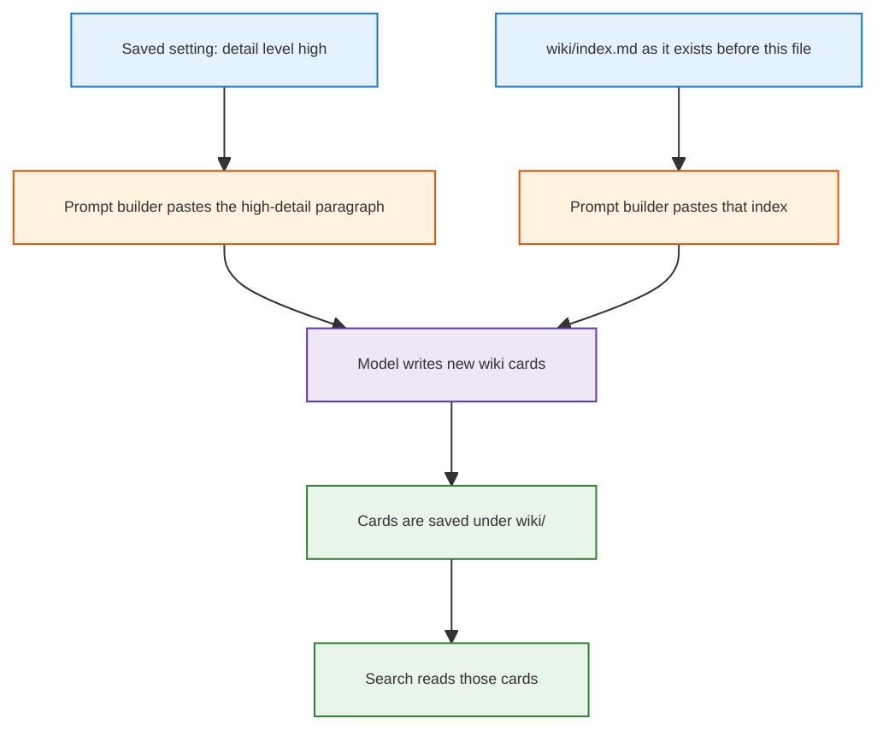
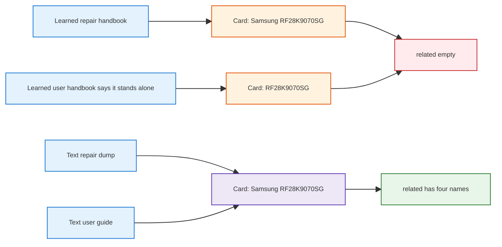
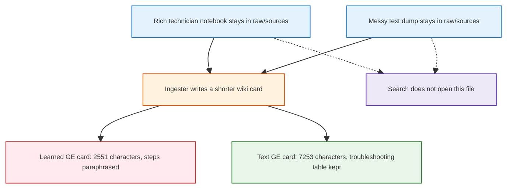

<h1 id="doc-title" style="color:#0d47a1;font-size:1.5em;font-weight:700;border-bottom:2px solid #90caf9;padding-bottom:0.25em;margin-top:0">Why the learned manuals look thinner, and what search can see</h1>

Two fridge projects were ingested at high detail. The learned project started from a careful technician handbook. The text project started from a flat copy of the PDF words. The handbook is the richer document. The wiki cards and the customer search do not read that handbook. They read the shorter cards the ingester wrote.

<h2 id="outline" style="color:#1565c0;font-size:1.22em;font-weight:650;border-left:4px solid #42a5f5;padding-left:10px;margin-top:1.1em">Document outline</h2>

1. [Short answers](#short-answers) — the two questions, in one place.
2. [Where the instructions live](#where-instructions) — the exact sentences, and the file that holds each one.
  2.1 [High detail](#high-detail) — put steps on the summary card.
  2.2 [Links only to cards already filed](#existing-only) — why a first pass can leave `related` empty.
  2.3 [A later file updates a card only when the title matches](#merge) — why the user guide did not repair the empty list.
3. [The Samsung pair, in plain language](#samsung-pair) — same model name, two different cards.
  3.1 [The company card](#samsung-company) — why `entities/samsung.md` differs.
4. [Why a better notebook becomes a thinner wiki](#summary-of-summary) — the clerk summarizes again.
5. [What a customer search looks at](#search) — `llm_wiki_search` reads wiki cards only.
6. [Which project is likelier to answer](#which-wins) — it depends on which fact survived on a card.
7. [What would make the learned wiki win](#remedy) — three changes, then re-ingest.

<h2 id="short-answers" style="color:#1565c0;font-size:1.22em;font-weight:650;border-left:4px solid #42a5f5;padding-left:10px;margin-top:1.1em">1. Short answers</h2>

**Why does the richer file show less?** The learned `.md` file stays in `raw/sources/`. Search never opens it. The ingester writes a new, shorter wiki card. When the input is already a tidy handbook, that second writing is a summary of a summary, and concrete lines (a voltage, a button hold, a page number) drop out. When the input is a messy text dump, the ingester has to lift a few concrete lines onto the card, so some facts survive there even though the dump itself is worse to read.

**Which search is better today?** `llm_wiki_search` searches the wiki cards, then can follow `related` links to neighboring cards. It does not search the raw handbook. On the cards that exist now, neither project wins every question. The text project can follow links. The learned project cannot. A fact that was paraphrased away on the card cannot be found, even when the raw handbook still has it. The 90-question fridge suite has not been run, so this is a reading of the pages and the search code, not a measured score.

<h2 id="where-instructions" style="color:#1565c0;font-size:1.22em;font-weight:650;border-left:4px solid #42a5f5;padding-left:10px;margin-top:1.1em">2. Where the instructions live</h2>

“Says” in the earlier note meant a sentence in the ingester’s prompt. The prompt is the written job description sent to the model with each file. Both projects used detail level **high**. That value is saved in LLM Wiki app state for both project ids. The sentences below are copied from the LLM Wiki source, not inferred.

<h3 id="high-detail" style="color:#00695c;font-size:1.05em;font-weight:600;margin-top:0.85em">2.1 High detail</h3>

File: `nu_llm_wiki/src/lib/ingest-detail-prompts.yaml`, level `high`, field `generation_instructions`. The prompt builder appends this block when the project’s detail level is high (`generationDetailPromptSection` in `ingest-detail-level.ts`).

> Prefer fewer standalone entity pages when the source is a service manual; put procedures, error codes, and steps on the source summary page.

In plain language: for a repair manual, write the steps on the one summary card for that file. Do not make a pile of little topic cards. The same paragraph also tells the model to copy error-code tables onto that summary card. The model may still make little cards. When it does, those cards are often one short paragraph, because the instruction spent the detail budget on the summary.

<h3 id="existing-only" style="color:#00695c;font-size:1.05em;font-weight:600;margin-top:0.85em">2.2 Links only to cards already filed</h3>

File: `nu_llm_wiki/src/lib/ingest.ts`.

The analysis prompt asks:

> What existing pages does this source relate to?

The writing prompt then says both of these:

> Keep other mentions as plain prose in the source summary, or as wikilinks only when the target already exists in the current wiki index.

> If the analysis found connections to existing pages, add cross-references.

“Existing” means already listed in `wiki/index.md` **before this file is ingested**. The index is pasted into the prompt at the start. Pages the model is inventing in this same answer are not in that index yet.

Picture a clerk and a card drawer.

- The drawer is the wiki index.
- The clerk may write several new cards from one manual in one sitting.
- The job description says: draw an arrow only to a card that is already in the drawer.
- Cards written in this same sitting are not in the drawer yet.
- So a first pass is *allowed* to leave `related` empty. The instruction does not *require* an empty list.
- There is no second automatic pass. A later file draws arrows only when the model writes them onto a card it is updating.

The text repair run did not obey the “already in the drawer” line. In that one sitting it created `samsung.md`, `samsung-rf28k9070sg.md`, and `samsung-smart-home.md`, and it filled `related` on `samsung.md` with the other two names. The learned repair run left `related: []` on the cards it created in its sitting. The learned user-guide run then updated `samsung.md` (both files are listed under `sources`) and still wrote `related: []`, even though the fridge card was already in the index. Nothing after the model deletes a filled list. The cleanup step only repairs a broken line such as `related: [[a]], [[b]]`. An empty list is valid, so it is saved.

<h3 id="merge" style="color:#00695c;font-size:1.05em;font-weight:600;margin-top:0.85em">2.3 A later file updates a card only when the title matches</h3>

File: `nu_llm_wiki/src/lib/sources-merge.ts`. When the ingester writes a page that **already exists**, it unions the old and new `sources`, `tags`, and `related` lists. Union means “keep every name that appears on either copy.” It does not look around the wiki and add missing names.

The writing prompt also says: reuse the exact title of an existing wiki page. A different title becomes a new card.

The learned user handbook says, in its own first paragraphs, that it was written from the user manual alone and that `RF28K9070SG` is a folder name. The ingester treated that as a different subject from “Samsung RF28K9070SG” and created `wiki/entities/rf28k9070sg.md`. The repair card was not opened again. Its empty `related` list had nothing to union with.

The text user guide does not draw that boundary. The second ingest wrote the same title, so merge kept the four names from the repair pass and added the user-guide file to `sources`.

<h2 id="samsung-pair" style="color:#1565c0;font-size:1.22em;font-weight:650;border-left:4px solid #42a5f5;padding-left:10px;margin-top:1.1em">3. The Samsung pair, in plain language</h2>

These two paths look like the same encyclopedia entry. They are two different writing events.

<table>
<thead>
<tr style="background:#1565c0;color:white"><th>What happened</th><th>Learned handbook</th><th>Text dump</th></tr>
</thead>
<tbody>
<tr>
<td style="background:#e3f2fd">Repair file ingested</td>
<td style="background:#fff3e0">New card <code>samsung-rf28k9070sg</code>. <code>related</code> left empty. Sibling cards created in the same sitting, also empty.</td>
<td style="background:#e8f5e9">New card <code>samsung-rf28k9070sg</code>. <code>related</code> filled with samsung, fast-track troubleshooting, diagnostic mode, error codes.</td>
</tr>
<tr>
<td style="background:#e3f2fd">User-guide file ingested</td>
<td style="background:#fff3e0">New card <code>rf28k9070sg</code>. Repair card left untouched.</td>
<td style="background:#e8f5e9">Same card updated. The four names kept. User-guide file added to <code>sources</code>.</td>
</tr>
<tr>
<td style="background:#e3f2fd">What search can follow</td>
<td style="background:#fff3e0">No arrow from the model card to error codes.</td>
<td style="background:#e8f5e9">Arrows among the model card and those four neighbors.</td>
</tr>
</tbody>
</table>

<h3 id="samsung-company" style="color:#00695c;font-size:1.05em;font-weight:600;margin-top:0.85em">3.1 The company card</h3>

`wiki/entities/samsung.md` is the clearest counterexample to “the arrows wait for a later file.”

The ingest cache records which cards each file wrote. The text repair file wrote `samsung.md`, `samsung-rf28k9070sg.md`, and `samsung-smart-home.md` in one sitting. `samsung.md` lists only `repair-guide.txt` under `sources`, and its `related` line already names the other two cards. The later user-guide ingest did not open `samsung.md` again. The arrows were drawn before any later file existed.

The learned repair file wrote `samsung.md` in one sitting with `samsung-rf28k9070sg.md`, `error-codes.md`, and `diagnostic-modes.md`, and left `related` empty. The learned user-guide file wrote `samsung.md` again. `sources` now lists both handbooks, which is how we know the second sitting updated this card. `related` is still `[]`. By then `samsung-rf28k9070sg` was already in the index. The model described the link in the paragraph (“manufacturer of the RF28K9070SG”) and did not put the name in the arrow field.

Same prompt. No code branch treats `.md` and `.txt` differently here. The text dump has a separate block titled “Samsung Smart Home - Troubleshooting,” so the model made a card for that app and pointed the company card at it. The learned handbook is one essay: the company, the fridge, and the error codes are sections of that essay, and the model kept the connection in the sentences.

<h2 id="summary-of-summary" style="color:#1565c0;font-size:1.22em;font-weight:650;border-left:4px solid #42a5f5;padding-left:10px;margin-top:1.1em">4. Why a better notebook becomes a thinner wiki</h2>

Think of three piles, not one.

1. **The notebook** in `raw/sources/`. The learned GE handbook is 43,757 characters, with temperatures, the Sabbath-mode hold, and the XWFE filter steps. The text dump of that same manual is 116,674 characters of PDF words run together.
2. **The wiki card** in `wiki/sources/`. The ingester always writes a new card. It does not file the notebook into the search catalog.
3. **The little topic cards** in `wiki/entities/` and `wiki/concepts/`. Optional. High detail asks for fewer of them on a service manual.

A tidy notebook already reads like an article. The model’s habit is to shorten an article. The second shortening drops numbers. A messy dump does not read like an article, so the model pulls out rows and lists. Some of those rows land on the card. That is why the worse source can produce the more useful card.

It is not true of every file. On the Samsung repair **summary card**, the learned side kept a real table (error 1, freezer sensor, CN30 pins 1–3, 4.5–1.0 V). The text side kept “over 100K ohm is OPEN” and then a table that stops at “…” inside a code fence. The learned **model card** is still the empty-relation stub. Richness moved to one card and disappeared from the others.

<table>
<thead>
<tr style="background:#1565c0;color:white"><th>Manual</th><th>Learned wiki card</th><th>Text wiki card</th></tr>
</thead>
<tbody>
<tr><td style="background:#e3f2fd">GE user guide</td><td style="background:#ffebee">2,551 characters. Steps described, not copied.</td><td style="background:#e8f5e9">7,253 characters. Troubleshooting table kept.</td></tr>
<tr><td style="background:#e3f2fd">KitchenAid user guide</td><td style="background:#fff3e0">2,438 characters</td><td style="background:#fff3e0">2,906 characters</td></tr>
<tr><td style="background:#e3f2fd">Samsung repair guide</td><td style="background:#e8f5e9">2,785 characters. Pins and volts for errors 1, 2, 4, 5.</td><td style="background:#fff3e0">3,750 characters. Resistance rule kept. Error table truncated.</td></tr>
<tr><td style="background:#e3f2fd">Samsung user guide</td><td style="background:#e8f5e9">1,852 characters</td><td style="background:#fff3e0">1,738 characters</td></tr>
</tbody>
</table>

<h2 id="search" style="color:#1565c0;font-size:1.22em;font-weight:650;border-left:4px solid #42a5f5;padding-left:10px;margin-top:1.1em">5. What a customer search looks at</h2>

`llm_wiki_search` is the desktop search used by the manual-answer path (`scripts/retail/retail_brain/answer_manuals.py` calls `POST …/search`). The implementation is `search_project_inner` in `nu_llm_wiki/src-tauri/src/commands/search.rs`.

It walks `wiki/**/*.md` only. A page under `raw/sources/` is never opened. Embeddings are built from those same wiki pages (`embed_wiki_page` refuses anything outside `wiki/`). Index, log, and overview are not embedded.

Each query uses three signals:

1. **Word overlap** with the card text.
2. **Meaning overlap** with the embedded chunks of the card text.
3. **Neighbor cards**, from `related:` and from `[[wikilinks]]` in the body (`extract_graph_links`).

If the voltage is only in the raw handbook, all three miss it. If `related` is empty and the body has no wikilink, signal 3 has nothing to follow. The learned model card is in that state. The text model card is not.

<h2 id="which-wins" style="color:#1565c0;font-size:1.22em;font-weight:650;border-left:4px solid #42a5f5;padding-left:10px;margin-top:1.1em">6. Which project is likelier to answer</h2>

Expectation “the learned handbook should hit more often” is right about the **notebook** and wrong about the **catalog search reads**.

<table>
<thead>
<tr style="background:#1565c0;color:white"><th>Customer question, as a sketch</th><th>Where the fact still is</th><th>Who search can hit</th></tr>
</thead>
<tbody>
<tr>
<td style="background:#e3f2fd">Freezer sensor error 1, what voltage on CN30?</td>
<td style="background:#e8f5e9">Learned repair <em>summary card</em> has pins 1–3 and 4.5–1.0 V. Text card’s table is cut off.</td>
<td style="background:#e8f5e9">Learned wiki</td>
</tr>
<tr>
<td style="background:#e3f2fd">Sensor over 100K ohm means open?</td>
<td style="background:#fff3e0">In the learned <em>notebook</em>, and on the text <em>summary card</em>. Absent from the learned wiki cards checked.</td>
<td style="background:#e8f5e9">Text wiki. Learned search misses it.</td>
</tr>
<tr>
<td style="background:#e3f2fd">GE fridge does not run. Defrost cycle. What do I do?</td>
<td style="background:#e8f5e9">Text GE summary card has the troubleshooting table. Learned GE card only says a table exists.</td>
<td style="background:#e8f5e9">Text wiki</td>
</tr>
<tr>
<td style="background:#e3f2fd">After finding the model, also open error codes.</td>
<td style="background:#fff3e0">Text model card lists error-codes in <code>related</code>. Learned model card lists nothing.</td>
<td style="background:#e8f5e9">Text wiki, via the neighbor step</td>
</tr>
</tbody>
</table>

So: for a one-off question whose exact line survived on a learned summary card, learned can win that question. Across a mixed customer queue, the text wiki is the safer catalog **today**, because more concrete rows survived and the neighbor step works. The learned notebook would be the better catalog if search read `raw/sources/`. It does not.

This is not a substitute for the fridge question suite. That run would count hits. This note only says what the cards and the search code make possible.

<h2 id="remedy" style="color:#1565c0;font-size:1.22em;font-weight:650;border-left:4px solid #42a5f5;padding-left:10px;margin-top:1.1em">7. What would make the learned wiki win</h2>

1. Change the writing prompt so cards created in the same sitting must name each other in `related`. Waiting for a later file fails when the later file is a separate handbook that mints a new title.
2. In the project schema, say that `RF28K9070SG` and `Samsung RF28K9070SG` are one card. Keep “user manual and repair sheet are separate evidence” in the card body.
3. Re-ingest the learned Samsung files after those two lines exist. Re-ingesting with today’s prompt writes the same empty lists again.

Until the wiki cards keep the notebook’s numbers, pointing search at the learned project will not harvest the work that went into the handbooks.
