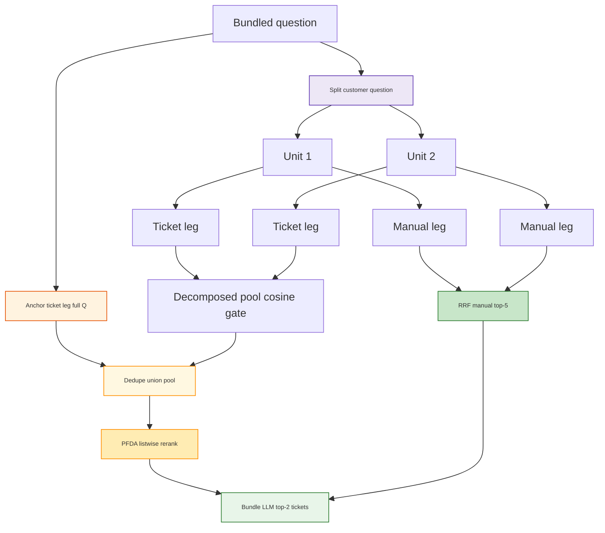

<h1 id="bnd-analysis-title" style="color:#0d47a1;font-size:1.5em;font-weight:700;border-bottom:2px solid #90caf9;padding-bottom:0.25em;margin-top:0">TEST_ANALYSIS — Bundled manual + ticket Q&amp;A (B20)</h1>

**Status:** **EVO-18 (M10)** operator matrix complete (**2026-10-28**). **Promoted manual stack:** `page_heading` + **`page_top5`** + manual **Tantivy**. **D7 v3 (PFDA):** canonical B20 after **resolved gold fix** — **`b20-evo18-d7-v3-goldfix-20261028`** **16/20** judge, strict top-2 **7/20**, six **3/6**. Prior **`b20-evo18-d7-v3-20261028`** used open **`expected_ticket_ids`** on 6 rows (invalid retrieval labels). PRE-T0: **`b20-brand-model-20261027`** **14/20**.

**Artifacts:** targeted `ops/runs/retail-bundled-qa/b20-customer-six-20261027/results.jsonl`; pre-rewrite full baseline `ops/runs/retail-bundled-qa/b20-brand-model-20261027/results.jsonl`.

<h2 id="bnd-analysis-outline" style="color:#1565c0;font-size:1.22em;font-weight:650;border-left:4px solid #42a5f5;padding-left:10px;margin-top:1.1em">Document outline</h2>

1. [Setup](#bnd-setup) — legs, k values, gold.
 1.1 [Manual leg source (Lane B)](#bnd-manual-source) — `brain/retail-md` + PG.
2. [Headline metrics](#bnd-headline) — **`b20-brand-model-20261027`** (canonical).
 2.1 [Run comparison](#bnd-compare) — fixed scope vs broken 20261026 run.
 2.2 [Natural-question gate](#bnd-natural-gate) — six rewritten prompts before a new full run.
3. [Per-row scoreboard](#bnd-rows) — all 20 ids (canonical run).
4. [Historical — manual leg empty](#bnd-root-cause) — SKU filter bug (**20261026** only).
 4.1 [Product scope contract (M9)](#bnd-uniform-metadata) — brand + OEM model.
5. [Failure drill-down](#bnd-failures) — six judge failures (**20261027**).
 5.1 [Summary table](#bnd-fail-six-summary) — all six rows.
 5.2 [Per-id detail tables](#bnd-fail-six-detail) — six Field/Content drill-downs (20261027).
 5.3 [Historical E01 & E02](#bnd-e01-e02) — empty manual leg (**20261026**).
6. [Interpretation](#bnd-interpret) — what failed and why.
7. [Reproduce](#bnd-repro) — operator commands.
8. [EVO-18 run-profile comparisons](#bnd-evo18) — matrix vs PRE-T0.
 8.1 [D2.page_pack semantics](#bnd-evo18-page-pack) — `global_top5` vs `page_top5`.
 8.2 [D7 vs ticket top-2](#bnd-evo18-d7-ticket) — why decomposition did not move 10/20.
 8.3 [EVO18-D7 v3 judge failures (4/20)](#bnd-evo18-d7-fail-five) — PFDA + per-leg hierarchy (expected gold ticket + manual).
 8.4 [EVO18-D7 v3 droptech (3 rows)](#bnd-evo18-d7-droptech) — remove technician phrasing; slice rerun.

---

<h2 id="bnd-setup" style="color:#1565c0;font-size:1.22em;font-weight:650;border-left:4px solid #42a5f5;padding-left:10px;margin-top:1.1em">1. Setup</h2>

| Knob | Value |
|------|--------|
| **Gold** | `tests/retail_multi_profiles/data/retail-bundled-qa-b20.json` (10 easy + 10 hard) |
| **k_manuals / k_tickets** | **5 / 2** (`config/brain-stack.example.yaml` → `second_brain.retail_evidence`) |
| **Manual leg profile** | `MANUAL_B_RAW_PG_HYBRID` (Postgres hybrid RRF, **D5 rerank off**) |
| **Manual corpus (D2)** | **Lane B** — [`brain/retail-md`](../../../brain/retail-md), glob `raw/sources/fridge-docs_md/**/*.md` (external Markdown, not LLM Wiki pages) |
| **Manual index** | Postgres `manual_chunks` with `lane_id = 'B'` (same ingest path as M90 Lane B raw RAG) |
| **Ticket leg** | Postgres, `RETAIL_TICKET_SEARCH_MODE=rrf_term_boosted` (ABC mode **C**) |
| **Assembly** | Fixed-k concat (`retail_brain.bundle_context`) |
| **Answer LLM** | OpenAI `gpt-4o-mini`, temperature **0** |
| **Judge** | Gemini `gemini-3.1-flash-lite`, temperature **0** |

---

<h2 id="bnd-manual-source" style="color:#1565c0;font-size:1.22em;font-weight:650;border-left:4px solid #42a5f5;padding-left:10px;margin-top:1.1em">1.1 Manual leg source (Lane B)</h2>

**Yes — the bundled harness targets Lane B (`brain/retail-md`), not wiki/`brain/retail` Lane A.**

<table>
<thead>
<tr style="background:#1565c0;color:white"><th>Layer</th><th>Value</th></tr>
</thead>
<tbody>
<tr><td style="background:#e3f2fd">Ingest lane</td><td><strong>B</strong> per [`config/retail-ingest-lanes.yaml`](../../../config/retail-ingest-lanes.yaml)</td></tr>
<tr><td style="background:#e3f2fd">Project path</td><td><code>brain/retail-md</code></td></tr>
<tr><td style="background:#e3f2fd">Raw sources</td><td><code>raw/sources/fridge-docs_md/**/*.md</code></td></tr>
<tr><td style="background:#e3f2fd">Retrieval</td><td><code>ManualEvidenceRetriever</code> → PG vector + lexical RRF (<code>MANUAL_B_RAW_PG_HYBRID</code>)</td></tr>
<tr><td style="background:#e3f2fd">Not used</td><td>LLM Wiki HTTP, Lane C/D txt/learned, or ticket index</td></tr>
</tbody>
</table>

<h3 id="bnd-natural-gate" style="color:#00695c;font-size:1.05em;font-weight:600;margin-top:0.85em">2.2 Natural-question gate (post-rewrite)</h3>

Run: <code>b20-customer-six-20261027</code>. The six prompts no longer reveal the answer or refer to retrieval artifacts such as past/similar cases or what a guide “says.” The retrieval pipeline completed normally, but all six remained judge failures; per the aligned gate, the full 20 was not rerun.

| Check | Result |
|-------|--------|
| Judge pass | **0 / 6** |
| Expected ticket id in top-2 | **0 / 6** |
| Manual leg non-empty | **6 / 6** (5 chunks each) |
| Main finding | Natural wording changed which similar tickets ranked, but did not recover the labeled ids or the missing manual numeric/procedure facts. |

---

<h2 id="bnd-headline" style="color:#1565c0;font-size:1.22em;font-weight:650;border-left:4px solid #42a5f5;padding-left:10px;margin-top:1.1em">2. Headline metrics</h2>

**Canonical run:** `b20-brand-model-20261027` · Artifacts: `ops/runs/retail-bundled-qa/b20-brand-model-20261027/results.jsonl`

<table>
<thead>
<tr style="background:#1565c0;color:white"><th>Metric</th><th>All 20</th><th>Easy (10)</th><th>Hard (10)</th></tr>
</thead>
<tbody>
<tr><td style="background:#e3f2fd">Judge pass (answer vs gold)</td><td style="background:#e8f5e9"><strong>14 / 20 (70%)</strong></td><td style="background:#e8f5e9">8 / 10</td><td style="background:#fff3e0">6 / 10</td></tr>
<tr><td style="background:#e3f2fd">Expected ticket id in top-2 packet</td><td style="background:#fff3e0"><strong>10 / 20 (50%)</strong></td><td style="background:#e8f5e9">6 / 10</td><td style="background:#ffebee">4 / 10</td></tr>
<tr><td style="background:#e3f2fd">Manual chunks in packet (non-empty leg)</td><td style="background:#e8f5e9"><strong>20 / 20</strong> (always 5)</td><td>10 / 10</td><td>10 / 10</td></tr>
<tr><td style="background:#e3f2fd">Mean manual retrieve ms</td><td colspan="3"><strong>491</strong> ms (PG hybrid, brand+OEM filter)</td></tr>
<tr><td style="background:#e3f2fd">Mean answer LLM ms</td><td colspan="3"><strong>1,647</strong> ms</td></tr>
<tr><td style="background:#e3f2fd">Mean judge ms</td><td colspan="3"><strong>1,632</strong> ms</td></tr>
<tr><td style="background:#e3f2fd">Wall clock (operator log)</td><td colspan="3">~100 s for 20 rows</td></tr>
</tbody>
</table>

**Notable passes without gold ticket in top-2:** `BND-H01`, `BND-H03`, `BND-E07`, `BND-E10` — manual + wrong/similar tickets still judged OK when excerpts carried gold facts.

<h3 id="bnd-compare" style="color:#00695c;font-size:1.05em;font-weight:600;margin-top:0.85em">2.1 Run comparison</h3>

<table>
<thead>
<tr style="background:#1565c0;color:white"><th>Metric</th><th><code>b20-brand-model-20261027</code></th><th><code>b20-full-20261026</code> (buggy filter)</th></tr>
</thead>
<tbody>
<tr><td style="background:#e3f2fd">Product filter</td><td style="background:#e8f5e9">M9 <code>brand</code> + <code>oem_model</code></td><td style="background:#ffebee">Bare OEM as <code>model_id</code></td></tr>
<tr><td style="background:#e3f2fd">Judge pass</td><td style="background:#e8f5e9"><strong>14 / 20</strong></td><td style="background:#ffebee">2 / 20</td></tr>
<tr><td style="background:#e3f2fd">Ticket-in-packet</td><td>10 / 20</td><td>10 / 20</td></tr>
<tr><td style="background:#e3f2fd">Empty manual leg</td><td style="background:#e8f5e9"><strong>0 / 20</strong></td><td style="background:#ffebee">~18 / 20</td></tr>
</tbody>
</table>

---

<h2 id="bnd-rows" style="color:#1565c0;font-size:1.22em;font-weight:650;border-left:4px solid #42a5f5;padding-left:10px;margin-top:1.1em">3. Per-row scoreboard</h2>

Source: **`b20-brand-model-20261027`** · Full payloads in `results.jsonl` (`candidate_answer`, `manual_leg_context`, `ticket_leg_context`).

<table>
<thead>
<tr style="background:#1565c0;color:white"><th>Id</th><th>Diff</th><th>Judge</th><th>Ticket in packet</th><th>Manual k</th><th>Notes (20261027)</th></tr>
</thead>
<tbody>
<tr><td>BND-E01</td><td>easy</td><td style="background:#e8f5e9">pass</td><td style="background:#e8f5e9">yes</td><td>5</td><td>Display board + door alarm 2 min</td></tr>
<tr><td>BND-E02</td><td>easy</td><td style="background:#e8f5e9">pass</td><td style="background:#e8f5e9">yes</td><td>5</td><td>Air damper + factory presets</td></tr>
<tr><td>BND-E03</td><td>easy</td><td style="background:#ffebee">fail</td><td style="background:#ffebee">no</td><td>5</td><td>Wrong tickets; filter-only answer — [§5.2](#bnd-fail-six-detail)</td></tr>
<tr><td>BND-E04</td><td>easy</td><td style="background:#e8f5e9">pass</td><td style="background:#e8f5e9">yes</td><td>5</td><td>Fill-tube heater + 35–120 psi</td></tr>
<tr><td>BND-E05</td><td>easy</td><td style="background:#e8f5e9">pass</td><td style="background:#e8f5e9">yes</td><td>5</td><td>Auger + outlet spec</td></tr>
<tr><td>BND-E06</td><td>easy</td><td style="background:#e8f5e9">pass</td><td style="background:#e8f5e9">yes</td><td>5</td><td>Hinge cams + 6 mo filter</td></tr>
<tr><td>BND-E07</td><td>easy</td><td style="background:#e8f5e9">pass</td><td style="background:#ffebee">no</td><td>5</td><td>Heater wire + freezer temps (judge OK w/o gold ticket)</td></tr>
<tr><td>BND-E08</td><td>easy</td><td style="background:#ffebee">fail</td><td style="background:#ffebee">no</td><td>5</td><td>Wrong ambient range 34–44°F — [§5.2](#bnd-fail-six-detail)</td></tr>
<tr><td>BND-E09</td><td>easy</td><td style="background:#e8f5e9">pass</td><td style="background:#e8f5e9">yes</td><td>5</td><td>Air damper + Control Lock 3 s</td></tr>
<tr><td>BND-E10</td><td>easy</td><td style="background:#e8f5e9">pass</td><td style="background:#ffebee">no</td><td>5</td><td>Start relay + door alarm (judge OK w/o gold ticket)</td></tr>
<tr><td>BND-H01</td><td>hard</td><td style="background:#e8f5e9">pass</td><td style="background:#ffebee">no</td><td>5</td><td>Air damper + 12–24 h ice</td></tr>
<tr><td>BND-H02</td><td>hard</td><td style="background:#ffebee">fail</td><td style="background:#ffebee">no</td><td>5</td><td>20 psi vs gold 25–120 — [§5.2](#bnd-fail-six-detail)</td></tr>
<tr><td>BND-H03</td><td>hard</td><td style="background:#e8f5e9">pass</td><td style="background:#ffebee">no</td><td>5</td><td>Paraphrase OK without labeled ticket</td></tr>
<tr><td>BND-H04</td><td>hard</td><td style="background:#e8f5e9">pass</td><td style="background:#e8f5e9">yes</td><td>5</td><td>Fill-tube heater + ice maker off</td></tr>
<tr><td>BND-H05</td><td>hard</td><td style="background:#e8f5e9">pass</td><td style="background:#e8f5e9">yes</td><td>5</td><td>Hinge + filter interval</td></tr>
<tr><td>BND-H06</td><td>hard</td><td style="background:#e8f5e9">pass</td><td style="background:#e8f5e9">yes</td><td>5</td><td>Was fail on empty-manual run; now pass</td></tr>
<tr><td>BND-H07</td><td>hard</td><td style="background:#ffebee">fail</td><td style="background:#ffebee">no</td><td>5</td><td>Missing Power Freeze 3 s hold — [§5.2](#bnd-fail-six-detail)</td></tr>
<tr><td>BND-H08</td><td>hard</td><td style="background:#ffebee">fail</td><td style="background:#ffebee">no</td><td>5</td><td>Freezer button span not found — [§5.2](#bnd-fail-six-detail)</td></tr>
<tr><td>BND-H09</td><td>hard</td><td style="background:#e8f5e9">pass</td><td style="background:#e8f5e9">yes</td><td>5</td><td>FlexZone / soft-freeze</td></tr>
<tr><td>BND-H10</td><td>hard</td><td style="background:#ffebee">fail</td><td style="background:#ffebee">no</td><td>5</td><td>Room temp 3°F nonsense — [§5.2](#bnd-fail-six-detail)</td></tr>
</tbody>
</table>

---

<h2 id="bnd-root-cause" style="color:#1565c0;font-size:1.22em;font-weight:650;border-left:4px solid #42a5f5;padding-left:10px;margin-top:1.1em">4. Historical — manual leg empty on most rows (20261026)</h2>

Run **`b20-full-20261026`** passed B20’s bare ticket SKU (e.g. <code>GNE27JYMFS</code>) into PG retrieval as <code>model_id</code>. Indexed Lane B chunks use **folder ids** (e.g. <code>ge_GNE27JYMFS</code>). The filter matched **zero rows**, so the manual leg context was **empty** even though hybrid search returned in ~200 ms.

| B20 JSON field | Example | PG `manual_chunks.model_id` |
|----------------|---------|----------------------------|
| <code>model</code> | <code>GNE27JYMFS</code> | <code>ge_GNE27JYMFS</code> |

M90 avoids this: suite rows use <code>ge_GNE27JYMFS</code>, and the harness calls <code>resolve_retrieval_sku</code> + company profile mapping. **Code fix:** all legs should use <code>retail_brain.product_scope.resolve_product_scope</code> (see [§4.1](#bnd-uniform-metadata)).

**Impact:** Ticket leg often worked; answer LLM saw **tickets only** → judge failures on manual half and inflated “Insufficient_Information” rates. **Re-run B20** after the fix before trusting headline metrics.

---

<h2 id="bnd-uniform-metadata" style="color:#1565c0;font-size:1.22em;font-weight:650;border-left:4px solid #42a5f5;padding-left:10px;margin-top:1.1em">4.1 Uniform product metadata (best practice)</h2>

<h3 id="bnd-industry" style="color:#00695c;font-size:1.05em;font-weight:600;margin-top:0.85em">What production RAG systems do (2024–2026)</h3>

Vector and hybrid search stacks (OpenSearch kNN, pgvector, Qdrant, Weaviate, Pinecone, etc.) treat **metadata filtering** as first-class: every chunk/document carries **stable, filterable attributes** (tenant, product, locale, doc type). At **query time**, one normalized scope object drives filters on **all** retrievers — not different string conventions per index.

Typical pattern:

1. **Canonical entity id** on every indexed row (your case: <code>catalog_sku = ge_GNE27JYMFS</code>).
2. **Secondary aliases** where the source system uses another code (tickets: OEM <code>GNE27JYMFS</code> on <code>service_queries.model</code>).
3. **Resolve once** at the API/harness boundary; log the resolved scope on every answer/evidence payload.
4. **Optional:** duplicate <code>catalog_sku</code> onto ticket rows at ingest so both legs filter the same metadata key long term.

<h3 id="bnd-repo-contract" style="color:#00695c;font-size:1.05em;font-weight:600;margin-top:0.85em">This repo — exact contract</h3>

<table>
<thead>
<tr style="background:#1565c0;color:white"><th>Field</th><th>Format</th><th>Used by</th></tr>
</thead>
<tbody>
<tr><td style="background:#e3f2fd"><strong><code>catalog_sku</code></strong></td><td><code>ge_GNE27JYMFS</code>, <code>kitchenaid_KRFF507HPS</code>, …</td><td>Manual PG <code>manual_chunks.model_id</code>, raw paths, M90/B20 gold, ingest lanes</td></tr>
<tr><td style="background:#e3f2fd"><strong><code>oem_model</code></strong></td><td><code>GNE27JYMFS</code> (manufacturer model code)</td><td>Ticket Postgres <code>service_queries.model</code>, customer query text</td></tr>
<tr><td style="background:#e3f2fd"><strong><code>lane_id</code></strong></td><td><code>B</code> (manual only)</td><td>Which corpus (<code>brain/retail-md</code>)</td></tr>
</tbody>
</table>

**Single entry point (M9):** <code>scripts/retail/retail_brain/product_scope.py</code> → <code>resolve_product_scope(…)</code> returns <code>ProductScope</code> with:

- <code>.manual_filter</code> / <code>.ticket_filter</code> → <strong>brand + OEM model</strong> (same pair on both legs)  
- <code>.ingest_key</code> → folder slug (e.g. <code>ge_GNE27JYMFS</code>) for lineage only  
- <code>.to_metadata()</code> → JSON on every harness/bundle row  

**Catalog helpers** live in <code>retail_brain/sku_scope.py</code> (moved out of tests); <code>resolve_retrieval_sku</code> now accepts suite hints in **either** catalog or OEM form (<code>suite_oem_fallback</code>).

<h3 id="bnd-gold-fixtures" style="color:#00695c;font-size:1.05em;font-weight:600;margin-top:0.85em">Gold fixtures — naming</h3>

| Today (B20) | Recommended |
|-------------|-------------|
| <code>"model": "GNE27JYMFS"</code> | <code>"catalog_sku": "ge_GNE27JYMFS"</code> plus optional <code>"oem_model": "GNE27JYMFS"</code> |

Until B20 JSON is migrated, <code>resolve_product_scope</code> maps bare suite <code>model</code> via <code>fru_us_service.yaml</code>. New suites should **author catalog_sku only** in the canonical form.

<h3 id="bnd-future-ingest" style="color:#00695c;font-size:1.05em;font-weight:600;margin-top:0.85em">Future ingest (optional hardening)</h3>

- Add <code>catalog_sku</code> column on <code>service_queries</code> (denormalized from <code>model</code> at load time).  
- Store both fields in Tantivy/lexical ticket index metadata.  
- Manual chunks already use <code>model_id = catalog_sku</code> — keep that name or rename column to <code>catalog_sku</code> in a later migration for clarity.

---

<h2 id="bnd-failures" style="color:#1565c0;font-size:1.22em;font-weight:650;border-left:4px solid #42a5f5;padding-left:10px;margin-top:1.1em">5. Failure drill-down — six judge failures (20261027)</h2>

Current six-row evidence: <code>b20-customer-six-20261027</code>. Every row received **5 manual chunks**, but only **BND-E03** received the expected manual page/fact. The other five are manual top-5 retrieval misses. All six missed the strict labeled ticket id, although five packets contained another ticket with the same resolution.

<h3 id="bnd-fail-six-summary" style="color:#00695c;font-size:1.05em;font-weight:600;margin-top:0.85em">5.1 Summary table</h3>

<table>
<thead>
<tr style="background:#1565c0;color:white"><th>Id</th><th>Gold ticket</th><th>Top-2 tickets (current run)</th><th>Expected manual</th><th>Diagnostic full-pool rank</th></tr>
</thead>
<tbody>
<tr><td style="background:#e3f2fd">BND-E03</td><td>T-0042-100043</td><td>T-0042-100931, T-0042-100382</td><td>GE user guide p.14 — XWFE housing</td><td style="background:#e8f5e9"><strong>2</strong> (in packet)</td></tr>
<tr><td style="background:#e3f2fd">BND-E08</td><td>T-0042-100004</td><td>T-0042-100825, T-0042-100980</td><td>Samsung user guide p.27 — 50–110°F ambient</td><td style="background:#ffebee"><strong>49</strong></td></tr>
<tr><td style="background:#e3f2fd">BND-H02</td><td>T-0042-100017</td><td>T-0042-100383, T-0042-100426</td><td>GE user guide p.20 — 25–120 psi</td><td style="background:#ffebee"><strong>17</strong></td></tr>
<tr><td style="background:#e3f2fd">BND-H07</td><td>T-0042-100002</td><td>T-0042-100482, T-0042-100738</td><td>Samsung user guide p.37 — hold Freezer 3 sec</td><td style="background:#ffebee"><strong>22</strong></td></tr>
<tr><td style="background:#e3f2fd">BND-H08</td><td>T-0042-100004</td><td>T-0042-100422, T-0042-100783</td><td>Samsung user guide p.37 — 5°F to −8°F</td><td style="background:#ffebee"><strong>23</strong></td></tr>
<tr><td style="background:#e3f2fd">BND-H10</td><td>T-0042-100010</td><td>T-0042-100176, T-0042-100777</td><td>Samsung user guide p.27 — 50–110°F ambient</td><td style="background:#ffebee"><strong>45</strong></td></tr>
</tbody>
</table>

<h3 id="bnd-fail-six-detail" style="color:#00695c;font-size:1.05em;font-weight:600;margin-top:0.85em">5.2 Per-id detail tables</h3>

Evidence from current run <code>b20-customer-six-20261027</code>. Manual leg: **5 chunks**, filter <strong>brand + OEM model</strong> (M9). Full verbatim context: <code>ops/runs/retail-bundled-qa/b20-customer-six-20261027/results.jsonl</code>.

<h4 id="bnd-fail-e03" style="color:#00695c;font-size:1em;font-weight:600;margin-top:0.75em">5.2.1 BND-E03</h4>

<table>
<thead>
<tr style="background:#1565c0;color:white"><th>Field</th><th>Content</th></tr>
</thead>
<tbody>
<tr><td style="background:#e3f2fd"><strong>Question</strong> (current full text)</td><td>My GNE27JYMFS keeps freezing the ice cubes into one solid clump, and the food sometimes feels warm even though the app reports normal temperatures. What should a technician check or repair to stop this, and where is the XWFE filter housing located?</td></tr>
<tr><td style="background:#e3f2fd"><strong>Gold / expected answer</strong></td><td>The repair adjusted the freezer temperature and replaced the bin auger seal. The XWFE filter housing is in the back upper-right corner of the refrigerator compartment.</td></tr>
<tr><td style="background:#fff8e1"><strong>Expected ticket</strong> (gold label — <em>not in top-2 packet</em>)</td><td><strong>T-0042-100043</strong> · issue <code>ice_clumping</code> · FRU-E118<br><br><strong>Customer:</strong> Intake: GNE27JYMFS owner in Long Beach, CA — ice cubes clumping together in the bin. Smart app shows normal temps but food feels warm. Ticket context #43: no power blinks. Technician later confirmed FRU-E118 in the service log.<br><br><strong>Resolution:</strong> Adjusted freezer temperature and replaced bin auger seal.</td></tr>
<tr><td style="background:#e3f2fd"><strong>Historical ticket leg</strong> (top 2 retrieved, mode C)</td><td><strong>T-0042-100931</strong> (rank 1) — ice maker stopped producing cubes; <em>cleared jammed auger and reset ice-maker module.</em><br><br><strong>T-0042-100382</strong> (rank 2) — water leaking from ice-maker housing; <em>replaced fill-tube heater and tightened inlet valve.</em></td></tr>
<tr><td style="background:#fff8e1"><strong>Expected manual evidence</strong></td><td><strong>Anchor:</strong> <code>ge_GNE27JYMFS-E03</code><br><strong>Manual:</strong> <code>fridge-docs/ge_GNE27JYMFS/user-guide.pdf</code> · printed/PDF page <strong>14</strong><br><strong>Lane B source:</strong> <code>brain/retail-md/raw/sources/fridge-docs_md/ge_GNE27JYMFS/user-guide.md</code>, heading <code>PDF page 14</code><br><strong>Expected fact:</strong> “The water filter cartridge holder is located in the back upper-right corner of the refrigerator compartment.”</td></tr>
<tr><td style="background:#e8f5e9"><strong>Retrieved manual leg</strong> (Lane B PG)</td><td><strong>5 chunks</strong>. The expected page-14 XWFE passage <strong>was in the packet</strong>; the model correctly returned the location. Filter: <code>GE</code> + <code>GNE27JYMFS</code>.</td></tr>
<tr><td style="background:#e3f2fd"><strong>Verbatim model answer</strong> (<code>b20-customer-six-20261027</code>)</td><td>To address the issue of your GNE27JYMFS freezing ice cubes into a solid clump and the food feeling warm despite normal app temperature readings, a technician should check the following:<br><br>1. <strong>Ice Maker Module</strong>: The technician should clear any jammed auger and reset the ice maker module, as this has been a resolution in past tickets for similar issues.<br><br>2. <strong>Temperature Settings</strong>: Ensure that the refrigerator control is set to an appropriate temperature. If it is set too cold, it may cause food to feel warm and ice to freeze improperly.<br><br>3. <strong>Air Flow</strong>: Check if food is too close to the air vent at the back of the refrigerator, as this can affect cooling efficiency.<br><br>4. <strong>Water Filter</strong>: If the water filter is clogged, it may affect ice production. The technician should verify the condition of the XWFE filter and replace it if necessary.<br><br>The XWFE filter housing is located in the back upper-right corner of the refrigerator compartment.</td></tr>
<tr><td style="background:#fff3e0"><strong>Judge</strong></td><td>Fail — speculative troubleshooting not supported by the gold answer; it did not cleanly give the auger-seal/freezer-setpoint repair.</td></tr>
</tbody>
</table>

<h4 id="bnd-fail-e08" style="color:#00695c;font-size:1em;font-weight:600;margin-top:0.75em">5.2.2 BND-E08</h4>

<table>
<thead>
<tr style="background:#1565c0;color:white"><th>Field</th><th>Content</th></tr>
</thead>
<tbody>
<tr><td style="background:#e3f2fd"><strong>Question</strong> (current full text)</td><td>The water dispenser on my RF28K9070SG has slowed to a trickle and the display showed FRU-E103. What should a technician check or replace, and what room-temperature range is safe for operating the refrigerator?</td></tr>
<tr><td style="background:#e3f2fd"><strong>Gold / expected answer</strong></td><td>The case replaced a clogged inline filter and flushed the water line. The allowed room temperature is 50–110°F (10–43°C).</td></tr>
<tr><td style="background:#fff8e1"><strong>Expected ticket</strong> (gold label — <em>not in top-2 packet</em>)</td><td><strong>T-0042-100004</strong> · FRU-E103 on service menu<br><br><strong>Customer:</strong> RF28K9070SG water dispenser runs very slowly (Virginia Beach Store). Kids leave door open sometimes. Ticket context #4. Display showed FRU-E103.<br><br><strong>Resolution:</strong> Replaced clogged inline filter and flushed water line.</td></tr>
<tr><td style="background:#e3f2fd"><strong>Historical ticket leg</strong> (top 2 retrieved, mode C)</td><td><strong>T-0042-100825</strong> (rank 1) — slow dispenser, Raleigh, FRU-E513 — <em>same inline-filter + flush resolution as gold.</em><br><strong>T-0042-100980</strong> (rank 2) — slow dispenser, Raleigh, FRU-E591 — <em>same resolution as gold.</em></td></tr>
<tr><td style="background:#fff8e1"><strong>Expected manual evidence</strong></td><td><strong>Anchor:</strong> <code>samsung_RF28K9070SG-E01</code><br><strong>Manual:</strong> <code>fridge-docs/samsung_RF28K9070SG/user-guide.pdf</code> · printed/PDF page <strong>27</strong><br><strong>Lane B source:</strong> <code>brain/retail-md/raw/sources/fridge-docs_md/samsung_RF28K9070SG/user-guide.md</code>, heading <code>PDF page 27</code><br><strong>Expected fact:</strong> Site temperature must be <strong>50–110°F (10–43°C)</strong>.</td></tr>
<tr><td style="background:#ffebee"><strong>Retrieved manual leg</strong> (Lane B PG)</td><td><strong>5 chunks</strong>, but expected page 27 / <strong>50–110°F</strong> passage was <strong>not in the packet</strong>. Retrieved text instead led toward the refrigerator setpoint band; manual retrieval miss.</td></tr>
<tr><td style="background:#e3f2fd"><strong>Verbatim model answer</strong> (<code>b20-customer-six-20261027</code>)</td><td>To address the issue of the water dispenser on your RF28K9070SG slowing to a trickle and displaying FRU-E103, a technician should check and potentially replace the clogged inline filter and flush the water line, as indicated in past tickets where similar issues were resolved.<br><br>Regarding the safe operating conditions for the refrigerator, the manual does not specify an exact room-temperature range. However, it does mention that if the ambient room temperature is too low, it can affect the refrigerator's performance. Therefore, it is advisable to ensure that the refrigerator is not exposed to excessively low temperatures to maintain optimal functionality.<br><br>In summary, the technician should:<br>1. Check and replace the clogged inline filter.<br>2. Flush the water line.<br>3. Ensure the refrigerator is in a suitable ambient temperature environment.</td></tr>
<tr><td style="background:#fff3e0"><strong>Judge</strong></td><td>Fail — omitted the required <strong>50–110°F</strong> operating range and incorrectly said no exact range was available.</td></tr>
</tbody>
</table>

<h4 id="bnd-fail-h02" style="color:#00695c;font-size:1em;font-weight:600;margin-top:0.75em">5.2.3 BND-H02</h4>

<table>
<thead>
<tr style="background:#1565c0;color:white"><th>Field</th><th>Content</th></tr>
</thead>
<tbody>
<tr><td style="background:#e3f2fd"><strong>Question</strong> (current full text)</td><td>The door display on my GNE27JYMFS no longer responds when I press it. What component should a technician reset or repair, and what cold-water pressure does the ice maker need?</td></tr>
<tr><td style="background:#e3f2fd"><strong>Gold / expected answer</strong></td><td>They power-cycled the display board and updated firmware. The cold-water line should supply 25–120 psi (172–827 kPa).</td></tr>
<tr><td style="background:#fff8e1"><strong>Expected ticket</strong> (gold label — <em>not in top-2 packet</em>)</td><td><strong>T-0042-100017</strong> · FRU-E108 (owner photo)<br><br><strong>Customer:</strong> GNE27JYMFS touch panel unresponsive (Omaha Store). Ticket context #17: extended warranty.<br><br><strong>Resolution:</strong> Power-cycled display board and updated firmware.</td></tr>
<tr><td style="background:#e3f2fd"><strong>Historical ticket leg</strong> (top 2 retrieved, mode C)</td><td><strong>T-0042-100383</strong> (rank 1) — ice-maker housing leak, Omaha, FRU-E293 — fill-tube heater resolution.<br><strong>T-0042-100426</strong> (rank 2) — touch panel unresponsive, Mesa, FRU-E317 — <em>power-cycled display board and updated firmware.</em></td></tr>
<tr><td style="background:#fff8e1"><strong>Expected manual evidence</strong></td><td><strong>Anchor:</strong> <code>ge_GNE27JYMFS-E05</code><br><strong>Manual:</strong> <code>fridge-docs/ge_GNE27JYMFS/user-guide.pdf</code> · printed/PDF page <strong>20</strong><br><strong>Lane B source:</strong> <code>brain/retail-md/raw/sources/fridge-docs_md/ge_GNE27JYMFS/user-guide.md</code>, heading <code>PDF page 20</code><br><strong>Expected fact:</strong> Automatic ice maker cold-water pressure must be <strong>25–120 psi (172–827 kPa)</strong>.</td></tr>
<tr><td style="background:#ffebee"><strong>Retrieved manual leg</strong> (Lane B PG)</td><td><strong>5 chunks</strong>, but expected page 20 pressure passage was <strong>not in the packet</strong>. Retrieved text mentioned low pressure generally; the model supplied an unsupported <strong>20–120 psi</strong>.</td></tr>
<tr><td style="background:#e3f2fd"><strong>Verbatim model answer</strong> (<code>b20-customer-six-20261027</code>)</td><td>To resolve the issue with the unresponsive door display on your GNE27JYMFS, a technician should power-cycle the display board and update the firmware, as indicated in past ticket T-0042-100426.<br><br>Regarding the ice maker, it requires a cold-water pressure of 20 to 120 psi to function properly, although this specific detail was not provided in the past tickets or manual excerpts.<br><br>Therefore, the technician should focus on resetting the display board and ensuring the water pressure is within the required range for the ice maker.</td></tr>
<tr><td style="background:#fff3e0"><strong>Judge</strong></td><td>Fail — display-board repair correct; pressure range wrong (gold: <strong>25–120 psi</strong>).</td></tr>
</tbody>
</table>

<h4 id="bnd-fail-h07" style="color:#00695c;font-size:1em;font-weight:600;margin-top:0.75em">5.2.4 BND-H07</h4>

<table>
<thead>
<tr style="background:#1565c0;color:white"><th>Field</th><th>Content</th></tr>
</thead>
<tbody>
<tr><td style="background:#e3f2fd"><strong>Question</strong> (current full text)</td><td>Puddles keep forming under the crisper drawers in my RF28K9070SG even though it is on a dedicated 20-amp circuit. What should a technician clear or repair, and how do I start Power Freeze?</td></tr>
<tr><td style="background:#e3f2fd"><strong>Gold / expected answer</strong></td><td>They cleared the defrost drain tube and installed a heater-wire kit. Press and hold Freezer for 3 seconds.</td></tr>
<tr><td style="background:#fff8e1"><strong>Expected ticket</strong> (gold label — <em>not in top-2 packet</em>)</td><td><strong>T-0042-100002</strong> · FRU-E101 · second visit · dedicated 20A<br><br><strong>Customer:</strong> RF28K9070SG water pooling under crisper drawers (Virginia Beach). Unit on dedicated 20A circuit. Ticket context #2: second visit. FRU-E101 in service log.<br><br><strong>Resolution:</strong> Cleared defrost drain tube and installed heater wire kit.</td></tr>
<tr><td style="background:#e3f2fd"><strong>Historical ticket leg</strong> (top 2 retrieved, mode C)</td><td><strong>T-0042-100482</strong> (rank 1) — pooling under crispers, Kansas City — <em>same drain + heater-kit resolution as gold.</em><br><strong>T-0042-100738</strong> (rank 2) — pooling under crispers, Kansas City — <em>same resolution as gold.</em></td></tr>
<tr><td style="background:#fff8e1"><strong>Expected manual evidence</strong></td><td><strong>Anchor:</strong> <code>samsung_RF28K9070SG-E03</code><br><strong>Manual:</strong> <code>fridge-docs/samsung_RF28K9070SG/user-guide.pdf</code> · printed/PDF page <strong>37</strong><br><strong>Lane B source:</strong> <code>brain/retail-md/raw/sources/fridge-docs_md/samsung_RF28K9070SG/user-guide.md</code>, heading <code>PDF page 37</code><br><strong>Expected fact:</strong> “To activate Power Freeze, press and hold Freezer for <strong>3 seconds</strong>.”</td></tr>
<tr><td style="background:#ffebee"><strong>Retrieved manual leg</strong> (Lane B PG)</td><td><strong>5 chunks</strong>, but expected page 37 Power Freeze passage was <strong>not in the packet</strong>. The model guessed “press” and omitted the hold duration; manual retrieval miss.</td></tr>
<tr><td style="background:#e3f2fd"><strong>Verbatim model answer</strong> (<code>b20-customer-six-20261027</code>)</td><td>To address the issue of water pooling under the crisper drawers in your RF28K9070SG, the technician should clear the defrost drain tube and install a heater wire kit, as indicated in previous resolved tickets.<br><br>To start Power Freeze, locate the feature panel on your refrigerator. Press the “Freezer / Power Freeze” button to activate the Power Freeze function. This will help in quickly freezing items in the freezer compartment.<br><br>If you encounter any further issues, ensure that the refrigerator is properly leveled and that the door closes securely to prevent condensation and pooling.</td></tr>
<tr><td style="background:#fff3e0"><strong>Judge</strong></td><td>Fail — repair correct; Power Freeze instruction omitted the required <strong>3-second hold</strong> and added unsupported advice.</td></tr>
</tbody>
</table>

<h4 id="bnd-fail-h08" style="color:#00695c;font-size:1em;font-weight:600;margin-top:0.75em">5.2.5 BND-H08</h4>

<table>
<thead>
<tr style="background:#1565c0;color:white"><th>Field</th><th>Content</th></tr>
</thead>
<tbody>
<tr><td style="background:#e3f2fd"><strong>Question</strong> (current full text)</td><td>The water dispenser on my RF28K9070SG only trickles after I fill several jugs. What part should a technician check or replace, and what temperature range can I select with the Freezer button?</td></tr>
<tr><td style="background:#e3f2fd"><strong>Gold / expected answer</strong></td><td>They replaced a clogged inline filter and flushed the water line. Freezer settings run from 5°F (−15°C) down to −8°F (−23°C).</td></tr>
<tr><td style="background:#fff8e1"><strong>Expected ticket</strong> (gold label — <em>not in top-2 packet</em>)</td><td><strong>T-0042-100004</strong> (same gold id as BND-E08 — slow dispenser + FRU-E103). See [§5.2.2](#bnd-fail-e08) for full customer/resolution.</td></tr>
<tr><td style="background:#e3f2fd"><strong>Historical ticket leg</strong> (top 2 retrieved, mode C)</td><td><strong>T-0042-100422</strong> (rank 1) — slow dispenser, Kansas City — inline filter + flush.<br><strong>T-0042-100783</strong> (rank 2) — slow dispenser, Colorado Springs — inline filter + flush.</td></tr>
<tr><td style="background:#fff8e1"><strong>Expected manual evidence</strong></td><td><strong>Anchor:</strong> <code>samsung_RF28K9070SG-E02</code><br><strong>Manual:</strong> <code>fridge-docs/samsung_RF28K9070SG/user-guide.pdf</code> · printed/PDF page <strong>37</strong><br><strong>Lane B source:</strong> <code>brain/retail-md/raw/sources/fridge-docs_md/samsung_RF28K9070SG/user-guide.md</code>, heading <code>PDF page 37</code><br><strong>Expected fact:</strong> Freezer button settings range from <strong>5°F (−15°C) to −8°F (−23°C)</strong>.</td></tr>
<tr><td style="background:#ffebee"><strong>Retrieved manual leg</strong> (Lane B PG)</td><td><strong>5 chunks</strong>, but expected page 37 temperature passage was <strong>not in the packet</strong>. Retrieved excerpts covered water-line/ice purge, so the model abstained; manual retrieval miss.</td></tr>
<tr><td style="background:#e3f2fd"><strong>Verbatim model answer</strong> (<code>b20-customer-six-20261027</code>)</td><td>To resolve the issue of the water dispenser on your RF28K9070SG only trickling after filling several jugs, a technician should check or replace the clogged inline filter and flush the water line, as indicated in past tickets T-0042-100422 and T-0042-100783.<br><br>Regarding the temperature range that can be selected with the Freezer button, the manual does not specify the exact temperature range available. Therefore, the response is: <code>Insufficient_Information_Based_On_Given_PDF</code>.</td></tr>
<tr><td style="background:#fff3e0"><strong>Judge</strong></td><td>Fail — filter repair correct; failed to provide the gold Freezer range <strong>5°F to −8°F</strong>.</td></tr>
</tbody>
</table>

<h4 id="bnd-fail-h10" style="color:#00695c;font-size:1em;font-weight:600;margin-top:0.75em">5.2.6 BND-H10</h4>

<table>
<thead>
<tr style="background:#1565c0;color:white"><th>Field</th><th>Content</th></tr>
</thead>
<tbody>
<tr><td style="background:#e3f2fd"><strong>Question</strong> (current full text)</td><td>My RF28K9070SG has a loud hum near the compressor and the food feels warm even though the app reports normal temperatures; the display also showed FRU-E104. After checking that the refrigerator is level, what electrical part should a technician inspect or replace, and what room-temperature range is safe for operation?</td></tr>
<tr><td style="background:#e3f2fd"><strong>Gold / expected answer</strong></td><td>After leveling and tightening the condenser mounts, the start relay was replaced. The allowed ambient range is 50–110°F (10–43°C).</td></tr>
<tr><td style="background:#fff8e1"><strong>Expected ticket</strong> (gold label — <em>not in top-2 packet</em>)</td><td><strong>T-0042-100010</strong> · FRU-E104 · Atlanta<br><br><strong>Customer:</strong> RF28K9070SG loud humming from compressor area. Smart app shows normal temps but food feels warm. Ticket context #10: original install. Display showed FRU-E104.<br><br><strong>Resolution:</strong> Leveled unit, tightened condenser mounts, replaced start relay.</td></tr>
<tr><td style="background:#e3f2fd"><strong>Historical ticket leg</strong> (top 2 retrieved, mode C)</td><td><strong>T-0042-100176</strong> (rank 1) — compressor hum, Kansas City, FRU-E184 — <em>same resolution as gold.</em><br><strong>T-0042-100777</strong> (rank 2) — compressor hum, Kansas City, FRU-E492 — <em>same resolution as gold.</em></td></tr>
<tr><td style="background:#fff8e1"><strong>Expected manual evidence</strong></td><td><strong>Anchor:</strong> <code>samsung_RF28K9070SG-E01</code><br><strong>Manual:</strong> <code>fridge-docs/samsung_RF28K9070SG/user-guide.pdf</code> · printed/PDF page <strong>27</strong><br><strong>Lane B source:</strong> <code>brain/retail-md/raw/sources/fridge-docs_md/samsung_RF28K9070SG/user-guide.md</code>, heading <code>PDF page 27</code><br><strong>Expected fact:</strong> Installation-site temperature must be <strong>50–110°F (10–43°C)</strong>.</td></tr>
<tr><td style="background:#ffebee"><strong>Retrieved manual leg</strong> (Lane B PG)</td><td><strong>5 chunks</strong>, but expected user-guide page 27 passage was <strong>not in the packet</strong>. In a widened diagnostic over all 59 product-filtered chunks, it ranked lexical <strong>48</strong>, vector <strong>35</strong>, and fused <strong>45</strong>. Production only admits each leg's top 20 before fusion, so this chunk was excluded before reciprocal rank fusion. Top evidence came from <code>repair-guide.md</code> and user-guide troubleshooting; manual retrieval miss.</td></tr>
<tr><td style="background:#e3f2fd"><strong>Verbatim model answer</strong> (<code>b20-customer-six-20261027</code>)</td><td>The technician should inspect or replace the start relay, as indicated in the past tickets where similar issues were resolved. Additionally, the safe room-temperature range for operation is not explicitly stated in the provided excerpts. Therefore, based on the information available, the response is:<br><br><code>Insufficient_Information_Based_On_Given_PDF</code></td></tr>
<tr><td style="background:#fff3e0"><strong>Judge</strong></td><td>Fail — start relay correct; omitted the required operating range <strong>50–110°F</strong>.</td></tr>
</tbody>
</table>

<p><strong>Pattern:</strong> All six rows: <strong>gold ticket id ∉ top-2</strong> (strict id label), but five packets still carry the <em>same resolution text</em> on another ticket. Manual evidence is the sharper blocker: the expected page/fact is absent from top-5 on five rows. E03 is the exception—the correct XWFE passage is present, but the ticket packet drives speculative repair advice.</p>

<h3 id="bnd-e01-e02" style="color:#00695c;font-size:1.05em;font-weight:600;margin-top:0.85em">5.3 Historical — BND-E01 &amp; BND-E02 (empty manual leg, 20261026)</h3>

Evidence from run <code>b20-full-20261026</code> (ticket leg + model answer). Manual leg text below is what the harness **actually fed** (empty). Ticket leg text reproduced with the same Postgres + mode **C** settings. **After M9, E01 and E02 judge pass** on <code>b20-brand-model-20261027</code> — see [§3](#bnd-rows).

<h4 id="bnd-e01-table" style="color:#00695c;font-size:1em;font-weight:600;margin-top:0.75em">5.3.1 BND-E01</h4>

<table>
<thead>
<tr style="background:#1565c0;color:white"><th>Field</th><th>Content</th></tr>
</thead>
<tbody>
<tr><td style="background:#e3f2fd"><strong>Question</strong></td><td>On a GNE27JYMFS the touch panel is unresponsive (same complaint as a resolved Omaha case that showed FRU-E108). What did that case do, and when does the user guide say the door alarm beeps?</td></tr>
<tr><td style="background:#e3f2fd"><strong>Gold / expected answer</strong></td><td>The resolved case power-cycled the display board and updated firmware. When the door alarm is enabled, it sounds if either door stays open for more than 2 minutes; closing the door stops the beeping.</td></tr>
<tr><td style="background:#e3f2fd"><strong>Historical ticket leg</strong> (top 2, mode C)</td><td><strong>T-0042-100017</strong> (expected) — Resolution: <em>Power-cycled display board and updated firmware.</em><br><br><strong>T-0042-100831</strong> — same resolution text (duplicate symptom class).</td></tr>
<tr><td style="background:#ffebee"><strong>Manual leg</strong> (Lane B PG, as run)</td><td><strong>(empty)</strong> — 0 chunks. PG filter used <code>model_id=GNE27JYMFS</code>; index has <code>ge_GNE27JYMFS</code> only.</td></tr>
<tr><td style="background:#e3f2fd"><strong>Model answer</strong> (bundled LLM output)</td><td>To resolve the unresponsive touch panel… power-cycling the display board and updating the firmware.<br><br>Regarding the door alarm beeping, there is no information provided in the excerpts about when the door alarm beeps.<br><br><code>Insufficient_Information_Based_On_Given_PDF</code></td></tr>
<tr><td style="background:#fff3e0"><strong>Judge</strong></td><td>Fail — ticket half OK; manual half missing (door alarm timing).</td></tr>
</tbody>
</table>

<p><strong>Counterfactual (same query, correct filter <code>ge_GNE27JYMFS</code>):</strong> PG returns 5 chunks from <code>raw/sources/fridge-docs_md/ge_GNE27JYMFS/user-guide.md</code>, including: <em>“The alarm will sound if either door is left open for more than 2 minutes. The beeping stops when you close the door.”</em> — so this easy row is primarily a <strong>harness SKU bug</strong>, not missing ingest.</p>

<h4 id="bnd-e02-table" style="color:#00695c;font-size:1em;font-weight:600;margin-top:0.75em">5.3.2 BND-E02</h4>

<table>
<thead>
<tr style="background:#1565c0;color:white"><th>Field</th><th>Content</th></tr>
</thead>
<tbody>
<tr><td style="background:#e3f2fd"><strong>Question</strong></td><td>A GNE27JYMFS has warm spots on the upper refrigerator shelves after a Costco load (Long Beach case, no fault code in the short symptom). What was the resolution, and what factory refrigerator and freezer presets does the top-control guide list?</td></tr>
<tr><td style="background:#e3f2fd"><strong>Gold / expected answer</strong></td><td>The case cleared a blocked air damper and recalibrated the temperature sensors. Factory presets are 37°F (2.8°C) for the refrigerator and 0°F (−17.8°C) for the freezer.</td></tr>
<tr><td style="background:#e3f2fd"><strong>Historical ticket leg</strong> (top 2, mode C)</td><td><strong>T-0042-100845</strong> (rank 1) — Resolution: <em>Cleared blocked air damper and recalibrated temperature sensors.</em><br><br><strong>T-0042-100000</strong> (expected, rank 2) — same resolution (Long Beach / Costco wording).</td></tr>
<tr><td style="background:#ffebee"><strong>Manual leg</strong> (Lane B PG, as run)</td><td><strong>(empty)</strong> — same SKU filter bug as E01.</td></tr>
<tr><td style="background:#e3f2fd"><strong>Model answer</strong> (bundled LLM output)</td><td>Resolution: Cleared blocked air damper and recalibrated temperature sensors.<br><br>Factory refrigerator and freezer presets: <code>Insufficient_Information_Based_On_Given_PDF</code></td></tr>
<tr><td style="background:#fff3e0"><strong>Judge</strong></td><td>Fail — ticket half OK; factory presets not stated.</td></tr>
</tbody>
</table>

<p><strong>Counterfactual (filter <code>ge_GNE27JYMFS</code>):</strong> top chunks include factory preset copy: freezer <strong>0°F (−17.8°C)</strong>, refrigerator <strong>37°F (2.8°C)</strong> from the same user-guide controls section.</p>

---

<h2 id="bnd-interpret" style="color:#1565c0;font-size:1.22em;font-weight:650;border-left:4px solid #42a5f5;padding-left:10px;margin-top:1.1em">6. Interpretation</h2>

1. **Prior full-20 baseline:** <code>b20-brand-model-20261027</code> scored **14/20** by the judge, **10/20** on strict expected-ticket-id inclusion, and had **0** empty manual legs. The later targeted run <code>b20-customer-six-20261027</code> uses the six rewritten customer questions and scored **0/6**; the full 20 has not yet been rerun with those rewrites.
2. **Strict id recall is not effective evidence recall:** all six targeted rows missed their labeled ticket id in the top two, but five retrieved a different ticket carrying the same repair. Those five ticket legs made a real, correct contribution and are not ticket-evidence failures.
3. **Only BND-E03 is a true ticket-evidence failure:** neither returned ticket contains the gold repair. A same-repair duplicate, <code>T-0042-100993</code>, ranked third and was cut by <code>k_tickets=2</code>; the labeled ticket ranked fifth. The mixed query split the labeled ticket across vector rank 13 and lexical rank 6, while reciprocal rank fusion favored ice-maker and water-system distractors that scored moderately well in both lists.
4. **The other five are manual retrieval failures:** their expected manual chunks ranked **49 (E08), 17 (H02), 22 (H07), 23 (H08), and 45 (H10)**, outside <code>k_manuals=5</code>. The facts do exist in the verified Lane B Markdown sources; this is ranking failure, not missing source content or wrong brand/model filtering.
5. **Why manual ranking fails:** one combined customer question is sent unchanged to both retrieval legs. Service symptoms and repair language intended for ticket search therefore compete with the specification or procedure terms intended for manual search. Hybrid lexical/vector fusion rewards broadly related troubleshooting pages, and the fixed top-five cutoff removes the exact installation or control page before answer generation.
6. **Per-case displacement:** E08/H10 ambient-temperature facts on Samsung page 27 lose to slow-dispenser, compressor, and general troubleshooting chunks; H02 pressure on GE page 20 loses to display and ice-maker troubleshooting; H07/H08 controls on Samsung page 37 lose to condensation, dispenser, and repair-guide chunks.
7. **Answer generation amplifies missing evidence:** E08, H08, and H10 hedge or abstain; H02 invents a **20–120 psi** range; H07 guesses “press” but omits the required three-second hold. E03 receives the correct XWFE location but adds unsupported troubleshooting from the two wrong tickets. Retrieval is the primary failure in all six; unsupported guessing or overreach is a secondary generation failure in E03, H02, and H07.
8. **Fragile manual-pool construction:** Lane B has 208 chunks, but the search currently loads an unordered cross-product pool with <code>LIMIT 200</code> before product filtering. All six expected facts happened to be present in the loaded pool in this run, so that cap did not cause these failures; nevertheless, SQL should apply lane + brand + OEM model before limiting and ranking.
9. **Historical lesson (20261026):** an empty manual filter inflated the earlier judge failures; [§5.3](#bnd-e01-e02) documents E01/E02 before M9. E01/E02 passed after brand+OEM filtering in the prior full-20 run.
10. **No separate report:** M90 post-M9 lives in <code>ops/runs/retail-lane-abcd-raw/m90-brand-model-20261027/</code> — document it in <code>TEST_ANALYSIS_A2_MANUAL_RAG_PG.md</code> when a headline row is needed (**33/60** answerable).

---

<h2 id="bnd-repro" style="color:#1565c0;font-size:1.22em;font-weight:650;border-left:4px solid #42a5f5;padding-left:10px;margin-top:1.1em">7. Reproduce</h2>

```bash
set -a && source .env && set +a
export PYTHONPATH="$PWD/scripts/retail:$PWD"
export RETAIL_LEXICAL_BACKEND=tantivy RETAIL_SIM_DATA_PROFILE=fru_us_1k

# Smoke (2 ids)
./scripts/py tests/retail_multi_profiles/run_bundled_qa.py --smoke --run-id b20-smoke

# Full B20
./scripts/py tests/retail_multi_profiles/run_bundled_qa.py --full --run-id b20-brand-model-YYYYMMDD
```

**Unit gates:**

```bash
./scripts/py -m pytest tests/retail/test_bundle_context.py tests/retail_multi_profiles/test_bundled_qa_suite.py -q
```

**Plan:** [`REFACTOR_BUNDLED_MANUAL_TICKET_QA.md`](../ref_plan/new/REFACTOR_BUNDLED_MANUAL_TICKET_QA.md) · **Parent:** [`REFACTOR_PLAN_MAIN_1_FURTHER_ENHANCEMENT_GPT.md`](../ref_plan/new/REFACTOR_PLAN_MAIN_1_FURTHER_ENHANCEMENT_GPT.md) minor **M4**.

---

<h2 id="bnd-evo18" style="color:#1565c0;font-size:1.22em;font-weight:650;border-left:4px solid #42a5f5;padding-left:10px;margin-top:1.1em">8. EVO-18 run-profile comparisons (vs PRE-T0)</h2>

**Registry:** [`REALIGNMENT_DIMENSIONS.md`](aggregated/REALIGNMENT_DIMENSIONS.md) §11. **Latency** = median ms per question from each run’s JSONL. **B20** columns use `manual_retrieval_ms` / `answer_ms` / `judge_ms`. **M90** columns use `latency_ms.retrieval` / `answer` / `judge`.

**Em dash (—) in T100:** retrieval-only ticket suite **not re-run** for that row — only **manual-leg** knobs changed (chunk policy, page_pack, D7); ticket index and mode **C** were unchanged, so recall@1 stays **0.54** from **`fru-ticket-brand-model-20261027`** / **`fru-ticket-evo18-t0-20261028`**.

<table>
<thead>
<tr style="background:#1565c0;color:white"><th>Profile</th><th>B20 run-id</th><th>Changes vs PRE-T0<br><small>(manual leg; ticket leg same mode C)</small></th><th>B20 judge</th><th>Ticket top-2</th><th>B20 latency med (manual / answer / judge)</th><th>M90 run-id</th><th>M90 pass</th><th>M90 ans/60</th><th>M90 latency med (ret / ans / judge)</th><th>T100 r@1</th><th>Notes</th></tr>
</thead>
<tbody>
<tr><td style="background:#e3f2fd"><strong>PRE-T0</strong></td><td><code>b20-brand-model-20261027</code></td><td><em>Baseline</em> · M9 brand+OEM filter after <code>LIMIT 200</code> pool · in-process overlap lexical · <code>fixed_2k</code> chunks · D7 off</td><td>14/20</td><td>10/20</td><td>456 / 1504 / 1743</td><td><code>m90-brand-model-20261027</code></td><td>63/90</td><td>33/60</td><td>444 / 1131 / 1282</td><td>0.54<br><small><code>fru-ticket-brand-model-20261027</code></small></td><td>—</td></tr>
<tr><td style="background:#fff3e0"><strong>EVO18-T0</strong></td><td><code>b20-evo18-t0-20261028</code></td><td>+ SQL filter <code>brand+oem</code> on pool/KNN · + manual Tantivy BM25 · still <code>fixed_2k</code> · D7 off</td><td><strong>11/20</strong></td><td>10/20</td><td>272 / 1626 / 1134<br><small>(faster manual leg vs PRE-T0)</small></td><td><code>m90-evo18-t0-20261028</code></td><td>65/90</td><td>35/60</td><td>269 / 1045 / 1081</td><td>0.54<br><small><code>fru-ticket-evo18-t0-20261028</code></small></td><td>B20 judge −3 vs baseline</td></tr>
<tr><td style="background:#e8f5e9"><strong>EVO18-D2-PAGE</strong></td><td><code>b20-evo18-d2-page-20261028</code></td><td>T0 stack · + <code>page_heading</code> re-ingest (592 chunks) · page_pack <code>global_top5</code> = <strong>no</strong> per-file cap (see §8.1)</td><td>14/20</td><td>10/20</td><td>318 / 1805 / 1273</td><td><code>m90-evo18-d2-page-20261028</code></td><td>72/90</td><td>42/60</td><td>318 / 1170 / 1092</td><td>—</td><td>—</td></tr>
<tr><td style="background:#e8f5e9"><strong>EVO18-D2-PACK-PAGE</strong></td><td><code>b20-evo18-d2-pack-page-20261028</code></td><td>Same chunks as D2-PAGE · <strong>only</strong> page_pack <code>page_top5</code>: cap each hybrid leg’s shortlist to ≤5 chunks per <code>source_relpath</code> (usually one <code>user-guide.md</code> per model) before RRF</td><td>14/20</td><td>10/20</td><td>331 / 1772 / 1220<br><small>(≈ same B20 shape as D2-PAGE)</small></td><td><code>m90-evo18-d2-pack-page-20261028</code></td><td>74/90</td><td><strong>44/60</strong></td><td>337 / 1131 / 1067</td><td>—</td><td>Best M90 answerable</td></tr>
<tr><td style="background:#fff3e0"><strong>EVO18-D7 (legacy)</strong></td><td><code>b20-evo18-d7-20261028</code></td><td>D2-PACK-PAGE · <code>RETAIL_D7=decompose</code> <span style="background:#ffcdd2;padding:1px 4px">manual leg only</span> (withdrawn)</td><td>15/20</td><td>10/20</td><td>629 / 1725 / 1184</td><td><code>m90-evo18-d7-20261028</code></td><td>73/90</td><td>43/60</td><td>332 / 1150 / 1099</td><td>—</td><td>Six-row <code>b20-evo18-d7-six-20261028</code> <strong>3/6</strong></td></tr>
<tr><td style="background:#fff3e0"><strong>EVO18-D7 v2 (legacy)</strong></td><td><code>b20-evo18-d7-v2-20261028</code></td><td>D2-PACK-PAGE · D7 v2 orchestrator (4–6 tickets to answer · cosine merge only)</td><td>16/20</td><td>7/20</td><td>659 / 1859 / 1131</td><td><code>m90-evo18-d7-v2-20261028</code></td><td>74/90</td><td>44/60</td><td>322 / 1170 / 1027</td><td>—</td><td>Six-row <strong>2/6</strong></td></tr>
<tr><td style="background:#fff3e0"><strong>EVO18-D7 v3</strong></td><td><code>b20-evo18-d7-v3-20261028</code></td><td>PFDA · <span style="background:#ffcdd2;padding:1px 4px">open gold labels</span> on 6 rows</td><td>16/20</td><td>7/20</td><td>658 / 1589 / 1108</td><td>—</td><td>—</td><td>—</td><td>—</td><td>—</td><td>Six <strong>3/6</strong> · superseded</td></tr>
<tr><td style="background:#c8e6c9"><strong>EVO18-D7 v3 goldfix</strong></td><td><code>b20-evo18-d7-v3-goldfix-20261028</code></td><td>PFDA + B20 <strong>resolved</strong> retrieval gold (<code>REFACTOR_B20_RESOLVED_GOLD_LABELS</code>)</td><td><strong>16/20</strong></td><td>7/20</td><td>718 / 1466 / 1276</td><td>—</td><td>—</td><td>—</td><td>—</td><td>—</td><td>Six <code>…-goldfix-six-…</code> <strong>3/6</strong> · §8.3</td></tr>
<tr><td style="background:#e8eaf6"><strong>EVO18-D7 v3 droptech</strong></td><td><code>b20-evo18-d7-v3-droptech-20261029</code></td><td>Same stack as goldfix · B20 copy edit on <strong>3 rows</strong> — remove “technician …” phrasing (<code>feature/evo-19-query-remove-tech</code>)</td><td><strong>1/3</strong> <small>(slice only)</small></td><td>0/3</td><td>—</td><td>—</td><td>—</td><td>—</td><td>—</td><td>—</td><td>§8.4 · projected full B20 <strong>17/20</strong> if only H08 flips</td></tr>
</tbody>
</table>

<h3 id="bnd-evo18-page-pack" style="color:#00695c;font-size:1.05em;font-weight:600;margin-top:0.85em">8.1 D2.page_pack semantics (aligned with code)</h3>

**Scope:** Applies only when **`RETAIL_MANUAL_D2_CHUNK=page_heading`**. It does **not** change chunk boundaries in Postgres — only how many chunk rows from each **ingested source file** may enter the **manual** hybrid fuse.

<table>
<thead>
<tr style="background:#1565c0;color:white"><th>Env value</th><th>Behavior before RRF</th><th>What it is not</th></tr>
</thead>
<tbody>
<tr><td style="background:#e3f2fd"><code>global_top5</code> (D2-PAGE default)</td><td style="background:#e8f5e9">No per-file cap — lexical and vector legs keep their full shortlists (up to <code>top_k×4</code> candidates).</td><td>Not “pick five PDF pages globally” as a separate index; the name means “global shortlist, no page_pack filter.”</td></tr>
<tr><td style="background:#e3f2fd"><code>page_top5</code> (D2-PACK-PAGE)</td><td style="background:#fff3e0">After each leg ranks chunks, drop extras so **at most five chunks per <code>source_relpath</code>** remain (order preserved), then RRF.</td><td>Not a re-chunk or re-embed; same 592 rows as D2-PAGE. “Page” here = **one markdown file path** (e.g. <code>…/user-guide.md</code> vs <code>…/repair-guide.md</code>), not a printed PDF page number field.</td></tr>
</tbody>
</table>

**One-Δ vs D2-PAGE:** PACK-PAGE changes **only** <code>RETAIL_D2_PAGE_PACK</code>; ticket leg and chunk ingest are unchanged.

<h3 id="bnd-evo18-d7-ticket" style="color:#00695c;font-size:1.05em;font-weight:600;margin-top:0.85em">8.2 D7 architecture (v3 — PFDA)</h3>

**Intent:** Decomposition stays in **`bundled_runner`** only. **v3** adds **PFDA (pick from decomposed answers):** union decomposed ticket pool + **full-question anchor** ticket leg, **dedupe by ticket id**, **listwise LLM rerank** on the bundled question, then **top `k_tickets=2`** to the answer LLM. Manual leg unchanged (per-unit hybrid → RRF). Trace: **`d7_trace.d7_version=v3`** + **`pfda`**.

**Runs:** Manual-only D7 = **`b20-evo18-d7-20261028`** · v2 (legacy) = **`b20-evo18-d7-v2-20261028`** · **§8.3** = **`b20-evo18-d7-v3-goldfix-20261028`** (resolved retrieval gold).



<h3 id="bnd-evo18-d7-fail-five" style="color:#00695c;font-size:1.05em;font-weight:600;margin-top:0.85em">8.3 EVO18-D7 v3 judge failures (16/20 pass)</h3>

Run: <code>b20-evo18-d7-v3-goldfix-20261028</code> · D2-PACK-PAGE stack · <strong>D7 v3</strong> (PFDA) · B20 labels fixed per <code>REFACTOR_B20_RESOLVED_GOLD_LABELS</code>. JSONL: <code>ops/runs/retail-bundled-qa/b20-evo18-d7-v3-goldfix-20261028/results.jsonl</code>.

<p><strong>Ticket similarity (mode C):</strong> Vector cosine and lexical rank use each ticket&apos;s <strong>customer intake</strong> text only (<code>query_embedding</code> / <code>search_text</code>); <strong>resolution</strong> is shown for humans and sent to the answer LLM after retrieval, not for proximity.</p>

<p>Each failure table includes <strong>Expected ticket</strong> (resolved retrieval id + customer + resolution), <strong>Expected manual</strong> (M90 anchor + <strong>gold page heading</strong> from M90 top hits on the anchor PDF page), per-unit manual legs <strong>M1–M5</strong> as <code>doc · p# · <em>page_heading</em></code> with <span style="background:#c8e6c9;padding:1px 4px">✓ gold page heading</span> only when the heading matches that gold spec (not page-only), plus deep <strong>Root cause</strong> and ≤2 deterministic <strong>Recommended fixes</strong>. Regenerate: <code>./scripts/py docs_manual_gen/artifacts/_gen_d7_fail_html.py b20-evo18-d7-v3-goldfix-20261028</code></p>

<p><strong>vs v2 (legacy):</strong> Judge tie <strong>16/20</strong>; strict top-2 still <strong>7/20</strong> (answer path is exactly two ids again). Gains: customer six <strong>3/6</strong> (↑ from 2/6) — <strong>BND-E03</strong> pass after PFDA trims speculative multi-ticket context; <strong>BND-H01</strong> pass (was fail on v2). New six-row failures on v3: <strong>BND-H08</strong> (v2 had passed). Answer median <strong>1589 ms</strong> vs v2 <strong>1859 ms</strong> (smaller ticket context). v2 row retained in §8 table as legacy reference.</p>

<p><strong>Legend:</strong> <span style="background:#ede7f6;padding:2px 6px">Root / split</span> <span style="background:#fff3e0;padding:2px 6px">Ticket per unit</span> <span style="background:#e3f2fd;padding:2px 6px">Manual M1–M5 (doc · p# · page_heading vs M90 gold heading)</span> <span style="background:#ffecb3;padding:2px 6px">PFDA top-2</span> <span style="background:#c8e6c9;padding:2px 6px">Manual merge</span> <span style="background:#fce4ec;padding:2px 6px">Root cause (deep)</span> <span style="background:#e8eaf6;padding:2px 6px">Recommended fixes</span>.</p>
<h4 id="bnd-evo18-fail-e05" style="color:#00695c;font-size:1em;font-weight:600;margin-top:0.75em">BND-E05</h4>
<table style="width:100%;border-collapse:collapse;margin-bottom:8px"><thead><tr style="background:#5e35b1;color:white"><th style="width:14%">Layer</th><th>Detail</th></tr></thead><tbody>
<tr><td style="background:#ede7f6"><strong>Root</strong></td><td style="background:#fafafa">A KRFF507HPS in Kansas City stopped making cubes and showed FRU-E109. What did service do, and what outlet and circuit does the guide require?</td></tr>
<tr><td style="background:#ede7f6"><strong>Gold (bundled)</strong></td><td style="background:#f5f5f5">Service cleared a jammed auger and reset the ice-maker module. The refrigerator needs a grounded 3-prong outlet on 115 V, 60 Hz AC with a fused 15- or 20-amp circuit, and must not use an extension cord or adapter.</td></tr>
<tr><td style="background:#ede7f6;vertical-align:top"><strong>Expected ticket</strong></td><td style="background:#e8f5e9"><code>T-0042-100024</code> · <span style="background:#c8e6c9;padding:1px 4px">in top-2</span><br><br><strong>Customer:</strong> Intake: KRFF507HPS owner in Kansas City, MO — ice maker stopped producing cubes. Started after we loaded groceries from Costco. Ticket context #24: original install. Owner photo shows FRU-E109 on the error screen.<br><strong>Resolution:</strong> Cleared jammed auger and reset ice maker module.</td></tr>
<tr><td style="background:#ede7f6;vertical-align:top"><strong>Expected manual</strong></td><td style="background:#e8f4fd"><strong>Anchor id:</strong> <code>kitchenaid_KRFF507HPS-E01</code><br><strong>Manual fact (M90):</strong> What type of electrical outlet and power supply does this refrigerator require?<br><strong>Gold manual answer:</strong> A grounded 3-prong outlet supplied with 115 V, 60 Hz AC on a fused 15- or 20-amp circuit. Do not use an extension cord or adapter.<br>• <code>raw/sources/fridge-docs_md/kitchenaid_KRFF507HPS/user-guide.md</code> · PDF p12 — States recommended electrical supply and outlet safety instructions.<br><br><strong>Gold page heading (M90 on anchor page):</strong> <code>kitchenaid_KRFF507HPS/user-guide.md</code> · <strong>p12</strong> · <em>(NO HEADING)</em>, <em>WARNING</em></td></tr>
<tr><td style="background:#ede7f6;vertical-align:top"><strong>D7 split</strong></td><td style="background:#fafafa"><p><strong>2 units</strong> · min ticket cosine <code>0.28</code></p><ol style="margin:4px 0 8px 20px"><li><em>A KRFF507HPS in Kansas City stopped making cubes and showed FRU-E109.</em></li><li><em>What did service do, and what outlet and circuit does the guide require?</em></li></ol></td></tr>
<tr><td style="background:#fff3e0;vertical-align:top"><strong>Ticket legs</strong><br><small>one per unit</small></td><td style="background:#fffde7"><table style="width:100%;margin:6px 0;border-collapse:collapse;font-size:0.92em"><tr style="background:#fff3e0"><th colspan="2" style="text-align:left;padding:4px 8px">Unit 1 ticket sub-query</th></tr><tr><td colspan="2" style="background:#fffde7;padding:6px"><em>A KRFF507HPS in Kansas City stopped making cubes and showed FRU-E109.</em></td></tr><tr><td style="background:#fff3e0;width:22%"><span style="background:#c8e6c9;padding:1px 4px">kept</span><br><code>T-0042-100024</code><br>cos=0.891<br><small>mode C · similarity vs <em>customer intake</em> embedding</small></td><td style="background:#e8f5e9"><strong>Customer:</strong> Intake: KRFF507HPS owner in Kansas City, MO — ice maker stopped producing cubes. Started after we loaded groceries from Costco. Ticket context #24: original install. Owner photo shows FRU-E109 on the error screen.<br><strong>Resolution:</strong> Cleared jammed auger and reset ice maker module.</td></tr>
<tr><td style="background:#fff3e0;width:22%"><span style="background:#c8e6c9;padding:1px 4px">kept</span><br><code>T-0042-100204</code><br>cos=0.864<br><small>mode C · similarity vs <em>customer intake</em> embedding</small></td><td style="background:#e8f5e9"><strong>Customer:</strong> Customer reports: ice maker stopped producing cubes on KRFF507HPS in Kansas City, MO. Happens more on humid days in the kitchen. Ticket context #204: extended warranty.<br><strong>Resolution:</strong> Cleared jammed auger and reset ice maker module.</td></tr>
</table><table style="width:100%;margin:6px 0;border-collapse:collapse;font-size:0.92em"><tr style="background:#fff3e0"><th colspan="2" style="text-align:left;padding:4px 8px">Unit 2 ticket sub-query</th></tr><tr><td colspan="2" style="background:#fffde7;padding:6px"><em>What did service do, and what outlet and circuit does the guide require?</em></td></tr><tr><td style="background:#fff3e0;width:22%"><span style="background:#c8e6c9;padding:1px 4px">kept</span><br><code>T-0042-100242</code><br>cos=0.683<br><small>mode C · similarity vs <em>customer intake</em> embedding</small></td><td style="background:#e8f5e9"><strong>Customer:</strong> Customer reports: door gasket not sealing on the left hinge side on KRFF507HPS in Virginia Beach, VA. Unit is on a dedicated 20A circuit. Ticket context #242: original install. Display showed FRU-E221 on the service menu.<br><strong>Resolution:</strong> Reseated gasket and adjusted door alignment pins.</td></tr>
<tr><td style="background:#fff3e0;width:22%"><span style="background:#c8e6c9;padding:1px 4px">kept</span><br><code>T-0042-100049</code><br>cos=0.6549<br><small>mode C · similarity vs <em>customer intake</em> embedding</small></td><td style="background:#e8f5e9"><strong>Customer:</strong> Customer reports: French doors sit uneven and scrape on KRFF507HPS in Virginia Beach, VA. Unit is on a dedicated 20A circuit. Ticket context #49: no power blinks.<br><strong>Resolution:</strong> Adjusted hinge cams and synchronized door heights.</td></tr>
</table><div style="margin:8px 0;padding:6px;background:#fff3e0;border:1px solid #e65100"><strong>Decomposed ticket pool</strong> (pre-PFDA): <code>T-0042-100024</code>, <code>T-0042-100204</code>, <code>T-0042-100242</code>, <code>T-0042-100049</code></div></td></tr>
<tr><td style="background:#ffecb3;vertical-align:top"><strong>PFDA</strong><br><small>pick from decomposed</small></td><td style="background:#fff8e1"><p><strong>Listwise rerank</strong> on full question · mode <code>llm_listwise</code></p><p><strong>Anchor leg</strong> (full question): <code>T-0042-100024</code>, <code>T-0042-100566</code></p><p><strong>Deduped pool</strong> (5 ids): <code>T-0042-100024</code>, <code>T-0042-100204</code>, <code>T-0042-100242</code>, <code>T-0042-100049</code>, <code>T-0042-100566</code></p><div style="margin:8px 0;padding:6px;background:#c8e6c9;border:1px solid #2e7d32"><strong>Selected top-2 for answer LLM:</strong> <code>T-0042-100024</code>, <code>T-0042-100204</code> (expected: <code>T-0042-100024</code>)</div><p style="margin:6px 0 6px 12px;font-size:0.92em"><code>T-0042-100024</code><br><strong>Customer:</strong> Intake: KRFF507HPS owner in Kansas City, MO — ice maker stopped producing cubes. Started after we loaded groceries from Costco. Ticket context #24: original install. Owner photo shows FRU-E109 on the error screen.<br><strong>Resolution:</strong> Cleared jammed auger and reset ice maker module.</p><p style="margin:6px 0 6px 12px;font-size:0.92em"><code>T-0042-100204</code><br><strong>Customer:</strong> Customer reports: ice maker stopped producing cubes on KRFF507HPS in Kansas City, MO. Happens more on humid days in the kitchen. Ticket context #204: extended warranty.<br><strong>Resolution:</strong> Cleared jammed auger and reset ice maker module.</p><p><strong>Context excerpt:</strong><br><small>Ticket T-0042-100024
Customer: Intake: KRFF507HPS owner in Kansas City, MO — ice maker stopped producing cubes. Started after we loaded groceries from Costco. Ticket context #24: original install. Owner photo shows FRU-E109 on the error screen.
Resolution: Cleared jammed auger and reset ice maker module.

Ticket T-0042-100204
Customer: Customer reports: ice maker stopped producing cubes on KRFF507HPS in Kansas City, MO. Happens more on humid days in the kitchen. Ticket context #204: extended warranty.
Resolution: Cleared jammed auger and reset ice maker module.…</small></p></td></tr>
<tr><td style="background:#e3f2fd;vertical-align:top"><strong>Manual legs</strong><br><small>one per unit → RRF</small></td><td style="background:#e8f4fd"><table style="width:100%;margin:6px 0;border-collapse:collapse;font-size:0.92em"><tr style="background:#e3f2fd"><th colspan="2" style="text-align:left;padding:4px 8px">Unit 1 manual sub-query · 380 ms</th></tr><tr><td colspan="2" style="background:#e8f4fd;padding:6px"><strong>Customer unit:</strong> <em>A KRFF507HPS in Kansas City stopped making cubes and showed FRU-E109.</em><br><strong>Retrieve query:</strong> KRFF507HPS A KRFF507HPS in Kansas City stopped making cubes and showed FRU-E109.</td></tr><tr><td style="background:#e3f2fd;width:22%"><strong>M1</strong><br><small><code>859566c2b445…</code></small></td><td style="background:#fafafa"><code>kitchenaid_KRFF507HPS/user-guide.md</code> · <strong>p27</strong> · <em>REFRIGERATOR USE</em> <span style="background:#ffcdd2;padding:1px 4px">≠ gold heading</span></td></tr>
<tr><td style="background:#e3f2fd;width:22%"><strong>M2</strong><br><small><code>79a9b6859f6c…</code></small></td><td style="background:#fafafa"><code>kitchenaid_KRFF507HPS/user-guide.md</code> · <strong>p33</strong> · <em>TROUBLESHOOTING</em> <span style="background:#ffcdd2;padding:1px 4px">≠ gold heading</span></td></tr>
<tr><td style="background:#e3f2fd;width:22%"><strong>M3</strong><br><small><code>a9fbb9de3791…</code></small></td><td style="background:#fafafa"><code>kitchenaid_KRFF507HPS/user-guide.md</code> · <strong>p36</strong> · <em>Table (PDF page 36, 1)</em> <span style="background:#ffcdd2;padding:1px 4px">≠ gold heading</span></td></tr>
<tr><td style="background:#e3f2fd;width:22%"><strong>M4</strong><br><small><code>150320db87f5…</code></small></td><td style="background:#fafafa"><code>kitchenaid_KRFF507HPS/user-guide.md</code> · <strong>p32</strong> · <em>PDF page 32</em> <span style="background:#ffcdd2;padding:1px 4px">≠ gold heading</span></td></tr>
<tr><td style="background:#e3f2fd;width:22%"><strong>M5</strong><br><small><code>00a00bd0aab7…</code></small></td><td style="background:#fafafa"><code>kitchenaid_KRFF507HPS/user-guide.md</code> · <strong>p37</strong> · <em>Table (PDF page 37)</em> <span style="background:#ffcdd2;padding:1px 4px">≠ gold heading</span></td></tr>
</table><table style="width:100%;margin:6px 0;border-collapse:collapse;font-size:0.92em"><tr style="background:#e3f2fd"><th colspan="2" style="text-align:left;padding:4px 8px">Unit 2 manual sub-query · 342 ms</th></tr><tr><td colspan="2" style="background:#e8f4fd;padding:6px"><strong>Customer unit:</strong> <em>What did service do, and what outlet and circuit does the guide require?</em><br><strong>Retrieve query:</strong> KRFF507HPS What did service do, and what outlet and circuit does the guide require?</td></tr><tr><td style="background:#e3f2fd;width:22%"><strong>M1</strong><br><small><code>ea404b6afdb4…</code></small></td><td style="background:#fafafa"><code>kitchenaid_KRFF507HPS/user-guide.md</code> · <strong>p3</strong> · <em>REFRIGERATOR SAFETY</em> <span style="background:#ffcdd2;padding:1px 4px">≠ gold heading</span></td></tr>
<tr><td style="background:#e3f2fd;width:22%"><strong>M2</strong><br><small><code>4e50a386e8be…</code></small></td><td style="background:#fafafa"><code>kitchenaid_KRFF507HPS/user-guide.md</code> · <strong>p12</strong> · <em>INSTALLATION INSTRUCTIONS</em> <span style="background:#ffcdd2;padding:1px 4px">≠ gold heading</span></td></tr>
<tr><td style="background:#e3f2fd;width:22%"><strong>M3</strong><br><small><code>2346625a8ca5…</code></small></td><td style="background:#fafafa"><code>kitchenaid_KRFF507HPS/user-guide.md</code> · <strong>p33</strong> · <em>Table (PDF page 33)</em> <span style="background:#ffcdd2;padding:1px 4px">≠ gold heading</span></td></tr>
<tr><td style="background:#e3f2fd;width:22%"><strong>M4</strong><br><small><code>2aa136ee06c4…</code></small></td><td style="background:#fafafa"><code>kitchenaid_KRFF507HPS/user-guide.md</code> · <strong>p33</strong> · <em>WARNING</em> <span style="background:#ffcdd2;padding:1px 4px">≠ gold heading</span></td></tr>
<tr><td style="background:#e3f2fd;width:22%"><strong>M5</strong><br><small><code>f13b3adfb58a…</code></small></td><td style="background:#fafafa"><code>kitchenaid_KRFF507HPS/user-guide.md</code> · <strong>p41</strong> · <em>LIMITED WARRANTY</em> <span style="background:#ffcdd2;padding:1px 4px">≠ gold heading</span></td></tr>
</table><div style="margin:8px 0;padding:6px;background:#a5d6a7;border:1px solid #2e7d32"><strong>Merged manual top-5 (doc · p# · heading, ✓ = gold page heading):</strong> <code>kitchenaid_KRFF507HPS/user-guide.md p27 · REFRIGERATOR USE</code>, <code>kitchenaid_KRFF507HPS/user-guide.md p3 · REFRIGERATOR SAFETY</code>, <code>kitchenaid_KRFF507HPS/user-guide.md p12 · INSTALLATION INSTRUCTIONS</code>, <code>kitchenaid_KRFF507HPS/user-guide.md p33 · TROUBLESHOOTING</code>, <code>kitchenaid_KRFF507HPS/user-guide.md p33 · Table (PDF page 33)</code></div></td></tr>
<tr><td style="background:#ffecb3"><strong>Bundle LLM</strong></td><td style="background:#fff8e1"><pre style="white-space:pre-wrap;margin:0;font-size:0.88em">Service cleared the jammed auger and reset the ice maker module for the KRFF507HPS in Kansas City that showed FRU-E109. The guide requires plugging the power cord into a grounded 3 prong outlet and ensuring there is power to the outlet.</pre></td></tr>
<tr><td style="background:#ffcdd2"><strong>Judge</strong></td><td style="background:#ffebee"><span style="background:#c62828;color:white;padding:2px 6px">FAIL</span> The candidate answer fails to specify the required electrical voltage, frequency, and circuit amperage mandated by the guide.</td></tr>
<tr><td style="background:#fce4ec;vertical-align:top"><strong>Root cause</strong><br><small>deep · vs judge</small></td><td style="background:#fff5f5"><p><strong>Verdict:</strong> Judge conclusion is <strong>fair</strong>.</p><ol style="margin:6px 0 6px 20px"><li><strong>Ticket leg (OK):</strong> U1 ranks gold <code>T-0042-100024</code> #1; PFDA keeps it in answer top-2 — not the judge break.</li><li><strong>Manual leg (miss):</strong><ol type="a" style="margin:4px 0 4px 18px"><li><strong>Scope:</strong> <code>KitchenAid</code> · <code>KRFF507HPS</code> (SQL / <code>ProductFilter</code> on manual chunks).</li><li><strong>U2 compound query:</strong> One retrieve over the full unit blends ice-maker context with <em>outlet/circuit</em>; hybrid ranks p12 heading chunks (<em>INSTALLATION INSTRUCTIONS</em>) not sibling <em>WARNING</em> / <em>(no heading)</em> bodies with <strong>115 V / 60 Hz / 15–20 A</strong>.</li><li><strong>Merge:</strong> U1 ice/troubleshooting pages crowd merged top-5; 115 V <strong>absent</strong> in <code>manual_leg_context</code>.</li></ol></li><li><strong>Bundle LLM:</strong> Excerpts-only — partial outlet text without inventing numerics.</li></ol></td></tr>
<tr><td style="background:#e8eaf6;vertical-align:top"><strong>Recommended fixes</strong><br><small>≤2 deterministic</small></td><td style="background:#f3f4fb"><ol style="margin:6px 0 6px 16px"><li><strong>Clausal manual retrieve:</strong> Split manual units on coordinated questions; run <code>{model_id} {clause}</code> hybrid retrieve per clause with existing <code>ProductFilter</code>; merge chunks before top-5 RRF.</li><li><strong>Page-complete p12 expand:</strong> When any hit is on anchor PDF p12 for the scoped SKU, union all <code>page_heading</code> chunks on that (file, page) into the answer packet.</li></ol></td></tr>
</tbody></table>

<h4 id="bnd-evo18-fail-e08" style="color:#00695c;font-size:1em;font-weight:600;margin-top:0.75em">BND-E08</h4>
<table style="width:100%;border-collapse:collapse;margin-bottom:8px"><thead><tr style="background:#5e35b1;color:white"><th style="width:14%">Layer</th><th>Detail</th></tr></thead><tbody>
<tr><td style="background:#ede7f6"><strong>Root</strong></td><td style="background:#fafafa">The water dispenser on my RF28K9070SG has slowed to a trickle and the display showed FRU-E103. What should a technician check or replace, and what room-temperature range is safe for operating the refrigerator?</td></tr>
<tr><td style="background:#ede7f6"><strong>Gold (bundled)</strong></td><td style="background:#f5f5f5">The case replaced a clogged inline filter and flushed the water line. The allowed room temperature is 50–110°F (10–43°C).</td></tr>
<tr><td style="background:#ede7f6;vertical-align:top"><strong>Expected ticket</strong></td><td style="background:#fff8e1"><code>T-0042-100026</code> · <span style="background:#ffcdd2;padding:1px 4px">not in top-2</span><br><br><strong>Customer:</strong> Intake: RF28K9070SG owner in Colorado Springs, CO — refrigerator water dispenser runs very slowly. Unit is on a dedicated 20A circuit. Ticket context #26: extended warranty. Owner photo shows FRU-E110 on the error screen.<br><strong>Resolution:</strong> Replaced clogged inline filter and flushed water line.</td></tr>
<tr><td style="background:#ede7f6;vertical-align:top"><strong>Expected manual</strong></td><td style="background:#e8f4fd"><strong>Anchor id:</strong> <code>samsung_RF28K9070SG-E01</code><br><strong>Manual fact (M90):</strong> Within what ambient temperature range does the installation guide say I should locate my refrigerator?<br><strong>Gold manual answer:</strong> 50–110°F (10–43°C).<br>• <code>raw/sources/fridge-docs_md/samsung_RF28K9070SG/user-guide.md</code> · PDF p27 — Provides the permitted installation-site ambient temperature range.<br><br><strong>Gold page heading (M90 on anchor page):</strong> <code>samsung_RF28K9070SG/user-guide.md</code> · <strong>p27</strong> · <em>PDF PAGE 27</em></td></tr>
<tr><td style="background:#ede7f6;vertical-align:top"><strong>D7 split</strong></td><td style="background:#fafafa"><p><strong>2 units</strong> · min ticket cosine <code>0.28</code></p><ol style="margin:4px 0 8px 20px"><li><em>The water dispenser on my RF28K9070SG has slowed to a trickle and the display showed FRU-E103.</em></li><li><em>What should a technician check or replace, and what room-temperature range is safe for operating the refrigerator?</em></li></ol></td></tr>
<tr><td style="background:#fff3e0;vertical-align:top"><strong>Ticket legs</strong><br><small>one per unit</small></td><td style="background:#fffde7"><table style="width:100%;margin:6px 0;border-collapse:collapse;font-size:0.92em"><tr style="background:#fff3e0"><th colspan="2" style="text-align:left;padding:4px 8px">Unit 1 ticket sub-query</th></tr><tr><td colspan="2" style="background:#fffde7;padding:6px"><em>The water dispenser on my RF28K9070SG has slowed to a trickle and the display showed FRU-E103.</em></td></tr><tr><td style="background:#fff3e0;width:22%"><span style="background:#c8e6c9;padding:1px 4px">kept</span><br><code>T-0042-100825</code><br>cos=0.8702<br><small>mode C · similarity vs <em>customer intake</em> embedding</small></td><td style="background:#e8f5e9"><strong>Customer:</strong> Customer reports: refrigerator water dispenser runs very slowly on RF28K9070SG in Raleigh, NC. No recent moves — fridge has been in this spot for two years. Ticket context #825: second visit. Display showed FRU-E513 on the service menu.<br><strong>Resolution:</strong> Replaced clogged inline filter and flushed water line.</td></tr>
<tr><td style="background:#fff3e0;width:22%"><span style="background:#c8e6c9;padding:1px 4px">kept</span><br><code>T-0042-100980</code><br>cos=0.8937<br><small>mode C · similarity vs <em>customer intake</em> embedding</small></td><td style="background:#e8f5e9"><strong>Customer:</strong> Need help with RF28K9070SG: refrigerator water dispenser runs very slowly (visited Raleigh Store store). Water filter was changed about six weeks ago. Ticket context #980: no power blinks. Display showed FRU-E591 on the service menu.<br><strong>Resolution:</strong> Replaced clogged inline filter and flushed water line.</td></tr>
</table><table style="width:100%;margin:6px 0;border-collapse:collapse;font-size:0.92em"><tr style="background:#fff3e0"><th colspan="2" style="text-align:left;padding:4px 8px">Unit 2 ticket sub-query</th></tr><tr><td colspan="2" style="background:#fffde7;padding:6px"><em>What should a technician check or replace, and what room-temperature range is safe for operating the refrigerator?</em></td></tr><tr><td style="background:#fff3e0;width:22%"><span style="background:#c8e6c9;padding:1px 4px">kept</span><br><code>T-0042-100697</code><br>cos=0.6958<br><small>mode C · similarity vs <em>customer intake</em> embedding</small></td><td style="background:#e8f5e9"><strong>Customer:</strong> Intake: RF28K9070SG owner in Kansas City, MO — ice cubes taste like plastic or chemical. Unit is on a dedicated 20A circuit. Ticket context #697: original install. Technician later confirmed FRU-E449 in the service log.<br><strong>Resolution:</strong> Flushed lines, ran sanitize cycle, replaced filter.</td></tr>
<tr><td style="background:#fff3e0;width:22%"><span style="background:#c8e6c9;padding:1px 4px">kept</span><br><code>T-0042-100013</code><br>cos=0.769<br><small>mode C · similarity vs <em>customer intake</em> embedding</small></td><td style="background:#e8f5e9"><strong>Customer:</strong> Need help with RF28K9070SG: warm spots on upper refrigerator shelves (visited Columbus Store store). Happens more on humid days in the kitchen. Ticket context #13: no power blinks. Diagnostic FRU-E105 appeared on the door panel.<br><strong>Resolution:</strong> Cleared blocked air damper and recalibrated temperature sensors.</td></tr>
</table><div style="margin:8px 0;padding:6px;background:#fff3e0;border:1px solid #e65100"><strong>Decomposed ticket pool</strong> (pre-PFDA): <code>T-0042-100980</code>, <code>T-0042-100825</code>, <code>T-0042-100013</code>, <code>T-0042-100697</code></div></td></tr>
<tr><td style="background:#ffecb3;vertical-align:top"><strong>PFDA</strong><br><small>pick from decomposed</small></td><td style="background:#fff8e1"><p><strong>Listwise rerank</strong> on full question · mode <code>llm_listwise</code></p><p><strong>Anchor leg</strong> (full question): <code>T-0042-100825</code>, <code>T-0042-100980</code></p><p><strong>Deduped pool</strong> (4 ids): <code>T-0042-100980</code>, <code>T-0042-100825</code>, <code>T-0042-100013</code>, <code>T-0042-100697</code></p><div style="margin:8px 0;padding:6px;background:#c8e6c9;border:1px solid #2e7d32"><strong>Selected top-2 for answer LLM:</strong> <code>T-0042-100980</code>, <code>T-0042-100825</code> (expected: <code>T-0042-100026</code>)</div><p style="margin:6px 0 6px 12px;font-size:0.92em"><code>T-0042-100980</code><br><strong>Customer:</strong> Need help with RF28K9070SG: refrigerator water dispenser runs very slowly (visited Raleigh Store store). Water filter was changed about six weeks ago. Ticket context #980: no power blinks. Display showed FRU-E591 on the service menu.<br><strong>Resolution:</strong> Replaced clogged inline filter and flushed water line.</p><p style="margin:6px 0 6px 12px;font-size:0.92em"><code>T-0042-100825</code><br><strong>Customer:</strong> Customer reports: refrigerator water dispenser runs very slowly on RF28K9070SG in Raleigh, NC. No recent moves — fridge has been in this spot for two years. Ticket context #825: second visit. Display showed FRU-E513 on the service menu.<br><strong>Resolution:</strong> Replaced clogged inline filter and flushed water line.</p><p><strong>Context excerpt:</strong><br><small>Ticket T-0042-100980
Customer: Need help with RF28K9070SG: refrigerator water dispenser runs very slowly (visited Raleigh Store store). Water filter was changed about six weeks ago. Ticket context #980: no power blinks. Display showed FRU-E591 on the service menu.
Resolution: Replaced clogged inline filter and flushed water line.

Ticket T-0042-100825
Customer: Customer reports: refrigerator water dispenser runs very slowly on RF28K9070SG in Raleigh, NC. No recent moves — fridge has been in this spot for two years. Ticket context #825: second visit. Display showed FRU-E513 on the service menu.
Resolution: Replaced clogged inline filter and flushed water line.…</small></p></td></tr>
<tr><td style="background:#e3f2fd;vertical-align:top"><strong>Manual legs</strong><br><small>one per unit → RRF</small></td><td style="background:#e8f4fd"><table style="width:100%;margin:6px 0;border-collapse:collapse;font-size:0.92em"><tr style="background:#e3f2fd"><th colspan="2" style="text-align:left;padding:4px 8px">Unit 1 manual sub-query · 399 ms</th></tr><tr><td colspan="2" style="background:#e8f4fd;padding:6px"><strong>Customer unit:</strong> <em>The water dispenser on my RF28K9070SG has slowed to a trickle and the display showed FRU-E103.</em><br><strong>Retrieve query:</strong> RF28K9070SG The water dispenser on my RF28K9070SG has slowed to a trickle and the display showed FRU-E103.</td></tr><tr><td style="background:#e3f2fd;width:22%"><strong>M1</strong><br><small><code>5b0fa892208d…</code></small></td><td style="background:#fafafa"><code>samsung_RF28K9070SG/user-guide.md</code> · <strong>p61</strong> · <em>PDF page 61</em> <span style="background:#ffcdd2;padding:1px 4px">≠ gold heading</span></td></tr>
<tr><td style="background:#e3f2fd;width:22%"><strong>M2</strong><br><small><code>77aef1e88ecc…</code></small></td><td style="background:#fafafa"><code>samsung_RF28K9070SG/user-guide.md</code> · <strong>p33</strong> · <em>PDF page 33</em> <span style="background:#ffcdd2;padding:1px 4px">≠ gold heading</span></td></tr>
<tr><td style="background:#e3f2fd;width:22%"><strong>M3</strong><br><small><code>63824e5c3216…</code></small></td><td style="background:#fafafa"><code>samsung_RF28K9070SG/repair-guide.md</code> · <strong>p7</strong> · <em>PDF page 7</em> <span style="background:#ffcdd2;padding:1px 4px">≠ gold heading</span></td></tr>
<tr><td style="background:#e3f2fd;width:22%"><strong>M4</strong><br><small><code>ac8a035d7676…</code></small></td><td style="background:#fafafa"><code>samsung_RF28K9070SG/repair-guide.md</code> · <strong>p8</strong> · <em>PDF page 8</em> <span style="background:#ffcdd2;padding:1px 4px">≠ gold heading</span></td></tr>
<tr><td style="background:#e3f2fd;width:22%"><strong>M5</strong><br><small><code>32c53809e27b…</code></small></td><td style="background:#fafafa"><code>samsung_RF28K9070SG/repair-guide.md</code> · <strong>p1</strong> · <em>Fast Track Troubleshooting</em> <span style="background:#ffcdd2;padding:1px 4px">≠ gold heading</span></td></tr>
</table><table style="width:100%;margin:6px 0;border-collapse:collapse;font-size:0.92em"><tr style="background:#e3f2fd"><th colspan="2" style="text-align:left;padding:4px 8px">Unit 2 manual sub-query · 335 ms</th></tr><tr><td colspan="2" style="background:#e8f4fd;padding:6px"><strong>Customer unit:</strong> <em>What should a technician check or replace, and what room-temperature range is safe for operating the refrigerator?</em><br><strong>Retrieve query:</strong> RF28K9070SG What should a technician check or replace, and what room-temperature range is safe for operating the refrigerator?</td></tr><tr><td style="background:#e3f2fd;width:22%"><strong>M1</strong><br><small><code>3139de488a78…</code></small></td><td style="background:#fafafa"><code>samsung_RF28K9070SG/repair-guide.md</code> · <strong>p4</strong> · <em>Diagnostic mode</em> <span style="background:#ffcdd2;padding:1px 4px">≠ gold heading</span></td></tr>
<tr><td style="background:#e3f2fd;width:22%"><strong>M2</strong><br><small><code>2ed41ba2b41a…</code></small></td><td style="background:#fafafa"><code>samsung_RF28K9070SG/user-guide.md</code> · <strong>p63</strong> · <em>Table (PDF page 63)</em> <span style="background:#ffcdd2;padding:1px 4px">≠ gold heading</span></td></tr>
<tr><td style="background:#e3f2fd;width:22%"><strong>M3</strong><br><small><code>bb851b066862…</code></small></td><td style="background:#fafafa"><code>samsung_RF28K9070SG/repair-guide.md</code> · <strong>p5</strong> · <em>PDF page 5</em> <span style="background:#ffcdd2;padding:1px 4px">≠ gold heading</span></td></tr>
<tr><td style="background:#e3f2fd;width:22%"><strong>M4</strong><br><small><code>63824e5c3216…</code></small></td><td style="background:#fafafa"><code>samsung_RF28K9070SG/repair-guide.md</code> · <strong>p7</strong> · <em>PDF page 7</em> <span style="background:#ffcdd2;padding:1px 4px">≠ gold heading</span></td></tr>
<tr><td style="background:#e3f2fd;width:22%"><strong>M5</strong><br><small><code>4622c96c5d94…</code></small></td><td style="background:#fafafa"><code>samsung_RF28K9070SG/repair-guide.md</code> · <strong>p4</strong> · <em>(no heading)</em> <span style="background:#ffcdd2;padding:1px 4px">≠ gold heading</span></td></tr>
</table><div style="margin:8px 0;padding:6px;background:#a5d6a7;border:1px solid #2e7d32"><strong>Merged manual top-5 (doc · p# · heading, ✓ = gold page heading):</strong> <code>samsung_RF28K9070SG/repair-guide.md p7 · PDF page 7</code>, <code>samsung_RF28K9070SG/repair-guide.md p4 · Diagnostic mode</code>, <code>samsung_RF28K9070SG/user-guide.md p61 · PDF page 61</code>, <code>samsung_RF28K9070SG/user-guide.md p63 · Table (PDF page 63)</code>, <code>samsung_RF28K9070SG/user-guide.md p33 · PDF page 33</code></div></td></tr>
<tr><td style="background:#ffecb3"><strong>Bundle LLM</strong></td><td style="background:#fff8e1"><pre style="white-space:pre-wrap;margin:0;font-size:0.88em">To address the issue of the water dispenser on your RF28K9070SG slowing to a trickle and displaying FRU-E103, a technician should check or replace the following:

1. **Check for Clogged Filters**: Similar to past tickets, where clogged inline filters were replaced to resolve slow water flow, the technician should inspect the water filter and inline filter for clogs and replace them if necessary.

2. **Flush the Water Line**: After replacing any clogged filters, the technician should flush the water line to ensure that any impurities or air trapped in the line are removed.

Regarding the safe operating temperature for the refrigerator, the manual does not specify an exact room-temperature range. However, it is important to ensure that the refrigerator is not exposed to direct sunlight or near heat sources, as this can affect cooling performance. Additionally, the refrigerator should be installed far enough away from walls or cabinets to allow proper ventilation. 

If the ambient room temperature is too low, it may also affect the refrigerator&#x27;s performance, so maintaining a moderate room temperature is advisable. 

In summary, the technician should check and potentially replace clogged filters and flush the water line, while ensuring the refrigerator is in a suitable environment for optimal operation.</pre></td></tr>
<tr><td style="background:#ffcdd2"><strong>Judge</strong></td><td style="background:#ffebee"><span style="background:#c62828;color:white;padding:2px 6px">FAIL</span> The candidate incorrectly states that the manual does not specify an operating temperature range, failing to provide the required 50–110°F (10–43°C) specification.</td></tr>
<tr><td style="background:#fce4ec;vertical-align:top"><strong>Root cause</strong><br><small>deep · vs judge</small></td><td style="background:#fff5f5"><p><strong>Verdict:</strong> Judge conclusion is <strong>fair</strong>.</p><ol style="margin:6px 0 6px 20px"><li><strong>Ticket leg (miss):</strong><ol type="a" style="margin:4px 0 4px 18px"><li><strong>λ / FRU (mode C):</strong> Boost applies only when a <em>pool candidate’s</em> <code>search_text</code> contains the same FRU as the subquery. E103 is only on an <strong>open</strong> row → among resolved candidates λ adds <strong>0 to all</strong> — FRU does not break ties between resolved twins.</li><li><strong>Why twins win on U1:</strong> Kept <code>T-0042-100825</code> cos=0.8702, <code>T-0042-100980</code> cos=0.8937; gold <code>T-0042-100026</code> is outside <strong>k=2</strong> (~dense rank <strong>6</strong>, cos≈0.858 vs top≈0.894) — template “runs very slowly” intakes embed closer than gold “Intake … FRU-E110”.</li><li><strong>PFDA pool:</strong> <code>T-0042-100980, T-0042-100825, T-0042-100013, T-0042-100697</code> — gold never listed.</li></ol></li><li><strong>Manual leg (miss):</strong><ol type="a" style="margin:4px 0 4px 18px"><li><strong>Scope:</strong> <code>Samsung</code> · <code>RF28K9070SG</code> (SQL / <code>ProductFilter</code> on manual chunks) — brand/model prefilter already on.</li><li><strong>U2 query (fix prior error):</strong> <code>RF28K9070SG What should a technician check or replace, and what room-temperature range is safe for operating the refrigerator?</code> — <strong>no dispenser symptom</strong> (that is U1 only).</li><li><strong>Compound intent:</strong> “Technician check or replace” + “room-temperature range” in <strong>one</strong> retrieve → repair-guide <em>Diagnostic mode</em> (M1) wins; ambient clause does not pull p27 installation body into merged top-5; U1 adds dispenser pages (p61).</li><li>Gold fact on p27; 50–110 °F <strong>absent</strong>.</li></ol></li><li><strong>Bundle LLM:</strong> Faithfully says range missing from excerpts.</li></ol></td></tr>
<tr><td style="background:#e8eaf6;vertical-align:top"><strong>Recommended fixes</strong><br><small>≤2 deterministic</small></td><td style="background:#f3f4fb"><ol style="margin:6px 0 6px 16px"><li><strong>Clausal manual retrieve:</strong> Retrieve ambient-range clause separately from “technician check or replace” (same brand/model filter — no new anchor-id router).</li><li><strong>Deeper PFDA ticket pool:</strong> Increase per-symptom-unit <code>k_tickets</code> so dense ~rank-6 gold enters listwise pool; λ unchanged (recall cutoff, not FRU tuning).</li></ol></td></tr>
</tbody></table>

<h4 id="bnd-evo18-fail-h08" style="color:#00695c;font-size:1em;font-weight:600;margin-top:0.75em">BND-H08</h4>
<table style="width:100%;border-collapse:collapse;margin-bottom:8px"><thead><tr style="background:#5e35b1;color:white"><th style="width:14%">Layer</th><th>Detail</th></tr></thead><tbody>
<tr><td style="background:#ede7f6"><strong>Root</strong></td><td style="background:#fafafa">The water dispenser on my RF28K9070SG only trickles after I fill several jugs. What part should a technician check or replace, and what temperature range can I select with the Freezer button?</td></tr>
<tr><td style="background:#ede7f6"><strong>Gold (bundled)</strong></td><td style="background:#f5f5f5">They replaced a clogged inline filter and flushed the water line. Freezer settings run from 5°F (−15°C) down to −8°F (−23°C).</td></tr>
<tr><td style="background:#ede7f6;vertical-align:top"><strong>Expected ticket</strong></td><td style="background:#fff8e1"><code>T-0042-100026</code> · <span style="background:#ffcdd2;padding:1px 4px">not in top-2</span><br><br><strong>Customer:</strong> Intake: RF28K9070SG owner in Colorado Springs, CO — refrigerator water dispenser runs very slowly. Unit is on a dedicated 20A circuit. Ticket context #26: extended warranty. Owner photo shows FRU-E110 on the error screen.<br><strong>Resolution:</strong> Replaced clogged inline filter and flushed water line.</td></tr>
<tr><td style="background:#ede7f6;vertical-align:top"><strong>Expected manual</strong></td><td style="background:#e8f4fd"><strong>Anchor id:</strong> <code>samsung_RF28K9070SG-E02</code><br><strong>Manual fact (M90):</strong> What freezer temperature settings can I select with the Freezer button?<br><strong>Gold manual answer:</strong> From 5°F (−15°C) down to −8°F (−23°C).<br>• <code>raw/sources/fridge-docs_md/samsung_RF28K9070SG/user-guide.md</code> · PDF p37 — Specifies the selectable freezer-temperature range.<br><br><strong>Gold page heading (M90 on anchor page):</strong> <code>samsung_RF28K9070SG/user-guide.md</code> · <strong>p37</strong> · <em>PDF PAGE 37</em></td></tr>
<tr><td style="background:#ede7f6;vertical-align:top"><strong>D7 split</strong></td><td style="background:#fafafa"><p><strong>2 units</strong> · min ticket cosine <code>0.28</code></p><ol style="margin:4px 0 8px 20px"><li><em>The water dispenser on my RF28K9070SG only trickles after I fill several jugs.</em></li><li><em>What part should a technician check or replace, and what temperature range can I select with the Freezer button?</em></li></ol></td></tr>
<tr><td style="background:#fff3e0;vertical-align:top"><strong>Ticket legs</strong><br><small>one per unit</small></td><td style="background:#fffde7"><table style="width:100%;margin:6px 0;border-collapse:collapse;font-size:0.92em"><tr style="background:#fff3e0"><th colspan="2" style="text-align:left;padding:4px 8px">Unit 1 ticket sub-query</th></tr><tr><td colspan="2" style="background:#fffde7;padding:6px"><em>The water dispenser on my RF28K9070SG only trickles after I fill several jugs.</em></td></tr><tr><td style="background:#fff3e0;width:22%"><span style="background:#c8e6c9;padding:1px 4px">kept</span><br><code>T-0042-100422</code><br>cos=0.8869<br><small>mode C · similarity vs <em>customer intake</em> embedding</small></td><td style="background:#e8f5e9"><strong>Customer:</strong> Need help with RF28K9070SG: refrigerator water dispenser runs very slowly (visited Kansas City Store store). Problem began the morning after a thunderstorm. Ticket context #422: original install.<br><strong>Resolution:</strong> Replaced clogged inline filter and flushed water line.</td></tr>
<tr><td style="background:#fff3e0;width:22%"><span style="background:#c8e6c9;padding:1px 4px">kept</span><br><code>T-0042-100783</code><br>cos=0.8571<br><small>mode C · similarity vs <em>customer intake</em> embedding</small></td><td style="background:#e8f5e9"><strong>Customer:</strong> Need help with RF28K9070SG: refrigerator water dispenser runs very slowly (visited Colorado Springs Store store). Problem began the morning after a thunderstorm. Ticket context #783: second visit.<br><strong>Resolution:</strong> Replaced clogged inline filter and flushed water line.</td></tr>
</table><table style="width:100%;margin:6px 0;border-collapse:collapse;font-size:0.92em"><tr style="background:#fff3e0"><th colspan="2" style="text-align:left;padding:4px 8px">Unit 2 ticket sub-query</th></tr><tr><td colspan="2" style="background:#fffde7;padding:6px"><em>What part should a technician check or replace, and what temperature range can I select with the Freezer button?</em></td></tr><tr><td style="background:#fff3e0;width:22%"><span style="background:#c8e6c9;padding:1px 4px">kept</span><br><code>T-0042-100264</code><br>cos=0.7542<br><small>mode C · similarity vs <em>customer intake</em> embedding</small></td><td style="background:#e8f5e9"><strong>Customer:</strong> Need help with RF28K9070SG: heavy frost buildup on freezer back wall (visited Virginia Beach Store store). Unit is on a dedicated 20A circuit. Ticket context #264: original install. Technician later confirmed FRU-E230 in the service log.<br><strong>Resolution:</strong> Forced defrost cycle and replaced defrost thermostat.</td></tr>
<tr><td style="background:#fff3e0;width:22%"><span style="background:#c8e6c9;padding:1px 4px">kept</span><br><code>T-0042-100550</code><br>cos=0.7038<br><small>mode C · similarity vs <em>customer intake</em> embedding</small></td><td style="background:#e8f5e9"><strong>Customer:</strong> Need help with RF28K9070SG: ice cubes taste like plastic or chemical (visited Colorado Springs Store store). Noise is worse when the icemaker tries to dump a batch. Ticket context #550: original install. Technician later confirmed FRU-E383 in the service log.<br><strong>Resolution:</strong> Flushed lines, ran sanitize cycle, replaced filter.</td></tr>
</table><div style="margin:8px 0;padding:6px;background:#fff3e0;border:1px solid #e65100"><strong>Decomposed ticket pool</strong> (pre-PFDA): <code>T-0042-100422</code>, <code>T-0042-100783</code>, <code>T-0042-100264</code>, <code>T-0042-100550</code></div></td></tr>
<tr><td style="background:#ffecb3;vertical-align:top"><strong>PFDA</strong><br><small>pick from decomposed</small></td><td style="background:#fff8e1"><p><strong>Listwise rerank</strong> on full question · mode <code>llm_listwise</code></p><p><strong>Anchor leg</strong> (full question): <code>T-0042-100422</code>, <code>T-0042-100783</code></p><p><strong>Deduped pool</strong> (4 ids): <code>T-0042-100422</code>, <code>T-0042-100783</code>, <code>T-0042-100264</code>, <code>T-0042-100550</code></p><div style="margin:8px 0;padding:6px;background:#c8e6c9;border:1px solid #2e7d32"><strong>Selected top-2 for answer LLM:</strong> <code>T-0042-100422</code>, <code>T-0042-100783</code> (expected: <code>T-0042-100026</code>)</div><p style="margin:6px 0 6px 12px;font-size:0.92em"><code>T-0042-100422</code><br><strong>Customer:</strong> Need help with RF28K9070SG: refrigerator water dispenser runs very slowly (visited Kansas City Store store). Problem began the morning after a thunderstorm. Ticket context #422: original install.<br><strong>Resolution:</strong> Replaced clogged inline filter and flushed water line.</p><p style="margin:6px 0 6px 12px;font-size:0.92em"><code>T-0042-100783</code><br><strong>Customer:</strong> Need help with RF28K9070SG: refrigerator water dispenser runs very slowly (visited Colorado Springs Store store). Problem began the morning after a thunderstorm. Ticket context #783: second visit.<br><strong>Resolution:</strong> Replaced clogged inline filter and flushed water line.</p><p><strong>Context excerpt:</strong><br><small>Ticket T-0042-100422
Customer: Need help with RF28K9070SG: refrigerator water dispenser runs very slowly (visited Kansas City Store store). Problem began the morning after a thunderstorm. Ticket context #422: original install.
Resolution: Replaced clogged inline filter and flushed water line.

Ticket T-0042-100783
Customer: Need help with RF28K9070SG: refrigerator water dispenser runs very slowly (visited Colorado Springs Store store). Problem began the morning after a thunderstorm. Ticket context #783: second visit.
Resolution: Replaced clogged inline filter and flushed water line.…</small></p></td></tr>
<tr><td style="background:#e3f2fd;vertical-align:top"><strong>Manual legs</strong><br><small>one per unit → RRF</small></td><td style="background:#e8f4fd"><table style="width:100%;margin:6px 0;border-collapse:collapse;font-size:0.92em"><tr style="background:#e3f2fd"><th colspan="2" style="text-align:left;padding:4px 8px">Unit 1 manual sub-query · 329 ms</th></tr><tr><td colspan="2" style="background:#e8f4fd;padding:6px"><strong>Customer unit:</strong> <em>The water dispenser on my RF28K9070SG only trickles after I fill several jugs.</em><br><strong>Retrieve query:</strong> RF28K9070SG The water dispenser on my RF28K9070SG only trickles after I fill several jugs.</td></tr><tr><td style="background:#e3f2fd;width:22%"><strong>M1</strong><br><small><code>77aef1e88ecc…</code></small></td><td style="background:#fafafa"><code>samsung_RF28K9070SG/user-guide.md</code> · <strong>p33</strong> · <em>PDF page 33</em> <span style="background:#ffcdd2;padding:1px 4px">≠ gold heading</span></td></tr>
<tr><td style="background:#e3f2fd;width:22%"><strong>M2</strong><br><small><code>36c08efee499…</code></small></td><td style="background:#fafafa"><code>samsung_RF28K9070SG/user-guide.md</code> · <strong>p50</strong> · <em>Operations</em> <span style="background:#ffcdd2;padding:1px 4px">≠ gold heading</span></td></tr>
<tr><td style="background:#e3f2fd;width:22%"><strong>M3</strong><br><small><code>63824e5c3216…</code></small></td><td style="background:#fafafa"><code>samsung_RF28K9070SG/repair-guide.md</code> · <strong>p7</strong> · <em>PDF page 7</em> <span style="background:#ffcdd2;padding:1px 4px">≠ gold heading</span></td></tr>
<tr><td style="background:#e3f2fd;width:22%"><strong>M4</strong><br><small><code>4edbef57cabe…</code></small></td><td style="background:#fafafa"><code>samsung_RF28K9070SG/user-guide.md</code> · <strong>p66</strong> · <em>Table (PDF page 66)</em> <span style="background:#ffcdd2;padding:1px 4px">≠ gold heading</span></td></tr>
<tr><td style="background:#e3f2fd;width:22%"><strong>M5</strong><br><small><code>cfad60d33029…</code></small></td><td style="background:#fafafa"><code>samsung_RF28K9070SG/user-guide.md</code> · <strong>p51</strong> · <em>PDF page 51</em> <span style="background:#ffcdd2;padding:1px 4px">≠ gold heading</span></td></tr>
</table><table style="width:100%;margin:6px 0;border-collapse:collapse;font-size:0.92em"><tr style="background:#e3f2fd"><th colspan="2" style="text-align:left;padding:4px 8px">Unit 2 manual sub-query · 373 ms</th></tr><tr><td colspan="2" style="background:#e8f4fd;padding:6px"><strong>Customer unit:</strong> <em>What part should a technician check or replace, and what temperature range can I select with the Freezer button?</em><br><strong>Retrieve query:</strong> RF28K9070SG What part should a technician check or replace, and what temperature range can I select with the Freezer button?</td></tr><tr><td style="background:#e3f2fd;width:22%"><strong>M1</strong><br><small><code>3139de488a78…</code></small></td><td style="background:#fafafa"><code>samsung_RF28K9070SG/repair-guide.md</code> · <strong>p4</strong> · <em>Diagnostic mode</em> <span style="background:#ffcdd2;padding:1px 4px">≠ gold heading</span></td></tr>
<tr><td style="background:#e3f2fd;width:22%"><strong>M2</strong><br><small><code>ae363eb0764b…</code></small></td><td style="background:#fafafa"><code>samsung_RF28K9070SG/user-guide.md</code> · <strong>p37</strong> · <em>PDF page 37</em> <span style="background:#c8e6c9;padding:1px 4px">✓ gold page heading</span></td></tr>
<tr><td style="background:#e3f2fd;width:22%"><strong>M3</strong><br><small><code>bb851b066862…</code></small></td><td style="background:#fafafa"><code>samsung_RF28K9070SG/repair-guide.md</code> · <strong>p5</strong> · <em>PDF page 5</em> <span style="background:#ffcdd2;padding:1px 4px">≠ gold heading</span></td></tr>
<tr><td style="background:#e3f2fd;width:22%"><strong>M4</strong><br><small><code>b75d5e657c3a…</code></small></td><td style="background:#fafafa"><code>samsung_RF28K9070SG/user-guide.md</code> · <strong>p44</strong> · <em>Table (PDF page 44, 2)</em> <span style="background:#ffcdd2;padding:1px 4px">≠ gold heading</span></td></tr>
<tr><td style="background:#e3f2fd;width:22%"><strong>M5</strong><br><small><code>4622c96c5d94…</code></small></td><td style="background:#fafafa"><code>samsung_RF28K9070SG/repair-guide.md</code> · <strong>p4</strong> · <em>(no heading)</em> <span style="background:#ffcdd2;padding:1px 4px">≠ gold heading</span></td></tr>
</table><div style="margin:8px 0;padding:6px;background:#a5d6a7;border:1px solid #2e7d32"><strong>Merged manual top-5 (doc · p# · heading, ✓ = gold page heading):</strong> <code>samsung_RF28K9070SG/repair-guide.md p4 · Diagnostic mode</code>, <code>samsung_RF28K9070SG/user-guide.md p33 · PDF page 33</code>, <code>samsung_RF28K9070SG/user-guide.md p50 · Operations</code>, <code>samsung_RF28K9070SG/user-guide.md p37 · PDF page 37 ✓</code>, <code>samsung_RF28K9070SG/repair-guide.md p7 · PDF page 7</code></div></td></tr>
<tr><td style="background:#ffecb3"><strong>Bundle LLM</strong></td><td style="background:#fff8e1"><pre style="white-space:pre-wrap;margin:0;font-size:0.88em">For the issue with the water dispenser on your RF28K9070SG only trickling after filling several jugs, a technician should check or replace the clogged inline filter and flush the water line, as indicated in past tickets T-0042-100422 and T-0042-100783.

Regarding the temperature range you can select with the Freezer button, it can be set between 5 °F (-15 °C) and -8 °F (-23 °C).</pre></td></tr>
<tr><td style="background:#ffcdd2"><strong>Judge</strong></td><td style="background:#ffebee"><span style="background:#c62828;color:white;padding:2px 6px">FAIL</span> The candidate includes unsupported claims by referencing specific internal ticket numbers that were not present in the gold answer.</td></tr>
<tr><td style="background:#fce4ec;vertical-align:top"><strong>Root cause</strong><br><small>deep · vs judge</small></td><td style="background:#fff5f5"><p><strong>Verdict:</strong> Judge conclusion is <strong>fair</strong> on citation style; manual substance largely OK.</p><ol style="margin:6px 0 6px 20px"><li><strong>Ticket leg (miss, E08 cluster):</strong> Symptom-only slow-dispenser U1; λ neutral when no resolvable FRU in pool. Twins <code>T-0042-100422, T-0042-100783</code> in PFDA; gold <code>T-0042-100026</code> cut by k=2 / template similarity — same resolution class as E08.</li><li><strong>Manual leg (partial):</strong> Freezer subquery hits ✓ gold page-heading (p37) in merge.</li><li><strong>Bundle LLM (policy):</strong> Internal ticket ids in customer text — judge FAIL.</li></ol></td></tr>
<tr><td style="background:#e8eaf6;vertical-align:top"><strong>Recommended fixes</strong><br><small>≤2 deterministic</small></td><td style="background:#f3f4fb"><ol style="margin:6px 0 6px 16px"><li><strong>Answer prompt guard:</strong> Forbid internal <code>T-…</code> ids in customer-facing prose.</li><li><strong>Eval / pool (optional):</strong> Widen PFDA pool or score resolution match when twins share filter/flush text — if strict ticket-id top-2 remains the metric.</li></ol></td></tr>
</tbody></table>

<h4 id="bnd-evo18-fail-h10" style="color:#00695c;font-size:1em;font-weight:600;margin-top:0.75em">BND-H10</h4>
<table style="width:100%;border-collapse:collapse;margin-bottom:8px"><thead><tr style="background:#5e35b1;color:white"><th style="width:14%">Layer</th><th>Detail</th></tr></thead><tbody>
<tr><td style="background:#ede7f6"><strong>Root</strong></td><td style="background:#fafafa">My RF28K9070SG has a loud hum near the compressor and the food feels warm even though the app reports normal temperatures; the display also showed FRU-E104. After checking that the refrigerator is level, what electrical part should a technician inspect or replace, and what room-temperature range is safe for operation?</td></tr>
<tr><td style="background:#ede7f6"><strong>Gold (bundled)</strong></td><td style="background:#f5f5f5">After leveling and tightening the condenser mounts, the start relay was replaced. The allowed ambient range is 50–110°F (10–43°C).</td></tr>
<tr><td style="background:#ede7f6;vertical-align:top"><strong>Expected ticket</strong></td><td style="background:#fff8e1"><code>T-0042-100132</code> · <span style="background:#ffcdd2;padding:1px 4px">not in top-2</span><br><br><strong>Customer:</strong> Intake: RF28K9070SG owner in Atlanta, GA — loud humming from the compressor area. Started after we loaded groceries from Costco. Ticket context #132: second visit. Owner photo shows FRU-E154 on the error screen.<br><strong>Resolution:</strong> Leveled unit, tightened condenser mounts, replaced start relay.</td></tr>
<tr><td style="background:#ede7f6;vertical-align:top"><strong>Expected manual</strong></td><td style="background:#e8f4fd"><strong>Anchor id:</strong> <code>samsung_RF28K9070SG-E01</code><br><strong>Manual fact (M90):</strong> Within what ambient temperature range does the installation guide say I should locate my refrigerator?<br><strong>Gold manual answer:</strong> 50–110°F (10–43°C).<br>• <code>raw/sources/fridge-docs_md/samsung_RF28K9070SG/user-guide.md</code> · PDF p27 — Provides the permitted installation-site ambient temperature range.<br><br><strong>Gold page heading (M90 on anchor page):</strong> <code>samsung_RF28K9070SG/user-guide.md</code> · <strong>p27</strong> · <em>PDF PAGE 27</em></td></tr>
<tr><td style="background:#ede7f6;vertical-align:top"><strong>D7 split</strong></td><td style="background:#fafafa"><p><strong>2 units</strong> · min ticket cosine <code>0.28</code></p><ol style="margin:4px 0 8px 20px"><li><em>My RF28K9070SG has a loud hum near the compressor and the food feels warm even though the app reports normal temperatures; the display also showed FRU-E104.</em></li><li><em>After checking that the refrigerator is level, what electrical part should a technician inspect or replace, and what room-temperature range is safe for operation?</em></li></ol></td></tr>
<tr><td style="background:#fff3e0;vertical-align:top"><strong>Ticket legs</strong><br><small>one per unit</small></td><td style="background:#fffde7"><table style="width:100%;margin:6px 0;border-collapse:collapse;font-size:0.92em"><tr style="background:#fff3e0"><th colspan="2" style="text-align:left;padding:4px 8px">Unit 1 ticket sub-query</th></tr><tr><td colspan="2" style="background:#fffde7;padding:6px"><em>My RF28K9070SG has a loud hum near the compressor and the food feels warm even though the app reports normal temperatures; the display also showed FRU-E104.</em></td></tr><tr><td style="background:#fff3e0;width:22%"><span style="background:#c8e6c9;padding:1px 4px">kept</span><br><code>T-0042-100176</code><br>cos=0.9164<br><small>mode C · similarity vs <em>customer intake</em> embedding</small></td><td style="background:#e8f5e9"><strong>Customer:</strong> Need help with RF28K9070SG: loud humming from the compressor area (visited Kansas City Store store). Smart app shows normal temps but food feels warm. Ticket context #176: original install. Diagnostic FRU-E184 appeared on the door panel.<br><strong>Resolution:</strong> Leveled unit, tightened condenser mounts, replaced start relay.</td></tr>
<tr><td style="background:#fff3e0;width:22%"><span style="background:#c8e6c9;padding:1px 4px">kept</span><br><code>T-0042-100934</code><br>cos=0.8535<br><small>mode C · similarity vs <em>customer intake</em> embedding</small></td><td style="background:#e8f5e9"><strong>Customer:</strong> Intake: RF28K9070SG owner in Raleigh, NC — loud humming from the compressor area. Smart app shows normal temps but food feels warm. Ticket context #934: original install.<br><strong>Resolution:</strong> Leveled unit, tightened condenser mounts, replaced start relay.</td></tr>
</table><table style="width:100%;margin:6px 0;border-collapse:collapse;font-size:0.92em"><tr style="background:#fff3e0"><th colspan="2" style="text-align:left;padding:4px 8px">Unit 2 ticket sub-query</th></tr><tr><td colspan="2" style="background:#fffde7;padding:6px"><em>After checking that the refrigerator is level, what electrical part should a technician inspect or replace, and what room-temperature range is safe for operation?</em></td></tr><tr><td style="background:#fff3e0;width:22%"><span style="background:#c8e6c9;padding:1px 4px">kept</span><br><code>T-0042-100087</code><br>cos=0.6805<br><small>mode C · similarity vs <em>customer intake</em> embedding</small></td><td style="background:#e8f5e9"><strong>Customer:</strong> Customer reports: replace water filter alert will not clear on RF28K9070SG in Raleigh, NC. Problem began the morning after a thunderstorm. Ticket context #87: original install.<br><strong>Resolution:</strong> Installed OEM filter and reset indicator per service bulletin.</td></tr>
<tr><td style="background:#fff3e0;width:22%"><span style="background:#c8e6c9;padding:1px 4px">kept</span><br><code>T-0042-100176</code><br>cos=0.7324<br><small>mode C · similarity vs <em>customer intake</em> embedding</small></td><td style="background:#e8f5e9"><strong>Customer:</strong> Need help with RF28K9070SG: loud humming from the compressor area (visited Kansas City Store store). Smart app shows normal temps but food feels warm. Ticket context #176: original install. Diagnostic FRU-E184 appeared on the door panel.<br><strong>Resolution:</strong> Leveled unit, tightened condenser mounts, replaced start relay.</td></tr>
</table><div style="margin:8px 0;padding:6px;background:#fff3e0;border:1px solid #e65100"><strong>Decomposed ticket pool</strong> (pre-PFDA): <code>T-0042-100176</code>, <code>T-0042-100934</code>, <code>T-0042-100087</code></div></td></tr>
<tr><td style="background:#ffecb3;vertical-align:top"><strong>PFDA</strong><br><small>pick from decomposed</small></td><td style="background:#fff8e1"><p><strong>Listwise rerank</strong> on full question · mode <code>llm_listwise</code></p><p><strong>Anchor leg</strong> (full question): <code>T-0042-100176</code>, <code>T-0042-100777</code></p><p><strong>Deduped pool</strong> (4 ids): <code>T-0042-100176</code>, <code>T-0042-100934</code>, <code>T-0042-100087</code>, <code>T-0042-100777</code></p><div style="margin:8px 0;padding:6px;background:#c8e6c9;border:1px solid #2e7d32"><strong>Selected top-2 for answer LLM:</strong> <code>T-0042-100176</code>, <code>T-0042-100934</code> (expected: <code>T-0042-100132</code>)</div><p style="margin:6px 0 6px 12px;font-size:0.92em"><code>T-0042-100176</code><br><strong>Customer:</strong> Need help with RF28K9070SG: loud humming from the compressor area (visited Kansas City Store store). Smart app shows normal temps but food feels warm. Ticket context #176: original install. Diagnostic FRU-E184 appeared on the door panel.<br><strong>Resolution:</strong> Leveled unit, tightened condenser mounts, replaced start relay.</p><p style="margin:6px 0 6px 12px;font-size:0.92em"><code>T-0042-100934</code><br><strong>Customer:</strong> Intake: RF28K9070SG owner in Raleigh, NC — loud humming from the compressor area. Smart app shows normal temps but food feels warm. Ticket context #934: original install.<br><strong>Resolution:</strong> Leveled unit, tightened condenser mounts, replaced start relay.</p><p><strong>Context excerpt:</strong><br><small>Ticket T-0042-100176
Customer: Need help with RF28K9070SG: loud humming from the compressor area (visited Kansas City Store store). Smart app shows normal temps but food feels warm. Ticket context #176: original install. Diagnostic FRU-E184 appeared on the door panel.
Resolution: Leveled unit, tightened condenser mounts, replaced start relay.

Ticket T-0042-100934
Customer: Intake: RF28K9070SG owner in Raleigh, NC — loud humming from the compressor area. Smart app shows normal temps but food feels warm. Ticket context #934: original install.
Resolution: Leveled unit, tightened condenser mounts, replaced start relay.…</small></p></td></tr>
<tr><td style="background:#e3f2fd;vertical-align:top"><strong>Manual legs</strong><br><small>one per unit → RRF</small></td><td style="background:#e8f4fd"><table style="width:100%;margin:6px 0;border-collapse:collapse;font-size:0.92em"><tr style="background:#e3f2fd"><th colspan="2" style="text-align:left;padding:4px 8px">Unit 1 manual sub-query · 343 ms</th></tr><tr><td colspan="2" style="background:#e8f4fd;padding:6px"><strong>Customer unit:</strong> <em>My RF28K9070SG has a loud hum near the compressor and the food feels warm even though the app reports normal temperatures; the display also showed FRU-E104.</em><br><strong>Retrieve query:</strong> RF28K9070SG My RF28K9070SG has a loud hum near the compressor and the food feels warm even though the app reports normal temperatures; the display also showed FRU-E104.</td></tr><tr><td style="background:#e3f2fd;width:22%"><strong>M1</strong><br><small><code>63824e5c3216…</code></small></td><td style="background:#fafafa"><code>samsung_RF28K9070SG/repair-guide.md</code> · <strong>p7</strong> · <em>PDF page 7</em> <span style="background:#ffcdd2;padding:1px 4px">≠ gold heading</span></td></tr>
<tr><td style="background:#e3f2fd;width:22%"><strong>M2</strong><br><small><code>2ed41ba2b41a…</code></small></td><td style="background:#fafafa"><code>samsung_RF28K9070SG/user-guide.md</code> · <strong>p63</strong> · <em>Table (PDF page 63)</em> <span style="background:#ffcdd2;padding:1px 4px">≠ gold heading</span></td></tr>
<tr><td style="background:#e3f2fd;width:22%"><strong>M3</strong><br><small><code>37a78ec32f34…</code></small></td><td style="background:#fafafa"><code>samsung_RF28K9070SG/user-guide.md</code> · <strong>p64</strong> · <em>Table (PDF page 64)</em> <span style="background:#ffcdd2;padding:1px 4px">≠ gold heading</span></td></tr>
<tr><td style="background:#e3f2fd;width:22%"><strong>M4</strong><br><small><code>76f80baa1500…</code></small></td><td style="background:#fafafa"><code>samsung_RF28K9070SG/repair-guide.md</code> · <strong>p5</strong> · <em>(no heading)</em> <span style="background:#ffcdd2;padding:1px 4px">≠ gold heading</span></td></tr>
<tr><td style="background:#e3f2fd;width:22%"><strong>M5</strong><br><small><code>ac8a035d7676…</code></small></td><td style="background:#fafafa"><code>samsung_RF28K9070SG/repair-guide.md</code> · <strong>p8</strong> · <em>PDF page 8</em> <span style="background:#ffcdd2;padding:1px 4px">≠ gold heading</span></td></tr>
</table><table style="width:100%;margin:6px 0;border-collapse:collapse;font-size:0.92em"><tr style="background:#e3f2fd"><th colspan="2" style="text-align:left;padding:4px 8px">Unit 2 manual sub-query · 353 ms</th></tr><tr><td colspan="2" style="background:#e8f4fd;padding:6px"><strong>Customer unit:</strong> <em>After checking that the refrigerator is level, what electrical part should a technician inspect or replace, and what room-temperature range is safe for operation?</em><br><strong>Retrieve query:</strong> RF28K9070SG After checking that the refrigerator is level, what electrical part should a technician inspect or replace, and what room-temperature range is safe for operation?</td></tr><tr><td style="background:#e3f2fd;width:22%"><strong>M1</strong><br><small><code>3139de488a78…</code></small></td><td style="background:#fafafa"><code>samsung_RF28K9070SG/repair-guide.md</code> · <strong>p4</strong> · <em>Diagnostic mode</em> <span style="background:#ffcdd2;padding:1px 4px">≠ gold heading</span></td></tr>
<tr><td style="background:#e3f2fd;width:22%"><strong>M2</strong><br><small><code>bb851b066862…</code></small></td><td style="background:#fafafa"><code>samsung_RF28K9070SG/repair-guide.md</code> · <strong>p5</strong> · <em>PDF page 5</em> <span style="background:#ffcdd2;padding:1px 4px">≠ gold heading</span></td></tr>
<tr><td style="background:#e3f2fd;width:22%"><strong>M3</strong><br><small><code>32c53809e27b…</code></small></td><td style="background:#fafafa"><code>samsung_RF28K9070SG/repair-guide.md</code> · <strong>p1</strong> · <em>Fast Track Troubleshooting</em> <span style="background:#ffcdd2;padding:1px 4px">≠ gold heading</span></td></tr>
<tr><td style="background:#e3f2fd;width:22%"><strong>M4</strong><br><small><code>4622c96c5d94…</code></small></td><td style="background:#fafafa"><code>samsung_RF28K9070SG/repair-guide.md</code> · <strong>p4</strong> · <em>(no heading)</em> <span style="background:#ffcdd2;padding:1px 4px">≠ gold heading</span></td></tr>
<tr><td style="background:#e3f2fd;width:22%"><strong>M5</strong><br><small><code>e389af94bbb5…</code></small></td><td style="background:#fafafa"><code>samsung_RF28K9070SG/user-guide.md</code> · <strong>p14</strong> · <em>Safety information</em> <span style="background:#ffcdd2;padding:1px 4px">≠ gold heading</span></td></tr>
</table><div style="margin:8px 0;padding:6px;background:#a5d6a7;border:1px solid #2e7d32"><strong>Merged manual top-5 (doc · p# · heading, ✓ = gold page heading):</strong> <code>samsung_RF28K9070SG/repair-guide.md p4 · Diagnostic mode</code>, <code>samsung_RF28K9070SG/repair-guide.md p7 · PDF page 7</code>, <code>samsung_RF28K9070SG/user-guide.md p63 · Table (PDF page 63)</code>, <code>samsung_RF28K9070SG/repair-guide.md p5 · PDF page 5</code>, <code>samsung_RF28K9070SG/repair-guide.md p1 · Fast Track Troubleshooting</code></div></td></tr>
<tr><td style="background:#ffecb3"><strong>Bundle LLM</strong></td><td style="background:#fff8e1"><pre style="white-space:pre-wrap;margin:0;font-size:0.88em">The technician should inspect or replace the start relay, as indicated in the past resolved tickets where similar issues were addressed. Additionally, the safe room-temperature range for operation is not explicitly stated in the provided excerpts. 

Insufficient_Information_Based_On_Given_PDF</pre></td></tr>
<tr><td style="background:#ffcdd2"><strong>Judge</strong></td><td style="background:#ffebee"><span style="background:#c62828;color:white;padding:2px 6px">FAIL</span> The candidate failed to provide the required temperature range, which was available in the gold answer.</td></tr>
<tr><td style="background:#fce4ec;vertical-align:top"><strong>Root cause</strong><br><small>deep · vs judge</small></td><td style="background:#fff5f5"><p><strong>Verdict:</strong> Judge conclusion is <strong>fair</strong>.</p><ol style="margin:6px 0 6px 20px"><li><strong>Ticket leg (miss):</strong><ol type="a" style="margin:4px 0 4px 18px"><li><strong>λ / FRU:</strong> Query FRU-E104 ≠ gold intake FRU-E154; no E104 bump among resolved candidates → ranking is dense+lexical only.</li><li><strong>Twins vs gold:</strong> <code>T-0042-100176, T-0042-100934</code> match hum+warm+app-normal template at higher cos than gold <code>T-0042-100132</code> but share the same start-relay resolution.</li></ol></li><li><strong>Manual leg (miss):</strong> Same compound U2 pattern as E08 — technician/electrical clause steers to repair-guide; p27 ambient not in merged top-5; 50–110 °F not in packet.</li><li><strong>Bundle LLM:</strong> Relay from ticket context; insufficient-info on ambient.</li></ol></td></tr>
<tr><td style="background:#e8eaf6;vertical-align:top"><strong>Recommended fixes</strong><br><small>≤2 deterministic</small></td><td style="background:#f3f4fb"><ol style="margin:6px 0 6px 16px"><li><strong>Clausal manual retrieve:</strong> Same as E08 for compound U2 units.</li><li><strong>Eval label hygiene:</strong> Align ask FRU with resolved gold intake when testing code stories; separate from pool-depth / clausal manual fixes.</li></ol></td></tr>
</tbody></table>


<h3 id="bnd-evo18-d7-droptech" style="color:#00695c;font-size:1.05em;font-weight:600;margin-top:0.85em">8.4 EVO18-D7 v3 droptech (query edit — 3 rows)</h3>

**Branch:** <code>feature/evo-19-query-remove-tech</code> · **Run:** <code>b20-evo18-d7-v3-droptech-20261029</code> · JSONL: <code>ops/runs/retail-bundled-qa/b20-evo18-d7-v3-droptech-20261029/results.jsonl</code>

**Intent:** Drop unnatural “technician check/replace …” clauses from customer wording on rows that had compound technician + second ask (room temp / freezer button). <strong>Gold unchanged:</strong> same <code>expected_ticket_ids</code>, <code>manual_anchor_question_id</code>, and bundled <code>answer</code> prose — retrieval labels and judge target stay valid; symptom unit still carries ticket leg.

<table>
<thead>
<tr style="background:#1565c0;color:white"><th>Id</th><th>Query change (summary)</th><th>goldfix judge</th><th>droptech judge</th><th>Notes</th></tr>
</thead>
<tbody>
<tr><td style="background:#e3f2fd"><strong>BND-E08</strong></td><td>U2 → room-temp only (no technician clause)</td><td style="background:#ffebee">FAIL</td><td style="background:#ffebee">FAIL</td><td>Manual U2 retrieve is ambient-only; 50–110 °F still absent in packet</td></tr>
<tr><td style="background:#e3f2fd"><strong>BND-H08</strong></td><td>Freezer-button ask only (no technician clause)</td><td style="background:#ffebee">FAIL</td><td style="background:#c8e6c9"><strong>PASS</strong></td><td>Judge break was ticket-id citation; droptech answer no longer fails judge</td></tr>
<tr><td style="background:#e3f2fd"><strong>BND-H10</strong></td><td>“electrical part … inspected or replaced” (no “technician”)</td><td style="background:#ffebee">FAIL</td><td style="background:#ffebee">FAIL</td><td>Compound U2 still repair-heavy; ambient range missing in excerpts</td></tr>
</tbody>
</table>

<p><strong>Operator (3-row slice):</strong> <code>./scripts/py tests/retail_multi_profiles/run_bundled_qa.py --question-ids BND-E08,BND-H08,BND-H10 --run-id b20-evo18-d7-v3-droptech-YYYYMMDD</code></p>

**Operator (D7 v3 B20):** same env as §8 table · `./scripts/py tests/retail_multi_profiles/run_bundled_qa.py --full --run-id b20-evo18-d7-v3-YYYYMMDD`

**Operator (EVO18-T0):** `RETAIL_MANUAL_LEXICAL_BACKEND=tantivy` · rebuild manual index · `./scripts/py tests/retail_multi_profiles/run_bundled_qa.py --full --run-id b20-evo18-t0-YYYYMMDD`
