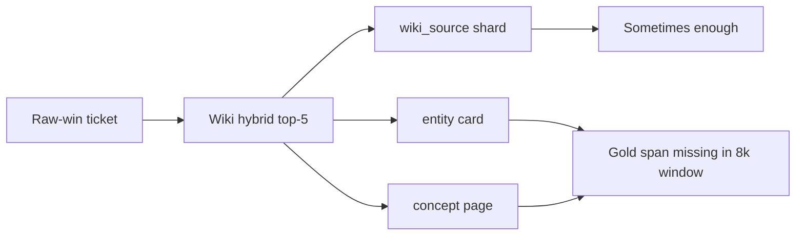

<h1 id="test-wr-title" style="color:#0d47a1;font-size:1.5em;font-weight:700;border-bottom:2px solid #90caf9;padding-bottom:0.25em;margin-top:0">Test analysis — LLM Wiki vs raw-sources RAG (lanes B, C, D)</h1>

**Type:** benchmark post-mortem (retrieval + Q&A).  
**Wiki run:** `ops/runs/retail-lane-abcd/abcd-full-openai-v2/` · **Raw run:** `ops/runs/retail-lane-abcd-raw/abcd-raw-full-openai-v1/` · **90 questions × 3 lanes** · same answer/judge, top-k=5, 8000-char prefix.  
**Related:** [`ABOUT_FOUR_LANE_TEST_ANALYSIS.md`](./ABOUT_FOUR_LANE_TEST_ANALYSIS.md) · plan [`REFACTOR_RETAIL_RAW_SOURCES_RAG_ABCD_COMPARE.md`](../ref_plan/completed/REFACTOR_RETAIL_RAW_SOURCES_RAG_ABCD_COMPARE.md) (minor **M2**) · **Last updated:** 2026-10-21 (accuracy + performance + MRKD samples).

<h2 id="test-wr-outline" style="color:#1565c0;font-size:1.22em;font-weight:650;border-left:4px solid #42a5f5;padding-left:10px;margin-top:1.1em">Document outline</h2>

1. [Headline quadrants](#test-wr-1-quadrants) — pass/fail matrix per lane.
2. [Performance](#test-wr-2-performance) — wall clock, per-stage latency, retrieval share.
3. [Why methods differ](#test-wr-3-mechanisms) — corpus, retrieval, win/loss patterns.
4. [Wiki top-k on raw wins](#test-wr-4-path-mix) — slot mix by path kind (counts explained).
5. [Lane B — external Markdown](#test-wr-5-lane-b) — `brain/retail-md` case studies + samples.
6. [Lane C — plain text](#test-wr-6-lane-c) — `brain/retail-txt` case studies + samples.
7. [Lane D — learned digest](#test-wr-7-lane-d) — wiki full-copy vs raw split-less.
8. [Appendix — ticket lists](#test-wr-8-appendix) — full raw-only / wiki-only ids.

---

<h2 id="test-wr-1-quadrants" style="color:#1565c0;font-size:1.22em;font-weight:650;border-left:4px solid #42a5f5;padding-left:10px;margin-top:1.1em">1. Headline quadrants</h2>

<table>
<thead>
<tr style="background:#1565c0;color:white"><th>Lane</th><th>Both pass</th><th>Wiki only</th><th>Raw only</th><th>Both fail</th><th>Wiki pass rate</th><th>Raw pass rate</th></tr>
</thead>
<tbody>
<tr><td style="background:#e3f2fd"><strong>B</strong></td><td>34</td><td>5</td><td style="background:#e8f5e9">24</td><td>27</td><td>43.3%</td><td style="background:#e8f5e9"><strong>64.4%</strong></td></tr>
<tr><td style="background:#e3f2fd"><strong>C</strong></td><td>34</td><td>0</td><td style="background:#e8f5e9">26</td><td>30</td><td>37.8%</td><td style="background:#e8f5e9"><strong>66.7%</strong></td></tr>
<tr><td style="background:#e3f2fd"><strong>D</strong></td><td>50</td><td style="background:#fff3e0">11</td><td>9</td><td>20</td><td style="background:#e8f5e9"><strong>67.8%</strong></td><td>65.6%</td></tr>
</tbody>
</table>

**Raw-only wins (wiki fail → raw pass)** are the main driver of raw beating wiki on **B** and **C**. **Wiki-only** cases on **D** often involve facts present in compiled **`wiki/sources/`** full-copy pages but absent or split differently in **`raw/sources/`** split-less digest.

<h2 id="test-wr-2-performance" style="color:#1565c0;font-size:1.22em;font-weight:650;border-left:4px solid #42a5f5;padding-left:10px;margin-top:1.1em">2. Performance (latency and wall clock)</h2>

**Sources:** per-row **`latency_ms`** in each run’s **`results.json`**; operator **`elapsed_sec`** in **`logs/ops/retail-lane-abcd-abcd-full-openai-v2.log`** and **`logs/ops/retail-lane-abcd-raw-abcd-raw-full-openai-v1.log`**; raw index in **`ops/runs/retail-lane-abcd-raw/abcd-raw-full-openai-v1-index/index_progress.jsonl`**. Lanes **B, C, D** only (**270** rows/arm). Same answer (**gpt-4o-mini**) and judge (**gemini-3.1-flash-lite**).

<h3 id="test-wr-2-1-wall" style="color:#00695c;font-size:1.05em;font-weight:600;margin-top:0.85em">2.1 Wall clock (sequential benchmark)</h3>

<table>
<thead>
<tr style="background:#1565c0;color:white"><th>Run</th><th>Rows</th><th>Wall time</th><th>≈ per row</th></tr>
</thead>
<tbody>
<tr><td style="background:#e3f2fd">Wiki hybrid · <code>abcd-full-openai-v2</code></td><td>360 (A–D)</td><td><strong>2,936 s</strong> (~49.0 min)</td><td>~8.2 s</td></tr>
<tr><td style="background:#e3f2fd">Wiki hybrid · B/C/D (scaled)</td><td>270</td><td>~2,202 s (~36.7 min)</td><td>~8.2 s</td></tr>
<tr><td style="background:#e8f5e9">Raw vector RAG · <code>abcd-raw-full-openai-v1</code></td><td>270 (B–D)</td><td><strong>745 s</strong> (~12.4 min)</td><td>~2.8 s</td></tr>
<tr><td style="background:#fff3e0">Raw index preflight (B+C+D)</td><td>630 chunks</td><td><strong>20 s</strong> (13+4+3)</td><td>—</td></tr>
</tbody>
</table>

<h3 id="test-wr-2-2-latency" style="color:#00695c;font-size:1.05em;font-weight:600;margin-top:0.85em">2.2 Per-row latency (ms) — B/C/D intersection</h3>

<table>
<thead>
<tr style="background:#1565c0;color:white"><th>Stage</th><th>Wiki mean</th><th>Wiki p50</th><th>Wiki p95</th><th>Raw mean</th><th>Raw p50</th><th>Raw p95</th><th>Speedup (mean)</th></tr>
</thead>
<tbody>
<tr><td style="background:#e3f2fd"><strong>Retrieval</strong></td><td>4,393</td><td>4,422</td><td>8,877</td><td style="background:#e8f5e9">307</td><td style="background:#e8f5e9">262</td><td>620</td><td style="background:#e8f5e9"><strong>~14×</strong></td></tr>
<tr><td style="background:#e3f2fd">Answer LLM</td><td>1,281</td><td>1,133</td><td>2,362</td><td>1,126</td><td>1,031</td><td>1,768</td><td>~1.1×</td></tr>
<tr><td style="background:#e3f2fd">Judge LLM</td><td>887</td><td>1,155</td><td>1,719</td><td>869</td><td>1,108</td><td>1,660</td><td>~1.0×</td></tr>
<tr><td style="background:#e3f2fd"><strong>Row total</strong></td><td>6,561</td><td>6,302</td><td>11,234</td><td style="background:#e8f5e9">2,301</td><td style="background:#e8f5e9">2,507</td><td>3,549</td><td style="background:#e8f5e9"><strong>~2.9×</strong></td></tr>
</tbody>
</table>

**Retrieval share of row time:** wiki **67.0%** · raw **13.3%**.

<h3 id="test-wr-2-3-lane-p50" style="color:#00695c;font-size:1.05em;font-weight:600;margin-top:0.85em">2.3 Lane-level row p50 (ms)</h3>

<table>
<thead>
<tr style="background:#1565c0;color:white"><th>Lane</th><th>Wiki total p50</th><th>Wiki retrieval p50</th><th>Raw total p50</th><th>Raw retrieval p50</th></tr>
</thead>
<tbody>
<tr><td style="background:#e3f2fd"><strong>B</strong></td><td>6,224</td><td>4,085</td><td style="background:#e8f5e9">2,531</td><td style="background:#e8f5e9">252</td></tr>
<tr><td style="background:#e3f2fd"><strong>C</strong></td><td>5,288</td><td>3,179</td><td style="background:#e8f5e9">2,420</td><td style="background:#e8f5e9">250</td></tr>
<tr><td style="background:#e3f2fd"><strong>D</strong></td><td>7,505</td><td>4,830</td><td style="background:#e8f5e9">2,584</td><td style="background:#e8f5e9">292</td></tr>
</tbody>
</table>

<h2 id="test-wr-3-mechanisms" style="color:#1565c0;font-size:1.22em;font-weight:650;border-left:4px solid #42a5f5;padding-left:10px;margin-top:1.1em">3. Why methods differ</h2>

<table>
<thead><tr style="background:#1565c0;color:white"><th>Factor</th><th>LLM Wiki arm</th><th>Raw RAG arm</th></tr></thead>
<tbody>
<tr><td style="background:#e3f2fd">Corpus</td><td>Compiled <code>wiki/**</code> (cards, entities, source shards, graph)</td><td>Only <code>raw/sources/**</code> chunks (~2k chars)</td></tr>
<tr><td style="background:#e3f2fd">Retrieval</td><td>Hybrid keyword + vector + graph leg</td><td>Dense vector only</td></tr>
<tr><td style="background:#e3f2fd">Typical win</td><td>Graph/keyword pulls related source shard; D full-copy sources</td><td>Verbatim manual prose in one chunk; no concept dilution</td></tr>
<tr><td style="background:#e3f2fd">Typical loss</td><td>Top-k fills with <code>wiki/concepts/*</code> or wrong SKU source shard</td><td>Wrong SKU file in top-1; chunk boundary cuts gold sentence</td></tr>
</tbody></table>

<h2 id="test-wr-4-path-mix" style="color:#1565c0;font-size:1.22em;font-weight:650;border-left:4px solid #42a5f5;padding-left:10px;margin-top:1.1em">4. When raw RAG wins, what did wiki retrieve instead?</h2>

**Question this section answers:** On tickets where **wiki failed** and **raw RAG passed**, we inspect **only the wiki arm’s top-5 hit list** (not raw’s). We label each path by type, then count how often each type appears **across all slots**.

**How to read the counts:** Each ticket contributes up to **five** paths (top-k=5). Lane B has **24** raw-win tickets → up to **120** path slots. A count of **35** for `entity` means “entity pages occupied 35 of those 120 slots,” not “35 tickets.”

**Path kinds (wiki hybrid):**

<table>
<thead>
<tr style="background:#1565c0;color:white"><th>Kind</th><th>Path pattern</th><th>Typical content</th></tr>
</thead>
<tbody>
<tr><td style="background:#e3f2fd"><code>wiki_source</code></td><td><code>wiki/sources/*</code></td><td>Compiled manual shard (often one PDF page)</td></tr>
<tr><td style="background:#e3f2fd"><code>concept</code></td><td><code>wiki/concepts/*</code></td><td>LLM-written topic page (may omit numeric gold)</td></tr>
<tr><td style="background:#e3f2fd"><code>entity</code></td><td><code>wiki/entities/*</code></td><td>Model/product summary card</td></tr>
<tr><td style="background:#e3f2fd"><code>other</code></td><td><code>wiki/index.md</code>, etc.</td><td>Index / misc wiki pages</td></tr>
</tbody>
</table>

**Slot mix on raw-win tickets (wiki top-5 only):**

<table>
<thead>
<tr style="background:#1565c0;color:white"><th>Lane</th><th>Raw-win tickets</th><th>Max slots</th><th><code>wiki_source</code></th><th><code>entity</code></th><th><code>concept</code></th><th><code>other</code></th><th>Pattern</th></tr>
</thead>
<tbody>
<tr><td style="background:#e3f2fd"><strong>B</strong></td><td>24</td><td>120</td><td>36 (30%)</td><td style="background:#fff3e0">35 (29%)</td><td style="background:#fff3e0">31 (26%)</td><td>18 (15%)</td><td>Concept + entity often <strong>crowd out</strong> the right source shard</td></tr>
<tr><td style="background:#e3f2fd"><strong>C</strong></td><td>26</td><td>130</td><td>50 (38%)</td><td style="background:#fff3e0">53 (41%)</td><td>1 (1%)</td><td>26 (20%)</td><td>Plain-text lane: wiki still pulls <strong>entity cards</strong> over full manual text</td></tr>
<tr><td style="background:#e3f2fd"><strong>D</strong></td><td>9</td><td>45</td><td style="background:#e8f5e9">28 (62%)</td><td>5 (11%)</td><td>3 (7%)</td><td>9 (20%)</td><td>Wiki often hits <strong>full-copy sources</strong>; raw wins are fewer and narrower</td></tr>
</tbody>
</table>

**Use in later sections:** Sample tickets in §5–§7 show **rank-1 file + excerpts** for the same questions; this table explains **why wiki’s top-k mix** correlates with those misses before you read each card.

<h2 id="test-wr-5-lane-b" style="color:#1565c0;font-size:1.22em;font-weight:650;border-left:4px solid #42a5f5;padding-left:10px;margin-top:1.1em">5. Lane B — external Markdown (`brain/retail-md`)</h2>

<strong>Lane B</strong> — compiled LLM Wiki on external Markdown (<code>brain/retail-md</code>).
Samples below: <strong>5</strong> raw-only wins (of 24) + <strong>5</strong> wiki-only wins (of 5). Each ticket is one HTML card: judge outcome, paths, side-by-side evidence.

<strong>Numbering:</strong> N.1 case study ·
N.2 raw-win sample group ·
N.2.x raw-win ticket ·
N.3 wiki-win group ·
N.3.x wiki-win ticket 
<strong>File quotes:</strong> amber panel = wiki rank-1 · green panel = raw rank-1 · monospace body with
## page / ### section / YAML frontmatter tinted inside the box.

<h3 id="test-wr-5-1-e02" style="color:#00695c;font-size:1.08em;font-weight:600;margin-top:1em;border-left:4px solid #00897b;padding-left:10px">5.1 Case study — <code>ge_GNE27JYMFS-E02</code> (door alarm, 2 minutes)</h3>

<table>
<tr><td style="background:#e3f2fd;font-weight:600;width:110px;vertical-align:top">Gold answer</td><td style="background:#fff8e1">alarm if door open <strong>more than 2 minutes</strong>.</td></tr>
</table>
<table>
<tr style="background:#1565c0;color:white"><th>Arm</th><th>Judge</th><th>Rank-1 path (wiki hybrid vs raw chunk)</th></tr>
<tr><td style="background:#e3f2fd;font-weight:600;width:110px;vertical-align:top">Wiki</td><td style="background:#ffcdd2;text-align:center">FAIL</td><td><code>wiki/concepts/reversing-refrigerator-doors.md</code></td></tr>
<tr><td style="background:#e3f2fd;font-weight:600;width:110px;vertical-align:top">Raw RAG</td><td style="background:#c8e6c9;text-align:center">PASS</td><td><code>raw/sources/fridge-docs_md/ge_GNE27JYMFS/user-guide.md</code></td></tr>
</table>
<table>
<tr style="background:#1565c0;color:white"><th>Wiki top-3 (concept/entity heavy)</th><th>Raw top-2 (manual MD)</th></tr>
<tr>
<td style="background:#ffebee;vertical-align:top"><ul style="margin:0.3em 0;padding-left:1.2em"><li><code>wiki/concepts/reversing-refrigerator-doors.md</code></li><li><code>wiki/entities/ge-gne27jymfs.md</code></li><li><code>wiki/concepts/adjustable-door-bins.md</code></li></ul></td>
<td style="background:#e8f5e9;vertical-align:top"><ul style="margin:0.3em 0;padding-left:1.2em"><li><code>…rces/fridge-docs_md/kitchenaid_KRFF507HPS/user-guide.md</code></li><li><code>raw/sources/fridge-docs_md/ge_GNE27JYMFS/user-guide.md</code></li></ul></td>
</tr></table>

Quoted from raw/sources/…/ge_GNE27JYMFS/user-guide.md (rank-1 chunk)

frigerator temperature cannotbe changed during TurboCool™. The freezertemperature is not affected during Turbo Cool.When opening the refrigerator door duringTurboCool™, the fans will continue to run if theyhave cycled on.Door AlarmTo set the alarm, press the Door Alarm pad. Thisalarm will sound if either door is open for more than2 minutes. The beeping stops when you close thedoor.NOTE: To put the refrigerator control in the OFF position,simultaneously touch the words Freezer and Fridgefor 3 seconds. Power to the refrigerator cannot bedisconnected by any setting on the control panel.Changing °F to °C or °C to °F: Press and hold the&quot;DOOR ALARM&quot; and &quot;FREEZER&quot; bu

<strong>Wiki miss:</strong> GE <strong>2 minute</strong> wording is <strong>not</strong> present in `brain/retail-md/wiki/sources/*gegne27*` shards searched; hybrid top-k led with <strong>concept/entity</strong> pages (`reversing-refrigerator-doors`, `ge-gne27jymfs` entity). Rank-5 source shard `page034` is image-caption heavy, not the control-panel alarm paragraph.

<strong>Why raw wins:</strong> full Docling MD retains the <strong>Door Alarm</strong> section verbatim; vector search lands on the same file (despite Kitchenaid rank-1 noise, prefix includes GE in top-k).

<h3 id="test-wr-lane-b-raw-samples" style="color:#1565c0;font-size:1.06em;font-weight:650;margin-top:1.2em;border-left:4px solid #42a5f5;padding-left:10px">5.2 Raw wins (wiki failed) — sample tickets</h3>

Judge: wiki FAIL → raw PASS — evidence cards below.
<h4 id="test-wr-ticket-ge-gne27jymfs-h05-hard" style="color:#5e35b1;font-size:0.98em;font-weight:600;margin-top:1em">5.2.1 <code>ge_GNE27JYMFS-H05</code> hard</h4>

<table>
<tr><td style="background:#e3f2fd;font-weight:600;width:110px;vertical-align:top">Question</td><td>My GNE27J shows “tc,” and some food by the back vent is freezing. What does “tc” mean and what should I do about the food?</td></tr>
<tr><td style="background:#e3f2fd;font-weight:600;width:110px;vertical-align:top">Gold</td><td style="background:#fff8e1">“tc” means TurboCool is activated. Move food away from the rear air vent; if cooling is still too strong, adjust the refrigerator to a warmer setting incrementally after TurboCool is no longer preventing a refrigerator temperature adjustment.</td></tr>
</table>
<table>
<tr style="background:#1565c0;color:white"><th>Arm</th><th>Judge</th><th>Rank-1 retrieved file</th></tr>
<tr><td style="background:#e3f2fd;font-weight:600;width:110px;vertical-align:top">Wiki hybrid</td><td style="background:#ffcdd2;text-align:center">FAIL</td><td><code>brain/retail-md/wiki/entities/ge-gne27jymfs.md</code></td></tr>
<tr><td style="background:#e3f2fd;font-weight:600;width:110px;vertical-align:top">Raw RAG</td><td style="background:#c8e6c9;text-align:center">PASS</td><td><code>brain/retail-md/raw/sources/fridge-docs_md/ge_GNE27JYMFS/user-guide.md</code></td></tr>
</table>
<table>
<tr style="background:#1565c0;color:white"><th>Wiki top-5 paths</th><th>Raw top-5 paths</th></tr>
<tr><td style="vertical-align:top;background:#fff3e0"><ol style="margin:0.2em 0;padding-left:1.3em;font-size:0.88em"><li><code>wiki/entities/ge-gne27jymfs.md</code></li><li><code>wiki/concepts/temperature-settings.md</code></li><li><code>wiki/concepts/control-panel-functions.md</code></li><li><code>wiki/concepts/temperature-controls.md</code></li><li><code>wiki/concepts/turbo-cool-function.md</code></li></ol></td><td style="vertical-align:top;background:#e8f5e9"><ol style="margin:0.2em 0;padding-left:1.3em;font-size:0.88em"><li><code>raw/sources/fridge-docs_md/ge_GNE27JYMFS/user-guide.md</code></li><li><code>raw/sources/fridge-docs_md/ge_GNE27JYMFS/user-guide.md</code></li><li><code>raw/sources/fridge-docs_md/ge_GNE27JYMFS/user-guide.md</code></li><li><code>raw/sources/fridge-docs_md/samsung_RF28K9070SG/repair-guide.md</code></li><li><code>raw/sources/fridge-docs_md/ge_GNE27JYMFS/user-guide.md</code></li></ol></td></tr>
</table>
<table><tr>
<td style="vertical-align:top;width:50%;padding:6px 4px">

Wiki rank-1 evidence

ing shelves to accommodate taller items.  - &lt;strong&gt;Specialized Pans and Dividers&lt;/strong&gt;: Enhance food storage efficiency.  The user guide provides detailed information about the refrigerator&#x27;s layout, including a diagram that highlights key components such as LED lighting, shelves, door bins, and an icemaker. This appliance is designed to provide optimal cooling performance and user-friendly operation, as detailed in its user guide.  Additionally, the GE GNE27JYMFS features advanced control panel functionalities, which are central to the user guide. This includes detailed instructions on its operation, including temperature settings and special features like Turbo Cool. Regular maintenance is req

</td>
<td style="vertical-align:top;width:50%;padding:6px 4px">

Raw rank-1 evidence

nded setting.Refrigerator Compartment Temperature ControlAdjust refrigerator compartment temperature. Therefrigerator temperature is preset in the factoryat 37°F (2.8°C). Allow 24 hours for temperature tostabilize to the preset recommended setting.Water FilterPress and hold 3 seconds to reset the Water Filter.Turbo CoolTo set the TurboCool™, press the Turbo Cool padfor 3 seconds. The display will show tc.TurboCool™ rapidly cools the refrigeratorcompartment in order to more quickly cool foods.8VH TurboCool™ when adding a large amount ofthe food to the refrigerator compartment, puttingaway foods after they have been sitting out at roomtemperature, or when puttin

</td>
</tr></table>

<strong>Takeaway:</strong> Wiki hybrid often surfaces <strong>compiled abstractions</strong> (concepts/entities) or <strong>partial OCR shards</strong>; raw chunk still contains <strong>manual sentences</strong> matching gold numbers/phrasing.

<h4 id="test-wr-ticket-ge-gne27jymfs-h06-hard" style="color:#5e35b1;font-size:0.98em;font-weight:600;margin-top:1em">5.2.2 <code>ge_GNE27JYMFS-H06</code> hard</h4>

<table>
<tr><td style="background:#e3f2fd;font-weight:600;width:110px;vertical-align:top">Question</td><td>I want to clean the fridge exterior and then pull the appliance out to clean behind it. What cleaning products and moving method should I use?</td></tr>
<tr><td style="background:#e3f2fd;font-weight:600;width:110px;vertical-align:top">Gold</td><td style="background:#fff8e1">For fingerprint-resistant or painted finishes, use mild detergent in warm water with a soft or microfiber cloth and wipe dry; avoid abrasive and stainless-steel cleaners on those surfaces. Raise the front leveling legs and pull the refrigerator straight out, then push it straight back rather than si…</td></tr>
</table>
<table>
<tr style="background:#1565c0;color:white"><th>Arm</th><th>Judge</th><th>Rank-1 retrieved file</th></tr>
<tr><td style="background:#e3f2fd;font-weight:600;width:110px;vertical-align:top">Wiki hybrid</td><td style="background:#ffcdd2;text-align:center">FAIL</td><td><code>…docsmd--12-gegne27jymfs--6-assets--10-user-guide--7-page023--169h3pu.md</code></td></tr>
<tr><td style="background:#e3f2fd;font-weight:600;width:110px;vertical-align:top">Raw RAG</td><td style="background:#c8e6c9;text-align:center">PASS</td><td><code>brain/retail-md/raw/sources/fridge-docs_md/ge_GNE27JYMFS/user-guide.md</code></td></tr>
</table>
<table>
<tr style="background:#1565c0;color:white"><th>Wiki top-5 paths</th><th>Raw top-5 paths</th></tr>
<tr><td style="vertical-align:top;background:#fff3e0"><ol style="margin:0.2em 0;padding-left:1.3em;font-size:0.88em"><li><code>…12-gegne27jymfs--6-assets--10-user-guide--7-page023--169h3pu.md</code></li><li><code>…12-gegne27jymfs--6-assets--10-user-guide--7-page022--1638wn9.md</code></li><li><code>…es/13-fridge-docsmd--12-gegne27jymfs--10-user-guide--1xp31fe.md</code></li><li><code>wiki/concepts/care-and-cleaning-instructions.md</code></li><li><code>wiki/concepts/refrigerator-internal-components.md</code></li></ol></td><td style="vertical-align:top;background:#e8f5e9"><ol style="margin:0.2em 0;padding-left:1.3em;font-size:0.88em"><li><code>raw/sources/fridge-docs_md/ge_GNE27JYMFS/user-guide.md</code></li><li><code>raw/sources/fridge-docs_md/ge_GNE27JYMFS/user-guide.md</code></li><li><code>raw/sources/fridge-docs_md/samsung_RF28K9070SG/user-guide.md</code></li><li><code>raw/sources/fridge-docs_md/kitchenaid_KRFF507HPS/user-guide.md</code></li><li><code>raw/sources/fridge-docs_md/ge_GNE27JYMFS/user-guide.md</code></li></ol></td></tr>
</table>
<table><tr>
<td style="vertical-align:top;width:50%;padding:6px 4px">

Wiki rank-1 evidence

---type: sourcetitle: GE GNE27JYMFS User Guide - Page 023created: 2026-10-19updated: 2026-10-19tags: [user guide, refrigerator, GE GNE27JYMFS]related: [ge-gne27jymfs, refrigerator-internal-components, care-and-cleaning-instructions]sources: [&quot;fridge-docs_md/ge_GNE27JYMFS/assets/user-guide/page_023.png&quot;]---# GE GNE27JYMFS User Guide - Page 023This page includes a cutaway diagram of the GE GNE27JYMFS refrigerator, illustrating its internal components and layout. The accompanying text provides care and cleaning instructions, specifically detailing how to move the refrigerator and replace lights. Understanding these components and maintenance procedures is crucial for proper care and longevity of the appliance.![The image depicts a cutaway diagram of a refrigerator, showing its internal components and layout. Visible text includes &quot;LEDs (locations may vary by model)&quot; and various…

</td>
<td style="vertical-align:top;width:50%;padding:6px 4px">

Raw rank-1 evidence

erator is plugged in.Ice Maker FrameON/OFF SwitchON/OFF SwitchIce Maker(On some models)Figure E2149-1000472 Rev. 9### Original figure / page illustration (PDF page 21)## PDF page 22### Care and Cleaning#### Cleaning the Outside#### FINGERPRINT RESISTANT STAINLESS STEEL*, BLACK STAINLESS, SLATE, DARK#### SLATE, PAINTED - Outside surfaces, door handles, and trimDO NOT use Stainless Steel cleaners on the door surfaces.IMPORTANT: The use of incorrect products may damage the outer finish of Fingerprint Resistant Stainless andBlack Stainless models. Please follow these inst

</td>
</tr></table>

<strong>Takeaway:</strong> Wiki hybrid often surfaces <strong>compiled abstractions</strong> (concepts/entities) or <strong>partial OCR shards</strong>; raw chunk still contains <strong>manual sentences</strong> matching gold numbers/phrasing.

<h4 id="test-wr-ticket-kitchenaid-krff507hps-h06-hard" style="color:#5e35b1;font-size:0.98em;font-weight:600;margin-top:1em">5.2.3 <code>kitchenaid_KRFF507HPS-H06</code> hard</h4>

<table>
<tr><td style="background:#e3f2fd;font-weight:600;width:110px;vertical-align:top">Question</td><td>The water from my dispenser is warm after I have filled several large jugs. How long should I wait for it to cool again, and what button sequence starts Measured Fill calibration?</td></tr>
<tr><td style="background:#e3f2fd;font-weight:600;width:110px;vertical-align:top">Gold</td><td style="background:#fff8e1">After a large draw of water, allow about 3 hours for the supply to cool completely. To initiate Measured Fill calibration, press and hold OPTIONS and LOCK simultaneously for 3 seconds (after flushing the dispenser system).</td></tr>
</table>
<table>
<tr style="background:#1565c0;color:white"><th>Arm</th><th>Judge</th><th>Rank-1 retrieved file</th></tr>
<tr><td style="background:#e3f2fd;font-weight:600;width:110px;vertical-align:top">Wiki hybrid</td><td style="background:#ffcdd2;text-align:center">FAIL</td><td><code>…es/13-fridge-docsmd--20-kitchenaidkrff507hps--10-user-guide--1bdnof4.md</code></td></tr>
<tr><td style="background:#e3f2fd;font-weight:600;width:110px;vertical-align:top">Raw RAG</td><td style="background:#c8e6c9;text-align:center">PASS</td><td><code>…etail-md/raw/sources/fridge-docs_md/kitchenaid_KRFF507HPS/user-guide.md</code></td></tr>
</table>
<table>
<tr style="background:#1565c0;color:white"><th>Wiki top-5 paths</th><th>Raw top-5 paths</th></tr>
<tr><td style="vertical-align:top;background:#fff3e0"><ol style="margin:0.2em 0;padding-left:1.3em;font-size:0.88em"><li><code>…idge-docsmd--20-kitchenaidkrff507hps--10-user-guide--1bdnof4.md</code></li><li><code>wiki/entities/kitchenaid-krff507hps.md</code></li><li><code>wiki/concepts/measured-fill-feature.md</code></li><li><code>…henaidkrff507hps--6-assets--10-user-guide--7-page024--suqbr9.md</code></li><li><code>wiki/index.md</code></li></ol></td><td style="vertical-align:top;background:#e8f5e9"><ol style="margin:0.2em 0;padding-left:1.3em;font-size:0.88em"><li><code>raw/sources/fridge-docs_md/kitchenaid_KRFF507HPS/user-guide.md</code></li><li><code>raw/sources/fridge-docs_md/kitchenaid_KRFF507HPS/user-guide.md</code></li><li><code>raw/sources/fridge-docs_md/kitchenaid_KRFF507HPS/user-guide.md</code></li><li><code>raw/sources/fridge-docs_md/kitchenaid_KRFF507HPS/user-guide.md</code></li><li><code>raw/sources/fridge-docs_md/kitchenaid_KRFF507HPS/user-guide.md</code></li></ol></td></tr>
</table>
<table><tr>
<td style="vertical-align:top;width:50%;padding:6px 4px">

Wiki rank-1 evidence

lui- Instrucțiuni de instalare- Cerințe electrice- Cerințe pentru alimentarea cu apă- Ajustarea înclinării cabinetului- Alinierea ușilor- Stabilizarea frigiderului- Curățarea frigiderului- Întreținerea sistemului de filtrare a apei- Avertismente de siguranță privind curățarea- Sistem de filtrare a apei- Funcții de frigider (ex. Max Ice, Water Filter Status)- Instrucțiuni de instalare pentru uși și compartimente&lt;!-- llm-wiki:embedded-images --&gt;## Embedded Images### Document![L&#x27;image montre un réfrigérateur à portes françaises avec plusieurs éléments étiquetés. Les étiquettes incluent : A. Ice maker, B. Air filter, C. Water filter, D. Door bins, E. Crispers, F. Pantry drawer

</td>
<td style="vertical-align:top;width:50%;padding:6px 4px">

Raw rank-1 evidence

Refrigerator:Your refrigerator is heavy. When moving the refrigerator forcleaning or service, be sure to cover the floor withcardboard or hardboard to avoid floor damage. Always pullthe refrigerator straight out when moving it. Do not wiggle or“walk” the refrigerator when trying to move it, as floordamage could occur.Clean Before UsingAfter you remove all of the packaging materials, clean the insideof your refrigerator before using it. See the cleaning instructions in“Refrigerator Care.”Important information to know about glass shelvesand covers:Do not clean glass shelves or covers with warm water whenthey are cold. Shelves and covers may break if exposed tosudden

</td>
</tr></table>

<strong>Takeaway:</strong> Wiki hybrid often surfaces <strong>compiled abstractions</strong> (concepts/entities) or <strong>partial OCR shards</strong>; raw chunk still contains <strong>manual sentences</strong> matching gold numbers/phrasing.

<h4 id="test-wr-ticket-kitchenaid-krff507hps-h09-hard" style="color:#5e35b1;font-size:0.98em;font-weight:600;margin-top:1em">5.2.4 <code>kitchenaid_KRFF507HPS-H09</code> hard</h4>

<table>
<tr><td style="background:#e3f2fd;font-weight:600;width:110px;vertical-align:top">Question</td><td>I replaced the water filter and still get weak dispenser flow. What must be true about the filter’s installed position, and which test distinguishes a clog from another water-supply problem?</td></tr>
<tr><td style="background:#e3f2fd;font-weight:600;width:110px;vertical-align:top">Gold</td><td style="background:#fff8e1">Make sure the water filter is turned clockwise 90° and locked into the housing; without correct locking, water will not flow. If flow is merely weak, remove the filter and test the dispenser: improved flow indicates the filter may be clogged and needs replacement.</td></tr>
</table>
<table>
<tr style="background:#1565c0;color:white"><th>Arm</th><th>Judge</th><th>Rank-1 retrieved file</th></tr>
<tr><td style="background:#e3f2fd;font-weight:600;width:110px;vertical-align:top">Wiki hybrid</td><td style="background:#ffcdd2;text-align:center">FAIL</td><td><code>…tail-md/wiki/entities/kitchenaid-french-door-refrigerator-krff507hps.md</code></td></tr>
<tr><td style="background:#e3f2fd;font-weight:600;width:110px;vertical-align:top">Raw RAG</td><td style="background:#c8e6c9;text-align:center">PASS</td><td><code>…etail-md/raw/sources/fridge-docs_md/kitchenaid_KRFF507HPS/user-guide.md</code></td></tr>
</table>
<table>
<tr style="background:#1565c0;color:white"><th>Wiki top-5 paths</th><th>Raw top-5 paths</th></tr>
<tr><td style="vertical-align:top;background:#fff3e0"><ol style="margin:0.2em 0;padding-left:1.3em;font-size:0.88em"><li><code>wiki/entities/kitchenaid-french-door-refrigerator-krff507hps.md</code></li><li><code>wiki/entities/kitchenaid-krff507hps.md</code></li><li><code>wiki/concepts/water-filter.md</code></li><li><code>…enaidkrff507hps--6-assets--10-user-guide--7-page017--1b62ko7.md</code></li><li><code>wiki/index.md</code></li></ol></td><td style="vertical-align:top;background:#e8f5e9"><ol style="margin:0.2em 0;padding-left:1.3em;font-size:0.88em"><li><code>raw/sources/fridge-docs_md/kitchenaid_KRFF507HPS/user-guide.md</code></li><li><code>raw/sources/fridge-docs_md/kitchenaid_KRFF507HPS/user-guide.md</code></li><li><code>raw/sources/fridge-docs_md/kitchenaid_KRFF507HPS/user-guide.md</code></li><li><code>raw/sources/fridge-docs_md/ge_GNE27JYMFS/user-guide.md</code></li><li><code>raw/sources/fridge-docs_md/kitchenaid_KRFF507HPS/user-guide.md</code></li></ol></td></tr>
</table>
<table><tr>
<td style="vertical-align:top;width:50%;padding:6px 4px">

Wiki rank-1 evidence

---  type: entity  title: KitchenAid® French Door Refrigerator (Model KRFF507HPS)  created: 2026-10-19  updated: 2026-10-19  tags: [refrigerator, KitchenAid, KRFF507HPS]  related: [ice-maker, air-filter, water-filter, door-bins, crispers, pantry-drawer, freezer-drawer, led-ramp-on-lighting, in-door-ice-dispensing-system, pull-out-tray, refrigerator-door-removal-and-replacement]  sources: [&quot;fridge-docs_md/kitchenaid_KRFF507HPS/assets/user-guide/page_005.png&quot;, &quot;fridge-docs_md/kitchenaid_KRFF507HPS/assets/user-guide/page_008.png&quot;]  ---  The Kitchen

</td>
<td style="vertical-align:top;width:50%;padding:6px 4px">

Raw rank-1 evidence

er Front..............................................................11-- Replace Drawer Front..............................................................11-- Final Steps................................................................................11Electrical Requirements..............................................................12Water Supply Requirements.......................................................12Connect the Water Supply.........................................................12-- Connect to Water Line.............................................................13-- Connect to Refrigerator............................................................13--

</td>
</tr></table>

<strong>Takeaway:</strong> Wiki hybrid often surfaces <strong>compiled abstractions</strong> (concepts/entities) or <strong>partial OCR shards</strong>; raw chunk still contains <strong>manual sentences</strong> matching gold numbers/phrasing.

<h4 id="test-wr-ticket-kitchenaid-krff507hps-h10-hard" style="color:#5e35b1;font-size:0.98em;font-weight:600;margin-top:1em">5.2.5 <code>kitchenaid_KRFF507HPS-H10</code> hard</h4>

<table>
<tr><td style="background:#e3f2fd;font-weight:600;width:110px;vertical-align:top">Question</td><td>My newly installed refrigerator has not cooled fully. How long should the first cool-down take, and after changing a temperature set point how long should I wait before changing it again?</td></tr>
<tr><td style="background:#e3f2fd;font-weight:600;width:110px;vertical-align:top">Gold</td><td style="background:#fff8e1">Allow about 24 hours following installation for complete cooling. After changing a set point, wait at least 24 hours before making another temperature adjustment, then recheck temperatures.</td></tr>
</table>
<table>
<tr style="background:#1565c0;color:white"><th>Arm</th><th>Judge</th><th>Rank-1 retrieved file</th></tr>
<tr><td style="background:#e3f2fd;font-weight:600;width:110px;vertical-align:top">Wiki hybrid</td><td style="background:#ffcdd2;text-align:center">FAIL</td><td><code>…20-kitchenaidkrff507hps--6-assets--10-user-guide--7-page021--1hz5a92.md</code></td></tr>
<tr><td style="background:#e3f2fd;font-weight:600;width:110px;vertical-align:top">Raw RAG</td><td style="background:#c8e6c9;text-align:center">PASS</td><td><code>…etail-md/raw/sources/fridge-docs_md/kitchenaid_KRFF507HPS/user-guide.md</code></td></tr>
</table>
<table>
<tr style="background:#1565c0;color:white"><th>Wiki top-5 paths</th><th>Raw top-5 paths</th></tr>
<tr><td style="vertical-align:top;background:#fff3e0"><ol style="margin:0.2em 0;padding-left:1.3em;font-size:0.88em"><li><code>…enaidkrff507hps--6-assets--10-user-guide--7-page021--1hz5a92.md</code></li><li><code>…enaidkrff507hps--6-assets--10-user-guide--7-page022--10qhhbn.md</code></li><li><code>wiki/entities/kitchenaid-french-door-refrigerator-krff507hps.md</code></li><li><code>wiki/concepts/temperature-settings.md</code></li><li><code>wiki/index.md</code></li></ol></td><td style="vertical-align:top;background:#e8f5e9"><ol style="margin:0.2em 0;padding-left:1.3em;font-size:0.88em"><li><code>raw/sources/fridge-docs_md/kitchenaid_KRFF507HPS/user-guide.md</code></li><li><code>raw/sources/fridge-docs_md/samsung_RF28K9070SG/user-guide.md</code></li><li><code>raw/sources/fridge-docs_md/kitchenaid_KRFF507HPS/user-guide.md</code></li><li><code>raw/sources/fridge-docs_md/kitchenaid_KRFF507HPS/user-guide.md</code></li><li><code>raw/sources/fridge-docs_md/kitchenaid_KRFF507HPS/user-guide.md</code></li></ol></td></tr>
</table>
<table><tr>
<td style="vertical-align:top;width:50%;padding:6px 4px">

Wiki rank-1 evidence

---This page from the KitchenAid® KRFF507HPS user guide focuses on the hinged seal mechanism of the refrigerator doors and the temperature settings. It includes a labeled diagram illustrating the hinged seal, which enhances cooling efficiency by ensuring a tight seal when the door is closed. The guide also emphasizes the importance of waiting 24 hours before placing food in the refrigerator to ensure proper cooling.![The image depicts a section of a refrigerator with a focus on the hinged seal mechanism. It includes a labeled diagram showing the &quot;A. Hinged seal&quot; that automatically folds inward when the left door is opened. The surrounding text discusses the operation of the refrigerator

</td>
<td style="vertical-align:top;width:50%;padding:6px 4px">

Raw rank-1 evidence

mentalcapabilities, or lack of experience and knowledge, unlessthey have been given supervision or instruction concerninguse of the appliance by a person responsible for their safety.IChildren should be supervised to ensure that they do notplay with the appliance.ITo avoid the risk of children becoming trapped andsuffocating, do not allow them to play or hide inside therefrigerator.IIf the power supply cord is damaged, it must be replaced bythe manufacturer or its service agent or a similarly qualifiedperson.3## PDF page 4### REFRIGERATOR SAFETYProper Disposal of Your Old RefrigeratorBefore You Throw Away Your OldRefrigerator or Freezer:Take off the door

</td>
</tr></table>

<strong>Takeaway:</strong> Wiki hybrid often surfaces <strong>compiled abstractions</strong> (concepts/entities) or <strong>partial OCR shards</strong>; raw chunk still contains <strong>manual sentences</strong> matching gold numbers/phrasing.

<h3 id="test-wr-lane-b-wiki-samples" style="color:#e65100;font-size:1.06em;font-weight:650;margin-top:1.2em;border-left:4px solid #ff9800;padding-left:10px">5.3 Wiki wins (raw failed) — sample tickets</h3>

Judge: wiki PASS → raw FAIL — often full-copy wiki source or entity with gold facts.

Judge: wiki PASS → raw FAIL — often full-copy wiki source or entity with gold facts.
<h4 id="test-wr-ticket-ge-gne27jymfs-h04-hard" style="color:#2e7d32;font-size:0.98em;font-weight:600;margin-top:1em">5.3.1 <code>ge_GNE27JYMFS-H04</code> hard</h4>

<table>
<tr><td style="background:#e3f2fd;font-weight:600;width:110px;vertical-align:top">Question</td><td>My water filter is unavailable, but I still want water and ice. What must be installed instead of the filter, and what water-pressure range does the guide require?</td></tr>
<tr><td style="background:#e3f2fd;font-weight:600;width:110px;vertical-align:top">Gold</td><td style="background:#fff8e1">Install the designated filter bypass plug; neither the dispenser nor the ice maker will operate without a filter or bypass plug. The required cold-water pressure for the ice maker is 25–120 psi (172–827 kPa).</td></tr>
</table>
<table>
<tr style="background:#1565c0;color:white"><th>Arm</th><th>Judge</th><th>Rank-1 retrieved file</th></tr>
<tr><td style="background:#e3f2fd;font-weight:600;width:110px;vertical-align:top">Wiki hybrid</td><td style="background:#c8e6c9;text-align:center">PASS</td><td><code>brain/retail-md/wiki/entities/water-filter-cartridge-xwfe.md</code></td></tr>
<tr><td style="background:#e3f2fd;font-weight:600;width:110px;vertical-align:top">Raw RAG</td><td style="background:#ffcdd2;text-align:center">FAIL</td><td><code>…etail-md/raw/sources/fridge-docs_md/kitchenaid_KRFF507HPS/user-guide.md</code></td></tr>
</table>
<table>
<tr style="background:#1565c0;color:white"><th>Wiki top-5 paths</th><th>Raw top-5 paths</th></tr>
<tr><td style="vertical-align:top;background:#fff3e0"><ol style="margin:0.2em 0;padding-left:1.3em;font-size:0.88em"><li><code>wiki/entities/water-filter-cartridge-xwfe.md</code></li><li><code>…es/13-fridge-docsmd--12-gegne27jymfs--10-user-guide--1xp31fe.md</code></li><li><code>wiki/concepts/water-filter-cartridge.md</code></li><li><code>…12-gegne27jymfs--6-assets--10-user-guide--7-page014--1789a3o.md</code></li><li><code>wiki/concepts/filter-replacement-instructions.md</code></li></ol></td><td style="vertical-align:top;background:#e8f5e9"><ol style="margin:0.2em 0;padding-left:1.3em;font-size:0.88em"><li><code>raw/sources/fridge-docs_md/kitchenaid_KRFF507HPS/user-guide.md</code></li><li><code>raw/sources/fridge-docs_md/ge_GNE27JYMFS/user-guide.md</code></li><li><code>raw/sources/fridge-docs_md/ge_GNE27JYMFS/user-guide.md</code></li><li><code>raw/sources/fridge-docs_md/samsung_RF28K9070SG/user-guide.md</code></li><li><code>raw/sources/fridge-docs_md/ge_GNE27JYMFS/user-guide.md</code></li></ol></td></tr>
</table>
<table><tr>
<td style="vertical-align:top;width:50%;padding:6px 4px">

Wiki rank-1 evidence

---  type: entity  title: Water Filter Cartridge - XWFE  created: 2026-10-19  updated: 2026-10-19  tags: [water filter, XWFE, specifications, product, filtrare, apă]  related: [ge-gne27jymfs, ge-appliances, limited-warranty]  sources: [&quot;fridge-docs_md/ge_GNE27JYMFS/assets/user-guide/page_015.png&quot;, &quot;fridge-docs_md/ge_GNE27JYMFS/assets/user-guide/page_049.png&quot;, &quot;fridge-docs_md/ge_GNE27JYMFS/user-guide.md&quot;]  ---  # Water Filter Cartridge - XWFE  The Water Filter Cartridge - XWFE is a specific model designed for use in certain GE refrigerators, including the GE GNE27JYMFS. It provides essential filtration for drinking water and ice, ensuring safety and quality. This cartridge is crucial for maintaining the quality of water dispensed from the refrigerator, adhering to specified water supply conditions for optimal performance.## Specifications  - &lt;strong&gt;Service Flow:&lt;/strong&gt; 0.5 gpm (1.89 lp…

</td>
<td style="vertical-align:top;width:50%;padding:6px 4px">

Raw rank-1 evidence

pliance that leave s our factory is inspectedthoroughly to ensure that it is working properly.REFRIGERATOR SAFETY..............................................................3What’s New Behind the Doors?...................................................5PARTS AND FEATURES.................................................................5INSTALLATION INSTRUCTIONS...................................................6Unpack the Refrigerator...............................................................7-- Remove the Packaging..............................................................7-- Clean Before Using....................................................................7Lo

</td>
</tr></table>

<strong>Takeaway:</strong> Wiki <strong>source shard</strong> or graph-assisted path includes the fact; raw top chunk is <strong>off-topic</strong>, <strong>wrong SKU</strong>, or <strong>missing</strong> the gold span in the 8k window.

<h4 id="test-wr-ticket-ge-gne27jymfs-e04-easy" style="color:#2e7d32;font-size:0.98em;font-weight:600;margin-top:1em">5.3.2 <code>ge_GNE27JYMFS-E04</code> easy</h4>

<table>
<tr><td style="background:#e3f2fd;font-weight:600;width:110px;vertical-align:top">Question</td><td>What is the rated water-filter capacity of the XWFE cartridge?</td></tr>
<tr><td style="background:#e3f2fd;font-weight:600;width:110px;vertical-align:top">Gold</td><td style="background:#fff8e1">170 gallons (643.5 litres).</td></tr>
</table>
<table>
<tr style="background:#1565c0;color:white"><th>Arm</th><th>Judge</th><th>Rank-1 retrieved file</th></tr>
<tr><td style="background:#e3f2fd;font-weight:600;width:110px;vertical-align:top">Wiki hybrid</td><td style="background:#c8e6c9;text-align:center">PASS</td><td><code>brain/retail-md/wiki/entities/water-filter-cartridge-xwfe.md</code></td></tr>
<tr><td style="background:#e3f2fd;font-weight:600;width:110px;vertical-align:top">Raw RAG</td><td style="background:#ffcdd2;text-align:center">FAIL</td><td><code>brain/retail-md/raw/sources/fridge-docs_md/ge_GNE27JYMFS/user-guide.md</code></td></tr>
</table>
<table>
<tr style="background:#1565c0;color:white"><th>Wiki top-5 paths</th><th>Raw top-5 paths</th></tr>
<tr><td style="vertical-align:top;background:#fff3e0"><ol style="margin:0.2em 0;padding-left:1.3em;font-size:0.88em"><li><code>wiki/entities/water-filter-cartridge-xwfe.md</code></li><li><code>…-12-gegne27jymfs--6-assets--10-user-guide--7-page049--mkh61m.md</code></li><li><code>wiki/entities/ge-gne27jymfs.md</code></li><li><code>…-12-gegne27jymfs--6-assets--10-user-guide--7-page050--xqzm30.md</code></li><li><code>wiki/concepts/filter-replacement-instructions.md</code></li></ol></td><td style="vertical-align:top;background:#e8f5e9"><ol style="margin:0.2em 0;padding-left:1.3em;font-size:0.88em"><li><code>raw/sources/fridge-docs_md/ge_GNE27JYMFS/user-guide.md</code></li><li><code>raw/sources/fridge-docs_md/ge_GNE27JYMFS/user-guide.md</code></li><li><code>raw/sources/fridge-docs_md/kitchenaid_KRFF507HPS/user-guide.md</code></li><li><code>raw/sources/fridge-docs_md/ge_GNE27JYMFS/user-guide.md</code></li><li><code>raw/sources/fridge-docs_md/kitchenaid_KRFF507HPS/user-guide.md</code></li></ol></td></tr>
</table>
<table><tr>
<td style="vertical-align:top;width:50%;padding:6px 4px">

Wiki rank-1 evidence

rtridge is crucial for maintaining the quality of water dispensed from the refrigerator, adhering to specified water supply conditions for optimal performance.## Specifications  - &lt;strong&gt;Service Flow:&lt;/strong&gt; 0.5 gpm (1.89 lpm)  - &lt;strong&gt;Water Pressure Range:&lt;/strong&gt; 25-120 psi (172-827 kPa)  - &lt;strong&gt;Water Temperature Range:&lt;/strong&gt; 33°F-100°F (0.6°C-38°C)  - &lt;strong&gt;Capacity:&lt;/strong&gt; 170 gallons (643.5 liters)  ## Importance  The Water Filter Cartridge - XWFE is an essential component used in the GE GNE27JYMFS refrigerator, ensuring the purity of the water and ice produced by the appliance. It is mentioned in the context of maintaining and operating the water dispenser.## Warranty  The Water Filter Cartridge XWFE is cover

</td>
<td style="vertical-align:top;width:50%;padding:6px 4px">

Raw rank-1 evidence

gewaterfilters.comor call GE Appliances Parts and Accessories, 877.959.8688. In Canada, call 800.661.1616.1549-1000472 Rev. 9### Table (PDF page 15)| Service Flow | 0.5 gpm (1.89 lpm) || --- | --- || Water Supply | Potable Water || Water Pressure | 25-120 psi (172-827 kPa) || Water Temperature | 33ƒF-100ƒF  0.6ƒC-38ƒC || Capacity | 170 gallons (643.5 liters) |### Original figure / page illustration (PDF page 15)## PDF page 16### Shelves and BinsNot all features are on all models.#### Rearranging the Refrigerator ShelvesShelves in the refrigerator compartment are adjustable.

</td>
</tr></table>

<strong>Takeaway:</strong> Wiki <strong>source shard</strong> or graph-assisted path includes the fact; raw top chunk is <strong>off-topic</strong>, <strong>wrong SKU</strong>, or <strong>missing</strong> the gold span in the 8k window.

<h4 id="test-wr-ticket-ge-gne27jymfs-e05-easy" style="color:#2e7d32;font-size:0.98em;font-weight:600;margin-top:1em">5.3.3 <code>ge_GNE27JYMFS-E05</code> easy</h4>

<table>
<tr><td style="background:#e3f2fd;font-weight:600;width:110px;vertical-align:top">Question</td><td>What cold-water pressure is required for the automatic ice maker?</td></tr>
<tr><td style="background:#e3f2fd;font-weight:600;width:110px;vertical-align:top">Gold</td><td style="background:#fff8e1">25–120 psi (172–827 kPa).</td></tr>
</table>
<table>
<tr style="background:#1565c0;color:white"><th>Arm</th><th>Judge</th><th>Rank-1 retrieved file</th></tr>
<tr><td style="background:#e3f2fd;font-weight:600;width:110px;vertical-align:top">Wiki hybrid</td><td style="background:#c8e6c9;text-align:center">PASS</td><td><code>brain/retail-md/wiki/concepts/automatic-icemaker.md</code></td></tr>
<tr><td style="background:#e3f2fd;font-weight:600;width:110px;vertical-align:top">Raw RAG</td><td style="background:#ffcdd2;text-align:center">FAIL</td><td><code>…etail-md/raw/sources/fridge-docs_md/kitchenaid_KRFF507HPS/user-guide.md</code></td></tr>
</table>
<table>
<tr style="background:#1565c0;color:white"><th>Wiki top-5 paths</th><th>Raw top-5 paths</th></tr>
<tr><td style="vertical-align:top;background:#fff3e0"><ol style="margin:0.2em 0;padding-left:1.3em;font-size:0.88em"><li><code>wiki/concepts/automatic-icemaker.md</code></li><li><code>wiki/entities/ge-gne27jymfs.md</code></li><li><code>…-12-gegne27jymfs--6-assets--10-user-guide--7-page041--pbfx1e.md</code></li><li><code>wiki/entities/water-filter-cartridge-xwfe.md</code></li><li><code>…12-gegne27jymfs--6-assets--10-user-guide--7-page020--1ol3jsv.md</code></li></ol></td><td style="vertical-align:top;background:#e8f5e9"><ol style="margin:0.2em 0;padding-left:1.3em;font-size:0.88em"><li><code>raw/sources/fridge-docs_md/kitchenaid_KRFF507HPS/user-guide.md</code></li><li><code>raw/sources/fridge-docs_md/ge_GNE27JYMFS/user-guide.md</code></li><li><code>raw/sources/fridge-docs_md/samsung_RF28K9070SG/user-guide.md</code></li><li><code>raw/sources/fridge-docs_md/kitchenaid_KRFF507HPS/user-guide.md</code></li><li><code>raw/sources/fridge-docs_md/kitchenaid_KRFF507HPS/user-guide.md</code></li></ol></td></tr>
</table>
<table><tr>
<td style="vertical-align:top;width:50%;padding:6px 4px">

Wiki rank-1 evidence

---  type: concept  title: Automatic Icemaker  created: 2026-10-19  updated: 2026-10-19  tags: [icemaker, refrigerator feature, refrigerator, appliance]  related: [ge-gne27jymfs]  sources: [&quot;fridge-docs_md/ge_GNE27JYMFS/assets/user-guide/page_020.png&quot;, &quot;fridge-docs_md/ge_GNE27JYMFS/assets/user-guide/page_021.png&quot;]  ---  # Automatic Icemaker  The automatic icemaker is a device within the GE GNE27JYMFS refrigerator that automatically produces ice. This feature is significant for users who require a steady supply of ice for beverages and food preservation and is essential for modern refrigerators, providing convenience for users.## Operational Details  - The icemaker may take 12 to 24 hours to begin producing ice.  - It can generate approximately 100-130 cubes in a 24-hour period.  - The icemaker requires a potable water supply and follows an ice production cycle.## Safety…

</td>
<td style="vertical-align:top;width:50%;padding:6px 4px">

Raw rank-1 evidence

# user-guide.pdf — extracted Markdown&gt; Original PDF: `user-guide.pdf`; PDF page references below are 1-based.&gt; Source fidelity: Text and diagrams are extracted from this PDF only; image links are rasterized views of their original PDF pages.## PDF page 1#### FRENCHDOOR BOTTOM MOUNT#### REFRIGERATOR#### USE &amp; CARE GUIDEW W W.KI T C HE N A I D .C OMWWW. K IT C HENAID. C AC A N A D A : 1 - 8 0 0 - 8 0 7 - 6 7 7 7U . S . : 1 - 8 0 0 - 4 2 2 - 1 2 3 0W11218735B## PDF page 2### TABLE OF CONTENTSCongratulations on your purchase and welcome to theKitchenAid Brand family o f high-quality appliances. Your newKitchenAid® French Door Refrigerator combines advancedcooling technology with simple operation and high efficiency.Each appliance that leave s our factory is inspectedthoroughly to ensure that it is working properly.REFRIGERATOR SAFETY............…

</td>
</tr></table>

<strong>Takeaway:</strong> Wiki <strong>source shard</strong> or graph-assisted path includes the fact; raw top chunk is <strong>off-topic</strong>, <strong>wrong SKU</strong>, or <strong>missing</strong> the gold span in the 8k window.

<h4 id="test-wr-ticket-samsung-rf28k9070sg-e02-easy" style="color:#2e7d32;font-size:0.98em;font-weight:600;margin-top:1em">5.3.4 <code>samsung_RF28K9070SG-E02</code> easy</h4>

<table>
<tr><td style="background:#e3f2fd;font-weight:600;width:110px;vertical-align:top">Question</td><td>What freezer temperature settings can I select with the Freezer button?</td></tr>
<tr><td style="background:#e3f2fd;font-weight:600;width:110px;vertical-align:top">Gold</td><td style="background:#fff8e1">From 5°F (−15°C) down to −8°F (−23°C).</td></tr>
</table>
<table>
<tr style="background:#1565c0;color:white"><th>Arm</th><th>Judge</th><th>Rank-1 retrieved file</th></tr>
<tr><td style="background:#e3f2fd;font-weight:600;width:110px;vertical-align:top">Wiki hybrid</td><td style="background:#c8e6c9;text-align:center">PASS</td><td><code>brain/retail-md/wiki/concepts/temperature-settings.md</code></td></tr>
<tr><td style="background:#e3f2fd;font-weight:600;width:110px;vertical-align:top">Raw RAG</td><td style="background:#ffcdd2;text-align:center">FAIL</td><td><code>…etail-md/raw/sources/fridge-docs_md/kitchenaid_KRFF507HPS/user-guide.md</code></td></tr>
</table>
<table>
<tr style="background:#1565c0;color:white"><th>Wiki top-5 paths</th><th>Raw top-5 paths</th></tr>
<tr><td style="vertical-align:top;background:#fff3e0"><ol style="margin:0.2em 0;padding-left:1.3em;font-size:0.88em"><li><code>wiki/concepts/temperature-settings.md</code></li><li><code>wiki/entities/samsung-rf28k9070sg.md</code></li><li><code>…ridge-docsmd--18-samsungrf28k9070sg--12-repair-guide--xkh07f.md</code></li><li><code>…sungrf28k9070sg--6-assets--10-user-guide--7-page036--1riywkl.md</code></li><li><code>wiki/index.md</code></li></ol></td><td style="vertical-align:top;background:#e8f5e9"><ol style="margin:0.2em 0;padding-left:1.3em;font-size:0.88em"><li><code>raw/sources/fridge-docs_md/kitchenaid_KRFF507HPS/user-guide.md</code></li><li><code>raw/sources/fridge-docs_md/ge_GNE27JYMFS/user-guide.md</code></li><li><code>raw/sources/fridge-docs_md/ge_GNE27JYMFS/user-guide.md</code></li><li><code>raw/sources/fridge-docs_md/samsung_RF28K9070SG/user-guide.md</code></li><li><code>raw/sources/fridge-docs_md/samsung_RF28K9070SG/user-guide.md</code></li></ol></td></tr>
</table>
<table><tr>
<td style="vertical-align:top;width:50%;padding:6px 4px">

Wiki rank-1 evidence

emphasizes the significance of setting the correct temperature. Users are advised to wait 24 hours before placing food in the refrigerator to ensure that it reaches the desired cooling level. Additionally, it provides specific instructions on how to adjust these settings, including a recommended freezer temperature range of -5°F to 5°F (-21°C to -15°C).## Samsung RF28K9070SG  Temperature settings on the Samsung RF28K9070SG refrigerator allow users to set and monitor the temperature for both the freezer and fridge compartments. The recommended settings are -8°F for the freezer and 89°F for the fridge, which are crucial for optimal food preservation. These settings can be managed through t

</td>
<td style="vertical-align:top;width:50%;padding:6px 4px">

Raw rank-1 evidence

. Use both hands when removing them to avoiddropping.NOTE: This refrigerator is intended for use in a location where thetemperature ranges from a minimum of 55°F (13°C) to a maximumof 110°F (43°C). The preferred room temperature range foroptimum performance, which reduces electricity usage andprovides superior cooling, is between 60°F (15°C) and 90°F(32°C). It is recommended that you do not install the refrigeratornear a heat source, such as an oven or radiator.1/2&quot; (1.25 cm)3¾ &quot; (9.5 cm)7## PDF page 8### INSTALLATION INSTRUCTIONS#### Remove and Replace Refrigerator DoorsNOTE: Measure the width of your door opening, to see whether or not you need to remove the

</td>
</tr></table>

<strong>Takeaway:</strong> Wiki <strong>source shard</strong> or graph-assisted path includes the fact; raw top chunk is <strong>off-topic</strong>, <strong>wrong SKU</strong>, or <strong>missing</strong> the gold span in the 8k window.

<h4 id="test-wr-ticket-samsung-rf28k9070sg-e08-easy" style="color:#2e7d32;font-size:0.98em;font-weight:600;margin-top:1em">5.3.5 <code>samsung_RF28K9070SG-E08</code> easy</h4>

<table>
<tr><td style="background:#e3f2fd;font-weight:600;width:110px;vertical-align:top">Question</td><td>What water pressure does the ice maker require?</td></tr>
<tr><td style="background:#e3f2fd;font-weight:600;width:110px;vertical-align:top">Gold</td><td style="background:#fff8e1">20–125 psi.</td></tr>
</table>
<table>
<tr style="background:#1565c0;color:white"><th>Arm</th><th>Judge</th><th>Rank-1 retrieved file</th></tr>
<tr><td style="background:#e3f2fd;font-weight:600;width:110px;vertical-align:top">Wiki hybrid</td><td style="background:#c8e6c9;text-align:center">PASS</td><td><code>brain/retail-md/wiki/entities/samsung-rf28k9070sg.md</code></td></tr>
<tr><td style="background:#e3f2fd;font-weight:600;width:110px;vertical-align:top">Raw RAG</td><td style="background:#ffcdd2;text-align:center">FAIL</td><td><code>…/retail-md/raw/sources/fridge-docs_md/samsung_RF28K9070SG/user-guide.md</code></td></tr>
</table>
<table>
<tr style="background:#1565c0;color:white"><th>Wiki top-5 paths</th><th>Raw top-5 paths</th></tr>
<tr><td style="vertical-align:top;background:#fff3e0"><ol style="margin:0.2em 0;padding-left:1.3em;font-size:0.88em"><li><code>wiki/entities/samsung-rf28k9070sg.md</code></li><li><code>wiki/entities/ice-maker.md</code></li><li><code>…fridge-docsmd--18-samsungrf28k9070sg--10-user-guide--1a8ymzx.md</code></li><li><code>…i/concepts/installation-instructions-for-samsung-rf28k9070sg.md</code></li><li><code>wiki/index.md</code></li></ol></td><td style="vertical-align:top;background:#e8f5e9"><ol style="margin:0.2em 0;padding-left:1.3em;font-size:0.88em"><li><code>raw/sources/fridge-docs_md/samsung_RF28K9070SG/user-guide.md</code></li><li><code>raw/sources/fridge-docs_md/kitchenaid_KRFF507HPS/user-guide.md</code></li><li><code>raw/sources/fridge-docs_md/samsung_RF28K9070SG/user-guide.md</code></li><li><code>raw/sources/fridge-docs_md/samsung_RF28K9070SG/user-guide.md</code></li><li><code>raw/sources/fridge-docs_md/kitchenaid_KRFF507HPS/user-guide.md</code></li></ol></td></tr>
</table>
<table><tr>
<td style="vertical-align:top;width:50%;padding:6px 4px">

Wiki rank-1 evidence

---  type: entity  title: Samsung RF28K9070SG  created: 2026-10-19  updated: 2026-10-19  tags: [samsung, refrigerator, rf28k9070sg, model, appliance, smart home]  related: [samsung-rf28k9381, samsung-rf28k9380, load-mode, diagnostic-mode, error-codes, diagnostic-methods, refrigerator-troubleshooting, samsung-smart-home, troubleshooting, ice-maker, auger-motor-assembly, ice-bucket-removal, auger-motor-assembly-removal, tdm-4-way-valve, 4-way-valve-operation, main-circuit-board, switch-mode-power-supply, inverter-board, wiring-diagram, electrical-components, refrigerator-components-diagram, user-manual, installation-instructions, freezer-door-detachment, freezer-door-reattachment-instructions, door-height-adjustment, snap-rings, refrigerator-operations-panel, override-mode, smartthings, temperature-settings, installation-instructions-for-wine-rack, flexzone, handling-tempered-glass-s…

</td>
<td style="vertical-align:top;width:50%;padding:6px 4px">

Raw rank-1 evidence

# user-guide.pdf — extracted Markdown&gt; Original PDF: `user-guide.pdf`; PDF page references below are 1-based.&gt; Source fidelity: Text and diagrams are extracted from this PDF only; image links are rasterized views of their original PDF pages.## PDF page 1### Refrigerator### User manualFree Standing Appliance2018-07-05 5:53:09### Original figure / page illustration (PDF page 1)## PDF page 2### ContentsSafety information4Important safety symbols and precautions:4State of California Proposition 65 Warning (US only)5Critical installation warnings5Installation cautions7Critical usage warnings8Usage cautions11Cleaning cautions12Critical disposal warnings13This appliance is intended to be used in household and similar applications such as13…

</td>
</tr></table>

<strong>Takeaway:</strong> Wiki <strong>source shard</strong> or graph-assisted path includes the fact; raw top chunk is <strong>off-topic</strong>, <strong>wrong SKU</strong>, or <strong>missing</strong> the gold span in the 8k window.

<h2 id="test-wr-6-lane-c" style="color:#1565c0;font-size:1.22em;font-weight:650;border-left:4px solid #42a5f5;padding-left:10px;margin-top:1.1em">6. Lane C — plain text (`brain/retail-txt`)</h2>

<strong>Lane C</strong> — plain-text ingest (<code>brain/retail-txt</code>).
<strong>26</strong> raw-only wins, <strong>0</strong> wiki-only — only <strong>raw-win</strong> samples are shown (5 of 26).

<strong>Numbering:</strong> N.1 case study ·
N.2 raw-win sample group ·
N.2.x raw-win ticket ·
N.3 wiki-win group ·
N.3.x wiki-win ticket 
<strong>File quotes:</strong> amber panel = wiki rank-1 · green panel = raw rank-1 · monospace body with
## page / ### section / YAML frontmatter tinted inside the box.

<h3 id="test-wr-lane-c-raw-samples" style="color:#1565c0;font-size:1.06em;font-weight:650;margin-top:1.2em;border-left:4px solid #42a5f5;padding-left:10px">6.1 Raw wins (wiki failed) — sample tickets</h3>

Judge: wiki FAIL → raw PASS — evidence cards below.
<h4 id="test-wr-ticket-ge-gne27jymfs-h05-hard" style="color:#5e35b1;font-size:0.98em;font-weight:600;margin-top:1em">6.1.1 <code>ge_GNE27JYMFS-H05</code> hard</h4>

<table>
<tr><td style="background:#e3f2fd;font-weight:600;width:110px;vertical-align:top">Question</td><td>My GNE27J shows “tc,” and some food by the back vent is freezing. What does “tc” mean and what should I do about the food?</td></tr>
<tr><td style="background:#e3f2fd;font-weight:600;width:110px;vertical-align:top">Gold</td><td style="background:#fff8e1">“tc” means TurboCool is activated. Move food away from the rear air vent; if cooling is still too strong, adjust the refrigerator to a warmer setting incrementally after TurboCool is no longer preventing a refrigerator temperature adjustment.</td></tr>
</table>
<table>
<tr style="background:#1565c0;color:white"><th>Arm</th><th>Judge</th><th>Rank-1 retrieved file</th></tr>
<tr><td style="background:#e3f2fd;font-weight:600;width:110px;vertical-align:top">Wiki hybrid</td><td style="background:#ffcdd2;text-align:center">FAIL</td><td><code>brain/retail-txt/wiki/entities/ge-gne27jymfs.md</code></td></tr>
<tr><td style="background:#e3f2fd;font-weight:600;width:110px;vertical-align:top">Raw RAG</td><td style="background:#c8e6c9;text-align:center">PASS</td><td><code>…n/retail-txt/raw/sources/fridge-docs/samsung_RF28K9070SG/user-guide.txt</code></td></tr>
</table>
<table>
<tr style="background:#1565c0;color:white"><th>Wiki top-5 paths</th><th>Raw top-5 paths</th></tr>
<tr><td style="vertical-align:top;background:#fff3e0"><ol style="margin:0.2em 0;padding-left:1.3em;font-size:0.88em"><li><code>wiki/entities/ge-gne27jymfs.md</code></li><li><code>…urces/11-fridge-docs--12-gegne27jymfs--10-user-guide--anda5p.md</code></li><li><code>…-fridge-docs--20-kitchenaidkrff507hps--10-user-guide--agi3vb.md</code></li><li><code>wiki/entities/samsung-rf28k9070sg.md</code></li><li><code>wiki/index.md</code></li></ol></td><td style="vertical-align:top;background:#e8f5e9"><ol style="margin:0.2em 0;padding-left:1.3em;font-size:0.88em"><li><code>raw/sources/fridge-docs/samsung_RF28K9070SG/user-guide.txt</code></li><li><code>raw/sources/fridge-docs/ge_GNE27JYMFS/user-guide.txt</code></li><li><code>raw/sources/fridge-docs/ge_GNE27JYMFS/user-guide.txt</code></li><li><code>raw/sources/fridge-docs/samsung_RF28K9070SG/repair-guide.txt</code></li><li><code>raw/sources/fridge-docs/ge_GNE27JYMFS/user-guide.txt</code></li></ol></td></tr>
</table>
<table><tr>
<td style="vertical-align:top;width:50%;padding:6px 4px">

Wiki rank-1 evidence

---type: entitytitle: GE GNE27JYMFScreated: 2026-10-18updated: 2026-10-18tags: [refrigerator, GE]related: []sources: [&quot;fridge-docs/ge_GNE27JYMFS/user-guide.txt&quot;]---# GE GNE27JYMFSThe GE GNE27JYMFS is a refrigerator model manufactured by General Electric. It is designed to provide efficient cooling and storage solutions for household needs. This model features adjustable shelves, an icemaker, and a water filtration system, making it a versatile choice for modern kitchens.## Key Features- Adjustable shelves for customizable storage.- Icemaker functionality for convenient ice production.- Water filtration system to ensure clean dri

</td>
<td style="vertical-align:top;width:50%;padding:6px 4px">

Raw rank-1 evidence

as laundry, lighted candles, lighted cigarettes, dishes, chemicals, metal objects, etc.) on the appliance. This may result in an electric shock, fire, problems with the product, or injury. Do not put a container filled with water on the appliance. - If spilled, there is a risk of fire or electric shock. • Do not use mechanical devices or any other means to accelerate the defrosting process, other than those recommended by the manufacturer. • Do not damage the refrigerant circuit. • Never stare directly at the UV LED lamp for long periods of time. - This may result in eye strain due to the ultraviolet rays. • Do not put a fridge shelf into the refrigerator upside down. The shelf stopper will

</td>
</tr></table>

<strong>Takeaway:</strong> Wiki hybrid often surfaces <strong>compiled abstractions</strong> (concepts/entities) or <strong>partial OCR shards</strong>; raw chunk still contains <strong>manual sentences</strong> matching gold numbers/phrasing.

<h4 id="test-wr-ticket-ge-gne27jymfs-h06-hard" style="color:#5e35b1;font-size:0.98em;font-weight:600;margin-top:1em">6.1.2 <code>ge_GNE27JYMFS-H06</code> hard</h4>

<table>
<tr><td style="background:#e3f2fd;font-weight:600;width:110px;vertical-align:top">Question</td><td>I want to clean the fridge exterior and then pull the appliance out to clean behind it. What cleaning products and moving method should I use?</td></tr>
<tr><td style="background:#e3f2fd;font-weight:600;width:110px;vertical-align:top">Gold</td><td style="background:#fff8e1">For fingerprint-resistant or painted finishes, use mild detergent in warm water with a soft or microfiber cloth and wipe dry; avoid abrasive and stainless-steel cleaners on those surfaces. Raise the front leveling legs and pull the refrigerator straight out, then push it straight back rather than si…</td></tr>
</table>
<table>
<tr style="background:#1565c0;color:white"><th>Arm</th><th>Judge</th><th>Rank-1 retrieved file</th></tr>
<tr><td style="background:#e3f2fd;font-weight:600;width:110px;vertical-align:top">Wiki hybrid</td><td style="background:#ffcdd2;text-align:center">FAIL</td><td><code>…/wiki/sources/11-fridge-docs--12-gegne27jymfs--10-user-guide--anda5p.md</code></td></tr>
<tr><td style="background:#e3f2fd;font-weight:600;width:110px;vertical-align:top">Raw RAG</td><td style="background:#c8e6c9;text-align:center">PASS</td><td><code>…retail-txt/raw/sources/fridge-docs/kitchenaid_KRFF507HPS/user-guide.txt</code></td></tr>
</table>
<table>
<tr style="background:#1565c0;color:white"><th>Wiki top-5 paths</th><th>Raw top-5 paths</th></tr>
<tr><td style="vertical-align:top;background:#fff3e0"><ol style="margin:0.2em 0;padding-left:1.3em;font-size:0.88em"><li><code>…urces/11-fridge-docs--12-gegne27jymfs--10-user-guide--anda5p.md</code></li><li><code>wiki/entities/ge-gne27jymfs.md</code></li><li><code>…-fridge-docs--20-kitchenaidkrff507hps--10-user-guide--agi3vb.md</code></li><li><code>…ki/entities/kitchenaid-french-door-bottom-mount-refrigerator.md</code></li><li><code>wiki/index.md</code></li></ol></td><td style="vertical-align:top;background:#e8f5e9"><ol style="margin:0.2em 0;padding-left:1.3em;font-size:0.88em"><li><code>raw/sources/fridge-docs/kitchenaid_KRFF507HPS/user-guide.txt</code></li><li><code>raw/sources/fridge-docs/ge_GNE27JYMFS/user-guide.txt</code></li><li><code>raw/sources/fridge-docs/ge_GNE27JYMFS/user-guide.txt</code></li><li><code>raw/sources/fridge-docs/ge_GNE27JYMFS/user-guide.txt</code></li><li><code>raw/sources/fridge-docs/samsung_RF28K9070SG/user-guide.txt</code></li></ol></td></tr>
</table>
<table><tr>
<td style="vertical-align:top;width:50%;padding:6px 4px">

Wiki rank-1 evidence

---type: sourcetitle: User Guide for GE GNE27JYMFS Refrigeratortags: [refrigerator, user guide]related: []created: 2026-10-18updated: 2026-10-18authors: []year: 2026url: &quot;&quot;venue: &quot;&quot;sources: [&quot;fridge-docs/ge_GNE27JYMFS/user-guide.txt&quot;]---# User Guide for GE GNE27JYMFS RefrigeratorThis document serves as the user guide for the GE GNE27JYMFS refrigerator, providing essential information on safety, operation, features, maintenance, care and cleaning, installation instructions, and troubleshooting tips.## Safety Precautions- Emphasizes the importance of safety precautions and proper installation to prevent injury and property damage.## Features and Controls- Details the features of the GE GNE27JYMFS refrigerator, including adjustable shelves, icemaker functionality, and water filtration system.## Water Filter Cartridge- Specifications and maintenance instructions for…

</td>
<td style="vertical-align:top;width:50%;padding:6px 4px">

Raw rank-1 evidence

mar the finish. DO USE DO NOT USE ✔ Soft, clean cloth ✘ Abrasive cloths ✘ Paper towels or newsprint ✘ Steel-wool pads ✔ Warm, soapy water - use a mild detergent ✘ Abrasive powders or liquids ✘ Window sprays ✘ Ammonia ✘ Acidic or vinegar based cleaners ✘ Oven cleaners ✘ Flammable fluids NOTE: Paper towels scratch and may dull the clear coat of the painted door. To avoid possible damage, use only soft clean cloths to polish and wipe the door. Style 2 - Stainless Steel IMPORTANT: ■ Damage to stainless steel finish due to improper use of cleaning products, or using non-recommended cleaning products, is not covered under the warranty. DO USE DO NOT USE ✔ Soft, clean cloth ✘ Abrasive cloths ✘ Pap

</td>
</tr></table>

<strong>Takeaway:</strong> Wiki hybrid often surfaces <strong>compiled abstractions</strong> (concepts/entities) or <strong>partial OCR shards</strong>; raw chunk still contains <strong>manual sentences</strong> matching gold numbers/phrasing.

<h4 id="test-wr-ticket-kitchenaid-krff507hps-h01-hard" style="color:#5e35b1;font-size:0.98em;font-weight:600;margin-top:1em">6.1.3 <code>kitchenaid_KRFF507HPS-H01</code> hard</h4>

<table>
<tr><td style="background:#e3f2fd;font-weight:600;width:110px;vertical-align:top">Question</td><td>My ice cubes are hollow. What inlet water-pressure range is required, and what two water-supply checks does the troubleshooting section recommend?</td></tr>
<tr><td style="background:#e3f2fd;font-weight:600;width:110px;vertical-align:top">Gold</td><td style="background:#fff8e1">The supply pressure should be 35–120 psi (241–827 kPa). Check that the shutoff valve is fully open and that the water-source line is not kinked; the guide also advises checking the filter if the problem persists.</td></tr>
</table>
<table>
<tr style="background:#1565c0;color:white"><th>Arm</th><th>Judge</th><th>Rank-1 retrieved file</th></tr>
<tr><td style="background:#e3f2fd;font-weight:600;width:110px;vertical-align:top">Wiki hybrid</td><td style="background:#ffcdd2;text-align:center">FAIL</td><td><code>…l-txt/wiki/entities/kitchenaid-french-door-bottom-mount-refrigerator.md</code></td></tr>
<tr><td style="background:#e3f2fd;font-weight:600;width:110px;vertical-align:top">Raw RAG</td><td style="background:#c8e6c9;text-align:center">PASS</td><td><code>…retail-txt/raw/sources/fridge-docs/kitchenaid_KRFF507HPS/user-guide.txt</code></td></tr>
</table>
<table>
<tr style="background:#1565c0;color:white"><th>Wiki top-5 paths</th><th>Raw top-5 paths</th></tr>
<tr><td style="vertical-align:top;background:#fff3e0"><ol style="margin:0.2em 0;padding-left:1.3em;font-size:0.88em"><li><code>…ki/entities/kitchenaid-french-door-bottom-mount-refrigerator.md</code></li><li><code>…-fridge-docs--20-kitchenaidkrff507hps--10-user-guide--agi3vb.md</code></li><li><code>…urces/11-fridge-docs--12-gegne27jymfs--10-user-guide--anda5p.md</code></li><li><code>wiki/entities/water-filter.md</code></li><li><code>wiki/index.md</code></li></ol></td><td style="vertical-align:top;background:#e8f5e9"><ol style="margin:0.2em 0;padding-left:1.3em;font-size:0.88em"><li><code>raw/sources/fridge-docs/kitchenaid_KRFF507HPS/user-guide.txt</code></li><li><code>raw/sources/fridge-docs/kitchenaid_KRFF507HPS/user-guide.txt</code></li><li><code>raw/sources/fridge-docs/kitchenaid_KRFF507HPS/user-guide.txt</code></li><li><code>raw/sources/fridge-docs/kitchenaid_KRFF507HPS/user-guide.txt</code></li><li><code>raw/sources/fridge-docs/kitchenaid_KRFF507HPS/user-guide.txt</code></li></ol></td></tr>
</table>
<table><tr>
<td style="vertical-align:top;width:50%;padding:6px 4px">

Wiki rank-1 evidence

---type: entitytitle: KitchenAid® French Door Bottom Mount Refrigeratorcreated: 2026-10-18updated: 2026-10-18tags: [refrigerator, KitchenAid, appliance]related: [water-filter, air-filter, produce-preserver, kitchenaid-refrigeration-limited-warranty]sources: [&quot;fridge-docs/kitchenaid_KRFF507HPS/user-guide.txt&quot;]---# KitchenAid® French Door Bottom Mount RefrigeratorThe KitchenAid® French Door Bottom Mount Refrigerator (model W11218735B) is a high-efficiency appliance designed to provide advanced cooling technology and energy efficiency. It features a water filtration system, air filtration system, and produce preserver to enhance food preservation.## Key Features- Advanced cooling technology- Energy efficiency- Water filtration system- Air filtration system- Produce preserver## MaintenanceRegular maintenance is essential for optimal performance, including cleaning the c…

</td>
<td style="vertical-align:top;width:50%;padding:6px 4px">

Raw rank-1 evidence

Front ..............................................................11 - Replace Drawer Front ..............................................................11 - Final Steps ...............................................................................11 Electrical Requirements .............................................................12 Water Supply Requirements ......................................................12 Connect the Water Supply .........................................................12 - Connect to Water Line .............................................................13 - Connect to Refrigerator ...........................................................13 - Complete t

</td>
</tr></table>

<strong>Takeaway:</strong> Wiki hybrid often surfaces <strong>compiled abstractions</strong> (concepts/entities) or <strong>partial OCR shards</strong>; raw chunk still contains <strong>manual sentences</strong> matching gold numbers/phrasing.

<h4 id="test-wr-ticket-kitchenaid-krff507hps-h04-hard" style="color:#5e35b1;font-size:0.98em;font-weight:600;margin-top:1em">6.1.4 <code>kitchenaid_KRFF507HPS-H04</code> hard</h4>

<table>
<tr><td style="background:#e3f2fd;font-weight:600;width:110px;vertical-align:top">Question</td><td>If I keep getting food smells, what kind of filter is described for controlling odors, and what is the replacement interval and indicator colour?</td></tr>
<tr><td style="background:#e3f2fd;font-weight:600;width:110px;vertical-align:top">Gold</td><td style="background:#fff8e1">The refrigerator has an air filter intended to reduce common food odours; on models with that filter, replace it every 6 months when its status indicator changes completely from white to red.</td></tr>
</table>
<table>
<tr style="background:#1565c0;color:white"><th>Arm</th><th>Judge</th><th>Rank-1 retrieved file</th></tr>
<tr><td style="background:#e3f2fd;font-weight:600;width:110px;vertical-align:top">Wiki hybrid</td><td style="background:#ffcdd2;text-align:center">FAIL</td><td><code>…l-txt/wiki/entities/kitchenaid-french-door-bottom-mount-refrigerator.md</code></td></tr>
<tr><td style="background:#e3f2fd;font-weight:600;width:110px;vertical-align:top">Raw RAG</td><td style="background:#c8e6c9;text-align:center">PASS</td><td><code>…retail-txt/raw/sources/fridge-docs/kitchenaid_KRFF507HPS/user-guide.txt</code></td></tr>
</table>
<table>
<tr style="background:#1565c0;color:white"><th>Wiki top-5 paths</th><th>Raw top-5 paths</th></tr>
<tr><td style="vertical-align:top;background:#fff3e0"><ol style="margin:0.2em 0;padding-left:1.3em;font-size:0.88em"><li><code>…ki/entities/kitchenaid-french-door-bottom-mount-refrigerator.md</code></li><li><code>…-fridge-docs--20-kitchenaidkrff507hps--10-user-guide--agi3vb.md</code></li><li><code>wiki/entities/air-filter.md</code></li><li><code>wiki/entities/water-filter.md</code></li><li><code>wiki/index.md</code></li></ol></td><td style="vertical-align:top;background:#e8f5e9"><ol style="margin:0.2em 0;padding-left:1.3em;font-size:0.88em"><li><code>raw/sources/fridge-docs/kitchenaid_KRFF507HPS/user-guide.txt</code></li><li><code>raw/sources/fridge-docs/kitchenaid_KRFF507HPS/user-guide.txt</code></li><li><code>raw/sources/fridge-docs/ge_GNE27JYMFS/user-guide.txt</code></li><li><code>raw/sources/fridge-docs/kitchenaid_KRFF507HPS/user-guide.txt</code></li><li><code>raw/sources/fridge-docs/samsung_RF28K9070SG/user-guide.txt</code></li></ol></td></tr>
</table>
<table><tr>
<td style="vertical-align:top;width:50%;padding:6px 4px">

Wiki rank-1 evidence

---type: entitytitle: KitchenAid® French Door Bottom Mount Refrigeratorcreated: 2026-10-18updated: 2026-10-18tags: [refrigerator, KitchenAid, appliance]related: [water-filter, air-filter, produce-preserver, kitchenaid-refrigeration-limited-warranty]sources: [&quot;fridge-docs/kitchenaid_KRFF507HPS/user-guide.txt&quot;]---# KitchenAid® French Door Bottom Mount RefrigeratorThe KitchenAid® French Door Bottom

</td>
<td style="vertical-align:top;width:50%;padding:6px 4px">

Raw rank-1 evidence

W11218735B FRENCH DOOR BOTTOM MOUNT REFRIGERATOR USE &amp; CARE GUIDE WWW.KITCHENAID.COM U.S.: 1-800-422-1230 WWW.KITCHENAID.CA CANADA: 1-800-807-67772 Congratulations on your purchase and welcome to the KitchenAid Brand family o f high-quality appliances. Your new KitchenAid® French Door Refrigerator combines advanced cooling technology with simple operation and high efficiency. Each

</td>
</tr></table>

<strong>Takeaway:</strong> Wiki hybrid often surfaces <strong>compiled abstractions</strong> (concepts/entities) or <strong>partial OCR shards</strong>; raw chunk still contains <strong>manual sentences</strong> matching gold numbers/phrasing.

<h4 id="test-wr-ticket-samsung-rf28k9070sg-h03-hard" style="color:#5e35b1;font-size:0.98em;font-weight:600;margin-top:1em">6.1.5 <code>samsung_RF28K9070SG-H03</code> hard</h4>

<table>
<tr><td style="background:#e3f2fd;font-weight:600;width:110px;vertical-align:top">Question</td><td>I want to use the bottom-right FlexZone for deli meat, but the controls are locked. What mode and temperature do I need, how do I unlock it, and does Control Lock also prevent water or ice dispensing?</td></tr>
<tr><td style="background:#e3f2fd;font-weight:600;width:110px;vertical-align:top">Gold</td><td style="background:#fff8e1">Use FlexZone “Chill / Meat,” set to 30°F (−1°C), selected by holding FlexZone for 3 seconds and cycling through its modes. Hold Lighting/Control Lock for 3 seconds to unlock the controls. While Control Lock is enabled, the dispenser also will not deliver water or ice.</td></tr>
</table>
<table>
<tr style="background:#1565c0;color:white"><th>Arm</th><th>Judge</th><th>Rank-1 retrieved file</th></tr>
<tr><td style="background:#e3f2fd;font-weight:600;width:110px;vertical-align:top">Wiki hybrid</td><td style="background:#ffcdd2;text-align:center">FAIL</td><td><code>…ources/11-fridge-docs--18-samsungrf28k9070sg--10-user-guide--1c3bihc.md</code></td></tr>
<tr><td style="background:#e3f2fd;font-weight:600;width:110px;vertical-align:top">Raw RAG</td><td style="background:#c8e6c9;text-align:center">PASS</td><td><code>…n/retail-txt/raw/sources/fridge-docs/samsung_RF28K9070SG/user-guide.txt</code></td></tr>
</table>
<table>
<tr style="background:#1565c0;color:white"><th>Wiki top-5 paths</th><th>Raw top-5 paths</th></tr>
<tr><td style="vertical-align:top;background:#fff3e0"><ol style="margin:0.2em 0;padding-left:1.3em;font-size:0.88em"><li><code>…1-fridge-docs--18-samsungrf28k9070sg--10-user-guide--1c3bihc.md</code></li><li><code>wiki/entities/samsung-rf28k9070sg.md</code></li><li><code>…fridge-docs--18-samsungrf28k9070sg--12-repair-guide--16k4klu.md</code></li><li><code>wiki/entities/samsung-smart-home.md</code></li><li><code>wiki/index.md</code></li></ol></td><td style="vertical-align:top;background:#e8f5e9"><ol style="margin:0.2em 0;padding-left:1.3em;font-size:0.88em"><li><code>raw/sources/fridge-docs/samsung_RF28K9070SG/user-guide.txt</code></li><li><code>raw/sources/fridge-docs/samsung_RF28K9070SG/repair-guide.txt</code></li><li><code>raw/sources/fridge-docs/ge_GNE27JYMFS/user-guide.txt</code></li><li><code>raw/sources/fridge-docs/samsung_RF28K9070SG/user-guide.txt</code></li><li><code>raw/sources/fridge-docs/ge_GNE27JYMFS/user-guide.txt</code></li></ol></td></tr>
</table>
<table><tr>
<td style="vertical-align:top;width:50%;padding:6px 4px">

Wiki rank-1 evidence

---type: sourcetitle: User Manual for Samsung RF28K9070SG Refrigeratorauthors: []year: 2026url: &quot;&quot;venue: &quot;&quot;created: 2026-10-18updated: 2026-10-18tags: []related: []sources: [&quot;fridge-docs/samsung_RF28K9070SG/user-guide.txt&quot;]---# User Manual for Samsung RF28K9070SG RefrigeratorThis document serves as the user manual for the Samsung RF28K9070SG refrigerator, outlining safety information, installation instructions, operational guidelines, and warranty details.## Safety Information- Emphasizes the importance of following safety precautions to prevent accidents.- Provides extensive safety warnings and installation cautions.## Installation Procedures- Detailed instructions for connecting the water supply line.- Steps to ensure proper setup and operation.### Installation Steps1. Connect the water supply line to the refrigerator.2. Plug the power cord into the wall soc…

</td>
<td style="vertical-align:top;width:50%;padding:6px 4px">

Raw rank-1 evidence

s or cabinets. • The refrigerator is level and is sitting firmly on the floor. • The door opens and closes freely, and the interior light turns on automatically when you open the door. Untitled-2 35 2018-07-05 □□ 5:53:16English36 Operations Feature panel 01 02 03 04 05 07 08 06 09 01 Freezer / Power Freeze 02 Fridge / Power Cool 03 Door Alarm 04 FlexZone 05 Lighting / Control Lock 06 Ice Maker Off 07 Cubed Ice / Override 08 Crushed Ice / Filter Reset 09 Network connection NOTE When you change the temperature on the panel, the panel displays the actual temperature inside the refrigerator until the temperature matches the temperature you set. Then, the panel displays the new set temperature.

</td>
</tr></table>

<strong>Takeaway:</strong> Wiki hybrid often surfaces <strong>compiled abstractions</strong> (concepts/entities) or <strong>partial OCR shards</strong>; raw chunk still contains <strong>manual sentences</strong> matching gold numbers/phrasing.

<h3 id="test-wr-lane-c-wiki-samples" style="color:#e65100;font-size:1.06em;font-weight:650;margin-top:1.2em;border-left:4px solid #ff9800;padding-left:10px">6.2 Wiki wins (raw failed)</h3>

<strong>None</strong> — Lane C had <strong>0</strong> wiki-only wins on this run.

<strong>None</strong> — Lane C had <strong>0</strong> wiki-only wins on this run.
<h2 id="test-wr-7-lane-d" style="color:#1565c0;font-size:1.22em;font-weight:650;border-left:4px solid #42a5f5;padding-left:10px;margin-top:1.1em">7. Lane D — learned (`brain/retail-md-learned`)</h2>

<strong>Lane D</strong> — learned digest (<code>brain/retail-md-learned</code>); wiki uses <strong>full-copy</strong> <code>wiki/sources/</code>, raw uses <strong>split-less</strong> files under <code>raw/sources/</code>.
Samples: <strong>5</strong> raw-only (of 9) + <strong>5</strong> wiki-only (of 11).

<strong>Numbering:</strong> N.1 case study ·
N.2 raw-win sample group ·
N.2.x raw-win ticket ·
N.3 wiki-win group ·
N.3.x wiki-win ticket 
<strong>File quotes:</strong> amber panel = wiki rank-1 · green panel = raw rank-1 · monospace body with
## page / ### section / YAML frontmatter tinted inside the box.

<h3 id="test-wr-lane-d-raw-samples" style="color:#1565c0;font-size:1.06em;font-weight:650;margin-top:1.2em;border-left:4px solid #42a5f5;padding-left:10px">7.1 Raw wins (wiki failed) — sample tickets</h3>

Judge: wiki FAIL → raw PASS — evidence cards below.
<h4 id="test-wr-ticket-ge-gne27jymfs-h04-hard" style="color:#5e35b1;font-size:0.98em;font-weight:600;margin-top:1em">7.1.1 <code>ge_GNE27JYMFS-H04</code> hard</h4>

<table>
<tr><td style="background:#e3f2fd;font-weight:600;width:110px;vertical-align:top">Question</td><td>My water filter is unavailable, but I still want water and ice. What must be installed instead of the filter, and what water-pressure range does the guide require?</td></tr>
<tr><td style="background:#e3f2fd;font-weight:600;width:110px;vertical-align:top">Gold</td><td style="background:#fff8e1">Install the designated filter bypass plug; neither the dispenser nor the ice maker will operate without a filter or bypass plug. The required cold-water pressure for the ice maker is 25–120 psi (172–827 kPa).</td></tr>
</table>
<table>
<tr style="background:#1565c0;color:white"><th>Arm</th><th>Judge</th><th>Rank-1 retrieved file</th></tr>
<tr><td style="background:#e3f2fd;font-weight:600;width:110px;vertical-align:top">Wiki hybrid</td><td style="background:#ffcdd2;text-align:center">FAIL</td><td><code>…070sg--10-user-guide--36-user-guide-part-04-water-ice-filter--612x3m.md</code></td></tr>
<tr><td style="background:#e3f2fd;font-weight:600;width:110px;vertical-align:top">Raw RAG</td><td style="background:#c8e6c9;text-align:center">PASS</td><td><code>…t-less/ge_GNE27JYMFS/user-guide/user-guide--part-04-water-ice-filter.md</code></td></tr>
</table>
<table>
<tr style="background:#1565c0;color:white"><th>Wiki top-5 paths</th><th>Raw top-5 paths</th></tr>
<tr><td style="vertical-align:top;background:#fff3e0"><ol style="margin:0.2em 0;padding-left:1.3em;font-size:0.88em"><li><code>…0-user-guide--36-user-guide-part-04-water-ice-filter--612x3m.md</code></li><li><code>…-user-guide--36-user-guide-part-04-water-ice-filter--1gfp1gh.md</code></li><li><code>…g--10-user-guide--32-user-guide-part-02-installation--jcvco2.md</code></li><li><code>…s--10-user-guide--32-user-guide-part-02-installation--xofqwp.md</code></li><li><code>wiki/index.md</code></li></ol></td><td style="vertical-align:top;background:#e8f5e9"><ol style="margin:0.2em 0;padding-left:1.3em;font-size:0.88em"><li><code>…e_GNE27JYMFS/user-guide/user-guide--part-04-water-ice-filter.md</code></li><li><code>…sung_RF28K9070SG/user-guide/user-guide--part-02-installation.md</code></li><li><code>…ss/ge_GNE27JYMFS/user-guide/user-guide--part-02-installation.md</code></li><li><code>…_RF28K9070SG/user-guide/user-guide--part-04-water-ice-filter.md</code></li><li><code>…F507HPS/user-guide/user-guide--part-06-troubleshooting-other.md</code></li></ol></td></tr>
</table>
<table><tr>
<td style="vertical-align:top;width:50%;padding:6px 4px">

Wiki rank-1 evidence

urge air and impurities.&lt;strong&gt;Note:&lt;/strong&gt; Use only Samsung-provided or approved replacement filters.## Ice Bucket ManagementTo prevent clumping and ensure proper ice production, follow these instructions for removing and reseating the ice bucket:1. Hold the bottom and side of the bucket; gently lift and pull it out.2. Remove remaining cubes and reinstall.3. If the bucket cannot seat firmly, turn the &lt;strong&gt;ice screw 90 degrees&lt;/strong&gt; and try again.## Reverse Osmosis Water Pressure RequirementsWhen using a reverse osmosis system with the refrigerator, ensure the following water pressure conditions:- The supply to the reverse-osmosis system must be &lt;strong&gt;35–120 psi (241–827 kPa)&lt;/strong&gt;.- The filtered li

</td>
<td style="vertical-align:top;width:50%;padding:6px 4px">

Raw rank-1 evidence

## Dispenser, ice maker, water filters and performance&lt;strong&gt;Original manual:&lt;/strong&gt; *Refrigerators — Bottom Freezer: Owner’s Manual &amp; Installation Instructions*. &lt;strong&gt;Source file:&lt;/strong&gt; `user-guide.pdf`.### GE-DISPENSER-001 — External and internal dispenser operation, initial purge&lt;strong&gt;Knowledge ID:&lt;/strong&gt; `GE-DISPENSER-001`  &lt;strong&gt;Evidence:&lt;/strong&gt; [DOCUMENTED]  &lt;strong&gt;Applies to:&lt;/strong&gt; GE / GE Profile bottom-freezer refrigerators of 18, 19, 21, 22, 24, 25, 26 and 27 cu ft in publication 49-1000472 Rev. 9;

</td>
</tr></table>

<strong>Takeaway:</strong> Wiki hybrid often surfaces <strong>compiled abstractions</strong> (concepts/entities) or <strong>partial OCR shards</strong>; raw chunk still contains <strong>manual sentences</strong> matching gold numbers/phrasing.

<h4 id="test-wr-ticket-ge-gne27jymfs-h08-hard" style="color:#5e35b1;font-size:0.98em;font-weight:600;margin-top:1em">7.1.2 <code>ge_GNE27JYMFS-H08</code> hard</h4>

<table>
<tr><td style="background:#e3f2fd;font-weight:600;width:110px;vertical-align:top">Question</td><td>After replacing my XWFE filter, I see water spurting at the dispenser. How much water should I run, and when does the manual say to replace the filter again?</td></tr>
<tr><td style="background:#e3f2fd;font-weight:600;width:110px;vertical-align:top">Gold</td><td style="background:#fff8e1">Run the dispenser for about 3 minutes (approximately 1½ gallons) after installing a new cartridge. Replace an XWFE cartridge about every 6 months or at its 170-gallon rated capacity, and sooner if flow noticeably decreases.</td></tr>
</table>
<table>
<tr style="background:#1565c0;color:white"><th>Arm</th><th>Judge</th><th>Rank-1 retrieved file</th></tr>
<tr><td style="background:#e3f2fd;font-weight:600;width:110px;vertical-align:top">Wiki hybrid</td><td style="background:#ffcdd2;text-align:center">FAIL</td><td><code>…ymfs--10-user-guide--36-user-guide-part-04-water-ice-filter--1td0v6v.md</code></td></tr>
<tr><td style="background:#e3f2fd;font-weight:600;width:110px;vertical-align:top">Raw RAG</td><td style="background:#c8e6c9;text-align:center">PASS</td><td><code>…t-less/ge_GNE27JYMFS/user-guide/user-guide--part-04-water-ice-filter.md</code></td></tr>
</table>
<table>
<tr style="background:#1565c0;color:white"><th>Wiki top-5 paths</th><th>Raw top-5 paths</th></tr>
<tr><td style="vertical-align:top;background:#fff3e0"><ol style="margin:0.2em 0;padding-left:1.3em;font-size:0.88em"><li><code>…-user-guide--36-user-guide-part-04-water-ice-filter--1td0v6v.md</code></li><li><code>…-user-guide--36-user-guide-part-04-water-ice-filter--1gfp1gh.md</code></li><li><code>…0-user-guide--36-user-guide-part-04-water-ice-filter--612x3m.md</code></li><li><code>…r-guide--41-user-guide-part-06-troubleshooting-other--u3xq2c.md</code></li><li><code>wiki/index.md</code></li></ol></td><td style="vertical-align:top;background:#e8f5e9"><ol style="margin:0.2em 0;padding-left:1.3em;font-size:0.88em"><li><code>…e_GNE27JYMFS/user-guide/user-guide--part-04-water-ice-filter.md</code></li><li><code>…e_GNE27JYMFS/user-guide/user-guide--part-04-water-ice-filter.md</code></li><li><code>…e_GNE27JYMFS/user-guide/user-guide--part-04-water-ice-filter.md</code></li><li><code>…27JYMFS/user-guide/user-guide--part-06-troubleshooting-other.md</code></li><li><code>…27JYMFS/user-guide/user-guide--part-06-troubleshooting-other.md</code></li></ol></td></tr>
</table>
<table><tr>
<td style="vertical-align:top;width:50%;padding:6px 4px">

Wiki rank-1 evidence

---type: sourcetitle: Dispenser, ice maker, water filters and performancetags: [water filter, ice maker, dispenser]related: [water-dispenser-operation, ice-maker-operation, water-filter-performance]created: 2026-10-19updated: 2026-10-19sources: [&quot;fridge-docs-split-less/ge_GNE27JYMFS/user-guide/user-guide--part-04-water-ice-filter.md&quot;]authors: []year: 2026url: &quot;&quot;

</td>
<td style="vertical-align:top;width:50%;padding:6px 4px">

Raw rank-1 evidence

## Dispenser, ice maker, water filters and performance&lt;strong&gt;Original manual:&lt;/strong&gt; *Refrigerators — Bottom Freezer: Owner’s Manual &amp; Installation Instructions*. &lt;strong&gt;Source file:&lt;/strong&gt; `user-guide.pdf`.### GE-DISPENSER-001 — External and internal dispenser operation, initial purge&lt;strong&gt;Knowledge ID:&lt;/strong&gt; `GE-DISPENSER-001`  &lt;strong&gt;Evidence:&lt;/strong&gt; [DOCUMENTED]  **Applies to:

</td>
</tr></table>

<strong>Takeaway:</strong> Wiki hybrid often surfaces <strong>compiled abstractions</strong> (concepts/entities) or <strong>partial OCR shards</strong>; raw chunk still contains <strong>manual sentences</strong> matching gold numbers/phrasing.

<h4 id="test-wr-ticket-kitchenaid-krff507hps-h01-hard" style="color:#5e35b1;font-size:0.98em;font-weight:600;margin-top:1em">7.1.3 <code>kitchenaid_KRFF507HPS-H01</code> hard</h4>

<table>
<tr><td style="background:#e3f2fd;font-weight:600;width:110px;vertical-align:top">Question</td><td>My ice cubes are hollow. What inlet water-pressure range is required, and what two water-supply checks does the troubleshooting section recommend?</td></tr>
<tr><td style="background:#e3f2fd;font-weight:600;width:110px;vertical-align:top">Gold</td><td style="background:#fff8e1">The supply pressure should be 35–120 psi (241–827 kPa). Check that the shutoff valve is fully open and that the water-source line is not kinked; the guide also advises checking the filter if the problem persists.</td></tr>
</table>
<table>
<tr style="background:#1565c0;color:white"><th>Arm</th><th>Judge</th><th>Rank-1 retrieved file</th></tr>
<tr><td style="background:#e3f2fd;font-weight:600;width:110px;vertical-align:top">Wiki hybrid</td><td style="background:#ffcdd2;text-align:center">FAIL</td><td><code>…rff507hps--10-user-guide--32-user-guide-part-02-installation--xofqwp.md</code></td></tr>
<tr><td style="background:#e3f2fd;font-weight:600;width:110px;vertical-align:top">Raw RAG</td><td style="background:#c8e6c9;text-align:center">PASS</td><td><code>…ss/kitchenaid_KRFF507HPS/user-guide/user-guide--part-02-installation.md</code></td></tr>
</table>
<table>
<tr style="background:#1565c0;color:white"><th>Wiki top-5 paths</th><th>Raw top-5 paths</th></tr>
<tr><td style="vertical-align:top;background:#fff3e0"><ol style="margin:0.2em 0;padding-left:1.3em;font-size:0.88em"><li><code>…s--10-user-guide--32-user-guide-part-02-installation--xofqwp.md</code></li><li><code>…-guide--41-user-guide-part-06-troubleshooting-other--1o0awky.md</code></li><li><code>…er-guide--40-user-guide-part-05-troubleshooting-core--bf8bd6.md</code></li><li><code>…-user-guide--36-user-guide-part-04-water-ice-filter--1gfp1gh.md</code></li><li><code>wiki/index.md</code></li></ol></td><td style="vertical-align:top;background:#e8f5e9"><ol style="margin:0.2em 0;padding-left:1.3em;font-size:0.88em"><li><code>…enaid_KRFF507HPS/user-guide/user-guide--part-02-installation.md</code></li><li><code>…F507HPS/user-guide/user-guide--part-06-troubleshooting-other.md</code></li><li><code>…F507HPS/user-guide/user-guide--part-06-troubleshooting-other.md</code></li><li><code>…28K9070SG/repair-guide/repair-guide--part-05-troubleshooting.md</code></li><li><code>…sung_RF28K9070SG/user-guide/user-guide--part-02-installation.md</code></li></ol></td></tr>
</table>
<table><tr>
<td style="vertical-align:top;width:50%;padding:6px 4px">

Wiki rank-1 evidence

---type: sourcetitle: Installation, water pressure, doors and levelingtags: []related: [installation-instructions, water-pressure-requirements, door-removal-and-reattachment, leveling-and-door-alignment]created: 2026-10-19updated: 2026-10-19sources: [&quot;fridge-docs-split-less/kitchenaid_KRFF507HPS/user-guide/user-guide--part-02-installation.md&quot;]---# Installation, Water Pressure, Doors

</td>
<td style="vertical-align:top;width:50%;padding:6px 4px">

Raw rank-1 evidence

o see whether or not you need to remove the refrigerator doors to move the refrigerator- into your home. If door removal is necessary, see the following instructions.- IMPORTANT: If the refrigerator was previously installed and you are moving it out of the home, before you begin, turn the refrigerator### KA-WATER-PRESSURE-001 — Household water supply, pressure and RO considerations&lt;strong&gt;Knowledge ID:&lt;/strong&gt; `KA-WATER-PRESSURE-001`  &lt;strong&gt;Evidence:&lt;/strong&gt; [DOCUMENTED]  &lt;strong&gt;Applies to:&lt;/strong&gt; KitchenAid French Door Bottom Mount Refrigerator models to which guide W11218735B applies; features marked “on some models” require inspection of fitted options  &lt;strong&gt;Source:&lt;/strong&gt; French Door Bottom Mount Refrigerator — Use &amp;

</td>
</tr></table>

<strong>Takeaway:</strong> Wiki hybrid often surfaces <strong>compiled abstractions</strong> (concepts/entities) or <strong>partial OCR shards</strong>; raw chunk still contains <strong>manual sentences</strong> matching gold numbers/phrasing.

<h4 id="test-wr-ticket-kitchenaid-krff507hps-h06-hard" style="color:#5e35b1;font-size:0.98em;font-weight:600;margin-top:1em">7.1.4 <code>kitchenaid_KRFF507HPS-H06</code> hard</h4>

<table>
<tr><td style="background:#e3f2fd;font-weight:600;width:110px;vertical-align:top">Question</td><td>The water from my dispenser is warm after I have filled several large jugs. How long should I wait for it to cool again, and what button sequence starts Measured Fill calibration?</td></tr>
<tr><td style="background:#e3f2fd;font-weight:600;width:110px;vertical-align:top">Gold</td><td style="background:#fff8e1">After a large draw of water, allow about 3 hours for the supply to cool completely. To initiate Measured Fill calibration, press and hold OPTIONS and LOCK simultaneously for 3 seconds (after flushing the dispenser system).</td></tr>
</table>
<table>
<tr style="background:#1565c0;color:white"><th>Arm</th><th>Judge</th><th>Rank-1 retrieved file</th></tr>
<tr><td style="background:#e3f2fd;font-weight:600;width:110px;vertical-align:top">Wiki hybrid</td><td style="background:#ffcdd2;text-align:center">FAIL</td><td><code>…7hps--10-user-guide--36-user-guide-part-04-water-ice-filter--1gfp1gh.md</code></td></tr>
<tr><td style="background:#e3f2fd;font-weight:600;width:110px;vertical-align:top">Raw RAG</td><td style="background:#c8e6c9;text-align:center">PASS</td><td><code>…itchenaid_KRFF507HPS/user-guide/user-guide--part-04-water-ice-filter.md</code></td></tr>
</table>
<table>
<tr style="background:#1565c0;color:white"><th>Wiki top-5 paths</th><th>Raw top-5 paths</th></tr>
<tr><td style="vertical-align:top;background:#fff3e0"><ol style="margin:0.2em 0;padding-left:1.3em;font-size:0.88em"><li><code>…-user-guide--36-user-guide-part-04-water-ice-filter--1gfp1gh.md</code></li><li><code>…-guide--41-user-guide-part-06-troubleshooting-other--1o0awky.md</code></li><li><code>wiki/concepts/water-ice-dispenser-calibration.md</code></li><li><code>…s--10-user-guide--32-user-guide-part-02-installation--xofqwp.md</code></li><li><code>wiki/index.md</code></li></ol></td><td style="vertical-align:top;background:#e8f5e9"><ol style="margin:0.2em 0;padding-left:1.3em;font-size:0.88em"><li><code>…d_KRFF507HPS/user-guide/user-guide--part-04-water-ice-filter.md</code></li><li><code>…d_KRFF507HPS/user-guide/user-guide--part-04-water-ice-filter.md</code></li><li><code>…F507HPS/user-guide/user-guide--part-06-troubleshooting-other.md</code></li><li><code>…F507HPS/user-guide/user-guide--part-06-troubleshooting-other.md</code></li><li><code>…F507HPS/user-guide/user-guide--part-06-troubleshooting-other.md</code></li></ol></td></tr>
</table>
<table><tr>
<td style="vertical-align:top;width:50%;padding:6px 4px">

Wiki rank-1 evidence

e measured fill feature of the water and ice dispensers.1. &lt;strong&gt;Check the filter and water supply&lt;/strong&gt; before calibration.2. &lt;strong&gt;Use a measuring cup&lt;/strong&gt; to dispense water accurately.3. &lt;strong&gt;Follow the control panel sequence&lt;/strong&gt; for calibration.&lt;strong&gt;Troubleshooting Tips&lt;/strong&gt;:- Ensure the door is closed and the control lock is disengaged.- Flush the water system after connecting to a new water source.## Ice Maker OperationThe guide outlines the operation and maintenance of the ice maker.1. &lt;strong&gt;Confirm the ice maker is ON&lt;/strong&gt; and that the water supply is connected.2. &lt;strong&gt;Check the ice storage bin&lt;/strong&gt; for proper seating.3. &lt;strong&gt;Follow the printed instructions&lt;/strong&gt; for cleaning and maintenance.&lt;strong&gt;Important Notes&lt;/strong&gt;

</td>
<td style="vertical-align:top;width:50%;padding:6px 4px">

Raw rank-1 evidence

em” on printed pages 17–18 show the locking direction and correct seating.&lt;strong&gt;Additional documented conditions — printed page 17:&lt;/strong&gt;- 5. Turn the filter clockwise 90 degrees (1/4 turn), until it locks- Do not use with water that is microbiologically unsafe or into the housing.- NOTE: If the filter is not correctly locked into the housing, the or after the system. Systems certified for cyst reduction- water dispenser will not operate. Water will not flow from the may be used on disinfected waters that may contain- 1. Locate the accessory packet in the refrigerator and remove- 2. Take the water filter out of its packaging and remove the cover- 6. While the compartment door is still open,

</td>
</tr></table>

<strong>Takeaway:</strong> Wiki hybrid often surfaces <strong>compiled abstractions</strong> (concepts/entities) or <strong>partial OCR shards</strong>; raw chunk still contains <strong>manual sentences</strong> matching gold numbers/phrasing.

<h4 id="test-wr-ticket-samsung-rf28k9070sg-h10-hard" style="color:#5e35b1;font-size:0.98em;font-weight:600;margin-top:1em">7.1.5 <code>samsung_RF28K9070SG-H10</code> hard</h4>

<table>
<tr><td style="background:#e3f2fd;font-weight:600;width:110px;vertical-align:top">Question</td><td>A technician mentions compressor error 81, and I am wondering whether I should attempt a repair myself. What checks does that error call for and what safety limitation does the service sheet state?</td></tr>
<tr><td style="background:#e3f2fd;font-weight:600;width:110px;vertical-align:top">Gold</td><td style="background:#fff8e1">Error 81 is a compressor-run error. The technician sheet calls for checking inverter-PCB soldering/shorts, whether its 15 V DC output is below 13.5 V, and the compressor/refrigeration cycle. The sheet explicitly says it is for qualified technicians with electrical, electronic and mechanical experien…</td></tr>
</table>
<table>
<tr style="background:#1565c0;color:white"><th>Arm</th><th>Judge</th><th>Rank-1 retrieved file</th></tr>
<tr><td style="background:#e3f2fd;font-weight:600;width:110px;vertical-align:top">Wiki hybrid</td><td style="background:#ffcdd2;text-align:center">FAIL</td><td><code>…f28k9070sg--12-repair-guide--28-repair-guide-part-01-safety--1rb7f19.md</code></td></tr>
<tr><td style="background:#e3f2fd;font-weight:600;width:110px;vertical-align:top">Raw RAG</td><td style="background:#c8e6c9;text-align:center">PASS</td><td><code>…s/samsung_RF28K9070SG/repair-guide/repair-guide--part-02-diagnostics.md</code></td></tr>
</table>
<table>
<tr style="background:#1565c0;color:white"><th>Wiki top-5 paths</th><th>Raw top-5 paths</th></tr>
<tr><td style="vertical-align:top;background:#fff3e0"><ol style="margin:0.2em 0;padding-left:1.3em;font-size:0.88em"><li><code>…sg--12-repair-guide--28-repair-guide-part-01-safety--1rb7f19.md</code></li><li><code>…2-repair-guide--33-repair-guide-part-02-diagnostics--1d667m8.md</code></li><li><code>…epair-guide--37-repair-guide-part-05-troubleshooting--6fgjk9.md</code></li><li><code>…ir-guide--40-repair-guide-part-06-electronics-wiring--nljgbe.md</code></li><li><code>wiki/index.md</code></li></ol></td><td style="vertical-align:top;background:#e8f5e9"><ol style="margin:0.2em 0;padding-left:1.3em;font-size:0.88em"><li><code>…g_RF28K9070SG/repair-guide/repair-guide--part-02-diagnostics.md</code></li><li><code>…g_RF28K9070SG/repair-guide/repair-guide--part-02-diagnostics.md</code></li><li><code>…g_RF28K9070SG/repair-guide/repair-guide--part-02-diagnostics.md</code></li><li><code>…g_RF28K9070SG/repair-guide/repair-guide--part-02-diagnostics.md</code></li><li><code>…g_RF28K9070SG/repair-guide/repair-guide--part-02-diagnostics.md</code></li></ol></td></tr>
</table>
<table><tr>
<td style="vertical-align:top;width:50%;padding:6px 4px">

Wiki rank-1 evidence

---type: sourcetitle: Technician safety and service authorization boundariesauthors: []year: 2026url: &quot;&quot;venue: &quot;&quot;tags: [safety, repair, technician-only]related: []sources: [&quot;fridge-docs-split-less/samsung_RF28K9070SG/repair-guide/repair-guide--part-01-safety.md&quot;]created: 2026-10-19updated: 2026-10-19---# Samsung RF28K9070SG Repair Guide: Part 01 - SafetyThis document serves as a safety guide for the Samsung RF28K9070SG refrigerator model, emphasizing the importance of professional handling for repairs. It outlines critical safety protocols and the boundaries of consumer-level repairs.## Technician-only Safety Boundary- &lt;strong&gt;Definition&lt;/strong&gt;: Guidelines indicating that certain repair procedures are restricted to trained technicians due to safety risks.- &lt;strong&gt;Importance&lt;/strong&gt;: Emphasizes the need for professional handling of complex repairs to prevent injury or damage.- &lt;strong&gt;Evidence&lt;/strong&gt;…

</td>
<td style="vertical-align:top;width:50%;padding:6px 4px">

Raw rank-1 evidence

## Diagnostic mode and error-code troubleshooting&lt;strong&gt;Original manual:&lt;/strong&gt; *Fast Track Troubleshooting*. &lt;strong&gt;Source file:&lt;/strong&gt; `repair-guide.pdf`.### SFT-CONTROL-001 — Demo mode, load mode and diagnostic mode buttons&lt;strong&gt;Knowledge ID:&lt;/strong&gt; `SFT-CONTROL-001`  &lt;strong&gt;Evidence:&lt;/strong&gt; [DOCUMENTED]  &lt;strong&gt;Applies to:&lt;/strong&gt; Models RF28K9070, RF22K9381 and RF28K9380 as printed on this service sheet; in

</td>
</tr></table>

<strong>Takeaway:</strong> Wiki hybrid often surfaces <strong>compiled abstractions</strong> (concepts/entities) or <strong>partial OCR shards</strong>; raw chunk still contains <strong>manual sentences</strong> matching gold numbers/phrasing.

<h3 id="test-wr-lane-d-wiki-samples" style="color:#e65100;font-size:1.06em;font-weight:650;margin-top:1.2em;border-left:4px solid #ff9800;padding-left:10px">7.2 Wiki wins (raw failed) — sample tickets</h3>

Judge: wiki PASS → raw FAIL — often full-copy wiki source or entity with gold facts.

Judge: wiki PASS → raw FAIL — often full-copy wiki source or entity with gold facts.
<h4 id="test-wr-ticket-ge-gne27jymfs-h05-hard" style="color:#2e7d32;font-size:0.98em;font-weight:600;margin-top:1em">7.2.1 <code>ge_GNE27JYMFS-H05</code> hard</h4>

<table>
<tr><td style="background:#e3f2fd;font-weight:600;width:110px;vertical-align:top">Question</td><td>My GNE27J shows “tc,” and some food by the back vent is freezing. What does “tc” mean and what should I do about the food?</td></tr>
<tr><td style="background:#e3f2fd;font-weight:600;width:110px;vertical-align:top">Gold</td><td style="background:#fff8e1">“tc” means TurboCool is activated. Move food away from the rear air vent; if cooling is still too strong, adjust the refrigerator to a warmer setting incrementally after TurboCool is no longer preventing a refrigerator temperature adjustment.</td></tr>
</table>
<table>
<tr style="background:#1565c0;color:white"><th>Arm</th><th>Judge</th><th>Rank-1 retrieved file</th></tr>
<tr><td style="background:#e3f2fd;font-weight:600;width:110px;vertical-align:top">Wiki hybrid</td><td style="background:#c8e6c9;text-align:center">PASS</td><td><code>…--10-user-guide--41-user-guide-part-06-troubleshooting-other--u3xq2c.md</code></td></tr>
<tr><td style="background:#e3f2fd;font-weight:600;width:110px;vertical-align:top">Raw RAG</td><td style="background:#ffcdd2;text-align:center">FAIL</td><td><code>…s/ge_GNE27JYMFS/user-guide/user-guide--part-06-troubleshooting-other.md</code></td></tr>
</table>
<table>
<tr style="background:#1565c0;color:white"><th>Wiki top-5 paths</th><th>Raw top-5 paths</th></tr>
<tr><td style="vertical-align:top;background:#fff3e0"><ol style="margin:0.2em 0;padding-left:1.3em;font-size:0.88em"><li><code>…r-guide--41-user-guide-part-06-troubleshooting-other--u3xq2c.md</code></li><li><code>…er-guide--40-user-guide-part-05-troubleshooting-core--ouzaxc.md</code></li><li><code>wiki/entities/gne27jymfs.md</code></li><li><code>wiki/entities/ge-profile.md</code></li><li><code>wiki/index.md</code></li></ol></td><td style="vertical-align:top;background:#e8f5e9"><ol style="margin:0.2em 0;padding-left:1.3em;font-size:0.88em"><li><code>…27JYMFS/user-guide/user-guide--part-06-troubleshooting-other.md</code></li><li><code>…E27JYMFS/user-guide/user-guide--part-05-troubleshooting-core.md</code></li><li><code>…27JYMFS/user-guide/user-guide--part-06-troubleshooting-other.md</code></li><li><code>…27JYMFS/user-guide/user-guide--part-06-troubleshooting-other.md</code></li><li><code>…E27JYMFS/user-guide/user-guide--part-05-troubleshooting-core.md</code></li></ol></td></tr>
</table>
<table><tr>
<td style="vertical-align:top;width:50%;padding:6px 4px">

Wiki rank-1 evidence

E-SYMPTOM-033 — My Display is Showing tc&lt;strong&gt;Knowledge ID:&lt;/strong&gt; `GE-SYMPTOM-033`  &lt;strong&gt;Applies to:&lt;/strong&gt; GE / GE Profile bottom-freezer refrigerators of 18, 19, 21, 22, 24, 25, 26, and 27 cu ft in publication 49-1000472 Rev. 9.  &lt;strong&gt;Customer symptom:&lt;/strong&gt; My display is showing tc.  &lt;strong&gt;Documented cause/check pairs:&lt;/strong&gt;- &lt;strong&gt;Possible cause:&lt;/strong&gt; Turbo Cool function is activated.    &lt;strong&gt;Documented check/action:&lt;/strong&gt; See Controls section.### GE-SYMPTOM-034 — Water Filter Indicator Light Changed Color&lt;strong&gt;Knowledge ID:&lt;/strong&gt; `GE-SYMPTOM-034`  &lt;strong&gt;Applies to:&lt;/strong&gt; GE / GE Profile bottom-freezer refrigerators of 18, 19, 21, 22, 24, 25, 26, and 27 cu ft in publication 49-1000472 Rev. 9.  &lt;strong&gt;Customer symptom:&lt;/strong&gt; Water filter indic

</td>
<td style="vertical-align:top;width:50%;padding:6px 4px">

Raw rank-1 evidence

ely  &lt;strong&gt;Source:&lt;/strong&gt; Refrigerators — Bottom Freezer: Owner’s Manual &amp; Installation Instructions, PDF page(s) 47.  &lt;strong&gt;Customer phrasing:&lt;/strong&gt; My display is showing tc; GE refrigerator my display is showing tc.  &lt;strong&gt;Customer symptom:&lt;/strong&gt; My display is showing tc.&lt;strong&gt;Documented cause/check pairs from the manual:&lt;/strong&gt;- &lt;strong&gt;Possible cause:&lt;/strong&gt; Turbo Cool function is activated.  &lt;strong&gt;Documented check/action:&lt;/strong&gt; See Controls section&lt;strong&gt;Expected result/limits:&lt;/strong&gt; Perform relevant customer-safe checks first. A listed possible cause is not an established diagnosis; if a cause/action line has unreadable font content, use the printed original table before giving unsafe instructions.### GE-SYMPTOM-034 — Water filter indi

</td>
</tr></table>

<strong>Takeaway:</strong> Wiki <strong>source shard</strong> or graph-assisted path includes the fact; raw top chunk is <strong>off-topic</strong>, <strong>wrong SKU</strong>, or <strong>missing</strong> the gold span in the 8k window.

<h4 id="test-wr-ticket-ge-gne27jymfs-h09-hard" style="color:#2e7d32;font-size:0.98em;font-weight:600;margin-top:1em">7.2.2 <code>ge_GNE27JYMFS-H09</code> hard</h4>

<table>
<tr><td style="background:#e3f2fd;font-weight:600;width:110px;vertical-align:top">Question</td><td>If the XWFE filter fails from a manufacturing defect shortly after I buy the fridge, how long is the limited filter warranty, and what is the ordinary replacement interval?</td></tr>
<tr><td style="background:#e3f2fd;font-weight:600;width:110px;vertical-align:top">Gold</td><td style="background:#fff8e1">The refrigerator warranty gives the included water filter a 30-day limited warranty from the refrigerator’s original purchase date for defects in materials or workmanship. Separately, the XWFE filter is normally replaced about every 6 months or sooner if flow decreases.</td></tr>
</table>
<table>
<tr style="background:#1565c0;color:white"><th>Arm</th><th>Judge</th><th>Rank-1 retrieved file</th></tr>
<tr><td style="background:#e3f2fd;font-weight:600;width:110px;vertical-align:top">Wiki hybrid</td><td style="background:#c8e6c9;text-align:center">PASS</td><td><code>…ymfs--10-user-guide--36-user-guide-part-07-warranty-support--107uu9u.md</code></td></tr>
<tr><td style="background:#e3f2fd;font-weight:600;width:110px;vertical-align:top">Raw RAG</td><td style="background:#ffcdd2;text-align:center">FAIL</td><td><code>…t-less/ge_GNE27JYMFS/user-guide/user-guide--part-07-warranty-support.md</code></td></tr>
</table>
<table>
<tr style="background:#1565c0;color:white"><th>Wiki top-5 paths</th><th>Raw top-5 paths</th></tr>
<tr><td style="vertical-align:top;background:#fff3e0"><ol style="margin:0.2em 0;padding-left:1.3em;font-size:0.88em"><li><code>…-user-guide--36-user-guide-part-07-warranty-support--107uu9u.md</code></li><li><code>…-user-guide--36-user-guide-part-04-water-ice-filter--1td0v6v.md</code></li><li><code>…r-guide--41-user-guide-part-06-troubleshooting-other--u3xq2c.md</code></li><li><code>…-user-guide--36-user-guide-part-04-water-ice-filter--1gfp1gh.md</code></li><li><code>wiki/index.md</code></li></ol></td><td style="vertical-align:top;background:#e8f5e9"><ol style="margin:0.2em 0;padding-left:1.3em;font-size:0.88em"><li><code>…e_GNE27JYMFS/user-guide/user-guide--part-07-warranty-support.md</code></li><li><code>…e_GNE27JYMFS/user-guide/user-guide--part-07-warranty-support.md</code></li><li><code>…e_GNE27JYMFS/user-guide/user-guide--part-04-water-ice-filter.md</code></li><li><code>…e_GNE27JYMFS/user-guide/user-guide--part-04-water-ice-filter.md</code></li><li><code>…27JYMFS/user-guide/user-guide--part-06-troubleshooting-other.md</code></li></ol></td></tr>
</table>
<table><tr>
<td style="vertical-align:top;width:50%;padding:6px 4px">

Wiki rank-1 evidence

upport, GE Appliances]related: [ge-appliances, limited-warranty, water-filter-warranty, consumer-support]sources: [&quot;fridge-docs-split-less/ge_GNE27JYMFS/user-guide/user-guide--part-07-warranty-support.md&quot;]authors: []year: 2026url: &quot;&quot;venue: &quot;&quot;---## Warranty OverviewThis document provides warranty and support information for GE Appliances refrigerators, specifically focusing on the limited warranty, water filter warranty, and consumer support options.### Limited Warranty- &lt;strong&gt;Coverage&lt;/strong&gt;: One-year limited warranty on parts that fail due to defects in materials or workmanship.- &lt;strong&gt;Exclusions&lt;/strong&gt;: Labor and related service as specified.- &lt;strong&gt;Extended Coverage&lt;/strong&gt;: Five-year sealed system

</td>
<td style="vertical-align:top;width:50%;padding:6px 4px">

Raw rank-1 evidence

## Warranty, regulatory information and support&lt;strong&gt;Original manual:&lt;/strong&gt; *Refrigerators — Bottom Freezer: Owner’s Manual &amp; Installation Instructions*. &lt;strong&gt;Source file:&lt;/strong&gt; `user-guide.pdf`.### GE-WARRANTY-001 — GE Appliances refrigerator limited warranty and regional applicability&lt;strong&gt;Knowledge ID:&lt;/strong&gt; `GE-WARRANTY-001`  &lt;strong&gt;Evidence:&lt;/strong&gt; [DOCUMENTED]  &lt;strong&gt;Applies to:&lt;/strong&gt; GE / GE Profile bottom-freezer refrigerators of 18, 19, 21,

</td>
</tr></table>

<strong>Takeaway:</strong> Wiki <strong>source shard</strong> or graph-assisted path includes the fact; raw top chunk is <strong>off-topic</strong>, <strong>wrong SKU</strong>, or <strong>missing</strong> the gold span in the 8k window.

<h4 id="test-wr-ticket-ge-gne27jymfs-h10-hard" style="color:#2e7d32;font-size:0.98em;font-weight:600;margin-top:1em">7.2.3 <code>ge_GNE27JYMFS-H10</code> hard</h4>

<table>
<tr><td style="background:#e3f2fd;font-weight:600;width:110px;vertical-align:top">Question</td><td>The GNE27J refrigerator seems too warm after I changed the settings and the icemaker is not making ice yet. What stabilization time applies to the temperature setting, and what separate initial ice-maker delay is normal?</td></tr>
<tr><td style="background:#e3f2fd;font-weight:600;width:110px;vertical-align:top">Gold</td><td style="background:#fff8e1">Allow 24 hours for the refrigerator temperature to stabilize at the selected recommended setting. A newly installed refrigerator can separately take 12–24 hours to start making ice.</td></tr>
</table>
<table>
<tr style="background:#1565c0;color:white"><th>Arm</th><th>Judge</th><th>Rank-1 retrieved file</th></tr>
<tr><td style="background:#e3f2fd;font-weight:600;width:110px;vertical-align:top">Wiki hybrid</td><td style="background:#c8e6c9;text-align:center">PASS</td><td><code>…mfs--10-user-guide--38-user-guide-part-03-controls-operation--unr63u.md</code></td></tr>
<tr><td style="background:#e3f2fd;font-weight:600;width:110px;vertical-align:top">Raw RAG</td><td style="background:#ffcdd2;text-align:center">FAIL</td><td><code>…t-less/ge_GNE27JYMFS/user-guide/user-guide--part-04-water-ice-filter.md</code></td></tr>
</table>
<table>
<tr style="background:#1565c0;color:white"><th>Wiki top-5 paths</th><th>Raw top-5 paths</th></tr>
<tr><td style="vertical-align:top;background:#fff3e0"><ol style="margin:0.2em 0;padding-left:1.3em;font-size:0.88em"><li><code>…user-guide--38-user-guide-part-03-controls-operation--unr63u.md</code></li><li><code>…-user-guide--36-user-guide-part-04-water-ice-filter--1td0v6v.md</code></li><li><code>…r-guide--41-user-guide-part-06-troubleshooting-other--u3xq2c.md</code></li><li><code>wiki/concepts/ice-maker-operation.md</code></li><li><code>wiki/index.md</code></li></ol></td><td style="vertical-align:top;background:#e8f5e9"><ol style="margin:0.2em 0;padding-left:1.3em;font-size:0.88em"><li><code>…e_GNE27JYMFS/user-guide/user-guide--part-04-water-ice-filter.md</code></li><li><code>…E27JYMFS/user-guide/user-guide--part-05-troubleshooting-core.md</code></li><li><code>…9070SG/repair-guide/repair-guide--part-04-service-procedures.md</code></li><li><code>…E27JYMFS/user-guide/user-guide--part-05-troubleshooting-core.md</code></li><li><code>…E27JYMFS/user-guide/user-guide--part-05-troubleshooting-core.md</code></li></ol></td></tr>
</table>
<table><tr>
<td style="vertical-align:top;width:50%;padding:6px 4px">

Wiki rank-1 evidence

, top, and external controls.## Rotary Control### Overview- &lt;strong&gt;Models:&lt;/strong&gt; GBE21D / GBE21A- &lt;strong&gt;Functionality:&lt;/strong&gt; Adjusts refrigerator/freezer settings at dedicated internal controls.- &lt;strong&gt;Stabilization Time:&lt;/strong&gt; 24 hours for temperatures to stabilize after adjustment.### Instructions1. Set the knob to the desired position.2. Wait for 24 hours to allow the temperature to stabilize.### Electrical Precaution- Power cannot be disconnected by any setting on the control panel.### Visual Reference- Refer to &lt;strong&gt;Figure B&lt;/strong&gt; on printed page 8 of the owner&#x27;s manual for knob-position guidance.## Top Control### Overview- &lt;strong&gt;Models:&lt;/strong&gt; GNE27J / GNE27E and others in the GDE and GWE families.- **F

</td>
<td style="vertical-align:top;width:50%;padding:6px 4px">

Raw rank-1 evidence

D replacement indicator light for the water filter- cartridge on the dispenser, the red filter light will start&lt;strong&gt;Additional verified text-layer details — printed page 15:&lt;/strong&gt;- Water Filter Cartridge - XWFE (on some models)(Cont.)- USING THE REFRIGERATOR: Water Filter Cartridge - XWFE- WARNING To reduce the risk associated with choking, do not allow children under 3 years of age to- have access to small parts during the installation of this product. The disposable filter cartridge should be- replaced every 6 months at the rated capacity, or sooner if a noticeable reduction in flow rate occurs.- important for products that are filtering your water. GE Appliances has not qualified non-G

</td>
</tr></table>

<strong>Takeaway:</strong> Wiki <strong>source shard</strong> or graph-assisted path includes the fact; raw top chunk is <strong>off-topic</strong>, <strong>wrong SKU</strong>, or <strong>missing</strong> the gold span in the 8k window.

<h4 id="test-wr-ticket-samsung-rf28k9070sg-h01-hard" style="color:#2e7d32;font-size:0.98em;font-weight:600;margin-top:1em">7.2.4 <code>samsung_RF28K9070SG-H01</code> hard</h4>

<table>
<tr><td style="background:#e3f2fd;font-weight:600;width:110px;vertical-align:top">Question</td><td>I have just replaced the Samsung water filter but the water dispenser still will not work. How do I reset and flush after replacement, and what panel control might be blocking dispensing?</td></tr>
<tr><td style="background:#e3f2fd;font-weight:600;width:110px;vertical-align:top">Gold</td><td style="background:#fff8e1">Hold Crushed Ice for 3 seconds to reset the filter life detector, reopen the water valve, and dispense water for about 7 minutes to clear air and impurities. If Control Lock is enabled, hold Lighting/Control Lock for 3 seconds to unlock; Control Lock prevents water and ice dispensing even if the lev…</td></tr>
</table>
<table>
<tr style="background:#1565c0;color:white"><th>Arm</th><th>Judge</th><th>Rank-1 retrieved file</th></tr>
<tr><td style="background:#e3f2fd;font-weight:600;width:110px;vertical-align:top">Wiki hybrid</td><td style="background:#c8e6c9;text-align:center">PASS</td><td><code>…070sg--10-user-guide--36-user-guide-part-04-water-ice-filter--612x3m.md</code></td></tr>
<tr><td style="background:#e3f2fd;font-weight:600;width:110px;vertical-align:top">Raw RAG</td><td style="background:#ffcdd2;text-align:center">FAIL</td><td><code>…naid_KRFF507HPS/user-guide/user-guide--part-06-troubleshooting-other.md</code></td></tr>
</table>
<table>
<tr style="background:#1565c0;color:white"><th>Wiki top-5 paths</th><th>Raw top-5 paths</th></tr>
<tr><td style="vertical-align:top;background:#fff3e0"><ol style="margin:0.2em 0;padding-left:1.3em;font-size:0.88em"><li><code>…0-user-guide--36-user-guide-part-04-water-ice-filter--612x3m.md</code></li><li><code>…g--10-user-guide--32-user-guide-part-02-installation--jcvco2.md</code></li><li><code>…r-guide--41-user-guide-part-03-controls-connectivity--kv4x03.md</code></li><li><code>…-user-guide--36-user-guide-part-04-water-ice-filter--1gfp1gh.md</code></li><li><code>wiki/index.md</code></li></ol></td><td style="vertical-align:top;background:#e8f5e9"><ol style="margin:0.2em 0;padding-left:1.3em;font-size:0.88em"><li><code>…F507HPS/user-guide/user-guide--part-06-troubleshooting-other.md</code></li><li><code>…_RF28K9070SG/user-guide/user-guide--part-04-water-ice-filter.md</code></li><li><code>…_RF28K9070SG/user-guide/user-guide--part-04-water-ice-filter.md</code></li><li><code>…_RF28K9070SG/user-guide/user-guide--part-04-water-ice-filter.md</code></li><li><code>…_RF28K9070SG/user-guide/user-guide--part-04-water-ice-filter.md</code></li></ol></td></tr>
</table>
<table><tr>
<td style="vertical-align:top;width:50%;padding:6px 4px">

Wiki rank-1 evidence

icator:1. Unlock the old cartridge by turning its knob &lt;strong&gt;90° counterclockwise&lt;/strong&gt;.2. Pull it straight out, keeping it aligned to avoid leaks.3. Insert the replacement and turn clockwise to lock.4. Hold &lt;strong&gt;Crushed Ice for 3 seconds&lt;/strong&gt; to reset the filter-life detector.5. Open the water valve and run water through the dispenser for approximately &lt;strong&gt;7 minutes&lt;/strong&gt; to purge air and impurities.&lt;strong&gt;Note:&lt;/strong&gt; Use only Samsung-provided or approved replacement filters.## Ice Bucket ManagementTo prevent clumping and ensure proper ice production, follow these instructions for removing and reseating the ice bucket:1. Hold the bottom and side of the bucket; gently lift and pull it out.2. Remove remain

</td>
<td style="vertical-align:top;width:50%;padding:6px 4px">

Raw rank-1 evidence

d delivery chute every 2 weeks.&lt;strong&gt;Applicability and answerability:&lt;/strong&gt; A listed cause is not a confirmed diagnosis. These are the issue-specific manufacturer troubleshooting rows; if a source table continues across pages, check the referenced printed page and model options before acting.### KA-SYMPTOM-027 — The ice dispenser jams while dispensing crushed ice&lt;strong&gt;Knowledge ID:&lt;/strong&gt; `KA-SYMPTOM-027`  &lt;strong&gt;Evidence:&lt;/strong&gt; [DOCUMENTED]  &lt;strong&gt;Applies to:&lt;/strong&gt; KitchenAid French Door Bottom Mount Refrigerator models to which guide W11218735B applies; features marked “on some models” require inspection of fitted options  &lt;strong&gt;Source:&lt;/strong&gt; French Door Bottom Mount Refrigerator — Use &amp; Care Guide, PDF page(s) 38.  **Cu

</td>
</tr></table>

<strong>Takeaway:</strong> Wiki <strong>source shard</strong> or graph-assisted path includes the fact; raw top chunk is <strong>off-topic</strong>, <strong>wrong SKU</strong>, or <strong>missing</strong> the gold span in the 8k window.

<h4 id="test-wr-ticket-samsung-rf28k9070sg-h04-hard" style="color:#2e7d32;font-size:0.98em;font-weight:600;margin-top:1em">7.2.5 <code>samsung_RF28K9070SG-H04</code> hard</h4>

<table>
<tr><td style="background:#e3f2fd;font-weight:600;width:110px;vertical-align:top">Question</td><td>My freezer is not as cold as I want. What temperature range can I select, and what basic operating checks should I make before requesting repair?</td></tr>
<tr><td style="background:#e3f2fd;font-weight:600;width:110px;vertical-align:top">Gold</td><td style="background:#fff8e1">The Freezer button lets you select temperatures from 5°F (−15°C) to −8°F (−23°C). Before requesting repair, check power connection, the temperature setting, direct sunlight/nearby heat sources, ventilation clearance and whether too much food is blocking air circulation.</td></tr>
</table>
<table>
<tr style="background:#1565c0;color:white"><th>Arm</th><th>Judge</th><th>Rank-1 retrieved file</th></tr>
<tr><td style="background:#e3f2fd;font-weight:600;width:110px;vertical-align:top">Wiki hybrid</td><td style="background:#c8e6c9;text-align:center">PASS</td><td><code>…--10-user-guide--41-user-guide-part-03-controls-connectivity--kv4x03.md</code></td></tr>
<tr><td style="background:#e3f2fd;font-weight:600;width:110px;vertical-align:top">Raw RAG</td><td style="background:#ffcdd2;text-align:center">FAIL</td><td><code>…s/samsung_RF28K9070SG/repair-guide/repair-guide--part-02-diagnostics.md</code></td></tr>
</table>
<table>
<tr style="background:#1565c0;color:white"><th>Wiki top-5 paths</th><th>Raw top-5 paths</th></tr>
<tr><td style="vertical-align:top;background:#fff3e0"><ol style="margin:0.2em 0;padding-left:1.3em;font-size:0.88em"><li><code>…r-guide--41-user-guide-part-03-controls-connectivity--kv4x03.md</code></li><li><code>…2-repair-guide--33-repair-guide-part-02-diagnostics--1d667m8.md</code></li><li><code>…ide--45-user-guide-part-05-troubleshooting-appliance--x2hw9n.md</code></li><li><code>wiki/entities/samsung-rf28k9070sg.md</code></li><li><code>wiki/index.md</code></li></ol></td><td style="vertical-align:top;background:#e8f5e9"><ol style="margin:0.2em 0;padding-left:1.3em;font-size:0.88em"><li><code>…g_RF28K9070SG/repair-guide/repair-guide--part-02-diagnostics.md</code></li><li><code>…0SG/user-guide/user-guide--part-05-troubleshooting-appliance.md</code></li><li><code>…g_RF28K9070SG/repair-guide/repair-guide--part-02-diagnostics.md</code></li><li><code>…g_RF28K9070SG/repair-guide/repair-guide--part-02-diagnostics.md</code></li><li><code>…28K9070SG/repair-guide/repair-guide--part-05-troubleshooting.md</code></li></ol></td></tr>
</table>
<table><tr>
<td style="vertical-align:top;width:50%;padding:6px 4px">

Wiki rank-1 evidence

the panel continues to show the measured compartment temperature until it reaches the set target, then displays the chosen value. This delay is normal; repeated adjustments are unnecessary.## Temperature Control Features### Freezer Setting and Power Freeze- &lt;strong&gt;Set Temperature:&lt;/strong&gt; Press &lt;strong&gt;Freezer&lt;/strong&gt; repeatedly to select a temperature from &lt;strong&gt;5°F (−15°C) to −8°F (−23°C)&lt;/strong&gt;.- &lt;strong&gt;Power Freeze Activation:&lt;/strong&gt; Hold &lt;strong&gt;Freezer&lt;/strong&gt; for &lt;strong&gt;3 seconds&lt;/strong&gt; to activate; hold again for 3 seconds to deactivate. It runs the freezer at full power temporarily.### Fridge Temperature and Power Cool- &lt;strong&gt;Set Temperature:&lt;/strong&gt; Press &lt;strong&gt;Fridge&lt;/strong&gt; repeatedly; selectable values are &lt;strong&gt;34–44°F (1–7°C)&lt;/strong&gt;.- **Power Cool Activation

</td>
<td style="vertical-align:top;width:50%;padding:6px 4px">

Raw rank-1 evidence

plies to:** Models RF28K9070, RF22K9381 and RF28K9380 as printed on this service sheet; individual procedures may be feature-specific  &lt;strong&gt;Source:&lt;/strong&gt; Fast Track Troubleshooting, PDF page(s) 1.  &lt;strong&gt;Customer phrasing:&lt;/strong&gt; Why does my fridge show 0 FF?; How to enter diagnostic mode?; Which buttons show load status?.  &lt;strong&gt;Demo / cooling-off mode:&lt;/strong&gt; Hold &lt;strong&gt;Freezer + Fridge + Door Alarm&lt;/strong&gt; for &lt;strong&gt;6 seconds&lt;/strong&gt; until the display shows &lt;strong&gt;0–FF&lt;/strong&gt;. Repeat to exit.&lt;strong&gt;Load mode:&lt;/strong&gt; Hold &lt;strong&gt;Freezer + Fridge + Flex Zone&lt;/strong&gt; for &lt;strong&gt;6 seconds&lt;/strong&gt;. The on/off LEDs blink. Release the buttons to see load status, then use the load-display mapping in `SFT-LOAD-001` (printed page 3).&lt;strong&gt;Diagnostic mode:&lt;/strong&gt; Hold **Freezer + Fridg

</td>
</tr></table>

<strong>Takeaway:</strong> Wiki <strong>source shard</strong> or graph-assisted path includes the fact; raw top chunk is <strong>off-topic</strong>, <strong>wrong SKU</strong>, or <strong>missing</strong> the gold span in the 8k window.

<h2 id="test-wr-8-appendix" style="color:#1565c0;font-size:1.22em;font-weight:650;border-left:4px solid #42a5f5;padding-left:10px;margin-top:1.1em">8. Appendix — full ticket lists</h2>

<table><thead><tr style="background:#1565c0;color:white"><th>Lane</th><th>Raw-only count</th><th>Raw-only ids (truncated)</th><th>Wiki-only count</th><th>Wiki-only ids (truncated)</th></tr></thead><tbody><tr><td style="background:#e3f2fd"><strong>B</strong></td><td>24</td><td style="font-size:0.82em;max-width:420px">ge_GNE27JYMFS-E02</td><td>5</td><td style="font-size:0.82em;max-width:420px">ge_GNE27JYMFS-E04</td></tr><tr><td style="background:#e3f2fd"><strong>C</strong></td><td>26</td><td style="font-size:0.82em;max-width:420px">ge_GNE27JYMFS-E01</td><td>0</td><td style="font-size:0.82em;max-width:420px">—</td></tr><tr><td style="background:#e3f2fd"><strong>D</strong></td><td>9</td><td style="font-size:0.82em;max-width:420px">ge_GNE27JYMFS-E07</td><td>11</td><td style="font-size:0.82em;max-width:420px">ge_GNE27JYMFS-H05</td></tr></tbody></table>
