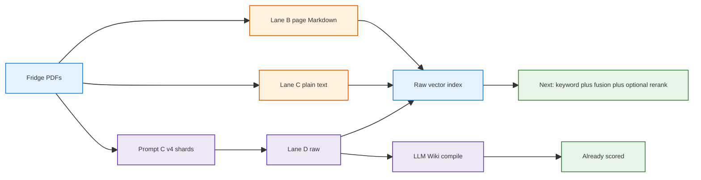

<h1 id="about-gpt-title" style="color:#0d47a1;font-size:1.5em;font-weight:700;border-bottom:2px solid #90caf9;padding-bottom:0.25em;margin-top:0">Further enhancement notes — ChatGPT “LLM Wiki RAG Advice”</h1>

**Type:** knowledge note, not a refactor plan.  
**Plan that uses this note:** [`REFACTOR_FURTHER_ENHANCEMENT_GPT.md`](../../ref_plan/new/REFACTOR_FURTHER_ENHANCEMENT_GPT.md) (updated 2026-10-23 after user review: **both** raw and wiki tracks + shared evidence libs + FastAPI stub).  
**Share:** [https://chatgpt.com/share/6ada2c90-9160-83ec-b331-2e999fea8431](https://chatgpt.com/share/6ada2c90-9160-83ec-b331-2e999fea8431) (title: LLM Wiki RAG Advice, 21 October 2026 in the chat).  
**Transcript:** `utils/chatgpt/transcripts/llm_wiki_rag_advice_6ada2c90-9160-83ec-b331-2e999fea8431.txt`.  
**How to read this:** the chat did not see our code. Its “Pass 3” letters A–E are recipes, similar in spirit to our ingest lanes A–D, not a replacement for them. Prompt names in the chat are the prompts we gave a GPT-class model, together with a zip of `brain/retail/archive/pdf/fridge-docs`, to produce Markdown we then put in `raw/sources` for LLM Wiki.

<h2 id="about-gpt-outline" style="color:#1565c0;font-size:1.22em;font-weight:650;border-left:4px solid #42a5f5;padding-left:10px;margin-top:1.1em">Document outline</h2>

1. [What the conversation was for](#about-gpt-purpose) — the decision the chat was pushed to make.
2. [Chief of staff analogy](#about-gpt-cos) — where a compiled wiki helps, and where it does not.
3. [What our benchmark already showed](#about-gpt-bench) — numbers the chat was summarizing.
4. [Prompt family](#about-gpt-prompts) — what B and C actually are in this repo.
5. [Pass 3 versus lanes A–D](#about-gpt-pass3) — letter collision and what we kept.
6. [Retrieval ladder](#about-gpt-ladder) — vector, keyword, fusion, rerank, in plain language.
7. [Second search is not magic](#about-gpt-agentic) — the determinism objection.
8. [Inaccuracy versus incompleteness](#about-gpt-claims) — why a judge panel is a weak fix.
9. [Three search arms](#about-gpt-arms) — tickets, manuals, wiki.
10. [Files that count as truth](#about-gpt-truth) — PDF, extracts, Prompt C.
11. [Contextual prefixes](#about-gpt-context) — Anthropic’s idea, and the cheap version.
12. [Tickets and reusable knowledge](#about-gpt-kcs) — what a closed ticket is allowed to become.
13. [How not to integrate LLM Wiki](#about-gpt-nashsu) — HTTP boundary, no fork yet.
14. [Links the chat named](#about-gpt-links) — not re-fetched here.
15. [What we took, dropped, and postponed](#about-gpt-judge) — pointer to the plan.
16. [Hypotheses still open](#about-gpt-open) — what a later scoreboard can settle.
17. [Glossary](#about-gpt-glossary) — short definitions.
18. [Diagram → repo mapping](#about-gpt-diagram) — EvidenceRetriever / Verifier / FastAPI.
19. [Plan revision (2026-10-23)](#about-gpt-revision) — why raw-only was too narrow.

---

<h2 id="about-gpt-purpose" style="color:#1565c0;font-size:1.22em;font-weight:650;border-left:4px solid #42a5f5;padding-left:10px;margin-top:1.1em">1. What the conversation was for</h2>

The user **attached the aggregate test analysis** ([`AGGREGATED_TEST_ANALYSIS_LLM_WIKI_AND_RAG.md`](./AGGREGATED_TEST_ANALYSIS_LLM_WIKI_AND_RAG.md)) into the chat first. Everything in the thread is anchored on that report: **Lane D** is the competitive wiki ingest (~**31/60** answerable); raw vector on the same folder is ~**29/60** and much faster. The business question is not “wiki vs RAG in the abstract” but **“what do we run next to get more accurate PDF-grounded Q&amp;A than those numbers?”**

The user brought a finished refrigerator-manual benchmark (LLM Wiki versus raw vector search) and asked two things at once:

1. How should a company second brain be built if the compiled wiki did **not** clearly beat raw vector search on customer questions?
2. What is the practical next experiment, given that industry write-ups talk about hybrid search, reranking, and agents?

The chat’s standing answer, repeated from the first long reply through the last turn:

- Keep a compiled wiki for **organizational memory** (relationships, repeated investigations, contradictions).
- Do **not** use that wiki as the only evidence for a precise product answer.
- The immediate experiment is a **stronger retriever on the manuals**, not another PDF conversion format.

That split is the useful core. The implementation sketch around it (six named arms, a new FastAPI app, claim auditing on every wiki sentence) was written without our harness. The plan file keeps the core and drops the sketch.

Plugin and web-search bodies in the share are redacted (`The output of this plugin was redacted.`). Anything the assistant said about Azure, Anthropic, or a 2026 paper is the assistant’s paraphrase, not a source we re-opened for this note.

---

<h2 id="about-gpt-cos" style="color:#1565c0;font-size:1.22em;font-weight:650;border-left:4px solid #42a5f5;padding-left:10px;margin-top:1.1em">2. Chief of staff analogy</h2>

The user compared LLM Wiki to a human chief of staff:

- They absorb reports and keep a working summary.
- When management asks, they answer from that summary, organized, not as a dump of files.
- The summary is not guaranteed complete or accurate.

The chat agreed, then tightened the analogy. A good chief of staff does **not** answer “what was revenue?” from memory. They open the finance report. They **do** use memory for “why are warranty costs rising, and what should we do?”, because that question crosses tickets, models, parts, and prior discussions.

<table>
<thead>
<tr style="background:#1565c0;color:white"><th>Job</th><th>What “good” looks like</th><th>What the manual benchmark measures</th></tr>
</thead>
<tbody>
<tr><td style="background:#e3f2fd">Customer Q&amp;A from a manual</td><td style="background:#e8f5e9">Right model, right number, cited passage, fast enough, honest refusal</td><td style="background:#e8f5e9">Yes — the 90 questions</td></tr>
<tr><td style="background:#e3f2fd">Company second brain</td><td style="background:#fff3e0">Less repeated investigation, earlier contradictions, briefings that still point at records</td><td style="background:#ffebee">No — the 90 questions never ask for a cross-department briefing</td></tr>
</tbody>
</table>

Consequences the chat argued, and that still hold:

- If the only product is “answer from the fridge PDF”, a careful search index is the economical system. A wiki is extra machinery.
- Management will not accept “the summary hallucinated” as a product explanation. The product has to **label** an answer: source-checked fact, interpretation, or not enough evidence. Our negative questions already force one of those labels (`Insufficient_Information_Based_On_Given_PDF`). The other two labels are not a separate field yet.
- Pre-writing summaries can be cheaper when the **same** cross-source question is asked often. It is not automatically cheaper when each question is new, or when live search is fast. The chat wrote that as compile-cost plus N times query-cost, versus index-cost plus N times a more expensive query. A cache of verified answers can give the same reuse without a wiki.
- “People study before the exam, so the AI should study before the question” is a weak analogy. The defensible claim is narrower: **a maintained synthesis is worth it when reusing it beats rediscovering it**, including the cost of keeping it honest. That claim is untested here.

The chat’s own warning: neither 31/60 (best wiki) nor 29/60 (raw on that lane) is good enough for unattended customer support. A two-question gap is not a strategy.

---

<h2 id="about-gpt-bench" style="color:#1565c0;font-size:1.22em;font-weight:650;border-left:4px solid #42a5f5;padding-left:10px;margin-top:1.1em">3. What our benchmark already showed</h2>

Full narrative: [`AGGREGATED_TEST_ANALYSIS_LLM_WIKI_AND_RAG.md`](./AGGREGATED_TEST_ANALYSIS_LLM_WIKI_AND_RAG.md). The chat was reacting to that family of results. Short form:

| Arm | Answerable (easy + hard, out of 60) | What it is |
|-----|--------------------------------------|------------|
| Wiki A (in-app PDF) | 3 (5%) | Compiled wiki over native PDF ingest |
| Wiki B (per-page Markdown) | 9 (15%) | Compiled wiki; cards often outrank source pages |
| Wiki C (plain text) | 4 (7%) | Compiled wiki; structure lost |
| Wiki D (Prompt C shards + full-copy sources) | 31 (52%) | Best wiki |
| Raw vector B, C, D | roughly 28–30 (about 47–50%) | Same raw files, vector top-k only, no wiki cards |

Overall scores out of 90 look kinder because the 30 “cannot be answered” items pass whenever the model emits the refusal literal. Use the 60.

Other facts the chat used correctly:

- Raw retrieval was on the order of **14×** faster (about 0.3 s versus about 4.4 s mean).
- Wiki and raw on lane D are **not** the same text. Wiki D’s searchable sources are full-copy pages. Raw D is the split-less Prompt C tree. A small accuracy gap mixes retrieval and corpus.
- A GE door-alarm miss can be a **missing fact** (the “2 minutes” sentence never made it into the wiki source), not a ranking bug. Vector search then looks “smarter” because it still has the sentence.
- Concept cards can occupy the top slots so the answering model never sees the manual page.
- High vector similarity is not evidence that every part of the question is supported.

Facts the chat treated as open, which our code still confirms:

- Raw vector search stores `model_id` and still does not filter on it (`vector_search` in `raw_rag_index.py`). Wrong-SKU top-1 is a known raw failure in the aggregate.
- Wiki “hybrid” in our harness is keyword-style scoring plus vectors plus rank fusion plus a graph slot. It is not BM25-on-an-inverted-index plus a cross-encoder. Rank fusion (merge by rank position) does not read the passage again.

---

<h2 id="about-gpt-prompts" style="color:#1565c0;font-size:1.22em;font-weight:650;border-left:4px solid #42a5f5;padding-left:10px;margin-top:1.1em">4. Prompt family</h2>

These files are **prompts**, not runtime code. They were sent, with the fridge PDFs, to a GPT-class chat. The returned Markdown was copied into a lane’s `raw/sources` and compiled by LLM Wiki.

| Name in conversation | On disk | What it asked the external model to produce |
|----------------------|---------|-----------------------------------------------|
| Prompt C | `brain/retail/archive/fridge_prompts_pdf_or_zip_updated/Prompt_C.md` (older copy also under `tmp/fru-gpt-prompts/`) | Strict, source-only, text-only technician notes for simple wiki ingest |
| Prompt C v2 | `Prompt_C_v2.md` in that archive | Same, plus retrieval-safe handling of UNKNOWN |
| Prompt C v3 split | `Prompt_C_v3_split.md` | One Markdown file per top-level `##` section |
| Prompt C v4 | `Prompt_C_v4_split.md` | **4–10 coarse shards per PDF**, knowledge units nested under those parts. This is what lane D raw uses (`fridge-docs-split-less`) |

Lane map, so the letters do not drift:

| Our lane | Folder | Raw material the prompts helped create |
|----------|--------|------------------------------------------|
| A | `brain/retail` | Original PDFs ingested inside LLM Wiki. Not a prompt export. |
| B | `brain/retail-md` | External per-page Markdown (Docling-style), not Prompt C. |
| C | `brain/retail-txt` | External plain text. |
| D | `brain/retail-md-learned` | Prompt C v4 shards. Wiki side also has full-copy source pages from the learned-section plan. |

v4 caveat, from the shard preambles themselves: several user-guide preambles say the v4 export is a **thematic merge of the earlier v3 text**, not a fresh transcription of the PDF. Treat lane D raw as **derived notes**. Do not describe it as a page-faithful copy of the manual.

The chat’s advice “Prompt C is an extra representation, not a replacement for the original” matches that caveat. Its advice “also index Prompt B and Prompt C as two raw copies” does **not** match our lanes: we do not have a Prompt B sibling of v4, and stacking page-Markdown with v4 shards in **one** search index would repeat claims and crowd the top slots. Separate lanes already exist for that comparison.

---

<h2 id="about-gpt-pass3" style="color:#1565c0;font-size:1.22em;font-weight:650;border-left:4px solid #42a5f5;padding-left:10px;margin-top:1.1em">5. Pass 3 versus lanes A–D</h2>

The chat’s Pass 3 table:

| Chat letter | Chat meaning |
|-------------|--------------|
| A | Faithful raw text, vector only |
| B | Same text, keyword + vector + reranker |
| C | Raw text **plus** Prompt C shards, same strong retriever |
| D | Prompt C compiled by the wiki, current wiki hybrid |
| E | Raw + Prompt C + wiki, then wiki-guided retrieval, source checks, and a second search |

How to hear it without renaming our experiment:

- Chat A is our **raw vector** mode, already run.
- Chat B is the **missing raw upgrade** (keyword, fusion, rerank).
- Chat C is “put two representations in one index”. We should not. Lane D **is** the Prompt C corpus; lane B **is** the page Markdown corpus. Run the new retriever on each lane separately.
- Chat D is our **wiki** arm, already run. Best score is our lane D, which is a coincidence of letters, not the same design.
- Chat E bundles three unmeasured ideas (use the wiki as a map, verify claims, search again). Those stay ideas until the retriever upgrade has a score.

The chat also said: do not build five apps; use one harness and feature switches. That part matches `tests/retail_multi_profiles/` and is what the plan does.

---

<h2 id="about-gpt-ladder" style="color:#1565c0;font-size:1.22em;font-weight:650;border-left:4px solid #42a5f5;padding-left:10px;margin-top:1.1em">6. Retrieval ladder</h2>

The last turns of the chat are a lay explanation of reranking. Condensed, with the misconception the user asked about corrected.

<table>
<thead>
<tr style="background:#1565c0;color:white"><th>Step</th><th>What it looks at</th><th>What it cannot do</th></tr>
</thead>
<tbody>
<tr><td style="background:#e3f2fd"><strong>Vector search</strong></td><td>Question and passage are each compressed to a vector <strong>separately</strong>, then compared. Good at “this is about freezer temperature”.</td><td>Fine differences die in the compression. A sensor-diagnostic paragraph and a “set freezer from 5°F to −8°F” paragraph can look alike.</td></tr>
<tr><td style="background:#e3f2fd"><strong>Keyword / BM25</strong></td><td>Rare exact words (“2 minutes”, a model code, “Crushed Ice”) get a high score.</td><td>A paraphrase with none of those words can miss. Our ticket stack has this leg. Raw manuals do not, yet.</td></tr>
<tr><td style="background:#e3f2fd"><strong>Rank fusion</strong></td><td>If a chunk is near the top of <em>either</em> list, it stays in the pool. We already do this for tickets (`reciprocal_rank_fusion`) and for wiki hybrid.</td><td>It does <strong>not</strong> read the chunk again. It only trusts the two ranks. Equal weights are not a reranker.</td></tr>
<tr><td style="background:#e3f2fd"><strong>Cross-encoder rerank</strong></td><td>A smaller transformer reads <strong>question and passage in one input</strong> and emits a new relevance score. Typical training is “is this passage a good answer to this question?”, not “predict the next word”.</td><td>It only reorders the pool it was given (often 20–30). It does not search the whole manual. It was not trained on our PDFs. The facts are in the passage text, not in the reranker’s memory.</td></tr>
<tr><td style="background:#e3f2fd"><strong>Listwise LLM rerank</strong></td><td>One chat-model call sees the question and the short list and returns an order. Same job as the cross-encoder, using a model we already call for answers.</td><td>More expensive and less stable than a small cross-encoder. Can ignore instructions. Must be checked: only ids from the pool, else keep the fused order.</td></tr>
<tr><td style="background:#e3f2fd"><strong>Answer model</strong></td><td>Writes the reply from the passages it was given.</td><td>A fluent answer is not a citation check. That is why a separate judge exists in the harness.</td></tr>
</tbody>
</table>

BERT versus GPT, as the last turn put it:

- GPT-style models are trained to predict the **next** token from earlier tokens. They are generators.
- BERT-style models are trained to fill a **missing** word using words on both sides. They are encoders.
- A reranker that **uses** a BERT-style body is then trained again on question–passage pairs to output **relevance**. It is not scoring “how likely is the next word of this manual”. The user’s guess (highest score means the passage’s next word is the most predictable) is the wrong mechanism.
- Manual knowledge enters when the **chunk text is in the input**. If the pool never contained the temperature range, no reranker will recall it from model weights. Treating the reranker as a fridge expert is the failure mode.

Why not rerank every chunk in the corpus: each candidate is a separate forward pass (or a long joint prompt). Vectors and keywords exist to cut millions of chunks down to a few dozen. The expensive reader runs only on that short list.

The plan’s first rerank is the **listwise LLM call**, not a new BERT weight file, because the harness already has an LLM client and the 90-question set is small. If that call helps and the bill or the wait is the problem, a cross-encoder is the later swap. The chat preferred the cross-encoder as the industry default. We agree it is the better production ranker **after** a scoreboard shows that re-reading the pool beats fusion alone.

Debug habit the chat insisted on, and we should keep: store the keyword rank, the vector rank, the fused rank, and the rerank rank. Otherwise a gain cannot be attributed.

---

<h2 id="about-gpt-agentic" style="color:#1565c0;font-size:1.22em;font-weight:650;border-left:4px solid #42a5f5;padding-left:10px;margin-top:1.1em">7. Second search is not magic</h2>

The user objected: if the files do not change, search is deterministic, so “search again” cannot find a new chunk.

The chat agreed, with one distinction:

- Repeating the **same** query returns the same hits. That does nothing.
- A second query helps only when it asks for a **missing piece** the first query did not name. Example they used: first query finds Samsung “not cooling” steps; the user also asked for the selectable freezer range; the second query is about freezer controls, not “not cooling” again.
- The system does not know the gold temperature. It only knows the question had two parts, and the first passages did not state a range. That check is itself a model call and can be wrong (it may think a vague sentence is enough, or miss a number that was present).
- If the fact is absent from the indexed files, more queries will not create it. The door-alarm “2 minutes” case is this kind of miss when the wiki copy dropped the sentence.
- Cap it. The chat’s practical version was **one** extra search, then answer or refuse. An open-ended agent on a fixed manual set can also wander.

We are not building that loop in the next refactor. It would change accuracy for reasons other than fusion and rerank. It belongs after those numbers exist, and only on hard questions that still failed with the right fact possibly elsewhere in the same PDF.

“Required components” feedback (found versus missing) is a planner’s guess, not a guarantee. The chat walked this back in a later turn: the Samsung table was illustrative, not a measured retrieval.

---

<h2 id="about-gpt-claims" style="color:#1565c0;font-size:1.22em;font-weight:650;border-left:4px solid #42a5f5;padding-left:10px;margin-top:1.1em">8. Inaccuracy versus incompleteness</h2>

The user asked whether wiki inaccuracy is the serious defect, and whether a dual layer fixes it. Also: should a panel of models vote on each summary?

The chat’s distinction is worth keeping:

| Defect | What the assistant can still do | Danger |
|--------|----------------------------------|--------|
| Incomplete wiki | Search the original, or say it does not know | Missed answers |
| Incorrect wiki | Later pages cite the bad sentence as if it were a source | Cascading false “facts” |

A second copy of the manuals (the dual layer) stops the wiki from being the **only** place a number can come from. It does not stop a bad sentence from being written, or from being retrieved first. Extra controls the chat listed, none of which we have as code:

- Store a claim with model, source path, page, and a status: grounded, inferred, contradicted, unverified.
- Check numbers, units, and model codes with plain code where possible. Use a model only to compare a claim to a **quoted** passage, not to decide whether the summary “sounds right”.
- Do not let a summary cite another summary as its only evidence.
- Re-check claims when the source file changes. Cache by source hash.
- A panel vote is optional for high-risk disputes. Agreement among models is not evidence. The default check is **one other model that must quote the passage**, plus the deterministic checks.
- Completeness is a different test from accuracy. A wiki can be perfectly faithful to the sentences it kept and still have dropped the sentence the customer needs.

The chat was honest that this still cannot promise zero errors: the PDF can be wrong, and the checker can miss a condition (“only when the alarm is enabled”).

Practical boundary for our repo: the 90-question judge already checks **answers** against gold. It does not audit every wiki page at ingest. Building that auditor is a product of its own. The next plan does not start it. If we start it later, the chat’s integration advice was: run it **outside** LLM Wiki first (read generated pages, quarantine untrusted ones from the customer path). Blocking a write inside `nu_llm_wiki` needs a hook that project does not document, and would fork a TypeScript/Rust app for a Python checker.

---

<h2 id="about-gpt-arms" style="color:#1565c0;font-size:1.22em;font-weight:650;border-left:4px solid #42a5f5;padding-left:10px;margin-top:1.1em">9. Three search arms</h2>

The user pointed at two existing hybrids and asked not to pretend the manual experiment is the first hybrid in the repo. The chat’s corrected picture:

| Arm | What it searches | Hybrid today | Rule that must stay different |
|-----|------------------|--------------|-------------------------------|
| Historical tickets | Past service cases | Keyword (Tantivy or similar) + vectors + rank fusion. Diagnostic codes can get an extra boost. No cross-encoder. | A similar model may be a useful hint when this SKU has no cases. |
| Product manuals | `raw/sources` of one lane | Vector only, until the new plan. | Do **not** borrow a specification from another SKU. Hard filter. |
| LLM Wiki | Compiled pages and graph | Keyword-style score + vectors + fusion + graph expansion, via the app’s HTTP API | Cards and graph are navigation. Source pages are evidence. Do not assume this is BM25 plus a reranker. |

Share **ideas** (fusion math, “filter by model”, “log every rank”). Do not share **indexes**. A ticket row is not a manual chunk. Pointing manual search at `retail_brain.lexical_search` would query the wrong corpus.

The chat’s diagram of one Python orchestrator calling all three is a destination, not the next patch. Customer answers today already have separate paths (`answer_tickets.py` versus the manual harness). Merging them before the manual scoreboard exists would make a failure impossible to attribute.

---

<h2 id="about-gpt-truth" style="color:#1565c0;font-size:1.22em;font-weight:650;border-left:4px solid #42a5f5;padding-left:10px;margin-top:1.1em">10. Files that count as truth</h2>

The chat wanted three layers. Mapped onto files we actually have:

| Layer | Chat’s wish | What we have |
|-------|-------------|--------------|
| Authoritative document | Original PDF, kept, hashed, not used as a second full-text index | `brain/retail/archive/pdf/fridge-docs` (and lane A’s copy inside the wiki project). Good. |
| Faithful searchable text | One verified Markdown per PDF, page mapping, tables kept | **Not one file.** Lane B is per-page Markdown and has dropped facts. Lane C is plain text. Neither is certified page-complete. |
| Derived organization | Prompt C, linked back, not authoritative by itself | Lane D raw. Explicitly a technician rewrite; v4 often merges v3. Full-copy wiki pages on D are a **second** derived view, closer to “keep the wording”, still not the PDF. |

“Keep both the PDF and the Markdown” is right as **storage**. “Index both as if they were independent witnesses” is wrong: the same sentence would look like two sources. Index one text representation per lane. Open the PDF when a human needs the figure or the printed page.

The chat’s phase-1 “lock a canonical extract before any new search” would delay the retriever experiment behind another PDF project. The aggregate already says preprocessing dominated the wiki scores, and also says to stop adding formats until retrieval on the current files is less naive. We follow the second instruction.

Duplicate chunks are cheap on disk and expensive in the top-k. That is the operational form of “don’t ingest the PDF and the Markdown into the same watched folder”.

---

<h2 id="about-gpt-context" style="color:#1565c0;font-size:1.22em;font-weight:650;border-left:4px solid #42a5f5;padding-left:10px;margin-top:1.1em">11. Contextual prefixes</h2>

Anthropic’s published contextual-retrieval note, as the chat summarized it (we did not re-read the paper for this file): before embedding, prepend a short description of where the chunk sits in the document, built by a model from the whole document. Both the keyword index and the vector index see that prefix. The answer model should still see the original sentences. They reported large gains on **their** benchmark, including a further gain from reranking. Those percentages are not an FRU forecast.

Where it would sit in our pipeline: **after** chunking, **before** embed, on the string that is indexed. It is not a new lane and it does not replace Prompt C.

The chat’s sensible order, which we should keep if we ever do this:

1. A **deterministic** prefix from the path: manufacturer, SKU, manual name, section. No model call. Our chunk rows already have `model_id` and `source_relpath`; the query string also contains the SKU. A prefix still helps when the chunk body itself never says the model name.
2. Only then an LLM-written 50–100 token blurb, with a ban on new facts.
3. Measure against (1). Prompt C already spent a large model pass to reorganize the manual. Another blurb on every window may be redundant and forces a full re-embed.

This is postponed in the plan until fusion has a score. A prefix changes every vector, so it cannot be mixed silently into the hybrid comparison.

---

<h2 id="about-gpt-kcs" style="color:#1565c0;font-size:1.22em;font-weight:650;border-left:4px solid #42a5f5;padding-left:10px;margin-top:1.1em">12. Tickets and reusable knowledge</h2>

The user asked: if manual Q&amp;A uses search, should each resolved case still be written into the wiki, or only into the ticket note, given we already hybrid-search old tickets?

The chat’s answer, aligned with the Knowledge-Centered Service idea it cited (capture knowledge in the flow of work, keep incidents separate from reusable articles):

| Keep on the ticket | Promote only after a check |
|--------------------|----------------------------|
| The customer’s words, the suggestion, what the technician did, the outcome | A pattern that has shown up enough times to be a procedure, still tied to which models it was seen on |
| “We tried a fix from a similar model” as a hypothesis | Not a universal rule from one success |
| A FAQ whose answer is already in the manual | A link to that manual passage, not a new “fact” page that can drift |

Do not: close the ticket, let a model declare the suggestion correct, and publish it as verified.

The wiki’s real advantage over search, if it has one, is this **accumulation with status**, not a higher score on the 90 manual questions. A fair test of that advantage is a set of cross-source management questions, compared with an agent that can search the same tickets and manuals and is allowed to write notes. The 90-question suite cannot settle it.

Customer-visible text, agent-visible troubleshooting, and technician-only repair steps (electrical, refrigerant) should not be one undifferentiated index. The chat flagged that as an access rule, not a retrieval algorithm. We do not have that split in the manual harness.

---

<h2 id="about-gpt-nashsu" style="color:#1565c0;font-size:1.22em;font-weight:650;border-left:4px solid #42a5f5;padding-left:10px;margin-top:1.1em">13. How not to integrate LLM Wiki</h2>

The chat inspected the public `nashsu/llm_wiki` tree (our app is that project, `nu_llm_wiki` in plans):

- UI: TypeScript / React. Backend: Tauri / Rust. Ingest lives in TypeScript (`src/lib/ingest.ts` in upstream).
- Local HTTP API on `127.0.0.1:19828` (search, read file, graph, sources). The manual harness already uses that for the wiki arm.
- “Read sources only” and search over raw sources exist upstream. Our benchmark’s custom harness is not every mode the app offers. Improving the harness is not the same as replacing the compiler.
- There is review metadata. That is not an automatic “block this sentence until a Python checker agrees”.

So:

- Python can **call** the wiki and can **read** what it wrote. Python cannot be pasted into the Rust/TypeScript process.
- Giving the app only Markdown (lane B, C, or D) means the app does not automatically open the PDF. A side manifest (document id, PDF path, hash, page map) would let **our** checker open the PDF. We do not have that manifest. Importing PDF and Markdown into the same raw folder duplicates ingest. Avoid that.
- First version of any future audit: compile as usual, then mark pages trusted or not in **our** answer path. A pre-write hook inside the app is a later, smaller patch if the audit proves useful.

The chat’s module sketch (`EvidenceRetriever`, `EvidenceVerifier`, `qa_api`, adapters) is a reasonable **future** layout. It is not a reason to stand up a new service before `tests/retail_multi_profiles/lib/raw_rag_search.py` can fuse two lists.

---

<h2 id="about-gpt-links" style="color:#1565c0;font-size:1.22em;font-weight:650;border-left:4px solid #42a5f5;padding-left:10px;margin-top:1.1em">14. Links the chat named</h2>

Kept so a later pass can verify them. Plugin output that might have contained the real quotes was redacted. Do not treat the percentages in section 11 as measurements we reproduced.

| Topic | URL as written in the share |
|-------|-----------------------------|
| LLM Wiki pattern | https://gist.github.com/karpathy/442a6bf555914893e9891c11519de94f |
| Implementation we run | https://github.com/nashsu/llm_wiki |
| Contextual retrieval | https://www.anthropic.com/research/contextual-retrieval |
| Agentic retrieval paper (May 2026, as cited) | https://arxiv.org/abs/2605.05538 |
| Knowledge-Centered Service solve loop | https://library.serviceinnovation.org/KCS/Knowledge-Centered_Success_Practices_Guide/201-Solve_Loop |
| Semantic reranking (Elastic) | https://www.elastic.co/docs/solutions/search/ranking/semantic-reranking |
| Retrieve and rerank (sentence-transformers) | https://www.sbert.net/examples/sentence_transformer/applications/retrieve_rerank/README.html |
| RAG retrieval guide (Microsoft) | https://learn.microsoft.com/en-us/azure/architecture/ai-ml/guide/rag/rag-information-retrieval |
| Upstream ingest file | https://github.com/nashsu/llm_wiki/blob/main/src/lib/ingest.ts |

The chat also summarized Azure AI Search hybrid (keyword + vector + semantic rank) and AWS agentic retrieval without a stable URL in the visible transcript. A 2026 cybersecurity comparison (graph plus text, multi-hop, “up to 35%”) was cited as domain-specific, not as a reason for us to add a graph database. The chat explicitly said a separate graph database is not justified by the fridge results. Our wiki graph is already inside LLM Wiki; we are not adding another.

---

<h2 id="about-gpt-judge" style="color:#1565c0;font-size:1.22em;font-weight:650;border-left:4px solid #42a5f5;padding-left:10px;margin-top:1.1em">15. What we took, dropped, and postponed</h2>

Judgment is recorded as decisions **D1–D10** and grill **G1–G2** in the refactor plan (revised 2026-10-23). Short form:

<table>
<thead>
<tr style="background:#1565c0;color:white"><th>From the chat</th><th>Judgment</th><th>Why</th></tr>
</thead>
<tbody>
<tr><td style="background:#e3f2fd">Wiki for memory, search for exact answers</td><td style="background:#e8f5e9">Keep as the product story</td><td>The 90 questions do not measure the memory story. Do not abandon the wiki because raw vector matched it.</td></tr>
<tr><td style="background:#e3f2fd">Next experiment is hybrid plus rerank on the manuals</td><td style="background:#e8f5e9">Keep — raw track</td><td>P1–P3: keyword, fusion, listwise rerank on Lance chunks.</td></tr>
<tr><td style="background:#e3f2fd">Boost wiki Q&amp;A (sources beat cards)</td><td style="background:#e8f5e9">Keep — wiki track</td><td>P4: `sources_only`, `sources_rerank` in main harness on Lane D (harness-only, grill G2).</td></tr>
<tr><td style="background:#e3f2fd">Six arms A–E as the test matrix</td><td style="background:#fff3e0">Map to modes, not folders</td><td>Raw modes + wiki_evidence + combined on lane D (P6). Do not add ingest lanes.</td></tr>
<tr><td style="background:#e3f2fd">Index Prompt C beside a new canonical Markdown</td><td style="background:#ffebee">Do not</td><td>No certified canonical Markdown. Mixing representations duplicates hits. v4 is not page-faithful.</td></tr>
<tr><td style="background:#e3f2fd">Cross-encoder as the first reranker</td><td style="background:#fff3e0">Postpone the dependency</td><td>One listwise call tests “read the passage with the question” without new weights. Swap in a cross-encoder if the scoreboard says the idea works and the LLM bill does not.</td></tr>
<tr><td style="background:#e3f2fd">One extra targeted search</td><td style="background:#fff3e0">Postpone</td><td>User’s determinism objection is right for a repeated query. A new subquery is a second experiment.</td></tr>
<tr><td style="background:#e3f2fd">EvidenceRetriever / EvidenceVerifier + FastAPI</td><td style="background:#e8f5e9">In plan</td><td>P5 libs, P7 verifier v1, P9 thin FastAPI (grill G1). Full wiki ingest gate still deferred.</td></tr>
<tr><td style="background:#e3f2fd">Ticket → reviewed article → wiki</td><td style="background:#fff3e0">Keep as policy, not code</td><td>One closed ticket is not a universal repair rule. Ticket search already exists and should stay separate.</td></tr>
<tr><td style="background:#e3f2fd">Hard SKU filter on manuals</td><td style="background:#e8f5e9">Do this first inside the hybrid modes</td><td>Column already exists. Legacy vector mode stays unfiltered so old runs stay comparable.</td></tr>
<tr><td style="background:#e3f2fd">Held-out models before any new run</td><td style="background:#fff3e0">Postpone</td><td>Needed before a customer launch. The 90 is the right regression set for this patch.</td></tr>
</tbody>
</table>

---

<h2 id="about-gpt-open" style="color:#1565c0;font-size:1.22em;font-weight:650;border-left:4px solid #42a5f5;padding-left:10px;margin-top:1.1em">16. Hypotheses still open</h2>

These are the questions worth a scoreboard. They are not settled by the chat.

1. **Lane D primary (A2):** Does manual raw reach **≥ 33/60** answerable (beat wiki D **31**)? Candidates: `hybrid_rrf_rerank` on raw. Wiki modes and combined wiki+raw are **A1 / Part B** — see [§20](#about-gpt-realign2).
2. On lane D raw, does hybrid beat **~29/60** with retrieval **&lt; 2 s**?
3. On lane B, does raw hybrid recover ground raw vector already won over wiki (regression guard)?
4. Does wiki `sources_only` alone approach sources-only replay gains (24/38 on mixed tickets → extrapolate to full 90)?
5. How often is gold outside the fused top 20 (rerank ceiling)?
6. Does verifier v1 + one expansion rescue hard-tier rows without hurting easy?
7. Cross-source “second brain” value — still untested by the 90.

---

<h2 id="about-gpt-glossary" style="color:#1565c0;font-size:1.22em;font-weight:650;border-left:4px solid #42a5f5;padding-left:10px;margin-top:1.1em">17. Glossary</h2>

| Term | In this note |
|------|----------------|
| Lane A–D | Four **ingest** setups (PDF, page Markdown, plain text, Prompt C shards). Not the chat’s Pass 3 letters. |
| Answerable 60 | Easy + hard questions. The score that matters. Overall / 90 counts easy refusals as passes. |
| Raw arm | Search `raw/sources` chunks. No wiki cards. Today: vectors only. |
| Rank fusion | Merge two ordered lists by rank. Does not re-read text. |
| Rerank | New scores after a model reads the question and each candidate together. |
| Cross-encoder | Small transformer that does that rerank. Not a generator, not trained on our manuals. |
| Listwise rerank | One LLM call that returns an order for a short list. |
| Prompt C v4 | External prompt that produced lane D’s coarse shards. Not a function in the wiki app. |
| Full-copy | Wiki source pages that keep manual wording, as opposed to concept cards. On lane D they are not identical to the raw v4 files. |
| Dual layer | Wiki for synthesis, original text for checking a fact. Necessary for honesty, not sufficient. |
| EvidenceRetriever | Orchestrates manual raw, wiki HTTP, (future) ticket adapters; returns ranked passages. |
| EvidenceVerifier | Checks coverage or claim vs cited passage; v1 on hard tier in benchmark. |

---

<h2 id="about-gpt-diagram" style="color:#1565c0;font-size:1.22em;font-weight:650;border-left:4px solid #42a5f5;padding-left:10px;margin-top:1.1em">18. Diagram → repo mapping</h2>

See refactor plan [Part A / shared components](../../ref_plan/new/REFACTOR_FURTHER_ENHANCEMENT_GPT.md#gpt-part-a). The attached screenshot is the chat’s **target production shape**, not a requirement to skip the benchmark.

| Diagram box | Plan phase | Repo (target) |
|-------------|------------|----------------|
| Q&amp;A Orchestrator (COS) | **Phase 4 — B** | `evidence_qa_api.py` |
| EvidenceRetriever | **Phase 1 — A2** | `retail_brain/evidence/retriever.py` |
| EvidenceVerifier | **Phase 1 — A2** | `retail_brain/evidence/verifier.py` |
| AgenticRetrievalController | **Phase 1 — A2** | `retail_brain/evidence/agentic.py` |
| Manual index | **Phase 1 — A2** | `.retail-raw-rag/` Lance |
| nashsu Wiki | **Phase 3 — A1** | `LlmWikiHttpClient` + audit |
| Ticket index | **Phase 2 — A3** | unchanged `pg_search` |
| Wiki audit worker | **Phase 3 — A1** | offline claim audit job |

**Grill G1:** libraries + harness first; FastAPI stub last (**Phase 4**, not Phase 1).

---

<h2 id="about-gpt-revision" style="color:#1565c0;font-size:1.22em;font-weight:650;border-left:4px solid #42a5f5;padding-left:10px;margin-top:1.1em">19. Plan revision (2026-10-23)</h2>

The first draft plan only upgraded **raw vector**. That matched one chat thread (user point 8: “enhance separate RAG for B,C,D”) but **under-read** the opening goal: beat **Lane D** Q&amp;A from PDF knowledge, where **wiki hybrid is still the accuracy leader** and the chat also recommended **wiki-side evidence fixes** (sources-first, rerank, dual-layer verification) and the **two reusable Python modules** in the diagram.

The revised plan keeps **both** enhancement tracks, maps chat arm **E** to **combined** mode on lane D, and records your grill choices: **harness-only wiki**, **FastAPI after libs**.

---

<h2 id="about-gpt-realign2" style="color:#1565c0;font-size:1.22em;font-weight:650;border-left:4px solid #42a5f5;padding-left:10px;margin-top:1.1em">20. Second realignment — A1 / A2 / A3 then B (2026-10-23)</h2>

**Source:** [diagram chat](https://chatgpt.com/share/6adb338c-a8e0-83ec-88aa-f633463cb70e) · transcript `utils/chatgpt/transcripts/refactor_three_tracks_cos_6adb338c-a8e0-83ec-88aa-f633463cb70e.txt` · one-page summary [`REALIGNMENT_REFACTOR_GOALS.md`](./REALIGNMENT_REFACTOR_GOALS.md).

The **first** long thread ([§1–16](#about-gpt-why)) is still the design pantry (Pass 3 arms, dual layer, rerank). The **second** thread fixes **execution order** and **scope boundaries**:

| Part | Meaning |
|------|---------|
| **A1** | Wiki — compile-time claim audit + trust; wiki Q&amp;A harness modes |
| **A2** | Manual RAG — 90-Q benchmark; hybrid + rerank + bounded agentic + verifier |
| **A3** | Tickets — reuse hybrid; optional rerank + agentic + applicability verifier |
| **B** | COS — wiki provisional vs evidence-backed; **after** A is measured |

**Plan file** [`REFACTOR_FURTHER_ENHANCEMENT_GPT.md`](../../ref_plan/new/REFACTOR_FURTHER_ENHANCEMENT_GPT.md) now implements **Phase 1 = A2 only**. Combined wiki+raw and COS are **out of Phase 1** (Part B / Phase 4).
