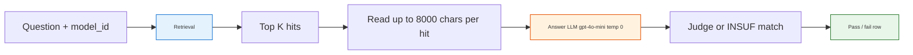
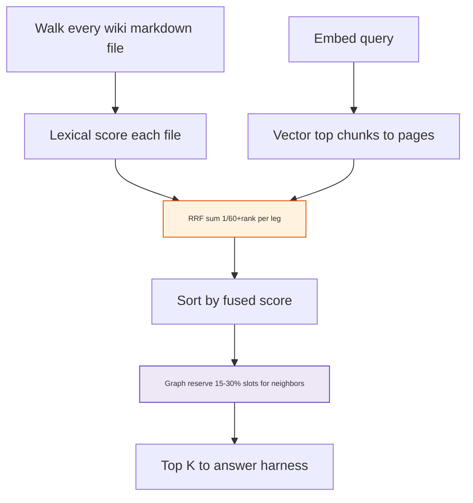
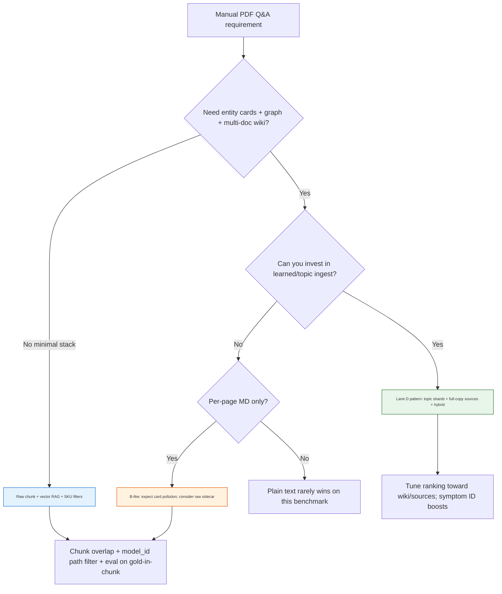

<h1 id="agg-title" style="color:#0d47a1;font-size:1.5em;font-weight:700;border-bottom:2px solid #90caf9;padding-bottom:0.25em;margin-top:0">Aggregated test analysis — product manual PDFs, preprocessing, and search for accurate Q&amp;A</h1>

**Audience:** Product, service, and platform teams deciding **how to preprocess complex product PDFs** (user manuals, repair guides) and **how to search** that content so customer-facing Q&amp;A stays factual.  
**Scope:** Refrigerator manual benchmark (3 SKU families, 90 questions) — methods generalize to other durable-goods manuals.  
**Standalone:** This document **aggregates** prior internal analyses into one narrative; you do **not** need sibling artifact files to interpret the conclusions.  
**Evidence runs (internal):** LLM Wiki four-lane **`abcd-full-openai-v2`** (360 rows) · raw-sources RAG **`abcd-raw-full-openai-v1`** (270 rows, lanes B/C/D) · sources-only replay (38 mixed B/D tickets).  
**Last updated:** 2026-10-21.

<h2 id="agg-outline" style="color:#1565c0;font-size:1.22em;font-weight:650;border-left:4px solid #42a5f5;padding-left:10px;margin-top:1.1em">Document outline</h2>

1. [Executive summary](#agg-exec) — what to do first, and what not to assume.
2. [Business question](#agg-problem) — preprocessing + retrieval for manual Q&amp;A.
3. [Experiment design](#agg-method) — fixed questions, models, and fairness rules.
4. [Preprocessing strategies (lanes A–D)](#agg-preprocess) — PDF → searchable corpus options.
5. [Search architectures](#agg-search) — LLM Wiki hybrid vs raw vector RAG.
6. [Results — four-lane LLM Wiki](#agg-results-abcd) — headline accuracy by lane.
7. [Results — Lane B vs Lane D](#agg-results-bd) — why ingest shape dominates.
8. [Results — LLM Wiki vs raw RAG](#agg-results-wiki-raw) — accuracy, quadrants, path mix.
9. [Performance and cost of retrieval](#agg-perf) — latency and wall clock.
10. [Failure modes (retrieval, corpus, judge)](#agg-failures) — pattern catalog.
11. [Worked examples](#agg-examples) — E02, TurboCool “tc”, filter reset, freezer range.
12. [Hybrid search mechanics (LLM Wiki)](#agg-hybrid) — keyword, vector, RRF, graph.
13. [Decision framework for your company](#agg-decision) — choose preprocessing + search.
14. [Recommendations by scenario](#agg-reco) — practical defaults and caveats.
15. [Operational checklist](#agg-ops) — before you ship or extend the benchmark.
16. [Limitations and benchmark integrity](#agg-limits) — gold vs indexed text.
17. [Glossary](#agg-glossary) — terms used in this doc.
18. [Appendix — run metadata](#agg-appendix) — suite shape, config snapshot, ticket strata.

---

<h2 id="agg-exec" style="color:#1565c0;font-size:1.22em;font-weight:650;border-left:4px solid #42a5f5;padding-left:10px;margin-top:1.1em">1. Executive summary</h2>

<table>
<thead>
<tr style="background:#1565c0;color:white"><th>Finding</th><th>Implication for a typical manufacturer / service org</th></tr>
</thead>
<tbody>
<tr><td style="background:#e3f2fd"><strong>Preprocessing matters more than “turn on vector search.”</strong></td><td style="background:#e8f5e9">Same hybrid search stack ranged from <strong>5%</strong> to <strong>52%</strong> on answerable questions depending on how PDFs became wiki text.</td></tr>
<tr><td style="background:#e3f2fd"><strong>Best LLM Wiki ingest (Lane D)</strong></td><td style="background:#e8f5e9">Topic-aligned <strong>learned shards</strong> + <strong>full-copy source pages</strong> under a compiled wiki — symptom blocks and troubleshooting sections rank high.</td></tr>
<tr><td style="background:#e3f2fd"><strong>Per-page Markdown alone (Lane B) underperforms</strong></td><td style="background:#fff3e0">Entity/concept cards often <strong>outrank</strong> manual source pages; pages are caption-heavy and may <strong>omit</strong> facts present in consolidated PDF extracts.</td></tr>
<tr><td style="background:#e3f2fd"><strong>Plain text (Lane C) and in-app PDF (Lane A)</strong></td><td style="background:#ffebee">Not competitive on this suite — structure loss or wrong evidence shapes.</td></tr>
<tr><td style="background:#e3f2fd"><strong>Raw vector RAG on untouched manual files</strong></td><td style="background:#e8f5e9">Beats LLM Wiki on lanes B and C (+21–29 pts overall pass rate) with <strong>~14× faster retrieval</strong>; on Lane D wiki still slightly ahead on accuracy but raw is close and much faster.</td></tr>
<tr><td style="background:#e3f2fd"><strong>Hybrid search can hide corpus gaps</strong></td><td style="background:#fff3e0">High <code>vector_score</code> on a symptom shard does not guarantee gold-level detail (e.g. <strong>2-minute</strong> door-alarm rule missing from searchable wiki).</td></tr>
</tbody>
</table>

**Practical default (manual Q&amp;A index inside an LLM Wiki–style product):** invest in **Lane D–style ingest** (topic shards + preserved source passages), tune hybrid ranking so **`wiki/sources/*`** wins over cards for SKU-scoped queries, and **validate gold against indexed text** before trusting eval pass rates.

**Alternative (simpler stack, lower latency):** keep **canonical Markdown/text manuals** under `raw/sources/**`, **chunk + embed + vector top-k**, accept **wrong-SKU** and **chunk-boundary** risks — strong when consolidated user guides retain verbatim specs (B/C raw wins).

---

<h2 id="agg-problem" style="color:#1565c0;font-size:1.22em;font-weight:650;border-left:4px solid #42a5f5;padding-left:10px;margin-top:1.1em">2. Business question</h2>

Customer questions (installation, controls, troubleshooting, parts) must be answered from **long PDF manuals** and sometimes **repair guides**. Before production you need answers to:

1. **Preprocessing:** Ingest PDFs **inside** a wiki compiler, as **external per-page Markdown**, as **plain text**, or as **LLM-digested topic shards** with full-copy sources?
2. **Retrieval:** Does **hybrid keyword + vector + graph** over wiki pages surface **answer-bearing manual text**, or mostly **marketing-style entity/concept cards**?
3. **End-to-end accuracy:** With fixed top-k, char budget, and closed-world answering, which pipeline maximizes **factual pass rate** on a **fixed 90-question** suite per product line?

The benchmark holds **questions, models, top-k, and prefix length** constant and varies **only** corpus layout and retrieval mode.

---

<h2 id="agg-method" style="color:#1565c0;font-size:1.22em;font-weight:650;border-left:4px solid #42a5f5;padding-left:10px;margin-top:1.1em">3. Experiment design</h2>

<h3 id="agg-method-suite" style="color:#00695c;font-size:1.05em;font-weight:600;margin-top:0.85em">3.1 Question suite</h3>

- **90 questions** × up to **4 ingest lanes** (A–D) in the primary run; raw RAG arm uses **lanes B, C, D** only (no lane A PDF duplicate).
- **Models:** `ge_GNE27JYMFS`, `kitchenaid_KRFF507HPS`, `samsung_RF28K9070SG` — **30 questions each** (10 easy, 10 hard, 10 negative / unanswerable from provided evidence).
- **Query shape:** `{model_id} {question}` — SKU-scoped search (no ticket Postgres leg in v1).

<h3 id="agg-method-pipeline" style="color:#00695c;font-size:1.05em;font-weight:600;margin-top:0.85em">3.2 Closed-world evaluation pipeline</h3>



**Defaults:** `search_top_k: 5`, `page_prefix_chars: 8000`, `evidence_mode: page_prefix`.

- **Negative questions (30 per lane):** Pass iff answer equals configured literal **`Insufficient_Information_Based_On_Given_PDF`** — **no judge LLM**.
- **Answerable (easy + hard, 60 per lane):** LLM-as-judge against gold prose; paraphrase OK; unsupported claims fail.

This is **retrieve-then-answer**, not open-ended chat RAG.

<h3 id="agg-method-read-scores" style="color:#00695c;font-size:1.05em;font-weight:600;margin-top:0.85em">3.3 How to read scores</h3>

- **Overall pass / 90** includes **30 negatives** all lanes pass trivially when the answer model emits the INSUF literal — **do not** treat **61/90** as “68% factual accuracy.”
- **Answerable 60** (easy + hard) is the primary metric for “did we answer from the manual?”
- **Hard** stratum separates paraphrase and multi-step reasoning; only Lane D reached double-digit hard passes on the wiki arm.

---

<h2 id="agg-preprocess" style="color:#1565c0;font-size:1.22em;font-weight:650;border-left:4px solid #42a5f5;padding-left:10px;margin-top:1.1em">4. Preprocessing strategies (lanes A–D)</h2>

<table>
<thead>
<tr style="background:#1565c0;color:white"><th>Lane</th><th>Typical brain folder</th><th>PDF → corpus</th><th>Search index shape</th></tr>
</thead>
<tbody>
<tr><td style="background:#e3f2fd"><strong>A</strong></td><td><code>brain/retail</code></td><td>Native PDF in LLM Wiki (in-app compile)</td><td>Large compiled source blobs; weak answerable scores</td></tr>
<tr><td style="background:#e3f2fd"><strong>B</strong></td><td><code>brain/retail-md</code></td><td>External PDF→MD (Docling-style), <strong>one file per PDF page</strong></td><td>Many small <code>wiki/sources/*pageNNN*</code> + entity/concept cards</td></tr>
<tr><td style="background:#e3f2fd"><strong>C</strong></td><td><code>brain/retail-txt</code></td><td>External PDF→plain text</td><td>Lossy structure; entity cards still dominate rankings</td></tr>
<tr><td style="background:#e8f5e9"><strong>D</strong></td><td><code>brain/retail-md-learned</code></td><td><strong>Prompt C</strong> topic shards + <strong>full-copy</strong> wiki sources from split-less manuals</td><td>Fewer, topic-aligned <code>wiki/sources/*part-*</code> + symptom IDs</td></tr>
</tbody>
</table>

Each lane is a **separate LLM Wiki project** (own `wiki/`, embeddings, graph). The harness uses **absolute project paths** from a lane registry — not a single global “brain profile” switch.

**Raw-sources arm (comparison):** Same lane folders but retrieval reads only **`raw/sources/**`** chunked (~2k chars, overlap 200) into a **Lance** vector index (`text-embedding-3-small`) — **no** wiki compile, **no** graph leg.

---

<h2 id="agg-search" style="color:#1565c0;font-size:1.22em;font-weight:650;border-left:4px solid #42a5f5;padding-left:10px;margin-top:1.1em">5. Search architectures</h2>

<table>
<thead>
<tr style="background:#1565c0;color:white"><th>Aspect</th><th>LLM Wiki hybrid (A–D)</th><th>Raw vector RAG (B/C/D)</th></tr>
</thead>
<tbody>
<tr><td style="background:#e3f2fd">Corpus</td><td><code>wiki/**</code> — sources, entities, concepts, graph links</td><td><code>raw/sources/**</code> chunks only</td></tr>
<tr><td style="background:#e3f2fd">Retrieval</td><td>Lexical walk + dense chunks + <strong>RRF</strong> fuse + <strong>graph</strong> slot reservation</td><td>Dense vector top-k only</td></tr>
<tr><td style="background:#e3f2fd">Typical win</td><td>Lane D: troubleshooting / water-ice / controls shards at rank 1–3</td><td>Verbatim manual prose in one chunk; no concept dilution</td></tr>
<tr><td style="background:#e3f2fd">Typical loss</td><td>Top-k = concept/entity cards; wrong SKU source shard</td><td>Wrong SKU in top-1; gold sentence split across chunk boundary</td></tr>
</tbody>
</table>

---

<h2 id="agg-results-abcd" style="color:#1565c0;font-size:1.22em;font-weight:650;border-left:4px solid #42a5f5;padding-left:10px;margin-top:1.1em">6. Results — four-lane LLM Wiki</h2>

**Run:** `abcd-full-openai-v2` · **360 rows** (90 × 4 lanes).

<table>
<thead>
<tr style="background:#1565c0;color:white"><th>Lane</th><th>Overall (90)</th><th>Easy (30)</th><th>Hard (30)</th><th>Negative (30)</th><th>Answerable (60)</th></tr>
</thead>
<tbody>
<tr><td style="background:#e3f2fd">A</td><td>33</td><td>3</td><td>0</td><td>30</td><td style="background:#ffebee">3 (5%)</td></tr>
<tr><td style="background:#e3f2fd">B</td><td>39</td><td>8</td><td>1</td><td>30</td><td style="background:#fff3e0">9 (15%)</td></tr>
<tr><td style="background:#e3f2fd">C</td><td>34</td><td>4</td><td>0</td><td>30</td><td style="background:#ffebee">4 (7%)</td></tr>
<tr><td style="background:#e8f5e9">D</td><td><strong>61</strong></td><td><strong>19</strong></td><td><strong>12</strong></td><td>30</td><td style="background:#e8f5e9"><strong>31 (52%)</strong></td></tr>
</tbody>
</table>

**Ordering on answerable accuracy:** **D ≫ B > C ≈ A** for this corpus and harness.

---

<h2 id="agg-results-bd" style="color:#1565c0;font-size:1.22em;font-weight:650;border-left:4px solid #42a5f5;padding-left:10px;margin-top:1.1em">7. Results — Lane B vs Lane D</h2>

Same hybrid search, same answer/judge — **only ingest differs.**

<table>
<thead>
<tr style="background:#1565c0;color:white"><th>Metric</th><th>Lane B</th><th>Lane D</th></tr>
</thead>
<tbody>
<tr><td style="background:#e3f2fd">Answerable pass (60)</td><td style="background:#fff3e0"><strong>9 (15%)</strong></td><td style="background:#e8f5e9"><strong>31 (52%)</strong></td></tr>
<tr><td style="background:#e3f2fd">Mixed outcomes (B vs D disagree)</td><td colspan="2">38 tickets</td></tr>
<tr><td style="background:#e3f2fd">Sources-only replay (top 10, <code>wiki/sources/</code> only)</td><td style="background:#fff3e0">3 / 38</td><td style="background:#e8f5e9">24 / 38</td></tr>
<tr><td style="background:#e3f2fd">Avg source slots in top 10</td><td>2.89</td><td>4.13</td></tr>
<tr><td style="background:#e3f2fd">Distinct source paths in top 10</td><td>43 (spread across many pages)</td><td>26 (denser topic shards)</td></tr>
</tbody>
</table>

**Verdict:** D’s **ingest shape** makes hybrid search surface **answer-bearing manual text** far more often. B loses when **entity/concept** pages rank above **source** pages; even when sources appear, **per-page MD** often lacks facts that consolidated **`raw/.../user-guide.md`** still contains.

**B failure modes (ranking + content):**

1. Keyword leg favors titles on **concept** pages (*door*, *filter*, model id).
2. Many B source pages have **null vector leg** in top-10; cards consume vector slots.
3. With **top-k = 5** and **8k prefix**, if top 5 are cards, the answer model never sees PDF markdown.
4. Per-page bodies are often **image captions**; gold may live only in full manual extract.

**Why D wins retrieval:**

- Topic shards bundle symptoms/procedures; **vector_score ≈ 1.0** more often on customer wording.
- Structured blocks (e.g. **GE-SYMPTOM-026**) give scannable cause/action pairs for the answer model.

---

<h2 id="agg-results-wiki-raw" style="color:#1565c0;font-size:1.22em;font-weight:650;border-left:4px solid #42a5f5;padding-left:10px;margin-top:1.1em">8. Results — LLM Wiki vs raw RAG</h2>

**Wiki baseline:** same `abcd-full-openai-v2` scores below (overall pass rate on 90 Q per lane).  
**Raw arm:** `abcd-raw-full-openai-v1` — vector-only on `raw/sources/**`, same answer/judge/top-k/prefix.

<h3 id="agg-wr-headline" style="color:#00695c;font-size:1.05em;font-weight:600;margin-top:0.85em">8.1 Headline pass rates (90 questions per lane)</h3>

<table>
<thead>
<tr style="background:#1565c0;color:white"><th>Lane</th><th>Wiki hybrid</th><th>Raw vector RAG</th><th>Δ (raw − wiki)</th></tr>
</thead>
<tbody>
<tr><td style="background:#e3f2fd"><strong>B</strong></td><td>43.3%</td><td style="background:#e8f5e9"><strong>64.4%</strong></td><td style="background:#e8f5e9">+21.1</td></tr>
<tr><td style="background:#e3f2fd"><strong>C</strong></td><td>37.8%</td><td style="background:#e8f5e9"><strong>66.7%</strong></td><td style="background:#e8f5e9">+28.9</td></tr>
<tr><td style="background:#e3f2fd"><strong>D</strong></td><td style="background:#e8f5e9"><strong>67.8%</strong></td><td>65.6%</td><td style="background:#fff3e0">−2.2</td></tr>
</tbody>
</table>

**Quadrant summary (wiki vs raw pass/fail per question):**

<table>
<thead>
<tr style="background:#1565c0;color:white"><th>Lane</th><th>Both pass</th><th>Wiki only</th><th>Raw only</th><th>Both fail</th></tr>
</thead>
<tbody>
<tr><td style="background:#e3f2fd"><strong>B</strong></td><td>34</td><td>5</td><td style="background:#e8f5e9">24</td><td>27</td></tr>
<tr><td style="background:#e3f2fd"><strong>C</strong></td><td>34</td><td>0</td><td style="background:#e8f5e9">26</td><td>30</td></tr>
<tr><td style="background:#e3f2fd"><strong>D</strong></td><td>50</td><td style="background:#fff3e0">11</td><td>9</td><td>20</td></tr>
</tbody>
</table>

Raw-only wins on **B/C** are the main driver of raw beating wiki there. **Wiki-only** on **D** often involves facts in **full-copy `wiki/sources/`** that are absent or split differently in **split-less `raw/sources/`** — corpora are **not identical**.

<h3 id="agg-wr-path-mix" style="color:#00695c;font-size:1.05em;font-weight:600;margin-top:0.85em">8.2 When raw wins, what did wiki retrieve? (path-slot mix)</h3>

On tickets **wiki fail → raw pass**, label each slot in wiki’s **top-5** (not raw’s):

<table>
<thead>
<tr style="background:#1565c0;color:white"><th>Lane</th><th>Raw-win tickets</th><th><code>wiki_source</code></th><th><code>entity</code></th><th><code>concept</code></th><th><code>other</code></th><th>Pattern</th></tr>
</thead>
<tbody>
<tr><td style="background:#e3f2fd"><strong>B</strong></td><td>24 (≤120 slots)</td><td>36</td><td style="background:#fff3e0">35</td><td style="background:#fff3e0">31</td><td>18</td><td>Concept + entity <strong>crowd out</strong> the right source shard</td></tr>
<tr><td style="background:#e3f2fd"><strong>C</strong></td><td>26 (≤130 slots)</td><td>50</td><td style="background:#fff3e0">53</td><td>1</td><td>26</td><td>Entity cards over full manual text</td></tr>
<tr><td style="background:#e3f2fd"><strong>D</strong></td><td>9 (≤45 slots)</td><td style="background:#e8f5e9">28</td><td>5</td><td>3</td><td>9</td><td>Wiki often hits full-copy sources; raw wins are fewer</td></tr>
</tbody>
</table>

Counts are **slots** (up to 5 per ticket), not ticket counts.

**Representative failure themes (from sampled tickets, all lanes):**

| Theme | Wiki hybrid | Raw RAG |
|-------|-------------|---------|
| TurboCool / “**tc**” on display | Entity or concept rank-1; missing pad paragraph | Often rank-1 on consolidated **user-guide.md** with “display will show tc” |
| Door alarm **2 minutes** | Concept “reversing doors”; source shard lacks timing | Raw chunk may include **Door Alarm** verbatim (E02) |
| Water filter bypass / pressure | Sometimes **entity** card (filter SKU) wins on wiki | Raw may rank **wrong SKU** user-guide |
| Freezer temp range / checks | D wiki **controls** shard passes | Raw rank-1 **repair diagnostics** — off-topic |
| Filter reset **Crushed Ice 3s** / 7 min flush | D wiki **water-ice** shard passes | Raw rank-1 wrong model’s troubleshooting |

---

<h2 id="agg-perf" style="color:#1565c0;font-size:1.22em;font-weight:650;border-left:4px solid #42a5f5;padding-left:10px;margin-top:1.1em">9. Performance and cost of retrieval</h2>

<table>
<thead>
<tr style="background:#1565c0;color:white"><th>Run</th><th>Rows</th><th>Wall time</th><th>≈ per row</th></tr>
</thead>
<tbody>
<tr><td style="background:#e3f2fd">Wiki hybrid full (A–D)</td><td>360</td><td>~49 min</td><td>~8.2 s</td></tr>
<tr><td style="background:#e3f2fd">Wiki hybrid B/C/D only (scaled)</td><td>270</td><td>~37 min</td><td>~8.2 s</td></tr>
<tr><td style="background:#e8f5e9">Raw vector RAG B/C/D</td><td>270</td><td>~12.4 min</td><td>~2.8 s</td></tr>
<tr><td style="background:#fff3e0">Raw index build (B+C+D)</td><td>630 chunks</td><td>~20 s</td><td>—</td></tr>
</tbody>
</table>

**Per-row latency (B/C/D, mean):**

<table>
<thead>
<tr style="background:#1565c0;color:white"><th>Stage</th><th>Wiki</th><th>Raw</th><th>Speedup</th></tr>
</thead>
<tbody>
<tr><td style="background:#e3f2fd"><strong>Retrieval</strong></td><td>~4.4 s</td><td style="background:#e8f5e9">~0.31 s</td><td style="background:#e8f5e9">~14×</td></tr>
<tr><td style="background:#e3f2fd">Answer LLM</td><td>~1.3 s</td><td>~1.1 s</td><td>~1.1×</td></tr>
<tr><td style="background:#e3f2fd">Judge LLM</td><td>~0.9 s</td><td>~0.9 s</td><td>~1×</td></tr>
<tr><td style="background:#e3f2fd"><strong>Row total</strong></td><td>~6.6 s</td><td style="background:#e8f5e9">~2.3 s</td><td style="background:#e8f5e9">~2.9×</td></tr>
</tbody>
</table>

Wiki hybrid is **retrieval-bound** (~67% of row time); raw RAG shifts bottleneck to **answer + judge** (~87% after retrieval).

---

<h2 id="agg-failures" style="color:#1565c0;font-size:1.22em;font-weight:650;border-left:4px solid #42a5f5;padding-left:10px;margin-top:1.1em">10. Failure modes (retrieval, corpus, judge)</h2>

<table>
<thead>
<tr style="background:#1565c0;color:white"><th>Mode</th><th>Symptom</th><th>Mitigation direction</th></tr>
</thead>
<tbody>
<tr><td style="background:#e3f2fd"><strong>Card pollution</strong></td><td>Top-k is <code>wiki/concepts/*</code> or <code>wiki/entities/*</code></td><td>Ingest like D; ranking boosts for <code>wiki/sources/*</code>; SKU filters</td></tr>
<tr><td style="background:#e3f2fd"><strong>Missing gold in index</strong></td><td>Retrieval “looks good” but fact not in any shard</td><td>Full-copy sources; grep gold vs <code>wiki/sources</code> before adding eval questions</td></tr>
<tr><td style="background:#e3f2fd"><strong>Per-page caption index</strong></td><td>OCR/caption text without control-panel specs</td><td>Avoid B-only page shards for spec-heavy QA; keep consolidated MD</td></tr>
<tr><td style="background:#e3f2fd"><strong>Graph neighbor noise</strong></td><td>Related PDF pages (e.g. door reversal) fill graph slots</td><td>Tune graph quota; improve <code>related:</code> on seeds</td></tr>
<tr><td style="background:#e3f2fd"><strong>Vector leg down</strong></td><td><code>vectorHits: 0</code> → misleading keyword-only order</td><td>Health-check embed API before long runs</td></tr>
<tr><td style="background:#e3f2fd"><strong>Raw wrong SKU</strong></td><td>Top-1 is another model’s user-guide</td><td>Metadata filter on <code>model_id</code>; re-rank by path prefix</td></tr>
<tr><td style="background:#e3f2fd"><strong>Chunk boundary</strong></td><td>Gold span split across chunks</td><td>Overlap tuning; hybrid with lexical anchor</td></tr>
<tr><td style="background:#e3f2fd"><strong>Summarization loss (D)</strong></td><td>Symptom block passes partial answer; judge fails on numbers</td><td>Preserve timing/spec sentences in shard or full-copy sidecar</td></tr>
</tbody>
</table>

---

<h2 id="agg-examples" style="color:#1565c0;font-size:1.22em;font-weight:650;border-left:4px solid #42a5f5;padding-left:10px;margin-top:1.1em">11. Worked examples</h2>

<h3 id="agg-ex-e02" style="color:#00695c;font-size:1.05em;font-weight:600;margin-top:0.85em">11.1 Door alarm — ge_GNE27JYMFS-E02</h3>

**Question:** When will the door alarm beep if a door is left open?  
**Gold:** With alarm enabled, door open **more than 2 minutes** → beep; closing door stops it.

| Arm | Typical rank-1 | Outcome |
|-----|----------------|---------|
| Wiki B | `wiki/concepts/reversing-refrigerator-doors.md` | Fail — INSUF or no 2-minute rule |
| Wiki D | Troubleshooting shard (**GE-SYMPTOM-026** — door open) | Partial — beep/open/close without **2 minutes** |
| Raw B | Consolidated `ge_GNE27JYMFS/user-guide.md` | Often **pass** — **Door Alarm** paragraph verbatim |

**Corpus integrity lesson:** Gold was authored from **full manual** text. Searchable **wiki/sources** for B and D **did not contain** the 2-minute control-panel sentence; consolidated **raw** MD **did**. High **vector_score** on D does not imply full gold coverage.

<h3 id="agg-ex-tc" style="color:#00695c;font-size:1.05em;font-weight:600;margin-top:0.85em">11.2 TurboCool “tc” — ge_GNE27JYMFS-H05</h3>

**Gold:** “tc” = TurboCool; move food from rear vent; warm setting after TurboCool ends.

- **Wiki** rank-1 often **entity** summary without pad instructions.
- **Raw** rank-1 frequently same file’s **Turbo Cool** section (“display will show **tc**”).

<h3 id="agg-ex-filter" style="color:#00695c;font-size:1.05em;font-weight:600;margin-top:0.85em">11.3 Water filter — wiki-only on D (illustrative)</h3>

**Gold:** Bypass plug; 25–120 psi; dispenser needs filter or bypass.

- **Wiki D** can pass from **water-ice / filter** full-copy shard with structured steps (e.g. **Crushed Ice 3s** reset, **7 min** flush on Samsung H01-style questions).
- **Raw** may fail when rank-1 is **wrong SKU** or repair **diagnostics** chunk.

<h3 id="agg-ex-freezer" style="color:#00695c;font-size:1.05em;font-weight:600;margin-top:0.85em">11.4 Freezer temperature range — samsung_RF28K9070SG-H04</h3>

**Gold:** Freezer selectable **5°F to −8°F**; check power, setting, heat, ventilation, load.

- **Wiki D** pass from **controls** shard listing range in markdown bullets.
- **Raw** fail when rank-1 is **repair-guide diagnostics** (demo mode, load mode) not user-facing controls.

---

<h2 id="agg-hybrid" style="color:#1565c0;font-size:1.22em;font-weight:650;border-left:4px solid #42a5f5;padding-left:10px;margin-top:1.1em">12. Hybrid search mechanics (LLM Wiki)</h2>

Shared by lanes B and D (implementation conceptually: walk all `wiki/*.md`, score, fuse, graph expand).



**Keyword leg:** No separate inverted index — every file read; must have token/phrase hit to enter pool. Bonuses: filename exact **+200**, title phrase **+50**, body phrase **+20×** (cap), title token **×5**, body **×1** — then ranks feed RRF.

**RRF display score:** `1/(60+keyword_rank) + 1/(60+vector_rank)` (omit missing leg). Same **k = 60** family as ticket hybrid search elsewhere in the repo, but wiki uses **unweighted** sum (not 0.5/0.5 legs) and adds **graph** slots.

**vector_score:** Best chunk similarity `1/(1+distance)` on a page — **display only**; does not add to RRF sum.

**Graph leg:** Reserves ~**2** of **10** UI slots (with full vector leg) for one-hop neighbors via `related:` and wikilinks; neighbor selection weighted by seed position. Does not fix wrong seed (E02: door-reversal pages).

**Answer step:** Harness concatenates **first 8000 characters** per selected path — independent of lexical scan depth.

---

<h2 id="agg-decision" style="color:#1565c0;font-size:1.22em;font-weight:650;border-left:4px solid #42a5f5;padding-left:10px;margin-top:1.1em">13. Decision framework for your company</h2>



---

<h2 id="agg-reco" style="color:#1565c0;font-size:1.22em;font-weight:650;border-left:4px solid #42a5f5;padding-left:10px;margin-top:1.1em">14. Recommendations by scenario</h2>

<table>
<thead>
<tr style="background:#1565c0;color:white"><th>Scenario</th><th>Recommendation</th><th>Caveat</th></tr>
</thead>
<tbody>
<tr><td style="background:#e3f2fd"><strong>Best answerable accuracy in wiki product</strong></td><td style="background:#e8f5e9"><strong>Lane D ingest</strong> + hybrid search</td><td>Verify specs (timings, pressures) exist in <code>wiki/sources</code></td></tr>
<tr><td style="background:#e3f2fd"><strong>Fastest iteration / lowest retrieval latency</strong></td><td style="background:#e8f5e9"><strong>Raw vector RAG</strong> on consolidated manuals</td><td>Guard SKU mix-ups; weaker on D-style structured shards</td></tr>
<tr><td style="background:#e3f2fd"><strong>Already on Docling per-page MD</strong></td><td>Do <strong>not</strong> stop at Lane B alone; add **full-copy** or **raw** sidecar</td><td>Sources-only replay: B **3/38** vs D **24/38</td></tr>
<tr><td style="background:#e3f2fd"><strong>Plain text only</strong></td><td>Not recommended as primary index</td><td>C underperformed B and D</td></tr>
<tr><td style="background:#e3f2fd"><strong>Production agent (tickets + tools)</strong></td><td>Use this benchmark for **manual leg quality** only</td><td>Full agent stack not identical to harness</td></tr>
</tbody>
</table>

**Hybrid future (not fully tested here):** vector raw chunks **fused** with wiki hybrid for SKU queries; symptom-ID lexical boost (**GE-SYMPTOM-***, **SAM-SYMPTOM-***) analogous to ticket code boost.

---

<h2 id="agg-ops" style="color:#1565c0;font-size:1.22em;font-weight:650;border-left:4px solid #42a5f5;padding-left:10px;margin-top:1.1em">15. Operational checklist</h2>

1. **Before a long eval run:** Probe hybrid search — confirm **vector leg** returns hits (not keyword-only fallback).
2. **When adding gold questions:** Grep target fact in **`wiki/sources`** (and raw MD if using raw RAG).
3. **Interpret negatives:** 30/30 INSUF is **literal match**, not deep unanswerable reasoning.
4. **Primary metric:** **Answerable 60** (easy + hard), not overall 90.
5. **Row debug:** Persist `top_paths`, `latency_ms`, and hit metadata on future runs.
6. **Raw index:** Preflight chunk index (~20s for this corpus); embedding **`text-embedding-3-small`** in harness config.

---

<h2 id="agg-limits" style="color:#1565c0;font-size:1.22em;font-weight:650;border-left:4px solid #42a5f5;padding-left:10px;margin-top:1.1em">16. Limitations and benchmark integrity</h2>

- **Closed-world** answering with fixed INSUF literal — not open chat quality.
- **Three SKUs**, English-heavy suite — transfer to other categories requires re-eval.
- **D vs raw** on lane D compares **different file shapes** (full-copy wiki vs split-less raw).
- **Gold ↔ index misalignment** (E02 **2 minutes**) can fail judges despite “good” retrieval — fix ingest or gold, not only ranking.
- **Judge variance:** LLM judge on paraphrase; spot-check borderline rows.
- **Citation / page-level audit scores** deferred in v1 plan.

---

<h2 id="agg-glossary" style="color:#1565c0;font-size:1.22em;font-weight:650;border-left:4px solid #42a5f5;padding-left:10px;margin-top:1.1em">17. Glossary</h2>

<table>
<thead>
<tr style="background:#1565c0;color:white"><th>Term</th><th>Meaning in this benchmark</th></tr>
</thead>
<tbody>
<tr><td style="background:#e3f2fd"><strong>Lane A–D</strong></td><td>Four preprocessing strategies as separate LLM Wiki brain projects</td></tr>
<tr><td style="background:#e3f2fd"><strong>Answerable</strong></td><td>Easy + hard questions (60) with real gold answers</td></tr>
<tr><td style="background:#e3f2fd"><strong>INSUF</strong></td><td>Configured “insufficient information” literal for negative questions</td></tr>
<tr><td style="background:#e3f2fd"><strong>Hybrid search</strong></td><td>Keyword walk + dense retrieval + RRF + graph slot reservation</td></tr>
<tr><td style="background:#e3f2fd"><strong>RRF</strong></td><td>Reciprocal rank fusion — combines ranks with <code>1/(60+rank)</code></td></tr>
<tr><td style="background:#e3f2fd"><strong>Raw RAG arm</strong></td><td>Vector-only search on chunked <code>raw/sources/**</code> without wiki compile</td></tr>
<tr><td style="background:#e3f2fd"><strong>Sources-only replay</strong></td><td>Re-run mixed tickets using only <code>wiki/sources/</code> hits in top 10</td></tr>
<tr><td style="background:#e3f2fd"><strong>Topic shard</strong></td><td>Learned ingest unit (e.g. troubleshooting, water-ice) vs one PDF page</td></tr>
</tbody>
</table>

---

<h2 id="agg-appendix" style="color:#1565c0;font-size:1.22em;font-weight:650;border-left:4px solid #42a5f5;padding-left:10px;margin-top:1.1em">18. Appendix — run metadata</h2>

<h3 id="agg-appendix-config" style="color:#00695c;font-size:1.05em;font-weight:600;margin-top:0.85em">18.1 Eval config snapshot</h3>

```yaml
search_top_k: 5
query_template: "{model_id} {question}"
page_prefix_chars: 8000
insufficient_literal: Insufficient_Information_Based_On_Given_PDF
evidence_mode: page_prefix
answer: { provider: openai, model: gpt-4o-mini, temperature: 0 }
judge: { provider: gemini, model: gemini-3.1-flash-lite, temperature: 0 }
raw_rag_embedding: { provider: openai, model: text-embedding-3-small }
```

<h3 id="agg-appendix-runs" style="color:#00695c;font-size:1.05em;font-weight:600;margin-top:0.85em">18.2 Primary run identifiers</h3>

| Run | Rows | Role |
|-----|------|------|
| `abcd-full-openai-v2` | 360 (90×4) | Four-lane LLM Wiki baseline |
| `abcd-raw-full-openai-v1` | 270 (90×3) | Raw vector RAG on lanes B, C, D |
| Sources-only top-10 replay | 38×2 | B vs D on `wiki/sources/` only |

<h3 id="agg-appendix-symptom" style="color:#00695c;font-size:1.05em;font-weight:600;margin-top:0.85em">18.3 Symptom-ID stratum (future eval)</h3>

Lane D shards already expose stable IDs (**GE-SYMPTOM-026**, **SAM-SYMPTOM-005**, etc.). A recommended next suite stratum asks questions **quoting those IDs** (similar to diagnostic code boost in ticket search). Before adding rows: confirm ID text in target lane’s `wiki/sources/` and lock gold to verbatim documented checks.

<h3 id="agg-appendix-provenance" style="color:#00695c;font-size:1.05em;font-weight:600;margin-top:0.85em">18.4 Provenance of this aggregation</h3>

This file synthesizes evidence and narrative from three internal analyses (four-lane overview, Lane B vs D deep dive, wiki vs raw RAG test analysis including performance tables and quadrant/path-mix statistics). Ticket-level HTML sample cards from the raw RAG analysis are **summarized** here as themes and examples — not reproduced in full — so the aggregated doc stays readable while remaining **self-contained** for decision-making.
