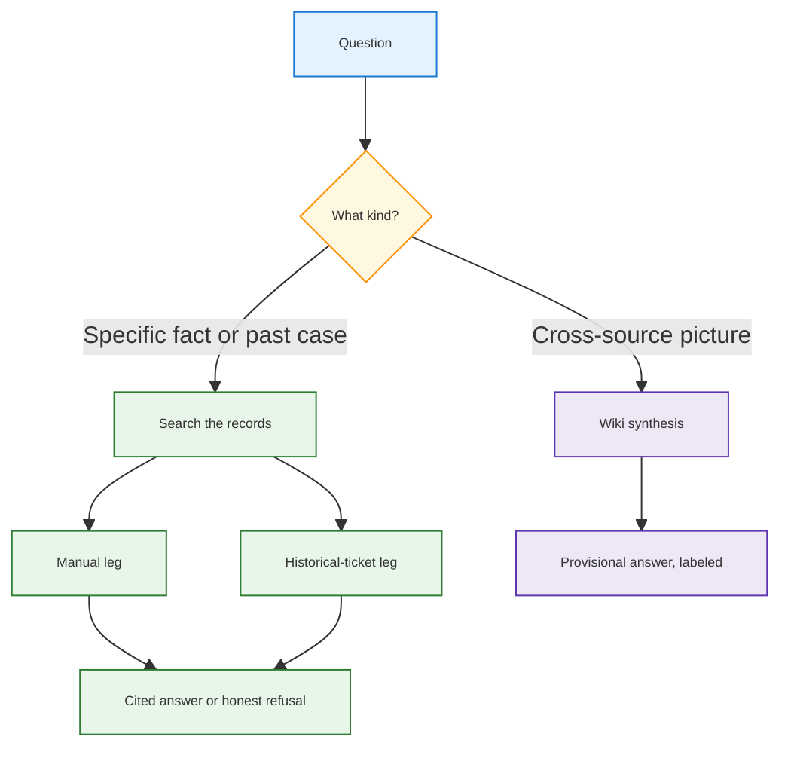

<h1 id="recap-title" style="color:#0d47a1;font-size:1.5em;font-weight:700;border-bottom:2px solid #90caf9;padding-bottom:0.25em;margin-top:0">Recap — a chief-of-staff second brain for FRU</h1>

**Type:** narrative companion, not an execution plan.  
**Date:** 2026-10-31. **Reading:** 2026-11-02 (roadmap check; **HG-P2** closed per **R30**).  
**Parent plan:** [`REFACTOR_PLAN_MAIN_1_FURTHER_ENHANCEMENT_GPT.md`](../../ref_plan/new/REFACTOR_PLAN_MAIN_1_FURTHER_ENHANCEMENT_GPT.md) (decisions **R28**, **R29**, **R30**).

<h2 id="recap-outline" style="color:#1565c0;font-size:1.22em;font-weight:650;border-left:4px solid #42a5f5;padding-left:10px;margin-top:1.1em">Document outline</h2>

1. [The picture](#recap-picture) — what we are building.
2. [Corrections to the note](#recap-corrections) — lane name, what actually scored, what “both” means.
 2.1 [Reading on 2026-11-02](#recap-reading-20261102) — what in the later roadmap note is off.
3. [The four manual lanes](#recap-lanes) — what the wiki tests showed.
4. [Two kinds of questions](#recap-two-kinds) — why wiki and search both stay.
5. [The chief-of-staff shape](#recap-shape) — locks, then the two legs.
 5.1 [Locks](#recap-locks) — Lane B on manuals, mode C on tickets.
 5.2 [Search legs](#recap-rag) — what is already measured.
 5.3 [Wiki](#recap-wiki) — experiment ran; product phase has not.
6. [The next one to two weeks](#recap-next) — Phase 3 after **HG-P2** closed.
7. [Parked ideas](#recap-parked) — wiki inputs, plus later search experiments.
8. [Decisions](#recap-decisions) — grills on 2026-10-31 and 2026-11-02.
9. [Links](#recap-links) — plan and source notes.

---

<h2 id="recap-picture" style="color:#1565c0;font-size:1.22em;font-weight:650;border-left:4px solid #42a5f5;padding-left:10px;margin-top:1.1em">1. The picture</h2>

We are building a second brain for FRU that behaves like a chief of staff. It should answer two kinds of questions:

- A **specific** question (a customer ticket, a temperature range, a part, a past fix) by opening the records.
- A **big-picture** question (what is going on across models, tickets, and prior notes) from a maintained summary, and label that answer as provisional.

The maintained summary is the LLM Wiki (compiled pages and links). The records are ordinary search, called RAG (retrieve-then-answer) here: a manual leg and a historical-ticket leg. The router that chooses between them is the chief of staff. That router is **not built**. The main plan puts it in Phase 4, after the three question-answering tracks have their own numbers.

---

<h2 id="recap-corrections" style="color:#1565c0;font-size:1.22em;font-weight:650;border-left:4px solid #42a5f5;padding-left:10px;margin-top:1.1em">2. Corrections to the note</h2>

The note this file started from is right about the product and about the split between search and the wiki. Three facts needed a correction before they harden.

<table>
<thead>
<tr style="background:#1565c0;color:white"><th>In the note</th><th>What the record says</th></tr>
</thead>
<tbody>
<tr><td style="background:#e3f2fd">“Mode C” on <code>brain/retail-md-learned</code> was the best wiki result</td><td style="background:#e8f5e9">That folder is <strong>Lane D</strong>. Lane C is plain text in <code>brain/retail-txt</code> and scored <strong>4 of 60</strong>. Lane D scored <strong>31 of 60</strong>. Ticket search also has a “mode C”; that is a different switch (how past tickets are ranked), not a manual lane.</td></tr>
<tr><td style="background:#e3f2fd">The wiki search found the answers in the dense learned pages</td><td style="background:#fff3e0">On Lane D the useful hits were mostly <strong>full-copy manual pages</strong> under <code>wiki/sources/</code>, not the digested concept cards. Cards often crowded out the manual page on the weaker lanes. Some gold facts were missing from <code>wiki/sources</code> entirely, so a high similarity score did not mean the fact was in the wiki.</td></tr>
<tr><td style="background:#e3f2fd">The grand plan’s middle step is “RAG on both tickets and manuals,” then the wiki</td><td style="background:#e8f5e9">The written order is manuals, then tickets, then the wiki, then the chief of staff. Asking one customer question against <strong>both</strong> legs is already a separate judged suite (minor plan M4, the 20 bundled questions). That suite is a search test. It is not the chief-of-staff router, and it is not the wiki.</td></tr>
</tbody>
</table>

One more scope note. After the four-lane wiki comparison, later judged manual runs were pinned to **Lane B** (`brain/retail-md`), not Lane D. Lane D stays a comparison, not the default corpus. That is decision **R10** in the main plan.

<h3 id="recap-reading-20261102" style="color:#00695c;font-size:1.05em;font-weight:600;margin-top:0.85em">2.1 Reading on 2026-11-02</h3>

A later note restated the roadmap. The split is right: search for precise questions, the wiki for big-picture questions. These parts of that note are not.

<table>
<thead>
<tr style="background:#1565c0;color:white"><th>In the 2026-11-02 note</th><th>What the record says</th></tr>
</thead>
<tbody>
<tr><td style="background:#e3f2fd">The LLM Wiki is entirely yet to implement, maybe on Lane B</td><td style="background:#fff3e0">The four-lane wiki comparison already ran ([section 3](#recap-lanes)). Lane B’s wiki score was <strong>9 of 60</strong>. What has not started is Phase 3: claim audit, uncertainty labels, and a fresh Lane B harness. That phase’s corpus is Lane B, manuals only (<strong>R10</strong>).</td></tr>
<tr><td style="background:#e3f2fd">Historical-ticket search and manual search are finished implementation</td><td style="background:#e8f5e9">The code and measured runs are in ([section 5.2](#recap-rag)). <strong>HG-P2</strong> closed <strong>2026-11-02</strong> (<strong>R30</strong>): ABC ladder green + bundled judge <strong>16/20</strong> on canonical run <code>b20-evo18-d7-v3-20261028</code>. Phase 3 may start.</td></tr>
<tr><td style="background:#e3f2fd">Industry-trend news and tariff news are absent from the plan</td><td style="background:#e8f5e9">Correct. Both stay parked with the other outside-the-manuals ideas. Tariff is an example of that bucket, not a new track. FRU sells in the US and imports some brands; no source for that is in the corpora.</td></tr>
<tr><td style="background:#e3f2fd">GraphRAG could enhance precise manual search, and might replace or sit beside the wiki</td><td style="background:#e8f5e9">It does not help a local fact lookup (a temperature, a step, a page). It can later draft a whole-corpus picture that the wiki then stores and checks. It does not replace the wiki. See [parked ideas](#recap-parked).</td></tr>
<tr><td style="background:#e3f2fd">Agentic RAG is a later experiment on the same precise-question search</td><td style="background:#e8f5e9">Correct, and only there. It is an extra look when the first hits miss a fact that is still in the index. It is not a wiki feature. The bundled path that scored 16 of 20 does not run that loop.</td></tr>
</tbody>
</table>

---

<h2 id="recap-lanes" style="color:#1565c0;font-size:1.22em;font-weight:650;border-left:4px solid #42a5f5;padding-left:10px;margin-top:1.1em">3. The four manual lanes</h2>

Earlier in the month we ran the same 90 manual questions through the LLM Wiki on four ways of turning FRU product PDFs into text. Thirty of the ninety are “this cannot be answered from the PDF,” so the useful score is **answerable out of 60**. Source: [`AGGREGATED_TEST_ANALYSIS_LLM_WIKI_AND_RAG.md`](./AGGREGATED_TEST_ANALYSIS_LLM_WIKI_AND_RAG.md).

<table>
<thead>
<tr style="background:#1565c0;color:white"><th>Lane</th><th>Folder</th><th>What went in</th><th>Wiki answerable</th></tr>
</thead>
<tbody>
<tr><td style="background:#e3f2fd"><strong>A</strong></td><td><code>brain/retail</code></td><td>Original PDF, compiled inside the wiki</td><td style="background:#ffebee">3 / 60</td></tr>
<tr><td style="background:#e3f2fd"><strong>B</strong></td><td><code>brain/retail-md</code></td><td>One Markdown file per PDF page</td><td style="background:#fff3e0">9 / 60</td></tr>
<tr><td style="background:#e3f2fd"><strong>C</strong></td><td><code>brain/retail-txt</code></td><td>Plain text</td><td style="background:#ffebee">4 / 60</td></tr>
<tr><td style="background:#e8f5e9"><strong>D</strong></td><td><code>brain/retail-md-learned</code></td><td>Topic shards plus full-copy manual pages</td><td style="background:#e8f5e9"><strong>31 / 60</strong></td></tr>
</tbody>
</table>

Lane D won the wiki comparison, and the rate was still about half. A sources-only replay on the 38 questions where B and D disagreed kept **24 of 38** when only `wiki/sources/` was allowed, versus **3 of 38** on Lane B. So the gain was “the manual passage is in the pile and the pile is shaped so search can see it,” not “the digested non-source pages answered the question.”

Plain vector search on the raw files, with no wiki, was about **28 of 60** on Lane B and in the same band on C and D, and on the order of **14×** faster to retrieve. On B and C that plain search beat the wiki. On D the wiki was only slightly ahead, and the two piles of text were not the same document. The write-up’s warning still holds: neither about 31 of 60 nor about 29 of 60 is good enough to leave a customer unattended.

That is when the question changed from “which PDF conversion should the wiki use?” to “can the wiki alone be the second brain?”

---

<h2 id="recap-two-kinds" style="color:#1565c0;font-size:1.22em;font-weight:650;border-left:4px solid #42a5f5;padding-left:10px;margin-top:1.1em">4. Two kinds of questions</h2>

The research conclusion is written down, and it matches the note.

- **Specific questions** — a number, a procedure, a past case that applies to this model — belong on search over the original records. A compiled summary is the wrong place to look up “what was revenue?” or “what ambient range does this guide allow?”
- **Big-picture questions** — relationships, repeated investigations, “why is this rising, and what should we do?” — are the job the wiki is *for*, because the pages and links are already a digest. Those answers must be labeled provisional. Important facts still have to be checked against the records.

The 90 manual questions never ask for a cross-department briefing, so they **cannot** prove the wiki is good at the second job. They only showed that, on fridge-manual facts, a search index was the more economical system, and that how the PDF was cut mattered more than the brand of search.

Sources for this split:

- [`ABOUT_FURTHER_ENHANCEMENT_GPT.md`](./ABOUT_FURTHER_ENHANCEMENT_GPT.md) section 2 (the chief-of-staff analogy).
- [`REALIGNMENT_REFACTOR_GOALS.md`](./REALIGNMENT_REFACTOR_GOALS.md) section 4 (provisional wiki vs evidence-backed search).
- Main plan section 8 (same two modes, deferred to Phase 4).
- Chat shares linked from those files: [LLM Wiki RAG Advice](https://chatgpt.com/share/6ada2c90-9160-83ec-b331-2e999fea8431) and [three tracks, then chief of staff](https://chatgpt.com/share/6adb338c-a8e0-83ec-88aa-f633463cb70e).

The diamond in that diagram is the chief of staff. Today a human still chooses which system to run.

---

<h2 id="recap-shape" style="color:#1565c0;font-size:1.22em;font-weight:650;border-left:4px solid #42a5f5;padding-left:10px;margin-top:1.1em">5. The chief-of-staff shape</h2>

<h3 id="recap-locks" style="color:#00695c;font-size:1.05em;font-weight:600;margin-top:0.85em">5.1 Locks on the two search legs</h3>

Recent runs did not keep switching corpora or ticket rankers. Manuals stay on **Lane B**. Historical tickets stay on **mode C**. The letters are different switches. Lane letters name a folder of manuals. Mode letters name how past tickets are ranked. There is no ticket mode D.

Manual lanes come from `config/retail-ingest-lanes.yaml`. **R10** (the decision that pins judged manual runs to one folder) chose Lane B after Lane D won the earlier wiki comparison. Lane D stays a comparison, not the index these runs search.

<table>
<thead>
<tr style="background:#1565c0;color:white"><th>Lane</th><th>Folder</th><th>How the PDF was prepared</th><th>Files the search index reads</th><th>Wiki score (of 60)</th></tr>
</thead>
<tbody>
<tr><td style="background:#e3f2fd">A</td><td><code>brain/retail</code></td><td>Original PDF, compiled inside the wiki</td><td style="background:#ffebee">Search index off</td><td>3</td></tr>
<tr><td style="background:#e8f5e9"><strong>B</strong></td><td><code>brain/retail-md</code></td><td>Markdown, one file per page</td><td style="background:#e8f5e9"><code>raw/sources/fridge-docs_md/**/*.md</code></td><td>9</td></tr>
<tr><td style="background:#e3f2fd">C</td><td><code>brain/retail-txt</code></td><td>Plain text</td><td><code>raw/sources/fridge-docs/**/*.txt</code></td><td>4</td></tr>
<tr><td style="background:#e3f2fd">D</td><td><code>brain/retail-md-learned</code></td><td>Topic shards plus full-copy pages</td><td><code>raw/sources/fridge-docs-split-less/**/*.md</code></td><td><strong>31</strong></td></tr>
</tbody>
</table>

Ticket modes are `RETAIL_TICKET_SEARCH_MODE`. The ladder below is the 100-question probe on 1,000 historical tickets (recall at rank 1: the right ticket is the first hit). Source: [`ABOUT_SEARCH_RRF_FRU.md`](../ABOUT_SEARCH_RRF_FRU.md). Mode C is the one the bundled questions use. Paraphrase and mixed-wording scores do not move from B to C. The gain is on questions that contain a fault code (0.15 to 0.65 on those 20).

<table>
<thead>
<tr style="background:#1565c0;color:white"><th>Mode</th><th>Setting name</th><th>What it does</th><th>Right ticket first (of 100)</th></tr>
</thead>
<tbody>
<tr><td style="background:#e3f2fd">A</td><td><code>vector_only</code></td><td>Meaning only. One embedding list.</td><td>0.25</td></tr>
<tr><td style="background:#e3f2fd">B</td><td><code>rrf_normal</code></td><td>Meaning plus keywords, merged by rank.</td><td>0.44</td></tr>
<tr><td style="background:#e8f5e9"><strong>C</strong></td><td><code>rrf_term_boosted</code></td><td>Same as B, plus an extra bump when the question’s <code>FRU-E###</code> code matches the ticket.</td><td><strong>0.54</strong></td></tr>
</tbody>
</table>

Later manual changes (heading-sized chunks, the per-file cap, splitting the question) sat on top of these two locks. They did not switch the folder or the ticket ranking mode.

<h3 id="recap-rag" style="color:#00695c;font-size:1.05em;font-weight:600;margin-top:0.85em">5.2 Search, for specific questions</h3>

Two legs, both on an index. Keyword rank and embedding rank are merged by rank (reciprocal rank fusion). Neither leg is the LLM Wiki. Only the ticket leg adds the fault-code bump on top of that merge. The manual leg does not.

The bump already reads `FRU-E###` from the question and from each candidate ticket’s text, then adds weight when they match. Tickets that lack the code stay in the pile. A stored fault-code tag would repeat that match. A filter on the tag would drop good tickets. That metadata idea stays aside.

| Leg | Plan name | What exists now |
|-----|-----------|-----------------|
| Historical tickets | A3, Phase 2 | Mode C: rank-merge plus the fault-code bump. P2.1–P2.6 done. The 100-question ladder stays **0.54** recall@1 (monitoring). Optional P2.3 ticket-rerank compare remains deferred. |
| Manuals | A2, Phase 1 | Lane B, rank-merge only (no fault-code bump). Phase 1 checklist done. Best manual-only figure in the EVO-18 matrix: **44 of 60** (page pack). |
| Both legs on one customer question | Minor plan M4 | **HG-P2** gate exam: **16/20** judge on **`b20-evo18-d7-vb20-evo18-d7-v3-20261028A). Goldfix run **`b20-evo18-d7-v3-goldfix-2026b20-evo18-d7-v3-goldfix-20261028h resolved ticket labels. Not the wiki; not the COS router. |

<h3 id="recap-wiki" style="color:#00695c;font-size:1.05em;font-weight:600;margin-top:0.85em">5.3 Wiki, for big-picture questions</h3>

The comparison already ran. The product track has not. Phase 3 (claim audit, uncertainty labels, a fresh Lane B wiki run) is entirely unchecked. Its corpus is Lane B, manuals only. Phase 4 (the router) is entirely unchecked.

What the wiki can see today is still **manuals**, in the four lanes above. The main plan’s A1 v1 line is explicit: do not promote tickets into the wiki in that version. A big-picture question about warranty cost, mix of failures, or “what should we do” cannot be answered from fridge manuals alone. That gap is real. Filling it is listed under [parked ideas](#recap-parked), not under the next one to two weeks.

---

<h2 id="recap-next" style="color:#1565c0;font-size:1.22em;font-weight:650;border-left:4px solid #42a5f5;padding-left:10px;margin-top:1.1em">6. The next one to two weeks</h2>

Search-leg quality for the bundled path is gated (**R30**). **HG-P2** closed **2026-11-02**: ABC ladder green and bundled judge **16/20** on **`b20-evo18-d7-v3-20261028`**.

**Next:** Phase 3 (Ab20-evo18-d7-v3-20261028nuals only) via **`qimpltdd`** on the main plan — claim audit (P3.1) first. Tickets, news, and Hermes ingest into the wiki stay parked (**R28** / **R29**).

---

<h2 id="recap-parked" style="color:#1565c0;font-size:1.22em;font-weight:650;border-left:4px solid #42a5f5;padding-left:10px;margin-top:1.1em">7. Parked ideas</h2>

These stay ideas. The main plan was not changed. The first four are missing wiki inputs. The last two are later experiments on search, written up in [`TODO_AGENTIC_AND_GRAPH_RAG_FIT.md`](../../todos/TODO_AGENTIC_AND_GRAPH_RAG_FIT.md). Metadata enrichment (hypothetical questions on manual chunks, part words on ticket resolutions) was considered on 2026-11-02 and set aside. It is not a roadmap step.

<table>
<thead>
<tr style="background:#1565c0;color:white"><th>Idea</th><th>Why it stays parked</th></tr>
</thead>
<tbody>
<tr><td style="background:#e3f2fd">Ingest historical tickets into the wiki</td><td style="background:#fff3e0">A1 v1 already says ticket promotion into the wiki is out. Tickets are searched on their own leg.</td></tr>
<tr><td style="background:#e3f2fd">Text-to-SQL, as in another FRU project</td><td style="background:#fff3e0">Not specified in this repo. Do not treat it as a designed path here.</td></tr>
<tr><td style="background:#e3f2fd">Industry news, including tariff news</td><td style="background:#fff3e0">Not in the current corpora and not in the plan. A briefing stays thin until a source exists. Tariff (US sales, imported brands) is this same bucket.</td></tr>
<tr><td style="background:#e3f2fd">Hermes ingests that extra material</td><td style="background:#fff3e0">In this repo Hermes compiles and deletes a brain profile. News ingest is not what that plan does.</td></tr>
<tr><td style="background:#e3f2fd">Agentic RAG</td><td style="background:#e8f5e9">Later experiment on the precise-question legs only. Extra search when the first hits miss a fact still in the index. Not a wiki feature. The 16-of-20 path does not run it.</td></tr>
<tr><td style="background:#e3f2fd">GraphRAG</td><td style="background:#e8f5e9">Does not enhance precise manual lookup. May later draft a whole-corpus picture for the wiki to store and check. Does not replace the wiki, and does not pay until a global question set and a richer corpus exist.</td></tr>
</tbody>
</table>

---

<h2 id="recap-decisions" style="color:#1565c0;font-size:1.22em;font-weight:650;border-left:4px solid #42a5f5;padding-left:10px;margin-top:1.1em">8. Decisions</h2>

Grill on 2026-10-31 (**R28**). Grill on 2026-11-02 (**R29**). **HG-P2** rewrite and close (**R30**, same day).

| Choice | Letter | Why |
|--------|--------|-----|
| File lives next to the About and Realignment notes | A | Same shelf as the chats this recap cites |
| Tickets-into-wiki, text-to-SQL, news, Hermes ingest | A | Later ideas only. Phase 3 stays manuals-first |
| Next one to two weeks | B | Finish the manual leg and the historical-ticket leg before wiki work |
| 2026-11-02: start the wiki next, or stay on search? | A | Stay on search until **HG-P2** closes (then Phase 3) |
| **HG-P2** exit metric | Bundled judge **> 15/20** + ABC ladder green | Both-leg product (M4), not T100 ticket-only lift. **Closed** on **`b20-evo18-d7-v3-20261028`** (**16/20**) |

---

<h2 id="recap-lib20-evo18-d7-v3-202610280;font-size:1.22em;font-weight:650;border-left:4px solid #42a5f5;padding-left:10px;margin-top:1.1em">9. Links</h2>

| Document | Role |
|----------|------|
| [`REFACTOR_PLAN_MAIN_1_FURTHER_ENHANCEMENT_GPT.md`](../../ref_plan/new/REFACTOR_PLAN_MAIN_1_FURTHER_ENHANCEMENT_GPT.md) | Execution plan. This recap is **R28** there. |
| [`AGGREGATED_TEST_ANALYSIS_LLM_WIKI_AND_RAG.md`](./AGGREGATED_TEST_ANALYSIS_LLM_WIKI_AND_RAG.md) | Lane A–D scores |
| [`ABOUT_FURTHER_ENHANCEMENT_GPT.md`](./ABOUT_FURTHER_ENHANCEMENT_GPT.md) | Chief-of-staff analogy |
| [`REALIGNMENT_REFACTOR_GOALS.md`](./REALIGNMENT_REFACTOR_GOALS.md) | Three tracks, then the router |
| [`TEST_ANALYSIS_BUNDLED_MANUAL_TICKET_QA.md`](../TEST_ANALYSIS_BUNDLED_MANUAL_TICKET_QA.md) | Both-legs customer questions (section 8) |
| [`TODO_AGENTIC_AND_GRAPH_RAG_FIT.md`](../../todos/TODO_AGENTIC_AND_GRAPH_RAG_FIT.md) | Parked agentic loop and GraphRAG. Not a phase change. |
