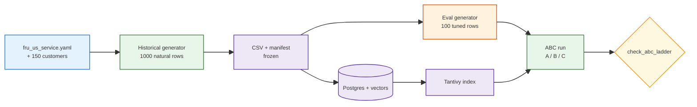

<h1 id="fru-us-title" style="color:#0d47a1;font-size:1.5em;font-weight:700;border-bottom:2px solid #90caf9;padding-bottom:0.25em;margin-top:0">Refactor: Samsung AU phone demo → FRU US aftersales service brain</h1>

**Status:** **completed** (2026-10-15) — P1–P12 **`[X]`**; HG-2 wiki smoke optional  
**Branch:** `feature/bootstrap-rrf-evolve-7-main-brain` → continued on **`feature/bootstrap-rrf-evolve-8-fru-second-brain`**  
**Execute (archive):** `qimpltdd docs_manual_gen/ref_plan/completed/REFACTOR_FRU_US_SERVICE_BRAIN.md`

**Headline goal:** On a new **FRU US 1000 historical / 100 incoming** profile, with the **Tantivy** keyword index, the A/B/C eval must show **A &lt; B &lt; C** on recall@1 — same bar the phone corpus met (0.27 → 0.39 → 0.58). The FRU project has **one** run profile; there is no FRU 60/10 profile.

**Builds on:** [`REFACTOR_RETAIL_SIM_DATA_SCALE_1K.md`](../completed/REFACTOR_RETAIL_SIM_DATA_SCALE_1K.md) (phone 1k layout + eval retune playbook) and [`REFACTOR_SAMSUNG_RETAIL_SERVICE_BRAIN.md`](../completed/REFACTOR_SAMSUNG_RETAIL_SERVICE_BRAIN.md) (search stack, wiki plane, phases 0–7).

**Forward product work (wiki + agent loop):** [`REFACTOR_FRU_RETAIL_SERVICE_BRAIN.md`](../wip/REFACTOR_FRU_RETAIL_SERVICE_BRAIN.md).

**Related, out of scope:** [`ultra-fru-genai-analytics-new`](../../../../ultra-fru-genai-analytics-new) sales analytics — no schema merge.

**Staged manuals:** [`docs_manual_gen/assets/raw/fridge-docs/`](../../assets/raw/fridge-docs/README.md).

<h2 id="outline" style="color:#1565c0;font-size:1.22em;font-weight:650;border-left:4px solid #42a5f5;padding-left:10px;margin-top:1.1em">Document outline</h2>

1. [Goal](#1-goal) — FRU US aftersales brain; ABC ladder is the gate.
2. [Feasibility](#2-feasibility) — why A &lt; B &lt; C is practical; risks.
3. [Decisions](#3-decisions) — F1–F25 with rationale.
4. [Architecture snapshot](#4-architecture) — planes and data flow.
5. [Code touchpoints](#5-touchpoints) — files that still assume phones.
6. [Phases](#6-phases) — P1–P12.
    6.1 [P1 Corpus hygiene](#6-p1) — fridge-docs into brain.
    6.2 [P2 Company profile](#6-p2) — YAML, customers, US market.
    6.3 [P3 Fault-code prefix](#6-p3) — FRU-E in normalize, boost, validator.
    6.4 [P4 Schema and manifest](#6-p4) — customer_id; persist issue and code.
    6.5 [P5 Historical generator](#6-p5) — 1000 natural tickets.
    6.6 [P6 Incoming eval generator](#6-p6) — 100 tuned rows.
    6.7 [P7 Profile and ladder checker](#6-p7) — registry, report field, checker.
    6.8 [P8 Article rename and FRU draft](#6-p8) — legacy rename, links, FRU narrative.
    6.9 [P9 Operator ABC run](#6-p9) — Tantivy; iterate eval only.
    6.10 [P10 Article fill](#6-p10) — real numbers and worked examples.
    6.11 [P11 Domain sweep](#6-p11) — copy, legacy seed, tests, specs.
    6.12 [P12 Verify and close](#6-p12) — verify.sh, runbooks.
7. [Quality bar and TDD bar](#7-quality) — per-phase test-first contracts.
8. [Execution checklist](#8-checklist) — progress.
9. [Acceptance](#9-acceptance) — exit criteria.
10. [Deferred](#10-deferred) — follow-ups.

---

<h2 id="1-goal" style="color:#1565c0;font-size:1.22em;font-weight:650;border-left:4px solid #42a5f5;padding-left:10px;margin-top:1.1em">1. Goal</h2>

Replace the Samsung Australia phone teaching demo with a **US-based Fridges R Us (FRU) aftersales** second brain:

- **Past tickets (structured plane):** Postgres + pgvector + Tantivy keyword index — same search code.
- **Manuals (unstructured plane):** 6 PDFs (3 fridges × user + repair) under `brain/retail/raw/sources/fridge-docs/`, compiled into `brain/retail/wiki/`.
- **Simulated data:** a single **`fru_us_1000_100`** profile. The **1000 historical** tickets are generated to read like real service history, with no eye on the exam. The **100 incoming** tickets (eval questions) are then tuned so the three search modes ladder **A &lt; B &lt; C**, as the phone 1k profile did.
- **Customer continuity:** each ticket carries a real `customer_id` from the ultra-fru sales CSV, with that customer’s fridge and store, so a later merge can join on the id.
- **Article:** the phone write-up becomes `ABOUT_SEARCH_RRF_LEGACY_PHONE.md`; a new `ABOUT_SEARCH_RRF_FRU.md` tells the FRU story directly, not as edits on top of the phone text.

**Search modes (unchanged):** **A** `vector_only` (meaning only) · **B** `rrf_normal` (meaning + keyword, fused by rank) · **C** `rrf_term_boosted` (B plus a bump when the query’s fault code appears in the ticket).

**Non-goals:** sales agent, `fridge_sales_*` tables, Delta/Spark, one agent across both repos, any FRU 60/10 profile.

---

<h2 id="2-feasibility" style="color:#1565c0;font-size:1.22em;font-weight:650;border-left:4px solid #42a5f5;padding-left:10px;margin-top:1.1em">2. Feasibility</h2>

**Verdict: practical.** The phone 1k ladder came from three question types, none of which depend on phones:

<table>
<thead>
<tr style="background:#1565c0;color:white"><th>Incoming row type (count)</th><th>How it is built</th><th>Why the mode wins</th><th>Phone 1k recall@1 A / B / C</th></tr>
</thead>
<tbody>
<tr><td style="background:#e3f2fd">① paraphrase (50)</td><td style="background:#e8f5e9">Customer re-words the stored symptom; one detail sentence copied from the stored ticket</td><td style="background:#e8f5e9">Meaning carries most rows; keyword leg breaks ties on the detail sentence</td><td>0.44 / 0.64 / 0.64</td></tr>
<tr><td style="background:#e3f2fd">② hybrid_stress (30)</td><td style="background:#fff8e1">Old closed-ticket wording (bait) pasted in front of the real open problem</td><td style="background:#fff8e1">Vector drifts to the bait; keyword leg holds the real issue + detail, so B lifts</td><td>0.17 / 0.23 / 0.23</td></tr>
<tr><td style="background:#e3f2fd">③ code_in_query (20)</td><td style="background:#ffebee">Wrong symptom + the gold ticket’s fault code</td><td style="background:#ffebee">Only C’s code bump finds the ticket with that exact code</td><td>0.00 / 0.00 / 0.95</td></tr>
<tr><td style="background:#e3f2fd"><strong>Overall (100)</strong></td><td colspan="2"></td><td><strong>0.27 / 0.39 / 0.58</strong></td></tr>
</tbody>
</table>

<span style="background:#ffcdd2;padding:2px 4px">⚠</span> **Risks and mitigations**

| Risk | Mitigation |
|------|------------|
| Mode C cannot fire: `SAM-E` is hardcoded in four places | P3 makes the code pattern configurable (`FRU-E###`) before any regen |
| Fridge wording is less varied than phone wording, so tickets look alike and vector ties rise | P5 diversity rules: ≥24 issues, model-specific issues, ≥12 detail lines, weighted frequencies |
| Natural (random) issue choice breaks eval-only regen, which re-derives issue and code from ticket-id arithmetic | P4 persists `issue_key` and `fault_code` in the manifest; eval-only reads them back |
| Only 150 usable customers for 1000 tickets (~6.7 visits each) | Accepted as a demo artifact (F12); see Deferred for a bigger customer pool |
| ABC run needs Docker Postgres and a Gemini embedding key | Human gate **HG-1** in P9 |
| Ladder not met first try | P9 allows up to **4** eval-only retune rounds; historical CSV stays frozen |
| Article written before numbers exist | P8 drafts narrative with marked `TBD-P10` slots; P10 fills them from committed reports |

---

<h2 id="3-decisions" style="color:#1565c0;font-size:1.22em;font-weight:650;border-left:4px solid #42a5f5;padding-left:10px;margin-top:1.1em">3. Decisions</h2>

**last_aligned:** 2026-10-15 — owner chat (FRU pivot, US market, customer reuse, YAML config, wiki cleanup, 1k ABC on Tantivy) and **grillnow** round on the article (answers recorded F22–F25 as option letters in the order asked).

**Plan ledger (2026-10-15 grill):** corpus pivot stays **`wip/`** until P10–P12; phone scale plan → **`completed/`**; Samsung master → **`completed/`** with pointer to FRU product plan; full-stack V2→V5 tracked in **`REFACTOR_FRU_RETAIL_SERVICE_BRAIN.md`**.

| ID | Decision | Rationale |
|----|----------|-----------|
| **F1** | Market **US**; add `US` to `market.py`; default `RETAIL_MARKET=US`. AU/BR profiles stay only for their existing tests. | Match ultra-fru sales geography. |
| **F2** | Aftersales only; no sales integration. | Owner: separate project for now. |
| **F3** | Customers come from a **committed** excerpt of `fridge_sales_with_rating.csv`; no runtime read of the sibling repo. | CI must not need ultra-fru. |
| **F4** | 3 SKUs: `RF28K9070SG` (Samsung), `GNE27JYMFS` (GE), `KRFF507HPS` (KitchenAid). Frigidaire deferred. | Matches staged PDFs. |
| **F5** | Fault code **`FRU-E###`**; prefix lives in YAML. | Brand-neutral service code. |
| **F6** | Remove `brain/retail/raw/sources/samsung-docs/`; copy staged fridge-docs into `brain/retail/raw/sources/fridge-docs/`. | Keep FRU brain clean. |
| **F7** | Company profile YAML at `scripts/retail/config/fru_us_service.yaml`; tests use it where cheap, no forced full de-hardcode. | Owner: ideal, not forced. |
| **F8** | **Search code frozen:** RRF k, leg weights, boost λ, top-k, Tantivy schema, embed model. Only the code-prefix pattern changes (P3). Tuning happens in the 100 incoming rows only. | A ladder earned by changing search code would not be the same experiment. |
| **F9** | Phone profiles `data_60_10` and `data_1000_100` stay untouched as archive. New profile id **`fru_us_1k`** → `profiles/fru_us_1000_100/` becomes default. | Keep the published phone result reproducible. |
| **F10** | Nullable `customer_id` column in CSV, schema `001_retail.sql`, and loader. | Join key for a later merge. |
| **F11** | Ticket `model` = that customer’s `FRIDGE_MODEL`; ticket store = their purchase store; `opened_at` after their `SALES_DATE`. | Data stays consistent with sales. |
| **F12** | Pool = 150 non-Frigidaire customers; 1000 tickets assigned with uneven (weighted) repeat visits, every customer ≥1 ticket. | Owner prefers existing customers over invented ones. |
| **F13** | **Historical tickets are generated once, blind to the exam.** No eval-driven edits to the CSV; seed fixed. | “Most natural way” — tuning lives in incoming rows. |
| **F14** | Incoming mix **50 paraphrase / 30 hybrid_stress / 20 code_in_query**. Queries never contain `customer_id`, ticket id, or item number. Gold must be `resolved`. | Same eval design as phone; no leakage. |
| **F15** | **Pass bar (machine-checked):** overall recall@1 **A &lt; B &lt; C** strictly; plus hybrid_stress **B &gt; A** and code_in_query **C &gt; B**. Report must show lexical backend **tantivy** and `total == 100`. | Phone 1k met all three. |
| **F16** | `customer_id` is a column only, never written into `customer_query_text`. | A rare id in text would let keyword search cheat. |
| **F17** | Eval-only regen reads `issue_key` + `fault_code` from `ticket_manifest.jsonl`, not ticket-id formulas. | Natural sampling breaks the formula. |
| **F18** | Eval report JSON gains `lexical_backend`; new `scripts/retail/eval/check_abc_ladder.py` enforces F15. | Today the report only says `backend: postgres`. |
| **F19** | `market.py` US `customer_query_prefix` and generator intake openings must agree so prefix stripping works. | Otherwise boilerplate pollutes the index. |
| **F20** | **No FRU 60/10 profile, now or later.** `fru_us_1k` is the only FRU run profile; `ProfileGenSpec` and the registry get no FRU 60/10 entry. | Owner: not needed at all. |
| **F21** | Article split: `git mv` `ABOUT_SEARCH_RRF.md` → `ABOUT_SEARCH_RRF_LEGACY_PHONE.md`; write a new `ABOUT_SEARCH_RRF_FRU.md` grown from it for FRU (not a find-and-replace). | Owner: organic FRU document, phone kept intact. |
| **F22** | Timing = **B** — draft structure and narrative in P8 (before the operator run); fill results and worked examples in P10 after P9. | Narrative does not depend on numbers; examples must be real FRU rows. |
| **F23** | History depth = **A** — FRU article presents the final three-mode design; one short “how we got here” section links to the legacy phone doc for the evolution and the six-way engine comparison. | Keeps the FRU article focused. |
| **F24** | Links = **A** — completed plans and the Samsung plan point to `_LEGACY_PHONE`; live docs (`docs_manual_gen/README.md`, `ref_plan/README.md`, this plan) point to `_FRU`. No redirect stub at the old path. | Each reader lands on the version that matches their context. |
| **F25** | Delivery = **A** — this plan is updated now; rename and article happen during `qimpltdd`. | Owner chose plan-only for this turn. |

---

<h2 id="4-architecture" style="color:#1565c0;font-size:1.22em;font-weight:650;border-left:4px solid #42a5f5;padding-left:10px;margin-top:1.1em">4. Architecture snapshot</h2>



The eval generator reads the frozen CSV; it never writes back. Retune loops go `E → R → C` only.

---

<h2 id="5-touchpoints" style="color:#1565c0;font-size:1.22em;font-weight:650;border-left:4px solid #42a5f5;padding-left:10px;margin-top:1.1em">5. Code touchpoints</h2>

<table>
<thead>
<tr style="background:#1565c0;color:white"><th>Area</th><th>Where</th><th>Change</th></tr>
</thead>
<tbody>
<tr><td style="background:#e3f2fd">Manuals + wiki stub</td><td><code>brain/retail/raw/sources/samsung-docs/</code>, <code>brain/retail/wiki/index.md</code>, <code>brain/retail/purpose.md</code></td><td>Remove phone tree; FRU wording</td></tr>
<tr><td style="background:#e3f2fd">Catalog</td><td><code>sim_data/generation/catalog.py</code></td><td>Load from YAML: models, issues, paraphrases, detail lines, bait pairs</td></tr>
<tr><td style="background:#e3f2fd">Writers</td><td><code>tickets.py</code>, <code>eval_gold.py</code>, <code>eval_abc.py</code>, <code>cli.py</code>, <code>io.py</code></td><td>Natural sampling, customer join, FRU-E, manifest fields; drop hardcoded “Melbourne”, “Samsung Members”, “battery” wording</td></tr>
<tr><td style="background:#e3f2fd">Code pattern</td><td><code>text_normalize.py</code> (<code>_DIAG_CODE</code>, <code>_CODE_IN_QUERY</code>), <code>rrf.code_boost_scores</code>, <code>seed/validate_llm_corpus.py</code> (<code>_SAM</code>)</td><td>Configurable prefix</td></tr>
<tr><td style="background:#e3f2fd">Schema + load</td><td><code>schema/001_retail.sql</code>, <code>load_service_queries.py</code></td><td><code>customer_id</code>; drop <code>SP</code> state default</td></tr>
<tr><td style="background:#e3f2fd">Profiles</td><td><code>retail_brain/sim_data_profile.py</code>, <code>sim_data/generation/profiles.py</code></td><td>Add <code>fru_us_1k</code> only; make it default</td></tr>
<tr><td style="background:#e3f2fd">Eval report + gate</td><td><code>eval/eval_ticket_search.py</code>, new <code>eval/check_abc_ladder.py</code>, <code>retail_v11_prep/05_run_abc_postgres.sh</code></td><td><code>lexical_backend</code> field; ladder check at end of script</td></tr>
<tr><td style="background:#e3f2fd">Legacy seed</td><td><code>retail_brain/models.py</code>, <code>seed_narrative.py</code>, <code>seed/abcd_demo_eval_spec.py</code></td><td>Mark phone-era; keep off default path</td></tr>
<tr><td style="background:#e3f2fd">Articles</td><td><code>docs_manual_gen/artifacts/ABOUT_SEARCH_RRF.md</code> + 8 inbound links</td><td>Rename to <code>_LEGACY_PHONE</code>; new <code>_FRU</code>; split links (F24)</td></tr>
<tr><td style="background:#e3f2fd">Harness</td><td><code>harness/second-brain/skills/query-retail-brain/SKILL.md</code></td><td>FRU US wording</td></tr>
</tbody>
</table>

---

<h2 id="6-phases" style="color:#1565c0;font-size:1.22em;font-weight:650;border-left:4px solid #42a5f5;padding-left:10px;margin-top:1.1em">6. Phases</h2>

<h3 id="6-p1" style="color:#00695c;font-size:1.05em;font-weight:600;margin-top:0.85em">6.1 P1 — Corpus hygiene · smoke-after-delete</h3>

- [ ] `git rm -r brain/retail/raw/sources/samsung-docs/`.
- [ ] Copy `docs_manual_gen/assets/raw/fridge-docs/{samsung_RF28K9070SG,ge_GNE27JYMFS,kitchenaid_KRFF507HPS}/` → `brain/retail/raw/sources/fridge-docs/` with a short README pointing at the staged copy.
- [ ] Rewrite `brain/retail/wiki/index.md` (no `samsung-docs`).
- [ ] Update `tests/test_retail_corpus_layout.py` for the three fridge folders, each with `user-guide.pdf` + `repair-guide.pdf`.
- [ ] Repoint `cursor_gen/retail_v11_prep/01_copy_manuals.sh` at the staged fridge-docs.

**Exit:** layout test green; `rg samsung-docs brain/` empty.

<h3 id="6-p2" style="color:#00695c;font-size:1.05em;font-weight:600;margin-top:0.85em">6.2 P2 — Company profile · strict-TDD</h3>

- [ ] `scripts/retail/config/fru_us_service.yaml`: `market`, `fault_code_prefix`, `models` (SKU, brand, docs folder), `issues` (key, symptom, resolution, paraphrase, weight, `models` it applies to), `detail_slots`, `intake_openings`, `code_phrasings`, `hybrid_bait_pairs`.
- [ ] `scripts/retail/sim_data/seed/fru_customers.jsonl`: 150 rows `customer_id`, `fridge_model`, `store_name`, `city`, `state`, `sales_date` (city/state parsed from `STORE_ADDRESS`). One-off script `scripts/retail/sim_data/seed/extract_fru_customers.py` documents how it was built.
- [ ] `scripts/retail/retail_brain/company_profile.py` loader (cached; validates required keys).
- [ ] `market.py` `US` profile: `bcp47: en-US`, prefix and templates aligned with YAML openings (F19).

**Exit:** loader tests green; `fru_customers.jsonl` has 150 rows, 50 per SKU, no `FFSS2615TS`.

<h3 id="6-p3" style="color:#00695c;font-size:1.05em;font-weight:600;margin-top:0.85em">6.3 P3 — Fault-code prefix · strict-TDD</h3>

- [ ] One helper (e.g. `diag_code_pattern()` in `text_normalize.py`) builds the regex from the active profile prefix; default stays `SAM-E` when no FRU profile is active so phone tests keep passing.
- [ ] `code_boost_scores`, `_CODE_IN_QUERY`, and `validate_llm_corpus._SAM` use that helper.

**Exit:** `FRU-E123` is extracted and boosted; existing `SAM-E` tests still green.

<h3 id="6-p4" style="color:#00695c;font-size:1.05em;font-weight:600;margin-top:0.85em">6.4 P4 — Schema and manifest · strict-TDD</h3>

- [ ] `001_retail.sql`: `customer_id TEXT NULL` (+ `ALTER TABLE … ADD COLUMN IF NOT EXISTS` for existing local DBs).
- [ ] `load_service_queries.py`: insert `customer_id`; require `state` (no `SP` default).
- [ ] `TicketRow` gains `customer_id`, `issue_key`, `fault_code` (rename from `sam_e`; keep alias if cheap).
- [ ] `io.py`: write these to CSV / `ticket_manifest.jsonl`; `read_csv` + manifest reader recover them without ticket-id arithmetic (F17).

**Exit:** round-trip test (write → read) preserves all three fields.

<h3 id="6-p5" style="color:#00695c;font-size:1.05em;font-weight:600;margin-top:0.85em">6.5 P5 — Historical generator (1000 natural) · strict-TDD</h3>

- [ ] Seeded generator: pick customer (weighted repeat visits, all 150 ≥1), take their model + store, sample an issue allowed for that model by weight, opening, 1–2 detail lines, status (~6% open), timestamps after purchase date spread over 2024–2025.
- [ ] Fault code on ~50% of rows (validator band), sequential unique `FRU-E###`, phrased with `code_phrasings`.
- [ ] `ProfileGenSpec("fru_us_1000_100", historical_count=1000, 50/30/20, seed=…)` — the only FRU spec (F20).
- [ ] Generate `profiles/fru_us_1000_100/service_queries.csv` + manifest.

**Diversity gates (tested):** ≥24 issue keys used; no single issue &gt;12% of rows; each SKU 25–42% of rows; every store in the pool appears; no duplicate normalized text; zero `Galaxy`, `SAM-E`, AU city names, or `CUST` strings in `customer_query_text`.

**Exit:** 1000 rows; validator green; diversity tests green.

<h3 id="6-p6" style="color:#00695c;font-size:1.05em;font-weight:600;margin-top:0.85em">6.6 P6 — Incoming eval generator (100 tuned) · strict-TDD</h3>

- [ ] Port `eval_abc.py` to YAML data: paraphrase uses issue `paraphrase` + stored detail anchor; hybrid uses `hybrid_bait_pairs` (no hardcoded city/bait index); code row uses unrelated symptom + gold `fault_code` + a `code_phrasings` line.
- [ ] Gold picks: resolved, unique, rare rich signature (model + store city + issue + detail), as in `eval_gold.py`.
- [ ] `cli --profile fru_us_1000_100 --eval-only` rewrites only `ticket_retrieval.jsonl`.

**Exit:** 100 rows with 50/30/20 strata and matching `demo_lift`; leakage test green; CSV bytes unchanged after `--eval-only`.

<h3 id="6-p7" style="color:#00695c;font-size:1.05em;font-weight:600;margin-top:0.85em">6.7 P7 — Profile registry and ladder checker · strict-TDD</h3>

- [ ] `sim_data_profile.py`: add `fru_us_1k`; `DEFAULT_PROFILE = fru_us_1k`. Phone ids still resolve. No FRU 60/10 id (F20).
- [ ] `eval_ticket_search.py`: write `lexical_backend` (from `RETAIL_LEXICAL_BACKEND`) into the report.
- [ ] `scripts/retail/eval/check_abc_ladder.py --reports-dir …`: reads the three reports, prints an A/B/C table (overall + per stratum), exits 1 unless F15 holds.
- [ ] `05_run_abc_postgres.sh`: export `RETAIL_LEXICAL_BACKEND=tantivy` if unset; call the checker at the end.

**Exit:** checker unit tests pass on fixture reports (one passing, one failing each rule).

<h3 id="6-p8" style="color:#00695c;font-size:1.05em;font-weight:600;margin-top:0.85em">6.8 P8 — Article rename and FRU draft · smoke-after-delete</h3>

- [ ] `git mv docs_manual_gen/artifacts/ABOUT_SEARCH_RRF.md docs_manual_gen/artifacts/ABOUT_SEARCH_RRF_LEGACY_PHONE.md`; add a one-line banner at the top linking to the FRU article. Body otherwise unchanged.
- [ ] Repoint inbound links per F24:
  - **→ `_LEGACY_PHONE`:** `ref_plan/completed/REFACTOR_RETAIL_LLM_GEN_HYBRID_EVAL_STRESS.md`, `…/REFACTOR_RETAIL_TICKET_SEARCH_V1X.md`, `…/REFACTOR_RETAIL_LLM_CORPUS_V2_NATURAL.md`, `…/REFACTOR_RETAIL_LEXICAL_BACKENDS.md`, `ref_plan/completed/REFACTOR_SAMSUNG_RETAIL_SERVICE_BRAIN.md`.
  - **→ `_FRU`:** `docs_manual_gen/README.md`, `docs_manual_gen/ref_plan/README.md`, this plan.
- [ ] Draft `docs_manual_gen/artifacts/ABOUT_SEARCH_RRF_FRU.md` (MRKD palette, numbered outline). Narrative written for FRU from the start; every number or example that needs P9 output is a visible `TBD-P10` slot. Outline:

| # | Section | Source in legacy doc | FRU growth |
|---|---------|----------------------|------------|
| 1 | Executive summary | §1 | FRU US aftersales; three modes; `TBD-P10` headline numbers |
| 2 | The business problem | §2 | Service desk intake: customer, fridge SKU, store, display fault code; near-duplicate tickets (same fridge, same store, same issue) |
| 3 | Two retrieval legs | §3 | Same mechanics; fridge examples (ice maker, door seal, `FRU-E###`) |
| 4 | Three search modes A/B/C | §5–§8 (final state only) | What each mode is for, in FRU terms |
| 5 | Mathematics of fusion | §9 (minus 70/30 weights) | Carry over: RRF, term boost, tie-break |
| 6 | Lexical leg: Tantivy | §11.0, §11.2–§11.3 | Why a BM25 sidecar; model filter on SKU; link legacy for engine comparison |
| 7 | Eval design | §12 | Natural 1000 vs tuned 100; strata 50/30/20; leakage rules; customer join; ladder checker |
| 8 | Worked examples | §10, §10b | `TBD-P10`: one row per stratum from the FRU eval with leg ranks |
| 9 | Results | §13.5 | `TBD-P10`: FRU 1k table only |
| 10 | Config reference | §14 | FRU env: `RETAIL_SIM_DATA_PROFILE=fru_us_1k`, `RETAIL_MARKET=US`, `RETAIL_LEXICAL_BACKEND=tantivy`, YAML path |
| 11 | How we got here | §4–§7, §11.4, §13.1–§13.4 | Short: phone prototype proved the design; link `_LEGACY_PHONE` (F23) |
| 12 | What comes next | §15 | Sales join on `customer_id`, wiki plane, agent routing |

**Exit:** `rg -l "ABOUT_SEARCH_RRF\.md" docs_manual_gen` empty; FRU draft has every section; `TBD-P10` slots listed in a short to-fill list at the end of the draft.

<h3 id="6-p9" style="color:#00695c;font-size:1.05em;font-weight:600;margin-top:0.85em">6.9 P9 — Operator ABC run on Tantivy · HG-1</h3>

**HG-1 (human gate):** needs Docker and `GEMINI_API_KEY` + `EMBEDDING_MODEL` in repo `.env`. If missing, stop and hand the commands to the owner.

```bash
export RETAIL_SIM_DATA_PROFILE=fru_us_1k RETAIL_MARKET=US RETAIL_LEXICAL_BACKEND=tantivy
bash cursor_gen/retail_v11_prep/00_docker_ensure.sh
bash cursor_gen/retail_v11_prep/03_pg_up_and_load.sh   2>&1 | tee logs/ops/fru_p9_03_load_1k.log
bash cursor_gen/retail_v11_prep/05_run_abc_postgres.sh 2>&1 | tee logs/ops/fru_p9_05_abc_1k.log
```

- [X] Round 0 run; record result table below.
- [X] Checker passed on round 0 (no eval retune rounds needed).
- [ ] If a future rerun fails: retune **only** P6 eval logic/data, `--eval-only`, rerun `05` (max **4** rounds).
- [X] Three reports under `profiles/fru_us_1000_100/reports/` (`pg_baseline_v1.json`, `pg_ab_v1_1_normal.json`, `pg_ab_v1_2_term_boosted.json`).
- [ ] Optional leg traces per stratum for P10 worked examples (`RETAIL_EVAL_TRACE_LEGS=1`).

**Result (fill in):**

| Round | A `vector_only` | B `rrf_normal` | C `rrf_term_boosted` | Checker |
|-------|-----------------|----------------|----------------------|---------|
| 0 | 0.25 | 0.44 | 0.54 | pass |

**Exit:** `check_abc_ladder.py` exits 0 on committed reports.

<h3 id="6-p10" style="color:#00695c;font-size:1.05em;font-weight:600;margin-top:0.85em">6.10 P10 — Article fill · smoke-after-delete</h3>

- [ ] Fill every `TBD-P10` slot in `ABOUT_SEARCH_RRF_FRU.md` from the committed P9 reports: headline numbers, per-stratum table, final retune round count.
- [ ] Worked examples (section 8): pick one paraphrase win for B, one hybrid_stress win for B over A, one code_in_query win for C over B; show live query, gold ticket text, competing ticket, and leg ranks from the P9 traces.
- [ ] Remove the to-fill list.

**Exit:** `rg -n "TBD-P10" docs_manual_gen/artifacts/ABOUT_SEARCH_RRF_FRU.md` empty; numbers match the report JSON.

<h3 id="6-p11" style="color:#00695c;font-size:1.05em;font-weight:600;margin-top:0.85em">6.11 P11 — Domain sweep · smoke-after-delete</h3>

- [ ] `brain/retail/purpose.md` and `query-retail-brain/SKILL.md` → FRU US aftersales.
- [ ] Legacy seed path (`models.py`, `seed_narrative.py`, `abcd_demo_eval_spec.py`): header note “phone-era”; ensure default prep scripts do not call them.
- [ ] Tests still asserting Galaxy/SAM-E on the **default** path: switch to FRU fixtures (YAML where cheap). Phone-profile tests may stay phone.
- [ ] Specs: new `docs/specs/fru-us-service-synthetic-data.md`; banner on `samsung-retail-synthetic-data.md`; header note on the Samsung refactor plan pointing here.
- [ ] **HG-2 (optional):** Hermes wiki rescan of `brain/retail` + one `llm_wiki_search` on an ice-maker question.

**Exit:** `rg -n "Galaxy|SAM-E" scripts/retail/sim_data/profiles/fru_us_1000_100` empty.

<h3 id="6-p12" style="color:#00695c;font-size:1.05em;font-weight:600;margin-top:0.85em">6.12 P12 — Verify and close · smoke-after-delete</h3>

- [ ] `./scripts/verify.sh` green.
- [ ] `scripts/retail/README.md`, `docs_manual_gen/SECOND_BRAIN_RUNBOOK.md`: FRU env vars and profile id.
- [ ] Tick checklist; move plan `new/ → wip/ → completed/` per implreftdd.

---

<h2 id="7-quality" style="color:#1565c0;font-size:1.22em;font-weight:650;border-left:4px solid #42a5f5;padding-left:10px;margin-top:1.1em">7. Quality bar and TDD bar</h2>

| Phase | TDD mode | Test-first artifact | Red case | Green gate |
|-------|----------|---------------------|----------|------------|
| P1 | smoke-after-delete | `tests/test_retail_corpus_layout.py` | — | `pytest tests/test_retail_corpus_layout.py` |
| P2 | strict-TDD | `tests/test_retail_company_profile.py` (load YAML, required keys, 150 customers / 50 per SKU, no Frigidaire); `tests/test_retail_market.py::test_us_profile` | Loader module missing | `pytest tests/test_retail_company_profile.py tests/test_retail_market.py` |
| P3 | strict-TDD | `tests/test_retail_diag_codes.py::test_fru_prefix_extract_and_boost` | `FRU-E123` not boosted | `pytest tests/test_retail_diag_codes.py tests/test_retail_text_normalize.py tests/test_retail_hybrid_rrf.py` |
| P4 | strict-TDD | `tests/test_retail_sim_data_generation.py::test_manifest_roundtrip_customer_issue_code` | `read_csv` loses `customer_id` / `issue_key` | `pytest tests/test_retail_sim_data_generation.py` |
| P5 | strict-TDD | `tests/test_retail_fru_historical.py` (row count, model matches customer, opened after purchase, diversity gates, no leaks in text) | Generator missing | `pytest tests/test_retail_fru_historical.py` + `validate_llm_corpus.py --corpus-dir …/fru_us_1000_100` |
| P6 | strict-TDD | `tests/test_retail_fru_eval.py` (50/30/20, gold resolved + unique, no `CUST`/`T-`/`ITM-` in queries, code rows contain gold code, `--eval-only` leaves CSV bytes unchanged) | Strata wrong or leak | `pytest tests/test_retail_fru_eval.py` |
| P7 | strict-TDD | `tests/test_retail_abc_ladder.py` (pass fixture; fail on each F15 rule; fail if backend ≠ tantivy); `tests/test_retail_sim_data_profile.py` (default = `fru_us_1k`; no FRU 60/10 id) | Checker missing | `pytest tests/test_retail_abc_ladder.py tests/test_retail_sim_data_profile.py` |
| P8 | smoke-after-delete (docs) | grep guard: no `ABOUT_SEARCH_RRF.md` links left | — | `rg -l "ABOUT_SEARCH_RRF\.md" docs_manual_gen` empty |
| P9 | smoke-after-delete (operator) | — | — | `check_abc_ladder.py` exit 0 |
| P10 | smoke-after-delete (docs) | grep guard: no `TBD-P10` | — | `rg -n "TBD-P10" …_FRU.md` empty |
| P11 | smoke-after-delete | grep guards above | — | `pytest tests/` |
| P12 | smoke-after-delete | — | — | `./scripts/verify.sh` |

**Comments (cdcm):** file header + one doc line per class/function in `company_profile.py`, `check_abc_ladder.py`, `extract_fru_customers.py`, and every edited generator module; inline note on why historical generation must not read eval settings (F13).

**Docs (mrkd):** FRU article uses numbered outline + HTML palette; legacy article body untouched apart from its banner.

**Determinism:** fixed seeds; customer excerpt committed; embed-once unchanged.

**Git hygiene:** no `logs/`, `__pycache__/`, `.env`, or `second_brain.code-workspace` in commits.

---

<h2 id="8-checklist" style="color:#1565c0;font-size:1.22em;font-weight:650;border-left:4px solid #42a5f5;padding-left:10px;margin-top:1.1em">8. Execution checklist</h2>

- [X] **P1** — fridge-docs in brain; samsung-docs removed
- [X] **P2** — YAML, 150-customer seed, loader, US market
- [X] **P3** — configurable fault-code prefix
- [X] **P4** — customer_id column; manifest carries issue + code
- [X] **P5** — 1000 natural historical tickets
- [X] **P6** — 100 tuned incoming tickets
- [X] **P7** — `fru_us_1k` default (only FRU profile); report backend field; ladder checker
- [X] **P8** — article renamed to `_LEGACY_PHONE`; links split; FRU article drafted
- [X] **P9** — HG-1 ABC on Tantivy; checker passes (A=0.25 B=0.44 C=0.54; ladder OK)
- [X] **P10** — FRU article filled from real reports
- [X] **P11** — domain copy, legacy seed, tests, specs (HG-2 optional)
- [X] **P12** — verify.sh; runbooks; plan in **`completed/`**

---

<h2 id="9-acceptance" style="color:#1565c0;font-size:1.22em;font-weight:650;border-left:4px solid #42a5f5;padding-left:10px;margin-top:1.1em">9. Acceptance</h2>

1. **ABC (primary):** committed reports in `profiles/fru_us_1000_100/reports/` show `lexical_backend: tantivy`, `total: 100`, overall recall@1 **A &lt; B &lt; C**, hybrid_stress **B &gt; A**, code_in_query **C &gt; B**; `check_abc_ladder.py` exits 0.
2. **Natural history:** 1000 tickets pass diversity gates; CSV unchanged by any eval retune round.
3. **Customers:** every ticket’s `customer_id` is in the 150-row seed, with matching model and store, opened after purchase.
4. **One FRU profile:** `fru_us_1k` is default and the only FRU profile; no FRU 60/10 directory, spec, or registry id.
5. **Articles:** `ABOUT_SEARCH_RRF_LEGACY_PHONE.md` is the old article with a banner; `ABOUT_SEARCH_RRF_FRU.md` has all 12 sections, no `TBD-P10`, and numbers that match the reports; links split per F24.
6. **Clean brain:** only `fridge-docs/` under `brain/retail/raw/sources/`.
7. **Phone archive intact:** `data_1000_100` reports still read 0.27 / 0.39 / 0.58.
8. `./scripts/verify.sh` green; no runtime dependency on ultra-fru.

---

<h2 id="10-deferred" style="color:#1565c0;font-size:1.22em;font-weight:650;border-left:4px solid #42a5f5;padding-left:10px;margin-top:1.1em">10. Deferred</h2>

| Item | Notes |
|------|-------|
| Frigidaire FFSS2615TS | Add PDFs + YAML row; pool grows to 200. |
| Bigger customer pool | Extend sales CSV in ultra-fru so repeat visits look less dense. |
| Unified sales + service agent | Separate plan (V5). |
| Rename `scripts/retail` | Cosmetic. |
| Full test de-hardcode | Only if YAML proves insufficient. |
