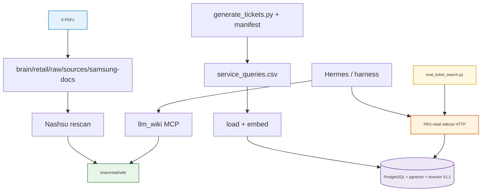
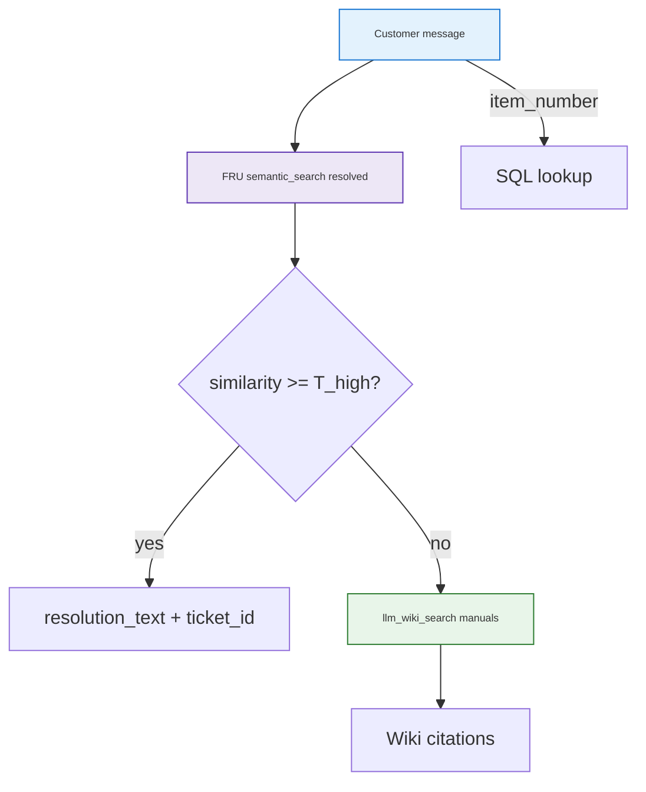

<h1 id="refactor-samsung-title" style="color:#0d47a1;font-size:1.5em;font-weight:700;border-bottom:2px solid #90caf9;padding-bottom:0.25em;margin-top:0">Refactor: Samsung Australia retail service Second Brain (extend <code>second_brain</code>)</h1>

<p><strong>Phone-era master (completed):</strong> Phases <strong>0–7</strong> shipped on the Samsung AU corpus. Forward work for the <strong>FRU US fridge</strong> product brain — wiki automation, operator harness, eval governance, agent loop — lives in <a href="../new/REFACTOR_FRU_RETAIL_SERVICE_BRAIN.md">REFACTOR_FRU_RETAIL_SERVICE_BRAIN.md</a>. Corpus pivot: <a href="../wip/REFACTOR_FRU_US_SERVICE_BRAIN.md">REFACTOR_FRU_US_SERVICE_BRAIN.md</a>.</p>

**Status:** **completed** (implementable ticket-search + sidecar **V1→V1.2** on phone demo); **V2–V5** re-homed to FRU product plan (2026-10-15 grill).  
**Source spec:** [`todos/TODO_SAMSUNG_RETAIL_STRUCTURED_DATA_AND_WIKI.md`](../../todos/TODO_SAMSUNG_RETAIL_STRUCTURED_DATA_AND_WIKI.md) (aligned 2026-10-10)  
**Domain:** Nationwide **Australia** retail (default **`RETAIL_MARKET=AU`**, en-AU synthetic copy) — sales + after-sales for **Galaxy A15 5G**, **Galaxy A16 5G**, **Galaxy A25 5G** only. Optional **`RETAIL_MARKET=BR`** profile preserves pt-BR + `portuguese` FTS for future operator runs.  
**Execute with:** [`implreftdd`](../../../.cursor/rules/tdd/implreftdd-resumimpl-refactor-plan-followthrough.mdc) / **`aciubtdd`** on **this file** (TDD chain). Do not create a separate git repo; extend this product tree.

**Canonical path:** `docs_manual_gen/ref_plan/completed/REFACTOR_SAMSUNG_RETAIL_SERVICE_BRAIN.md` (same pattern as [`REFACTOR_BOOTSTRAP_SEED_THREE_ZONES.md`](../completed/REFACTOR_BOOTSTRAP_SEED_THREE_ZONES.md)).

<h2 id="refactor-samsung-outline" style="color:#1565c0;font-size:1.22em;font-weight:650;border-left:4px solid #42a5f5;padding-left:10px;margin-top:1.1em">Document outline</h2>

1. [Evidence and scope](#1-evidence) — sources, non-goals, version slices.
2. [Decisions](#2-decisions) — locked D1–D13.
3. [Architecture and planes](#3-architecture) — wiki vs Postgres vs harness.
4. [Brain domain layout](#4-brain-domains) — `brain/retail` now; `brain/personal` later.
5. [Industry alignment](#5-industry) — benchmark table.
6. [Ingestion and schema](#6-ingestion) — sources A–C, refresh model.
7. [Query routing and skills](#7-routing) — customer, manager, MCP.
8. [Eval and A/B (V1 vs V1.x)](#8-eval) — shared real embeddings, multi-mode harness, D6.
 8.1 [Ticket search V1.x evolution (V1.1–V1.3)](#8-1-v1x-evolution) — RRF modes, article artifact.
9. [Phase 0 — Synthetic data spec](#9-phase-0) — written contract before generators.
10. [Phase 1 — Retail Nashsu corpus](#10-phase-1) — `brain/retail/`.
11. [Phase 2 — PostgreSQL + seed + eval JSONL](#11-phase-2) — PG, scripts under `scripts/retail/`.
12. [Phase 3 — FRU sidecar + skill + MCP](#12-phase-3) — ticket plane V1.
13. [Phase 4 — Ticket retrieval eval baseline](#13-phase-4) — harness, CI gate.
14. [Phase 5 — V1.1 hybrid search (required)](#14-phase-5) — tsvector + RRF + A/B.
 14.1 [Phase 5.1 — FTS normalize + richer seed (follow-up)](#14-1-rrf-strip-fluff) — child plan when lexical leg was empty.
15. [Phase 6 — Operator gate: Postgres V1 vs V1.1 A/B](#15-phase-6) — prep scripts, Hermes wiki, run `04`.
16. [Phase 7 — Ticket search V1.1–V1.2 (RRF modes)](#16-phase-7) — child plans, A/B/C demo, [`ABOUT_SEARCH_RRF_LEGACY_PHONE.md`](../../artifacts/ABOUT_SEARCH_RRF_LEGACY_PHONE.md).
17. [Deferred — Samsung V5 FRU agent harness](#16-deferred-v5) — model scope, SQL+RAG loop, generic `utils/pg_rag`.
18. [Deferred — Samsung V2 automation](#17-deferred-v2) — themes, cron, exports.
19. [Deferred — platform `brain/personal`](#18-deferred-platform) — legacy migration.
20. [Deferred — Samsung V3 operator harness](#19-deferred-v3) — prep split, Hermes vs Cursor, optional Cua.
21. [Deferred — Samsung V4 role split](#20-deferred-v4) — governance: exam author vs search coder.
22. [Quality bar](#21-quality-bar) — tests, verify, comments.
23. [References](#22-references) — specs, prep, war stories, implref.
24. [aciubtdd readiness](#23-aciubtdd-readiness) — when to start the loop.

**Execution checklist (implementable work):**

- [X] Phase 0 complete
- [X] Phase 1 complete
- [X] Phase 2 complete
- [X] Phase 3 complete
- [X] Phase 4 complete
- [X] Phase 5 complete (**required** — V1.1 hybrid + A/B gate per D6)
- [X] **Phase 5.1** — hybrid lexical normalize + seed uniqueness ([`REFACTOR_RETAIL_RRF_STRIP_FLUFF.md`](../completed/REFACTOR_RETAIL_RRF_STRIP_FLUFF.md); war story [4](../../../war_stories/WAR_STORIES.md#war-story-4))
- [X] **Phase 6** — operator prep + Postgres A/B shakedown ([section 15](#15-phase-6); operator log `scripts/retail/eval/reports/phase6_operator_log.md`)
- [X] **Phase 7** — ticket search **V1.1–V1.3** ([section 16](#16-phase-7); child [`REFACTOR_RETAIL_TICKET_SEARCH_V1X.md`](../completed/REFACTOR_RETAIL_TICKET_SEARCH_V1X.md))
- [→] **V2–V5 + platform** — continued on [`REFACTOR_FRU_RETAIL_SERVICE_BRAIN.md`](../new/REFACTOR_FRU_RETAIL_SERVICE_BRAIN.md) (FRU US fridges; same two-plane model: Postgres tickets + LLM Wiki manuals). Sections [16–20](#16-deferred-v5) below remain **reference** for the FRU plan author.

---

<h2 id="1-evidence" style="color:#1565c0;font-size:1.22em;font-weight:650;border-left:4px solid #42a5f5;padding-left:10px;margin-top:1.1em">1. Evidence and scope</h2>

| Input | Role |
|-------|------|
| [`TODO_SAMSUNG_RETAIL_STRUCTURED_DATA_AND_WIKI.md`](./todos/TODO_SAMSUNG_RETAIL_STRUCTURED_DATA_AND_WIKI.md) | Full design: V1 / V1.1 / V2, eval, domain layout |
| [`second-brain-llm-wiki-architecture.md`](./second-brain-llm-wiki-architecture.md) | Two-plane Second Brain baseline |
| [`MORE_SECOND_BRAIN_QUERY_HERMES_MCP.md`](./MORE_SECOND_BRAIN_QUERY_HERMES_MCP.md) | Wiki hybrid search via Nashsu MCP |
| [`config/second-brain.mcp-servers.yaml`](../config/second-brain.mcp-servers.yaml) | Shared MCP catalog pattern |
| [`ultra-fru-genai-analytics-new`](../../ultra-fru-genai-analytics-new) | ReAct + `semantic_search` + SQL reference |
| Nashsu [`llm_wiki`](../../nu_llm_wiki) | PDF compile + `llm_wiki_search` over wiki `.md` |

**In scope (this refactor):** Add retail module inside **`second_brain`**: `brain/retail/`, `scripts/retail/`, retail Postgres, FRU-style sidecar, `query-retail-brain` skill, deterministic seed/eval, optional V1.1 PG hybrid.

**Non-goals (V1 ship):**

- New git repository or split of `scripts/brain/` (shared stack stays).
- Ingest ~100k ticket rows into Nashsu wiki.
- Theme/playbook generation, `scripts/retail/export/`, cron/schedulers (Samsung **V2**).
- Nashsu ingest of ticket rows; OpenClaw live channels.
- Big-bang move `brain/` → `brain/personal/` ( **platform** deferred phase).

<h3 id="1-1-version-slices" style="color:#00695c;font-size:1.05em;font-weight:600;margin-top:0.85em">1.1 Version slices</h3>

<table>
<thead>
<tr style="background:#1565c0;color:white"><th>Slice</th><th>Ticket search</th><th>Wiki / exports</th></tr>
</thead>
<tbody>
<tr><td style="background:#e3f2fd"><strong>V1</strong></td><td style="background:#e8f5e9"><strong>FRU retail sidecar</strong>: pgvector <code>semantic_search</code> + <code>execute_sql</code> / <code>generate_sql</code>; filters + similarity threshold</td><td style="background:#e8f5e9">LLM Wiki = <strong>6 PDFs</strong> under <code>brain/retail/</code>; no DB→wiki</td></tr>
<tr><td style="background:#e3f2fd"><strong>V1.1</strong></td><td style="background:#fff3e0"><code>rrf_normal</code> — equal-leg RRF + production FTS (<code>ts_rank_cd</code>)</td><td style="background:#e8f5e9">Unchanged from V1</td></tr>
<tr><td style="background:#e3f2fd"><strong>V1.2</strong></td><td style="background:#ede7f6"><code>rrf_term_boosted</code> — equal RRF + <strong>λ=10</strong> on parsed <code>SAM-E###</code> ([`REFACTOR_RETAIL_SEARCH_THREE_MODES.md`](../completed/REFACTOR_RETAIL_SEARCH_THREE_MODES.md))</td><td style="background:#e8f5e9">Unchanged</td></tr>
<tr><td style="background:#e3f2fd"><strong>Samsung V5</strong></td><td style="background:#fff3e0"><strong>FRU agent:</strong> text-to-SQL + <code>semantic_search</code> + wiki RAG <strong>ReAct loop</strong>; <code>model_filter</code> from ticket; HTTP sidecar — [section 16](#16-deferred-v5)</td><td style="background:#e8f5e9">Model-scoped manual search (prompt + paths)</td></tr>
<tr><td style="background:#e3f2fd"><strong>Samsung V2</strong></td><td style="background:#e8f5e9">Same PG schema unless V1.1 promoted by A/B</td><td style="background:#fff3e0">Themes → <code>db-exports/</code> → wiki playbooks; sales MD; watermark + flock + cron</td></tr>
<tr><td style="background:#e3f2fd"><strong>Samsung V3</strong></td><td style="background:#e8f5e9">Same ticket plane as promoted V1.x</td><td style="background:#fff3e0"><strong>Operator harness:</strong> split Cursor vs Hermes prep; optional Cua — [section 19](#19-deferred-v3)</td></tr>
<tr><td style="background:#e3f2fd"><strong>Samsung V4</strong></td><td style="background:#e8f5e9">Same search as V3</td><td style="background:#fff3e0"><strong>Role split:</strong> exam author vs search coder — [section 20](#20-deferred-v4) — governance <strong>last</strong></td></tr>
</tbody>
</table>

Stock FRU <code>semantic_search</code> is **vector-only**. V1.1 requires **retail-sidecar extension** (tsvector column + GIN + RRF in one code path), not an upstream FRU flag alone.

<h3 id="1-2-feasibility" style="color:#00695c;font-size:1.05em;font-weight:600;margin-top:0.85em">1.2 Feasibility (summary)</h3>

<table>
<thead>
<tr style="background:#1565c0;color:white"><th>Question</th><th>Answer</th></tr>
</thead>
<tbody>
<tr><td style="background:#e3f2fd">100k tickets into Nashsu wiki?</td><td style="background:#ffebee"><span style="background:#ffcdd2;padding:2px 4px">No</span> — query PG at runtime.</td></tr>
<tr><td style="background:#e3f2fd">Skip theme/export in V1?</td><td style="background:#e8f5e9"><span style="background:#c8e6c9;padding:2px 4px">Yes</span></td></tr>
<tr><td style="background:#e3f2fd"><code>llm_wiki</code> MCP on Postgres?</td><td style="background:#fff3e0">No — sidecar or Postgres MCP for dev smoke only.</td></tr>
<tr><td style="background:#e3f2fd">Wiki hybrid BM25 + vector?</td><td style="background:#e8f5e9">Nashsu over <code>brain/retail/wiki/</code> — separate from ticket plane.</td></tr>
</tbody>
</table>

---

<h2 id="2-decisions" style="color:#1565c0;font-size:1.22em;font-weight:650;border-left:4px solid #42a5f5;padding-left:10px;margin-top:1.1em">2. Decisions</h2>

| ID | Decision |
|----|----------|
| **D1** | **Hybrid tools:** LLM Wiki for **PDF manuals only**; **PostgreSQL + pgvector + SQL** for tickets/sales — **no DB→wiki export** in V1/V1.1. |
| **D2** | **Prior-case reuse:** <code>semantic_search</code> on **resolved** tickets → else <code>llm_wiki_search</code> — **no playbook/theme fallback** until Samsung V2. |
| **D3** | **Synthetic LGPD-safe** CSV/PG; full ticket text in PG; read-only DB role for agents. |
| **D4** | **No cron** in V1/V1.1 — manual CSV load, one-shot embed, manual LLM Wiki rescan for PDFs. |
| **D5** | **Ticket plane:** FRU sidecar default; raw Postgres MCP = dev smoke only. |
| **D6** | **V1.1 promotion:** Hybrid default on only if [section 8.4](#8-eval) A/B passes predeclared strata without higher false reuse. |
| **D7** | **Domains:** Add thin Nashsu root <code>brain/retail/</code>; legacy personal stays at <code>brain/</code> until [section 18](#18-deferred-platform). Retail ops under <code>scripts/retail/</code> only. |
| **D8** | **Eval gold vs ranker (target):** <code>expected_ticket_ids</code> come from the scenario, never from current top‑k. **Until Samsung V4**, one Cursor agent may write gold **and** search code ([section 8.2](#8-2-gold-roles)). **V4** splits those roles ([section 20](#20-deferred-v4)). |
| **D9** | **User-facing MCP:** <code>llm_wiki</code> (and retail skill routing) live on **Hermes** / future **OpenClaw** — not on Cursor as the product agent. Cursor may run repo scripts and docs; wiki ingest smoke is **Hermes-native** ([Samsung V3 — section 19](#19-deferred-v3)). |
| **D10** | **Embeddings — Gemini only:** Repo <code>.env</code> <code>GEMINI_API_KEY</code> + <code>EMBEDDING_MODEL</code> (e.g. <code>gemini-embedding-2</code>). Implementation: <code>utils/retail_fru/embeddings.py</code> → <code>embed_text()</code>; **no mock fallback** — misconfig raises clear <code>RuntimeError</code>. Load tickets in PG **once** per row; A/B reads stored vectors. Pytest stubs embed only in tests. See [war story 2](../war_stories/WAR_STORIES.md#war-story-2). |
| **D11** | **Manuals — two steps:** (1) Shell copy PDFs → <code>brain/retail/raw/…</code> (<code>01_copy_manuals.sh</code>). (2) Hermes + <code>llm_wiki</code> **compile/rescan** → searchable <code>brain/retail/wiki/</code>. Copy ≠ ingest. Ticket A/B does not require step 2; product manual Q&A does. [Phase 6 §15.5](#15-5-wiki-vs-tickets). |
| **D12** | **Model-scoped search:** Resolve <code>model</code> (and structured fields) from the **open ticket** (<code>item_number</code> / <code>ticket_id</code> → SQL) **before</code> <code>semantic_search</code> and when practical for wiki queries. Eval already uses <code>model_filter</code> per row; product path must match ([section 7.1](#7-1-model-scope), **V5**). |
| **D13** | **Shared utils layout:** Domain-agnostic PG+RAG+SQL primitives live under <code>utils/pg_rag/</code> (target rename from interim <code>utils/retail_fru/</code>). Samsung-specific schema, seed, and adapters stay in <code>scripts/retail/</code>. Full FRU loop is **V5**, not Phase 6. |
| **D14** | **Ticket search modes (2026-10-14):** <code>vector_only</code> \| <code>rrf_normal</code> \| <code>rrf_term_boosted</code> → **V1 / V1.1 / V1.2**. Legacy <code>RETAIL_TICKET_HYBRID_SEARCH=1</code> → <code>rrf_normal</code>. *(Removed: 70/30 <code>rrf_weighted</code>.)* |
| **D15** | **V1.1 lexical:** BM25 sidecar (Tantivy default); Postgres <code>ts_rank_cd</code> retired for RRF. |
| **D16** | **Superseded:** 70/30 fusion weights — removed; hybrid modes use **equal RRF** (0.5/0.5). |
| **D17** | **V1.2 term boost:** Parse <code>SAM-E\d{3}</code>; <strong>λ=10</strong> (<code>RETAIL_LEXICAL_CODE_BOOST</code>) on **code-specific** signal after equal RRF. |
| **D18** | **Eval tradeoff:** Accept <code>error_code</code> regression vs demo-era FTS until **term boost** (V1.2) ships; do not rewrite gold. |

---

<h2 id="3-architecture" style="color:#1565c0;font-size:1.22em;font-weight:650;border-left:4px solid #42a5f5;padding-left:10px;margin-top:1.1em">3. Architecture and planes</h2>



**Ticket search mode (V1.x — Phase 7):**

```bash
RETAIL_TICKET_SEARCH_MODE=vector_only          # V1
RETAIL_TICKET_SEARCH_MODE=rrf_normal           # V1.1 equal RRF
RETAIL_TICKET_SEARCH_MODE=rrf_term_boosted     # V1.2 equal RRF + SAM-E λ
RETAIL_LEXICAL_CODE_BOOST=10

# Legacy: RETAIL_TICKET_HYBRID_SEARCH=0|1 → vector_only | rrf_normal
```

Article: [`artifacts/ABOUT_SEARCH_RRF_LEGACY_PHONE.md`](./artifacts/ABOUT_SEARCH_RRF_LEGACY_PHONE.md).

**MCP catalog (read-only Postgres — dev fallback example):**

```yaml
retail_pg:
  command: npx
  args:
    - "-y"
    - "@modelcontextprotocol/server-postgres"
    - "${RETAIL_DATABASE_URL}"
```

Samsung V2 adds **PG → export → raw/db-exports → rescan** (not in diagram).

---

<h2 id="4-brain-domains" style="color:#1565c0;font-size:1.22em;font-weight:650;border-left:4px solid #42a5f5;padding-left:10px;margin-top:1.1em">4. Brain domain layout</h2>

**End state:** sibling Nashsu roots **`brain/personal/`** + **`brain/retail/`** (one repo).

<table>
<thead>
<tr style="background:#1565c0;color:white"><th>When</th><th>Layout</th><th>Notes</th></tr>
</thead>
<tbody>
<tr><td style="background:#e8f5e9"><strong>Samsung V1 (this plan)</strong></td><td style="background:#e8f5e9">Add <code>brain/retail/</code> (<code>purpose.md</code>, <code>raw/sources/</code>, <code>wiki/</code>, own <code>.llm-wiki/</code>)</td><td style="background:#e8f5e9">Thin retail wiki; tickets in PG</td></tr>
<tr><td style="background:#fff3e0"><strong>Same period</strong></td><td style="background:#fff3e0">Keep legacy corpus at <code>brain/</code></td><td style="background:#fff3e0">No migration during retail bootstrap</td></tr>
<tr><td style="background:#e3f2fd"><strong>Later platform</strong></td><td style="background:#e3f2fd"><code>brain/</code> → <code>brain/personal/</code></td><td style="background:#e3f2fd">[Section 18](#18-deferred-platform)</td></tr>
</tbody>
</table>

- **`query-retail-brain`:** <code>llm_wiki_set_project</code> → absolute `…/second_brain/brain/retail`.
- **`query-brain`:** legacy `brain/` until platform migration, then `brain/personal`.

---

<h2 id="5-industry" style="color:#1565c0;font-size:1.22em;font-weight:650;border-left:4px solid #42a5f5;padding-left:10px;margin-top:1.1em">5. Industry alignment (2024–2026)</h2>

Two retrieval planes — do not conflate PG hybrid (V1.1) with Samsung V2 wiki exports.

<table>
<thead>
<tr style="background:#1565c0;color:white"><th>Practice</th><th>Plane</th><th>Our stack</th><th>Track</th></tr>
</thead>
<tbody>
<tr><td style="background:#e3f2fd">Curated document RAG</td><td style="background:#fff3e0">Wiki</td><td style="background:#e8f5e9">6 PDFs → <code>brain/retail/wiki/</code>; Nashsu hybrid on <code>.md</code></td><td style="background:#e8f5e9">V1</td></tr>
<tr><td style="background:#e3f2fd">Ticket / case retrieval</td><td style="background:#fff3e0">Postgres</td><td style="background:#e8f5e9">pgvector + FRU <code>semantic_search</code>; <code>status = resolved</code></td><td style="background:#e8f5e9">V1</td></tr>
<tr><td style="background:#e3f2fd">Analytics / BI</td><td style="background:#fff3e0">Postgres</td><td style="background:#e8f5e9"><code>generate_sql</code> / <code>execute_sql</code></td><td style="background:#e8f5e9">V1</td></tr>
<tr><td style="background:#e3f2fd">No OLTP mirror into doc KB</td><td style="background:#fff3e0">Boundary</td><td style="background:#e8f5e9">Tickets in PG; V2 optional theme MD</td><td style="background:#e8f5e9">V1</td></tr>
<tr><td style="background:#e3f2fd">PG tsvector + pgvector + RRF</td><td style="background:#fff3e0">Postgres</td><td style="background:#fff3e0">V1.1 optional; A/B before default</td><td style="background:#fff3e0">V1.1</td></tr>
<tr><td style="background:#e3f2fd">Cross-encoder rerank</td><td style="background:#fff3e0">Either</td><td style="background:#fff3e0">Not planned; threshold + wiki fallback</td><td style="background:#fff3e0">Later</td></tr>
<tr><td style="background:#e3f2fd">Managed KB (Bedrock)</td><td style="background:#fff3e0">Ops</td><td style="background:#e8f5e9">Self-managed Nashsu + PG</td><td style="background:#e8f5e9">Conscious tradeoff</td></tr>
</tbody>
</table>

**Verdict:** V1 + FRU sidecar matches Postgres-native support agents. V1.1 is ticket-plane tuning. Samsung V2 is ops/content only.

---

<h2 id="6-ingestion" style="color:#1565c0;font-size:1.22em;font-weight:650;border-left:4px solid #42a5f5;padding-left:10px;margin-top:1.1em">6. Ingestion and schema</h2>

<h3 id="6-1-source-a" style="color:#00695c;font-size:1.05em;font-weight:600;margin-top:0.85em">6.1 Source A — PDFs (6 files)</h3>

| Item | Value |
|------|--------|
| Content | User + repair guide × A15 / A16 / A25 5G |
| Raw path | `brain/retail/raw/sources/samsung-docs/{a15,a16,a25}/` |
| Nashsu project | `…/second_brain/brain/retail` |
| Update | Manual rescan |

<h3 id="6-2-source-b" style="color:#00695c;font-size:1.05em;font-weight:600;margin-top:0.85em">6.2 Source B — Sales</h3>

`scripts/retail/seed/sales_*.csv` → `load_sales_csv.py` → table `retail_sales`. **Not** exported to wiki.

<h3 id="6-3-source-c" style="color:#00695c;font-size:1.05em;font-weight:600;margin-top:0.85em">6.3 Source C — Service queries (~100k+ rows)</h3>

```text
ticket_id, item_number, store_id, city, model,
status,  # received | resolving | resolved | resolution_rejected
customer_query_text, resolution_text,
opened_at, updated_at, closed_at
```

| Plane | Mechanism |
|-------|-----------|
| Prior-case reuse | <code>semantic_search</code> on <code>customer_query_text</code>; <code>status = resolved</code>; threshold |
| Wiki | PDF-derived pages only |

**Generators (one agent, deterministic scripts):**

- `scripts/retail/seed/generate_tickets.py` → CSV + `ticket_manifest.jsonl`
- `scripts/retail/seed/generate_eval_from_manifest.py` → `eval/ticket_retrieval.jsonl`

Written contract first: `docs/specs/samsung-retail-synthetic-data.md` (Phase 0).

<h3 id="6-4-refresh" style="color:#00695c;font-size:1.05em;font-weight:600;margin-top:0.85em">6.4 Refresh model</h3>

<table>
<thead>
<tr style="background:#1565c0;color:white"><th>Source</th><th>V1 / V1.1</th><th>Samsung V2</th></tr>
</thead>
<tbody>
<tr><td style="background:#e3f2fd">PDFs</td><td style="background:#e8f5e9">Replace → rescan</td><td style="background:#fff3e0">Watch + rescan hook</td></tr>
<tr><td style="background:#e3f2fd">PG sales/tickets</td><td style="background:#e8f5e9">Re-run gen + load + embed</td><td style="background:#fff3e0">Incremental + cron</td></tr>
<tr><td style="background:#e3f2fd">Themes / wiki from DB</td><td style="background:#ffebee">N/A</td><td style="background:#fff3e0"><code>service_themes.py</code> + flock + cron</td></tr>
</tbody>
</table>

---

<h2 id="7-routing" style="color:#1565c0;font-size:1.22em;font-weight:650;border-left:4px solid #42a5f5;padding-left:10px;margin-top:1.1em">7. Query routing and skills</h2>



**Manager / GM:** SQL-first via FRU tools; “top themes” in V1 = SQL aggregates — not wiki playbooks until Samsung V2.

**Skill `query-retail-brain`:**

```text
1. item_number / ticket_id → SQL (read-only).
2. Customer troubleshooting → semantic_search(resolved) THEN llm_wiki (manuals); set_project brain/retail.
3. Manager metrics → generate_sql / execute_sql; cite counts.
4. No resolution or count without tool output; escalate if both paths fail.
```

**E2E eval (optional, separate JSONL):** `query → ticket_hit | wiki_paths[]` — not mixed into ticket-only A/B. **Scheduled in [Samsung V5](#16-deferred-v5)** with manager SQL eval and <code>sql_routed</code> stratum.

<h3 id="7-1-model-scope" style="color:#00695c;font-size:1.05em;font-weight:600;margin-top:0.85em">7.1 Model-scoped routing (D12)</h3>

<table>
<thead>
<tr style="background:#1565c0;color:white"><th>Plane</th><th>Today (Phases 0–5 / 6)</th><th>V5 target</th></tr>
</thead>
<tbody>
<tr><td style="background:#e3f2fd">Ticket similarity</td><td style="background:#fff3e0"><code>model_filter</code> in eval + PG when caller passes it</td><td style="background:#e8f5e9">Sidecar **always** sets filter from ticket row <code>model</code> after SQL lookup</td></tr>
<tr><td style="background:#e3f2fd">Manuals (wiki)</td><td style="background:#fff3e0">Per-model PDF folders under <code>raw/…/a15|a16|a25</code></td><td style="background:#e8f5e9">Hermes queries include model context; skill documents scope</td></tr>
<tr><td style="background:#e3f2fd">Manager / BI</td><td style="background:#ffebee"><code>execute_sql</code> stub only</td><td style="background:#e8f5e9"><code>generate_sql</code> + read-only <code>execute_sql</code> in ReAct loop (**V5**)</td></tr>
</tbody>
</table>

**Phase 6** does **not** implement D12 in the sidecar — only proves similarity + hybrid on PG with eval-supplied filters.

---

<h2 id="8-eval" style="color:#1565c0;font-size:1.22em;font-weight:650;border-left:4px solid #42a5f5;padding-left:10px;margin-top:1.1em">8. Eval and A/B (V1 vs V1.x)</h2>

| Artifact | Role |
|----------|------|
| `ticket_manifest.jsonl` | Provenance per `ticket_id` |
| `eval/ticket_retrieval.jsonl` | Gold — ticket plane only |
| `scripts/retail/eval/eval_ticket_search.py` | Deterministic harness |
| Frozen PG + **stored** embeddings (D10) | Same ticket vectors **and** same question vectors for both flag runs |

**Gold row:**

```text
eval_id, query, model_filter, expected_ticket_ids[], stratum, source_ticket_id
  [, acceptable_ticket_ids] [, gold_rationale]   # offline LLM author only
```

**Validity:** unique stored text per ticket (case ref in seed); **strict** `expected_ticket_ids = [source_ticket_id]` from `generate_eval_from_manifest.py`; optional **`seed/llm_author_gold.py`** (offline, pre-A/B) for `acceptable_ticket_ids`; paraphrase not verbatim; holdout disjoint from threshold tuning; hundreds+ rows for D6.

**A/B protocol (D10 — real embed once, shared):**

1. `02_generate_corpus.sh` → strict eval JSONL; optional `llm_author_gold.py` **before** any ranker run (never from top-k).
2. Load Postgres. Embed each ticket **once** via `embed_service_queries.py` (reads repo `.env`; **fails fast** if key/model missing). Build tsvector from the same text. Vectors are **768-d** (`gemini-embedding-2` + `outputDimensionality=768`).
3. Run harness for each **D14** mode on the **same** PG cabinet (query leg embeds at search time until eval-query storage is added — ticket leg is store-once). Operator: **`05_run_abc_postgres.sh`** (three modes).
4. Log top-k ids, scores; aggregate Recall@k, MRR@k, false reuse **by stratum**.
5. **Pytest** stubs `embed_text` only in tests — production paths never mock.

Lesson and caveats: [war story 2](../war_stories/WAR_STORIES.md#war-story-2).

**Promotion (D6):** Default hybrid on only if V1.1 wins on predeclared strata (e.g. Recall@5 on `literal_token`) **and** does not increase false reuse on `paraphrase`.

**Phased corpus (operator, pre–D6):** `COUNT=50` + fixed `SEED` for implementation wiring; regen **`COUNT=90`** (same seed, superset) immediately before Postgres A/B; **500+** eval rows for a serious D6 decision — see [`cursor_gen/retail_v11_prep/README.md`](../cursor_gen/retail_v11_prep/README.md) and war story #1 in [`war_stories/WAR_STORIES.md`](../war_stories/WAR_STORIES.md).

<h3 id="8-2-gold-roles" style="color:#00695c;font-size:1.05em;font-weight:600;margin-top:0.85em">8.2 Who builds “pass/fail” — author vs implementor</h3>

<table>
<thead>
<tr style="background:#1565c0;color:white"><th>Role</th><th>Owns</th><th>Must not</th></tr>
</thead>
<tbody>
<tr><td style="background:#e3f2fd"><strong>Data author</strong> (human operator and/or spec-bound generators)</td><td style="background:#e8f5e9"><code>ticket_manifest.jsonl</code>; <code>ticket_retrieval.jsonl</code> fields <code>query</code>, <code>expected_ticket_ids</code>, <code>stratum</code>, <code>source_ticket_id</code>; frozen <code>SEED</code> / corpus size; optional human holdout file</td><td style="background:#ffebee">Read ranker scores to set gold; edit eval to match top‑k after a failed run</td></tr>
<tr><td style="background:#e3f2fd"><strong>Implementor</strong> (search/sidecar/harness code)</td><td style="background:#e8f5e9"><code>eval_ticket_search.py</code>, hybrid/RRF, loaders, pytest that assert **contracts** (anti-leakage, linkage); metric aggregation and D6 comparison logic</td><td style="background:#ffebee">Change paraphrase rules or <code>expected_ticket_ids</code> in the same change set as ranker tuning; regenerate gold to “green” A/B without operator sign-off</td></tr>
<tr><td style="background:#e3f2fd"><strong>Harness (automated)</strong></td><td style="background:#fff3e0">For each eval row: run query → compare returned ids to <strong>preset</strong> <code>expected_ticket_ids</code>; compute Recall@k, MRR, false reuse by stratum</td><td style="background:#fff3e0">Invent expected answers — only compares to committed gold</td></tr>
</tbody>
</table>

**Preset gold:** “Match” means the author-declared ticket id(s) appear in top‑k (and false reuse uses author-declared **wrong** ids per harness rules). **Threshold `T_high`** is tuned on a **holdout disjoint from eval gold** (spec §4) — neither author nor implementor may use eval rows for threshold fitting.

**CI vs promotion:** Small seeded fixtures (author-owned) gate **regressions**; D6 promotion uses **frozen operator corpus + checksum** and larger gold (author-owned, human-approved before A/B).

**Until Samsung V4:** one Cursor agent may perform both author and implementor work. Do not rewrite gold after seeing A/B scores. **V4** adds the role split and review gates ([section 20](#20-deferred-v4)).

<h3 id="8-3-eval-vs-embed" style="color:#00695c;font-size:1.05em;font-weight:600;margin-top:0.85em">8.3 Gold authoring vs when the harness runs</h3>

| Stage | What happens | Who (until V4) |
|-------|----------------|----------------|
| **Manifest + eval JSONL** | Unique ticket text; strict <code>expected_ticket_ids</code>; optional offline LLM <code>acceptable_ticket_ids</code> | Generators + optional <code>llm_author_gold.py</code> (V2/V4) |
| **Load + real embed once** | Pinned model writes **ticket** vectors and **exam-question** vectors into Postgres; keyword index from the same text | Same agent / operator scripts |
| **A/B harness** | Arms differ only by hybrid flag; both read **stored** vectors | Same agent’s harness |

**Caveats for D10** (full write-up: [war story 2](../war_stories/WAR_STORIES.md#war-story-2)): question vectors must be frozen too; do not mix model versions in one table; do not change text normalization after storage; do not set gold from neighbors; finish or roll back a partial embed batch.

**Shared code (interim):** `utils/retail_fru/` → migrate to **`utils/pg_rag/`** in **V5** (D13). **No** checksum mock in production.

<h3 id="8-1-v1x-evolution" style="color:#00695c;font-size:1.05em;font-weight:600;margin-top:0.85em">8.1 Ticket search V1.x evolution (V1.1–V1.2 shipped)</h3>

Educational / publishable write-up: [`artifacts/ABOUT_SEARCH_RRF_LEGACY_PHONE.md`](./artifacts/ABOUT_SEARCH_RRF_LEGACY_PHONE.md) (update **§7 Results** after each operator run).

**Implementation plan (Phase 7):** [`REFACTOR_RETAIL_TICKET_SEARCH_V1X.md`](../completed/REFACTOR_RETAIL_TICKET_SEARCH_V1X.md).

| Label | Mode | Fusion |
|-------|------|--------|
| V1 | `vector_only` | — |
| V1.1 | `rrf_normal` | Equal RRF + BM25 sidecar |
| V1.2 | `rrf_term_boosted` | Equal RRF + SAM-E λ |

Future ticket-plane tweaks reserve **V1.3, V1.4, …** without reusing **Samsung V2** (wiki automation) version numbers. See [`REFACTOR_RETAIL_SEARCH_THREE_MODES.md`](../completed/REFACTOR_RETAIL_SEARCH_THREE_MODES.md).

---

<h2 id="9-phase-0" style="color:#1565c0;font-size:1.22em;font-weight:650;border-left:4px solid #42a5f5;padding-left:10px;margin-top:1.1em">9. Phase 0 — Synthetic data spec</h2>

- [X] Add `docs/specs/samsung-retail-synthetic-data.md`: LGPD rules, CSV schema, manifest + eval JSONL shapes, holdout policy, stratum quotas, embedding model id, threshold tuning process.
- [X] Link spec from TODO and this plan; optional mirror summary in `seed_grow/plans/samsung-retail-service-brain-plan.md` when delivery ledger is created.
- [X] **Exit:** Spec reviewed; no generator code required yet.

---

<h2 id="10-phase-1" style="color:#1565c0;font-size:1.22em;font-weight:650;border-left:4px solid #42a5f5;padding-left:10px;margin-top:1.1em">10. Phase 1 — Retail Nashsu corpus</h2>

- [X] Create `brain/retail/purpose.md` (retail-only scope: three models, service + sales context for compiler).
- [X] Create `brain/retail/raw/sources/samsung-docs/{a15,a16,a25}/` with README placeholders for 6 PDFs (or `.gitkeep` + doc where operator drops files).
- [X] Create `brain/retail/wiki/` skeleton if needed (`index.md` stub optional).
- [X] Do **not** move or rename legacy `brain/` (personal).
- [X] Add `tests/test_retail_corpus_layout.py` asserting required paths exist.
- [X] Document in hub or retail runbook stub: open Nashsu project at `brain/retail`, rescan after PDF drop (`scripts/retail/README.md`).
- [X] **Exit:** `./scripts/verify.sh` green; layout test passes.

---

<h2 id="11-phase-2" style="color:#1565c0;font-size:1.22em;font-weight:650;border-left:4px solid #42a5f5;padding-left:10px;margin-top:1.1em">11. Phase 2 — PostgreSQL + seed + eval JSONL</h2>

- [X] Add `scripts/retail/docker-compose.yml` (or extend repo compose) for retail Postgres + pgvector extension.
- [X] Implement `scripts/retail/seed/generate_tickets.py` and `generate_eval_from_manifest.py` per Phase 0 spec.
- [X] Implement `load_service_queries.py`; schema in `scripts/retail/schema/001_retail.sql`. **`load_sales_csv.py`** — follow-up when needed.
- [X] Real Gemini embed via `utils/retail_fru/embeddings.py` (→ **`utils/pg_rag/`** in V5) + `embed_service_queries.py` (768-d; `.env` required; no mock fallback).
- [X] Tables: `retail_sales`, service query table with vector + tsvector columns in SQL.
- [X] Emit `scripts/retail/seed/generated/*` and `scripts/retail/eval/ticket_retrieval.jsonl`.
- [X] Pytests: manifest↔eval linkage, no verbatim leakage (`tests/test_retail_seed_eval.py`).
- [X] **Exit:** pytest subset green; `./scripts/verify.sh`.

---

<h2 id="12-phase-3" style="color:#1565c0;font-size:1.22em;font-weight:650;border-left:4px solid #42a5f5;padding-left:10px;margin-top:1.1em">12. Phase 3 — FRU sidecar + skill + MCP</h2>

- [X] **Similarity slice only:** interim `utils/retail_fru/sidecar.py` + `retail_brain/sidecar_logic.py` (no ReAct loop, SQL stub). **Full FRU harness** → [Samsung V5](#16-deferred-v5). **HTTP FastAPI wrapper** → V5.
- [X] Document env keys in `scripts/retail/README.md` (`RETAIL_SIDECAR_URL`, `RETAIL_DATABASE_URL`).
- [X] Add `retail_pg` to [`config/second-brain.mcp-servers.yaml`](../config/second-brain.mcp-servers.yaml) for dev smoke.
- [X] Add `harness/second-brain/skills/query-retail-brain/SKILL.md` with routing contract (section 7) and `llm_wiki_set_project` to `brain/retail`.
- [X] Contract tests: `tests/test_retail_sidecar_contract.py`.
- [X] **Exit:** verify green.

---

<h2 id="13-phase-4" style="color:#1565c0;font-size:1.22em;font-weight:650;border-left:4px solid #42a5f5;padding-left:10px;margin-top:1.1em">13. Phase 4 — Ticket retrieval eval baseline</h2>

- [X] Implement `scripts/retail/eval/eval_ticket_search.py` with `RETAIL_TICKET_HYBRID_SEARCH=0`.
- [X] Frozen CSV fixture under `scripts/retail/seed/generated/`; pytest harness in `tests/test_retail_eval_harness.py`.
- [X] Baseline via `scripts/retail/eval/run_ab_compare.sh` → `reports/baseline_v1.json`.
- [X] Threshold documented in spec (operator tunes on full corpus).
- [X] CI: retail tests in `tests/test_retail_*.py`.
- [X] **Exit:** promotion criteria from section 8 documented.

---

<h2 id="14-phase-5" style="color:#1565c0;font-size:1.22em;font-weight:650;border-left:4px solid #42a5f5;padding-left:10px;margin-top:1.1em">14. Phase 5 — V1.1 hybrid search (required)</h2>

- [X] RRF fusion in `retail_brain/hybrid_search.py`; SQL tsvector + GIN in `schema/001_retail.sql`; env `RETAIL_TICKET_HYBRID_SEARCH` (default `0`).
- [X] A/B via `scripts/retail/eval/run_ab_compare.sh` → `reports/ab_v1_v11.json`.
- [X] Promotion rule (D6) in spec + plan section 8; default remains `0` until operator promotes after A/B.
- [X] Pytests: `tests/test_retail_hybrid_rrf.py`.
- [X] **Exit:** `./scripts/verify.sh` green (28 pytest).

<h3 id="14-1-rrf-strip-fluff" style="color:#00695c;font-size:1.05em;font-weight:600;margin-top:0.85em">14.1 Phase 5.1 — FTS normalize + richer seed (follow-up)</h3>

Phase 6 shakedown showed **V1.1 ≡ V1** because the lexical leg never matched paraphrase queries. **Child refactor plan (canonical):** [`REFACTOR_RETAIL_RRF_STRIP_FLUFF.md`](../completed/REFACTOR_RETAIL_RRF_STRIP_FLUFF.md) — finite **`search_text`** strip at embed time, `websearch_to_tsquery` on normalized queries, richer seeded ticket bodies, regen fixtures. **War story:** [4](../../../war_stories/WAR_STORIES.md#war-story-4). Operator: re-run [`03_pg_up_and_load.sh`](../../../cursor_gen/retail_v11_prep/03_pg_up_and_load.sh) + [`04_run_ab_postgres.sh`](../../../cursor_gen/retail_v11_prep/04_run_ab_postgres.sh) after merge to measure lexical contribution.

---

<h2 id="15-phase-6" style="color:#1565c0;font-size:1.22em;font-weight:650;border-left:4px solid #42a5f5;padding-left:10px;margin-top:1.1em">15. Phase 6 — Operator gate: Postgres V1 vs V1.1 A/B</h2>

**TDD mode:** operator smoke (not strict-TDD) — scripts + human gates per [`implref`](../.cursor/rules/implref-resumimpl-refactor-plan-followthrough.mdc) **§3.1f**.

**Goal:** Run the **ticket-plane** A/B on real Postgres with **real Gemini embeddings** (D10). Manual wiki compile (Hermes) is a **separate track** (D11).

**Prep root:** [`cursor_gen/retail_v11_prep/`](../cursor_gen/retail_v11_prep/) · War stories: [1](../war_stories/WAR_STORIES.md#war-story-1), [2](../war_stories/WAR_STORIES.md#war-story-2).

<h3 id="15-1-prereqs" style="color:#00695c;font-size:1.05em;font-weight:600;margin-top:0.85em">15.1 Prerequisites (fail-fast if missing)</h3>

| Gate | Check | If missing → **§3.1f HG** |
|------|--------|---------------------------|
| **HG-DOCKER** | `which docker` and daemon (`00_docker_ensure.sh`) | Install/start Docker Desktop; re-run 00 |
| **HG-DOCKER-UPDATE** | Update/restart blocking daemon | Finish update in Docker UI **or** `RETAIL_DOCKER_BREW_UPGRADE=1` + `00` (brew cask, idempotent) |
| **HG-PY-PG** | `python3 -c "import psycopg2"` | `pip install psycopg2-binary`; re-run 03 |
| **HG-PDF-SOURCE** | Six PDFs under `~/Downloads/samsung_manuals` (or operator path) | Drop manuals; re-run 01 |
| **HG-CUA** (optional) | `~/.local/bin/cua-driver doctor` + Accessibility/Screen Recording for CuaDriver.app | Human drives Hermes manually (prompt below) |
| **HG-NASHSU** (wiki track) | LLM Wiki on `127.0.0.1:19828` | Start Nashsu app; then Hermes prompt |
| **HG-EMBED** | `GEMINI_API_KEY` + `EMBEDDING_MODEL` in repo `.env` | Set keys; `03` / search **exit with clear error** if missing — no mock fallback |

<h3 id="15-2-ticket-ab-checklist" style="color:#00695c;font-size:1.05em;font-weight:600;margin-top:0.85em">15.2 Ticket A/B checklist (order)</h3>

- [X] **6.1** `./scripts/verify.sh` green (regression before operator work).
- [X] **6.2** `bash cursor_gen/retail_v11_prep/00_docker_ensure.sh`
- [X] **6.3** `bash cursor_gen/retail_v11_prep/01_copy_manuals.sh` — verify 6 PDFs under `brain/retail/raw/sources/samsung-docs/{a15,a16,a25}/`
- [X] **6.4** `bash cursor_gen/retail_v11_prep/02_generate_corpus.sh` — default **`COUNT=50`**, **`SEED=42`** (implement/wire corpus)
- [X] **6.5** **Hermes wiki track** — **waived** for ticket A/B (D11); PDFs copied only — run [15.4](#15-4-hermes-prompt) before manual Q&A
- [X] **6.6** `COUNT=90 SEED=42 bash cursor_gen/retail_v11_prep/02_generate_corpus.sh` — superset immediately **before** A/B
- [X] **6.7** `bash cursor_gen/retail_v11_prep/03_pg_up_and_load.sh` — compose :5433, load CSV, embed + tsvector
- [X] **6.8** Pin DB snapshot note (row count, optional checksum) in operator log
- [X] **6.9** `bash cursor_gen/retail_v11_prep/04_run_ab_postgres.sh` — outputs `pg_baseline_v1.json` vs `pg_ab_v1_v11.json` under `scripts/retail/eval/reports/` (or path script prints)
- [X] **6.10** Record stratum aggregates; compare to D6 criteria ([section 8](#8-eval)) — **90 rows = shakedown only**, not D6 promotion
- [ ] **6.11** Optional: `bash cursor_gen/retail_v11_prep/05_teardown.sh`

**Exit:** 6.9 complete with both JSON reports; 6.5 complete or explicitly waived with reason (wiki not required for ticket A/B).

<h3 id="15-5-wiki-vs-tickets" style="color:#00695c;font-size:1.05em;font-weight:600;margin-top:0.85em">15.5 Wiki vs tickets (D11 — layman)</h3>

<table>
<thead>
<tr style="background:#1565c0;color:white"><th>Step</th><th>Who</th><th>What you get</th></tr>
</thead>
<tbody>
<tr><td style="background:#e3f2fd"><strong>Copy</strong> <code>01_copy_manuals.sh</code></td><td style="background:#e8f5e9">Cursor / shell</td><td style="background:#fff3e0">PDF **files** in <code>brain/retail/raw/sources/…</code> — like putting books on a shelf</td></tr>
<tr><td style="background:#e3f2fd"><strong>Compile / rescan</strong> Hermes §15.4</td><td style="background:#e8f5e9">Hermes + <code>llm_wiki</code> MCP</td><td style="background:#e8f5e9">Searchable **wiki pages** under <code>brain/retail/wiki/</code> — like indexing those books</td></tr>
<tr><td style="background:#e3f2fd"><strong>Ticket A/B</strong> <code>03</code>–<code>04</code></td><td style="background:#e8f5e9">Cursor / shell + Gemini</td><td style="background:#ede7f6">Postgres ticket search only — **does not** read the wiki index</td></tr>
</tbody>
</table>

<h3 id="15-3-agent-behavior" style="color:#00695c;font-size:1.05em;font-weight:600;margin-top:0.85em">15.3 Cursor agent during Phase 6</h3>

- Run **6.1–6.4, 6.6–6.9** from repo root via shell (no auto-install Docker).
- **Hermes:** Cursor does **not** mount `llm_wiki` MCP (D9). Use **Hermes Desktop** with the prompt below, or **Cua Driver** to focus Hermes and paste/send if MCP is wired on Hermes only.
- On **HG-*** failure: stop, emit the **Human gate** table from **§3.1f** — do not loop install prompts.

<h3 id="15-4-hermes-prompt" style="color:#00695c;font-size:1.05em;font-weight:600;margin-top:0.85em">15.4 Hermes prompt (copy after step 01)</h3>

Canonical copy also lives in [`cursor_gen/retail_v11_prep/HERMES_PREP_PROMPT.md`](../cursor_gen/retail_v11_prep/HERMES_PREP_PROMPT.md).

```text
You are on my Mac helping finish Samsung retail Second Brain prep. Repo: /Users/jjw8053/projects/second_brain.

Goals (do in order, confirm each step):

1. LLM Wiki app is running (127.0.0.1:19828). If not, tell me to start Nashsu LLM Wiki.

2. Use llm_wiki MCP (or Nashsu UI): set project to the absolute path:
   /Users/jjw8053/projects/second_brain/brain/retail
   Not the legacy brain/ root.

3. Verify raw PDFs exist (6 files as user-guide.pdf + repair-guide.pdf under):
   brain/retail/raw/sources/samsung-docs/a15/
   brain/retail/raw/sources/samsung-docs/a16/
   brain/retail/raw/sources/samsung-docs/a25/

4. Trigger source rescan / ingest for this project so PDFs compile into brain/retail/wiki/.
   Wait for ingest to finish (or tell me if queue is still running).

5. Smoke query-retail-brain wiki path only:
   - llm_wiki_search with query: "Galaxy A15 5G battery replacement" (or similar)
   - llm_wiki_read_file on one top wiki path under brain/retail/wiki/
   Report the wiki file paths you used.

6. Do NOT load PostgreSQL or run Docker — I will run cursor_gen/retail_v11_prep/03_pg_up_and_load.sh separately.

7. If query-retail-brain skill is not installed, install harness/second-brain/skills/query-retail-brain per harness docs.

Stop with a short checklist: project path set, rescan done, N wiki pages visible, one search + read succeeded.
```

---

<h2 id="16-phase-7" style="color:#1565c0;font-size:1.22em;font-weight:650;border-left:4px solid #42a5f5;padding-left:10px;margin-top:1.1em">16. Phase 7 — Ticket search V1.1–V1.2 (three RRF modes)</h2>

**Goal:** BM25 lexical leg + three **D14** modes; A/B/C on frozen gold; narrative in [`artifacts/ABOUT_SEARCH_RRF_LEGACY_PHONE.md`](./artifacts/ABOUT_SEARCH_RRF_LEGACY_PHONE.md).

**Child plans:** [`REFACTOR_RETAIL_TICKET_SEARCH_V1X.md`](../completed/REFACTOR_RETAIL_TICKET_SEARCH_V1X.md) (historical four-mode) · [`REFACTOR_RETAIL_SEARCH_THREE_MODES.md`](../completed/REFACTOR_RETAIL_SEARCH_THREE_MODES.md) (2026-10-14 collapse)

- [X] **7.A** — V1.1 hybrid + BM25 sidecar ([D15](#2-decisions)); pytest green.
- [X] **7.B** — `RETAIL_TICKET_SEARCH_MODE` + legacy alias ([D14](#2-decisions)).
- [X] **7.C** — Removed 70/30; **V1.2** = `rrf_term_boosted` ([D16–D17](#2-decisions)).
- [X] **7.E** — Operator `05_run_abc_postgres.sh`; ABOUT §13.4 + reports.
- [X] **Exit:** `./scripts/verify.sh` green; **no** gold edits ([D18](#2-decisions)).

**TDD mode:** strict-TDD (Phases A–D in child plan).

---

<h2 id="16-deferred-v5" style="color:#1565c0;font-size:1.22em;font-weight:650;border-left:4px solid #42a5f5;padding-left:10px;margin-top:1.1em">16. Deferred — Samsung V5 FRU agent harness (SQL + RAG loop)</h2>

**Schedule:** **Last major product slice** — after [Samsung V4](#20-deferred-v4) role split. V2–V4 stay focused on corpus automation, operator docs, and eval governance; **V5** adds the full SQL + ticket RAG + wiki **ReAct** loop beyond similarity A/B.

**Reference:** [`ultra-fru-genai-analytics-new`](../../ultra-fru-genai-analytics-new) — ReAct over **structured** (SQL) and **unstructured** (pgvector + wiki) data.

<h3 id="16-1-v5-scope" style="color:#00695c;font-size:1.05em;font-weight:600;margin-top:0.85em">16.1 In scope</h3>

- [ ] **Rename / extract** interim [`utils/retail_fru/`](../utils/retail_fru/) → **`utils/pg_rag/`** (embeddings, vector+lexical helpers, SQL guardrails, loop orchestration). Keep **`scripts/retail/`** as Samsung adapter (schema, seed, eval, env).
- [ ] **HTTP FRU retail sidecar** (FastAPI): tools <code>semantic_search</code>, <code>generate_sql</code>, <code>execute_sql</code> (read-only role).
- [ ] **ReAct / tool loop** (customer + manager paths per [section 7](#7-routing)): SQL ↔ ticket RAG ↔ <code>llm_wiki_search</code> until answer or escalate.
- [ ] **D12 model scope:** <code>item_number</code> / <code>ticket_id</code> → SQL → <code>model</code> → pass <code>model_filter</code> into search; document wiki scoping in skill.
- [ ] **E2E eval JSONL:** <code>query → ticket_hit | wiki_paths[]</code>; expand <code>sql_routed</code> stratum tests; manager metric smoke cases.
- [ ] Wire real <code>execute_sql</code> / <code>generate_sql</code> (replace stubs in `sidecar_logic` / `utils/pg_rag`).
- [ ] Update `query-retail-brain` skill + Hermes tool catalog for sidecar URL.

<h3 id="16-2-v5-out-of-scope" style="color:#00695c;font-size:1.05em;font-weight:600;margin-top:0.85em">16.2 Out of scope (other slices)</h3>

- Theme/playbook export (**V2**), operator doc split (**V3**), author/implementor split (**V4**).

<h3 id="16-3-v5-exit" style="color:#00695c;font-size:1.05em;font-weight:600;margin-top:0.85em">16.3 V5 exit criteria</h3>

- [ ] Sidecar deployable locally; skill routes customer + manager flows through tools (not CSV-only harness).
- [ ] `./scripts/verify.sh` green; new tests for SQL guardrails + loop contract (mock LLM where needed).
- [ ] **Exit:** D12 enforced in sidecar; D13 folder rename complete or shim documented with deprecation date.

---

<h2 id="17-deferred-v2" style="color:#1565c0;font-size:1.22em;font-weight:650;border-left:4px solid #42a5f5;padding-left:10px;margin-top:1.1em">17. Deferred — Samsung V2 automation</h2>

Not part of V1 ship. Track separately when needed:

- [ ] **Eval gold at scale:** optional batch `seed/llm_author_gold.py` on promotion corpus; human/V4 sign-off before D6.
- [ ] Theme clustering → `brain/retail/raw/sources/db-exports/` → wiki playbooks.
- [ ] Sales summary MD exports.
- [ ] Watermark + `flock` + cron; optional rescan after export.
- [ ] `scripts/retail/export/service_themes.py` (or equivalent).

Same PG schema — automation and derived KB only.

---

<h2 id="18-deferred-platform" style="color:#1565c0;font-size:1.22em;font-weight:650;border-left:4px solid #42a5f5;padding-left:10px;margin-top:1.1em">18. Deferred — platform `brain/personal` migration</h2>

Second Brain platform work — **not** blocking Phases 0–5:

- [ ] Migrate legacy `brain/` → `brain/personal/` (single coordinated change).
- [ ] Update `config/brain-stack.example.yaml` `paths.brain_root` / `wiki_vault` / optional `domains:` map.
- [ ] Retarget `query-brain` skill, Obsidian vault, acceptance scripts (`find brain/wiki` → personal paths).
- [ ] Document dual-project ops in [`SECOND_BRAIN_RUNBOOK.md`](./SECOND_BRAIN_RUNBOOK.md).

---

<h2 id="19-deferred-v3" style="color:#1565c0;font-size:1.22em;font-weight:650;border-left:4px solid #42a5f5;padding-left:10px;margin-top:1.1em">19. Deferred — Samsung V3 operator harness (prep split + governance)</h2>

**Goal:** Make retail prep and eval **role-clear** for humans and agents: Cursor builds/tests repo artifacts; **Hermes** (later **OpenClaw**) runs user-facing wiki + ticket routing with **`llm_wiki` MCP** per [`config/second-brain.mcp-servers.yaml`](../config/second-brain.mcp-servers.yaml).

**Schedule:** After **Samsung V2** ([section 17](#17-deferred-v2)) and **platform** `brain/personal` ([section 18](#18-deferred-platform)). **Samsung V4** ([section 20](#20-deferred-v4)) follows V3. **Before V5** (FRU loop).

**Why V3 not V1.2:** V1 / V1.1 are **ticket-search product slices**; V2 is **derived wiki + automation**; V3 is **harness/process docs** (Cursor vs Hermes, optional Cua). Role split is **V4**, not V3.

<h3 id="19-1-prep-split" style="color:#00695c;font-size:1.05em;font-weight:600;margin-top:0.85em">19.1 Split `cursor_gen/retail_v11_prep/` handoffs</h3>

Replace the single [`HERMES_PREP_PROMPT.md`](../cursor_gen/retail_v11_prep/HERMES_PREP_PROMPT.md) monolith with two first-class docs (names tentative):

| Doc | Audience | Contents |
|-----|----------|----------|
| **`CURSOR_PREP_RUNBOOK.md`** | Cursor / shell operator | `00`–`05` scripts; `01_copy_manuals.sh`; filesystem verify of 6 PDFs; `02_generate_corpus.sh` (`COUNT=50` then `90`); `03_pg_up_and_load.sh`; `04_run_ab_postgres.sh`; explicit **no** Nashsu MCP on Cursor for product path |
| **`HERMES_WIKI_OPERATOR.md`** | Hermes Desktop (human paste or Hermes session) | Start LLM Wiki; **`llm_wiki_set_project`** → `…/second_brain/brain/retail`; rescan/ingest PDFs; smoke **`llm_wiki_search`** + **`llm_wiki_read_file`**; install/run **`query-retail-brain`** on **Hermes harness** only |

**Cross-links:** Each doc lists the other’s exit criteria (e.g. Cursor stops after PDF copy + PG A/B; Hermes stops after wiki smoke). Keep ticket A/B on **Postgres scripts**, not Hermes.

<h3 id="19-2-eval-governance" style="color:#00695c;font-size:1.05em;font-weight:600;margin-top:0.85em">19.2 Eval notes carried into V3 docs</h3>

- [ ] Point Hermes vs Cursor runbooks at **D10** (real embed once, shared) and [war story 2](../war_stories/WAR_STORIES.md#war-story-2).
- [ ] State plainly that **until V4** one Cursor agent owns gold + ranker ([section 8.2](#8-2-gold-roles)).
- [ ] Role-split checklists, held-out files, and “no combined diff” gates belong in [section 20](#20-deferred-v4), not here.

<h3 id="19-3-cua-fallback" style="color:#00695c;font-size:1.05em;font-weight:600;margin-top:0.85em">19.3 Optional desktop automation (Cua Driver)</h3>

**Purpose:** Fallback when Hermes MCP is unavailable — drive **Nashsu / Hermes UI** via [Cua Driver](https://cua.ai/docs/cua-driver) (`cua-driver mcp`), **not** to give Cursor **`llm_wiki`** as the product agent (D9).

| Use Cua for | Do not use Cua for |
|-------------|-------------------|
| Confirm wiki app up; click through rescan if MCP broken | Canonical ingest/smoke — prefer Hermes **`llm_wiki_*` tools** |
| One-off operator recovery | Replacing `03`/`04` Postgres prep or D6 harness |

**Not bundled with browser-use harness:** Cua already exposes browser + native app tools; add browser-use only if a **web-only** automation stack is required separately.

**Cursor integration (later):** Optional MCP entry in dev-only config — document in runbook; default product wiring unchanged.

<h3 id="19-4-v3-exit" style="color:#00695c;font-size:1.05em;font-weight:600;margin-top:0.85em">19.4 Samsung V3 exit criteria</h3>

- [ ] Split prep docs merged; README index updated.
- [ ] Hermes runbook smoke: project path + one search/read under `brain/retail/wiki/` recorded in operator checklist.
- [ ] Runbooks cite D10 and [war story 2](../war_stories/WAR_STORIES.md#war-story-2); role split stays unchecked until V4.
- [ ] **Exit:** `./scripts/verify.sh` green; no change to D6 math — process/docs only unless CI gates added.

---

<h2 id="20-deferred-v4" style="color:#1565c0;font-size:1.22em;font-weight:650;border-left:4px solid #42a5f5;padding-left:10px;margin-top:1.1em">20. Deferred — Samsung V4 role split (exam author vs search coder)</h2>

**Schedule:** After [Samsung V3](#19-deferred-v3). **Before [Samsung V5](#16-deferred-v5)** — tighten eval authorship before the full agent loop ships.

**What we do until then:** One Cursor agent may generate tickets, write the exam JSONL, implement hybrid search, and run A/B. That is an accepted shortcut (D8 interim).

**Why split later (plain language):** The same person who hopes hybrid search “wins” can quietly change the exam so the new search looks better — rewrite questions, or copy whatever ticket landed on top into the answer key. Two roles make that harder: the **exam author** only decides “this wording should retrieve ticket 123” from the story; the **search coder** only changes how search ranks and how scores are counted. The automated grader still only checks the preset answer key. A narrow subagent can help draft paraphrases later; it does not replace a frozen exam plus a human look before promotion.

- [ ] Update [`docs/specs/samsung-retail-synthetic-data.md`](../docs/specs/samsung-retail-synthetic-data.md) so author vs implementor is **required**, not optional.
- [ ] Review rule: one change set must not edit **`eval_gen` / generators** and **`hybrid_search` / `pg_search`** together without an explicit override.
- [ ] Optional CI: fail if `ticket_retrieval.jsonl` changes without a seed or generator-version bump.
- [ ] Held-out exam (second seed or a short human list) used only for D6, never while tuning the ranker.
- [ ] **Exit:** checklist in force; `./scripts/verify.sh` green; D10 embedding protocol unchanged.

---

<h2 id="21-quality-bar" style="color:#1565c0;font-size:1.22em;font-weight:650;border-left:4px solid #42a5f5;padding-left:10px;margin-top:1.1em">21. Quality bar</h2>

| Area | Expectation |
|------|-------------|
| **Verify** | `./scripts/verify.sh` stays green after each phase; new tests under `tests/`. |
| **Layout** | `tests/test_retail_corpus_layout.py` guards `brain/retail/` contract. |
| **Data** | Generators reproducible with fixed seed; eval anti-leakage tests. |
| **Security** | No secrets in repo; `RETAIL_DATABASE_URL` gitignored; read-only SQL role for agent paths. |
| **Comments** | Module headers on new Python under `scripts/retail/` per [`cdcm-code-comments`](../.cursor/rules/cdcm-code-comments.mdc). |
| **Docs** | Update TODO cross-link to this plan; README index row when plan is active. |

<h3 id="21-1-tdd-bar" style="color:#00695c;font-size:1.05em;font-weight:600;margin-top:0.85em">21.1 TDD bar (per phase)</h3>

<table>
<thead>
<tr style="background:#1565c0;color:white"><th>Phase</th><th>TDD mode</th><th>Test-first artifact</th><th>Red case</th><th>Green gate</th></tr>
</thead>
<tbody>
<tr><td style="background:#e3f2fd">0 Spec</td><td style="background:#fff8e1">smoke-after-delete</td><td style="background:#fff3e0">N/A (doc only)</td><td style="background:#fff3e0">—</td><td style="background:#e8f5e9">Spec file exists; linked from plan</td></tr>
<tr><td style="background:#e3f2fd">1 Corpus</td><td style="background:#e8f5e9">strict-TDD</td><td style="background:#e8f5e9"><code>tests/test_retail_corpus_layout.py</code></td><td style="background:#e8f5e9">Missing <code>brain/retail/purpose.md</code></td><td style="background:#e8f5e9"><code>pytest tests/test_retail_corpus_layout.py</code></td></tr>
<tr><td style="background:#e3f2fd">2 Data</td><td style="background:#e8f5e9">strict-TDD</td><td style="background:#e8f5e9"><code>tests/test_retail_seed_eval.py</code></td><td style="background:#e8f5e9">Eval row verbatim-leaks manifest text</td><td style="background:#e8f5e9">pytest seed/eval tests</td></tr>
<tr><td style="background:#e3f2fd">3 Sidecar</td><td style="background:#e8f5e9">strict-TDD</td><td style="background:#e8f5e9"><code>tests/test_retail_sidecar_contract.py</code></td><td style="background:#e8f5e9">Search returns unresolved ticket above threshold</td><td style="background:#e8f5e9">Contract tests pass</td></tr>
<tr><td style="background:#e3f2fd">4 Eval baseline</td><td style="background:#e8f5e9">strict-TDD</td><td style="background:#e8f5e9"><code>tests/test_retail_eval_harness.py</code></td><td style="background:#e8f5e9">Harness missing with flag=0</td><td style="background:#e8f5e9">Baseline JSON emitted in test tmp</td></tr>
<tr><td style="background:#e3f2fd">5 V1.1 hybrid</td><td style="background:#e8f5e9">strict-TDD</td><td style="background:#e8f5e9"><code>tests/test_retail_hybrid_rrf.py</code></td><td style="background:#e8f5e9">RRF does not promote lexical-only hit</td><td style="background:#e8f5e9">RRF + A/B harness tests</td></tr>
<tr><td style="background:#e3f2fd">6 Operator A/B</td><td style="background:#fff8e1">operator smoke</td><td style="background:#fff3e0"><code>04_run_ab_postgres.sh</code> + D6 strata log</td><td style="background:#fff3e0">PG not loaded / reports missing</td><td style="background:#e8f5e9">Both JSON reports; **§3.1f** gates clear</td></tr>
<tr><td style="background:#e3f2fd">V5 FRU harness</td><td style="background:#e8f5e9">strict-TDD</td><td style="background:#e8f5e9">Sidecar + loop + SQL guard tests</td><td style="background:#e8f5e9">Unscoped search or non-SELECT SQL</td><td style="background:#e8f5e9">E2E eval + verify green</td></tr>
</tbody>
</table>

---

<h2 id="22-references" style="color:#1565c0;font-size:1.22em;font-weight:650;border-left:4px solid #42a5f5;padding-left:10px;margin-top:1.1em">22. References</h2>

| Resource | Path / URL |
|----------|------------|
| Source TODO | [`todos/TODO_SAMSUNG_RETAIL_STRUCTURED_DATA_AND_WIKI.md`](./todos/TODO_SAMSUNG_RETAIL_STRUCTURED_DATA_AND_WIKI.md) |
| FRU pattern | [`ultra-fru-genai-analytics-new/README.md`](../../ultra-fru-genai-analytics-new/README.md) |
| LLM Wiki MCP | [`MORE_SECOND_BRAIN_QUERY_HERMES_MCP.md`](./MORE_SECOND_BRAIN_QUERY_HERMES_MCP.md) |
| MCP catalog | [`config/second-brain.mcp-servers.yaml`](../config/second-brain.mcp-servers.yaml) |
| Powabase Postgres agent | [blog](https://powabase.ai/blog/build-an-ai-customer-support-agent-on-postgres/) |
| pgvector production | [Jacar](https://jacar.es/en/rag-with-postgres-and-pgvector-in-production-from-poc-to-slo/) |
| V1.1 prep (interim) | [`cursor_gen/retail_v11_prep/`](../cursor_gen/retail_v11_prep/) |
| War stories (planes + embed-once A/B + hybrid RRF) | [`war_stories/WAR_STORIES.md`](../war_stories/WAR_STORIES.md) — [1](../war_stories/WAR_STORIES.md#war-story-1), [2](../war_stories/WAR_STORIES.md#war-story-2), [4](../war_stories/WAR_STORIES.md#war-story-4) |
| Phase 5.1 child plan (FTS normalize) | [`REFACTOR_RETAIL_RRF_STRIP_FLUFF.md`](../completed/REFACTOR_RETAIL_RRF_STRIP_FLUFF.md) |
| Phase 7 V1.x search evolution | [`REFACTOR_RETAIL_TICKET_SEARCH_V1X.md`](../completed/REFACTOR_RETAIL_TICKET_SEARCH_V1X.md) |
| Lexical backends (Tantivy default) | [`REFACTOR_RETAIL_LEXICAL_BACKENDS.md`](../completed/REFACTOR_RETAIL_LEXICAL_BACKENDS.md) |
| LLM natural corpus v2 | [`REFACTOR_RETAIL_LLM_CORPUS_V2_NATURAL.md`](../completed/REFACTOR_RETAIL_LLM_CORPUS_V2_NATURAL.md) |
| Hybrid eval stress (done) | [`REFACTOR_RETAIL_LLM_GEN_HYBRID_EVAL_STRESS.md`](../completed/REFACTOR_RETAIL_LLM_GEN_HYBRID_EVAL_STRESS.md) |
| V1.x article / results ledger | [`artifacts/ABOUT_SEARCH_RRF_LEGACY_PHONE.md`](./artifacts/ABOUT_SEARCH_RRF_LEGACY_PHONE.md) |
| Hermes MCP runbook | [`RUNBOOK_HARNESS_HERMES.md`](./RUNBOOK_HARNESS_HERMES.md) |
| OpenClaw harness (future) | [`RUNBOOK_HARNESS_OPENCLAW.md`](./RUNBOOK_HARNESS_OPENCLAW.md) |

<h2 id="23-aciubtdd-readiness" style="color:#1565c0;font-size:1.22em;font-weight:650;border-left:4px solid #42a5f5;padding-left:10px;margin-top:1.1em">23. aciubtdd readiness</h2>

<table>
<thead>
<tr style="background:#1565c0;color:white"><th>Gate</th><th>Status</th></tr>
</thead>
<tbody>
<tr><td style="background:#e3f2fd">Plan shape (<code>[ ]</code> / <code>[X]</code>, numbered phases, quality bar)</td><td style="background:#e8f5e9"><span style="background:#c8e6c9;padding:2px 4px">Ready</span> — parent + child Phase 7 plan</td></tr>
<tr><td style="background:#e3f2fd">Decisions **D14–D18** (modes, weights, λ, lexical, eval tradeoff)</td><td style="background:#e8f5e9"><span style="background:#c8e6c9;padding:2px 4px">Locked</span></td></tr>
<tr><td style="background:#e3f2fd">Phases 0–6</td><td style="background:#e8f5e9"><span style="background:#c8e6c9;padding:2px 4px">Complete</span></td></tr>
<tr><td style="background:#e3f2fd">First open implementable slice</td><td style="background:#fff3e0"><strong>Phase 7</strong> — [§16](#16-phase-7) via child plan</td></tr>
<tr><td style="background:#e3f2fd">Operator deps</td><td style="background:#e8f5e9">Docker PG + Gemini `.env`; demo corpus in repo</td></tr>
<tr><td style="background:#e3f2fd">TDD mode for Phase 7</td><td style="background:#e8f5e9">strict-TDD per child plan</td></tr>
<tr><td style="background:#e3f2fd">Remaining ambiguity</td><td style="background:#e8f5e9"><span style="background:#c8e6c9;padding:2px 4px">None</span> for Phase 7 scope</td></tr>
</tbody>
</table>

**Start command (recommended):** `qimpltdd docs_manual_gen/ref_plan/completed/REFACTOR_RETAIL_TICKET_SEARCH_V1X.md` (done) · eval stress: [`REFACTOR_RETAIL_LLM_GEN_HYBRID_EVAL_STRESS.md`](../completed/REFACTOR_RETAIL_LLM_GEN_HYBRID_EVAL_STRESS.md) (done)

**Parent file:** update Phase 7 checkboxes here after child plan completes; **Samsung V2+** remain deferred — do **not** mix wiki automation into Phase 7.

**Article:** maintain [`artifacts/ABOUT_SEARCH_RRF_LEGACY_PHONE.md`](./artifacts/ABOUT_SEARCH_RRF_LEGACY_PHONE.md) as results land.
