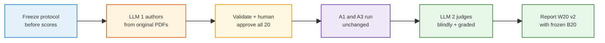

<h1 id="w20-recovery-title" style="color:#0d47a1;font-size:1.5em;font-weight:700;border-bottom:2px solid #90caf9;padding-bottom:0.25em;margin-top:0">Refactor plan — recover the A1 vs A3 W20 demonstration</h1>

**Plan role:** evaluation-only successor to [`REFACTOR_A1_WIKI_HG_P3.md`](./REFACTOR_A1_WIKI_HG_P3.md).<br>
**Status:** aligned and ready for `qimpltdd`; implementation not started.<br>
**last_aligned:** 2026-11-11 — graded semantic judging, automated OpenAI authoring with human approval, and frozen A1/A3 search systems.<br>
**Execute:** `qimpltdd docs_manual_gen/ref_plan/new/REFACTOR_A1_A3_W20_DEMONSTRATION_RECOVERY.md`.

<h2 id="w20-recovery-outline" style="color:#1565c0;font-size:1.22em;font-weight:650;border-left:4px solid #42a5f5;padding-left:10px;margin-top:1.1em">Document outline</h2>

1. [Goal](#w20-recovery-goal) — what this experiment must demonstrate.
2. [Current evidence](#w20-recovery-evidence) — why the latest run is not valid proof.
3. [Decisions](#w20-recovery-decisions) — locked scope and fairness rules.
4. [Shortest credible path](#w20-recovery-path) — ordered implementation.
 4.1 [P0 — Freeze the experiment contract](#w20-recovery-p0) — schema, construct, and model independence.
 4.2 [P1 — Author W20 v2 from the PDFs](#w20-recovery-p1) — reproducible LLM 1 command.
 4.3 [P2 — Validate and human-freeze W20 v2](#w20-recovery-p2) — no score-driven selection.
 4.4 [P3 — Add graded, blinded judging](#w20-recovery-p3) — LLM 2 scores instead of harsh binary gates.
 4.5 [P4 — Run and report the frozen comparison](#w20-recovery-p4) — W20 plus frozen B20 evidence.
5. [Evaluation boundary](#w20-recovery-boundary) — what remains unchanged.
6. [Acceptance](#w20-recovery-acceptance) — quality, efficiency, and no-regression bars.
7. [Implementation surface](#w20-recovery-surface) — expected files.
8. [TDD and execution checklist](#w20-recovery-tdd) — red/green sequence.
9. [Industry basis](#w20-recovery-industry) — external guidance behind the approach.

---

<h2 id="w20-recovery-goal" style="color:#1565c0;font-size:1.22em;font-weight:650;border-left:4px solid #42a5f5;padding-left:10px;margin-top:1.1em">1. Goal</h2>

Demonstrate two complementary product homes:

<table>
<thead>
<tr style="background:#1565c0;color:white"><th>Arm</th><th>Question home</th><th>Expected advantage</th><th>Frozen proof</th></tr>
</thead>
<tbody>
<tr><td style="background:#e3f2fd"><strong>A1 · LLM Wiki</strong></td><td style="background:#e8f5e9">Type C: broad orientation, cross-brand patterns, taxonomies, tradeoffs, and corpus-level synthesis</td><td>Compiled knowledge should answer with fewer searches, less context, or lower latency at equal or better quality</td><td>Revised <code>TYPE_W_W20</code></td></tr>
<tr><td style="background:#e3f2fd"><strong>A3 · classic RAG</strong></td><td style="background:#fff3e0">Type B: specific evidence-backed manual + ticket questions</td><td>Direct source retrieval should remain stronger for precise local evidence</td><td><code>TYPE_B_B20</code> canonical run <code>b20-evo18-d7-v3-20261028</code>: <strong>16/20</strong></td></tr>
</tbody>
</table>

This plan tests the hypothesis. It must not guarantee an A1 win by weakening A3 or rewriting questions after observing final scores.

**Non-goals:**

- Do not replace the frozen Type B baseline.
- Do not repair or regenerate A1 compiled content.
- Do not change A1/A3 retrieval, query planning, aliases, answer prompts, top-k, or corpus inputs.
- Do not make exact citation formatting the primary definition of Type C correctness.
- Do not tune the final 20 questions after the blinded operator run starts.

---

<h2 id="w20-recovery-evidence" style="color:#1565c0;font-size:1.22em;font-weight:650;border-left:4px solid #42a5f5;padding-left:10px;margin-top:1.1em">2. Current evidence</h2>

Latest run: **`w20-focused-20261111`**.

<table>
<thead>
<tr style="background:#1565c0;color:white"><th>Signal</th><th>A1</th><th>A3</th><th>Interpretation</th></tr>
</thead>
<tbody>
<tr><td style="background:#e3f2fd">Judge pass</td><td style="background:#ffebee">2/20</td><td style="background:#ffebee">3/20</td><td>Neither arm is production-valid on W20.</td></tr>
<tr><td style="background:#e3f2fd">Median elapsed</td><td style="background:#fff3e0">10.3 s</td><td style="background:#e8f5e9">6.2 s</td><td>A1 is not yet faster.</td></tr>
<tr><td style="background:#e3f2fd">Median retrieval</td><td style="background:#fff3e0">4.0 s</td><td style="background:#e8f5e9">0.7 s</td><td>Wiki HTTP/search overhead currently dominates.</td></tr>
<tr><td style="background:#e3f2fd">Median context</td><td style="background:#fff3e0">19.2k chars</td><td style="background:#e8f5e9">7.1k chars</td><td>A1 also uses more context.</td></tr>
<tr><td style="background:#e3f2fd">A3 source scope</td><td>N/A</td><td style="background:#ffebee">14/20 result sets were GE-only while another brand was needed</td><td>Brand aliases and cross-brand fan-out were bypassed.</td></tr>
</tbody>
</table>

The run mixes five failure layers:

1. **Compile loss:** A1 raw Samsung text contains “Water clouding”; the compiled wiki omitted it.
2. **Scope loss:** W20 says “GE” and “Samsung,” while A3 recognizes exact catalog slugs and receives no suite `model_id`.
3. **Orchestration loss:** both W20 arms perform one top-5 query; existing Type B D7 decomposition is not called.
4. **Generation mismatch:** gold is 41–56 words; candidates are often 100–350 words and add unsupported detail.
5. **Evaluation mismatch:** nine W20 rubrics demand source/section evidence, but the answer prompt does not require citations; W15 passed A3 despite missing Samsung evidence.

This refactor does **not** repair layers 1–4. It freezes both systems and replaces the invalid question/judge contract so the next run measures the systems as they exist. Retrieval defects remain reportable outcomes, not hidden implementation work.

---

<h2 id="w20-recovery-decisions" style="color:#1565c0;font-size:1.22em;font-weight:650;border-left:4px solid #42a5f5;padding-left:10px;margin-top:1.1em">3. Decisions</h2>

| ID | Decision |
|----|----------|
| **W20-D1** | Keep the canonical **TYPE_B_B20 16/20** result frozen as the A3-specific-question proof. Run it only as a no-regression check. |
| **W20-D2** | Replace the current W20 fixture with **W20 v2**, generated from the original PDFs before either arm is run. Preserve the old fixture and run as historical artifacts. |
| **W20-D3** | Use **graded semantic scoring**. Rubric bullets guide scoring; missing a non-critical bullet lowers the score but does not automatically fail. Citation correctness is separate. |
| **W20-D4** | Freeze both search systems. No compilation repair, query planner, retrieval, corpus, answer-prompt, top-k, or alias changes are in scope. |
| **W20-D5** | Efficiency means quality plus measurable cost: retrieval calls where available, context characters/tokens, retrieval latency, and wall-clock latency. |
| **W20-D6** | A1 promotion requires a frozen, blinded run. No row edits or threshold changes after results are visible. |
| **W20-D7** | `human_verified: false` is not promotion-grade. Human review all 20 gold answers and reference sources before the operator run. |
| **W20-D8** | **LLM 1** is an explicit, strong OpenAI author model selected via CLI/config, separate from the answer and judge roles. Record provider, model, prompt hash, source hashes, and raw response. |
| **W20-D9** | **LLM 2** is a different provider/model family from LLM 1. It judges candidates blindly, with arm labels removed and deterministic answer-order randomization. |
| **W20-D10** | The same answer model and settings serve A1 and A3. The primary outcome is a 0–100 semantic score plus judge-estimated correctness confidence; binary pass is derived only for historical comparison. |
| **W20-D11** | LLM confidence is not a calibrated probability. Human review all low-confidence, borderline, malformed, and surprising rows before interpreting the result. |
| **W20-D12** | Alignment answers: Q1 → graded semantic scoring; Q2 → automated API authoring plus human approval; Q3 → evaluation-only with both systems frozen. |

---

<h2 id="w20-recovery-path" style="color:#1565c0;font-size:1.22em;font-weight:650;border-left:4px solid #42a5f5;padding-left:10px;margin-top:1.1em">4. Shortest credible path</h2>



<h3 id="w20-recovery-p0" style="color:#00695c;font-size:1.05em;font-weight:600;margin-top:0.85em">4.1 P0 — Freeze the experiment contract</h3>

Define the contract before authoring or running either arm:

- Suite shape: **12** `global_cross_brand`, **4** `global_single_brand`, **4** `boundary_local`.
- Global questions ask for patterns, taxonomies, tradeoffs, briefing frameworks, or shared limitations.
- A global row requires at least three referenced sections; a cross-brand row requires at least two brands.
- A row is invalid when one local passage contains its complete answer, except `boundary_local`.
- Gold answers use only the original PDFs and include structured source references.
- Rubrics contain 3–5 semantic criteria, each marked `critical: true|false`.
- No question mentions A1, A3, LLM Wiki, RAG, lanes, retrieval, or expected winners.
- Freeze scoring before execution:
  - overall = correctness 40% + completeness 25% + manual grounding 25% + supported-claims component 10%;
  - compatibility pass = overall ≥70, correctness ≥3, and no direct critical contradiction;
  - human review = confidence &lt;0.75, overall 65–75, malformed judge output, or paired arm delta ≥25;
  - A1 global advantage = paired mean score delta ≥5 and paired bootstrap 95% interval lower bound &gt;0;
  - deterministic blinding seed = `w20-v2-20261111`.

**P0 exit:** schema and validation tests encode the contract, while both current retrieval stacks remain byte-for-byte untouched.

<h3 id="w20-recovery-p1" style="color:#00695c;font-size:1.05em;font-weight:600;margin-top:0.85em">4.2 P1 — Author W20 v2 from the PDFs</h3>

Replace the current validator-only `author_cos_insight_gold.py` with a reproducible authoring command:

1. Accept the four original PDF paths and fail if any is missing.
2. Require an explicit strong OpenAI model through `--model` or `RETAIL_W20_AUTHOR_MODEL`; do not inherit the mini answer-model default.
3. Submit the PDF contents plus a versioned prompt and strict JSON schema to LLM 1.
4. Require exactly 20 rows in the 12/4/4 distribution.
5. Persist:
   - raw provider response;
   - prompt text and SHA-256 hash;
   - model/provider and generation settings;
   - source filenames and SHA-256 hashes;
   - generated candidate suite marked `human_verified: false`.
6. Never overwrite an existing frozen suite without an explicit `--force` flag.
7. Use `neat_logger` for start, upload/generation, validation, and write milestones; write append-only progress JSONL and expose extra request metadata under `NEAT_LOGGER_DEBUG=1`.

**P1 exit:** a mocked API test creates a schema-valid candidate and proves malformed/model-missing/overwrite paths fail safely. The live command is an operator gate requiring `OPENAI_API_KEY`.

<h3 id="w20-recovery-p2" style="color:#00695c;font-size:1.05em;font-weight:600;margin-top:0.85em">4.3 P2 — Validate and human-freeze W20 v2</h3>

Add a freeze command that:

- verifies 20 unique IDs and exact 12/4/4 distribution;
- verifies source files and section/page references are present;
- rejects empty gold, missing criteria, implementation-referential questions, and single-passage global rows;
- requires every row’s `human_verified` flag before changing status from `candidate` to `frozen`;
- records reviewer, reviewed timestamp, candidate hash, and frozen hash;
- never filters, rewrites, or replaces rows using A1/A3 scores.

Human review checks factual support, useful big-picture framing, answer completeness, and whether each criterion is genuinely critical.

**P2 exit:** W20 v2 is frozen only after all 20 rows pass validation and human review. Until then, the full benchmark refuses to run it.

<h3 id="w20-recovery-p3" style="color:#00695c;font-size:1.05em;font-weight:600;margin-top:0.85em">4.4 P3 — Add graded, blinded judging</h3>

Replace binary-first judging with one strict JSON result:

```json
{
  "correctness": 0,
  "completeness": 0,
  "manual_grounding": 0,
  "unsupported_claims": 0,
  "criterion_scores": [],
  "overall_score": 0,
  "correctness_confidence": 0.0,
  "verdict": "correct|mostly_correct|mixed|incorrect",
  "rationale": ""
}
```

Scoring policy:

- `correctness`, `completeness`, and `manual_grounding`: integer **0–4**, higher is better.
- `unsupported_claims`: integer **0–4**, higher means more unsupported content and is a penalty.
- `overall_score`: deterministic weighted score computed in code, not accepted from model arithmetic.
- Each semantic criterion receives `met`, `partly_met`, or `not_met`; only a contradiction or missed `critical: true` claim may cap the verdict.
- A direct critical contradiction caps overall at 49; a missed but not contradicted critical claim caps it at 69. Non-critical misses have no hard cap.
- Citation presence/format is reported separately and cannot zero an otherwise semantically correct answer.
- `correctness_confidence` is LLM 2’s estimated confidence, not a calibrated probability.
- Judge provider must differ from LLM 1’s provider; record and reject an invalid same-provider configuration.
- Blind each candidate by removing arm labels and assigning a deterministic opaque candidate ID. Judge A1/A3 order is seeded and hidden from the prompt.
- Keep `judge_pass` only as a derived compatibility field from a frozen threshold; primary analysis uses scores and confidence.
- Flag malformed responses, confidence below the frozen threshold, score near the decision threshold, and surprising arm deltas for human review.

**P3 exit:** tests prove non-critical omissions reduce rather than zero a score, critical contradictions cap it, citation absence remains separate, arm labels never enter the prompt, and same-provider author/judge configuration is rejected.

<h3 id="w20-recovery-p4" style="color:#00695c;font-size:1.05em;font-weight:600;margin-top:0.85em">4.5 P4 — Run and report the frozen comparison</h3>

1. Freeze code, config, suite, prompt, gold, criteria, scoring weights, and thresholds.
2. Run the unchanged A1 and A3 W20 arms with the same answer model and settings.
3. Judge both arms with LLM 2 using deterministic blinding.
4. Human-review flagged rows without changing frozen scores; record any adjudicated score separately.
5. Preserve the canonical TYPE_B_B20 **16/20** result as the specific-question baseline; do not silently rerun it under changed models and call it equivalent.
6. Update `TEST_ANALYSIS_A1_LLM_WIKI.md` with quality by question class, score distributions, confidence bands, citation score, median/p95 latency, context size, flagged rows, and explicit unsupported-hypothesis language when A1 does not win.

**P4 exit:** the report can be regenerated from immutable suite/run artifacts, and no post-score question edits occurred.

---

<h2 id="w20-recovery-boundary" style="color:#1565c0;font-size:1.22em;font-weight:650;border-left:4px solid #42a5f5;padding-left:10px;margin-top:1.1em">5. Evaluation boundary</h2>

<table>
<thead>
<tr style="background:#1565c0;color:white"><th>Layer</th><th>Frozen input</th><th>This refactor may change</th></tr>
</thead>
<tbody>
<tr><td style="background:#e3f2fd">Corpus</td><td>A1 <code>brain/retail-md/wiki/**</code>; A3 <code>raw/sources/fridge-docs_md/**/*.md</code></td><td>Nothing</td></tr>
<tr><td style="background:#e3f2fd">Retrieval</td><td>Current LLM Wiki full search and current A3 Postgres hybrid search</td><td>Nothing</td></tr>
<tr><td style="background:#e3f2fd">Answering</td><td>Same answer model, prompt, temperature, and top-k for both arms</td><td>Only explicit provenance recording</td></tr>
<tr><td style="background:#e3f2fd">Evaluation</td><td>Historical W20 and B20 artifacts remain immutable</td><td>W20 v2 authoring, validation, blinding, graded judging, and reporting</td></tr>
</tbody>
</table>

This boundary is deliberate. If A1 lacks a needed compiled claim or A3 retrieves the wrong manual, the report records that failure. It does not modify either system during this experiment.

---

<h2 id="w20-recovery-acceptance" style="color:#1565c0;font-size:1.22em;font-weight:650;border-left:4px solid #42a5f5;padding-left:10px;margin-top:1.1em">6. Acceptance</h2>

<table>
<thead>
<tr style="background:#1565c0;color:white"><th>Gate</th><th>Required result</th><th>Why</th></tr>
</thead>
<tbody>
<tr><td style="background:#e3f2fd">W20 v2 construct</td><td>20 frozen, human-reviewed rows; 12 global cross-brand, 4 global single-brand, 4 boundary local</td><td>Tests the claimed product home without hiding boundary cases.</td></tr>
<tr><td style="background:#e3f2fd">Author independence</td><td>LLM 1 provenance and source hashes recorded; all rows generated before either arm is run</td><td>Prevents score-driven question selection.</td></tr>
<tr><td style="background:#e3f2fd">Judge independence</td><td>LLM 2 uses a different provider/model family; prompts contain opaque candidate IDs and no arm labels</td><td>Reduces self-preference and arm bias.</td></tr>
<tr><td style="background:#e3f2fd">Scoring validity</td><td>Primary 0–100 graded score; no automatic zero for non-critical omissions or citation formatting; flagged rows human-reviewed</td><td>Avoids the harsh binary-rubric failure seen in W13–W16.</td></tr>
<tr><td style="background:#e3f2fd">A1 quality hypothesis</td><td>A1 mean global score exceeds A3 by a frozen practical margin and the paired uncertainty interval excludes zero</td><td>Uses magnitude and uncertainty rather than cherry-picked row counts.</td></tr>
<tr><td style="background:#e3f2fd">A1 efficiency</td><td>At equal-or-better global quality, A1 wins at least two of: retrieval calls, context tokens, median elapsed</td><td>“Efficient” must be measurable, not narrative.</td></tr>
<tr><td style="background:#e3f2fd">Type B evidence</td><td>Canonical <code>b20-evo18-d7-v3-20261028</code> remains labeled 16/20 with its original model/config provenance</td><td>Preserves the already-observed specific-question advantage without pretending a new model run is identical.</td></tr>
</tbody>
</table>

If A1 does not meet the frozen ≥5-point paired global margin and uncertainty gate, report that the product hypothesis is unsupported. Do not edit W20 v2 after seeing the result.

---

<h2 id="w20-recovery-surface" style="color:#1565c0;font-size:1.22em;font-weight:650;border-left:4px solid #42a5f5;padding-left:10px;margin-top:1.1em">7. Implementation surface</h2>

Expected files:

- `tests/retail_multi_profiles/data/retail-w20-focused-synthesis-v2.json`
- `scripts/retail/tools/author_cos_insight_gold.py` — PDF authoring and freeze subcommands.
- `tests/retail_multi_profiles/lib/w20_authoring.py` — prompt, PDF request, provenance, and safe writes.
- `tests/retail_multi_profiles/lib/load_cos_insight_suite.py` — W20 v2 schema and frozen-suite validation.
- `tests/retail_multi_profiles/lib/cos_insight_runner.py` — blinded graded judge result and compatibility fields.
- `tests/retail_multi_profiles/lib/eval_models.py` — independent author/answer/judge role resolution.
- `tests/retail_multi_profiles/run_cos_insight_qa.py` — reject candidate suites and report frozen provenance.
- `tests/retail_multi_profiles/data/run-config.yaml` — independent model roles and frozen scoring thresholds.
- `tests/retail_multi_profiles/test_w20_authoring.py` — author/freeze contract tests.
- `tests/retail_multi_profiles/test_cos_insight_suite.py` — graded judge and blinding tests.
- `docs_manual_gen/artifacts/TEST_ANALYSIS_A1_LLM_WIKI.md` — W20 v2 and B20 regression report.

Explicitly untouched: `sku_scope.py`, `query_unit_orchestrator.py`, `wiki_evidence.py`, manual indexes, and compiled wiki content.

---

<h2 id="w20-recovery-tdd" style="color:#1565c0;font-size:1.22em;font-weight:650;border-left:4px solid #42a5f5;padding-left:10px;margin-top:1.1em">8. TDD and execution checklist</h2>

| Phase | TDD mode | Test-first artifact and red case | Green gate |
|-------|----------|----------------------------------|------------|
| **P0** | **strict-TDD** | `test_w20_authoring.py`: invalid 12/4/4 distribution, local global-row, or missing criterion metadata currently loads | `pytest -q tests/retail_multi_profiles/test_w20_authoring.py` |
| **P1** | **strict-TDD** | `test_w20_authoring.py`: missing model/PDF, malformed API JSON, provenance omission, and overwrite currently lack safe failures | Mocked author command emits candidate + raw/provenance + JSONL progress; live author command reaches HG-1 when key/model unavailable |
| **P2** | **strict-TDD** | `test_w20_authoring.py`: unreviewed candidate can currently be selected for a full run | Freeze rejects any unverified row; **HG-2** approves all 20 before frozen status |
| **P3** | **strict-TDD** | `test_cos_insight_suite.py`: binary judge cannot represent partial quality and prompt exposes arm ordering | Graded score/caps/blinding/provider-independence tests pass |
| **P4** | **strict-TDD** | Report fixture fails without immutable suite/config hashes, score distributions, and flagged-row list | Targeted tests + `./scripts/verify.sh`; live W20 is **HG-3** if external services are unavailable |

Execution:

- [ ] P0 freeze schema, score weights, thresholds, and experiment boundaries.
- [ ] P1 implement reproducible LLM 1 PDF authoring with provenance, safe writes, neat logging, and checkpoints.
- [ ] P2 implement validation/freeze workflow and complete human review.
- [ ] P3 implement independent LLM 2 graded judging, deterministic blinding, derived compatibility pass, and review flags.
- [ ] P4 run frozen W20 v2, update analysis, and preserve canonical B20 provenance.
- [ ] Record outcome without post-run question edits.
- [ ] Run `./scripts/verify.sh`.

Human gates:

- **HG-1:** `OPENAI_API_KEY`, an explicitly selected strong author model, and access to all four original PDFs.
- **HG-2:** named human reviewer verifies every question, gold answer, semantic criterion, and source reference.
- **HG-3:** LLM Wiki, Postgres, OpenAI answer access, and different-provider judge access are available for the full run.

Comments and documentation gate:

- Every non-trivially edited Python module retains a module docstring.
- Every edited/new class and function has at least one meaningful doc line.
- Non-obvious score caps, blinding, hashes, and overwrite protection receive short “why” comments.
- CLI help and `tests/retail_multi_profiles/README.md` document author → review → freeze → run.
- Operator logs use `W20-AUTHOR` / `W20-EVAL`, `logs/ops/`, JSONL steps (`author_start`, `request_start`, `response_saved`, `candidate_validated`, `freeze_done`, `row_start`, `judge_start`, `row_done`), and `NEAT_LOGGER_DEBUG`.

---

<h2 id="w20-recovery-industry" style="color:#1565c0;font-size:1.22em;font-weight:650;border-left:4px solid #42a5f5;padding-left:10px;margin-top:1.1em">9. Industry basis</h2>

| Practice | Source | Application |
|----------|--------|-------------|
| Criteria-based evaluation and held-out datasets | [OpenAI evaluation best practices](https://platform.openai.com/docs/guides/evals) | Freeze explicit criteria and test data before inspecting system scores. |
| LLM judge bias and position effects | [Judging LLM-as-a-Judge with MT-Bench and Chatbot Arena](https://arxiv.org/abs/2306.05685) | Use a different model family, hide arm identity, and randomize candidate order. |
| Graded natural-language evaluation | [G-Eval](https://arxiv.org/abs/2303.16634) | Prefer structured dimensions and rationales over one brittle binary judgment. |
| Context recall, precision, and faithfulness | [Ragas metrics](https://docs.ragas.io/en/stable/concepts/metrics/available_metrics/) | Keep retrieval/grounding diagnostics distinct from final answer quality. |
| Human oversight of model evaluation | [NIST AI Risk Management Framework](https://www.nist.gov/itl/ai-risk-management-framework) | Human-review gold data and uncertain or consequential judge outcomes. |
