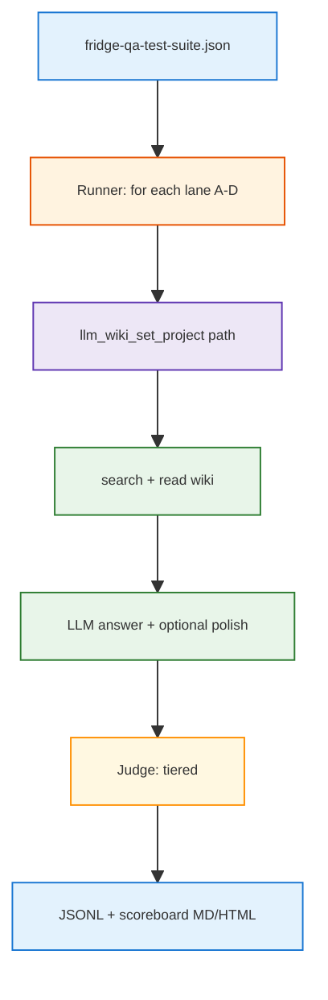

<h1 id="abcd-title" style="color:#0d47a1;font-size:1.5em;font-weight:700;border-bottom:2px solid #90caf9;padding-bottom:0.25em;margin-top:0">Refactor plan — fridge manual ingest A/B/C/D benchmark</h1>

**Status:** **new** — plan only (2026-10-19). All implementable items **`[ ]`**.  
**Chain:** **`onlyreftdd`**. Implement later with **`aciubtdd`** on this file.  
**Goal:** Automate a **four-lane** comparison (`retail`, `retail-md`, `retail-txt`, `retail-md-learned`) on the **same 90-question fridge QA suite**, score answers against gold, and publish reproducible metrics to choose a **best practice** for LLM Wiki + product Q&A from long PDF manuals.  
**Out of scope for this plan:** changing LLM Wiki ingest/compiler code in `nu_llm_wiki`; ticket Postgres leg; shipping a public article (capture outline only).

<h2 id="abcd-outline" style="color:#1565c0;font-size:1.22em;font-weight:650;border-left:4px solid #42a5f5;padding-left:10px;margin-top:1.1em">Document outline</h2>

1. [Problem](#abcd-problem) — why four lanes, one benchmark.
2. [Benchmark corpus](#abcd-benchmark) — JSON schema and counts.
3. [Ingest lanes (A–D)](#abcd-lanes) — what each profile ingests.
4. [Evidence](#abcd-evidence) — repo touchpoints today.
5. [Decisions](#abcd-decisions) — locked for impl (includes grill outcomes).
6. [Metrics and reporting](#abcd-metrics) — scoreboard shape.
7. [Phases](#abcd-phases) — P1–P8.
8. [Quality bar](#abcd-quality) — tests and comments.
9. [TDD bar](#abcd-tdd) — red/green per phase.
10. [Execution checklist](#abcd-checklist) — all open.
11. [Deferred](#abcd-deferred) — article, nu_llm_wiki changes, page-level cite.
12. [Related plans](#abcd-related) — links.

---

<h2 id="abcd-problem" style="color:#1565c0;font-size:1.22em;font-weight:650;border-left:4px solid #42a5f5;padding-left:10px;margin-top:1.1em">1. Problem</h2>

Fridges R Us manuals arrive as **long, complex PDFs**. LLM Wiki can ingest them several ways:

- **Native PDF** inside the app (PDFium path in the desktop stack).
- **Pre-converted Markdown or text** produced **outside** the app (Docling non-OCR, pypdf extract, etc.).
- **LLM-digested Markdown** (technician-style rewrite constrained to PDF facts).

You already stand up **four sibling projects** under `brain/` and ingested the **four fridge PDFs** (per lane’s raw format). The open question is **which lane yields the most reliable answers** on a fixed Q&A benchmark—not ad hoc chat.

This plan adds a **test harness**, **tiered scoring**, and a **comparison report** suitable for internal decision-making and (later) a publishable methods section.

---

<h2 id="abcd-benchmark" style="color:#1565c0;font-size:1.22em;font-weight:650;border-left:4px solid #42a5f5;padding-left:10px;margin-top:1.1em">2. Benchmark corpus</h2>

**Authoritative file (operator):**  
`/Users/jjw8053/Downloads/fridge-qa-pass2-package/fridge-qa-test-suite.json`

**Vendored copy (impl):**  
`eval/fridge_qa/fridge-qa-test-suite.json` (same bytes; add `eval/fridge_qa/README.md` with `schema_version`, provenance, and refresh command).

| Field | Value |
|-------|--------|
| `schema_version` | `1.0` |
| Models | 3 SKU leaves: `ge_GNE27JYMFS`, `kitchenaid_KRFF507HPS`, `samsung_RF28K9070SG` |
| Questions | **90** total (**30 easy**, **30 hard**, **30 negative**) |
| Grounding | PDF-only facts per model leaf (`grounding_policy` in JSON) |
| Negative literal | `Insufficient_Information_Based_On_Given_PDF` |
| Samsung sources | `user-guide.pdf` + `repair-guide.pdf` (only Samsung row lists two PDFs) |

Each question carries **`answer`** (gold prose) and **`reference_points`** (PDF path + **printed** page number for human audit—not used as an automated score in v1).

---

<h2 id="abcd-lanes" style="color:#1565c0;font-size:1.22em;font-weight:650;border-left:4px solid #42a5f5;padding-left:10px;margin-top:1.1em">3. Ingest lanes (A–D)</h2>

<table>
<thead>
<tr style="background:#1565c0;color:white"><th>Lane</th><th>Brain folder</th><th>Raw ingest</th><th>Provenance</th></tr>
</thead>
<tbody>
<tr><td style="background:#e3f2fd"><strong>A</strong></td><td style="background:#e8f5e9"><code>brain/retail</code></td><td style="background:#e8f5e9">Original <strong>PDF</strong> under <code>raw/sources/fridge-docs/…</code></td><td style="background:#fff3e0">LLM Wiki compile (PDFium / in-app PDF pipeline)</td></tr>
<tr><td style="background:#e3f2fd"><strong>B</strong></td><td style="background:#e8f5e9"><code>brain/retail-md</code></td><td style="background:#e8f5e9"><strong>.md</strong> under <code>raw/sources/…</code></td><td style="background:#fff3e0">External non-OCR PDF→MD (e.g. Docling)</td></tr>
<tr><td style="background:#e3f2fd"><strong>C</strong></td><td style="background:#e8f5e9"><code>brain/retail-txt</code></td><td style="background:#e8f5e9"><strong>.txt</strong> under <code>raw/sources/…</code></td><td style="background:#fff3e0">External PDF→text extract</td></tr>
<tr><td style="background:#e3f2fd"><strong>D</strong></td><td style="background:#e8f5e9"><code>brain/retail-md-learned</code></td><td style="background:#e8f5e9"><strong>.md</strong> (technician digest)</td><td style="background:#fff3e0">LLM rewrite from PDFs with strict no-hallucination prompt (ChatGPT-class model)</td></tr>
</tbody>
</table>

**Precondition (operator, already done per user):** each lane’s wiki index is built from its raw tree; LLM Wiki API healthy at `http://127.0.0.1:19828/api/v1`.

**Fairness rules for the experiment:**

- Same **90 questions** and same **answer model + judge model** configs across lanes (see Decisions).
- Questions are asked **in SKU context** (model_id from JSON) so search is not ambiguous across GE vs Samsung.
- Do **not** mix ticket search or Postgres in v1—**manual/wiki leg only**.

---

<h2 id="abcd-evidence" style="color:#1565c0;font-size:1.22em;font-weight:650;border-left:4px solid #42a5f5;padding-left:10px;margin-top:1.1em">4. Evidence</h2>

| Fact | Where |
|------|--------|
| HTTP search + read already implemented for live eval | `scripts/retail/retail_brain/answer_manuals.py` → `LlmWikiHttpClient` |
| Offline wiki fixtures for CI | `FixtureWikiClient` in same module |
| `BRAIN_PROFILES` only `personal` \| `retail` | `scripts/brain/brain_stack.py` — **lanes B–D are not switchable via `BRAIN_PROFILE` yet** |
| Layout test still assumes two profiles | `tests/test_brain_profile_layout.py` |
| Extensible scoreboard pattern | `.cursor/rules/project_specific/extesttab-expgtest-table-scoreboard.mdc` (adapt for ABCD) |
| Multi-project MCP compile gap | [`REFACTOR_MULTI_PROFILE_AGENT_OPS.md`](./REFACTOR_MULTI_PROFILE_AGENT_OPS.md) — not blocking if ingest is already done |

---

<h2 id="abcd-decisions" style="color:#1565c0;font-size:1.22em;font-weight:650;border-left:4px solid #42a5f5;padding-left:10px;margin-top:1.1em">5. Decisions</h2>

| ID | Decision |
|----|----------|
| **D1** | **Four experimental lanes** map 1:1 to folders `brain/retail`, `brain/retail-md`, `brain/retail-txt`, `brain/retail-md-learned`. Lane id in code: `A` \| `B` \| `C` \| `D`. |
| **D2** | **Answer path (grill):** use **retrieve-then-answer**, not Hermes agent loop. Pipeline: `llm_wiki_search` (SKU-scoped query) → read top‑k wiki pages → **one LLM call** with a fixed system prompt → optional **short polish/summarization** pass (second LLM call with temperature 0). This is **not equivalent** to LLM Wiki **chat/RAG** (Option A): chat bundles retrieval, tool use, and project chat settings inside the app. **B + polish** is preferred for **reproducible A/B/C/D** and article methods; run **one optional smoke subset** via chat API for contrast only. |
| **D3** | **Scoring (grill):** **tiered**. **Negative:** pass iff model output matches **`Insufficient_Information_Based_On_Given_PDF`** (normalize whitespace/case). **Easy + hard:** **LLM-as-judge** with rubric (factually consistent with gold, no unsupported claims, paraphrase OK). **Wise with caveats:** fix judge model + prompt version; calibrate on ~10 gold pairs; store judge raw JSON; report disagreement sample for human audit. |
| **D4** | **No automated PDF page citation score** in v1 (MD/TXT lanes lack stable printed pages); keep `reference_points` for manual spot-check and future phase. |
| **D5** | Benchmark JSON lives under **`eval/fridge_qa/`** in repo; runner accepts `--suite` override. |
| **D6** | Register lanes in a **static registry** (`config/fridge-abcd-lanes.yaml` or Python constant) with absolute project paths—**do not** overload `BRAIN_PROFILE` for B–D in v1; keep `retail` as production default for unrelated scripts. |
| **D7** | Answer + judge models configured in **`eval/fridge_qa/run-config.yaml`** (provider, model id, temperature 0); log full prompts and responses under **`ops/runs/fridge-abcd/<timestamp>/`** per opslog convention. |
| **D8** | Industry scan delivered as **`docs_manual_gen/artifacts/FRIDGE_MANUAL_QA_INDUSTRY_SCAN.md`** (sources cited, date-stamped)—feeds article §Related work, not a gate for harness merge. |

**Grill record (2026-10-19):** answer path = **D2**; scoring = **D3** (user asked whether tiered + LLM judge for easy/hard is wise → **yes**, with calibration in P4).

---

<h2 id="abcd-metrics" style="color:#1565c0;font-size:1.22em;font-weight:650;border-left:4px solid #42a5f5;padding-left:10px;margin-top:1.1em">6. Metrics and reporting</h2>

Primary table (lanes × strata):

| Metric | Definition |
|--------|------------|
| **Pass rate** | % judge pass (easy/hard) or exact insufficient (negative) |
| **Pass by difficulty** | easy / hard / negative columns |
| **Pass by SKU** | three model_id groups |
| **Latency p50/p95** | search + read + LLM + judge per question |
| **Retrieval recall proxy** | gold doc stem appears in top‑k wiki paths or source frontmatter (diagnostic only) |
| **Cost estimate** | token counts × price sheet (optional row) |

Deliverables:

- `ops/runs/fridge-abcd/<run_id>/results.jsonl` — one row per (lane, question_id).
- `ops/runs/fridge-abcd/<run_id>/scoreboard.md` — human scan (extesttab-friendly).
- `ops/runs/fridge-abcd/<run_id>/summary.json` — lane winner + confidence notes.

**Winner rule (default):** highest overall pass rate; tie-breaker higher hard-pass rate, then lower p95 latency.

---

<h2 id="abcd-phases" style="color:#1565c0;font-size:1.22em;font-weight:650;border-left:4px solid #42a5f5;padding-left:10px;margin-top:1.1em">7. Phases</h2>

<h3 id="abcd-p1" style="color:#00695c;font-size:1.05em;font-weight:600;margin-top:0.85em">7.1 P1 — Benchmark vendoring and schema loader</h3>

- [ ] Copy `fridge-qa-test-suite.json` → `eval/fridge_qa/fridge-qa-test-suite.json`.
- [ ] Add `eval/fridge_qa/README.md` (provenance, counts, grounding policy, negative literal).
- [ ] Python module `eval/fridge_qa/load_suite.py`: validate schema, iterate `(model_id, question)` with SKU context helper.

<h3 id="abcd-p2" style="color:#00695c;font-size:1.05em;font-weight:600;margin-top:0.85em">7.2 P2 — Lane registry (A–D)</h3>

- [ ] Add `config/fridge-abcd-lanes.yaml` (lane id → `brain/` relative path → ingest kind enum).
- [ ] Document lanes in `brain/README.md` appendix (**experimental**, not `BRAIN_PROFILE` switches).
- [ ] Preflight command: API health + project path exists + non-empty `wiki/` index marker.

<h3 id="abcd-p3" style="color:#00695c;font-size:1.05em;font-weight:600;margin-top:0.85em">7.3 P3 — Retrieval client and answer pipeline</h3>

- [ ] Extend or wrap `LlmWikiHttpClient` for **project path per lane** (reuse `answer_manuals.py` patterns).
- [ ] Implement `eval/fridge_qa/answer_pipeline.py`: search (topK configurable), read pages, build context bundle, **answer LLM**, optional **polish LLM** (D2).
- [ ] SKU scoping: prepend model_id / brand tokens to query per JSON `model_id` (document exact template in run-config).
- [ ] CLI `scripts/retail/eval/run_fridge_abcd.py --lanes A,B,C,D --limit N --dry-run`.

<h3 id="abcd-p4" style="color:#00695c;font-size:1.05em;font-weight:600;margin-top:0.85em">7.4 P4 — Tiered scoring and calibration</h3>

- [ ] `eval/fridge_qa/scoring.py`: negative exact match; easy/hard → judge prompt with gold + candidate + question.
- [ ] `eval/fridge_qa/judge_prompt.md` versioned; store `judge_version` in each JSONL row.
- [ ] Calibration set: hand-pick 10 `(question, gold, candidate)` triples; pytest ensures judge stable pass/fail on fixtures (mock LLM in CI).
- [ ] Emit per-row: `pass`, `judge_rationale`, `difficulty`, `lane`.

<h3 id="abcd-p5" style="color:#00695c;font-size:1.05em;font-weight:600;margin-top:0.85em">7.5 P5 — Full run, scoreboard, comparison</h3>

- [ ] Run driver executes 4 × 90 = 360 judgments (resume/checkpoint by `(lane, question_id)`).
- [ ] Scoreboard generator (Markdown table + optional HTML) per **extesttab** conventions.
- [ ] `summary.json` declares recommended lane for production ingest policy pending human sign-off.

<h3 id="abcd-p6" style="color:#00695c;font-size:1.05em;font-weight:600;margin-top:0.85em">7.6 P6 — CI vs live tiers</h3>

- [ ] **CI tier:** `FixtureWikiClient` + mocked LLM judge → deterministic pytest on 3 questions per difficulty (synthetic pages).
- [ ] **Live tier:** marker `@pytest.mark.live` or script-only; requires LLM Wiki + API keys; document in runbook.

<h3 id="abcd-p7" style="color:#00695c;font-size:1.05em;font-weight:600;margin-top:0.85em">7.7 P7 — Industry best-practice scan</h3>

- [ ] Author `docs_manual_gen/artifacts/FRIDGE_MANUAL_QA_INDUSTRY_SCAN.md`: RAG on manuals, structure-aware PDF ingestion, table handling, citation practices, eval methodologies (2024–2026 sources).
- [ ] Map findings to lanes A–D (strengths/weaknesses hypothesis table).

<h3 id="abcd-p8" style="color:#00695c;font-size:1.05em;font-weight:600;margin-top:0.85em">7.8 P8 — Article outline (no publish)</h3>

- [ ] `docs_manual_gen/artifacts/FRIDGE_MANUAL_QA_ARTICLE_OUTLINE.md`: title options, abstract bullets, methods (lanes, benchmark, judge), results placeholder, ethics/limitations, artifact links.
- [ ] Explicitly note **implicit publication intent**; no submission work in this plan.

---

<h2 id="abcd-quality" style="color:#1565c0;font-size:1.22em;font-weight:650;border-left:4px solid #42a5f5;padding-left:10px;margin-top:1.1em">8. Quality bar</h2>

- **Tests:** P1 loader validation; P4 judge fixtures; P6 CI tier; no flaky live tests in default `./scripts/verify.sh`.
- **Comments ([cdcm](.cursor/rules/cdcm-code-comments.mdc)):** file header + per-function doc lines on all new `eval/fridge_qa/*.py` and `run_fridge_abcd.py`.
- **Ops:** each live run writes under `ops/runs/fridge-abcd/` with config snapshot and git commit hash.
- **Secrets:** never commit API keys; read from `.env` / `LLM_WIKI_API_TOKEN` like existing retail live tests.

---

<h2 id="abcd-tdd" style="color:#1565c0;font-size:1.22em;font-weight:650;border-left:4px solid #42a5f5;padding-left:10px;margin-top:1.1em">9. TDD bar</h2>

| Phase | Red first | Green exit |
|-------|-----------|------------|
| P1 | load invalid JSON fails | load real suite → 90 questions |
| P4 | judge mock returns fail on bad candidate | pass on gold paraphrase fixture |
| P6 | pipeline without wiki → structured error | fixture wiki → non-empty answer string |

---

<h2 id="abcd-checklist" style="color:#1565c0;font-size:1.22em;font-weight:650;border-left:4px solid #42a5f5;padding-left:10px;margin-top:1.1em">10. Execution checklist</h2>

- [ ] P1 Benchmark vendoring and schema loader
- [ ] P2 Lane registry (A–D)
- [ ] P3 Retrieval client and answer pipeline
- [ ] P4 Tiered scoring and calibration
- [ ] P5 Full run, scoreboard, comparison
- [ ] P6 CI vs live tiers
- [ ] P7 Industry best-practice scan
- [ ] P8 Article outline (no publish)

---

<h2 id="abcd-deferred" style="color:#1565c0;font-size:1.22em;font-weight:650;border-left:4px solid #42a5f5;padding-left:10px;margin-top:1.1em">11. Deferred</h2>

| Item | Why deferred |
|------|----------------|
| Enroll B–D in `BRAIN_PROFILES` | Experiment registry suffices; avoid breaking two-profile tests until policy merges |
| Page-level citation auto-score | MD/TXT lanes lack printed page alignment |
| LLM Wiki chat API as primary path | Reproducibility; optional smoke only (D2) |
| Hermes agent eval | Non-deterministic; out of v1 |
| `nu_llm_wiki` PDFium vs MinerU A/B inside app | Separate from outside-conversion lanes B–D |
| Public article draft | After live run + human sign-off on P8 outline |

---

<h2 id="abcd-related" style="color:#1565c0;font-size:1.22em;font-weight:650;border-left:4px solid #42a5f5;padding-left:10px;margin-top:1.1em">12. Related plans</h2>

| Plan | Relationship |
|------|----------------|
| [`REFACTOR_MULTI_PROFILE_AGENT_OPS.md`](./REFACTOR_MULTI_PROFILE_AGENT_OPS.md) | Future: rescan/compile any lane without UI focus |
| [`REFACTOR_BRAIN_PROFILES_AND_RETAIL_ANSWER.md`](../wip/REFACTOR_BRAIN_PROFILES_AND_RETAIL_ANSWER.md) | Production `retail_answer.v1` path; orthogonal to ABCD eval |
| [`RETAIL_LLM_WIKI_TXT_COMPILE.md`](../artifacts/RETAIL_LLM_WIKI_TXT_COMPILE.md) | Historical txt compile notes; lane C aligns |
| `pdf_proc/docling/` | External MD for lane B (operator tooling) |
