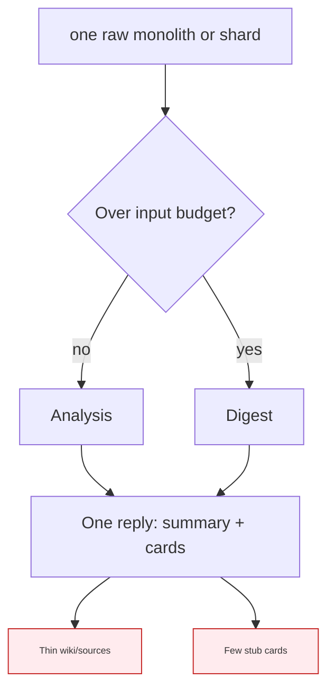
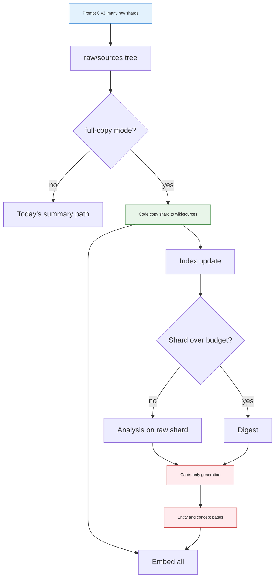

<h1 id="lsc-title" style="color:#0d47a1;font-size:1.5em;font-weight:700;border-bottom:2px solid #90caf9;padding-bottom:0.25em;margin-top:0">Refactor plan — external shards, full-copy ingest, service-manual cards</h1>

**Status:** **wip** — P1–P4, P7 + settings implemented in `nu_llm_wiki` (2026-10-20). **Last aligned:** 2026-10-20 (external-shard + full-copy; service-manual profile; Prompt C v3; UI-only flags).
**Chain:** **`onlyref`**. Implement with **`implref`** (`.cursor/rules/implref-resumimpl-refactor-plan-followthrough.mdc`).
**Code repo:** `/Users/jjw8053/projects/nu_llm_wiki`. Plan file: `second_brain/docs_manual_gen/ref_plan/new/`.
**Goal:** **`raw/sources`** holds **one Markdown file per handbook section** (from [Prompt C v3 split](../../../brain/retail/archive/fridge_prompts_pdf_or_zip_updated/Prompt_C_v3_split.md)). LLM Wiki **`full-copy`** maps each raw file → one **`wiki/sources`** page (bytes + frontmatter). A **cards-only** model pass reads **`raw/sources`** (not wiki pages) under **`ingestProfile: service-manual`**. No in-app `##` splitting.
**Estimate:** ~**2–3 days** in `nu_llm_wiki`; operator drops v3 shard tree and re-ingests (human gate).

<h2 id="lsc-outline" style="color:#1565c0;font-size:1.22em;font-weight:650;border-left:4px solid #42a5f5;padding-left:10px;margin-top:1.1em">Document outline</h2>

1. [Background](#lsc-background) — thin wiki, root cause.
2. [Pipeline facts](#lsc-pipeline) — Step 1 / Step 2 today.
3. [Card expectation (GE)](#lsc-cards-ge) — handbook vs wiki.
4. [Responsibility split](#lsc-responsibility) — external vs LLM Wiki.
5. [Locked decisions](#lsc-decisions) — implref gate.
6. [Detail levels (global, deferred)](#lsc-detail-levels) — 25 / 50 / 75 / full.
7. [Before / After](#lsc-before) — diagrams.
8. [Touchpoints](#lsc-touch) — code paths.
9. [Phases P1–P7](#lsc-phases) — all open.
10. [Quality bar](#lsc-quality) — tests, docs.
11. [Execution checklist](#lsc-check) — one list.
12. [Deferred](#lsc-deferred) — out of scope.
13. [Related](#lsc-related) — links.

---

<h2 id="lsc-background" style="color:#1565c0;font-size:1.22em;font-weight:650;border-left:4px solid #42a5f5;padding-left:10px;margin-top:1.1em">1. Background</h2>

Technician markdown under `brain/retail-md-learned/raw/sources/`. Search reads **`wiki/**` only**. Learned GE user-guide: raw **43,757** chars → wiki source **2,551** (~**6%**). **`related: []`** everywhere → **0** graph edges.

Learned files were **under** the input budget (~**122k** chars default) — **no chunk path**. Shrink is **mandatory source summary** in Step 2 (`buildGenerationPrompt` item 1), not token cap (~**6.5k** chars written in one Step 2 for GE).

---

<h2 id="lsc-pipeline" style="color:#1565c0;font-size:1.22em;font-weight:650;border-left:4px solid #42a5f5;padding-left:10px;margin-top:1.1em">2. Pipeline facts</h2>

| Step | Reads | Writes |
|---|---|---|
| Analysis | Raw file (or digest) | Analysis prose only |
| Generation (today) | Analysis + raw | **Same reply:** `wiki/sources` summary + entity/concept cards |

Cards are **not** built from saved wiki source pages.

---

<h2 id="lsc-cards-ge" style="color:#1565c0;font-size:1.22em;font-weight:650;border-left:4px solid #42a5f5;padding-left:10px;margin-top:1.1em">3. Card expectation (GE user-guide)</h2>

| Raw handbook | Wiki today |
|---|---|
| ~**21** `##` DOCUMENTED units + **8** UNKNOWN blocks | **1** thin source + **~7** stub cards |

Schema expects **~25–35** cards for this file. Under-build causes: **page-worthy** rules treat KB headings as sections; high detail says fewer entity pages; **`related`** never filled.

---

<h2 id="lsc-responsibility" style="color:#1565c0;font-size:1.22em;font-weight:650;border-left:4px solid #42a5f5;padding-left:10px;margin-top:1.1em">4. Responsibility split</h2>

<table>
<thead>
<tr style="background:#1565c0;color:white"><th>Owner</th><th>Job</th></tr>
</thead>
<tbody>
<tr><td style="background:#e3f2fd"><strong>Prompt C v3</strong> (GPT outside app)</td><td style="background:#e8f5e9">Per PDF: **shard `.md` files** on <code>^## </code>; naming <code>&lt;pdf-stem&gt;--&lt;slug&gt;.md</code>; drop wiki-firewall meta; path e.g. <code>…/user-guide/user-guide--ge-filter-001.md</code></td></tr>
<tr><td style="background:#e3f2fd"><strong>Operator</strong></td><td style="background:#fff3e0">Copy shard tree into project <code>raw/sources/</code>; keep auto-ingest on</td></tr>
<tr><td style="background:#e3f2fd"><strong>LLM Wiki</strong> (this plan)</td><td style="background:#e8f5e9"><code>full-copy</code> per raw file; <code>ingestProfile: service-manual</code> → cards-only pass + <code>related</code> rules; **no</code> in-app split</td></tr>
</tbody>
</table>

**Not learned-specific:** any project may use `full-copy` + `service-manual`. Learned fridge project is the first operator target.

---

<h2 id="lsc-decisions" style="color:#1565c0;font-size:1.22em;font-weight:650;border-left:4px solid #42a5f5;padding-left:10px;margin-top:1.1em">5. Locked decisions</h2>

**last_aligned:** 2026-10-20.

<table>
<thead>
<tr style="background:#1565c0;color:white"><th>Id</th><th>Decision</th></tr>
</thead>
<tbody>
<tr><td style="background:#e3f2fd">D1</td><td style="background:#e8f5e9"><code>sourcePageMode</code>: <code>summary</code> (default) | <code>full-copy</code>. <strong>No</strong> <code>section-copy</code> in app — split is external (v3).</td></tr>
<tr><td style="background:#e3f2fd">D2</td><td style="background:#e8f5e9"><code>full-copy</code>: one raw file → one <code>wiki/sources/&lt;slug&gt;.md</code>; body bytes = raw body (+ YAML frontmatter). No model for source page.</td></tr>
<tr><td style="background:#e3f2fd">D3</td><td style="background:#e8f5e9"><code>ingestProfile</code>: <code>default</code> | <code>service-manual</code> on <code>SourceWatchConfig</code> (or project schema flag). Learned project uses <code>full-copy</code> + <code>service-manual</code>. No hard-coded project id.</td></tr>
<tr><td style="background:#e3f2fd">D4</td><td style="background:#e8f5e9">After full-copy + index: **cards-only** generation (no <code>wiki/sources</code> FILE). Input context = **that raw shard** (or digest if over budget), plus index.</td></tr>
<tr><td style="background:#e3f2fd">D5</td><td style="background:#fff8e1"><strong>Knowledge units (not “GE KB”):</strong> Under <code>service-manual</code>, treat headings with a <strong>stable unit id</strong> as concept candidates — e.g. line contains <code>Knowledge ID:</code>, or heading suffix <code>— PREFIX-UNIT-NNN</code> (any manufacturer prefix), or <code>### UNKNOWN-…</code>. Mark <code>Page-worthy: yes</code> in analysis. <strong>Not</strong> hard-coded to <code>GE-*-001</code>.</td></tr>
<tr><td style="background:#e3f2fd">D6</td><td style="background:#fff8e1">Entities: named products, models, parts (GNE27JYMFS, XWFE filter, etc.) from analysis. Concepts: procedures, symptom routing, UNKNOWN boundaries per D5.</td></tr>
<tr><td style="background:#e3f2fd">D7</td><td style="background:#e8f5e9">Input budget applies to model branch only. Full-copy ignores budget.</td></tr>
<tr><td style="background:#e3f2fd">D8</td><td style="background:#fff8e1">Prompt deltas for D5–D6 live under <code>service-manual</code> profile only — not global <code>ingest-detail-prompts.yaml</code>.</td></tr>
<tr><td style="background:#e3f2fd">D9</td><td style="background:#fff8e1">P7: deterministic <code>related</code> backfill among pages sharing the same raw shard path prefix or same ingest batch when model leaves <code>related: []</code>.</td></tr>
<tr><td style="background:#e3f2fd">D10</td><td style="background:#e8f5e9">Re-ingest: rewriting a raw shard replaces its one wiki source page. Entity/concept pages merge via existing paths.</td></tr>
<tr><td style="background:#e3f2fd">D11</td><td style="background:#e8f5e9"><code>implref</code> does not run operator re-ingest or regenerate v3 shards.</td></tr>
</tbody>
</table>

<h2 id="lsc-decisions-impl" style="color:#1565c0;font-size:1.22em;font-weight:650;border-left:4px solid #42a5f5;padding-left:10px;margin-top:1.1em">5.1 Implementation decisions (2026-10-20)</h2>

| Id | Choice |
|---|---|
| **I1** | **UI-only** `sourcePageMode` + `ingestProfile` on Source Watch settings (no committed brain config yet). |
| **I2** | Ingest-cache fingerprint includes detail level + page mode + profile (cache miss on any change). |
| **I3** | **P5** orphan source cleanup deferred — full-copy overwrite on re-ingest only for now. |

---

<h2 id="lsc-detail-levels" style="color:#1565c0;font-size:1.22em;font-weight:650;border-left:4px solid #42a5f5;padding-left:10px;margin-top:1.1em">6. Detail levels (global, deferred)</h2>

| Level | Source page | Mechanism |
|---|---|---|
| low | 25% raw | Future plan — model summary + validator |
| medium | 50% | Future — split Step 2 |
| high | 75% | Future — reserved output tokens |
| **full** | **100%** | **`full-copy`** (this plan) for sharded raw files |

Floor ~**200–350** chars on summary bodies (future levels). Ceiling = Step 2 **`max_tokens`**.

---

<h2 id="lsc-before" style="color:#1565c0;font-size:1.22em;font-weight:650;border-left:4px solid #42a5f5;padding-left:10px;margin-top:1.1em">7. Before / After</h2>

<h3 id="lsc-before-today" style="color:#00695c;font-size:1.05em;font-weight:600;margin-top:0.85em">7.1 Before (summary mode)</h3>

<h3 id="lsc-after-target" style="color:#00695c;font-size:1.05em;font-weight:600;margin-top:0.85em">7.2 After (v3 shards + full-copy + service-manual)</h3>

**Per raw shard:** one auto-ingest run → one full wiki source page + card updates. Many shards ⇒ many ingests (acceptable; merge dedupes entities).

---

<h2 id="lsc-touch" style="color:#1565c0;font-size:1.22em;font-weight:650;border-left:4px solid #42a5f5;padding-left:10px;margin-top:1.1em">8. Touchpoints</h2>

| Path | Role |
|------|------|
| `nu_llm_wiki/src/lib/ingest.ts` | Modes, cards-only branch, profile appendices |
| `nu_llm_wiki/src/lib/full-copy-ingest.ts` | **New** — raw bytes → wiki source + frontmatter |
| `nu_llm_wiki/src/stores/wiki-store.ts` | `sourcePageMode`, `ingestProfile` |
| `nu_llm_wiki/src/lib/ingest.prompt.test.ts` | Prompt asserts |
| `brain/retail/archive/.../Prompt_C_v3_split.md` | External shard contract |
| `docs_manual_gen/artifacts/LEARNED_MD_VS_TXT_WIKI_SEARCH.md` | Post-ship note |

---

<h2 id="lsc-phases" style="color:#1565c0;font-size:1.22em;font-weight:650;border-left:4px solid #42a5f5;padding-left:10px;margin-top:1.1em">9. Phases</h2>

<h3 id="lsc-p1" style="color:#00695c;font-size:1.05em;font-weight:600;margin-top:0.85em">9.1 P1 — full-copy</h3>

- [X] `full-copy-ingest.ts`: read raw file, write `wiki/sources/<derived-slug>.md`, frontmatter (`sources`, title from first `#`/`##`, optional `source_shard: true`).
- [X] Tests: bytes preserved; slug stable from relative path.

<h3 id="lsc-p2" style="color:#00695c;font-size:1.05em;font-weight:600;margin-top:0.85em">9.2 P2 — flags</h3>

- [X] `sourcePageMode`: `summary` | `full-copy`. `ingestProfile`: `default` | `service-manual`. Settings UI + cache clear.
- [X] Defaults preserve today for existing projects.

<h3 id="lsc-p3" style="color:#00695c;font-size:1.05em;font-weight:600;margin-top:0.85em">9.3 P3 — wire full-copy before model</h3>

- [X] `full-copy` + index, then model branch on same raw file. `summary` mode unchanged.

<h3 id="lsc-p4" style="color:#00695c;font-size:1.05em;font-weight:600;margin-top:0.85em">9.4 P4 — service-manual cards-only</h3>

- [X] When `ingestProfile === service-manual` and `full-copy`: omit source FILE in generation; analysis/generation appendices per **D5–D6** (generic unit-id patterns, not GE-only).
- [X] Drop stray `wiki/sources/` FILE blocks from model output.
- [X] `ingest.prompt.test.ts` coverage.

<h3 id="lsc-p5" style="color:#00695c;font-size:1.05em;font-weight:600;margin-top:0.85em">9.5 P5 — replace rules</h3>

- [ ] Re-ingest raw shard overwrites its wiki source page. Remove orphan wiki source rows whose raw shard path disappeared.

<h3 id="lsc-p6" style="color:#00695c;font-size:1.05em;font-weight:600;margin-top:0.85em">9.6 P6 — docs</h3>

- [ ] Settings strings; artifact pointer; reference **Prompt C v3** in plan README row.

<h3 id="lsc-p7" style="color:#00695c;font-size:1.05em;font-weight:600;margin-top:0.85em">9.7 P7 — related backfill</h3>

- [X] Deterministic `related` among co-ingested pages when model leaves empty (D9).

---

<h2 id="lsc-quality" style="color:#1565c0;font-size:1.22em;font-weight:650;border-left:4px solid #42a5f5;padding-left:10px;margin-top:1.1em">10. Quality bar</h2>

- Unit tests P1–P5, P7; no live LLM in `implref`.
- cdcm on new modules.
- P6 doc gate.

---

<h2 id="lsc-check" style="color:#1565c0;font-size:1.22em;font-weight:650;border-left:4px solid #42a5f5;padding-left:10px;margin-top:1.1em">11. Execution checklist</h2>

- [X] P1 full-copy
- [X] P2 flags
- [X] P3 wire
- [X] P4 service-manual cards
- [ ] P5 replace
- [ ] P6 docs
- [X] P7 related backfill

---

<h2 id="lsc-deferred" style="color:#1565c0;font-size:1.22em;font-weight:650;border-left:4px solid #42a5f5;padding-left:10px;margin-top:1.1em">12. Deferred</h2>

| Item | Handling |
|---|---|
| Global 25 / 50 / 75 % summary plan | Separate `onlyref` in `nu_llm_wiki` |
| Operator: run Prompt C v3 on 4 PDFs, copy shards to `raw/sources` | Human; before benchmark |
| ABCD benchmark | After re-ingest |
| In-app `##` split (`section-copy`) | **Waived** — external v3 owns split |

---

<h2 id="lsc-related" style="color:#1565c0;font-size:1.22em;font-weight:650;border-left:4px solid #42a5f5;padding-left:10px;margin-top:1.1em">13. Related</h2>

| Doc | Role |
|-----|------|
| `brain/retail/archive/fridge_prompts_pdf_or_zip_updated/Prompt_C_v3_split.md` | Shard authoring |
| `docs_manual_gen/artifacts/LEARNED_MD_VS_TXT_WIKI_SEARCH.md` | Diagnosis |
| `docs_manual_gen/ref_plan/new/REFACTOR_FRIDGE_MANUAL_INGEST_ABCD_BENCHMARK.md` | Metrics |
