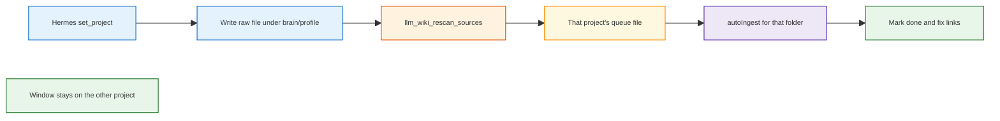

<h1 id="mp-title" style="color:#0d47a1;font-size:1.5em;font-weight:700;border-bottom:2px solid #90caf9;padding-bottom:0.25em;margin-top:0">Refactor plan — agent ops across brain profiles</h1>

**Plan role:** **minor** (child).  
**Parent (only):** [`REFACTOR_PLAN_MAIN_1_FURTHER_ENHANCEMENT_GPT.md`](./REFACTOR_PLAN_MAIN_1_FURTHER_ENHANCEMENT_GPT.md) — **cross-cutting** (main plan [§0 minor **M∥**](./REFACTOR_PLAN_MAIN_1_FURTHER_ENHANCEMENT_GPT.md#gpt-hierarchy)).  
**Status:** **new** — plan only (2026-10-18). All implementable items **`[ ]`**.  
**Chain:** **`onlyreftdd`**. Implement later with **`aciubtdd`** on this file (not plain **`aciub`** / **`implref`**).  
**Goal:** Hermes (or the same MCP tools) can search, add, compile, delete, and rename in `brain/personal` or `brain/retail` one after another. The desktop app must be running. The folder on screen does not have to be the folder being compiled.  
**Out of this plan’s steps:** rewriting the compiler in Rust. See [Note](#mp-note).

<h2 id="mp-outline" style="color:#1565c0;font-size:1.22em;font-weight:650;border-left:4px solid #42a5f5;padding-left:10px;margin-top:1.1em">Document outline</h2>

1. [Problem](#mp-problem) — one pin, one open project, one file root.
2. [Evidence](#mp-evidence) — what the code does today.
3. [Decisions](#mp-decisions) — lock for later impl.
4. [Phases](#mp-phases) — P1–P5.
5. [Quality bar](#mp-quality) — tests and comments.
6. [TDD bar](#mp-tdd) — per-phase red/green.
7. [Execution checklist](#mp-checklist) — all open.
8. [Note](#mp-note) — Rust compiler move, not a phase.

---

<h2 id="mp-problem" style="color:#1565c0;font-size:1.22em;font-weight:650;border-left:4px solid #42a5f5;padding-left:10px;margin-top:1.1em">1. Problem</h2>

A brain profile (`brain/personal`, `brain/retail`) is one LLM Wiki project. Files, wiki links, and the vector index (the searchable copy of wiki pages) already live in that folder. Hermes can `llm_wiki_set_project` and then search or read either project.

Compile (read a raw file and write wiki pages) and source delete or rename do not follow that pin. They run in the desktop app’s script, and only for the project on screen (`currentProjectId` in `ingest-queue.ts`). A rescan of the other project records the file change and the window ignores it. Hermes’s file server is rooted at `${BRAIN_ROOT}`, so a wiring pass done while retail is active exposes only `brain/retail`.

---

<h2 id="mp-evidence" style="color:#1565c0;font-size:1.22em;font-weight:650;border-left:4px solid #42a5f5;padding-left:10px;margin-top:1.1em">2. Evidence</h2>

Sibling app: `/Users/jjw8053/projects/nu_llm_wiki`. Checked 2026-10-17.

| Fact | Where |
|------|--------|
| `llm_wiki_set_project` pins the MCP process. It does not open the window. | `mcp-server/src/index.ts`, `project-binding.ts` |
| Search, read, and chat take a project id and hit `/projects/{id}/…`. | `mcp-server/src/api-client.ts` |
| `enqueueIngest` throws unless `projectId` is `currentProjectId`. | `src/lib/ingest-queue.ts` |
| After `autoIngest`, a mismatched `currentProjectId` returns before the task is marked done. | `ingest-queue.ts` `runTask` |
| Delete and rename cleanup is folder-scoped and runs inside `processFileChangeBatch`. A closed-project API rescan never calls that function. | `src/lib/project-file-sync.ts`, `src/lib/source-lifecycle.ts` |
| “Monitor all recent projects” queues work and runs it when that project is opened (or on a one-minute scan that still uses the inactive path). | `source-watch-section.tsx`, `enqueueInactiveProjectBatch` |
| Output language and model override are already saved per project id. | `src/lib/project-store.ts` (`projectOutputLanguages`, `projectLlmOverrides`) |
| File MCP root is the active profile. | `config/second-brain.mcp-servers.yaml` `${BRAIN_ROOT}` |

---

<h2 id="mp-decisions" style="color:#1565c0;font-size:1.22em;font-weight:650;border-left:4px solid #42a5f5;padding-left:10px;margin-top:1.1em">3. Decisions</h2>

| ID | Decision |
|----|----------|
| **D1** | One running LLM Wiki app. Many projects on disk. One folder on screen. |
| **D2** | Hermes switches with `llm_wiki_set_project` (folder path or UUID). That pin is not an “open project” click. |
| **D3** | A rescan for a named project compiles new raw files and applies deletes and renames for that folder even when `currentProjectId` is the other profile. |
| **D4** | The on-screen tree, chat, and review list stay on the open project. |
| **D5** | The compile run loads the **target** project’s saved output language and model override, not the window’s live settings. |
| **D6** | `second_brain_fs` is rooted at `brain/` (parent of both profiles). Skills still write `brain/<profile>/raw/sources/…`. |
| **D7** | Do not use “monitor all recent projects” as the fix. The named rescan runs the batch now. |
| **D8** | The compiler stays the existing TypeScript in the desktop app. No Rust port in these phases. |

---

<h2 id="mp-phases" style="color:#1565c0;font-size:1.22em;font-weight:650;border-left:4px solid #42a5f5;padding-left:10px;margin-top:1.1em">4. Phases</h2>

<h3 id="mp-p1" style="color:#00695c;font-size:1.05em;font-weight:600;margin-top:0.85em">4.1 P1 — File server sees both profiles</h3>

- [ ] Change `config/second-brain.mcp-servers.yaml` so `second_brain_fs` is rooted at the `brain/` directory, not `${BRAIN_ROOT}`.
- [ ] Resolver in `scripts/brain/brain_stack.py` (or the Hermes merge step) writes that parent path into `~/.hermes/config.yaml`.
- [ ] `harness/second-brain/skills/ingest-to-brain/SKILL.md` names both `brain/personal/raw/sources/` and `brain/retail/raw/sources/`.

<h3 id="mp-p2" style="color:#00695c;font-size:1.05em;font-weight:600;margin-top:0.85em">4.2 P2 — Compile the named project</h3>

Touch `nu_llm_wiki` `src/lib/ingest-queue.ts` and the rescan path in `src/lib/project-file-sync.ts`.

- [ ] A rescan (API `llm_wiki_rescan_sources` or the file-sync batch) for project B loads B’s `.llm-wiki/ingest-queue.json` and runs `autoIngest` with B’s folder while `currentProjectId` stays A.
- [ ] The task is marked done in B’s queue file. The early return in `runTask` that drops bookkeeping when `currentProjectId` differs does not apply to this run.
- [ ] The on-screen file tree is not replaced with B.

<h3 id="mp-p3" style="color:#00695c;font-size:1.05em;font-weight:600;margin-top:0.85em">4.3 P3 — Delete and rename on the named project</h3>

Same batch as P2. Touch `project-file-sync.ts`, `source-lifecycle.ts`, `wiki-page-delete.ts`.

- [ ] Deleting a raw file under B removes wiki pages whose `sources:` list only that file, strips leftover links, and drops those pages’ vectors. A is still the open project.
- [ ] A same-hash rename under B calls `migrateSourcePath` for B and does not compile the new path as a second source.

<h3 id="mp-p4" style="color:#00695c;font-size:1.05em;font-weight:600;margin-top:0.85em">4.4 P4 — Language and model of the target project</h3>

- [ ] The background run reads `projectOutputLanguages` and `projectLlmOverrides` for the target project id (`project-store.ts`) and passes those into `autoIngest`.
- [ ] It does not read the window store’s live `outputLanguage` or `projectLlmOverride` for that run.

<h3 id="mp-p5" style="color:#00695c;font-size:1.05em;font-weight:600;margin-top:0.85em">4.5 P5 — Hermes sequence</h3>

- [ ] `ingest-to-brain` and `local-llm-wiki` skills: `llm_wiki_set_project` to the profile path, write the raw file, then `llm_wiki_rescan_sources` for that same project. State that the window may show the other profile.
- [ ] One line in `docs_manual_gen/SECOND_BRAIN_RUNBOOK.md` under brain profiles: compile and delete follow the MCP project, not the folder on screen.

---

<h2 id="mp-quality" style="color:#1565c0;font-size:1.22em;font-weight:650;border-left:4px solid #42a5f5;padding-left:10px;margin-top:1.1em">5. Quality bar</h2>

| Exit | Command / check |
|------|-----------------|
| Wiring | `pytest tests/test_merge_hermes_wiring.py` plus the new root assertion |
| Compiler | Sibling `nu_llm_wiki` unit tests named in the TDD bar (vitest on the queue and file-sync modules) |
| Comments | **cdcm** on every new or edited function in those modules: one line on purpose, and a note where the run must ignore `currentProjectId` |
| Screen | A test or assertion that `currentProjectId` is unchanged after a B compile |

---

<h2 id="mp-tdd" style="color:#1565c0;font-size:1.22em;font-weight:650;border-left:4px solid #42a5f5;padding-left:10px;margin-top:1.1em">6. TDD bar</h2>

<table>
<thead>
<tr style="background:#1565c0;color:white"><th>Phase</th><th>TDD mode</th><th>Test-first artifact</th><th>Red case</th><th>Green gate</th></tr>
</thead>
<tbody>
<tr><td style="background:#e3f2fd">P1 File root</td><td style="background:#e8f5e9"><strong>strict-TDD</strong></td><td style="background:#e8f5e9"><code>tests/test_merge_hermes_wiring.py</code> — filesystem args root is the <code>brain/</code> parent</td><td style="background:#ffebee">Merged config still ends at <code>brain/retail</code> or <code>${BRAIN_ROOT}</code> only</td><td style="background:#e8f5e9"><code>pytest tests/test_merge_hermes_wiring.py</code></td></tr>
<tr><td style="background:#e3f2fd">P2 Compile</td><td style="background:#e8f5e9"><strong>strict-TDD</strong></td><td style="background:#e8f5e9"><code>nu_llm_wiki</code> <code>src/lib/ingest-queue.test.ts</code> — <code>runNamedProjectQueue</code> (name at impl time) with current project A and queue file for B</td><td style="background:#ffebee">B’s task stays pending, or <code>currentProjectId</code> becomes B</td><td style="background:#e8f5e9">That vitest file green</td></tr>
<tr><td style="background:#e3f2fd">P3 Delete and rename</td><td style="background:#e8f5e9"><strong>strict-TDD</strong></td><td style="background:#e8f5e9"><code>nu_llm_wiki</code> <code>src/lib/project-file-sync.test.ts</code> — closed-project delete and same-hash rename</td><td style="background:#ffebee">Wiki page that only cited the deleted file remains; rename is ingested as a new source</td><td style="background:#e8f5e9">That vitest file green</td></tr>
<tr><td style="background:#e3f2fd">P4 Settings</td><td style="background:#e8f5e9"><strong>strict-TDD</strong></td><td style="background:#e8f5e9">Same queue test: stub <code>loadOutputLanguage(projectId)</code> and <code>load</code> of <code>projectLlmOverrides</code></td><td style="background:#ffebee"><code>autoIngest</code> receives the window language, not B’s saved language</td><td style="background:#e8f5e9">Queue vitest green</td></tr>
<tr><td style="background:#e3f2fd">P5 Skills</td><td style="background:#fff8e1"><strong>smoke-after-delete</strong></td><td style="background:#fff8e1"><code>tests/test_llm_wiki_ctl.py</code> or a short skill read — both profile paths and <code>llm_wiki_rescan_sources</code></td><td style="background:#fff8e1">No red-first. Skills still say compile only when that project is open.</td><td style="background:#e8f5e9"><code>pytest tests/test_llm_wiki_ctl.py</code></td></tr>
</tbody>
</table>

Assumption: P2–P4 are **strict-TDD** because the queue’s external behavior changes (a closed project’s task completes). Tests live in the sibling repo `nu_llm_wiki`, not in this repo.

---

<h2 id="mp-checklist" style="color:#1565c0;font-size:1.22em;font-weight:650;border-left:4px solid #42a5f5;padding-left:10px;margin-top:1.1em">7. Execution checklist</h2>

- [ ] **P1** — `second_brain_fs` rooted at `brain/`
- [ ] **P2** — compile named project without changing the open project
- [ ] **P3** — delete and rename cascade for that same project
- [ ] **P4** — target project’s language and model
- [ ] **P5** — Hermes skill sequence and runbook line

---

<h2 id="mp-note" style="color:#1565c0;font-size:1.22em;font-weight:650;border-left:4px solid #42a5f5;padding-left:10px;margin-top:1.1em">8. Note — not a phase</h2>

Moving the compiler into the Rust API is a later option, not part of P1–P5. `ingest.ts` is about 3,900 lines of prompts and wiki writes; the queue, delete cascade, and file-change batch add roughly 2,600 more. The Rust process today watches files and serves search. It does not call the model.

P1–P5 keep that TypeScript and only stop it from requiring the target folder to be the one on screen. The desktop app process still has to be running. Rewriting those modules in Rust would not isolate the two profiles any further.
