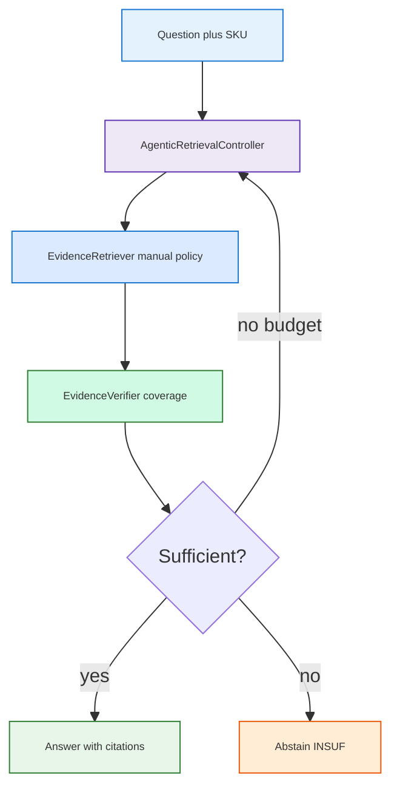
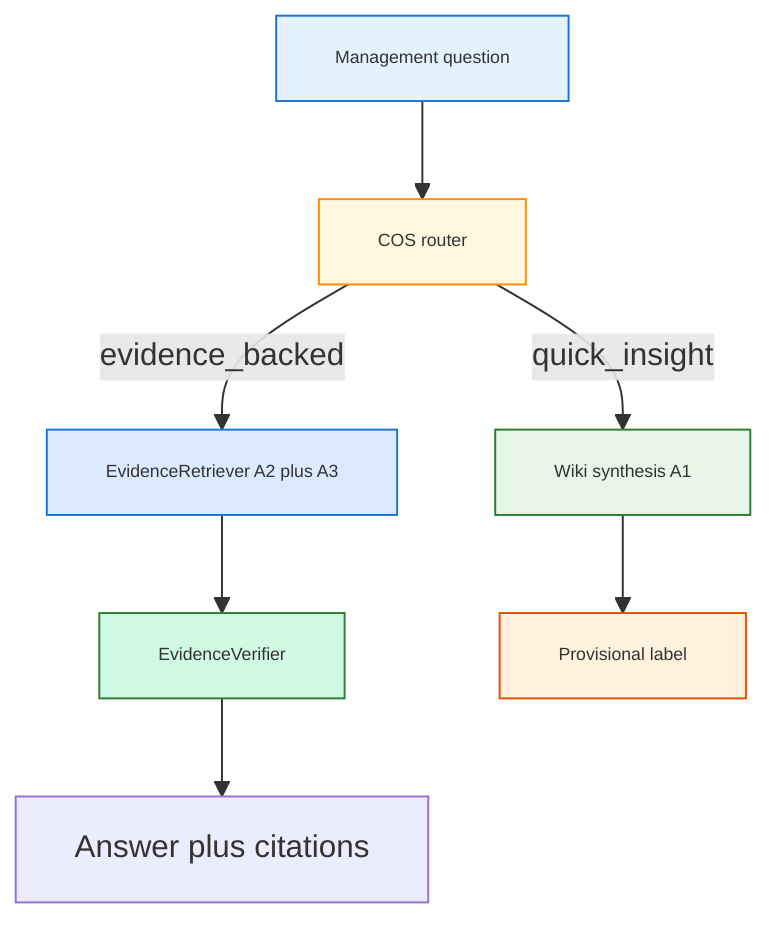

<h1 id="gpt-enh-title" style="color:#0d47a1;font-size:1.5em;font-weight:700;border-bottom:2px solid #90caf9;padding-bottom:0.25em;margin-top:0">Refactor plan — three Q&amp;A tracks, then Chief of Staff (main plan)</h1>

**Plan role:** **main** (**seq 1**) — the **only** umbrella refactor plan for retail Q&amp;A + COS. **Filename:** `REFACTOR_PLAN_MAIN_1_FURTHER_ENHANCEMENT_GPT.md` (pattern `REFACTOR_PLAN_MAIN_<seq>_<slug>.md`). Every other active `REFACTOR_*.md` under [`docs_manual_gen/ref_plan/`](../) is a **minor** (child) plan with **exactly one** parent: **this file**.  
**Status:** **wip** — Phase **1 complete** (hard exit + **HG-P1** default profile); Phase **2** unblocked. Phases **2–4** gated by **HG-P2** onward.  
**Execute:** **`qimpltdd`** this file → **`aciubtdd`** / **`implreftdd`** (Phase **2+** after **HG-P1**). Plain **`implref`** without TDD table is legacy.  
**last_aligned:** 2026-10-26 — main filename (**R27**); hierarchy (**R26**); prior **R25** A3 before A1; **HG-P1** (**R23**); Phase **2** scope **R24**.

**Branch:** `feature/evo-18-multi-various-new-combos` (active); prior `feature/evo-14-multi-retail-gpt-rerank`.  
**Realignment source:** ChatGPT share from user diagrams — [refactor three tracks](https://chatgpt.com/share/6adb338c-a8e0-83ec-88aa-f633463cb70e) (from *“I am trying hard to make what we want to refactor/improve more concrete…”*). Transcript: `utils/chatgpt/transcripts/refactor_three_tracks_cos_6adb338c-a8e0-83ec-88aa-f633463cb70e.txt`.  
**Earlier chat (background only):** [LLM Wiki RAG Advice](https://chatgpt.com/share/6ada2c90-9160-83ec-b331-2e999fea8431) · [`ABOUT_FURTHER_ENHANCEMENT_GPT.md`](../../artifacts/aggregated/ABOUT_FURTHER_ENHANCEMENT_GPT.md).  
**Benchmark anchor:** [`AGGREGATED_TEST_ANALYSIS_LLM_WIKI_AND_RAG.md`](../../artifacts/aggregated/AGGREGATED_TEST_ANALYSIS_LLM_WIKI_AND_RAG.md). **Primary lane:** **B** (`brain/retail-md`) for A2/A1 judged runs (**R10**). Lane D scores (wiki **31/60**, raw **~29/60**) remain a **later** comparison track.

<h2 id="gpt-enh-outline" style="color:#1565c0;font-size:1.22em;font-weight:650;border-left:4px solid #42a5f5;padding-left:10px;margin-top:1.1em">Document outline</h2>

0. [Plan hierarchy (main vs minor)](#gpt-hierarchy) — **minor execution order**; one parent each.
1. [Dimension model](#gpt-dim) — D1–D6; canonical vocabulary.
2. [Measured baselines](#gpt-measured) — what Part 1 already ran.
3. [Dimension-led phase map](#gpt-dim-map) — phases as Δ on dimensions.
4. [Why realign (product tracks)](#gpt-realign) — A1/A2/A3 then B.
5. [North star](#gpt-north) — one sentence per track.
6. [Part A — three independent systems](#gpt-part-a) — A1, A2, A3.
7. [Shared Python components](#gpt-shared) — not one algorithm for everything.
8. [Part B — Chief of Staff](#gpt-part-b) — after A is measured.
9. [Implementation order](#gpt-order) — phases 1–4; **Phase 2 (A3)** active after **HG-P1** closed.
10. [Phase 1 — A2 Manual RAG](#gpt-phase1) — full checklist.
11. [Phase 2 — A3 Ticket RAG](#gpt-phase2) — full checklist.
12. [Phase 3 — A1 LLM Wiki](#gpt-phase3) — full checklist.
13. [Phase 4 — B COS + API](#gpt-phase4) — full checklist.
14. [Human gates](#gpt-gates) — when each phase may start.
15. [Lanes and raw corpora](#gpt-lanes) — D2 registry.
16. [Decisions](#gpt-decisions).
17. [Quality bar](#gpt-quality) — §17.1–17.5 TDD; §17.2 exit trio; §17.6 **neatlog**.
18. [Execution checklist](#gpt-checklist) — all phases.
19. [Deferred](#gpt-deferred).
20. [Related](#gpt-related).

Phase 1 TDD table: [§17.1](#gpt-tdd).

---

<h2 id="gpt-hierarchy" style="color:#1565c0;font-size:1.22em;font-weight:650;border-left:4px solid #42a5f5;padding-left:10px;margin-top:1.1em">0. Plan hierarchy (main vs minor)</h2>

**Rules**

- **Main:** this file only (`REFACTOR_PLAN_MAIN_1_*`). Roadmap phases **1–4** (A2 → A3 → A1 → B) live here. Future mains (if ever needed) use **`REFACTOR_PLAN_MAIN_2_*`**, etc.; retail work stays under **seq 1** until explicitly split.
- **Minor:** scoped deliverables with their own TDD tables. Each minor declares **`Parent (only):`** → this plan (phase anchor below). **No dual parents.**
- **Completed minors** stay under [`completed/`](../completed/) for history; they still count as children of this main plan.
- **Execute minors** with **`qimpltdd`** / **`aciubtdd`** on the **minor file path** unless the minor says to resume on the main checklist only.

**Minor execution order** (run or finish in this sequence; cross-cutting items may overlap when unblocked):

<table>
<thead>
<tr style="background:#1565c0;color:white"><th>Seq</th><th>Minor plan</th><th>Main phase</th><th>Location</th><th>Status</th></tr>
</thead>
<tbody>
<tr><td style="background:#e3f2fd"><strong>M1</strong></td><td><a href="./REFACTOR_RETAIL_MANUAL_INGEST_ABCD_BENCHMARK.md">RETAIL_MANUAL_INGEST_ABCD_BENCHMARK</a></td><td>Phase <strong>1</strong> — M90 harness + four wiki lanes</td><td><code>new/</code></td><td style="background:#fff3e0">in progress</td></tr>
<tr><td style="background:#e3f2fd"><strong>M2</strong></td><td><a href="../completed/REFACTOR_RETAIL_RAW_SOURCES_RAG_ABCD_COMPARE.md">RETAIL_RAW_SOURCES_RAG_ABCD_COMPARE</a></td><td>Phase <strong>1</strong> — raw vector baseline (D3.R-V)</td><td><code>completed/</code></td><td style="background:#e8f5e9">done</td></tr>
<tr><td style="background:#e3f2fd"><strong>M3</strong></td><td><a href="../completed/REFACTOR_UNIFIED_PG_MANUAL_EMBEDDINGS.md">UNIFIED_PG_MANUAL_EMBEDDINGS</a></td><td>Phase <strong>1</strong> — Postgres manual chunks (D3 PG cutover)</td><td><code>completed/</code></td><td style="background:#e8f5e9">done (HG-PG-CUTOVER)</td></tr>
<tr><td style="background:#fff9c4"><strong>—</strong></td><td colspan="4"><strong>Main Phase 1 checklist</strong> [§10](#gpt-phase1) — hybrid + rerank + M90 (Lane B primary)</td></tr>
<tr><td style="background:#fff9c4"><strong>—</strong></td><td colspan="4"><strong>Main Phase 2 checklist</strong> [§11](#gpt-phase2) — ticket adapters + T100 (**active:** P2.6)</td></tr>
<tr><td style="background:#e3f2fd"><strong>M4</strong></td><td><a href="./REFACTOR_BUNDLED_MANUAL_TICKET_QA.md">BUNDLED_MANUAL_TICKET_QA</a></td><td>Phase <strong>4</strong> prelude <strong>B0</strong> — fixed-k manual+ticket concat + B20 judge</td><td><code>new/</code></td><td style="background:#e8f5e9">B20 baseline run</td></tr>
<tr><td style="background:#e3f2fd"><strong>M9</strong></td><td><a href="./REFACTOR_RETAIL_PRODUCT_SCOPE_BRAND_MODEL.md">RETAIL_PRODUCT_SCOPE_BRAND_MODEL</a></td><td><strong>Cross-cutting D1</strong> — brand+OEM model filters; T100 / M90 / B20 regression</td><td><code>new/</code></td><td style="background:#e8f5e9">P5 baselines recorded</td></tr>
<tr><td style="background:#e3f2fd"><strong>M10</strong></td><td><a href="./REFACTOR_EVO18_MULTI_VARIOUS_NEW_COMBOS.md">EVO18_MULTI_VARIOUS_NEW_COMBOS</a></td><td><strong>Phase 1</strong> — T0 manual SQL+Tantivy; D2/D7 run-profile matrix vs PRE-T0</td><td><code>new/</code></td><td style="background:#e8f5e9">P1–P5 operator matrix done</td></tr>
<tr><td style="background:#fff9c4"><strong>—</strong></td><td colspan="4"><strong>Main Phase 3 checklist</strong> [§12](#gpt-phase3) — A1 wiki audit + harness</td></tr>
<tr><td style="background:#e3f2fd"><strong>M5</strong></td><td><a href="./REFACTOR_LEARNED_SECTION_COPY_PLUS_CARDS.md">LEARNED_SECTION_COPY_PLUS_CARDS</a></td><td>Phase <strong>3</strong> — Lane D compile (`nu_llm_wiki`)</td><td><code>new/</code></td><td style="background:#fff3e0">partial (P1–P4, P7)</td></tr>
<tr><td style="background:#fff9c4"><strong>—</strong></td><td colspan="4"><strong>Main Phase 4 checklist</strong> [§13](#gpt-phase4) — COS router + API</td></tr>
<tr><td style="background:#e3f2fd"><strong>M6</strong></td><td><a href="../wip/REFACTOR_BRAIN_PROFILES_AND_RETAIL_ANSWER.md">BRAIN_PROFILES_AND_RETAIL_ANSWER</a></td><td>Phase <strong>4</strong> — <code>retail_answer.v1</code> production bundle</td><td><code>wip/</code></td><td style="background:#fff3e0">wip (HG-TXT-3)</td></tr>
<tr><td style="background:#e3f2fd"><strong>M7</strong></td><td><a href="../wip/REFACTOR_FRU_RETAIL_SERVICE_BRAIN.md">FRU_RETAIL_SERVICE_BRAIN</a></td><td>Phase <strong>4</strong> — product ops V2–V5 after M6</td><td><code>wip/</code></td><td style="background:#fff3e0">wip</td></tr>
<tr><td style="background:#e3f2fd"><strong>M8</strong></td><td><a href="../wip/REFACTOR_BRAIN_AGENT_ENTRYPOINT.md">BRAIN_AGENT_ENTRYPOINT</a></td><td>Phase <strong>4</strong> — single <code>scripts/brain/agent.sh</code> entry</td><td><code>wip/</code></td><td style="background:#fff3e0">wip</td></tr>
<tr><td style="background:#e3f2fd"><strong>M∥</strong></td><td><a href="./REFACTOR_MULTI_PROFILE_AGENT_OPS.md">MULTI_PROFILE_AGENT_OPS</a></td><td><strong>Cross-cutting</strong> — Hermes compile/delete any profile</td><td><code>new/</code></td><td style="background:#fff3e0">new</td></tr>
</tbody>
</table>

**M4 timing:** Start **B0 bundled** after **P2.6** ticket ABC metrics are recorded and manual PG hybrid is the regression anchor (M3 complete). **M4** does **not** replace Phase **4** COS — it adds a **judged** two-leg concat profile before full management routing.

**Historical (not minors of this main plan):** Samsung / phone-era completed plans under [`completed/`](../completed/) (e.g. `REFACTOR_SAMSUNG_*`, early ticket search). Use them as reference only.

---

<h2 id="gpt-dim" style="color:#1565c0;font-size:1.22em;font-weight:650;border-left:4px solid #42a5f5;padding-left:10px;margin-top:1.1em">1. Dimension model</h2>

**Canonical spec:** [`REALIGNMENT_DIMENSIONS.md`](../../artifacts/aggregated/REALIGNMENT_DIMENSIONS.md) — definitions, Part 1 fact-check, run profiles.

| Dim | Name | Plan uses it for |
|-----|------|------------------|
| **D1** | Knowledge corpus | **T** tickets · **M** manuals · (future **S/O/P**) |
| **D2** | Manual prep lane | **A/B/C/D** (`config/retail-ingest-lanes.yaml`) — **n/a** for tickets |
| **D3** | Retrieval engine | Ticket **T-A/B/C** · Wiki **W-H** · Raw **R-V** (done) → **R-H** + rerank (Phase 1) |
| **D4** | Evidence surface | PG · Tantivy · Wiki · Lance (implied by path) |
| **D5** | Post-retrieval | **0** today → **R/V/A** (phases 1–3) · **C** COS (phase 4) |
| **D6** | Eval contract | **T100** tickets · **M90** manual 90-Q · **AUDIT** wiki claims |

**Fair compare:** fix **D6 + D2 (+ D1)**, sweep **D3** and **D5**. Target harness: **`run_profiles`** in `run-config.yaml` → **`ResolvedRunProfile`** (see [`RUN_PROFILES.md`](../../../tests/retail_multi_profiles/docs/RUN_PROFILES.md) and dimensions doc §5).

<h2 id="gpt-measured" style="color:#1565c0;font-size:1.22em;font-weight:650;border-left:4px solid #42a5f5;padding-left:10px;margin-top:1.1em">2. Measured baselines</h2>

Already shipped (detail + corrections in dimensions doc **§1**):

| Profile (informal) | D1 | D3 | D6 |
|--------------------|----|----|-----|
| Ticket ABC | D1.T | T-A / T-B / T-C | D6.T100 |
| Manual wiki hybrid | D1.M | D3.W-H | D6.M90 × lanes A–D |
| Manual raw vector | D1.M | D3.R-V | D6.M90 × lanes B,C,D |

**Headline manual compare (B2 vs B1):** raw vector **beats** wiki hybrid on **B &amp; C**; wiki **slightly ahead** on **D** (overall pass); raw **not RRF yet**.

<h2 id="gpt-dim-map" style="color:#1565c0;font-size:1.22em;font-weight:650;border-left:4px solid #42a5f5;padding-left:10px;margin-top:1.1em">3. Dimension-led phase map</h2>

Phases are **product tracks** (A1/A2/A3/B) — each track changes specific dimensions:

<table>
<thead>
<tr style="background:#1565c0;color:white"><th>Phase</th><th>Track</th><th>D1</th><th>Main Δ D3</th><th>Main Δ D5</th><th>D6</th><th>Lane (D2)</th></tr>
</thead>
<tbody>
<tr><td style="background:#e8f5e9"><strong>1</strong></td><td>A2 Manual RAG</td><td>D1.M</td><td>R-V → <strong>R-H</strong>, +RR</td><td>+R, +V, +A</td><td>M90</td><td><strong>B</strong> (R10)</td></tr>
<tr><td style="background:#fff3e0"><strong>2</strong></td><td>A3 Tickets</td><td>D1.T</td><td>T-C + optional RR</td><td>+V, +A</td><td>T100</td><td>—</td></tr>
<tr><td style="background:#e3f2fd"><strong>3</strong></td><td>A1 Wiki</td><td>D1.M</td><td>W-H + sources filter / RR</td><td>audit V; harness R</td><td>M90 + AUDIT</td><td><strong>B</strong></td></tr>
<tr><td style="background:#ffebee"><strong>4</strong></td><td>B COS</td><td>T+M</td><td>multi</td><td><strong>C</strong> router</td><td>demos</td><td>B</td></tr>
</tbody>
</table>

---

<h2 id="gpt-realign" style="color:#1565c0;font-size:1.22em;font-weight:650;border-left:4px solid #42a5f5;padding-left:10px;margin-top:1.1em">4. Why realign (product tracks)</h2>

The prior draft of this plan **merged** raw hybrid modes, wiki harness modes, combined wiki+raw, FastAPI, and verifier into one scoreboard. That mirrored pieces of the first long ChatGPT thread but **did not match** your clarified **A → B** design:

- **A:** Improve **three Q&amp;A systems separately** (Wiki product knowledge, manual RAG, ticket RAG).
- **B:** **Then** integrate them into an AI **Chief of Staff (COS)** (provisional wiki insight vs evidence-backed answers).

This plan **drops** “combined `wiki_leads_raw`” and COS orchestration from Phase 1. Those belong to **Part B** after A2 (and ideally A3) have numbers.

---

<h2 id="gpt-north" style="color:#1565c0;font-size:1.22em;font-weight:650;border-left:4px solid #42a5f5;padding-left:10px;margin-top:1.1em">5. North star</h2>

<table>
<thead>
<tr style="background:#1565c0;color:white"><th>Track</th><th>Job</th><th>Success looks like</th></tr>
</thead>
<tbody>
<tr><td style="background:#e3f2fd"><strong>A2 Manual RAG</strong></td><td>Precise product Q&amp;A from manual text</td><td>Lane **B** answerable **≥ 30/60** vs raw vector **28** baseline (**R14**); Lane D deferred; retrieval **&lt; 2 s** mean</td></tr>
<tr><td style="background:#e3f2fd"><strong>A3 Ticket RAG</strong></td><td>Suggest fixes from past cases</td><td>Better applicable-case retrieval; **do not rebuild** existing ticket hybrid search</td></tr>
<tr><td style="background:#e3f2fd"><strong>A1 LLM Wiki</strong></td><td>Organizational knowledge + relationships</td><td>Fewer **unsupported** compiled claims; wiki Q&amp;A labels uncertainty; audit at **compile** time, not only at answer time</td></tr>
<tr><td style="background:#fff3e0"><strong>B COS</strong></td><td>Management questions</td><td>Two modes: provisional synthesis vs evidence-backed research — **after** A1–A3 measured</td></tr>
</tbody>
</table>

---

<h2 id="gpt-part-a" style="color:#1565c0;font-size:1.22em;font-weight:650;border-left:4px solid #42a5f5;padding-left:10px;margin-top:1.1em">6. Part A — three independent systems</h2>

<h3 id="gpt-a1" style="color:#00695c;font-size:1.05em;font-weight:600;margin-top:0.85em">6.1 A1 — LLM Wiki (product PDFs → compiled wiki)</h3>

**Focus:** Accuracy of **compiled knowledge** (fight hallucination / unsupported claims). Accept **incompleteness**; surface it.

| Enhancement | Scope |
|-------------|--------|
| External **wiki audit** after compile | Extract atomic claims → **EvidenceVerifier** vs canonical source text → status registry (supported / uncertain / contradicted) |
| Wiki **Q&amp;A harness** | Optional `sources_only` / rerank on **wiki/sources** pages (harness-only; no `nu_llm_wiki` ranking edits per grill G2) |
| **Not in A1 v1** | Blocking writes inside nashsu; ticket promotion into wiki |

**Measure:** Audit counts + Lane **B** wiki Q&amp;A modes vs `abcd-full-openai-v2` on **B** — aligned with A2 base lane (**R10**).

<h3 id="gpt-a2" style="color:#00695c;font-size:1.05em;font-weight:600;margin-top:0.85em">6.2 A2 — Manual RAG (product PDFs → search index)</h3>

**Focus:** **Completeness and precision** for customer-style manual questions (the 90-Q benchmark).

Pipeline (target):

Inside **EvidenceRetriever (manual):** SKU filter → BM25 + vector → RRF → **listwise rerank** (cross-encoder deferred). **Agentic:** at most **one** targeted sub-search when verifier reports missing components (bounded budget).

**Measure:** Primary — **Lane B** full **90-Q** vs wiki + raw baselines from `abcd-full-openai-v2` / `abcd-raw-full-openai-v1` on **B**; promotion targets recorded in TEST_ANALYSIS_A2 after first judged run. Secondary — Lane **C** smoke; Lane **D** optional follow-up (not Phase 1 exit).

<h3 id="gpt-a3" style="color:#00695c;font-size:1.05em;font-weight:600;margin-top:0.85em">6.3 A3 — Historical ticket RAG</h3>

**Focus:** Case applicability and outcome evidence — *this case supports the suggestion*, not *guaranteed fix*.

| Do | Do not |
|----|--------|
| Reuse **existing** Postgres + Tantivy hybrid + RRF | Rebuild ticket index from scratch |
| Add **optional rerank** if eval shows gain | Copy manual SKU rules onto tickets (similar-model expansion is **ticket policy**) |
| **AgenticRetrievalController** with ticket policy (symptom/code variants, bounded) | Merge ticket and manual indexes |

**Measure:** Existing FRU ticket eval / A-B modes — separate scoreboard from manual 90-Q.

---

<h2 id="gpt-shared" style="color:#1565c0;font-size:1.22em;font-weight:650;border-left:4px solid #42a5f5;padding-left:10px;margin-top:1.1em">7. Shared Python components</h2>

Three **interfaces**, three **policies** (chat: shared utilities, not one universal algorithm).

| Module | Path (target) | Manual (A2) | Ticket (A3) | Wiki (A1) |
|--------|---------------|---------------|-------------|-----------|
| **EvidenceRetriever** | `scripts/retail/retail_brain/evidence/retriever.py` | Lance raw chunks | PG + lexical | HTTP search only |
| **EvidenceVerifier** | `.../verifier.py` | Coverage + citations | Applicability + outcome | Claim vs source passage |
| **AgenticRetrievalController** | `.../agentic.py` | Missing-fact subquery | Missing-case subquery | **Not used in A1** |

Benchmark harness and (later) COS call the same modules. **Phase 1** introduces retriever + verifier + agentic for **manual policy only**; ticket adapter stubs in Phase 2.

---

<h2 id="gpt-part-b" style="color:#1565c0;font-size:1.22em;font-weight:650;border-left:4px solid #42a5f5;padding-left:10px;margin-top:1.1em">8. Part B — Chief of Staff (deferred)</h2>

**Not Phase 1–3 scope.** After A1–A3:

| COS mode | Source | Use |
|----------|--------|-----|
| **Quick insight** | A1 wiki synthesis | Labeled **provisional** |
| **Evidence-backed** | A2 + A3 (+ other records later) via retriever + verifier | Specs, warranty, repair advice |

Wiki may **lead** searches (context) but **important facts** default to verified records. Thin **FastAPI** orchestrator lives in **Phase 4**, not before A2 benchmark closes.

---

<h2 id="gpt-order" style="color:#1565c0;font-size:1.22em;font-weight:650;border-left:4px solid #42a5f5;padding-left:10px;margin-top:1.1em">9. Implementation order</h2>

| Phase | Track | Why this order |
|-------|-------|----------------|
| **1** | **A2 Manual RAG** | Clearest metric (90-Q); fixes the aggregate report pain first |
| **2** | **A3 Ticket RAG** | **Before A1 (R25):** same **non–LLM-Wiki** retrieval family as A2 (hybrid dense+lexical, RRF, D5 stack) — deepen shared **`EvidenceRetriever` / rerank / verifier / agentic** on **indexed search**, not compiled wiki HTTP |
| **3** | **A1 LLM Wiki** | **After A3 (R25):** different **D3.W-H** path (compiled wiki + harness); claim audit + wiki Q&amp;A modes; reuses verifier **patterns** from Phases 1–2 |
| **4** | **B COS + API** | Integrate measured components only |

**Conscious sequencing (R25):** Ticket cases are **grounded in manual/product context**, like A1’s corpus — but **implementation order** is **A2 → A3 → A1** so we finish hardening **classic hybrid retrieval** (Postgres manual chunks per **M3**, then Postgres tickets) before the **LLM-Wiki** compile/harness track. Not “tickets unrelated to manuals”; “same retrieval **style**, different **D1** store.”

Phases **2–4** are fully specified below for roadmap clarity. **HG-P1 closed (R23):** **`aciubtdd` / `implreftdd`** Phase **2** may proceed; Phase **3+** still gated by **HG-P2** / **HG-P3** per [§14](#gpt-gates).

---

<h2 id="gpt-phase1" style="color:#1565c0;font-size:1.22em;font-weight:650;border-left:4px solid #42a5f5;padding-left:10px;margin-top:1.1em">10. Phase 1 — A2 Manual RAG</h2>

<h3 id="gpt-p1-0" style="color:#00695c;font-size:1.05em;font-weight:600;margin-top:0.85em">10.0 P1.0 — Run profiles registry (scaffolding — partial)</h3>

- [X] Add **`run_profiles`** entries to `tests/retail_multi_profiles/data/run-config.yaml` (Lane B: vector / hybrid / rerank id).
- [X] Runner: resolve `--profile <id>` → **`retrieval_mode`**, **`raw_retrieval`**, lanes only (**D3 partial**).
- [X] **P1.0b — Resolved run profile (D1–D6 on profile):** YAML **`d5`** blocks; **`resolve_effective_profile()`** → **`ResolvedRunProfile`** (**R18**); [`RUN_PROFILES.md`](../../../tests/retail_multi_profiles/docs/RUN_PROFILES.md).
- [X] **P1.0c — Config coercion:** **`config_coerce.py`** + **`_coerce_raw_rag_scalars`**; snapshot **`resolved_profile`** in `results.json`.

<h3 id="gpt-p1-1" style="color:#00695c;font-size:1.05em;font-weight:600;margin-top:0.85em">10.1 P1.1 — Retriever core (D3.R-H — done)</h3>

- [X] SKU-filtered vector search; manual keyword index; RRF; config under `retail_raw_rag`.
- [X] Unit tests on fixture corpus (wrong-SKU blocked under hybrid).
- [X] Inline comments in `raw_hybrid_search.py` / retriever: **D3 vs D5** (**R19**).

<h3 id="gpt-p1-2" style="color:#00695c;font-size:1.05em;font-weight:600;margin-top:0.85em">10.2 P1.2 — D5.R listwise rerank (library done; harness incomplete)</h3>

- [X] Shared `rerank.py` + `listwise_rerank(..., rank_fn=...)`; unit test with mock **`rank_fn`**.
- [X] Retriever calls listwise step when legacy mode `hybrid_rrf_rerank` (hook only).
- [X] **P1.2b — Wire rerank:** `retail_brain/rerank_registry.py` + **`manual_raw_pipeline.py`** (**R5**).
- [X] **P1.2c — Config:** profile **`d5.rerank`** + env overrides (**R20**).
- [X] **P1.2d — Pre-flight:** **`assert_rerank_preflight`** at run start; v2 run **51/60** rows reorder vs hybrid.

**Naming (rerank backend):** use **`d5.rerank.enabled`** + **`d5.rerank.backend`** — not separate env names `LIST_WISE_RANK_FN` vs `LLM_RANK_FN` (same **llm_listwise**). Cross-encoder = **`cross_encoder`**, not `BERT_RANK_FN`.

<h3 id="gpt-p1-3" style="color:#00695c;font-size:1.05em;font-weight:600;margin-top:0.85em">10.3 P1.3 — Evidence packages + harness (partial)</h3>

- [X] `evidence/retriever.py`, `verifier.py`, `agentic.py` (manual policy).
- [X] Harness `--raw-retrieval`; progress steps (hybrid, rerank, verifier, agentic); **§17.6** neatlog.
- [X] **P1.3b — Thin runner:** **`build_manual_raw_pipeline`**; removed **`bool(yaml)`** agentic OR (**R18**).
- [X] Persist **`search_meta.agentic`**, **`search_meta.resolved_d5`**.

<h3 id="gpt-p1-4" style="color:#00695c;font-size:1.05em;font-weight:600;margin-top:0.85em">10.4 P1.4 — D5.V + D5.A (unit tests done; profile differentiation incomplete)</h3>

- [X] Verifier + agentic unit tests; budget **≤ 1** loop.
- [X] **P1.4b — Profile-owned D5:** YAML **`d5`**; v2 rerank arm **6** rows with **`agentic.loops > 0`**.
- [ ] Optional: hard-tier stricter **`min_term_coverage`** (deferred — +A fires on v2).

<h3 id="gpt-p1-5" style="color:#00695c;font-size:1.05em;font-weight:600;margin-top:0.85em">10.5 P1.5 — Judged runs + analysis</h3>

- [X] **Interim §17.2:** smoke `a2-p15-smoke-hybrid-b`; full `a2-hybrid-rrf-b-v1` **34/60**; `a2-hybrid-rerank-b-v1` **33/60** (not a fair D5 compare — identical `top_hits`).
- [X] Interim [`TEST_ANALYSIS_A2_MANUAL_RAG.md`](../../artifacts/TEST_ANALYSIS_A2_MANUAL_RAG.md) + [`RAW_RAG.md`](../../../tests/retail_multi_profiles/docs/RAW_RAG.md).
- [X] **P1.5b — Fair re-benchmark:** `a2-hybrid-rrf-b-v2` **34/60**; `a2-hybrid-rerank-b-v2` **37/60** (fair D5).
- [X] **P1.5c — Analysis update:** [`TEST_ANALYSIS_A2_MANUAL_RAG.md`](../../artifacts/TEST_ANALYSIS_A2_MANUAL_RAG.md) v2 section; **HG-P1** candidate: promote **`MANUAL_B_RAW_HYBRID_RERANK`** default.

**Phase 1 hard exit (revised):** Lane **B** answerable **≥ 30/60** on best arm; **fair** D5 ladder; **`hybrid_rrf` + D5.0** **≥ 28/60**; rerank profile must prove **active D5.R** before **R+V+A** claims; `./scripts/verify.sh` green or waived in Decisions. Unblocks **HG-P1**.

<h3 id="gpt-p1-6" style="color:#00695c;font-size:1.05em;font-weight:600;margin-top:0.85em">10.6 P1.6 — SKU scope SSOT + answer context caps (2026-10-25)</h3>

- [X] **`sku_scope.py`:** three legit model ids; **`resolve_retrieval_sku(query)`**; reject unknown `ge_` / `samsung_` / `kitchenaid_` tokens; multi-SKU → open pool; **`filter_chunks_by_model`** centralized.
- [X] **Runner:** parse scoped query before retrieve; **`search_meta.sku_scope`**; illegal SKU → fail row (no crash).
- [X] **`context_max_chars_per_chunk`** (default **2000**) on **`concat_top_k_raw_chunks`** + **`page_prefix_chars`** total budget **8000**.
- [X] Tests: **`test_sku_scope.py`**, **`test_raw_rag_context.py`**; **`pytest tests/retail_multi_profiles`** green.
- [X] **P1.6b — Re-benchmark:** `a2-hybrid-rrf-b-v3` **33/60**; `a2-hybrid-rerank-b-v3` **37/60** (rerank flat vs v2; hybrid **−1** = judge/answer variance — see **R22**).

<h3 id="gpt-p1-7" style="color:#00695c;font-size:1.05em;font-weight:600;margin-top:0.85em">10.7 P1.7 — `./scripts/verify.sh` alignment (layout + env + corpus validator)</h3>

- [X] **Brain layout:** allow lane roots **`retail-md`**, **`retail-txt`**, **`retail-md-learned`** under **`brain/`**; lane profiles need **`purpose.md` + raw/sources** (not full Nashsu manifests).
- [X] **Lane A corpus test:** PDF archive under **`archive/pdf/fridge-docs/`**; raw may hold **`.txt` or `.pdf`** during txt→md migration.
- [X] **`tests/retail/conftest.py`:** autouse clear **`RETAIL_FAULT_CODE_PREFIX`** so SAM-E unit tests are not polluted by operator **`FRU-E`** shell env.
- [X] **`validate_llm_corpus`:** skip SAM/FRU diag-code band for phone demo **`data_60_10`** (no codes in CSV).
- [X] **P16 e2e:** **`pytest.skip`** when **`brain/retail`** has no **`fridge-docs/*.txt`** (manuals on Lane **B/C** until txt restored or e2e repointed).
- [X] **P1.7b — Post-fix verify:** `./scripts/verify.sh` green (2026-10-25).
- [X] **P1.7c — Re-benchmark after verify:** `a2-hybrid-rrf-b-v4` **33/60**; `a2-hybrid-rerank-b-v4` **37/60** (matches v3; hybrid still **−1** vs v2 on **H08** — **R22**).

---

<h2 id="gpt-phase2" style="color:#1565c0;font-size:1.22em;font-weight:650;border-left:4px solid #42a5f5;padding-left:10px;margin-top:1.1em">11. Phase 2 — A3 Ticket RAG</h2>

**Prerequisite:** [HG-P1](#gpt-gates) (Phase 1 exit). **Order vs A1:** Phase **2** runs **before** Phase **3 (A1)** per **R25** — both follow Phase **1 (A2)** so **non–LLM-Wiki** hybrid search + D5 stack are exercised on **manual index** then **ticket Postgres** before wiki compile/harness work.

Reuses Phase 1 **`rerank.py`**, **`verifier.py`**, **`agentic.py`** with a **ticket policy** — not manual SKU rules.

**Baseline (do not regress):** FRU **`fru_us_1k`** ABC ladder — mode **C** `rrf_term_boosted` overall recall@1 **~0.54**; `scripts/retail/eval/check_abc_ladder.py` must keep passing. See [`ABOUT_SEARCH_RRF_FRU.md`](../../artifacts/ABOUT_SEARCH_RRF_FRU.md).

**Code touchpoints (existing):**

| Area | Path |
|------|------|
| Hybrid ticket search | `scripts/retail/retail_brain/pg_search.py` |
| RRF + code boost | `scripts/retail/retail_brain/rrf.py` |
| Eval harness | `scripts/retail/eval/eval_ticket_search.py` |
| Gold rows | `scripts/retail/eval/ticket_retrieval.jsonl` |
| Operator ABC | `cursor_gen/retail_v11_prep/05_run_abc_postgres.sh` |

<h3 id="gpt-p2-1" style="color:#00695c;font-size:1.05em;font-weight:600;margin-top:0.85em">11.1 P2.1 — Ticket EvidenceRetriever adapter</h3>

- [X] **`TicketEvidenceRetriever`** (`evidence/ticket_retriever.py`) — wraps `search_ticket_hits_pg`; **`model_filter`** from eval row.
- [X] Normalized **evidence packages** (ticket id, intake + resolution text, fused/cosine scores).
- [X] Unit tests mocked; optional live smoke when **`RETAIL_DATABASE_URL`** set (**R24**).

<h3 id="gpt-p2-2" style="color:#00695c;font-size:1.05em;font-weight:600;margin-top:0.85em">11.2 P2.2 — Ticket EvidenceVerifier</h3>

- [X] **`verify_ticket_applicability`** (`evidence/ticket_verifier.py`) — model, symptom overlap, resolution presence.
- [X] Output JSON: `applicable`, `reasons[]`, `escalate`.
- [X] Tests on fixture snippets (**P2.2**).

<h3 id="gpt-p2-3" style="color:#00695c;font-size:1.05em;font-weight:600;margin-top:0.85em">11.3 P2.3 — Optional listwise rerank (ticket pool)</h3>

- [X] Reuse **`listwise_rerank`** via **`TicketEvidenceRetriever.rank_fn`** (eval path **`retriever_rerank`**); production mode **C** unchanged until promotion.
- [ ] Compare on eval only first; promote only if [exit](#gpt-p2-6) met.

<h3 id="gpt-p2-4" style="color:#00695c;font-size:1.05em;font-weight:600;margin-top:0.85em">11.4 P2.4 — Agentic ticket controller</h3>

- [X] **`TicketAgenticController`** (`evidence/ticket_agentic.py`) — one subquery (**FRU-E** code or model+query); **R4** budget.
- [X] No manual Lance merge; no ticket index rebuild.

<h3 id="gpt-p2-5" style="color:#00695c;font-size:1.05em;font-weight:600;margin-top:0.85em">11.5 P2.5 — Eval integration</h3>

- [X] **`eval_ticket_search.py --evidence-path`** + **`ticket_evidence_eval.py`** — baseline / retriever / rerank / agentic.
- [X] Persist rows under `ops/runs/fru-ticket-evidence/<run_id>/evidence_rows.jsonl`.
- [ ] **§17.6:** `FRU_TICKET_EVIDENCE` neat_logger + `progress.jsonl` on eval path.
- [ ] **Governance:** do not edit **`ticket_retrieval.jsonl`** and ranker in one PR without override (see FRU retail plan V4).

<h3 id="gpt-p2-6" style="color:#00695c;font-size:1.05em;font-weight:600;margin-top:0.85em">11.6 P2.6 — Operator runs + analysis</h3>

- [ ] **§17.2:** smoke ticket eval → full **T100** + **`05_run_abc_postgres.sh`** → fill metrics in **`TEST_ANALYSIS_A3_TICKET_RAG.md`** (stub created; operator run pending).

**Phase 2 exit (HG-P2):** **`check_abc_ladder.py`** green on default modes **and** either (a) **paraphrase** stratum recall@1 improves **≥ +0.05** absolute vs mode **C** baseline with rerank and/or agentic, **or** (b) overall recall@1 **≥ +0.03** with no stratum dropping **> 0.02**. If rerank fails, ship verifier-only path for **`retail_answer.v1`** ticket leg metadata.

---

<h2 id="gpt-phase3" style="color:#1565c0;font-size:1.22em;font-weight:650;border-left:4px solid #42a5f5;padding-left:10px;margin-top:1.1em">12. Phase 3 — A1 LLM Wiki</h2>

**Prerequisite:** [HG-P1](#gpt-gates) (verifier module from Phase 1); **recommended:** Phase **2 (A3)** exit or progress per **R25** (wiki track deferred until **hybrid retrieval** libs are proven on A2 **and** A3). **No** `nu_llm_wiki` ranking or compile fork (**R6**). Harness + offline jobs only.

**Baseline:** Lane **B** wiki + raw from same aggregate runs as A2; sources-only replay on **B** (see aggregate §7 B vs D + **`sources_only_replay.py`**).

**Wiki corpus for this phase:** Lane **B** project **`brain/retail-md`** (**R10**). Lane **D** audit/90-Q deferred until B track promoted.

<h3 id="gpt-p3-1" style="color:#00695c;font-size:1.05em;font-weight:600;margin-top:0.85em">12.1 P3.1 — Claim audit job (compile-time path)</h3>

- [ ] CLI **`scripts/retail/retail_brain/evidence/wiki_audit.py`**: scan compiled **`wiki/**`** pages; resolve **`sources:`** frontmatter to lane **raw** `.txt` / `.md` (same SKU scope as page).
- [ ] Extract **atomic claims** (LLM batch with frozen prompt id in run-config); **`WikiClaimVerifier`** uses Phase 1 verifier shape (claim vs **quoted** source passage).
- [ ] Write registry **`brain/retail-md/.wiki-claim-audit/claims.jsonl`** (status: supported / uncertain / contradicted / unverified; source hash for invalidation).
- [ ] **§17.6:** audit CLI uses **`WIKI_CLAIM_AUDIT`** logger + `audit_progress.jsonl`.

<h3 id="gpt-p3-2" style="color:#00695c;font-size:1.05em;font-weight:600;margin-top:0.85em">12.2 P3.2 — Audit metrics + operator doc</h3>

- [ ] Summary counts per SKU + page type (concept vs **`wiki/sources/`**).
- [ ] **`tests/retail_multi_profiles/docs/WIKI_EVIDENCE.md`**: how to run audit + interpret registry (no Nashsu MCP steps in agent PRs).

<h3 id="gpt-p3-3" style="color:#00695c;font-size:1.05em;font-weight:600;margin-top:0.85em">12.3 P3.3 — Harness: wiki evidence modes</h3>

- [ ] Extend **`tests/retail_multi_profiles/data/run-config.yaml`**: **`wiki_evidence`** block — page filter **`sources_only`** (keep only `wiki/sources/` hits), optional **`listwise_rerank`** on wiki hit list.
- [ ] Runner flags: `--wiki-evidence sources_only` | `sources_rerank` | default **`full`** unchanged.
- [ ] Reuse or fold **`sources_only_replay.py`** logic into shared **`wiki_evidence.py`** helper (DRY with replay tests).

<h3 id="gpt-p3-4" style="color:#00695c;font-size:1.05em;font-weight:600;margin-top:0.85em">12.4 P3.4 — Judged wiki Q&amp;A runs (Lane B)</h3>

- [ ] Full **90** on lane **B** × modes: **`full`** (baseline), **`sources_only`**, **`sources_rerank`** — **`retrieval_mode llm_wiki`** only.
- [ ] Persist search hits + rerank order on **`results.jsonl`** (extends D14 from manual ingest plan).

<h3 id="gpt-p3-5" style="color:#00695c;font-size:1.05em;font-weight:600;margin-top:0.85em">12.5 P3.5 — Answer-time uncertainty (harness)</h3>

- [ ] When audit registry marks contradicted claims on cited pages, harness answer prompt adds **uncertainty label** (configurable) — measure judge **unsupported** rate on hard tier.

<h3 id="gpt-p3-6" style="color:#00695c;font-size:1.05em;font-weight:600;margin-top:0.85em">12.6 P3.6 — Analysis artifact</h3>

- [ ] **§17.2:** smoke wiki B → full **M90** P3.4 → **`TEST_ANALYSIS_A1_LLM_WIKI.md`** vs wiki **`full`** baseline profile on **D2.B**.

**Phase 3 exit (HG-P3):** Best **`wiki_evidence`** mode on lane **B** **≥** Lane B wiki **`full`** answerable score **and** audit registry shows **lower** contradicted+unsupported rate on **HG-WIKI-AUDIT** sample vs un-audited baseline. Wiki default remains **`full`** until human promotion. Lane D wiki modes **not** part of this exit.

---

<h2 id="gpt-phase4" style="color:#1565c0;font-size:1.22em;font-weight:650;border-left:4px solid #42a5f5;padding-left:10px;margin-top:1.1em">13. Phase 4 — B COS + thin API</h2>

**Prerequisite:** [HG-P1](#gpt-gates) minimum; [HG-P2](#gpt-gates) and [HG-P3](#gpt-gates) **recommended** so COS wires measured adapters. Does **not** replace [`REFACTOR_BRAIN_PROFILES_AND_RETAIL_ANSWER.md`](../wip/REFACTOR_BRAIN_PROFILES_AND_RETAIL_ANSWER.md) **`retail_answer.v1`** — extends it with **management-style** routing.

<h3 id="gpt-p4-1" style="color:#00695c;font-size:1.05em;font-weight:600;margin-top:0.85em">13.1 P4.1 — COS router module</h3>

- [ ] **`scripts/retail/retail_brain/evidence/cos_router.py`**: route **`quick_insight`** vs **`evidence_backed`** (v1: CLI flag or keyword rules; optional LLM classify behind env).
- [ ] **`wiki_leads_raw`** helper: wiki search first for **orientation only**; factual claims must cite A2/A3 retriever hits when mode is evidence-backed.

<h3 id="gpt-p4-2" style="color:#00695c;font-size:1.05em;font-weight:600;margin-top:0.85em">13.2 P4.2 — CLI demo (before HTTP)</h3>

- [ ] **`python -m retail_brain.evidence.cos_cli`**: two worked examples in docstring + **`docs_manual_gen/artifacts/COS_DEMO_SCRIPTS.md`**.
- [ ] **§17.6:** **`COS_ASK`** logger on CLI + API; route + leg timings in log.
- [ ] JSON output schema **`cos_answer.v1`**: `mode`, `provisional`, `citations[]`, `verifier_summary`.

<h3 id="gpt-p4-3" style="color:#00695c;font-size:1.05em;font-weight:600;margin-top:0.85em">13.3 P4.3 — Thin FastAPI</h3>

- [ ] **`scripts/retail/retail_brain/evidence_qa_api.py`**: `POST /cos/ask` with `mode` query param; health check; no auth v1 (local dev only).
- [ ] Tests: TestClient smoke with stubbed retriever/wiki clients.

<h3 id="gpt-p4-4" style="color:#00695c;font-size:1.05em;font-weight:600;margin-top:0.85em">13.4 P4.4 — Bridge to retail_answer.v1 (optional)</h3>

- [ ] When brain-profiles **`build_answer_bundle`** is ready: COS **evidence_backed** path calls ticket + manual legs through shared retriever policies (E2 both legs unchanged).
- [ ] Document boundary: ticket intake skill uses **`retail_answer.v1`**; COS uses **`cos_answer.v1`** for manager prompts.

<h3 id="gpt-p4-5" style="color:#00695c;font-size:1.05em;font-weight:600;margin-top:0.85em">13.5 P4.5 — Verification</h3>

- [ ] `./scripts/verify.sh` green; no change to default Hermes / MCP wiki production path until explicit HG-COS deploy note.

**Phase 4 exit (HG-P4):** Demo CLI + API return one **provisional** and one **evidence-backed** answer with citations; combined mode documented but **not** added to 90-Q scoreboard.

---

<h2 id="gpt-gates" style="color:#1565c0;font-size:1.22em;font-weight:650;border-left:4px solid #42a5f5;padding-left:10px;margin-top:1.1em">14. Human gates</h2>

| Gate | Starts | Condition |
|------|--------|-----------|
| **HG-P1** | Phase **2** `implref` | **Closed 2026-10-25** — Phase **1** exit + **`default_run_profile`** (**R23**) |
| **HG-P2** | Phase **3** `implref` | Phase **2** exit met |
| **HG-P3** | Phase **4** `implref` | Phase **1** exit + Phase **3** wiki audit job runnable (Phase 2 may lag if tickets deprioritized — record in Decisions) |
| **HG-P4** | COS deploy / default path change | Phase **4** exit + operator sign-off |
| **HG-WIKI-AUDIT** | Promote wiki_evidence mode | Human picks sample pages + promotion row in TEST_ANALYSIS_A1 |

Phase 1 may merge **empty ticket/wiki adapter protocols** in P1.3; that is not Phase 2 implementation.

---

<h2 id="gpt-lanes" style="color:#1565c0;font-size:1.22em;font-weight:650;border-left:4px solid #42a5f5;padding-left:10px;margin-top:1.1em">15. Lanes and raw corpora (D2)</h2>

From `config/retail-ingest-lanes.yaml` — **unchanged**:

| Lane | Project | Raw glob (A2 index only) |
|------|---------|---------------------------|
| B | `brain/retail-md` | `raw/sources/fridge-docs_md/**/*.md` |
| C | `brain/retail-txt` | `raw/sources/fridge-docs/**/*.txt` |
| D | `brain/retail-md-learned` | `raw/sources/fridge-docs-split-less/**/*.md` |
| A | `brain/retail` | Raw RAG disabled |

Wiki track A1 uses **`wiki/**`** on the same lane projects, not these globs.

---

<h2 id="gpt-decisions" style="color:#1565c0;font-size:1.22em;font-weight:650;border-left:4px solid #42a5f5;padding-left:10px;margin-top:1.1em">16. Decisions</h2>

| ID | Decision |
|----|----------|
| **R1** | **A before B** — no COS/combined integration until A2 (minimum) is measured. |
| **R2** | **Three tracks, three policies** — shared module names, not shared ranking rules across manuals vs tickets. |
| **R3** | **Phase 1 = A2 only** — wiki and ticket work explicitly Phase 2–3 (**order: A3 then A1**, **R25**). |
| **R4** | **Agentic = bounded controller** — max one extra search in v1; not an open agent loop. |
| **R5** | **Rerank = listwise LLM first**; cross-encoder deferred. |
| **R6** | **Wiki ranking: harness-only** (grill G2). |
| **R7** | **FastAPI in Phase 4**, not Phase 1. |
| **R8** | **Canonical Markdown** as long-term A1/A2 source — deferred until A2 plateaus without new PDF project in Phase 1. |
| **R9** | **A3 metric** — FRU **`ticket_retrieval.jsonl`** + ABC ladder; promotion on stratum-aware recall@1 (Phase 2 exit table). |
| **R10** | **Wiki + manual benchmark base** — Lane **B** (`brain/retail-md`) primary for A2 judged runs and A1 audit/90-Q; Lane **D** deferred until B promotion reviewed (**grill 2026-10-23**). |
| **R11** | **COS MVP** — CLI demo before FastAPI (**P4.2** before **P4.3**). |
| **R12** | **Plan depth** — Phases 2–4 fully specified in this file; **code** still gated by **HG-P*** rows. |
| **R13** | **Dimension vocabulary** — [`REALIGNMENT_DIMENSIONS.md`](../../artifacts/aggregated/REALIGNMENT_DIMENSIONS.md) is canonical for benchmarks and run profiles; phases map via [§3](#gpt-dim-map). |
| **R14** | **Phase 1 exit (Lane B, answerable/60):** Baselines — wiki hybrid **9/60** (`abcd-full-openai-v2`); raw vector **28/60** (`abcd-raw-full-openai-v1`). Best arm **≥ 30/60**, mean retrieval **&lt; 2 s**; **`hybrid_rrf` + D5.0** **≥ 28/60**. Promote default profile only after **fair** D5 compare (**R21**). **Scope:** raw RAG only — not LLM Wiki. |
| **R18** | **Run profile SSOT:** **`ResolvedRunProfile`** from YAML `run_profiles` + env + CLI; runner must not OR-parse YAML booleans. Doc: [`RUN_PROFILES.md`](../../../tests/retail_multi_profiles/docs/RUN_PROFILES.md). |
| **R19** | **D3 vs D5 vocabulary:** `hybrid_rrf` = D3; D5.R/V/A only via **`d5`** on profile. Legacy `hybrid_rrf_rerank` D3 string deprecated after P1.0b (alias OK during migration). |
| **R20** | **D5.R config:** `d5.rerank.enabled` (bool) is the off switch; when true, `d5.rerank.backend` defaults **`llm_listwise`**, alt **`cross_encoder`** (P1: **llm_listwise** only; cross-encoder must not silent no-op). |
| **R21** | **Interim runs (2026-10-24):** `a2-hybrid-*-b-v1` invalid for D5 promotion — identical retrieval; **P1.5b** `-v2` required before **HG-P1**. |
| **R22** | **H08 v3 regression (2026-10-25):** `ge_GNE27JYMFS-H08` hybrid **v2 pass → v3 fail** with **identical** `top_hits` chunk ids; answer LLM said **~5 min** vs gold **3 min** (v2 **“few minutes”** passed judge). Not SKU filter or **context_max_chars_per_chunk** — treat as **judge/answer variance** unless context logging shows a diff. |
| **R23** | **HG-P1 default profile (2026-10-25):** When harness CLI omits **`--profile`** and uses **`--retrieval-mode raw_rag`**, resolve **`run-config.yaml` → `default_run_profile`** = **`MANUAL_B_RAW_HYBRID_RERANK`**. **Eval comparison anchor** unchanged: raw vector **`abcd-raw-full-openai-v1`** — use explicit **`--profile MANUAL_B_RAW_*`** for ladder arms. |
| **R24** | **Phase 2 qimpltdd scope (2026-10-25):** **`aciubtdd`** through **P2.6** + **`TEST_ANALYSIS_A3_TICKET_RAG.md`** (full Phase 2). CI stays **mock/fixture** for ticket evidence tests; **optional live Postgres smoke** documented + skipped when DB env absent. |
| **R25** | **A3 before A1 (2026-10-25):** Implement **Phase 2 (tickets)** before **Phase 3 (LLM Wiki)** even though ticket content is manual-adjacent. **Rationale:** A2 and A3 both use **non–LLM-Wiki hybrid retrieval** (dense + lexical / RRF-style fusion, optional D5 rerank·verifier·agentic on a **search index** — Postgres manual chunks vs Postgres tickets). Prefer a **deep grip on that retrieval family** across two **D1** corpora before A1’s **D3.W-H** (compiled wiki HTTP, claim audit, harness-only ranking per **R6**). |
| **R26** | **Plan hierarchy (2026-10-26):** Exactly **one main** plan — **this file** (`REFACTOR_PLAN_MAIN_1_FURTHER_ENHANCEMENT_GPT.md`). All scoped retail Q&amp;A refactors are **minors** with **`Parent (only):`** here and execution order in [§0](#gpt-hierarchy). Completed work moves to **`completed/`** but stays a minor (e.g. **M2**, **M3**). **B0 bundled** Q&amp;A is minor **M4**, not a second umbrella. |
| **R27** | **Main filename (2026-10-26):** Main plans use **`REFACTOR_PLAN_MAIN_<seq>_<slug>.md`**. Retail umbrella is **seq 1**; slug keeps **`FURTHER_ENHANCEMENT_GPT`** for grep/history. Minors keep **`REFACTOR_<topic>.md`** (no `PLAN_MAIN` prefix). |
| **R15** | **Phase exit trio:** smoke → full benchmark (**D6**) → analysis vs prior **profile_id** — [§17.2](#gpt-phase-exit); required at end of **each** phase before **HG-P*** unlock. |
| **R16** | **`onlyreftdd` Phases 2–4 (2026-10-24):** TDD tables in [§17.3–17.5](#gpt-tdd-p2); plan is **paper-ready** for multi-phase **`qimpltdd`**; **execution** order unchanged (**HG-P***). |
| **R17** | **Operator logging:** all new runners/CLIs follow [§17.6](#gpt-neatlog) + **neatlog** rule; logging ships **in the same phase** as the feature (qimpl/aciub bar). |

**Grill 2026-10-23 (prior thread):** G1 libs before API; G2 harness-only wiki.

**Grill 2026-10-23 (phase expansion):** **G3** A3 exit = stratum-first (**R9**). **G4** A1/A2 benchmark base = **Lane B**; Lane D later (**R10**). **G5** COS MVP = CLI before API (**R11**).

**Align 2026-10-24 (Phase 1 rework — eval → plan):**

| # | Choice | Rationale |
|---|--------|-----------|
| **A** | **`d5.rerank.enabled` (bool) + `backend` (default `llm_listwise` when on)** — no `none` backend | Cross-encoder = **`cross_encoder`** only when explicitly chosen (**R20**) |
| **B** | **YAML profile SSOT + env override + `ResolvedRunProfile`**; remove runner `bool(yaml)` OR | Fair D5.0 vs R+V+A; fixes interim v1 mis-compare (**R18**, **R21**) |
| **C** | **cdcm + [`RUN_PROFILES.md`](../../../tests/retail_multi_profiles/docs/RUN_PROFILES.md)** everywhere D3/D5 touched | Multi-dimensional profiles stay legible without spelunking `runner.py` |
| **D** | Re-open **P1.0b–P1.5b**; interim v1 runs kept for history only | **HG-P1** waits on **v2** fair benchmark |

---

<h2 id="gpt-quality" style="color:#1565c0;font-size:1.22em;font-weight:650;border-left:4px solid #42a5f5;padding-left:10px;margin-top:1.1em">17. Quality bar</h2>

| Area | Requirement |
|------|-------------|
| **Tests** | Unit tests for fusion, rerank, agentic budget, verifier JSON; no live 90 in CI. |
| **Comments** | **cdcm** on `evidence/*`, **`run_profiles` / resolver**, pipeline factory, and harness edits; tie comments to **D3** vs **D5** terms in [`RUN_PROFILES.md`](../../../tests/retail_multi_profiles/docs/RUN_PROFILES.md). |
| **Logging** | Mandatory **[§17.6 neatlog](#gpt-neatlog)** — every new CLI/runner; same phase as feature code (**not** deferred polish). |
| **Safety** | Default `vector` + wiki `full` unchanged until human promotes after analysis. |

<h3 id="gpt-tdd" style="color:#00695c;font-size:1.05em;font-weight:600;margin-top:0.85em">17.1 TDD bar — Phase 1 (A2 raw)</h3>

<table>
<thead>
<tr style="background:#1565c0;color:white"><th>Phase</th><th>TDD mode</th><th>Test-first artifact</th><th>Red case</th><th>Green gate</th></tr>
</thead>
<tbody>
<tr><td style="background:#e3f2fd"><strong>P1.0</strong> profiles</td><td style="background:#fff8e1">smoke-after-delete</td><td><code>tests/retail_multi_profiles/test_run_config.py</code> — profile id resolves flags</td><td>N/A (additive config)</td><td><code>pytest tests/retail_multi_profiles/test_run_config.py</code></td></tr>
<tr><td style="background:#e3f2fd"><strong>P1.1</strong> hybrid</td><td style="background:#e8f5e9">strict-TDD</td><td><code>tests/retail_multi_profiles/test_raw_hybrid_search.py</code> (new) — RRF fusion + SKU filter on fixtures</td><td><code>hybrid_rrf</code> not implemented → import/call fails</td><td><code>pytest tests/retail_multi_profiles/test_raw_hybrid_search.py</code></td></tr>
<tr><td style="background:#e3f2fd"><strong>P1.2</strong> rerank lib</td><td style="background:#e8f5e9">strict-TDD</td><td><code>tests/retail_multi_profiles/test_raw_rerank.py</code> — mock <code>rank_fn</code> reorders</td><td>listwise no-op when ids valid</td><td>rerank unit tests green</td></tr>
<tr><td style="background:#e3f2fd"><strong>P1.2b–d</strong> harness rerank</td><td style="background:#e8f5e9">strict-TDD</td><td><code>test_run_config.py</code> + new <code>test_resolved_run_profile.py</code> — profile with <code>d5.rerank.enabled: true</code> builds non-null <code>rank_fn</code>; integration smoke: harness <code>top_hits</code> order ≠ hybrid-only on fixture</td><td>profile enables rerank but <code>rank_fn</code> None at runtime</td><td>pytest retail_multi_profiles + pre-flight passes</td></tr>
<tr><td style="background:#e3f2fd"><strong>P1.0b–c</strong> resolver</td><td style="background:#e8f5e9">strict-TDD</td><td><code>test_resolved_run_profile.py</code> — <code>agentic.enabled: false</code> string → off; MANUAL_B_RAW_HYBRID vs RERANK D5 diff</td><td><code>bool("false")</code> turns agentic on</td><td>resolver tests green</td></tr>
<tr><td style="background:#e3f2fd"><strong>P1.3</strong> evidence</td><td style="background:#e8f5e9">strict-TDD</td><td><code>scripts/retail/retail_brain/tests/test_evidence_manual.py</code> — package JSON shape from fixture chunks</td><td><code>EvidenceRetriever</code> manual policy absent</td><td>evidence unit tests green</td></tr>
<tr><td style="background:#e3f2fd"><strong>P1.4</strong> agentic</td><td style="background:#e8f5e9">strict-TDD</td><td>same file — agentic budget **≤ 1** loop; verifier triggers re-query once</td><td>second loop allowed when budget exhausted</td><td>agentic budget tests green</td></tr>
<tr><td style="background:#e3f2fd"><strong>P1.5b</strong> operator</td><td style="background:#fff8e1">smoke-after-delete</td><td>Fair **v2** full runs; update <code>TEST_ANALYSIS_A2_MANUAL_RAG.md</code>; <code>resolved_profile</code> in results</td><td>N/A</td><td><code>./scripts/verify.sh</code> + **R14** / **R21** + **HG-P1** note</td></tr>
<tr><td style="background:#e3f2fd"><strong>P1.6</strong> SKU + context</td><td style="background:#e8f5e9">strict-TDD</td><td><code>test_sku_scope.py</code>, <code>test_raw_rag_context.py</code></td><td>unknown SKU not rejected; concat ignores per-chunk cap</td><td><code>pytest tests/retail_multi_profiles</code></td></tr>
<tr><td style="background:#e3f2fd"><strong>P1.7</strong> verify.sh</td><td style="background:#e8f5e9">strict-TDD</td><td><code>tests/test_brain_profile_layout.py</code>, <code>test_retail_corpus_layout.py</code>, <code>tests/retail/conftest.py</code></td><td>layout tests fail on lane roots; <code>code_boost</code> fails under <code>FRU-E</code> shell</td><td><code>./scripts/verify.sh</code></td></tr>
<tr><td style="background:#e3f2fd"><strong>P1.7c</strong> operator</td><td style="background:#fff8e1">smoke-after-delete</td><td>Full **v4** hybrid + rerank Lane B vs **v2/v3**</td><td>N/A</td><td>Headline **≥ v2 − 1** hybrid; rerank **≥ 37/60**</td></tr>
</tbody>
</table>

**Code home note:** Prefer new tests under **`tests/retail_multi_profiles/`** per raw RAG plan **D-R11**; thin wrappers in **`scripts/retail/retail_brain/`** only when production imports require it.

<h3 id="gpt-phase-exit" style="color:#00695c;font-size:1.05em;font-weight:600;margin-top:0.85em">17.2 Phase exit — smoke, benchmark, analysis (**R15**)</h3>

Every phase **ends** with smoke → full → analysis (**implref §3.1h**). CI pytest stays fixture/smoke-only; **agent runs** smoke then full when keys/env OK; **fail-fast** on red — not “manual benchmark” by default.

| Step | Purpose | Phase 1 (A2 raw) | Phase 2 (A3 tickets) | Phase 3 (A1 wiki) | Phase 4 (COS) |
|------|---------|------------------|----------------------|-------------------|---------------|
| **1 Smoke** | Harness alive, no full cost | `python -m tests.retail_multi_profiles --smoke --profile MANUAL_B_RAW_HYBRID --lanes B` | `eval_ticket_search.py` on **5** fixture rows or smoke profile | `--smoke --retrieval-mode llm_wiki --lanes B` | `cos_cli` two demo prompts |
| **2 Benchmark** | Full eval contract **D6** | **Full (fair):** `--full --profile MANUAL_B_RAW_HYBRID --run-id a2-hybrid-rrf-b-v2`; `--full --profile MANUAL_B_RAW_HYBRID_RERANK --run-id a2-hybrid-rerank-b-v2` (**no** `--raw-agentic` — D5 from profile). Interim **v1** runs: **R21** — not for promotion. | **T100** full ticket eval + ABC regression script | **M90** Lane **B** wiki modes (P3.4) | Demo scripts only (no M90 scoreboard) |
| **3 Analysis** | Compare to **prior run with same profile_id** | `TEST_ANALYSIS_A2_MANUAL_RAG.md` | `TEST_ANALYSIS_A3_TICKET_RAG.md` | `TEST_ANALYSIS_A1_LLM_WIKI.md` | `COS_DEMO_SCRIPTS.md` + short note |

**Analysis doc must include (concise):**

1. **`profile_id`** tuple from [`REALIGNMENT_DIMENSIONS.md`](../../artifacts/aggregated/REALIGNMENT_DIMENSIONS.md) (D1–D6, lane).
2. **`run_id`** + path under `ops/runs/`.
3. **Headline metric** vs **prior comparable profile** (delta table — e.g. answerable/60, recall@1, or audit counts).
4. **Retrieval latency** mean/p95 when **D6.M90** or raw arm.
5. **Promotion yes/no** vs phase exit rule (**R14**, P2 exit, P3 exit, etc.).

Comparable run = same **D1 + D2 + D6**; prior candidate is usually the **immediate predecessor** on the **D3/D5** ladder (e.g. `MANUAL|M|D2.B|D3.R-V|…` → `D3.R-H` → `D3.R-H+RR`).

<h3 id="gpt-tdd-p2" style="color:#00695c;font-size:1.05em;font-weight:600;margin-top:0.85em">17.3 TDD bar — Phase 2 (A3 tickets)</h3>

**Gate:** implement only after **HG-P1**. **`implreftdd`** echoes **strict-TDD** / **smoke-after-delete** per row.

<table>
<thead>
<tr style="background:#1565c0;color:white"><th>Phase</th><th>TDD mode</th><th>Test-first artifact</th><th>Red case</th><th>Green gate</th></tr>
</thead>
<tbody>
<tr><td style="background:#e3f2fd"><strong>P2.1</strong> ticket retriever</td><td style="background:#e8f5e9">strict-TDD</td><td><code>tests/retail/test_evidence_ticket_retriever.py</code> — mock <code>search_ticket_hits_pg</code>; evidence package schema + <code>model_filter</code></td><td><code>TicketRetrieverPolicy</code> missing</td><td><code>pytest tests/retail/test_evidence_ticket_retriever.py</code></td></tr>
<tr><td style="background:#e3f2fd"><strong>P2.2</strong> applicability</td><td style="background:#e8f5e9">strict-TDD</td><td><code>tests/retail/test_evidence_ticket_verifier.py</code> — fixtures from P9 paraphrase / code_in_query snippets</td><td><code>applicable: true</code> when model mismatches</td><td>verifier tests green</td></tr>
<tr><td style="background:#e3f2fd"><strong>P2.3</strong> ticket rerank</td><td style="background:#e8f5e9">strict-TDD</td><td>extend retriever tests — top-K order changes with mock listwise rerank</td><td>rerank flag no-op</td><td>pytest ticket evidence + <code>tests/retail/test_retail_abc_ladder.py</code></td></tr>
<tr><td style="background:#e3f2fd"><strong>P2.4</strong> agentic ticket</td><td style="background:#e8f5e9">strict-TDD</td><td><code>tests/retail/test_evidence_ticket_agentic.py</code> — at most **one** sub-search; budget exhausted blocks second</td><td>two loops on single query</td><td>agentic tests green</td></tr>
<tr><td style="background:#e3f2fd"><strong>P2.5</strong> eval wiring</td><td style="background:#e8f5e9">strict-TDD</td><td><code>tests/retail/test_eval_ticket_evidence_path.py</code> — <code>--evidence-path</code> emits JSONL row shape (fixture DB or mock)</td><td>CLI flag ignored</td><td>new test module green</td></tr>
<tr><td style="background:#e3f2fd"><strong>P2.6</strong> operator</td><td style="background:#fff8e1">smoke-after-delete</td><td>§17.2 T100 + <code>05_run_abc_postgres.sh</code>; <code>TEST_ANALYSIS_A3_TICKET_RAG.md</code></td><td>N/A</td><td><code>python scripts/retail/eval/check_abc_ladder.py</code> on reports + Phase 2 exit metrics</td></tr>
</tbody>
</table>

<h3 id="gpt-tdd-p3" style="color:#00695c;font-size:1.05em;font-weight:600;margin-top:0.85em">17.4 TDD bar — Phase 3 (A1 wiki harness + audit)</h3>

**Gate:** **HG-P1** (verifier from Phase 1). No live LLM in CI for claim extract — use **fixture pages** + stub LLM.

<table>
<thead>
<tr style="background:#1565c0;color:white"><th>Phase</th><th>TDD mode</th><th>Test-first artifact</th><th>Red case</th><th>Green gate</th></tr>
</thead>
<tbody>
<tr><td style="background:#e3f2fd"><strong>P3.1</strong> wiki audit CLI</td><td style="background:#e8f5e9">strict-TDD</td><td><code>tests/retail_multi_profiles/test_wiki_audit.py</code> — fixture <code>wiki/</code> + stub claim verifier → <code>claims.jsonl</code> row statuses</td><td>audit CLI writes no registry</td><td>pytest wiki_audit tests</td></tr>
<tr><td style="background:#e3f2fd"><strong>P3.2</strong> metrics/doc</td><td style="background:#fff8e1">smoke-after-delete</td><td><code>WIKI_EVIDENCE.md</code> documents CLI; optional snapshot of summary counts on fixture registry</td><td>N/A</td><td>doc + fixture audit run in test</td></tr>
<tr><td style="background:#e3f2fd"><strong>P3.3</strong> wiki_evidence</td><td style="background:#e8f5e9">strict-TDD</td><td><code>tests/retail_multi_profiles/test_wiki_evidence.py</code> — <code>sources_only</code> drops concept hits; rerank reorders mocked list</td><td>filter keeps <code>wiki/concepts/*</code></td><td>pytest wiki_evidence tests</td></tr>
<tr><td style="background:#e3f2fd"><strong>P3.4</strong> M90 runs</td><td style="background:#fff8e1">smoke-after-delete</td><td>§17.2 full 90 Lane B; persist hits on <code>results.jsonl</code></td><td>N/A</td><td>analysis vs wiki B <code>full</code> baseline</td></tr>
<tr><td style="background:#e3f2fd"><strong>P3.5</strong> uncertainty label</td><td style="background:#e8f5e9">strict-TDD</td><td>extend <code>test_wiki_evidence.py</code> — contradicted claim id → answer prompt contains label token</td><td>label missing when registry flagged</td><td>pytest green</td></tr>
<tr><td style="background:#e3f2fd"><strong>P3.6</strong> analysis</td><td style="background:#fff8e1">smoke-after-delete</td><td><code>TEST_ANALYSIS_A1_LLM_WIKI.md</code> + **profile_id** vs prior <code>D3.W-H full</code></td><td>N/A</td><td>Phase 3 exit + <code>./scripts/verify.sh</code></td></tr>
</tbody>
</table>

<h3 id="gpt-tdd-p4" style="color:#00695c;font-size:1.05em;font-weight:600;margin-top:0.85em">17.5 TDD bar — Phase 4 (B COS)</h3>

**Gate:** **HG-P3** recommended. **P4.4** optional — skip strict-TDD if brain-profiles bridge deferred.

<table>
<thead>
<tr style="background:#1565c0;color:white"><th>Phase</th><th>TDD mode</th><th>Test-first artifact</th><th>Red case</th><th>Green gate</th></tr>
</thead>
<tbody>
<tr><td style="background:#e3f2fd"><strong>P4.1</strong> COS router</td><td style="background:#e8f5e9">strict-TDD</td><td><code>tests/retail/test_cos_router.py</code> — <code>evidence_backed</code> requires retriever stub call; <code>quick_insight</code> skips verify</td><td>wiki_leads_raw cites facts without A2/A3 hits in evidence mode</td><td>router tests green</td></tr>
<tr><td style="background:#e3f2fd"><strong>P4.2</strong> cos_cli</td><td style="background:#e8f5e9">strict-TDD</td><td><code>tests/retail/test_cos_cli.py</code> — stdout parses as <code>cos_answer.v1</code> JSON (stub backends)</td><td>invalid JSON or missing <code>provisional</code></td><td>CLI tests green</td></tr>
<tr><td style="background:#e3f2fd"><strong>P4.3</strong> FastAPI</td><td style="background:#e8f5e9">strict-TDD</td><td><code>tests/retail/test_evidence_qa_api.py</code> — TestClient <code>POST /cos/ask</code> + health (stubbed)</td><td>404 on <code>/cos/ask</code></td><td>API tests green</td></tr>
<tr><td style="background:#e3f2fd"><strong>P4.4</strong> bundle bridge</td><td style="background:#fff8e1">smoke-after-delete</td><td>When enabled: one test that <code>build_answer_bundle</code> + COS path both return ticket+manual ids (fixture)</td><td>N/A if deferred</td><td>optional test or waived in Decisions</td></tr>
<tr><td style="background:#e3f2fd"><strong>P4.5</strong> verify</td><td style="background:#fff8e1">smoke-after-delete</td><td>§17.2 COS demos; no default prod path change</td><td>N/A</td><td><code>./scripts/verify.sh</code> + **HG-P4** note</td></tr>
</tbody>
</table>

**Full-plan `qimpltdd`:** TDD contracts for Phases **1–4** are now in §17.1–17.5. **Code** for Phases **2–4** still waits on **HG-P*** — do not run **`aciubtdd`** past Phase 1 until gates pass.

<h3 id="gpt-neatlog" style="color:#00695c;font-size:1.05em;font-weight:600;margin-top:0.85em">17.6 Operator logging — neat_logger (**neatlog**)</h3>

Rule: **`.cursor/rules/neatlog-operator-logging-bar.mdc`**. How-to: [`utils/neat_logger/HOWTO_USE_NEAT_LOGGER.md`](../../../utils/neat_logger/HOWTO_USE_NEAT_LOGGER.md).

**Principles**

| Rule | Detail |
|------|--------|
| **No print-only progress** | New harness/CLI code uses **`NeatLoggerFactory.create("OPS", "<COMPONENT>", log_file_name=…, log_output="both")`** |
| **Human + machine** | **neat_logger** → `logs/ops/*.log` for **`tail -f`**; **`logging_utils`** JSONL for resume + failing-ticket inference |
| **Milestones** | **`step` / `info`** at start/end, lane, `question_id` or `ticket_id`, mode, **i/N** |
| **Heartbeats** | **`heartbeat(...)`** around calls that may stay silent **&gt; ~20 s** (embed, LLM rerank, wiki HTTP, PG search) |
| **DEBUG** | **`NEAT_LOGGER_DEBUG=1`** — rank metadata, top-k paths, verifier verdict, subquery text (truncated); document in operator docs |
| **Checkpoints** | Flush JSONL **before and after** slow external calls; last **`progress`** / **`result`** line must identify failing row (`.cursor/rules/neatlog-operator-logging-bar.mdc` §4) |

**Per surface (implement in same phase as the runner)**

<table>
<thead>
<tr style="background:#1565c0;color:white"><th>Phase</th><th>Component tag</th><th>Ops log (example)</th><th>JSONL checkpoint (example)</th><th>Progress steps (minimum)</th></tr>
</thead>
<tbody>
<tr><td style="background:#e3f2fd"><strong>P1</strong> raw hybrid</td><td><code>RETAIL_RAW_RAG</code> / extend existing</td><td><code>logs/ops/retail-lane-abcd-raw-&lt;run_id&gt;.log</code></td><td><code>ops/runs/retail-lane-abcd-raw/&lt;run_id&gt;/progress.jsonl</code> + row lines on <code>results.jsonl</code></td><td><code>index_check</code>, <code>retrieve_start/done</code>, <code>rerank_start/done</code>, <code>verifier_done</code>, <code>row_done</code> / <code>row_error</code></td></tr>
<tr><td style="background:#e3f2fd"><strong>P1</strong> index build</td><td><code>RETAIL_RAW_INDEX</code></td><td><code>logs/ops/retail-raw-index-*.log</code></td><td><code>index_progress.jsonl</code> (existing pattern)</td><td>embed batch heartbeats; file/chunk counts</td></tr>
<tr><td style="background:#fff3e0"><strong>P2</strong> ticket eval</td><td><code>FRU_TICKET_EVIDENCE</code></td><td><code>logs/ops/fru-ticket-evidence-&lt;run_id&gt;.log</code></td><td><code>ops/runs/fru-ticket-evidence/&lt;run_id&gt;/progress.jsonl</code></td><td><code>search_start/done</code>, <code>rerank_done</code>, <code>verifier_done</code>, <code>eval_row_done</code></td></tr>
<tr><td style="background:#e3f2fd"><strong>P3</strong> wiki audit</td><td><code>WIKI_CLAIM_AUDIT</code></td><td><code>logs/ops/wiki-claim-audit-*.log</code></td><td><code>brain/retail-md/.wiki-claim-audit/audit_progress.jsonl</code></td><td>per-page / per-SKU; claim batch heartbeats</td></tr>
<tr><td style="background:#e3f2fd"><strong>P3</strong> wiki M90</td><td><code>RETAIL_ABCD</code> (existing)</td><td><code>logs/ops/retail-lane-abcd-&lt;run_id&gt;.log</code></td><td>runner <code>results.jsonl</code> + wiki_evidence DEBUG fields</td><td><code>wiki_evidence_filter</code>, <code>rerank_done</code> when enabled</td></tr>
<tr><td style="background:#ffebee"><strong>P4</strong> COS</td><td><code>COS_ASK</code></td><td><code>logs/ops/cos-ask-*.log</code></td><td>optional <code>cos_answer.jsonl</code> for demos</td><td><code>route_decision</code>, leg timings, <code>provisional</code> flag</td></tr>
</tbody>
</table>

**Phase exit spot-check (with §17.2):** operator can **`tail -f`** one log through smoke; after a forced row failure, last JSONL line pinpoints **lane + question_id** (or ticket eval id). **`implreftdd`** marks phase **`[X]`** only after this spot-check or CI equivalent on fixtures.

---

<h2 id="gpt-checklist" style="color:#1565c0;font-size:1.22em;font-weight:650;border-left:4px solid #42a5f5;padding-left:10px;margin-top:1.1em">18. Execution checklist</h2>

**Phase 1 — A2**

- [X] P1.0 Run profiles registry (D3 scaffolding)
- [X] P1.0b–c ResolvedRunProfile + coercion + results snapshot
- [X] P1.1 Retriever core (D3.R-H)
- [X] P1.2 rerank library + P1.2b–d harness **llm_listwise** + pre-flight
- [X] P1.3 evidence modules + P1.3b thin runner + row meta
- [X] P1.4 agentic unit tests + P1.4b profile D5.0 vs R+V+A
- [X] P1.5 interim + P1.5b–c fair **v2** benchmark + analysis
- [X] P1.6 SKU scope SSOT + context caps + **v3** benchmark
- [X] P1.7 verify.sh alignment (**P1.7b** green)
- [X] P1.7c **v4** hybrid + rerank re-benchmark

**Phase 2 — A3** (after **HG-P1**)

- [X] P2.1 Ticket retriever adapter
- [X] P2.2 Ticket applicability verifier
- [X] P2.3 Optional ticket rerank
- [X] P2.4 Agentic ticket controller
- [X] P2.5 Eval integration
- [X] P2.6 ABC regression + TEST_ANALYSIS_A3 metrics (operator T100 — `ops/runs/fru-ticket-abc-p26-20261026`, ladder OK)

**Phase 3 — A1** (after **HG-P1**; exit **HG-P3**)

- [ ] P3.1 Wiki claim audit CLI
- [ ] P3.2 Audit metrics + WIKI_EVIDENCE.md
- [ ] P3.3 Harness wiki_evidence modes
- [ ] P3.4 Lane B full 90 wiki modes
- [ ] P3.5 Harness uncertainty labels
- [ ] P3.6 TEST_ANALYSIS_A1_LLM_WIKI.md

**Phase 4 — B** (after **HG-P3** recommended)

- [ ] P4.1 COS router + wiki_leads_raw helper
- [ ] P4.2 cos_cli demo
- [ ] P4.3 evidence_qa_api FastAPI
- [ ] P4.4 retail_answer.v1 bridge (optional)
- [ ] P4.5 verify.sh + operator note

---

<h2 id="gpt-deferred" style="color:#1565c0;font-size:1.22em;font-weight:650;border-left:4px solid #42a5f5;padding-left:10px;margin-top:1.1em">19. Deferred</h2>

| Item | Track |
|------|--------|
| Combined wiki+raw / COS routing | **B — Phase 4** |
| Cross-encoder rerank | A2 after listwise measured |
| **Unified PG manual embeddings** | **Done** — minor **M3** [`REFACTOR_UNIFIED_PG_MANUAL_EMBEDDINGS.md`](../completed/REFACTOR_UNIFIED_PG_MANUAL_EMBEDDINGS.md) |
| Canonical MD pipeline | A1/A2 — separate plan if needed |
| nu_llm_wiki internal changes | A1 — external audit first |
| Ticket→wiki KCS | B / product policy |

---

<h2 id="gpt-related" style="color:#1565c0;font-size:1.22em;font-weight:650;border-left:4px solid #42a5f5;padding-left:10px;margin-top:1.1em">20. Related</h2>

| Link | Role |
|------|------|
| [`REALIGNMENT_DIMENSIONS.md`](../../artifacts/aggregated/REALIGNMENT_DIMENSIONS.md) | **D1–D6**, Part 1 fact-check, run profiles |
| [`RUN_PROFILES.md`](../../../tests/retail_multi_profiles/docs/RUN_PROFILES.md) | Operator + implementer: **D3/D5**, config SSOT, backends |
| [`REALIGNMENT_REFACTOR_GOALS.md`](../../artifacts/aggregated/REALIGNMENT_REFACTOR_GOALS.md) | One-page A/B summary from diagram chat |
| [`ABOUT_FURTHER_ENHANCEMENT_GPT.md`](../../artifacts/aggregated/ABOUT_FURTHER_ENHANCEMENT_GPT.md) | First long chat digestion |
| [§0 Plan hierarchy](#gpt-hierarchy) | **Minor execution order** (M1–M8) |
| [`REFACTOR_RETAIL_RAW_SOURCES_RAG_ABCD_COMPARE.md`](../completed/REFACTOR_RETAIL_RAW_SOURCES_RAG_ABCD_COMPARE.md) | Minor **M2** — vector baseline (completed) |
| [`REFACTOR_UNIFIED_PG_MANUAL_EMBEDDINGS.md`](../completed/REFACTOR_UNIFIED_PG_MANUAL_EMBEDDINGS.md) | Minor **M3** — PG cutover (completed) |
| [`REFACTOR_BUNDLED_MANUAL_TICKET_QA.md`](./REFACTOR_BUNDLED_MANUAL_TICKET_QA.md) | Minor **M4** — B0 bundled Q&amp;A |
| [`REFACTOR_BRAIN_PROFILES_AND_RETAIL_ANSWER.md`](../wip/REFACTOR_BRAIN_PROFILES_AND_RETAIL_ANSWER.md) | Minor **M6** — Phase 4 consumer |
| [`utils/neat_logger/HOWTO_USE_NEAT_LOGGER.md`](../../../utils/neat_logger/HOWTO_USE_NEAT_LOGGER.md) | neat_logger factory + DEBUG |
