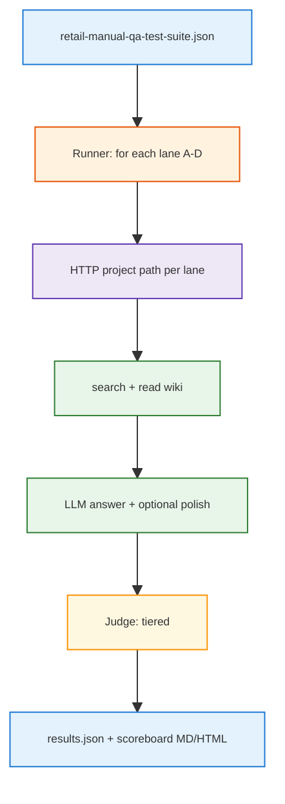

<h1 id="abcd-title" style="color:#0d47a1;font-size:1.5em;font-weight:700;border-bottom:2px solid #90caf9;padding-bottom:0.25em;margin-top:0">Refactor plan — retail manual ingest A/B/C/D benchmark</h1>

**D6 suite:** `TYPE_A_M90` — **M90-technical-singlefact** (`tests/retail_multi_profiles/data/retail-manual-qa-test-suite.json`).

**Plan role:** **minor** (child).  
**Parent (only):** [`REFACTOR_PLAN_MAIN_1_FURTHER_ENHANCEMENT_GPT.md`](./REFACTOR_PLAN_MAIN_1_FURTHER_ENHANCEMENT_GPT.md) — Phase **1** (TYPE_A_M90 harness; main plan [§0 minor **M1**](./REFACTOR_PLAN_MAIN_1_FURTHER_ENHANCEMENT_GPT.md#gpt-hierarchy)).  
**Status:** **in progress** — P0 + **P0.5** done (2026-10-20); full **90×4** via **`--full`**.  
**Chain:** **`aciubtdd`** / **`qimpltdd`** on this file.  
**Goal:** Automate a **four-lane** comparison (`retail`, `retail-md`, `retail-txt`, `retail-md-learned`) on the **same 90-question retail manual QA suite**, score answers against gold, and publish reproducible metrics to choose a **best practice** for LLM Wiki + product Q&A from long PDF manuals.  
**Out of scope for this plan:** changing LLM Wiki ingest/compiler code in `nu_llm_wiki`; ticket Postgres leg; shipping a public article (capture outline only).

<h2 id="abcd-outline" style="color:#1565c0;font-size:1.22em;font-weight:650;border-left:4px solid #42a5f5;padding-left:10px;margin-top:1.1em">Document outline</h2>

1. [Problem](#abcd-problem) — why four lanes, one benchmark.
2. [Benchmark corpus](#abcd-benchmark) — JSON schema and counts.
3. [Ingest lanes (A–D)](#abcd-lanes) — what each profile ingests.
4. [Evidence](#abcd-evidence) — repo touchpoints today.
5. [Decisions](#abcd-decisions) — locked for impl (includes grill outcomes).
6. [Metrics and reporting](#abcd-metrics) — scoreboard shape.
6.1 [Config split — evidence vs eval](#abcd-config-split) — brain-stack vs run-config (P0.5).
7. [Phases](#abcd-phases) — P0.5, P1–P8.
8. [Quality bar](#abcd-quality) — tests and comments.
9. [TDD bar](#abcd-tdd) — red/green per phase.
10. [Execution checklist](#abcd-checklist) — all open.
11. [Deferred](#abcd-deferred) — article, nu_llm_wiki changes, page-level cite.
12. [Related plans](#abcd-related) — links.

---

<h2 id="abcd-problem" style="color:#1565c0;font-size:1.22em;font-weight:650;border-left:4px solid #42a5f5;padding-left:10px;margin-top:1.1em">1. Problem</h2>

Fridges R Us manuals arrive as **long, complex PDFs**. LLM Wiki can ingest them several ways:

- **Native PDF** inside the app (PDFium path in the desktop stack).
- **Pre-converted Markdown or text** produced **outside** the app (Docling non-OCR, pypdf extract, etc.).
- **LLM-digested Markdown** (technician-style rewrite constrained to PDF facts).

You already stand up **four sibling projects** under `brain/` and ingested the **four retail manual PDFs** (per lane’s raw format). The open question is **which lane yields the most reliable answers** on a fixed Q&A benchmark—not ad hoc chat.

This plan adds a **test harness**, **tiered scoring**, and a **comparison report** suitable for internal decision-making and (later) a publishable methods section.

---

<h2 id="abcd-benchmark" style="color:#1565c0;font-size:1.22em;font-weight:650;border-left:4px solid #42a5f5;padding-left:10px;margin-top:1.1em">2. Benchmark corpus</h2>

**Authoritative file (operator):**  
`/Users/jjw8053/Downloads/fridge-qa-pass2-package/fridge-qa-test-suite.json`

**Vendored copy (impl):**  
`tests/retail_multi_profiles/data/retail-manual-qa-test-suite.json` (same bytes as upstream; see `tests/retail_multi_profiles/README.md` for provenance and refresh command).

| Field | Value |
|-------|--------|
| `schema_version` | `1.0` |
| Models | 3 SKU leaves: `ge_GNE27JYMFS`, `kitchenaid_KRFF507HPS`, `samsung_RF28K9070SG` |
| Questions | **90** total (**30 easy**, **30 hard**, **30 negative**) |
| Grounding | PDF-only facts per model leaf (`grounding_policy` in JSON) |
| Negative literal | `Insufficient_Information_Based_On_Given_PDF` |
| Samsung sources | `user-guide.pdf` + `repair-guide.pdf` (only Samsung row lists two PDFs) |

Each question carries **`answer`** (gold prose) and **`reference_points`** (PDF path + **printed** page number for human audit—not used as an automated score in v1).

---

<h2 id="abcd-lanes" style="color:#1565c0;font-size:1.22em;font-weight:650;border-left:4px solid #42a5f5;padding-left:10px;margin-top:1.1em">3. Ingest lanes (A–D)</h2>

<table>
<thead>
<tr style="background:#1565c0;color:white"><th>Lane</th><th>Brain folder</th><th>Raw ingest</th><th>Provenance</th></tr>
</thead>
<tbody>
<tr><td style="background:#e3f2fd"><strong>A</strong></td><td style="background:#e8f5e9"><code>brain/retail</code></td><td style="background:#e8f5e9">Original <strong>PDF</strong> under <code>raw/sources/fridge-docs/…</code></td><td style="background:#fff3e0">LLM Wiki compile (PDFium / in-app PDF pipeline)</td></tr>
<tr><td style="background:#e3f2fd"><strong>B</strong></td><td style="background:#e8f5e9"><code>brain/retail-md</code></td><td style="background:#e8f5e9"><strong>.md</strong> under <code>raw/sources/…</code></td><td style="background:#fff3e0">External non-OCR PDF→MD (e.g. Docling)</td></tr>
<tr><td style="background:#e3f2fd"><strong>C</strong></td><td style="background:#e8f5e9"><code>brain/retail-txt</code></td><td style="background:#e8f5e9"><strong>.txt</strong> under <code>raw/sources/…</code></td><td style="background:#fff3e0">External PDF→text extract</td></tr>
<tr><td style="background:#e3f2fd"><strong>D</strong></td><td style="background:#e8f5e9"><code>brain/retail-md-learned</code></td><td style="background:#e8f5e9"><strong>.md</strong> (technician digest)</td><td style="background:#fff3e0">LLM rewrite from PDFs with strict no-hallucination prompt (ChatGPT-class model)</td></tr>
</tbody>
</table>

**Precondition (operator, already done per user):** each lane’s wiki index is built from its raw tree; LLM Wiki API healthy at `http://127.0.0.1:19828/api/v1`.

**Fairness rules for the experiment:**

- Same **90 questions** and same **answer model + judge model** configs across lanes (see Decisions).
- Questions are asked **in SKU context** (model_id from JSON) so search is not ambiguous across GE vs Samsung.
- Do **not** mix ticket search or Postgres in v1—**manual/wiki leg only**.

---

<h2 id="abcd-evidence" style="color:#1565c0;font-size:1.22em;font-weight:650;border-left:4px solid #42a5f5;padding-left:10px;margin-top:1.1em">4. Evidence</h2>

| Fact | Where |
|------|--------|
| HTTP search + read already implemented for live eval | `scripts/retail/retail_brain/answer_manuals.py` → `LlmWikiHttpClient` |
| Offline wiki fixtures for CI | `FixtureWikiClient` in same module |
| `BRAIN_PROFILES` only `personal` \| `retail` | `scripts/brain/brain_stack.py` — **lanes B–D are not switchable via `BRAIN_PROFILE` yet** |
| Layout test still assumes two profiles | `tests/test_brain_profile_layout.py` |
| Extensible scoreboard pattern | `.cursor/rules/project_specific/extesttab-expgtest-table-scoreboard.mdc` (adapt for ABCD) |
| Multi-project MCP compile gap | [`REFACTOR_MULTI_PROFILE_AGENT_OPS.md`](./REFACTOR_MULTI_PROFILE_AGENT_OPS.md) — not blocking if ingest is already done |

---

<h2 id="abcd-decisions" style="color:#1565c0;font-size:1.22em;font-weight:650;border-left:4px solid #42a5f5;padding-left:10px;margin-top:1.1em">5. Decisions</h2>

| ID | Decision |
|----|----------|
| **D1** | **Four experimental lanes** map 1:1 to folders `brain/retail`, `brain/retail-md`, `brain/retail-txt`, `brain/retail-md-learned`. Lane id in code: `A` \| `B` \| `C` \| `D`. |
| **D2** | **Answer path (grill):** use **retrieve-then-answer**, not Hermes agent loop. Pipeline: `llm_wiki_search` (SKU-scoped query) → read top‑k wiki pages → **one LLM call** with a fixed system prompt → optional **short polish/summarization** pass (second LLM call with temperature 0). This is **not equivalent** to LLM Wiki **chat/RAG** (Option A): chat bundles retrieval, tool use, and project chat settings inside the app. **B + polish** is preferred for **reproducible A/B/C/D** and article methods; run **one optional smoke subset** via chat API for contrast only. |
| **D3** | **Scoring (grill):** **tiered**. **Negative:** pass iff model output matches **`Insufficient_Information_Based_On_Given_PDF`** (normalize whitespace/case). **Easy + hard:** **LLM-as-judge** with rubric (factually consistent with gold, no unsupported claims, paraphrase OK). **Wise with caveats:** fix judge model + prompt version; calibrate on ~10 gold pairs; store judge raw JSON; report disagreement sample for human audit. |
| **D4** | **No automated PDF page citation score** in v1 (MD/TXT lanes lack stable printed pages); keep `reference_points` for manual spot-check and future phase. |
| **D5** | Benchmark JSON vendored under **`tests/retail_multi_profiles/data/`**; runner accepts `--suite` override. |
| **D6** | Register lanes in **`config/retail-ingest-lanes.yaml`** (or CLI `--lane-path` list) with absolute project paths—**do not** overload `BRAIN_PROFILE` for B–D in v1. |
| **D7** | **Retrieval + literal** in **`config/brain-stack.yaml`** → **`second_brain.retail_evidence`** (example in **`brain-stack.example.yaml`**). **Closed-world answer + judge** in harness **`data/run-config.yaml`** → **`retail_eval`** only. Logs under **`ops/runs/retail-lane-abcd/<timestamp>/`**. *(Supersedes 2026-10-19 D7 “all in run-config”.)* |
| **D11** | **Two pipelines, one retrieval shape:** **Production** (`retail_answer.v1` + Hermes) should pass **rich wiki text** (page-prefix concat) and **not** force benchmark summarization—Hermes may combine MCP wiki, bundle tickets, and **external** tools. **Benchmark** reuses the **same** `search_top_k` / `query_template` / `page_prefix_chars` then adds **`retail_eval.answer`** (ONLY-excerpts LLM) for reproducible lane scores. |
| **D12** | **Shared code:** `scripts/retail/retail_brain/wiki_page_context.py` → `concat_top_k_wiki_pages`; harness loads merge via **`tests/retail_multi_profiles/lib/run_config.py`** (`load_brain_stack` + run-config). |
| **D13** | **Full run entrypoint:** `python -m tests.retail_multi_profiles --full [--limit N] --lanes A,B,C,D` (live tier); smoke unchanged. Checkpoint/resume remains **P5** polish. |
| **D14** | **Grill 2026-10-21:** persist each row’s search hits (`score`, `vectorScore`, `titleMatch`, search `mode` / hit counts) on `results.jsonl`. **Sources-only replay:** mixed-outcome tickets from `abcd-full-openai-v2`, lanes **B** and **D**, search **top 10**, keep only `wiki/sources/` pages, same 8000-char prefix and answer/judge prompts — to compare source-page informativeness, not entity/concept cards. |
| **D8** | Industry scan: **`docs_manual_gen/artifacts/RETAIL_MANUAL_QA_INDUSTRY_SCAN.md`** (not a merge gate). |
| **D9** | **Harness naming:** **`retail_*` / `retail-`** for repo paths; upstream **`fridge-qa-*`** filename provenance only. |
| **D10** | **Code home (2026-10-20):** all harness **library + pytest + CLI** under **`tests/retail_multi_profiles/`** (`lib/`, `data/`, `fixtures/`). Canonical run artifact: **`results.json`** (+ optional `.jsonl`); **`scoreboard.md`** + **`scoreboard.html`** derived. Future DB imports `results.json` schema. |



**Grill record (2026-10-19):** answer path = **D2**; scoring = **D3** (user asked whether tiered + LLM judge for easy/hard is wise → **yes**, with calibration in P4).

**Grill record (2026-10-20):** **D10** — all harness code under **`tests/retail_multi_profiles/`**; **`results.json`** canonical; move existing **`test_retail_*.py`** → **`tests/retail/`** (README index only for other top-level tests).

**Grill record (2026-10-20, config):** User asked whether **`answer`** belongs in brain-stack for prod → **split (D11–D12):** evidence/retrieval **yes** (operator source of truth); **summarization + judge** **no** (eval-only **`retail_eval`**). Prod keeps Hermes flexibility; future **`evidence_mode`** (`excerpt` \| `page_prefix`) on manual leg aligns bundle with benchmark fairness without coupling to judge prompt.

---

<h2 id="abcd-config-split" style="color:#1565c0;font-size:1.22em;font-weight:650;border-left:4px solid #42a5f5;padding-left:10px;margin-top:1.1em">6.1 Config split — evidence vs eval (P0.5)</h2>

<h3 id="abcd-config-why" style="color:#00695c;font-size:1.05em;font-weight:600;margin-top:0.85em">Why split (thinking)</h3>

| Concern | Resolution |
|---------|------------|
| Benchmark needs **closed-world** answers for **D3** judge | **`retail_eval.answer`** + fixed prompt in **`answer_pipeline.py`** — stays in harness config |
| Production needs **Hermes** to merge wiki evidence + tickets + **optional external** lookup | **No** mandatory pre-summary in brain-stack; **`hermes.chat_model`** remains the synthesis agent |
| A/B/C/D must compare **lanes**, not **config drift** | **Same retrieval** on every lane: **`second_brain.retail_evidence`** in brain-stack (merged example + local yaml) |
| Duplicating `search_top_k` in test yaml | **Removed** from harness defaults; **`load_merged_run_config`** merges stack + **`retail_eval`** |

**Rejected alternatives:**

- **All config in run-config** — retrieval hidden from operators; prod bundle would not share top‑k / 8000-char policy with eval.
- **All config in brain-stack including judge** — couples operator machine config to eval rubric; judge prompt versioning stays test-owned (**P4**).
- **Prod uses same summarization as benchmark** — blocks Hermes tool use and external enrichment; contradicts **`retail_answer.v1`** bundle design.

<h3 id="abcd-config-shape" style="color:#00695c;font-size:1.05em;font-weight:600;margin-top:0.85em">File shape (implemented)</h3>

```yaml
# config/brain-stack.example.yaml
second_brain:
  retail_evidence:
    search_top_k: 5
    query_template: "{model_id} {question}"
    page_prefix_chars: 8000
    insufficient_literal: Insufficient_Information_Based_On_Given_PDF
    evidence_mode: page_prefix   # future prod bundle; benchmark uses page_prefix today

# tests/retail_multi_profiles/data/run-config.yaml
retail_eval:
  answer: { provider, model, temperature }
  judge:  { provider, model, temperature }
smoke_question_ids: [...]
```

**Merge order:** code defaults → **`brain-stack.example.yaml`** + local **`brain-stack.yaml`** → harness **`run-config.yaml`** (`retail_eval` only; legacy top-level retrieval keys still overlay if present).

<h3 id="abcd-config-exit" style="color:#00695c;font-size:1.05em;font-weight:600;margin-top:0.85em">P0.5 exit</h3>

- [X] **`wiki_page_context.concat_top_k_wiki_pages`** shared module.
- [X] **`load_merged_run_config`** + pytest **`test_run_config.py`**.
- [X] **`--full`** CLI (90 Q × lanes; **`--limit N`** for partial live runs).
- [ ] Wire **`page_prefix`** into **`retail_answer.v1`** manual leg (orthogonal production plan — **`REFACTOR_BRAIN_PROFILES_AND_RETAIL_ANSWER.md`**).

---

<h2 id="abcd-metrics" style="color:#1565c0;font-size:1.22em;font-weight:650;border-left:4px solid #42a5f5;padding-left:10px;margin-top:1.1em">6. Metrics and reporting</h2>

Primary table (lanes × strata):

| Metric | Definition |
|--------|------------|
| **Pass rate** | % judge pass (easy/hard) or exact insufficient (negative) |
| **Pass by difficulty** | easy / hard / negative columns |
| **Pass by SKU** | three model_id groups |
| **Latency p50/p95** | search + read + LLM + judge per question |
| **Retrieval recall proxy** | gold doc stem appears in top‑k wiki paths or source frontmatter (diagnostic only) |
| **Cost estimate** | token counts × price sheet (optional row) |

Deliverables:

- `ops/runs/retail-lane-abcd/<run_id>/results.json` — canonical structured run (all lanes, metrics, rows).
- `ops/runs/retail-lane-abcd/<run_id>/results.jsonl` — optional append-friendly copy (one row per lane × question).
- `ops/runs/retail-lane-abcd/<run_id>/scoreboard.md` — human scan (extesttab-friendly).
- `ops/runs/retail-lane-abcd/<run_id>/summary.json` — lane winner + confidence notes.

**Winner rule (default):** highest overall pass rate; tie-breaker higher hard-pass rate, then lower p95 latency.

---

<h2 id="abcd-phases" style="color:#1565c0;font-size:1.22em;font-weight:650;border-left:4px solid #42a5f5;padding-left:10px;margin-top:1.1em">7. Phases</h2>

<h3 id="abcd-p0" style="color:#00695c;font-size:1.05em;font-weight:600;margin-top:0.85em">7.0 P0 — Smoke E2E (2 questions × 4 lanes)</h3>

- [X] Vendored suite + `load_suite.py` + pytest count (**90**).
- [X] `config/retail-ingest-lanes.yaml` + `data/run-config.yaml` (`smoke_question_ids`: `samsung_RF28K9070SG-E01`, `samsung_RF28K9070SG-H01`).
- [X] Minimal pipeline: wiki search/read → Gemini answer → tiered score → `results.json`.
- [X] `scoreboard.md` + `scoreboard.html` under `ops/runs/retail-lane-abcd/<run_id>/`.
- [X] CLI: `python -m tests.retail_multi_profiles --smoke --lanes A,B,C,D`.
- **Exit:** live smoke run produces comparable lane table; full **P1–P5** continues after sign-off.

<h3 id="abcd-p05" style="color:#00695c;font-size:1.05em;font-weight:600;margin-top:0.85em">7.0.1 P0.5 — Evidence config split + full-run CLI</h3>

**TDD mode:** strict-TDD (`test_run_config.py` red → merge loader + example yaml green).

- [X] Document **D11–D13** and §6.1 (this plan).
- [X] **`second_brain.retail_evidence`** in **`config/brain-stack.example.yaml`**.
- [X] Harness **`run-config.yaml`** → **`retail_eval`** + smoke ids only.
- [X] **`lib/run_config.py`**, **`wiki_page_context.py`**, runner uses merged config.
- [X] **`python -m tests.retail_multi_profiles --full`** ( **`--limit N`** optional ).
- **Exit:** operator can launch **90×4** live run with config snapshot in **`results.json`**; prod bundle alignment deferred to retail answer refactor.

<h3 id="abcd-p1" style="color:#00695c;font-size:1.05em;font-weight:600;margin-top:0.85em">7.1 P1 — Benchmark vendoring and schema loader</h3>

- [ ] Copy upstream `fridge-qa-test-suite.json` → `tests/retail_multi_profiles/data/retail-manual-qa-test-suite.json`.
- [ ] Extend `tests/retail_multi_profiles/README.md` (provenance, counts, grounding policy, negative literal).
- [ ] `tests/retail_multi_profiles/lib/load_suite.py`: validate schema; iterate `(model_id, question)` with SKU helper.

<h3 id="abcd-p2" style="color:#00695c;font-size:1.05em;font-weight:600;margin-top:0.85em">7.2 P2 — Lane registry (A–D)</h3>

- [ ] Add `config/retail-ingest-lanes.yaml` (lane id → `brain/` relative path → ingest kind enum).
- [ ] Document lanes in `brain/README.md` appendix (**experimental**, not `BRAIN_PROFILE` switches).
- [ ] Preflight command: API health + project path exists + non-empty `wiki/` index marker.

<h3 id="abcd-p3" style="color:#00695c;font-size:1.05em;font-weight:600;margin-top:0.85em">7.3 P3 — Retrieval client and answer pipeline</h3>

- [ ] Extend or wrap `LlmWikiHttpClient` for **project path per lane** (reuse `answer_manuals.py` patterns).
- [ ] `tests/retail_multi_profiles/lib/answer_pipeline.py`: search (topK), read pages, **answer LLM**, optional polish (D2).
- [ ] SKU scoping: prepend model_id / brand tokens to query (document in `data/run-config.yaml`).
- [ ] CLI `python -m tests.retail_multi_profiles --lanes A,B,C,D --limit N --dry-run` (see `__main__.py`).

<h3 id="abcd-p4" style="color:#00695c;font-size:1.05em;font-weight:600;margin-top:0.85em">7.4 P4 — Tiered scoring and calibration</h3>

- [ ] `tests/retail_multi_profiles/lib/scoring.py`: negative exact match; easy/hard → judge with gold + candidate + question.
- [ ] `tests/retail_multi_profiles/data/judge_prompt.md` versioned; store `judge_version` in each result row.
- [ ] Calibration set: hand-pick 10 `(question, gold, candidate)` triples; pytest ensures judge stable pass/fail on fixtures (mock LLM in CI).
- [ ] Emit per-row: `pass`, `judge_rationale`, `difficulty`, `lane`.

<h3 id="abcd-p5" style="color:#00695c;font-size:1.05em;font-weight:600;margin-top:0.85em">7.5 P5 — Full run, checkpoint logging, comparison</h3>

**TDD mode:** **strict-TDD** (`test_run_progress.py` → `logging_utils/run_progress.py` + runner).

**Why (2026-10-20):** Full run died on **Gemini judge `TimeoutError`** with **no row identity** in logs — operators must see **which `(lane, question_id)` and step** (`judge_start`, etc.) failed ([**neatlog**](.cursor/rules/neatlog-operator-logging-bar.mdc)).

- [X] **`logging_utils/run_progress.py`**: JSONL `progress` + `result` events; `completed_row_keys`; last progress line pinpoints timeout ticket.
- [X] **Runner**: per-step progress; **Heartbeat** on answer/judge LLM; flush **`results.json`** after each row; **`--resume`**.
- [X] **LLM**: 300s timeout + 3 retries on transient **`TimeoutError`** / **`OSError`**.
- [X] **Ops log**: `logs/ops/retail-lane-abcd-<run_id>.log` via **NeatLoggerFactory**.
- [ ] **`summary.json`** declares recommended lane for production ingest policy pending human sign-off.
- **Exit:** `tail -f logs/ops/retail-lane-abcd-*.log` shows row index; on crash, last **`results.jsonl`** progress line names ticket + step; **`--resume --run-id …`** continues.

<h3 id="abcd-p6" style="color:#00695c;font-size:1.05em;font-weight:600;margin-top:0.85em">7.6 P6 — CI vs live tiers</h3>

- [ ] **CI tier:** `FixtureWikiClient` + mocked LLM judge → deterministic pytest on 3 questions per difficulty (synthetic pages).
- [ ] **Live tier:** marker `@pytest.mark.live` or script-only; requires LLM Wiki + API keys; document in runbook.

<h3 id="abcd-p7" style="color:#00695c;font-size:1.05em;font-weight:600;margin-top:0.85em">7.7 P7 — Industry best-practice scan</h3>

- [ ] Author `docs_manual_gen/artifacts/RETAIL_MANUAL_QA_INDUSTRY_SCAN.md`: RAG on manuals, structure-aware PDF ingestion, table handling, citation practices, eval methodologies (2024–2026 sources).
- [ ] Map findings to lanes A–D (strengths/weaknesses hypothesis table).

<h3 id="abcd-p8" style="color:#00695c;font-size:1.05em;font-weight:600;margin-top:0.85em">7.8 P8 — Article outline (no publish)</h3>

- [ ] `docs_manual_gen/artifacts/RETAIL_MANUAL_QA_ARTICLE_OUTLINE.md`: title options, abstract bullets, methods (lanes, benchmark, judge), results placeholder, ethics/limitations, artifact links.
- [ ] Explicitly note **implicit publication intent**; no submission work in this plan.

---

<h2 id="abcd-quality" style="color:#1565c0;font-size:1.22em;font-weight:650;border-left:4px solid #42a5f5;padding-left:10px;margin-top:1.1em">8. Quality bar</h2>

- **Tests:** P1 loader validation; P4 judge fixtures; P6 CI tier; no flaky live tests in default `./scripts/verify.sh`.
- **Comments ([cdcm](.cursor/rules/cdcm-code-comments.mdc)):** file header + per-function doc lines on `tests/retail_multi_profiles/lib/*.py` and `__main__.py`.
- **Ops:** each live run writes under `ops/runs/retail-lane-abcd/` with config snapshot and git commit hash.
- **Operator logging ([neatlog](.cursor/rules/neatlog-operator-logging-bar.mdc)):** **P5 [X]** — JSONL + `logs/ops/retail-lane-abcd-<run_id>.log` + `--resume`.
- **Secrets:** never commit API keys; read from `.env` / `LLM_WIKI_API_TOKEN` like existing retail live tests.

---

<h2 id="abcd-tdd" style="color:#1565c0;font-size:1.22em;font-weight:650;border-left:4px solid #42a5f5;padding-left:10px;margin-top:1.1em">9. TDD bar</h2>

| Phase | Red first | Green exit |
|-------|-----------|------------|
| P0.5 | missing brain-stack still merges defaults | example yaml → `search_top_k` 5, `page_prefix_chars` 8000 |
| P1 | load invalid JSON fails | load real suite → 90 questions |
| P4 | judge mock returns fail on bad candidate | pass on gold paraphrase fixture |
| P6 | pipeline without wiki → structured error | fixture wiki → non-empty answer string |

---

<h2 id="abcd-checklist" style="color:#1565c0;font-size:1.22em;font-weight:650;border-left:4px solid #42a5f5;padding-left:10px;margin-top:1.1em">10. Execution checklist</h2>

- [X] P0 Smoke E2E (2×4)
- [X] P0.5 Evidence config split + `--full` CLI
- [ ] P1 Benchmark vendoring and schema loader
- [ ] P2 Lane registry (A–D)
- [ ] P3 Retrieval client and answer pipeline
- [ ] P4 Tiered scoring and calibration
- [X] P5 Checkpoint logging + resume (summary.json still open)
- [ ] P6 CI vs live tiers
- [ ] P7 Industry best-practice scan
- [ ] P8 Article outline (no publish)

---

<h2 id="abcd-deferred" style="color:#1565c0;font-size:1.22em;font-weight:650;border-left:4px solid #42a5f5;padding-left:10px;margin-top:1.1em">11. Deferred</h2>

| Item | Why deferred |
|------|----------------|
| Enroll B–D in `BRAIN_PROFILES` | Experiment registry suffices; avoid breaking two-profile tests until policy merges |
| Page-level citation auto-score | MD/TXT lanes lack printed page alignment |
| LLM Wiki chat API as primary path | Reproducibility; optional smoke only (D2) |
| Hermes agent eval | Non-deterministic; out of v1 |
| `nu_llm_wiki` PDFium vs MinerU A/B inside app | Separate from outside-conversion lanes B–D |
| Public article draft | After live run + human sign-off on P8 outline |
| **Operation_1 — structural lint batch fix** (Run Lint → select all → Fix selected) | No HTTP/MCP batch API today; see **§11.1** |
| **Operation_1 before/after lane benchmark** | Requires programmatic lint fix or scripted wikilink replay; **§11.1** |

<h3 id="abcd-deferred-lint" style="color:#00695c;font-size:1.05em;font-weight:600;margin-top:0.85em">11.1 Deferred — Wiki Lint operation_1 and A/B eval</h3>

**Context:** LLM Wiki **Wiki Lint** flags **structural** issues (not the same as “raw shard deleted” orphans):

| Lint term | Meaning |
|-----------|---------|
| **Orphan page** | No **inbound** `[[wikilink]]` from other wiki pages (screenshot: *“No other pages link to this page”*). |
| **No outlinks** | Page has no outbound `[[wikilink]]` to other pages. |
| **Fix selected** | For orphan + `suggestedSource`: **append** `[[orphan-slug]]` to the suggested source file; for no-outlinks: append link to `suggestedTarget`. Implemented in `nu_llm_wiki` `lint-view.tsx` (`handleFix` / `handleBatchFix`) — **desktop UI only**, no `api_server` route in v1. |

**Why consider operation_1 for lanes A–D:** Fixes **link-graph** orphans → can improve **one-hop graph hits** in hybrid search; does **not** remove wiki pages whose **raw** file was deleted (that is **LEARNED plan P5** / source lifecycle).

**Deferred work (onlyref — separate plan or phase after P5 harness):**

1. **`nu_llm_wiki`:** Extract `runStructuralLint` + batch fix (same rules as UI) behind **`POST /api/v1/projects/{id}/lint/structural`** and **`POST …/lint/fix-batch`** (or MCP tools `llm_wiki_lint_run`, `llm_wiki_lint_fix_batch`). **Effort:** ~**1–2 days** (logic exists; wire API, tests, index refresh) — **practical**, not a rewrite.
2. **`second_brain` harness:** Optional preflight step **`--apply-structural-lint-fix`** per lane (calls API above) with dry-run default.
3. **Before/after benchmark (recommended if operation_1 is automated):** Same 90-Q suite × lanes, two passes logged under `ops/runs/retail-lane-abcd/<run_id>-pre-lint/` vs `…-post-lint/`; scoreboard column delta (pass rate, graph-hit proxy). Treat as **experiment**, not a merge gate for v1 harness.

**Grill record (2026-10-20):** User asked whether operation_1 should be measured before/after → **yes**, deferred as rows above.

---

<h2 id="abcd-related" style="color:#1565c0;font-size:1.22em;font-weight:650;border-left:4px solid #42a5f5;padding-left:10px;margin-top:1.1em">12. Related plans</h2>

| Plan | Relationship |
|------|----------------|
| [`REFACTOR_PLAN_MAIN_1_FURTHER_ENHANCEMENT_GPT.md`](./REFACTOR_PLAN_MAIN_1_FURTHER_ENHANCEMENT_GPT.md) | **Main plan** — this file is minor **M1** |
| [`REFACTOR_RETAIL_RAW_SOURCES_RAG_ABCD_COMPARE.md`](../completed/REFACTOR_RETAIL_RAW_SOURCES_RAG_ABCD_COMPARE.md) | Sibling **M2** — raw RAG on same TYPE_A_M90 suite |
| [`REFACTOR_MULTI_PROFILE_AGENT_OPS.md`](./REFACTOR_MULTI_PROFILE_AGENT_OPS.md) | Sibling **M∥** — rescan/compile any lane without UI focus |
| [`REFACTOR_BRAIN_PROFILES_AND_RETAIL_ANSWER.md`](../wip/REFACTOR_BRAIN_PROFILES_AND_RETAIL_ANSWER.md) | Production `retail_answer.v1` path; orthogonal to ABCD eval |
| [`RETAIL_LLM_WIKI_TXT_COMPILE.md`](../artifacts/RETAIL_LLM_WIKI_TXT_COMPILE.md) | Historical txt compile notes; lane C aligns |
| `pdf_proc/docling/` | External MD for lane B (operator tooling) |
