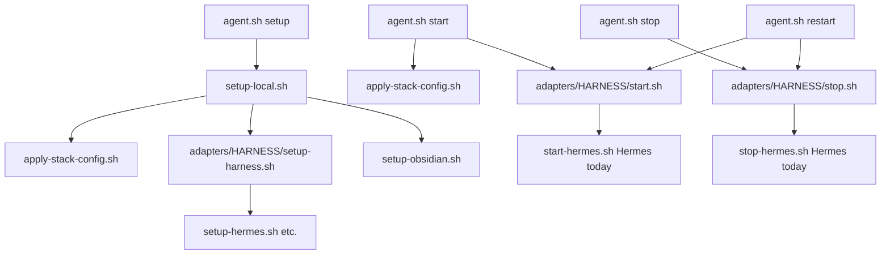

<h1 id="doc-title" style="color:#0d47a1;font-size:1.5em;font-weight:700;border-bottom:2px solid #90caf9;padding-bottom:0.25em;margin-top:0">Refactor plan — brain agent single entry (`agent.sh`)</h1>

**Plan role:** **minor** (child).  
**Parent (only):** [`REFACTOR_PLAN_MAIN_1_FURTHER_ENHANCEMENT_GPT.md`](../new/REFACTOR_PLAN_MAIN_1_FURTHER_ENHANCEMENT_GPT.md) — Phase **4** operator entry (main plan [§0 minor **M8**](../new/REFACTOR_PLAN_MAIN_1_FURTHER_ENHANCEMENT_GPT.md#gpt-hierarchy)).  
**Status:** **wip** — P1–P7 on branch **`feature/bootstrap-rrf-evolve-10-agent-entrypoint`** (P7 gateway lifecycle landed; not yet merged).  
**Scope:** Second Brain harness operator UX — one idempotent entry for setup / start / stop / restart; docs + call-stack clarity; trim duplicate glue (not merge adapter setup steps).

**last_aligned:** 2026-10-17 (P8 D16 status/restart table parity)

## Document outline

1. [Problem](#problem) — many scripts, unclear entry, duplicate apply-stack.
2. [Decisions](#decisions) — grill / design lock.
3. [Target architecture](#architecture) — `agent.sh` vs delegates.
4. [Phases](#phases) — P1–P7.
5. [Documentation map](#doc-map) — README locations and content contract.
6. [Quality bar](#quality) — verification.
7. [TDD bar](#tdd-bar) — per-phase test-first contracts.
8. [Execution checklist](#checklist) — `[ ]` / `[X]`.

---

<h2 id="problem" style="color:#1565c0;font-size:1.22em;font-weight:650;border-left:4px solid #42a5f5;padding-left:10px;margin-top:1.1em">1. Problem</h2>

Operators must remember **`setup-local.sh`**, **`apply-stack-config.sh`**, **`adapters/hermes/start-hermes.sh`**, **`stop-hermes.sh`**, and **`install-and-start-hermes-desktop.sh`**. **`active_harness`** (`hermes` | `openclaw`) drives adapter choice but is easy to miss in gitignored **`config/brain-stack.yaml`**. **`apply-stack-config.sh`** runs from multiple paths. Lower-level **`setup-*.sh`** files are documented as if they were public entrypoints.

---

<h2 id="decisions" style="color:#1565c0;font-size:1.22em;font-weight:650;border-left:4px solid #42a5f5;padding-left:10px;margin-top:1.1em">2. Decisions</h2>

| ID | Decision |
|----|----------|
| **D1** | **Public entry:** **`scripts/brain/agent.sh`** only (`setup` \| `start` \| `stop` \| `restart` \| `status` \| `help`). |
| **D2** | **Harness dispatch:** Read **`active_harness`** from **`config/brain-stack.yaml`** via existing **`brain_stack.active_harness()`** (default **`hermes`**). |
| **D3** | **Delegates (internal):** **`adapters/<harness>/start.sh`** and **`stop.sh`** — not documented as operator entrypoints. Hermes may **`exec`** current **`start-hermes.sh`** / **`stop-hermes.sh`** initially; optional rename in a later phase. |
| **D4** | **`setup`:** **`agent.sh setup`** → **`setup-local.sh`** unchanged (full idempotent bootstrap). |
| **D5** | **`start` / `restart`:** Hermes: **bring-up plan table first** (D11/D15), then **`apply-stack-config.sh`**, then delegate start. Optional **`--ensure-setup`** runs **light** probe and **`setup-harness.sh`** only on failure — **not** full **`setup-local`** every launch. |
| **D6** | **`start --install`:** If Hermes Desktop app missing, call **`setup-hermes-desktop.sh`** once; **remove** **`install-and-start-hermes-desktop.sh`**. |
| **D7** | **OpenClaw:** **`start.sh` / `stop.sh`** stubs with clear “not wired” exit until real launch exists. |
| **D8** | **Docs:** Each listed **`README.md`** gets usage + call-stack diagram + **“do not call delegates directly”** banner. |
| **D9** | **Superseded by D11** (was strict refuse-if-any-layer-up). P7 shipped strict; D11 bring-up is next impl. |
| **D10** | **Hermes teardown (P7):** **`stop`** runs **`hermes gateway stop`** plus Desktop quit and TUI pidfile cleanup. **`status`** uses **`hermes-runtime.sh`** + **`hermes gateway status`**. Cold **`start`**: **`hermes gateway start`** if gateway down, then UI. Detection: **`adapters/hermes/hermes-runtime.sh`**. |
| **D11 (aligned 2026-10-17)** | **`start` = bring-up:** start **only missing** layers (gateway → UI), exit **0** when desired state reached. **Replaces strict D9** for default `start`. |
| **D15 (aligned 2026-10-17)** | **Bring-up UX:** Before apply-stack, print **ASCII table** (component, running?, PID, notes) + **`Will start:`** list. During start: loud **`hermes bring-up: START|SKIP|DONE`** per component; if all satisfied, explicit no-op message. |
| **D16 (aligned 2026-10-17)** | **Table parity:** **`agent.sh status`** prints the **same** bring-up table (default UI mode **desktop**; **`--tui`** passthrough selects TUI row). **`agent.sh restart`** mirrors **`start`**: stop → table → apply-stack → delegate start (same flags/args as **`start`**). |
| **D12** | **`apply-stack-config`:** always on **`start`**, **after** the bring-up table and **before** adapter/UI launch (even when all layers already up — stack sync still runs, then START/SKIP/DONE may all be skip/no-op). |
| **D13** | **Desktop when gateway up:** keep **`start-hermes`** order (`open -a Hermes.app` first, fallback **`hermes desktop --cwd`**). |
| **D14** | **`stop`:** full stack (**gateway stop** + Desktop + TUI) — unchanged from P7. |

**Grill (2026-10-17):** bring-up start · apply-stack before UI (after check) · start-hermes Desktop path · full stop.

---

<h2 id="architecture" style="color:#1565c0;font-size:1.22em;font-weight:650;border-left:4px solid #42a5f5;padding-left:10px;margin-top:1.1em">3. Target architecture</h2>

<h3 id="architecture-operator" style="color:#00695c;font-size:1.05em;font-weight:600;margin-top:0.85em">3.1 Operator surface</h3>

```text
./scripts/brain/agent.sh setup|start|stop|restart|status [-- ensure-setup] [--install] [harness passthrough args…]
```

<h3 id="architecture-stacks" style="color:#00695c;font-size:1.05em;font-weight:600;margin-top:0.85em">3.2 Call stacks (canonical)</h3>



**Note:** **`llm-wiki.sh`** stays a **separate** entry (LLM Wiki **process**, not Hermes/OpenClaw harness). Cross-link from **`scripts/brain/README.md`**.

---

<h2 id="phases" style="color:#1565c0;font-size:1.22em;font-weight:650;border-left:4px solid #42a5f5;padding-left:10px;margin-top:1.1em">4. Phases</h2>

<h3 id="p1" style="color:#00695c;font-size:1.05em;font-weight:600;margin-top:0.85em">4.1 P1 — Config clarity</h3>

- [X] Expand **`config/brain-stack.example.yaml`** comments for **`active_harness`**: selects Hermes vs OpenClaw **agent runtime** for **`agent.sh`**; does not set brain profile, LLM Wiki URL, or MCP catalog path.
- [X] One line in **`scripts/brain/init-brain-stack-from-env.sh`** help (if present) pointing operators to copy example including **`active_harness`**.

<h3 id="p2" style="color:#00695c;font-size:1.05em;font-weight:600;margin-top:0.85em">4.2 P2 — `agent.sh` core</h3>

- [X] Add **`scripts/brain/agent.sh`**: subcommands **`setup`**, **`start`**, **`stop`**, **`restart`**, **`status`**, **`help`**; resolve **`HARNESS`** via **`scripts/py` + brain_stack** (same pattern as **`setup-local.sh`**).
- [X] **`setup`** → exec **`setup-local.sh`**.
- [X] **`start`** → **`apply-stack-config.sh`** → **`adapters/$HARNESS/start.sh`** (pass through unknown args).
- [X] **`stop`** / **`restart`** → delegate stop then (restart) start path.
- [X] **`status`**: print active harness, whether Hermes app/TUI pidfile exists (best-effort), suggest **`agent.sh help`**.

<h3 id="p3" style="color:#00695c;font-size:1.05em;font-weight:600;margin-top:0.85em">4.3 P3 — Hermes delegates + dedupe</h3>

- [X] Add **`adapters/hermes/start.sh`** → thin wrapper around **`start-hermes.sh`**; **`stop.sh`** → **`stop-hermes.sh`**.
- [X] Implement **`start --install`** (Desktop missing → **`setup-hermes-desktop.sh`**) inside **`start-hermes.sh`** or **`start.sh`** wrapper; document flag in help.
- [X] Remove **`install-and-start-hermes-desktop.sh`**; grep repo for references → **`agent.sh start --install`**.
- [X] Remove redundant **`apply-stack-config`** invocation from **`start-hermes.sh`** when **`agent.sh`** already ran it (env **`AGENT_SH_APPLIED_STACK=1`** or single call site documented in header comment).

<h3 id="p4" style="color:#00695c;font-size:1.05em;font-weight:600;margin-top:0.85em">4.4 P4 — OpenClaw stubs</h3>

- [X] Add **`adapters/openclaw/start.sh`** and **`stop.sh`**: exit **2** with message + link **`RUNBOOK_HARNESS_OPENCLAW.md`** unless wired later.
- [X] **`agent.sh status`**: report stub state for openclaw.

<h3 id="p5" style="color:#00695c;font-size:1.05em;font-weight:600;margin-top:0.85em">4.5 P5 — Documentation (README contract)</h3>

- [X] **`scripts/brain/README.md`** (create): primary **`agent.sh`** usage; full call-stack table; **delegates are internal** warning; link **`llm-wiki.sh`**.
- [X] **`harness/second-brain/README.md`**: replace direct **`setup-local` / start-hermes** bullets with **`agent.sh`**; keep MCP/compiler contract.
- [X] **`scripts/brain/adapters/hermes/README.md`** (create): delegate stack only; banner **use `../../agent.sh`**.
- [X] **`scripts/brain/adapters/openclaw/README.md`** (create or extend): stub + future **`start.sh`**.
- [X] **`docs_manual_gen/RUNBOOK_HARNESS_HERMES.md`**, **`RUNBOOK_HARNESS_OPENCLAW.md`**, **`SECOND_BRAIN_RUNBOOK.md`**: operator paths → **`agent.sh`**; retain **`setup-local`** as “what setup subcommand runs”.
- [X] Root **`README.md`** local setup section: one line **`./scripts/brain/agent.sh setup`** then **`start`**.

<h3 id="p6" style="color:#00695c;font-size:1.05em;font-weight:600;margin-top:0.85em">4.6 P6 — `--ensure-setup` (optional light bootstrap)</h3>

- [X] **`agent.sh start --ensure-setup`**: if harness probe fails, run **`adapters/$HARNESS/setup-harness.sh`** only (not Obsidian/corpus tests).
- [X] Document difference vs **`agent.sh setup`** in **`scripts/brain/README.md`**.

<h3 id="p7" style="color:#00695c;font-size:1.05em;font-weight:600;margin-top:0.85em">4.7 P7 — Hermes gateway lifecycle (single instance)</h3>

- [X] Add **`adapters/hermes/hermes-runtime.sh`**: detect gateway ( **`hermes gateway status`** ), Desktop, detach TUI.
- [X] **`agent.sh start`**: **`hermes_agent_running_or_exit`** before apply-stack; exit **1** with **`stop` / `restart`** / **`status`** messages.
- [X] **`agent.sh status`**: **`agent running: yes|no`** + gateway status excerpt.
- [X] **`stop-hermes.sh`**: **`hermes gateway stop`** + existing Desktop/TUI stop.
- [X] **`start-hermes.sh`**: if gateway down, **`hermes gateway start`** then UI; no second gateway when supervised.
- [X] Tests: **`test_brain_agent_entrypoint.py`** (runtime contract, gateway stop in teardown); **`scripts/brain/README.md`** single-instance note.
- [X] **D11 impl:** bring-up **`start`** (missing layers only); exit **0** when complete; no duplicate gateway/TUI.
- [X] **D12 impl:** apply-stack **before UI** after bring-up table (per grill).
- [X] **D15 impl:** ASCII table + **`Will start:`** + per-component progress logs.

<h3 id="p8" style="color:#00695c;font-size:1.05em;font-weight:600;margin-top:0.85em">4.8 P8 — Bring-up table on status + restart</h3>

- [X] **`agent.sh status` (Hermes):** after harness line, **`hermes_print_bringup_plan`** (same table as **`start`**); keep concise **`agent running:`** summary + optional gateway excerpt below table.
- [X] **`agent.sh restart`:** parse **`start`** flags/args; **`delegate_stop`**; **table**; **`apply-stack-config`**; optional **`--ensure-setup`**; **`delegate_start`** (no table skip).
- [X] Tests: **`test_brain_agent_entrypoint.py`** — status output contains table markers; **`restart`** branch sources plan before apply-stack.
- [X] **`scripts/brain/README.md`:** one line on status/restart table parity.

---

<h2 id="doc-map" style="color:#1565c0;font-size:1.22em;font-weight:650;border-left:4px solid #42a5f5;padding-left:10px;margin-top:1.1em">5. Documentation map</h2>

| File | Must include |
|------|----------------|
| **`scripts/brain/README.md`** | **`agent.sh`** examples; mermaid or ASCII call stacks; delegate warning |
| **`harness/second-brain/README.md`** | Contract + **`agent.sh`** as harness entry |
| **`adapters/hermes/README.md`** | Internal scripts list; no direct **`start-hermes.sh`** for operators |
| **`adapters/openclaw/README.md`** | Stub status |
| Runbooks (3) | Updated command blocks only where harness lifecycle is described |

---

<h2 id="quality" style="color:#1565c0;font-size:1.22em;font-weight:650;border-left:4px solid #42a5f5;padding-left:10px;margin-top:1.1em">6. Quality bar</h2>

| Exit | Command / check |
|------|------------------|
| Layout | **`pytest tests/test_brain_script_layout.py`** (update expectations: **`agent.sh`** at brain root; **`install-and-start-*`** removed) |
| Stack config | **`pytest tests/test_brain_stack_config.py`** |
| Agent contract | **`pytest tests/test_brain_agent_entrypoint.py`** (new) |
| Docs grep | No new operator docs recommending **`./scripts/brain/adapters/hermes/start-hermes.sh`** except “called by agent.sh” |
| Manual smoke | **`./scripts/brain/agent.sh help`**; **`status`**; Hermes **`restart`** on dev machine |

---

<h2 id="tdd-bar" style="color:#1565c0;font-size:1.22em;font-weight:650;border-left:4px solid #42a5f5;padding-left:10px;margin-top:1.1em">7. TDD bar</h2>

<table>
<thead>
<tr style="background:#1565c0;color:white"><th>Phase</th><th>TDD mode</th><th>Test-first artifact</th><th>Red case</th><th>Green gate</th></tr>
</thead>
<tbody>
<tr><td style="background:#e3f2fd">P1</td><td style="background:#fff8e1">smoke-after-delete</td><td style="background:#fff8e1">—</td><td style="background:#fff8e1">—</td><td style="background:#e8f5e9">Example YAML still loads in existing stack tests</td></tr>
<tr><td style="background:#e3f2fd">P2</td><td style="background:#e8f5e9"><strong>strict-TDD</strong></td><td style="background:#e8f5e9"><code>tests/test_brain_agent_entrypoint.py</code></td><td style="background:#ffebee">Assert <code>agent.sh</code> exists, help text lists subcommands, dispatches to <code>setup-local</code> / adapter paths (parse script or dry-run with mocked exec)</td><td style="background:#e8f5e9"><code>pytest tests/test_brain_agent_entrypoint.py</code></td></tr>
<tr><td style="background:#e3f2fd">P3</td><td style="background:#e8f5e9"><strong>strict-TDD</strong></td><td style="background:#e8f5e9">Extend <code>test_brain_script_layout.py</code></td><td style="background:#ffebee"><code>install-and-start-hermes-desktop.sh</code> absent; <code>agent.sh</code> present; delegate <code>start.sh</code>/<code>stop.sh</code> exist</td><td style="background:#e8f5e9">Layout pytest green</td></tr>
<tr><td style="background:#e3f2fd">P4</td><td style="background:#e8f5e9"><strong>strict-TDD</strong></td><td style="background:#e8f5e9"><code>test_brain_agent_entrypoint.py</code></td><td style="background:#ffebee">OpenClaw stub start exits non-zero with message</td><td style="background:#e8f5e9">pytest green</td></tr>
<tr><td style="background:#e3f2fd">P5</td><td style="background:#fff8e1">smoke-after-delete</td><td style="background:#fff8e1">Optional grep test or manual checklist</td><td style="background:#fff8e1">—</td><td style="background:#e8f5e9">README files exist; runbooks link <code>agent.sh</code></td></tr>
<tr><td style="background:#e3f2fd">P6</td><td style="background:#e8f5e9"><strong>strict-TDD</strong></td><td style="background:#e8f5e9"><code>test_brain_agent_entrypoint.py</code></td><td style="background:#ffebee"><code>--ensure-setup</code> invokes setup-harness only when probe fails (shell test with temp dirs / env)</td><td style="background:#e8f5e9">pytest green</td></tr>
</tbody>
</table>

---

<h2 id="checklist" style="color:#1565c0;font-size:1.22em;font-weight:650;border-left:4px solid #42a5f5;padding-left:10px;margin-top:1.1em">8. Execution checklist</h2>

- [X] **P1** — config comments
- [X] **P2** — `agent.sh` core
- [X] **P3** — Hermes delegates + remove install-and-start glue
- [X] **P4** — OpenClaw stubs
- [X] **P5** — README + runbook sweep
- [X] **P6** — `--ensure-setup` (optional; may ship after P2–P5 if timeboxed)
- [X] **P7** — Hermes gateway single-instance ( **`hermes-runtime.sh`** )
- [X] **D11–D12** — bring-up start + apply-stack timing (grill locked)
- [X] **D15** — bring-up table + progress logging
- [X] **P8 / D16** — bring-up table on **status** + **restart**

**Out of scope:** Changing **`llm-wiki.sh`**; merging **`setup-hermes*.sh`** into one file; OpenClaw full Desktop launch implementation.
