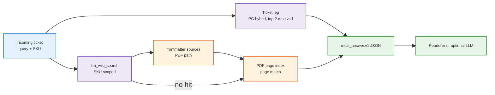

<h1 id="bp-title" style="color:#0d47a1;font-size:1.5em;font-weight:700;border-bottom:2px solid #90caf9;padding-bottom:0.25em;margin-top:0">Refactor: brain-profiles (personal | retail) + retail answer bundle E2E</h1>

**Status:** **wip** — P1–P9 `[X]` (code complete 2026-10-15); **P10** (section-split re-ingest) not started; waiting on manual **HG-P2** / **HG-2**, then live E2E with wiki  
**Execute:** `qimpltdd docs_manual_gen/ref_plan/wip/REFACTOR_BRAIN_PROFILES_AND_RETAIL_ANSWER.md` — run **first**; then manual HG-P2 + HG-2; then parent plan  
**Parent product plan:** [`REFACTOR_FRU_RETAIL_SERVICE_BRAIN.md`](../wip/REFACTOR_FRU_RETAIL_SERVICE_BRAIN.md) (this plan **replaces** its *Platform* phase and **supersedes** decision **P2** routing)

**Goal:** (1) `brain/` holds exactly two **brain-profiles** — `brain/personal/` and `brain/retail/` — with one active at a time (`BRAIN_PROFILE`, default **retail**); shared pieces stay directly under `brain/`. (2) A new FRU customer ticket produces one **deterministic answer bundle (JSON)**: top-2 historical tickets with similarity **and** manual evidence cited back to the raw PDF path + page; tested in CI and in an opt-in live tier.

<h2 id="bp-outline" style="color:#1565c0;font-size:1.22em;font-weight:650;border-left:4px solid #42a5f5;padding-left:10px;margin-top:1.1em">Document outline</h2>

1. [Scope](#bp-1-scope) — in / out.
2. [Decisions](#bp-2-decisions) — grill rounds 1–3 (2026-10-15).
3. [Design: before vs now](#bp-3-design) — exclusive fallback → always-both bundle.
    3.1 [Profile layout](#bp-3-1-layout) — tree + resolution order.
    3.2 [Answer bundle contract](#bp-3-2-bundle) — JSON v1.
    3.3 [Manual leg provenance](#bp-3-3-manual) — wiki → PDF page.
4. [Phases](#bp-4-phases) — P1–P10.
5. [Quality bar (TDD)](#bp-5-quality) — per-phase test-first rows.
6. [Execution checklist](#bp-6-checklist) — progress.
7. [Human gates](#bp-7-gates) — re-register LLM Wiki / Obsidian.
8. [Deferred](#bp-8-deferred) — summarizer tests, verdict, sidecar.

---

<h2 id="bp-1-scope" style="color:#1565c0;font-size:1.22em;font-weight:650;border-left:4px solid #42a5f5;padding-left:10px;margin-top:1.1em">1. Scope</h2>

**In scope**

- Move the working personal corpus (`wiki/`, `raw/`, `manifests/`, `purpose.md`, `schema.md`, untracked `.llm-wiki/`, `.cache/`) into `brain/personal/`.
- Profile resolver in `scripts/brain/brain_stack.py`; every script, adapter, config, and test derives paths from the active profile.
- Retail answer bundle: ticket leg (top-2, real cosine), manual leg (wiki → PDF page), deterministic JSON, plain-text/Markdown renderer.
- PDF page index for the six fridge PDFs (committed JSONL; built once by an operator script).
- E2E tests: **CI tier** (fixtures, no network) + **live tier** (`RUN_RETAIL_E2E=1`: Postgres + Gemini + LLM Wiki app).

**Out of scope**

- LLM summarizer tests (decision **E5**) — summarizer may exist as an optional caller, untested here.
- A deterministic verdict field (`reuse_ticket | use_manual | escalate`) — decision **E2**.
- FastAPI sidecar / ReAct loop / manager SQL path — stays in parent plan **V5**.

---

<h2 id="bp-2-decisions" style="color:#1565c0;font-size:1.22em;font-weight:650;border-left:4px solid #42a5f5;padding-left:10px;margin-top:1.1em">2. Decisions</h2>

**last_aligned:** 2026-10-15 — **grillnow** rounds 1–3 (**E9**–**E11**).

| ID | Decision (MC answer) | Rationale |
|----|----------------------|-----------|
| **B1** | **move_reregister** — move everything personal (incl. `.llm-wiki/`) into `brain/personal/`; operator re-opens the project in LLM Wiki and re-points Obsidian. | One clean layout; no symlink shims. |
| **B2** | **env_over_yaml** — `BRAIN_PROFILE=retail\|personal`; optional `active_brain_profile` in `config/brain-stack.yaml`; env wins; default **retail**. All of `brain_root`, wiki vault, LLM Wiki project path, MCP `set_project` derive from it. | Single switch; config stays portable. |
| **B3** | Shared under `brain/` only: `brain/.gitignore` (profile-relative patterns) and `brain/README.md`. No profile content at the root. | User: "exactly two subdirs + shared logic". |
| **E1** | **Two test tiers**: CI deterministic (fixtures, stubbed embed + wiki client) and opt-in live (`RUN_RETAIL_E2E=1`). | User picked A after design check. |
| **E2** | **Always both legs**; **no verdict field** — the bundle carries evidence only; caller (parser / LLM / agent) decides. **Supersedes** parent **P2** / Samsung **D2** (exclusive threshold fallback). | User: "always find out both". |
| **E3** | **both_scores** — each ticket hit carries vector **cosine similarity** (0–1, comparable across queries), fused **rank/score**, and the **search mode**. Cosine drives any cutoff a caller applies. | RRF scores are rank-based, not similarities. |
| **E4** | **wiki_then_pages** — `llm_wiki_search` over compiled wiki → raw PDF path from page frontmatter `sources:` → page number(s) from our own per-page PDF text index; if wiki has no answer, search the page index directly (`source: raw_pdf`). | Wiki frontmatter gives file, not page; `llm_wiki_search` never searches raw. |
| **E5** | **no_summarizer_tests** — tests cover the JSON bundle (and the deterministic renderer); LLM summarizer untested for now. | Keep scope on the contract. |
| **E6** | Bundle is **deterministic**: no timestamps, fixed key order, floats rounded to 4 dp, stable tie-break (score desc, then id asc). | "Same JSON every time" for the same inputs. |
| **E7** | PDF page index is **built once via CLI** (`pypdf`, local-only dependency) and **committed** as JSONL; CI reads the JSONL and never imports `pypdf`. | No PDF lib in repo deps; keeps CI hermetic. |
| **E8** | **HG-P2** (re-point LLM Wiki + Obsidian) and **HG-2** (compile fridge PDFs) are **manual, after P1–P9**; agent does not edit desktop-app state files. **HG-PDF** (`pypdf` install) done by agent via CLI. | User 2026-10-15: apps' private state stays hand-managed. |
| **E9** | **both** — make the compiled wiki detailed enough to answer from, and keep the PDF page index as the evidence fallback (**E4** unchanged). | Grill 2026-10-15. Whole-PDF compile wrote ~1 KB definitions; page-level hits still come from the index. |
| **E10** | **split_first** — split each remaining fridge PDF into section files, then ingest those sections. Do not ingest the whole PDF as one source again. | A 20 MB manual does not fit one model pass; the compiler then writes a definition of “user guide”, not the procedures. |
| **E11** | Recorded as **P10** on this plan. No splitter and no re-ingest in the grill turn. | User: add a phase here, do not start code yet. |

---

<h2 id="bp-3-design" style="color:#1565c0;font-size:1.22em;font-weight:650;border-left:4px solid #42a5f5;padding-left:10px;margin-top:1.1em">3. Design: before vs now</h2>

<table>
<thead>
<tr style="background:#1565c0;color:white"><th>Aspect</th><th>Before (Samsung D2 / parent P2)</th><th>Now (this plan)</th></tr>
</thead>
<tbody>
<tr><td style="background:#e3f2fd">① Routing</td><td style="background:#fff3e0">Ticket first; manuals only if top similarity &lt; <code>T_high</code></td><td style="background:#e8f5e9">Both legs every time</td></tr>
<tr><td style="background:#e3f2fd">② Output</td><td style="background:#fff3e0">Free-form agent reply</td><td style="background:#e8f5e9"><code>retail_answer.v1</code> JSON → renderer or optional LLM</td></tr>
<tr><td style="background:#e3f2fd">③ Ticket score</td><td style="background:#ffebee">Stub <code>distance: 0.2</code> in <code>utils/retail_fru/sidecar.py</code></td><td style="background:#e8f5e9">Cosine + fused rank/score + mode</td></tr>
<tr><td style="background:#e3f2fd">④ Manual citation</td><td style="background:#fff3e0">Wiki path only</td><td style="background:#e8f5e9">Wiki excerpt + raw PDF path + page(s)</td></tr>
<tr><td style="background:#e3f2fd">⑤ LLM judge</td><td style="background:#fff3e0">None at runtime (offline <code>llm_author_gold.py</code> only)</td><td style="background:#fff3e0">None (E5)</td></tr>
</tbody>
</table>



<h3 id="bp-3-1-layout" style="color:#00695c;font-size:1.05em;font-weight:600;margin-top:0.85em">3.1 Profile layout</h3>

```text
brain/
  .gitignore            # shared; patterns are */raw/sources/... (profile-relative)
  README.md             # shared; explains profiles + BRAIN_PROFILE
  personal/             # {purpose.md, schema.md, raw/, wiki/, manifests/, .llm-wiki/, .cache/}
  retail/               # {purpose.md, schema.md, raw/sources/fridge-docs/, wiki/, manifests/, .llm-wiki/}
```

**Resolution order:** `BRAIN_PROFILE` env → `active_brain_profile` (yaml) → `retail`. Unknown value → hard error listing valid profiles. `paths.brain_root` in yaml becomes the **parent** (`brain`); the active root is `brain/<profile>`. Exports: `BRAIN_PROFILE`, `BRAIN_ROOT`, `SECOND_BRAIN_WIKI_VAULT` (= `$BRAIN_ROOT/wiki`).

**Gitignore:** keep current personal rule (personal PDFs/binaries ignored) as `personal/raw/sources/**/*.pdf`; retail fridge PDFs stay committed.

<h3 id="bp-3-2-bundle" style="color:#00695c;font-size:1.05em;font-weight:600;margin-top:0.85em">3.2 Answer bundle contract (`retail_answer.v1`)</h3>

```json
{
  "schema": "retail_answer.v1",
  "profile": "retail",
  "corpus_profile": "fru_us_1k",
  "query": "RF28K9070SG ice maker stopped making ice, FRU-E101",
  "model": "RF28K9070SG",
  "model_sku": "samsung_RF28K9070SG",
  "fault_code": "FRU-E101",
  "tickets": {
    "search_mode": "rrf_term_boosted",
    "hits": [
      {"rank": 1, "ticket_id": "T-0042-100123", "cosine_similarity": 0.8123, "fused_score": 0.032787,
       "model": "RF28K9070SG", "issue_key": "ice_maker_no_ice",
       "customer_query_text": "...", "resolution_text": "..."}
    ]
  },
  "manuals": {
    "hits": [
      {"rank": 1, "source": "wiki", "wiki_path": "wiki/sources/....md", "wiki_score": 0.91,
       "excerpt": "...", "raw_origin": {"pdf_path": "raw/sources/fridge-docs/samsung_RF28K9070SG/user-guide.pdf",
       "pages": [64], "page_match_score": 0.61}}
    ]
  },
  "diagnostics": {"ticket_leg_ok": true, "manual_leg_ok": true, "wiki_available": true, "notes": []}
}
```

**Fields:** `model` is the ticket SKU (`RF28K9070SG`); `model_sku` is the manual folder under `fridge-docs/` (`samsung_RF28K9070SG`). Serialized by `bundle_to_json` with sorted keys.

**Rules:** `tickets.hits` ≤ 2, status `resolved`, model-scoped when `model` known; `manuals.hits` ≤ 3 (configurable), each **always** has `raw_origin.pdf_path` (paths relative to the active brain root); `source = raw_pdf` hits have `wiki_path = null` and `excerpt` from the page text. Leg failure → empty `hits` + `diagnostics.*_ok=false` + note (never raise past the builder). No timestamps (E6).

<h3 id="bp-3-3-manual" style="color:#00695c;font-size:1.05em;font-weight:600;margin-top:0.85em">3.3 Manual leg provenance</h3>

1. Query = ticket text (+ SKU display name); `llm_wiki_search` via an injected client (`WikiSearchClient` protocol; live = LLM Wiki HTTP API at `127.0.0.1:19828`, CI = fixture client).
2. Keep wiki hits whose frontmatter `sources:` resolve under the SKU folder `raw/sources/fridge-docs/<sku>/`.
3. Page match: token-overlap (normalized via `retail_brain.text_normalize`) between wiki excerpt and each page of the cited PDF in `brain/retail/manifests/pdf_page_index.jsonl`; take top 1–2 pages above a floor.
4. No usable wiki hit → search the page index directly (SKU-scoped) and return `source: raw_pdf`.

**Page index row:** `{"pdf_path", "sku", "guide": "user|repair", "page": 1-based, "text"}`, built by `scripts/retail/manuals/build_pdf_page_index.py` (operator, `pypdf`).

---

<h2 id="bp-4-phases" style="color:#1565c0;font-size:1.22em;font-weight:650;border-left:4px solid #42a5f5;padding-left:10px;margin-top:1.1em">4. Phases</h2>

<h3 id="bp-p1" style="color:#00695c;font-size:1.05em;font-weight:600;margin-top:0.85em">4.1 P1 — Profile resolver</h3>

- [X] `brain_stack.py`: `resolve_brain_profile()`, `profile_env_lines()`, CLI `profile-env`; yaml `active_brain_profile` + `paths.brains_dir` (legacy `brain_root` read as parent); `wiki_vault` / Obsidian vault always derived. Shell helper `scripts/brain/brain-profile-env.sh`.
- [X] `config/brain-stack.example.yaml` documents both profiles.

**Exit:** `tests/test_brain_stack_config.py` green with env/yaml/default matrix.

<h3 id="bp-p2" style="color:#00695c;font-size:1.05em;font-weight:600;margin-top:0.85em">4.2 P2 — Move personal tree</h3>

- [X] Moved `brain/{wiki,raw,manifests,purpose.md,schema.md,.llm-wiki}` → `brain/personal/` (`mv` + `git add -A brain`: 100 renames, no leaked binaries); Hermes pid/log → repo `.cache/hermes/`.
- [X] Rewrite `brain/.gitignore` profile-relative; add `brain/README.md`.
- [X] Update ~30 path users: `scripts/brain/*` (incl. hermes adapters, `llm-wiki.sh`, `ingest.sh`, `backup.sh`, `setup-*.sh`), `config/second-brain.mcp-servers.yaml`, `harness/**`, `scripts/verify-local.sh` + template, `query-brain` skill.
- [X] Do **not** touch LLM Wiki `app-state.json` or Obsidian `obsidian.json` — re-pointing is **HG-P2**, done manually **after P9** ([section 7](#bp-7-gates)).

**Exit:** `rg 'brain/wiki|brain/raw' -t py -t sh -t yaml` only hits profile-aware code; `./scripts/verify.sh` green. (Desktop apps still point at old `brain/` until HG-P2 — expected.)

<h3 id="bp-p3" style="color:#00695c;font-size:1.05em;font-weight:600;margin-top:0.85em">4.3 P3 — Retail profile completeness</h3>

- [X] Add `brain/retail/schema.md`, `brain/retail/manifests/`; retail `purpose.md` aligned with bundle contract.
- [X] Retail is default: Hermes/MCP `set_project` resolves to `brain/retail` with no env set.
- [X] Wiki compile of `fridge-docs` is **HG-2**, done manually **after P9** ([section 7](#bp-7-gates)); CI never depends on it.

**Exit:** profile layout test green.

<h3 id="bp-p4" style="color:#00695c;font-size:1.05em;font-weight:600;margin-top:0.85em">4.4 P4 — PDF page index</h3>

- [X] `pypdf` 6.20.1 installed for `python3.12` (user site, CLI, 2026-10-15) — **HG-PDF closed**.
- [X] `scripts/retail/manuals/build_pdf_page_index.py` (agent runs it via CLI; `pypdf`) → `brain/retail/manifests/pdf_page_index.jsonl` (committed, 630 rows, 1.6 MB). One process per unique file (~5 min, GE dominates); `user-guide.pdf` is canonical, byte-identical GE/KitchenAid `repair-guide.pdf` rows carry `duplicate_of`. GE shifted-font glyphs repaired before cleaning (`repair_shifted_glyphs`, story 9).
- [X] `retail_brain/pdf_pages.py`: load index, SKU-scoped `search_pages(query, sku, k)`, `best_pages(excerpt, pdf_path)`. Score = IDF share over **indexed** query tokens only, light stemming, ties → query bigrams → term density (story 8).

**Exit:** 6 PDFs × all pages present; loader/search unit tests green.

<h3 id="bp-p5" style="color:#00695c;font-size:1.05em;font-weight:600;margin-top:0.85em">4.5 P5 — Ticket leg with real scores</h3>

- [X] Replace stub `distance: 0.2`: search returns `(ticket_id, fused_score)` + cosine per hit (PG: `1 - (embedding <=> q)`; in-memory: `1 - cosine_distance`). Cosine is raw (range −1…1, rounded 4 dp); fused score 6 dp (RRF ≈ 1/60 would collapse at 4 dp).
- [X] `retail_brain/answer_tickets.py`: top-2 resolved, model-scoped, deterministic tie-break.

**Exit:** contract tests for scores, ordering, `resolved` filter, model scope.

<h3 id="bp-p6" style="color:#00695c;font-size:1.05em;font-weight:600;margin-top:0.85em">4.6 P6 — Manual leg</h3>

- [X] `retail_brain/answer_manuals.py`: `WikiSearchClient` protocol, `LlmWikiHttpClient` (live), `FixtureWikiClient` (CI); frontmatter `sources:` parse; SKU filter; page mapping; raw-PDF fallback. Wiki hits and raw hits are never mixed in one leg; model code stripped from the query.
- [X] Test fixtures: 3 wiki pages (one per SKU) under `tests/fixtures/retail_wiki/`, paragraphs copied from real troubleshooting page text, real `sources:` paths.

**Exit:** wiki hit → correct PDF + page; no-wiki → `raw_pdf` hit; wrong-SKU pages filtered.

<h3 id="bp-p7" style="color:#00695c;font-size:1.05em;font-weight:600;margin-top:0.85em">4.7 P7 — Bundle builder, renderer, CLI, skill</h3>

- [X] `retail_brain/answer_bundle.py`: `build_answer_bundle(...) -> dict` (E6 determinism) + `bundle_to_json()`. Model detected from query text; fault code read with the company-profile prefix; fault-code sentences dropped from the manual query.
- [X] `retail_brain/answer_render.py`: deterministic Markdown (tickets with similarity; manual excerpts with `pdf_path p.N`).
- [X] CLI `scripts/retail/answer/answer_ticket.py --query … [--model …] [--postgres | --tickets-csv …] [--no-wiki] [--json|--md]` (flag is `--model`, the ticket SKU; the manual folder is derived).
- [X] `query-retail-brain` skill: call CLI/bundle; never drop `raw_origin` when summarizing.

Golden snapshot: `tests/fixtures/retail_answer/golden_bundle.json` (`RETAIL_UPDATE_GOLDEN=1` rewrites).

**Exit:** golden-JSON snapshot test byte-identical on two runs.

<h3 id="bp-p8" style="color:#00695c;font-size:1.05em;font-weight:600;margin-top:0.85em">4.8 P8 — E2E tests (two tiers)</h3>

- [X] Gold: `manual_anchors` per issue in `scripts/retail/config/fru_us_service.yaml` (author-owned phrases; expected pages = pages of the model's manuals containing one). Replaces per-model page lists — pages differ per SKU, phrases do not.
- [X] `scripts/retail/sim_data/profiles/fru_us_1000_100/answer_e2e.jsonl` (32 rows, built by `scripts/retail/answer/build_answer_e2e.py`): 9 per stratum + 5 no-prior-ticket rows; `expected_ticket_ids`, `expected_manual_pages [{pdf_path, pages}]`. Manual gold follows the symptom the **query describes** (`manual_issue_key`): `code_in_query` rows describe a decoy symptom and manuals carry no FRU codes.
- [X] CI tier `tests/test_retail_answer_e2e.py`: in-memory tickets + stub embed + fixture wiki; hard on schema, model scope, raw provenance, no false prior-fix claims, manual gold ≥ 0.85 (measured 27/30) and paraphrase 9/9. **Deviation:** ticket gold@2 is not asserted in CI — the hash stub makes vectors noise (measured ~43%); it is reported by the live tier.
- [X] Live tier `tests/test_retail_answer_live.py` (skip unless `RUN_RETAIL_E2E=1`): PG + Gemini + LLM Wiki; report to `tmp/simulated_data/reports/answer_e2e/answer_e2e_report_<mode>.json` incl. **same-issue@2** (any top-2 ticket with the row's issue — carries the same fix); hard only on contract + provenance.

**Live pre-run (2026-10-15, wiki not compiled → raw PDF only, log `logs/ops/bp_p8_live_prerun.log`):** mode C same-issue@2 paraphrase 9/9, hybrid_stress 8/9, code_in_query 5/9; exact gold@2 5/9 each; manual gold 26/30; 0 false prior claims; every bundle contract-valid.

**Exit:** CI tier green in `./scripts/verify.sh`; one live run log under `logs/ops/`.

<h3 id="bp-p9" style="color:#00695c;font-size:1.05em;font-weight:600;margin-top:0.85em">4.9 P9 — Docs + closeout</h3>

- [X] `SECOND_BRAIN_RUNBOOK.md`: profiles section (§2.1) + answer CLI in §16; `HERMES_WIKI_OPERATOR.md`: frontmatter check + answer smoke; `ABOUT_SEARCH_RRF_FRU.md`: §12 answer bundle with pre-run numbers.
- [X] Parent plan: Platform `[X]` → pointer here; P2 marked superseded by **E2**.
- [X] Hand off **HG-P2** + **HG-2** checklist to operator ([section 7](#bp-7-gates)); live tier (`RUN_RETAIL_E2E=1`) re-runs **after** HG-2 to measure wiki-sourced hits.
- [ ] Move this plan → `completed/` once HG-P2 + HG-2 are ticked (code phases may close first).

<h3 id="bp-p10" style="color:#00695c;font-size:1.05em;font-weight:600;margin-top:0.85em">4.10 P10 — Section-split manuals, then re-ingest</h3>

**Why:** Settings → Embeddings (vector search on, Gemini `gemini-embedding-2`, 768) embeds **compiled wiki markdown**, chunk by chunk. It does not slice the PDFs. `llm_wiki_search` is keyword + those vectors + one wiki-link hop over `wiki/` only. The retail pages that exist today are about 0.7–3 KB (for example `concepts/user-guide.md` defines what a user guide is). Personal wiki pages are the same compiler, fed short notes, so they look richer. The detailed guide text already lives in `pdf_page_index.jsonl` and stays the fallback (**E4**, **E9**).

**Inputs now:** four PDFs (GE and KitchenAid `repair-guide.pdf` removed as byte-copies of their user guides; Samsung `repair-guide.pdf` is a different file). Index rows for the two removed files are already dropped.

- [ ] Splitter writes one markdown file per section under `brain/retail/raw/sources/fridge-docs/<sku>/sections/`, each with the parent PDF path and a page range in frontmatter (`sources:` still points at the PDF so the manual leg can cite `pdf_path` + page).
- [ ] Keep the PDFs on disk for the page index. Do not ingest the PDF itself again. After the section files exist, operator re-ingest (**HG-2b**) replaces the thin wiki pages.
- [ ] Rebuild or leave `pdf_page_index.jsonl` as-is: it indexes the PDFs, not the section files. Re-run the builder only if a PDF is added or removed.
- [ ] Spot-check: a section page for ice maker / water filter contains the procedure, not a definition of “user guide”; `llm_wiki_search` can hit it; a miss still returns `source: raw_pdf` from the page index.

**Exit:** section files exist for every remaining PDF; one re-ingest log shows those files compiled; PDF page index still answers when the wiki misses.

---

<h2 id="bp-5-quality" style="color:#1565c0;font-size:1.22em;font-weight:650;border-left:4px solid #42a5f5;padding-left:10px;margin-top:1.1em">5. Quality bar (TDD)</h2>

| Phase | TDD mode | Test-first artifact | Red case | Green gate |
|-------|----------|---------------------|----------|------------|
| P1 | strict-TDD | `tests/test_brain_stack_config.py::test_profile_env_over_yaml_default_retail` | Unset env → resolver missing / returns `brain` | `pytest tests/test_brain_stack_config.py` |
| P2 | strict-TDD | `tests/test_brain_profile_layout.py::test_brain_has_only_profiles_and_shared` | `brain/wiki` still exists at root | `./scripts/verify.sh` |
| P3 | strict-TDD | `test_brain_profile_layout.py::test_retail_profile_complete` | `brain/retail/schema.md` missing | same |
| P4 | strict-TDD | `tests/test_retail_pdf_pages.py` (index rows, SKU scope, page search) | Index file absent | `pytest tests/test_retail_pdf_pages.py` |
| P5 | strict-TDD | `tests/test_retail_answer_tickets.py` (cosine 0–1, top-2, resolved only) | Stub returns constant `0.2` | `pytest tests/test_retail_answer_tickets.py tests/test_retail_sidecar_contract.py` |
| P6 | strict-TDD | `tests/test_retail_answer_manuals.py` (wiki→pdf+page, raw fallback) | No module | `pytest tests/test_retail_answer_manuals.py` |
| P7 | strict-TDD | `tests/test_retail_answer_bundle.py` (schema keys, determinism, render cites `pdf_path p.N`) | Two builds differ / no `raw_origin` | `pytest tests/test_retail_answer_bundle.py` |
| P8 | strict-TDD | `tests/test_retail_answer_e2e.py` + `answer_e2e.jsonl` | Manual gold below floor / false prior claim | `./scripts/verify.sh`; live: `RUN_RETAIL_E2E=1 pytest tests/test_retail_answer_live.py` |
| P9 | smoke-after-delete | Doc links + `test_retail_corpus_layout.py` | — | `./scripts/verify.sh` |
| P10 | strict-TDD | `tests/test_retail_manual_sections.py` (section file exists, frontmatter has parent PDF + page range) | No `sections/` tree | pytest that test; then **HG-2b** re-ingest |

**Comments:** **cdcm** on all new modules (file header + per-symbol docstring).  
**Git hygiene:** no `logs/`, `__pycache__/`, `.env`, `second_brain.code-workspace` in commits.

---

<h2 id="bp-6-checklist" style="color:#1565c0;font-size:1.22em;font-weight:650;border-left:4px solid #42a5f5;padding-left:10px;margin-top:1.1em">6. Execution checklist</h2>

- [X] **P1** — profile resolver (exwar: story 7)
- [X] **P2** — move personal tree (exwar: story 7)
- [X] **P3** — retail profile completeness (exwar: story 7)
- [X] **P4** — PDF page index (exwar: stories 8, 9)
- [X] **P5** — ticket leg real scores (exwar: none new — load-time import vs monkeypatch noted in P5 tests)
- [X] **P6** — manual leg (exwar: story 8)
- [X] **P7** — bundle + renderer + CLI + skill (exwar: none new)
- [X] **P8** — E2E CI + live tiers; live **pre-run** done with wiki down (exwar: stories 8, 10)
- [X] **P9** — docs + closeout (plan stays `wip` until HG-P2 + HG-2)
- [X] **HG-PDF** — `pypdf` installed (CLI)
- [ ] **HG-P2** — manual: re-point LLM Wiki + Obsidian to `brain/personal`
- [ ] **P10** — split fridge PDFs into section files, then re-ingest (**E9**, **E10**)
- [ ] **HG-2** — manual: compile `brain/retail` fridge PDFs in LLM Wiki + smoke
- [ ] **HG-2b** — after P10: ingest `sections/` only, not the whole PDFs again
- [ ] **Live E2E** — `RUN_RETAIL_E2E=1` run after HG-2

---

<h2 id="bp-7-gates" style="color:#1565c0;font-size:1.22em;font-weight:650;border-left:4px solid #42a5f5;padding-left:10px;margin-top:1.1em">7. Human gates</h2>

**Decision E8 (2026-10-15):** HG-P2 and HG-2 stay **manual** and run **after all code phases (P1–P9)** land; HG-PDF done by agent via CLI.

| Gate | When | Who | Action |
|------|------|-----|--------|
| **HG-PDF** | Before P4 | agent (CLI) | <span style="background:#c8e6c9;padding:2px 4px">done</span> `python3.12 -m pip install pypdf` |
| **HG-P2** | After P9 | <span style="background:#fff9c4;padding:2px 4px">manual</span> | LLM Wiki: open `brain/personal` (old `brain/` entry goes stale; remove it); Obsidian: open folder `brain/personal/wiki` as vault, remove old `brain/wiki` vault |
| **HG-2** | After HG-P2 | <span style="background:#fff9c4;padding:2px 4px">manual</span> | LLM Wiki: open `brain/retail`, enable auto-ingest, rescan `fridge-docs`, wait for compile; one `llm_wiki_search` ("ice maker") + `llm_wiki_read_file` |
| **HG-2b** | After P10 | <span style="background:#fff9c4;padding:2px 4px">manual</span> | Re-ingest `fridge-docs/<sku>/sections/` only. Do not compile the whole PDF again. Confirm a section page states a procedure and still cites the parent PDF. |
| **Live E2E** | After HG-2 | agent or operator | `RUN_RETAIL_E2E=1 pytest tests/test_retail_answer_live.py -s` → log under `logs/ops/`; expect `manual_hit_sources.wiki > 0` (pre-run without wiki already passed) |

**HG-2 note:** after compile, confirm a source page keeps `sources: ["fridge-docs/<sku>/<guide>.pdf"]` in frontmatter — the manual leg needs it to cite the raw PDF ([`HERMES_WIKI_OPERATOR.md`](../../../cursor_gen/retail_v11_prep/HERMES_WIKI_OPERATOR.md) step 7).

---

<h2 id="bp-8-deferred" style="color:#1565c0;font-size:1.22em;font-weight:650;border-left:4px solid #42a5f5;padding-left:10px;margin-top:1.1em">8. Deferred</h2>

| Item | Notes |
|------|-------|
| LLM summarizer tests | E5; add a deterministic citation-preservation check later |
| Verdict field | E2; add `recommendation` only if the evidence-only bundle proves hard to consume |
| Sidecar / ReAct / manager SQL | Parent plan **V5** consumes `build_answer_bundle` |
