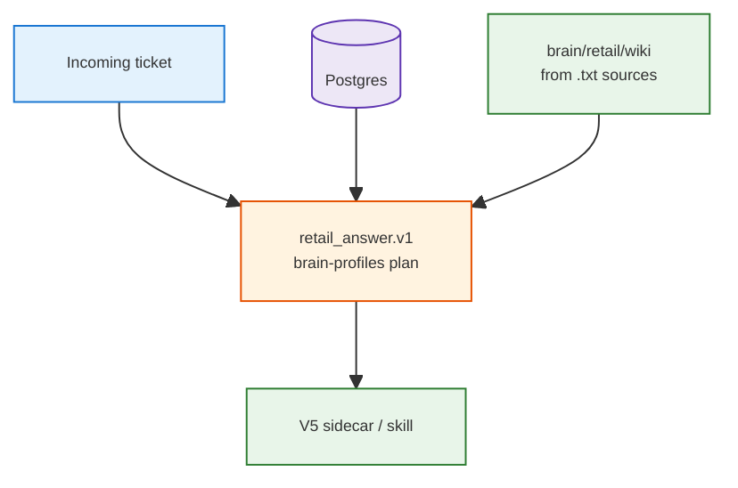

<h1 id="fru-product-title" style="color:#0d47a1;font-size:1.5em;font-weight:700;border-bottom:2px solid #90caf9;padding-bottom:0.25em;margin-top:0">Refactor: FRU US retail service Second Brain (product path)</h1>

**Status:** **wip** — V3 prep docs **`[X]`**; V2 / platform / V4 / V5 **`[ ]`**  
**Execute order:** (1) [`REFACTOR_BRAIN_PROFILES_AND_RETAIL_ANSWER.md`](./REFACTOR_BRAIN_PROFILES_AND_RETAIL_ANSWER.md) **P11–P16** via `qimpltdd` on that plan (platform + answer bundle); (2) operator gates on **that plan** [§7](./REFACTOR_BRAIN_PROFILES_AND_RETAIL_ANSWER.md#bp-7-gates) (**HG-P2**, **HG-TXT-1/2** — not duplicated here); (3) `qimpltdd` **this** plan for V2 → V4 → V5.

**Goal:** **New aftersales ticket** → historical **resolved ticket** (Postgres + hybrid search) **and** manual evidence **always together** ([brain-profiles **E2**](./REFACTOR_BRAIN_PROFILES_AND_RETAIL_ANSWER.md#bp-2-decisions)) as **`retail_answer.v1`**. Manual citations, corpus layout, wiki ingest, and E2E gold are **defined only** in the brain-profiles plan (**P11–P16**, doc-level `.txt` + optional archive PDFs) — this plan does not restate them.

**Prerequisites (done elsewhere):**

| Prerequisite | Plan |
|--------------|------|
| Ticket search A/B/C on FRU 1k corpus | [`REFACTOR_FRU_US_SERVICE_BRAIN.md`](../completed/REFACTOR_FRU_US_SERVICE_BRAIN.md) (**completed**) |
| Phone-era search stack + sidecar V1 | [`REFACTOR_SAMSUNG_RETAIL_SERVICE_BRAIN.md`](../completed/REFACTOR_SAMSUNG_RETAIL_SERVICE_BRAIN.md) phases 0–7 |
| Sim-data scale patterns | [`REFACTOR_RETAIL_SIM_DATA_SCALE_1K.md`](../completed/REFACTOR_RETAIL_SIM_DATA_SCALE_1K.md) |

**Article:** [`ABOUT_SEARCH_RRF_FRU.md`](../../artifacts/ABOUT_SEARCH_RRF_FRU.md) (close **`TBD-P10`** in corpus pivot plan P10).

<h2 id="outline" style="color:#1565c0;font-size:1.22em;font-weight:650;border-left:4px solid #42a5f5;padding-left:10px;margin-top:1.1em">Document outline</h2>

1. [Scope](#1-scope) — in / out; two planes.
2. [Decisions](#2-decisions) — grill + inherited D1–D13 (FRU wording).
3. [Architecture](#3-architecture) — routing: tickets → wiki.
4. [Phases](#4-phases) — V2 → platform → V3 → V4 → V5 (full stack order).
5. [Quality bar](#5-quality) — tests and operator gates.
6. [Checklist](#6-checklist) — progress.
7. [Acceptance](#7-acceptance) — product demo bar.
8. [Deferred](#8-deferred) — sales join, fourth SKU.

---

<h2 id="1-scope" style="color:#1565c0;font-size:1.22em;font-weight:650;border-left:4px solid #42a5f5;padding-left:10px;margin-top:1.1em">1. Scope</h2>

**In scope**

- **Structured plane:** `service_queries` in Postgres; default corpus **`fru_us_1k`**; search modes **`vector_only` / `rrf_normal` / `rrf_term_boosted`**; Tantivy lexical leg; **`FRU-E###`** term boost; **`customer_id`** join key (column only — never in query text).
- **Unstructured plane:** see brain-profiles plan — **`.txt`** manuals in `raw/sources/fridge-docs/`, PDFs in **`archive/`**, LLM Wiki compile over **`.txt`** only (**HG-TXT-2** on that plan).
- **Product routing:** `query-retail-brain` skill → **`retail_answer.v1`** (both legs, **E2**); optional manager SQL in **V5**.
- **Operator docs:** split Cursor prep vs Hermes wiki runbooks (**V3**).
- **Agent loop:** HTTP sidecar with **`semantic_search`**, **`generate_sql`**, **`execute_sql`**, wiki tool calls (**V5**).

**Out of scope (this plan)**

- Merging ultra-fru **sales** DB into Postgres (separate analytics project; only **`customer_id`** continuity here).
- Replacing Gemini embeddings or RRF constants (frozen per FRU corpus pivot **F8**).

---

<h2 id="2-decisions" style="color:#1565c0;font-size:1.22em;font-weight:650;border-left:4px solid #42a5f5;padding-left:10px;margin-top:1.1em">2. Decisions</h2>

**last_aligned:** 2026-10-15 — **grillnow** (plan ledger + product scope).

| ID | Decision | Rationale |
|----|----------|-----------|
| **G1** | Corpus pivot plan stays **`wip/`** until P10–P12 closeout. | Article + specs still open. |
| **G2** | Phone scale plan → **`completed/`** as archive. | Default profile is **`fru_us_1k`**. |
| **G3** | Samsung master → **`completed/`**; V2–V5 continue here. | Avoid two “master” wips. |
| **G4** | **Full stack** order: **V2 → platform (optional) → V3 → V4 → V5**. | Matches phone plan dependency order. |
| **P1** | **Market US**; manuals + tickets use FRU SKUs and **`RETAIL_FAULT_CODE_PREFIX=FRU-E`**. | Aligns with committed corpus. |
| **P2** | ~~exclusive D2 routing~~ → [brain-profiles **E2**](./REFACTOR_BRAIN_PROFILES_AND_RETAIL_ANSWER.md#bp-2-decisions): always both legs, **`retail_answer.v1`**. Manual provenance: [that plan §3.3](./REFACTOR_BRAIN_PROFILES_AND_RETAIL_ANSWER.md#bp-3-3-manual). | DRY: no duplicate manual-leg spec here. |
| **P3** | **D12 model scope:** resolve **`model`** (fridge SKU) from open ticket via SQL before search; eval already uses **`model_filter`**. | Prevents cross-SKU reuse mistakes. |
| **P4** | **D9 / D11:** Cursor runs repo scripts + PG A/B; Hermes runs **`llm_wiki_*`** for product manual path. | Copy PDFs ≠ ingest. |
| **P5** | **D13:** migrate **`utils/retail_fru/`** → **`utils/pg_rag/`** during **V5** (domain-agnostic loop). | Samsung plan D13, FRU naming. |

Inherited detail: see [Samsung plan sections 16–20](../completed/REFACTOR_SAMSUNG_RETAIL_SERVICE_BRAIN.md#16-deferred-v5) (wording still says “Samsung”; implement for **FRU** paths and copy).

---

<h2 id="3-architecture" style="color:#1565c0;font-size:1.22em;font-weight:650;border-left:4px solid #42a5f5;padding-left:10px;margin-top:1.1em">3. Architecture</h2>

---

<h2 id="4-phases" style="color:#1565c0;font-size:1.22em;font-weight:650;border-left:4px solid #42a5f5;padding-left:10px;margin-top:1.1em">4. Phases</h2>

<h3 id="4-v2" style="color:#00695c;font-size:1.05em;font-weight:600;margin-top:0.85em">4.1 V2 — Wiki automation and derived exports (optional themes)</h3>

- [ ] Theme clustering on FRU ticket text → `brain/retail/raw/sources/db-exports/` → wiki playbooks (no OLTP mirror into Nashsu wiki for raw tickets).
- [ ] Sales summary MD exports (stub or FRU-shaped columns) when sales join is ready.
- [ ] Watermark + `flock` + cron; rescan wiki after export batch.
- [ ] `scripts/retail/export/service_themes.py` (or equivalent) with FRU issue keys from YAML.

**Exit:** one playbook MD compiled into wiki; `./scripts/verify.sh` green.

<h3 id="4-platform" style="color:#00695c;font-size:1.05em;font-weight:600;margin-top:0.85em">4.2 Platform — brain-profiles (required)</h3>

- [X] P1–P9 on [`REFACTOR_BRAIN_PROFILES_AND_RETAIL_ANSWER.md`](./REFACTOR_BRAIN_PROFILES_AND_RETAIL_ANSWER.md) (profiles + answer bundle + CI E2E).
- [ ] P11–P16 on **same plan** (txt-wiki corpus + doc-level manual leg + smoke) — **V5** consumes `build_answer_bundle` from that delivery.

**Exit:** tick **Platform** when brain-profiles plan P11–P16 + its operator gates are done; do not duplicate acceptance rows here.

<h3 id="4-v3" style="color:#00695c;font-size:1.05em;font-weight:600;margin-top:0.85em">4.3 V3 — Operator harness (Cursor vs Hermes)</h3>

- [X] Split prep into **`CURSOR_PREP_RUNBOOK.md`** + **`HERMES_WIKI_OPERATOR.md`** (FRU PDF paths, **`fru_us_1k`** env block).
- [ ] Hermes smoke: follow brain-profiles **[§7 HG-TXT-2](./REFACTOR_BRAIN_PROFILES_AND_RETAIL_ANSWER.md#bp-7-gates)** (`.txt` rescan, not PDF); record log here when done.
- [X] Runbooks cite embed-once protocol and FRU ABC path (`SECOND_BRAIN_RUNBOOK.md` §16).

**Exit:** operator checklist recorded; ticket A/B remains on **`03`/`05`** scripts, not Hermes.

<h3 id="4-v4" style="color:#00695c;font-size:1.05em;font-weight:600;margin-top:0.85em">4.4 V4 — Eval governance (author vs search coder)</h3>

- [X] New spec **`docs/specs/fru-us-service-synthetic-data.md`**; banner on phone spec.
- [ ] CI or review rule: no combined diff on **`ticket_retrieval.jsonl`** generators + **`hybrid_search`** without explicit override.
- [ ] Held-out eval seed documented for D6-style promotion.

**Exit:** governance checklist in spec; `./scripts/verify.sh` green.

<h3 id="4-v5" style="color:#00695c;font-size:1.05em;font-weight:600;margin-top:0.85em">4.5 V5 — FRU agent harness (SQL + ticket RAG + wiki ReAct)</h3>

- [ ] **`utils/pg_rag/`** extract from **`utils/retail_fru/`** (embeddings, lexical helpers, SQL guardrails, loop orchestration).
- [ ] FastAPI sidecar: **`semantic_search`**, **`generate_sql`**, **`execute_sql`** (read-only DB role).
- [ ] ReAct loop: customer path (ticket → wiki); manager path (SQL aggregates) per Samsung [section 7](../completed/REFACTOR_SAMSUNG_RETAIL_SERVICE_BRAIN.md#7-routing).
- [ ] **D12:** ticket id → SQL → **`model`** → **`model_filter`** on search; wiki queries scoped by SKU folder.
- [ ] Sidecar returns the brain-profiles **`retail_answer.v1`** bundle (`build_answer_bundle`); reuse its `answer_e2e.jsonl` instead of the old `query → ticket_hit | wiki_paths[]` shape; expand **`sql_routed`** stratum tests.
- [ ] Update **`query-retail-brain`** skill + MCP catalog for sidecar URL.

**Exit:** local sidecar demo on FRU corpus; skill routes customer flow end-to-end; verify green.

---

<h2 id="5-quality" style="color:#1565c0;font-size:1.22em;font-weight:650;border-left:4px solid #42a5f5;padding-left:10px;margin-top:1.1em">5. Quality bar</h2>

| Phase | Tests / gates |
|-------|----------------|
| V2 | Export script unit tests; wiki file layout test |
| V3 | Doc smoke; wiki operator path = brain-profiles **HG-TXT-2** |
| V4 | Spec lint / CI rule if added |
| V5 | Sidecar contract tests; mock-LLM loop test; SQL guardrail tests |

**Comments:** **cdcm** on new modules; file headers on sidecar and export scripts.

---

<h2 id="6-checklist" style="color:#1565c0;font-size:1.22em;font-weight:650;border-left:4px solid #42a5f5;padding-left:10px;margin-top:1.1em">6. Execution checklist</h2>

- [ ] **V2** — themes / exports / cron
- [ ] **Platform** — brain-profiles [plan](./REFACTOR_BRAIN_PROFILES_AND_RETAIL_ANSWER.md): P1–P16 code `[X]`; **HG-TXT-1/2** + live E2E `[ ]`
- [X] **V3** — Cursor + Hermes runbooks (wiki smoke → brain-profiles **HG-TXT-2**)
- [ ] **V4** — eval governance CI / held-out seed
- [ ] **V5** — sidecar + skill + E2E eval JSONL

---

<h2 id="7-acceptance" style="color:#1565c0;font-size:1.22em;font-weight:650;border-left:4px solid #42a5f5;padding-left:10px;margin-top:1.1em">7. Acceptance</h2>

1. **Incoming ticket demo:** paraphrase intake on a known FRU eval row retrieves gold ticket at rank 1 in mode **B** or **C** via sidecar (not CSV harness only).
2. **Manual evidence:** per brain-profiles plan acceptance (**doc_path**, wiki + **`raw_txt`** fallback) — [§4 P16](./REFACTOR_BRAIN_PROFILES_AND_RETAIL_ANSWER.md#bp-p16).
3. **Hermes path:** **HG-TXT-2** on brain-profiles plan (`.txt` ingest smoke).
4. **`./scripts/verify.sh`** green after **V5** merge.
5. Corpus pivot plan P10–P12 complete (article numbers, runbooks, specs).

---

<h2 id="8-deferred" style="color:#1565c0;font-size:1.22em;font-weight:650;border-left:4px solid #42a5f5;padding-left:10px;margin-top:1.1em">8. Deferred</h2>

| Item | Notes |
|------|-------|
| Frigidaire SKU + PDFs | Fourth manual folder; extend YAML + customer pool |
| Unified sales + service agent | Join on **`customer_id`** after analytics merge |
| OpenClaw live channels | Same MCP pattern as Hermes when available |
