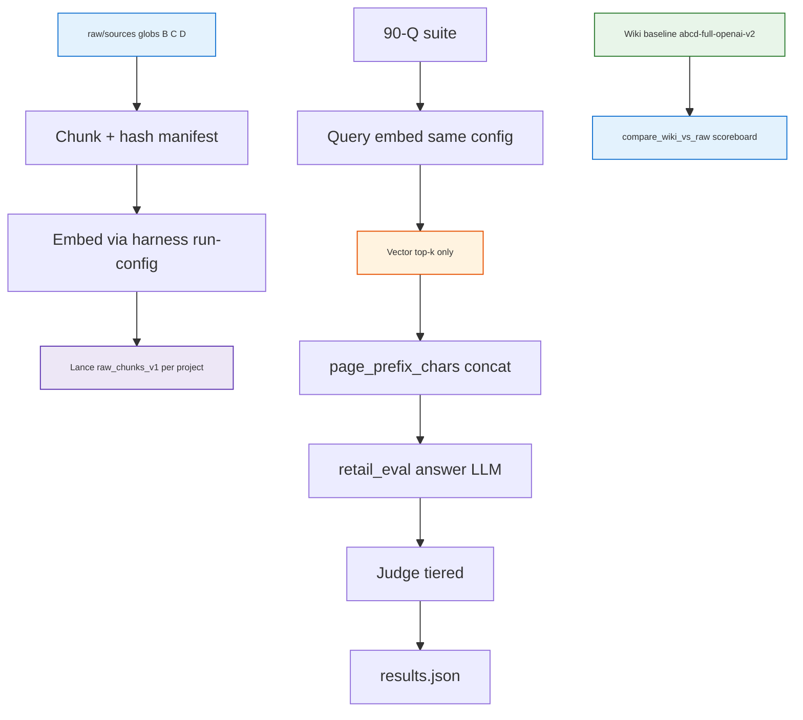

<h1 id="raw-rag-title" style="color:#0d47a1;font-size:1.5em;font-weight:700;border-bottom:2px solid #90caf9;padding-bottom:0.25em;margin-top:0">Refactor plan — raw-sources RAG vs LLM Wiki (lanes B/C/D)</h1>

**Status:** **wip** — P0–P8 operator run **`abcd-raw-full-openai-v1`** complete (2026-10-21); optional scoreboard badge + live smoke sign-off remain.  
**Chain:** **`qimpltdd`** / **`implref`** on this file after approval.  
**Branch context:** `feature/evo-13-multi-retail-test-rag`.  
**Goal:** Run the **same 90-question retail manual QA suite** on **pure dense RAG** over each lane’s **`raw/sources/**`** tree (not `wiki/**`), reuse the existing **`tests/retail_multi_profiles/`** harness for answer + judge, and publish a **Wiki vs raw-RAG** comparison per lane alongside the completed LLM Wiki baseline (`abcd-full-openai-v2`).  
**Parent experiment:** [`REFACTOR_RETAIL_MANUAL_INGEST_ABCD_BENCHMARK.md`](./REFACTOR_RETAIL_MANUAL_INGEST_ABCD_BENCHMARK.md) (LLM Wiki path).  
**Out of scope:** changing `nu_llm_wiki` hybrid RRF weights in production; Hermes agent eval; ticket Postgres leg; public article.

<h2 id="raw-rag-outline" style="color:#1565c0;font-size:1.22em;font-weight:650;border-left:4px solid #42a5f5;padding-left:10px;margin-top:1.1em">Document outline</h2>

1. [Problem](#raw-rag-problem) — why raw RAG vs wiki.
2. [Baseline and fairness](#raw-rag-baseline) — what we compare to.
3. [Raw corpus per lane](#raw-rag-corpus) — globs and Lane D nuance.
4. [Embedding and LanceDB strategy](#raw-rag-embed) — reuse vs replicate.
5. [Evidence](#raw-rag-evidence) — repo touchpoints.
6. [Decisions](#raw-rag-decisions) — grill + locked defaults.
7. [Centralization](#raw-rag-centralize) — code, tests, docs (single tree).
8. [Operator logging](#raw-rag-neatlog) — neatlog merge gate.
9. [Metrics and comparison report](#raw-rag-metrics) — Wiki vs RAG scoreboard.
10. [Phases](#raw-rag-phases) — P0–P8.
11. [Quality bar](#raw-rag-quality) — tests, comments, logging self-check.
12. [TDD bar](#raw-rag-tdd) — red/green per phase.
13. [Execution checklist](#raw-rag-checklist) — all open.
14. [Deferred](#raw-rag-deferred) — Lane A, hybrid raw RAG, RRF tuning.
15. [Related plans and artifacts](#raw-rag-related) — links.

---

<h2 id="raw-rag-problem" style="color:#1565c0;font-size:1.22em;font-weight:650;border-left:4px solid #42a5f5;padding-left:10px;margin-top:1.1em">1. Problem</h2>

The four-lane benchmark already measures **retrieve-then-answer** through **LLM Wiki** (`wiki/**` search: keyword + LanceDB vectors + optional graph leg). **Lane D** (`retail-md-learned`) is the current winner on that path; its **`wiki/sources/`** ingest used **full-copy** shards (not summarized entity cards)—still **not** identical to the **`raw/sources/`** tree (e.g. split-less topic files vs compiled source pages).

You want a **grounded second arm**: for each lane, index **`raw/sources/**`** only, retrieve with **dense vector top-k** (no wiki graph, no concept cards), then feed chunks into the **same** closed-world answer LLM + tiered judge as the wiki runs. That isolates **“wiki compile + hybrid search”** vs **“raw corpus + pure RAG”** on identical questions.

**Lane A (`brain/retail`, PDF in raw):** PDF bytes are not embedded directly; text conversion is required. **B** (external MD) and **C** (TXT) already represent the two main out-of-app conversions, so **v1 raw-RAG scope is lanes B, C, D only** (grill 2026-10-21).

---

<h2 id="raw-rag-baseline" style="color:#1565c0;font-size:1.22em;font-weight:650;border-left:4px solid #42a5f5;padding-left:10px;margin-top:1.1em">2. Baseline and fairness</h2>

| Arm | Retrieval surface | Canonical run id (reference) |
|-----|-------------------|------------------------------|
| **LLM Wiki** | `POST …/search` on `wiki/**` (hybrid) | `ops/runs/retail-lane-abcd/abcd-full-openai-v2/` |
| **Raw RAG** | LanceDB (or equivalent) on **`raw/sources/**`** chunks, **vector-only** top-k | `ops/runs/retail-lane-abcd-raw/<run_id>/` (new) |

**Held constant across arms (inherit from parent plan D7, D11, D3):**

- Same **`retail-manual-qa-test-suite.json`** (90 Q).
- Same **`second_brain.retail_evidence`**: `search_top_k`, `query_template`, `page_prefix_chars` (8000), SKU-scoped query.
- Same **`retail_eval`** answer + judge models/prompts in `tests/retail_multi_profiles/data/run-config.yaml`.
- Same negative literal: `Insufficient_Information_Based_On_Given_PDF`.

**Explicit non-goals for v1 raw arm:**

- No wiki read API for evidence (only raw chunk text).
- No graph leg, no `wiki/sources/` filter, no structural lint fixes.

---

<h2 id="raw-rag-corpus" style="color:#1565c0;font-size:1.22em;font-weight:650;border-left:4px solid #42a5f5;padding-left:10px;margin-top:1.1em">3. Raw corpus per lane</h2>

Extend **`config/retail-ingest-lanes.yaml`** (or sibling **`config/retail-raw-rag-lanes.yaml`**) with **`raw_glob`** per lane. Paths relative to each **`brain/<lane>/`** project root.

<table>
<thead>
<tr style="background:#1565c0;color:white"><th>Lane</th><th>Project</th><th>Raw RAG v1</th><th>Typical glob</th></tr>
</thead>
<tbody>
<tr><td style="background:#e3f2fd"><strong>A</strong></td><td><code>brain/retail</code></td><td style="background:#ffebee"><strong>Excluded</strong> (PDF; B/C cover text)</td><td>—</td></tr>
<tr><td style="background:#e3f2fd"><strong>B</strong></td><td><code>brain/retail-md</code></td><td style="background:#e8f5e9">Included</td><td><code>raw/sources/fridge-docs_md/**/*.md</code></td></tr>
<tr><td style="background:#e3f2fd"><strong>C</strong></td><td><code>brain/retail-txt</code></td><td style="background:#e8f5e9">Included</td><td><code>raw/sources/fridge-docs/**/*.txt</code></td></tr>
<tr><td style="background:#e3f2fd"><strong>D</strong></td><td><code>brain/retail-md-learned</code></td><td style="background:#e8f5e9">Included</td><td><code>raw/sources/fridge-docs-split-less/**/*.md</code></td></tr>
</tbody>
</table>

**Lane D comparison caveat (document in scoreboard footnote):** Wiki arm used **full-copy** `wiki/sources/`; raw arm uses **split-less** technician digest files under `raw/sources/`. Pass-rate deltas mix **retrieval mode** and **corpus shape**—call out in `compare_wiki_vs_raw.md`.

**Chunking (v1):** Fixed-size or heading-aware splits in Python (e.g. ~512–1024 tokens with overlap), **one row per chunk** in Lance. Document `chunk_policy_version` in index manifest. **Embedding model** is harness-owned (see §4.2)—chunk boundaries **will** differ from `wiki_chunks_v2` page splits; note both **chunking delta** and **embed-model delta** vs wiki in compare footnotes.

---

<h2 id="raw-rag-embed" style="color:#1565c0;font-size:1.22em;font-weight:650;border-left:4px solid #42a5f5;padding-left:10px;margin-top:1.1em">4. Embedding and LanceDB strategy</h2>

<h3 id="raw-rag-embed-wiki" style="color:#00695c;font-size:1.05em;font-weight:600;margin-top:0.85em">4.1 What LLM Wiki uses today</h3>

| Piece | Location |
|-------|----------|
| Wiki vector table | `{project}/.llm-wiki/lancedb`, table **`wiki_chunks_v2`** |
| Query embed | `commands/search.rs` → `resolve_query_embedding` + hybrid search |
| Batch embed (Rust) | `embedding_fetch_batch` in `search.rs` (Tauri command; **not** exposed on HTTP API in v1 scan) |
| Page embed (HTTP) | `POST /api/v1/projects/{id}/pages/embed` — **wiki pages only** |

**Do not write** raw chunks into **`wiki_chunks_v2`** (risk corrupting wiki search and mixed metadata).

<h3 id="raw-rag-embed-tier-c" style="color:#00695c;font-size:1.05em;font-weight:600;margin-top:0.85em">4.2 Preferred: Tier C — harness embedding (grill revert 2026-10-21)</h3>

**Intent:** **No `nu_llm_wiki` code changes** and **no LLM Wiki HTTP** for index build. Raw RAG uses a **single embedding config** owned by the benchmark harness; Lance storage stays per lane under **`{project}/.retail-raw-rag/lancedb`**.

| Step | Implementation |
|------|----------------|
| Embed config | **`tests/retail_multi_profiles/data/run-config.yaml`** → **`retail_raw_rag.embedding`**: `provider`, `model`, `dimensions` (if required), batch size, timeout. Same config for **all** lanes B/C/D in v1 (fair cross-lane raw comparison). |
| Embed texts | `lib/raw_embed.py`: OpenAI-compatible **`/v1/embeddings`** (or existing `lib/llm_*` helpers) from env keys — **independent** of wiki desktop settings. |
| Store vectors | Table **`raw_chunks_v1`**: `chunk_id`, `source_relpath`, `model_id`, `text`, `embedding`, `content_hash`, `chunk_index`, **`embed_model_id`**, **`chunk_policy_version`**. |
| Query | Same harness embed client for query strings; **L2 / cosine** ANN top-k only (**D-R2**). |

**Comparison impact vs wiki arm (read carefully):**

| Still apples-to-apples | Not directly comparable |
|------------------------|-------------------------|
| Same **90 questions**, answer LLM, judge, `page_prefix_chars`, top-k | **Vector geometry** vs wiki Lance (`wiki_chunks_v2`) if wiki uses a different embed model |
| **Pass rate** Wiki vs raw-RAG per lane (primary decision metric) | Raw **distance scores** vs wiki **`vectorScore`** display |
| **Recall proxy** (gold stem in top-k paths) | Claiming raw retrieval “matches wiki vectors” |

Store **`retail_raw_rag.embedding`** snapshot + optional **note** of wiki embed model (manual or read-only from `.llm-wiki` metadata if present) in **`results.json`** for audit—not a merge gate.

**Caveats (operator-facing):**

| Caveat | Mitigation |
|--------|------------|
| Embed model may ≠ wiki per-lane desktop config | Document in **`compare_wiki_vs_raw.md`**; optional later **Tier B** alignment (§12) |
| Chunk boundaries ≠ wiki chunks | Record `chunk_policy_version` |
| Index stale after raw file edits | **Automatic** preflight reindex (**D-R10**); optional `--force-reindex` |
| Separate DB path | Never write into `wiki_chunks_v2` |
| Lane D corpus ≠ wiki sources | Footnote on compare report (§3) |

**Deferred (Tier B):** mirror wiki **`embeddingConfig`** per project via copied endpoint config or future wiki batch API—only if you need tighter vector-space alignment with **`wiki_chunks_v2`**.

<h3 id="raw-rag-embed-future" style="color:#00695c;font-size:1.05em;font-weight:600;margin-top:0.85em">4.3 Future: hybrid on raw (RRF tuning)</h3>

Not v1. After vector-only baseline, optional phase can add **lexical rank + vector rank + RRF** on raw file text (mirror wiki k=60 shape) to study **weight tuning** without wiki graph—relevant if Lane D-style corpora benefit from hybrid on **shorter shards**. Deferred to §12.



---

<h2 id="raw-rag-evidence" style="color:#1565c0;font-size:1.22em;font-weight:650;border-left:4px solid #42a5f5;padding-left:10px;margin-top:1.1em">5. Evidence</h2>

| Fact | Where |
|------|--------|
| Wiki benchmark harness | `tests/retail_multi_profiles/` — `lib/runner.py`, `lib/answer_pipeline.py`, `lib/lanes.py` |
| Wiki baseline results | `ops/runs/retail-lane-abcd/abcd-full-openai-v2/results.json` |
| Lane registry | `config/retail-ingest-lanes.yaml` |
| Evidence merge | `lib/run_config.py`, `scripts/retail/retail_brain/wiki_page_context.py` |
| Lance path (wiki) | `nu_llm_wiki/.../vectorstore.rs` → `.llm-wiki/lancedb`, `wiki_chunks_v2` |
| Analysis artifacts | `docs_manual_gen/artifacts/ABOUT_FOUR_LANE_TEST_ANALYSIS.md`, `ABOUT_LANE_B_D_DETAILED_ANALYSIS.md` |
| Sources-only wiki replay | `lib/sources_only_replay.py`, `ops/runs/retail-lane-abcd/abcd-sources-only-topk10/` |

---

<h2 id="raw-rag-decisions" style="color:#1565c0;font-size:1.22em;font-weight:650;border-left:4px solid #42a5f5;padding-left:10px;margin-top:1.1em">6. Decisions</h2>

| ID | Decision |
|----|----------|
| **D-R1** | **Raw-RAG lanes v1:** **B, C, D only.** Skip **A** — PDF requires text extraction; B and C already cover MD/TXT conversion arms (grill 2026-10-21). |
| **D-R2** | **Retrieval mode v1:** **Dense vector top-k only** on raw chunks — no wiki graph, no keyword leg (grill 2026-10-21). |
| **D-R3** | **Embedding (grill revert 2026-10-21):** **Tier C** — harness **`retail_raw_rag.embedding`** in run-config; **no `nu_llm_wiki` changes**; vectors in **`{project}/.retail-raw-rag/lancedb`** (`raw_chunks_v1`). Wiki comparison focuses on **Q&A pass rate**, not matched embed model. |
| **D-R4** | **Harness home:** extend **`tests/retail_multi_profiles/`** — add `retrieval_mode`: `llm_wiki` \| `raw_rag`; shared scoring, reporting, checkpoint/resume. |
| **D-R5** | **CLI:** `python -m tests.retail_multi_profiles --full --retrieval-mode raw_rag --lanes B,C,D` and `… --index-raw-only` for operator index build. Wiki runs keep default `llm_wiki`. |
| **D-R6** | **Run artifacts:** `ops/runs/retail-lane-abcd-raw/<run_id>/` with same `results.json` schema + extra fields: `retrieval_mode`, `chunk_policy_version`, `index_manifest_path`, `hit_source_relpaths[]`. |
| **D-R7** | **Comparison:** script `lib/compare_wiki_raw.py` joins wiki baseline run id (default `abcd-full-openai-v2`) to raw run → `compare_wiki_vs_raw.md` + `.html` (lane × pass rate × stratum × delta). |
| **D-R8** | **Lane D narrative:** document **full-copy wiki sources** vs **split-less raw** when interpreting D deltas (user reminder 2026-10-21). |
| **D-R9** | **Superseded:** no **`nu_llm_wiki`** embed API work in this plan (**D-R3** Tier C). |
| **D-R10** | **Index freshness (grill 2026-10-21):** **Automatic by default.** Before raw search or `--full --retrieval-mode raw_rag`, preflight compares corpus manifest (path + sha256/mtime) and index metadata (`embed_model_id`, `chunk_policy_version`); **incremental rebuild** when drift detected. Escapes: **`--force-reindex`**, **`--skip-index-check`** (expert only; logs warning). Standalone **`--index-raw`** runs the same ensure-index path without Q&A. |
| **D-R11** | **Centralization (user 2026-10-21):** All **new** raw-RAG **Python**, **pytest**, and **operator docs** live under **`tests/retail_multi_profiles/`** — extend existing layout; **no** new top-level packages, **no** duplicate runners under `scripts/retail/` except thin re-exports if already used for wiki (prefer **none**). |
| **D-R12** | **Operator logging merge gate:** Raw-RAG phases **P3–P5** are **not done** until **[neatlog](.cursor/rules/neatlog-operator-logging-bar.mdc)** + **`logging_utils/run_progress`** match parent ABCD P5 bar (file path, JSONL steps, heartbeats, **`--resume`**, **`NEAT_LOGGER_DEBUG`**). Same phase as runner — not deferred polish. |

**Grill record (2026-10-21):** User confirmed PDF→text for A → exclude A; retrieval **vector-only**; noted future **RRF on raw** → **§14**. **Grill revert (2026-10-21):** embed **Tier C** (harness-only) to avoid LLM Wiki project changes; reindex **automatic** preflight (**D-R10**). **Grill record (2026-10-21):** centralize code/tests/docs in harness (**D-R11**); enforce neatlog on impl (**D-R12**).

---

<h2 id="raw-rag-centralize" style="color:#1565c0;font-size:1.22em;font-weight:650;border-left:4px solid #42a5f5;padding-left:10px;margin-top:1.1em">7. Centralization</h2>

**Single home:** **`tests/retail_multi_profiles/`** (same as wiki benchmark — **D-R4**, **D-R11**). Raw RAG is a **`retrieval_mode`** branch, not a second harness.

<h3 id="raw-rag-centralize-code" style="color:#00695c;font-size:1.05em;font-weight:600;margin-top:0.85em">7.1 Code layout (required)</h3>

```
tests/retail_multi_profiles/
  docs/RAW_RAG.md              ← operator runbook (index, full run, DEBUG, resume)
  lib/raw_corpus.py
  lib/raw_chunking.py
  lib/raw_embed.py
  lib/raw_rag_index.py         ← ensure_index_fresh, Lance ANN
  lib/raw_rag_search.py
  lib/compare_wiki_raw.py
  lib/runner.py                ← extend (wiki + raw_rag)
  lib/answer_pipeline.py       ← extend
  lib/run_config.py            ← retail_raw_rag.embedding merge
  data/run-config.yaml         ← retail_raw_rag block
  fixtures/raw_chunks/         ← tiny .md/.txt for chunk tests
  fixtures/raw_lance/          ← optional tiny index for CI search (generated once, committed if small)
  test_raw_chunking.py
  test_raw_embed.py
  test_raw_rag_index.py
  test_raw_rag_pipeline.py
  test_compare_wiki_raw.py
  README.md                    ← link RAW_RAG.md + raw output dir
  ARCHITECTURE.md              ← add raw_rag mermaid arm
```

| Allowed outside harness | Rule |
|-------------------------|------|
| `config/retail-ingest-lanes.yaml` | **`raw_glob`** keys only — no logic |
| `ops/runs/retail-lane-abcd-raw/` | Run artifacts only |
| `logs/ops/retail-lane-abcd-raw-*.log` | neatlog mirror |
| `docs_manual_gen/artifacts/*.md` | **Post-run analysis** only (P8); not operator how-to |
| `docs_manual_gen/SECOND_BRAIN_RUNBOOK.md` | **One link** to `tests/retail_multi_profiles/docs/RAW_RAG.md` — no duplicated command blocks |

**Forbidden without plan amendment:** `scripts/retail/raw_rag_*`, `eval/retail_raw_*`, second `python -m` package, wiki-side code.

<h3 id="raw-rag-centralize-tests" style="color:#00695c;font-size:1.05em;font-weight:600;margin-top:0.85em">7.2 Tests</h3>

- All new tests **`test_raw_*.py`** or **`test_compare_wiki_raw.py`** beside existing **`test_*.py`** — default **`./scripts/verify.sh`** runs them (mocked embed / fixture Lance).
- Live marker **`@pytest.mark.live`** for index+embed against real API — same pattern as wiki live tier.
- **P7 exit:** verify.sh green with **no** live keys.

<h3 id="raw-rag-centralize-docs" style="color:#00695c;font-size:1.05em;font-weight:600;margin-top:0.85em">7.3 Documentation</h3>

| Doc | Owner path | Content |
|-----|------------|---------|
| Operator | **`tests/retail_multi_profiles/docs/RAW_RAG.md`** | CLI, env vars, index auto-refresh, log paths, compare report |
| Architecture | **`ARCHITECTURE.md`** | Second diagram: raw corpus → Lance → search → shared answer/judge |
| Plan pointer | **`README.md`** | Link raw plan + `retrieval_mode` |
| Analysis | **`docs_manual_gen/artifacts/`** | Results interpretation after P8 only |

---

<h2 id="raw-rag-neatlog" style="color:#1565c0;font-size:1.22em;font-weight:650;border-left:4px solid #42a5f5;padding-left:10px;margin-top:1.1em">8. Operator logging (merge gate)</h2>

Parent wiki harness already implements **P5** logging; raw RAG **must not regress** and **must extend** the same patterns (**D-R12**).

<h3 id="raw-rag-neatlog-files" style="color:#00695c;font-size:1.05em;font-weight:600;margin-top:0.85em">8.1 Log and checkpoint paths</h3>

| Run kind | neatlog file | JSONL checkpoint |
|----------|--------------|------------------|
| Q&A full/smoke raw | `logs/ops/retail-lane-abcd-raw-<run_id>.log` | `ops/runs/retail-lane-abcd-raw/<run_id>/results.jsonl` |
| Index-only (`--index-raw`) | `logs/ops/retail-lane-abcd-raw-index-<run_id>.log` | `ops/runs/retail-lane-abcd-raw/<run_id>/index_progress.jsonl` (new) |

**Component names:** `NeatLoggerFactory.create("OPS", "RETAIL_RAW_RAG", …)` for eval; **`RETAIL_RAW_INDEX`** for index-only.

<h3 id="raw-rag-neatlog-steps" style="color:#00695c;font-size:1.05em;font-weight:600;margin-top:0.85em">8.2 Progress step vocabulary (JSONL)</h3>

Reuse wiki steps where identical: `row_start`, `answer_start`, `answer_done`, `judge_start`, `row_done`, `row_error`, `result`.

**Raw-only steps (required):**

| Step | When |
|------|------|
| `index_preflight_start` / `index_preflight_done` | `ensure_index_fresh` (auto reindex decision) |
| `index_build_start` / `index_build_done` | Full or incremental Lance write |
| `embed_batch_start` / `embed_batch_done` | Each embedding API batch (heartbeat inside) |
| `raw_search_start` / `raw_search_done` | Vector top-k (DEBUG: top paths, distances truncated) |

Flush JSONL **before and after** embed batches and answer/judge LLM calls (270-row raw run = 90×3 lanes).

<h3 id="raw-rag-neatlog-heartbeat" style="color:#00695c;font-size:1.05em;font-weight:600;margin-top:0.85em">8.3 Heartbeats and DEBUG</h3>

- **Heartbeat** on: embed batch, Lance rebuild, answer LLM, judge LLM (same ~20s rule as parent).
- **`NEAT_LOGGER_DEBUG=1`:** log `embed_model_id`, chunk counts, manifest drift summary, top-k `source_relpath` + distance (first 3 hits).
- Document env in **`docs/RAW_RAG.md`**.

<h3 id="raw-rag-neatlog-exit" style="color:#00695c;font-size:1.05em;font-weight:600;margin-top:0.85em">8.4 Phase exit — logging is mandatory</h3>

| Phase | Logging deliverable |
|-------|---------------------|
| **P3** | Index CLI emits neatlog + `index_progress.jsonl`; heartbeat on embed batch |
| **P5** | Raw Q&A runner shares `run_progress` + `--resume`; crash leaves last `(lane, question_id, step)` identifiable |
| **P8** | Operator spot-check documented in RAW_RAG.md: `tail -f logs/ops/retail-lane-abcd-raw-*.log` |

**Prior plan gap:** §9 previously had **one bullet** on neatlog — **insufficient** for **implref** merge gate. **§8 + D-R12** supersede that bullet for enforcement.

---

<h2 id="raw-rag-metrics" style="color:#1565c0;font-size:1.22em;font-weight:650;border-left:4px solid #42a5f5;padding-left:10px;margin-top:1.1em">9. Metrics and comparison report</h2>

Primary **Wiki vs raw** table (lanes B, C, D):

| Column | Definition |
|--------|------------|
| **Wiki pass %** | From baseline `results.json` (all 90 or by stratum) |
| **Raw RAG pass %** | Same judge rules on raw arm |
| **Delta (raw − wiki)** | Positive ⇒ raw arm better on that slice |
| **Easy / hard / negative** | Same strata as parent plan |
| **Mixed B vs D** | Reuse ticket list from `b-vs-d-mixed-outcomes.md` where applicable |
| **Recall proxy** | Gold PDF stem in top-k **source_relpath** (raw) vs wiki path (wiki) |
| **Embed audit row** | `retail_raw_rag.embedding` vs wiki model note (informational) |

Deliverables:

- `ops/runs/retail-lane-abcd-raw/<run_id>/results.json` (+ `.jsonl`, scoreboard MD/HTML).
- `ops/runs/retail-lane-abcd-raw/<run_id>/compare_wiki_vs_raw.md` (and HTML).
- Update `docs_manual_gen/artifacts/ABOUT_FOUR_LANE_TEST_ANALYSIS.md` with a **Raw RAG** section after first full run.

---

<h2 id="raw-rag-phases" style="color:#1565c0;font-size:1.22em;font-weight:650;border-left:4px solid #42a5f5;padding-left:10px;margin-top:1.1em">10. Phases</h2>

<h3 id="raw-rag-p0" style="color:#00695c;font-size:1.05em;font-weight:600;margin-top:0.85em">8.0 P0 — Design spike and config</h3>

- [X] Add **`raw_glob`** (and `raw_rag_enabled: true|false`) to lane config for B/C/D; A `raw_rag_enabled: false`.
- [X] Add **`tests/retail_multi_profiles/docs/RAW_RAG.md`** stub + update **`README.md`** / **`ARCHITECTURE.md`** (centralization **§7**).
- [X] Document corpus globs + Lane D caveat in **`docs/RAW_RAG.md`** (not scattered).
- [X] Spike: embed 3 strings via **`retail_raw_rag.embedding`** stub; write/read one Lance row under `.retail-raw-rag/` (pytest `test_raw_rag_index.py`).
- **Exit:** written `chunk_policy_version` v1 spec in README; Lance path confirmed writable.

<h3 id="raw-rag-p1" style="color:#00695c;font-size:1.05em;font-weight:600;margin-top:0.85em">8.1 P1 — Raw corpus enumeration and chunking</h3>

- [X] `lib/raw_corpus.py`: walk globs; stable `chunk_id`; optional `model_id` from path (`ge_GNE27JYMFS`, etc.).
- [X] `lib/raw_chunking.py`: chunk policy v1 + unit tests on fixture files in `fixtures/raw_chunks/`.
- [X] Index manifest JSON: file path, mtime, sha256, chunk count.

<h3 id="raw-rag-p2" style="color:#00695c;font-size:1.05em;font-weight:600;margin-top:0.85em">8.2 P2 — Embedding client (Tier C)</h3>

- [X] Add **`retail_raw_rag.embedding`** to `data/run-config.yaml` + merge in `lib/run_config.py`.
- [X] `lib/raw_embed.py`: batch embed with retries/timeouts; no imports from LLM Wiki.
- [X] Pytest: mock embed → deterministic vectors for CI.

<h3 id="raw-rag-p3" style="color:#00695c;font-size:1.05em;font-weight:600;margin-top:0.85em">8.3 P3 — Lance index build and vector search</h3>

- [X] `lib/raw_rag_index.py`: create/open `raw_chunks_v1`; upsert; ANN query top-k.
- [X] CLI: `python -m tests.retail_multi_profiles --index-raw --lanes B,C,D`.
- [X] `lib/raw_rag_index.py`: **`ensure_index_fresh(lane)`** — auto compare manifest vs index metadata; rebuild changed files or full regen when `embed_model_id` / `chunk_policy_version` changes (**D-R10**).
- [X] CLI flags: **`--force-reindex`**, **`--skip-index-check`** (override auto preflight).
- [X] **Logging exit (P3):** neatlog + `index_progress.jsonl` + heartbeats on embed batches (**§8**).

<h3 id="raw-rag-p4" style="color:#00695c;font-size:1.05em;font-weight:600;margin-top:0.85em">8.4 P4 — Answer pipeline branch</h3>

- [X] `lib/raw_rag_search.py`: query embed + top-k + concat to `page_prefix_chars` budget (reuse concat helper or parallel `concat_top_k_raw_chunks`).
- [X] `lib/runner.py`: branch on `retrieval_mode`; raw arm skips `LlmWikiHttpClient` search/read.
- [X] Persist hits on each row (like D14 search hits for wiki).

<h3 id="raw-rag-p5" style="color:#00695c;font-size:1.05em;font-weight:600;margin-top:0.85em">8.5 P5 — Full run, logging, resume</h3>

- [X] Extend `lib/runner.py` + `__main__.py`: `--retrieval-mode raw_rag`, `--full`, lanes default B,C,D for raw.
- [X] Reuse **`logging_utils/run_progress`** + **neatlog** from parent P5; **`--resume`** for raw rows (**§8**).
- [X] Raw-only JSONL steps: `index_preflight_*`, `raw_search_*`; flush before/after slow calls.
- [ ] Smoke: 2 questions × B,C,D raw (`smoke_question_ids`); verify last JSONL line pinpoints ticket on injected failure (pytest or manual checklist in RAW_RAG.md).

<h3 id="raw-rag-p6" style="color:#00695c;font-size:1.05em;font-weight:600;margin-top:0.85em">8.6 P6 — Wiki vs raw comparison report</h3>

- [X] `lib/compare_wiki_raw.py`: load wiki baseline + raw run; emit delta scoreboard.
- [ ] `lib/report_md.py` / `report_html.py`: optional `retrieval_mode` badge column.
- [X] **`SECOND_BRAIN_RUNBOOK.md`:** single link to **`tests/retail_multi_profiles/docs/RAW_RAG.md`** (no duplicated commands).

<h3 id="raw-rag-p7" style="color:#00695c;font-size:1.05em;font-weight:600;margin-top:0.85em">8.7 P7 — CI tier</h3>

- [X] Fixture Lance index (tiny corpus) + mocked embed; 3 questions deterministic pass/fail structure.
- [X] No live Lance/OpenAI in default `./scripts/verify.sh` (pytest mocks / importorskip).

<h3 id="raw-rag-p8" style="color:#00695c;font-size:1.05em;font-weight:600;margin-top:0.85em">8.8 P8 — Full operator run and artifact update</h3>

- [X] Live: **90 × 3 lanes** raw RAG (`abcd-raw-full-openai-v1`; 270 rows, ~12 min).
- [X] Publish `compare_wiki_vs_raw` against `abcd-full-openai-v2`.
- [X] Refresh `ABOUT_FOUR_LANE_TEST_ANALYSIS.md` with interpretation (incl. Lane D corpus caveat).

---

<h2 id="raw-rag-quality" style="color:#1565c0;font-size:1.22em;font-weight:650;border-left:4px solid #42a5f5;padding-left:10px;margin-top:1.1em">11. Quality bar</h2>

- **Centralization:** satisfy **§7** tree; implref self-check — no new scripts outside harness without plan edit.
- **Tests:** all under **`tests/retail_multi_profiles/test_raw_*.py`** (+ compare test); chunking (P1); mock embed (P2); fixture index (P3); pipeline branch (P4); compare (P6); default verify.sh green.
- **Comments ([cdcm](.cursor/rules/cdcm-code-comments.mdc)):** file headers + per-symbol doc lines on all new `lib/raw_*.py` and touched runner/CLI modules.
- **Operator logging ([neatlog](.cursor/rules/neatlog-operator-logging-bar.mdc), [opslog](.cursor/rules/opslog-ops-run-logs-directory.mdc)):** **§8 + D-R12** — merge gate, not optional.
- **Secrets:** embedding keys via same env paths as wiki live tests; never commit `.retail-raw-rag` Lance blobs to git (gitignore if needed).
- **Git snapshot:** store `git_commit` in `results.json` like wiki runs.

**Logging self-check (agent, before marking P3/P5 `[X]`):**

- [ ] CLI uses **NeatLoggerFactory** — no print-only progress.
- [ ] JSONL checkpoint for index + Q&A runs; **`--resume`** on Q&A.
- [ ] Heartbeats on embed batch + LLM steps.
- [ ] **`NEAT_LOGGER_DEBUG`** documented in **`docs/RAW_RAG.md`**.

---

<h2 id="raw-rag-tdd" style="color:#1565c0;font-size:1.22em;font-weight:650;border-left:4px solid #42a5f5;padding-left:10px;margin-top:1.1em">12. TDD bar</h2>

| Phase | Red first | Green exit |
|-------|-----------|------------|
| P1 | empty glob → 0 chunks | fixture md → N chunks stable ids |
| P2 | missing config → clear error | mock batch → len(vectors)==len(texts) |
| P3 | search empty index → [] | fixture index → top-k ordered by distance |
| P4 | raw mode still calls wiki | raw mode uses only raw search mock |
| P6 | missing wiki run id → error | fixture pair → delta table row |
| P5 | no JSONL on raw row | mock run → progress + result lines; resume skips completed keys |

---

<h2 id="raw-rag-checklist" style="color:#1565c0;font-size:1.22em;font-weight:650;border-left:4px solid #42a5f5;padding-left:10px;margin-top:1.1em">13. Execution checklist</h2>

- [X] P0 Design spike and config
- [X] P1 Raw corpus enumeration and chunking
- [X] P2 Embedding client (Tier C)
- [X] P3 Lance index build and vector search
- [X] P4 Answer pipeline branch
- [X] P5 Full run, logging, resume (live smoke sign-off open)
- [X] P6 Wiki vs raw comparison report (scoreboard badge deferred)
- [X] P7 CI tier
- [X] P8 Full operator run and artifact update

---

<h2 id="raw-rag-deferred" style="color:#1565c0;font-size:1.22em;font-weight:650;border-left:4px solid #42a5f5;padding-left:10px;margin-top:1.1em">14. Deferred</h2>

| Item | Why deferred |
|------|----------------|
| **Lane A raw RAG** | PDF extraction; B/C cover converted text arms |
| **Raw hybrid RRF + lexical** | User interest in dynamic RRF tuning; needs v1 vector baseline first |
| **Identical chunk boundaries to wiki_chunks_v2** | Requires porting page split from `page_embedding.rs` / search chunker |
| **Tier B — wiki-matched embedding config** | User chose Tier C to avoid `nu_llm_wiki` changes; revisit if vector-score parity matters |
| **Reuse wiki Lance file in read-only mode** | Wiki vectors index **wiki** text only—not `raw/sources` |
| **`nu_llm_wiki` graph on raw** | No wikilink graph on raw tree |
| **Lane A wiki vs raw** | Out of scope while A excluded from raw |

---

<h2 id="raw-rag-related" style="color:#1565c0;font-size:1.22em;font-weight:650;border-left:4px solid #42a5f5;padding-left:10px;margin-top:1.1em">15. Related plans and artifacts</h2>

| Link | Relationship |
|------|----------------|
| [`REFACTOR_RETAIL_MANUAL_INGEST_ABCD_BENCHMARK.md`](./REFACTOR_RETAIL_MANUAL_INGEST_ABCD_BENCHMARK.md) | Wiki arm; D14 hits; shared harness |
| [`REFACTOR_LEARNED_SECTION_COPY_PLUS_CARDS.md`](./wip/REFACTOR_LEARNED_SECTION_COPY_PLUS_CARDS.md) | Lane D full-copy wiki ingest context |
| [`../artifacts/ABOUT_FOUR_LANE_TEST_ANALYSIS.md`](../artifacts/ABOUT_FOUR_LANE_TEST_ANALYSIS.md) | Update after P8 |
| [`../artifacts/ABOUT_LANE_B_D_DETAILED_ANALYSIS.md`](../artifacts/ABOUT_LANE_B_D_DETAILED_ANALYSIS.md) | Retrieval mechanics reference |
| `nu_llm_wiki/src-tauri/src/commands/vectorstore.rs` | Wiki Lance layout reference |

**Execute:** `qimpltdd docs_manual_gen/ref_plan/new/REFACTOR_RETAIL_RAW_SOURCES_RAG_ABCD_COMPARE.md` or **`implref`** on this path.
