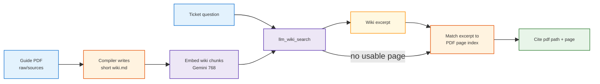
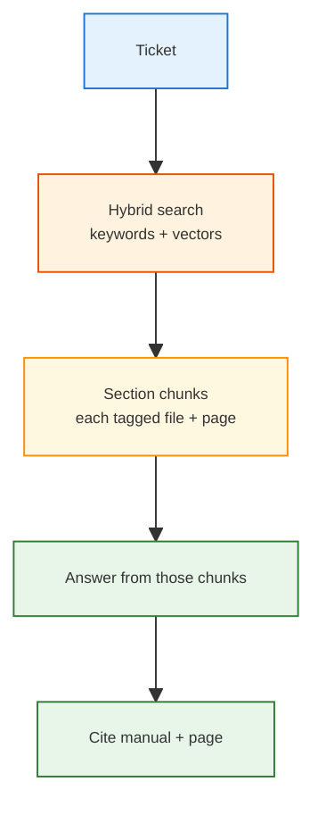
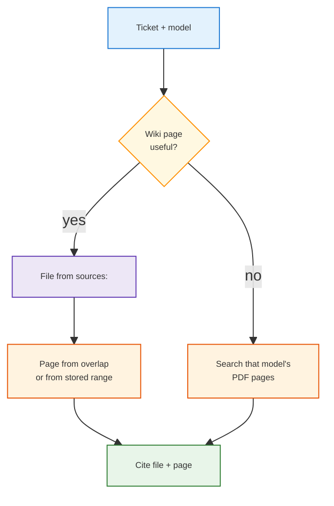
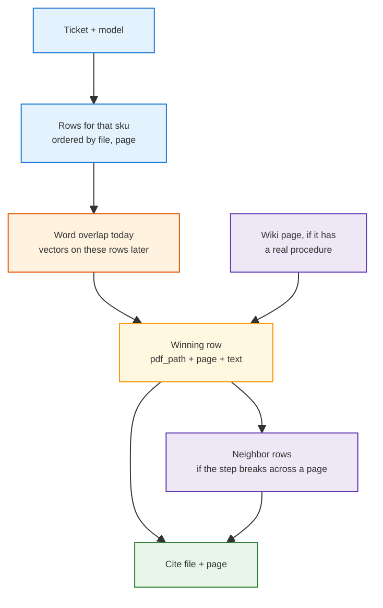

<h1 id="pdf-search-title" style="color:#0d47a1;font-size:1.5em;font-weight:700;border-bottom:2px solid #90caf9;padding-bottom:0.25em;margin-top:0">Best design: customer answers from guide PDFs</h1>

**Status:** analysis only (2026-10-15). Not a build phase. Index audit added the same day.  
**Industry window:** 2025-10-15 through 2026-10-15. Pages below were retrieved 2026-10-15.  
**Feeds:** [P10](../ref_plan/wip/REFACTOR_BRAIN_PROFILES_AND_RETAIL_ANSWER.md) on the retail-answer plan.  
**Checked in code:** `nu_llm_wiki` `src/lib/embedding.ts`, `src-tauri/src/commands/search.rs`, `src-tauri/src/agent/tools.rs`; Second Brain `answer_manuals.py`, `scripts/retail/manuals/build_pdf_page_index.py`.

<h2 id="pdf-search-outline" style="color:#1565c0;font-size:1.22em;font-weight:650;border-left:4px solid #42a5f5;padding-left:10px;margin-top:1.1em">Document outline</h2>

1. [Short verdict](#pdf-search-verdict) — three answers up front.
2. [What this app embeds](#pdf-search-embed) — wiki markdown only.
3. [Is that common?](#pdf-search-practice) — for an LLM wiki, yes; for a manual desk, no.
4. [Two ways to answer a ticket](#pdf-search-compare) — direct PDF search vs a wiki layer.
5. [The page index is the copy](#pdf-search-index) — ordered rows, measured against the PDFs.
6. [Optimized approach](#pdf-search-build) — search those rows; the wiki points at them.
7. [Sources](#pdf-search-sources) — links from 2025-10 through 2026-10.

---

<h2 id="pdf-search-verdict" style="color:#1565c0;font-size:1.22em;font-weight:650;border-left:4px solid #42a5f5;padding-left:10px;margin-top:1.1em">1. Short verdict</h2>

<table>
<thead>
<tr style="background:#1565c0;color:white"><th>Question</th><th>Answer</th></tr>
</thead>
<tbody>
<tr><td style="background:#e3f2fd">① Does Settings → Embeddings vectorize the PDFs?</td><td style="background:#e8f5e9">No. It chunks and embeds <code>wiki/*.md</code> only. The PDFs are not in that index.</td></tr>
<tr><td style="background:#e3f2fd">② Is “embed the wiki, not the PDF” normal?</td><td style="background:#fff3e0">Normal for the LLM-wiki pattern (compile notes, then search the notes). Not how appliance-support desks search long manuals in 2026.</td></tr>
<tr><td style="background:#e3f2fd">③ Which design fits our ticket leg?</td><td style="background:#e8f5e9">Search <code>pdf_page_index.jsonl</code>. Each row is already one page, with the file and the page number on it. The wiki points at those rows.</td></tr>
</tbody>
</table>

Retrieval-augmented generation (RAG: search stored text, then let the model answer from those hits) is the old manual-desk pattern and still the production one. An LLM wiki compiles sources into linked markdown first, then answers from those pages.

---

<h2 id="pdf-search-embed" style="color:#1565c0;font-size:1.22em;font-weight:650;border-left:4px solid #42a5f5;padding-left:10px;margin-top:1.1em">2. What this app embeds</h2>

`embedAllPages` lists `wiki/` and embeds each content `.md` (it skips `index`, `log`, `overview`, `purpose`, `schema`). Search embeds the question and looks up those chunks, then blends them with keyword hits and one wiki-link hop. The API note in `api_server.rs` describes that blend as keyword + vector + graph.

The raw PDF is a different path:

<table>
<thead>
<tr style="background:#1565c0;color:white"><th>Path</th><th>What it reads</th><th>Vectors?</th></tr>
</thead>
<tbody>
<tr><td style="background:#e3f2fd">Settings → Embeddings / <code>llm_wiki_search</code></td><td style="background:#e8f5e9"><code>wiki/*.md</code> chunks</td><td style="background:#e8f5e9">Yes, when the switch is on</td></tr>
<tr><td style="background:#e3f2fd">Agent tool <code>source.search</code></td><td style="background:#fff3e0">Keyword scan of <code>raw/sources</code>. A PDF counts only if an extracted-text cache already exists.</td><td style="background:#ffebee">No</td></tr>
<tr><td style="background:#e3f2fd">Our ticket manual leg</td><td style="background:#fff3e0">Wiki hit first. Page number = word overlap between the wiki excerpt and <code>pdf_page_index.jsonl</code>. Miss → search that page index directly.</td><td style="background:#ffebee">No on the PDF. Wiki hit may have used wiki vectors.</td></tr>
</tbody>
</table>

So the thin pages we saw (`concepts/user-guide.md` defining what a user guide is) are exactly what the vector index can retrieve. Turning embeddings on does not recover the 20 MB GE manual.

---

<h2 id="pdf-search-practice" style="color:#1565c0;font-size:1.22em;font-weight:650;border-left:4px solid #42a5f5;padding-left:10px;margin-top:1.1em">3. Is that common?</h2>

<h3 id="pdf-search-wiki-pattern" style="color:#00695c;font-size:1.05em;font-weight:600;margin-top:0.85em">3.1 LLM wiki pattern</h3>

Andrej Karpathy’s idea file ([gist, published 2026-04-04](https://gist.github.com/karpathy/442a6bf555914893e9891c11519de94f)) is the pattern Nashsu follows. Compile a markdown wiki and keep it updated. The raw files stay as they are. At a few hundred pages, reading `index.md` is enough. When the wiki grows, he points at search over the **markdown pages** (his example, [qmd](https://github.com/tobi/qmd), does keyword search plus vectors plus a rerank). That search is still of the wiki, not a second index of the original PDF. The Nashsu app matches this: optional vectors on wiki pages, and each page’s `sources:` field points at the raw file ([README](https://github.com/nashsu/llm_wiki), retrieved 2026-10-15).

That is the usual shape of an LLM wiki. It is a weak sole index for a 200-page repair manual. The gist does not claim to solve that job.

<h3 id="pdf-search-desk" style="color:#00695c;font-size:1.05em;font-weight:600;margin-top:0.85em">3.2 Manual desk, 2025–2026</h3>

Customer-support manuals are still searched as documents. Checked inside the last year:

- [Qdrant’s appliance-manual tutorial](https://qdrant.tech/documentation/examples/hybrid-search-llamaindex-jinaai/) (official docs, retrieved 2026-10-15; the page does not show a publish date) searches the PDF text with hybrid retrieval (dense vectors plus sparse keywords) and answers from those excerpts.
- [Tensorlake, Citation-Aware RAG](https://www.tensorlake.ai/blog/rag-citations) (vendor note, retrieved 2026-10-15) says the page number is stored on the chunk when the PDF is parsed. The model cites an id. The app turns that id into a page. The model is not asked to remember the page.

A wiki sits on top of that, it does not replace it. [dalby.md](https://dalby.md/briefs/docling-rag-and-the-llm-wiki) (after the April 2026 gist, retrieved 2026-10-15) keeps document search for a large or fast-changing corpus and uses the wiki as the compiled layer. [Dexio’s comparison](https://dexio.wiki/guides/llm-wiki-vs-rag/) (product guide, retrieved 2026-10-15) adds the miss path: if the wiki page does not cover the question, search the raw files and file a useful answer back into the wiki.

---

<h2 id="pdf-search-compare" style="color:#1565c0;font-size:1.22em;font-weight:650;border-left:4px solid #42a5f5;padding-left:10px;margin-top:1.1em">4. Two ways to answer a ticket</h2>

<h3 id="pdf-search-old" style="color:#00695c;font-size:1.05em;font-weight:600;margin-top:0.85em">4.1 Direct search on the PDFs</h3>

About a year ago the common build was: split each guide into chunks, embed the chunks, retrieve a few, generate an answer. Fixed-size windows (about 500 tokens) were widespread and still are. The better cut, already recommended then and standard now, is the **section or heading**, with the page number kept on the chunk. Citing only a chapter name is weak: appliance manuals reuse titles (“Controls”, “Ice maker”) across models, and a chapter can be 30 pages. The citation that holds up is **file + page**.

This finds a procedure even when nobody has written a wiki page. It re-discovers the same fact on every ticket. It does not accumulate “this model’s ice maker is in the door” across questions.

<h3 id="pdf-search-wiki" style="color:#00695c;font-size:1.05em;font-weight:600;margin-top:0.85em">4.2 Wiki layer, then the PDF</h3>

Intended shape: compile a wiki from the guides; search the wiki for the ticket; cite the manual and a page; if the wiki has nothing usable, search the PDFs, ideally already narrowed (which model, which guide).

That shape is sound. Two details in the current code do not match the hope:

<table>
<thead>
<tr style="background:#1565c0;color:white"><th>Hope</th><th>What the code does</th></tr>
</thead>
<tbody>
<tr><td style="background:#e3f2fd">The wiki page already stores the PDF <em>and the page</em> when it is written, so search stays cheap.</td><td style="background:#fff3e0">Frontmatter <code>sources:</code> stores the <strong>file path</strong> only. The page is chosen <strong>later</strong>, by comparing the excerpt to every page of that one file.</td></tr>
<tr><td style="background:#e3f2fd">A miss falls back to the same vector search people run on manuals.</td><td style="background:#fff3e0">The miss uses the <strong>word-overlap page index</strong>, scoped to the model folder. It is not Gemini vectors on PDF chunks.</td></tr>
</tbody>
</table>

Narrowing already happens: a wiki hit limits the page scan to one PDF, and a miss is limited to that model’s folder (`fridge-docs/<sku>/`). That part is efficient. What fails is the content of the wiki page. A 700-byte definition of “user guide” neither answers the ticket nor overlaps the right PDF page.

<table>
<thead>
<tr style="background:#1565c0;color:white"><th>Aspect</th><th>① Direct PDF search</th><th>② Wiki, then PDF</th></tr>
</thead>
<tbody>
<tr><td style="background:#e3f2fd">Unit you search</td><td>Section of the manual</td><td>Compiled wiki page, then a PDF page</td></tr>
<tr><td style="background:#e3f2fd">Citation</td><td>File + page, stored on the chunk</td><td>File stored on the page; page number is a second step</td></tr>
<tr><td style="background:#e3f2fd">Paraphrase (“ice is one frozen chunk”)</td><td style="background:#e8f5e9">Vectors on the manual text handle it</td><td style="background:#fff3e0">Only if the wiki page used those words, or the fallback is also vectors</td></tr>
<tr><td style="background:#e3f2fd">Error code, model name</td><td style="background:#e8f5e9">Keyword leg</td><td style="background:#e8f5e9">Keyword leg on wiki; page index if the code is on the page</td></tr>
<tr><td style="background:#e3f2fd">Gets smarter over time</td><td style="background:#ffebee">No. Same chunks every ticket.</td><td style="background:#e8f5e9">Yes, if ingest keeps real procedures</td></tr>
<tr><td style="background:#e3f2fd">Risk we already saw</td><td style="background:#fff3e0">Noisy PDF text, duplicate files</td><td style="background:#ffebee">A pretty wiki that does not contain the fix</td></tr>
</tbody>
</table>

---

<h2 id="pdf-search-index" style="color:#1565c0;font-size:1.22em;font-weight:650;border-left:4px solid #42a5f5;padding-left:10px;margin-top:1.1em">5. The page index is the copy</h2>

`brain/retail/manifests/pdf_page_index.jsonl` is already the decomposed manual. `scripts/retail/manuals/build_pdf_page_index.py` writes one row per page with `pypdf`, then sorts by file path and page number. A row holds `pdf_path`, `sku`, `guide`, `page`, `sha256`, `duplicate_of`, and `text`. Question time does not need to open the PDF again.

Checked 2026-10-15 against the four files under `fridge-docs/` (the three user guides plus the Samsung repair guide). A fresh run of the same extractor was compared with the stored rows.

<table>
<thead>
<tr style="background:#1565c0;color:white"><th>Manual</th><th>Pages in the PDF and in the index</th><th>Rows identical to a fresh extract</th></tr>
</thead>
<tbody>
<tr><td style="background:#e3f2fd">KitchenAid user guide</td><td>43/43</td><td style="background:#e8f5e9">43/43 (100%)</td></tr>
<tr><td style="background:#e3f2fd">Samsung user guide</td><td>220/220</td><td style="background:#e8f5e9">220/220 (100%)</td></tr>
<tr><td style="background:#e3f2fd">Samsung repair guide</td><td>12/12</td><td style="background:#e8f5e9">12/12 (100%)</td></tr>
<tr><td style="background:#e3f2fd">GE user guide</td><td>156/156</td><td style="background:#fff3e0">142/156 (91%)</td></tr>
<tr><td style="background:#e3f2fd">All four</td><td style="background:#e8f5e9">431/431 (100%)</td><td style="background:#e8f5e9">417/431 (96.8%)</td></tr>
</tbody>
</table>

Diagrams are absent, which is expected: `pypdf` reads the text layer only. KitchenAid and both Samsung guides read as the manuals. Eight Samsung user-guide rows are short on purpose (covers, memo pages, a contents line). The GE gap is 14 pages whose custom fonts come out wrong (`temperature LV preset LQ`, `tempprature`, `electrodom pstico`): pages 8, 14, 45, 50, 60, 61, 62, 63, 67, 98, 102, 112, 126, and 153. Those rows are still present. They are a bad quote, not a missing page.

---

<h2 id="pdf-search-build" style="color:#1565c0;font-size:1.22em;font-weight:650;border-left:4px solid #42a5f5;padding-left:10px;margin-top:1.1em">6. Optimized approach</h2>

Search the rows. The file and the page number are already on the winning row, so the citation does not depend on the wiki remembering them.

1. **Evidence leg.** Filter to the model’s `sku`. Search `text`. Return `pdf_path` and `page` from that row. Because the file is ordered, include the previous and next page when one step is split by a page break.
2. **Leave the PDF closed at question time.** Rebuild the JSONL only when a guide is added or removed. `duplicate_of` already marks the byte-identical copies so they are not searched twice.
3. **Wiki points at rows.** A compiled procedure page copies `pdf_path` and `page` from the rows it was written from. Word overlap stays only as a backfill for old wiki pages that name a file and no page.
4. **Section files (plan P10), if built, are cut from these rows**, grouped by consecutive pages. A second parse of the PDF is not required for the text.
5. **Vectors, if paraphrases miss, are vectors of these rows** (or of a short run of consecutive pages). Settings → Embeddings stays a wiki-page index.
6. **Flag the 14 GE pages** so a hit there is shown as a damaged extract. Re-running `pypdf` on those pages produces the same class of error.

---

<h2 id="pdf-search-sources" style="color:#1565c0;font-size:1.22em;font-weight:650;border-left:4px solid #42a5f5;padding-left:10px;margin-top:1.1em">7. Sources</h2>

Window: **2025-10-15 through 2026-10-15**. Retrieved **2026-10-15**. A date is listed only when the page states one.

<table>
<thead>
<tr style="background:#1565c0;color:white"><th>Source</th><th>What it supports</th></tr>
</thead>
<tbody>
<tr><td style="background:#e3f2fd">This repo</td><td><code>nu_llm_wiki/src/lib/embedding.ts</code> <code>embedAllPages</code>; <code>commands/search.rs</code>; <code>agent/tools.rs</code> <code>search_sources</code>; <code>scripts/retail/retail_brain/answer_manuals.py</code>; <code>scripts/retail/manuals/build_pdf_page_index.py</code>. Index audit 2026-10-15: 431/431 pages present, 417/431 rows identical to a fresh <code>pypdf</code> extract.</td></tr>
<tr><td style="background:#e3f2fd"><a href="https://gist.github.com/karpathy/442a6bf555914893e9891c11519de94f">Karpathy, llm-wiki gist</a> <small>Published 2026-04-04. Primary pattern note.</small></td><td style="background:#e8f5e9">Compile markdown. Leave raw files unchanged. At larger scale, search the wiki markdown (his example is qmd: keywords + vectors + rerank), not the original PDF.</td></tr>
<tr><td style="background:#e3f2fd"><a href="https://github.com/nashsu/llm_wiki">Nashsu LLM Wiki README</a> <small>The app this repo runs. Retrieved 2026-10-15.</small></td><td style="background:#e8f5e9">Optional vector search. <code>sources:</code> points at the raw file. Their own note says recall moved from 58.2% to 71.4% with vectors on. That figure is the project’s claim, not an outside study.</td></tr>
<tr><td style="background:#e3f2fd"><a href="https://github.com/tobi/qmd">qmd (Tobi Lütke)</a> <small>Search tool named in the gist. npm 2.8.3 dated 2026-08-16, via a secondary note checked 2026-09-25.</small></td><td style="background:#fff3e0">Hybrid search over markdown files. Used here only as Karpathy’s scaling example, not as a manual-desk design.</td></tr>
<tr><td style="background:#e3f2fd"><a href="https://qdrant.tech/documentation/examples/hybrid-search-llamaindex-jinaai/">Qdrant, appliance PDF manuals</a> <small>Official docs. Retrieved 2026-10-15. No publish date on the page.</small></td><td style="background:#e8f5e9">Customer-support manuals: hybrid search over the PDF text, then an answer from those excerpts.</td></tr>
<tr><td style="background:#e3f2fd"><a href="https://www.tensorlake.ai/blog/rag-citations">Tensorlake, Citation-Aware RAG</a> <small>Vendor engineering note. Retrieved 2026-10-15.</small></td><td style="background:#e8f5e9">Store the page on the chunk at parse time. The model cites an id. The app resolves the page.</td></tr>
<tr><td style="background:#e3f2fd"><a href="https://dalby.md/briefs/docling-rag-and-the-llm-wiki">dalby.md, wiki vs Docling RAG</a> <small>Independent brief, written after 2026-04-04. Retrieved 2026-10-15.</small></td><td style="background:#fff3e0">For a large or fast-changing corpus, keep document search and use the wiki as the compiled layer.</td></tr>
<tr><td style="background:#e3f2fd"><a href="https://dexio.wiki/guides/llm-wiki-vs-rag/">Dexio, RAG vs LLM wiki</a> <small>Product guide, not a paper. Retrieved 2026-10-15.</small></td><td style="background:#fff3e0">If the wiki page does not cover the question, search the raw files and file a useful answer back.</td></tr>
</tbody>
</table>
