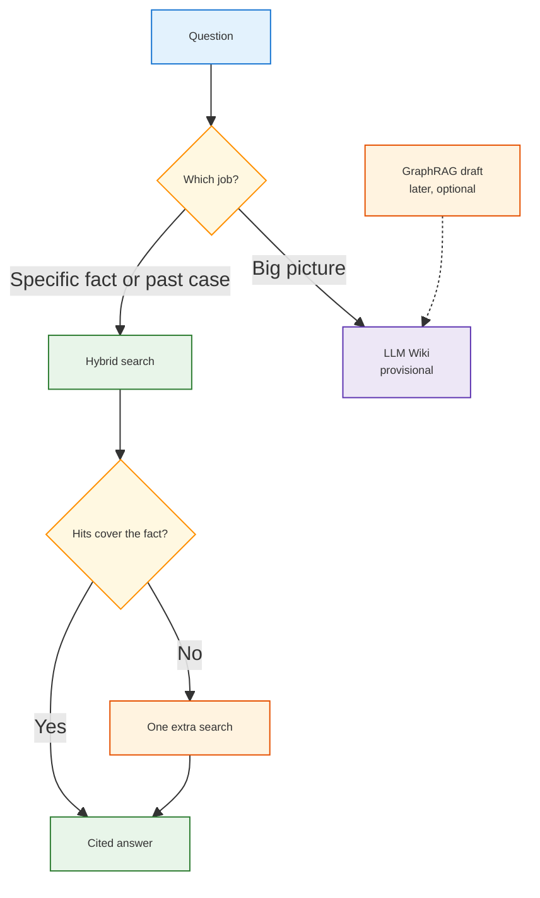
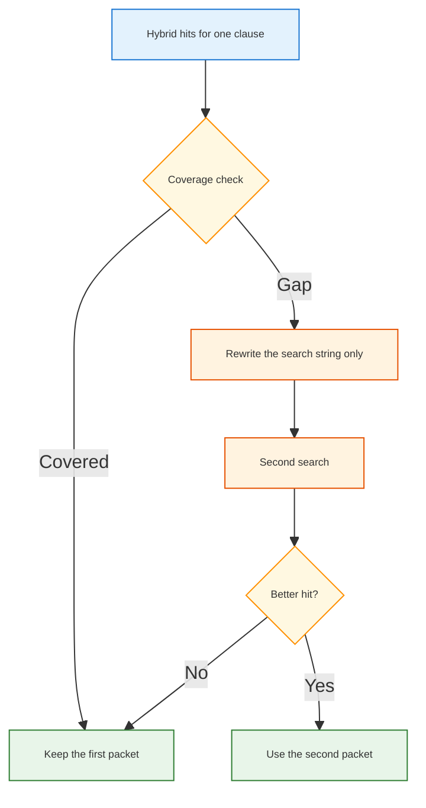
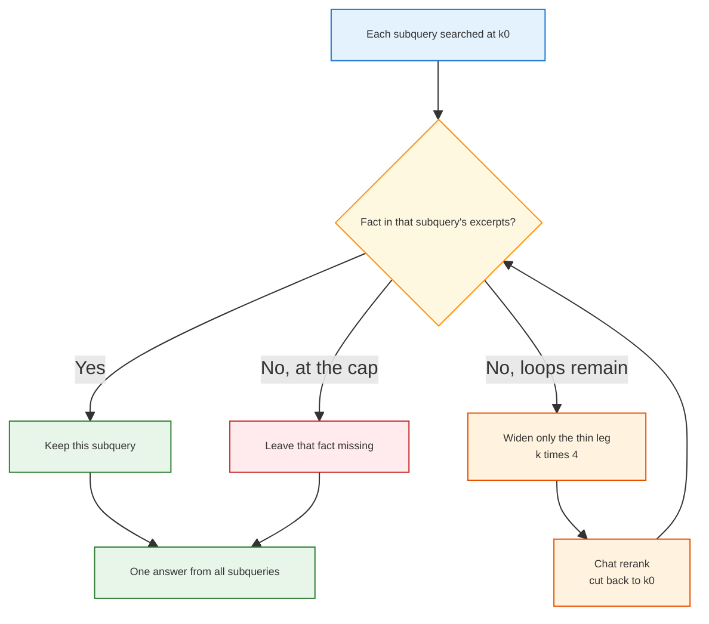
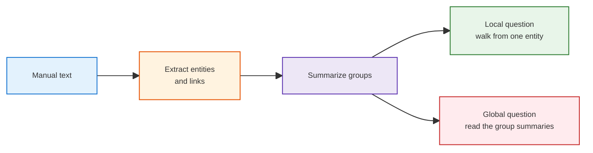
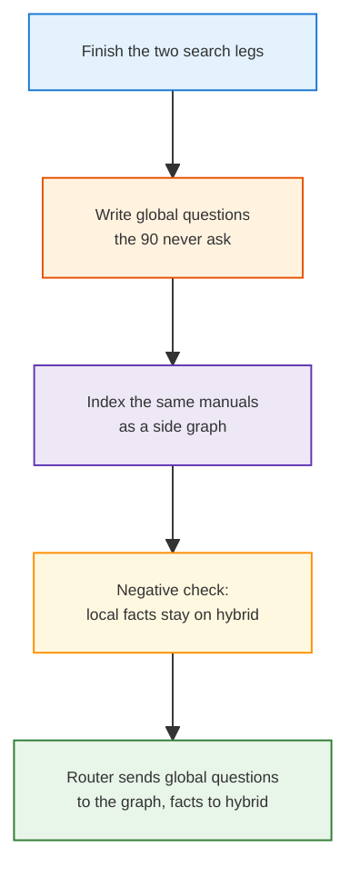

<h1 id="todo-agr-title" style="color:#0d47a1;font-size:1.5em;font-weight:700;border-bottom:2px solid #90caf9;padding-bottom:0.25em;margin-top:0">TODO — where agentic RAG and GraphRAG fit the FRU second brain</h1>

**Status:** analysis only. Does not change the main plan.  
**Date:** 2026-10-31.  
**Parent picture:** [`RECAP_SECOND_BRAIN_COS.md`](../artifacts/aggregated/RECAP_SECOND_BRAIN_COS.md). Execution plan stays [`REFACTOR_PLAN_MAIN_1_FURTHER_ENHANCEMENT_GPT.md`](../ref_plan/new/REFACTOR_PLAN_MAIN_1_FURTHER_ENHANCEMENT_GPT.md).  
**Past measurement, not an input:** **16 of 20** on `b20-evo18-d7-v3-20261028` is why this note exists. Six of those rows had open ticket labels, so that score is not a clean step up from 14 of 20. A stored correct answer is not an input to the production designs in §2 or §3.

<h2 id="todo-agr-outline" style="color:#1565c0;font-size:1.22em;font-weight:650;border-left:4px solid #42a5f5;padding-left:10px;margin-top:1.1em">Document outline</h2>

1. [Where each method sits](#todo-agr-where) — routing diagram, then the fit table.
2. [Agentic RAG and 16 of 20](#todo-agr-agent) — two loop designs, then which to try.
 2.1 [How and where](#todo-agr-agent-how) — one rewritten search, then a per-subquery widen. No stored correct answer.
 2.1.1 [Bounded extra search](#todo-agr-211) — one rewritten search, and what it costs.
 2.1.2 [Per-subquery production loop](#todo-agr-212) — widen only a thin subquery. No gold text.
 2.1.3 [Comparison](#todo-agr-213) — which design to try.
3. [GraphRAG](#todo-agr-graph) — worthwhile for global questions, not for this scoreboard.
 3.1 [How and where](#todo-agr-graph-how) — after the search legs, not instead of them.
 3.2 [Cost](#todo-agr-graph-cost) — the bill is mostly at index time.
 3.3 [Instead of the wiki?](#todo-agr-graph-wiki) — no. Different job.
4. [What not to start](#todo-agr-not) — this window stays on the two search legs.
5. [References](#todo-agr-refs) — sources used above.

---

<h2 id="todo-agr-where" style="color:#1565c0;font-size:1.22em;font-weight:650;border-left:4px solid #42a5f5;padding-left:10px;margin-top:1.1em">1. Where each method sits</h2>

The second brain has two jobs. Specific questions (a temperature range, a past fix) are answered from records. Big-picture questions (what is going on across models and tickets) are reserved for a maintained summary, labeled provisional. That split is already the chief-of-staff picture. Agentic RAG and GraphRAG do not add a third job. They are ways of doing one of the two.

Specific questions stay on today’s hybrid. Agentic RAG is only the extra look when that hybrid missed a fact that is still in the index. Big-picture questions stay on the planned wiki. A graph draft may feed that wiki later. It is not a second destination.



<table>
<thead>
<tr style="background:#1565c0;color:white"><th>Method</th><th>Job it is for</th><th>Fit on the 20 bundled questions</th><th>Fit on big-picture questions</th></tr>
</thead>
<tbody>
<tr><td style="background:#e3f2fd"><strong>① Today’s hybrid</strong></td><td>One search: keywords plus embeddings, fused by rank. Tickets also get a fault-code bump (mode C).</td><td style="background:#e8f5e9"><span style="background:#c8e6c9;padding:2px 4px">✓ now</span><br>This is the 16 of 20 path, plus a fixed split of the question.</td><td style="background:#ffebee"><span style="background:#ffcdd2;padding:2px 4px">⚠</span><br>A local search. It does not read the whole corpus.</td></tr>
<tr><td style="background:#e3f2fd"><strong>② Agentic RAG</strong></td><td>Look at the first hits, notice a gap, search again with a better string.</td><td style="background:#fff3e0"><span style="background:#fff9c4;padding:2px 4px">maybe</span><br>Possible help when the fact is in the index and the first wording missed it.</td><td style="background:#fff3e0"><span style="background:#fff9c4;padding:2px 4px">maybe</span><br>A loop still retrieves passages. It does not build a corpus-level summary.</td></tr>
<tr><td style="background:#e3f2fd"><strong>③ GraphRAG</strong></td><td>An automatic graph of entities, plus summaries of groups, so a question can be about the whole pile.</td><td style="background:#ffebee"><span style="background:#ffcdd2;padding:2px 4px">⚠</span><br>Microsoft’s own comparison: ordinary vector search is the more direct tool for local facts.</td><td style="background:#e8f5e9"><span style="background:#c8e6c9;padding:2px 4px">✓ published win</span><br>Broader, more diverse answers to global questions.</td></tr>
<tr><td style="background:#e3f2fd"><strong>④ LLM Wiki</strong><br><small>planned</small></td><td>Editable pages, links, and a later claim check. Answers from it stay labeled provisional.</td><td style="background:#ffebee"><span style="background:#ffcdd2;padding:2px 4px">⚠</span><br>Not the path that produced 16 of 20. Earlier wiki runs on manual facts were weaker than search.</td><td style="background:#e8f5e9"><span style="background:#c8e6c9;padding:2px 4px">✓ planned home</span><br>Not built.</td></tr>
</tbody>
</table>

“Agentic RAG” here means that loop: the model may call search more than once. It is not a product name. The main plan already caps it at **one extra search** (decision **R4** (the cap: at most one extra search, not an open loop)), and a ticket controller with that cap exists. The bundled run that scored 16 of 20 does not use that loop. It splits the customer question on punctuation, searches each piece, and (on that profile) spends one chat call reordering the ticket list.

A related backlog note, [`TODO_MULTI_SUBQUERY_RAG_DECOMPOSITION.md`](./TODO_MULTI_SUBQUERY_RAG_DECOMPOSITION.md), is about splitting a question into pieces up front. D7 v3 already does a fixed split. This note is about a **second** search after seeing the first hits.

---

<h2 id="todo-agr-agent" style="color:#1565c0;font-size:1.22em;font-weight:650;border-left:4px solid #42a5f5;padding-left:10px;margin-top:1.1em">2. Agentic RAG and 16 of 20</h2>

It can raise the score on some misses. Nothing in the published comparisons, or in our runs, shows it will.

The misses that a loop can touch are the ones where the right passage is in the index and the first query did not surface it. We have already seen that shape on the manual leg: an “ambient temperature” wording left the page-27 site range down the list, and an “installation site” wording put the same page first. The customer question was not edited. Only the search string changed. A loop that is allowed to rewrite the **search string**, after a coverage check fails, is the same idea with a model in the middle.

A loop cannot retrieve a passage that was never ingested. In production there is no stored correct answer to compare against, so the loop cannot “fix a label” either. It can only notice that the excerpts do not contain the fact the subquery asked, and search again or say so.

Published comparisons say the same thing in general:

<table>
<thead>
<tr style="background:#1565c0;color:white"><th>Source</th><th>What they measured</th><th>What it means here</th></tr>
</thead>
<tbody>
<tr><td style="background:#e3f2fd">Microsoft architecture guide</td><td>Standard RAG when one search of one index can answer. An agent when a later query depends on the first result. Sketch: about 2–3 seconds for one search plus an answer, about 8–15 seconds for three to five tool calls.</td><td style="background:#fff3e0">Cap the loop. Do not put it on every question.</td></tr>
<tr><td style="background:#e3f2fd">arXiv 2601.07711</td><td>Agent settings used about <strong>3.3×</strong> the input tokens and about <strong>1.5×</strong> the time of a stronger single pipeline. A tuned non-agent pipeline can match or beat the agent.</td><td style="background:#e8f5e9">The agent’s edge was rewriting the query. An explicit reranker was better at picking the final passages.</td></tr>
<tr><td style="background:#e3f2fd">Multi-hop study</td><td>The loop was worth a <strong>16× to 35×</strong> token premium only for questions that truly need two or three hops. A waste on one-hop lookups.</td><td style="background:#fff3e0">Route it. Cheap search by default. The loop only when the question needs it.</td></tr>
</tbody>
</table>

Our bundled questions are already two hops in a cheap form: the fixed split searches the symptom clause and the manual-fact clause separately. That is part of how the judge reached 16 of 20. A further agent is a third look, not the first time we search twice.

<h3 id="todo-agr-agent-how" style="color:#00695c;font-size:1.05em;font-weight:600;margin-top:0.85em">2.1 How and where</h3>

Both designs below are for the production answer path. Neither reads a stored correct answer. [2.1.1](#todo-agr-211) is one extra search with a rewritten string, the cap already in decision **R4** (at most one extra search, not an open loop). [2.1.2](#todo-agr-212) judges each subquery against its own excerpts and widens only the short ones. [2.1.3](#todo-agr-213) compares them.

<h4 id="todo-agr-211" style="color:#00695c;font-size:1em;font-weight:600;margin-top:0.75em">2.1.1 Bounded extra search</h4>

Put this on the bundled path, after the hybrid search for one clause, and only when a coverage check says the hits do not contain the asked fact. The second search uses a rewritten search string. It replaces that packet only when the new hit is better. Otherwise the first packet stays.



<table>
<thead>
<tr style="background:#1565c0;color:white"><th>Piece</th><th>Where it already is</th><th>What a trial would do</th></tr>
</thead>
<tbody>
<tr><td style="background:#e3f2fd">One extra search</td><td><strong>R4</strong>, <code>AgenticRetrievalController</code>, ticket side <code>TicketAgenticController</code></td><td style="background:#e8f5e9">Call that pattern from the bundled runner. Do not add a new service.</td></tr>
<tr><td style="background:#e3f2fd">Which leg</td><td>Manual misses are the ones we have watched fail by wording</td><td style="background:#fff3e0">Try the manual leg first. Leave ticket mode C alone.</td></tr>
<tr><td style="background:#e3f2fd">What the model may change</td><td>The search string only</td><td style="background:#ffebee"><span style="background:#ffcdd2;padding:2px 4px">⚠</span> Do not rewrite the customer question and do not edit the manuals.</td></tr>
<tr><td style="background:#e3f2fd">Stop</td><td><strong>R4</strong> is already one extra search</td><td style="background:#e8f5e9">If the second search still misses, return the first packet.</td></tr>
</tbody>
</table>

The coverage check compares the subquery with the excerpts just retrieved. It does not compare them with a stored correct answer. The same rule applies to the rewritten search here and to the widen in [2.1.2](#todo-agr-212).

Two bills, and they should not be mixed. We have not priced either on our own key. The multiples are from the studies above, not from a FRU invoice.

<table>
<thead>
<tr style="background:#1565c0;color:white"><th>How it is turned on</th><th>Extra cost on top of today’s path</th><th>When it is the wrong buy</th></tr>
</thead>
<tbody>
<tr><td style="background:#e3f2fd"><span style="background:#c8e6c9;padding:2px 4px">recommended</span><br>Only after a coverage gap, one extra search (<strong>R4</strong>)</td><td style="background:#e8f5e9">About one chat call plus one more retrieval, and only on the questions that fail the check. Search itself is not a chat call.</td><td style="background:#fff3e0">Still wasted when the fact is not in the index.</td></tr>
<tr><td style="background:#e3f2fd"><span style="background:#ffcdd2;padding:2px 4px">⚠</span><br>An agent wrapped around every question</td><td style="background:#ffebee">On the order of <strong>1.5×</strong> time and <strong>3×</strong> input tokens in one study, and <strong>16×–35×</strong> tokens in the multi-hop study. Microsoft’s sketch for three to five tool calls is several extra seconds.</td><td style="background:#ffebee">One-hop lookups, and any question the fixed split already covers.</td></tr>
</tbody>
</table>

<h4 id="todo-agr-212" style="color:#00695c;font-size:1em;font-weight:600;margin-top:0.75em">2.1.2 Per-subquery production loop</h4>

This is the production shape of the same idea. The customer question is already split into subqueries. Each subquery has its own retrieved excerpts. One coverage call looks at every subquery and asks whether those excerpts contain the fact that subquery asked. Only a short subquery is searched again. Covered subqueries stay put. No gold answer is shown to any call in this loop.

The recorded percent is a log line. The trigger is stricter than “the model feels 90% sure”: the fact that subquery asked is absent from its excerpts. A high score with a missing sentence must still count as short, because nothing later corrects a confident wrong answer.

Widening multiplies that leg’s k by 4, starting on the second pass. Today’s handful is 2 tickets and 5 manual chunks, so the first widen asks for 8 and 20. A chat rerank then cuts that wider list back to the original handful, so the answer call still fits. The local cross-encoder already failed to keep the page-27 range in that cut. The chat reranker did. It runs only on a short subquery, not on every question. The character budget still applies when the packets are packed for the answer.

`n = 0` is the first search. `n = 1` and `n = 2` are the two allowed widens when `max_n = 2`. After that the answer is written anyway, and a still-missing fact is said to be missing.



```python
# Production loop. No gold text is passed to coverage or to the answer.
MAX_N = 2                 # n=0 is the first search; n=1 and n=2 may widen
K0 = {"tickets": 2, "manuals": 5}

def answer_customer(question):
    units = split_on_sentence(question)       # same cut the bundled path already makes
    packets = {u: search(u, K0) for u in units}
    n = 0
    report = None
    while n < MAX_N:
        # One call covers every subquery. A missing sentence fires even if the score is high.
        report = coverage(packets)            # per unit: covered?, thin leg, gap note
        short = [u for u in units if not report[u].covered]
        if not short:
            break
        n += 1
        for u in short:                       # covered subqueries are not searched again
            leg = report[u].thin_leg          # "tickets" or "manuals", not both
            k = K0[leg] * (4 ** n)            # n=1 -> 4x, n=2 -> 16x
            wider = search_leg(u, leg, k)
            # Chat rerank, then throw the rest away so the answer still fits.
            packets[u][leg] = rerank_chat(wider, keep=K0[leg], gap=report[u].gap)
    # Gap notes are logged on a full cover too. They do not trigger another search.
    return aggregate(question, packets, gaps=report)
```

Standing cost, even when every subquery is covered: that one coverage call. The chat rerank and the wider search happen only for a subquery the coverage call marked short. If the fact was never ingested, the loop ends at the cap and the answer says so.

<h4 id="todo-agr-213" style="color:#00695c;font-size:1em;font-weight:600;margin-top:0.75em">2.1.3 Comparison and recommendation</h4>

<table>
<thead>
<tr style="background:#1565c0;color:white"><th>Aspect</th><th>2.1.1 Bounded extra search</th><th>2.1.2 Per-subquery production loop</th></tr>
</thead>
<tbody>
<tr><td style="background:#e3f2fd">What changes on a miss</td><td>The search string, once</td><td>How many hits are retrieved, then a chat rerank cuts back to the original handful</td></tr>
<tr><td style="background:#e3f2fd">Who is searched again</td><td>The one clause that failed the check</td><td>Only a subquery whose excerpts lack the fact, and only the thin leg</td></tr>
<tr><td style="background:#e3f2fd">Stored correct answer</td><td style="background:#e8f5e9">Never an input</td><td style="background:#e8f5e9">Never an input</td></tr>
<tr><td style="background:#e3f2fd">Cost when the first packet is enough</td><td style="background:#e8f5e9">No extra search</td><td style="background:#fff3e0">One coverage call on every question</td></tr>
<tr><td style="background:#e3f2fd">Cost when a packet is short</td><td>One rewritten search</td><td>Up to two widens, chat rerank each time, then one answer</td></tr>
<tr><td style="background:#e3f2fd">What it still cannot do</td><td style="background:#ffebee">Find a fact that was never ingested</td><td style="background:#ffebee">Same, and a wider pool does not help if the right chunk is outside even the 4× list</td></tr>
</tbody>
</table>

Use **2.1.2** if a production loop is built. It spends the expensive rerank only on the subquery that is actually short, and the decision is “is the fact in these excerpts?”, not a comparison with a stored correct answer. Keep **2.1.1** as the second move inside a subquery that is still short after the wider pool is reranked: a new search string can surface a chunk that ranking never returned, which a larger k cannot. Do not run that rewrite on every miss, and do not wrap the whole question in an open agent. Neither design reaches a guaranteed correct answer. A fact that is not in the index stays missing, and the answer should say so.

---

<h2 id="todo-agr-graph" style="color:#1565c0;font-size:1.22em;font-weight:650;border-left:4px solid #42a5f5;padding-left:10px;margin-top:1.1em">3. GraphRAG</h2>

GraphRAG, in the Microsoft Research sense, builds a graph of entities and relationships from the text, groups them, and summarizes the groups. A local question starts at a matching entity and walks. A global question is answered from those group summaries rather than from the single nearest chunk.



That global behavior is the published win. On their podcast and news sets, global answers beat ordinary vector search on comprehensiveness (about 72–83% win rate) and on diversity. Vector search was the more direct answer. Their later LazyGraphRAG note says the same split in one sentence: vector search is for “who / what / when / where” inside a passage; the graph is for questions about the whole dataset (“what are the main themes?”).

The 20 bundled questions are the first kind. A graph index is not the tool that should be asked to beat 16 of 20. Microsoft’s own issue discussion says the same: standard search for ordinary RAG, GraphRAG when the question is high-level and no single chunk resembles the query.

<h3 id="todo-agr-graph-how" style="color:#00695c;font-size:1.05em;font-weight:600;margin-top:0.85em">3.1 How and where</h3>

Do not put it on the bundled judge. If we try it, it belongs beside the future big-picture track. The sequence is the gate: no graph index until the search legs are finished and there are global questions to score.



<table>
<thead>
<tr style="background:#1565c0;color:white"><th>Step</th><th>What it is</th><th>Why it is in this order</th></tr>
</thead>
<tbody>
<tr><td style="background:#e3f2fd"><strong>①</strong></td><td>Finish the two search legs. That is the near-term choice already recorded as <strong>R28</strong> (finish manual and ticket search before wiki work).</td><td style="background:#e8f5e9">The graph does not fix the current scoreboard.</td></tr>
<tr><td style="background:#e3f2fd"><strong>②</strong></td><td>Write a handful of global questions the 90 manual questions never ask (themes across the three guides, repeated failures).</td><td style="background:#fff3e0">Without those questions, a graph run has no score.</td></tr>
<tr><td style="background:#e3f2fd"><strong>③</strong></td><td>Index the same manual text the search already uses, with the open GraphRAG library. Compare local search against today’s hybrid on the specific questions only as a negative check.</td><td style="background:#ffebee">It should not be required to win on local facts.</td></tr>
<tr><td style="background:#e3f2fd"><strong>④</strong></td><td>Keep the graph as a side index. The chief-of-staff router, still unbuilt, would send a global question there and a specific question to hybrid search. The running query does not look up a stored correct answer.</td><td style="background:#e8f5e9">One router, two indexes. Not a second product.</td></tr>
</tbody>
</table>

The LLM Wiki’s own search already has a graph slot (keyword score, vectors, fusion, and a graph expansion inside that app). A second, automatic entity graph is justified only if that slot cannot answer the global questions once Phase 3 exists. Building it now, on three manuals, mostly restates the guides.

<h3 id="todo-agr-graph-cost" style="color:#00695c;font-size:1.05em;font-weight:600;margin-top:0.85em">3.2 Cost</h3>

Full GraphRAG spends chat-model tokens **while indexing**: extract entities and relationships from every chunk, then summarize communities. Querying a global question then reads many of those summaries. The original paper’s root-level summaries used far fewer tokens than stuffing the source text into a map-reduce, and still beat vector search on breadth. They are not free.

Microsoft Research’s LazyGraphRAG write-up is the cost comparison to keep:

<table>
<thead>
<tr style="background:#1565c0;color:white"><th>Comparison</th><th>LazyGraphRAG</th><th>Full GraphRAG</th></tr>
</thead>
<tbody>
<tr><td style="background:#e3f2fd">Indexing cost</td><td style="background:#e8f5e9">Same order as vector RAG, about <strong>0.1%</strong> of full GraphRAG</td><td style="background:#ffebee">Chat-model pass over every chunk, then community summaries</td></tr>
<tr><td style="background:#e3f2fd">Local questions, at a vector-RAG query budget</td><td style="background:#e8f5e9">Beat the local methods they tried, including GraphRAG’s own local search</td><td style="background:#fff3e0">Local search is the walk from one entity. Not their global win.</td></tr>
<tr><td style="background:#e3f2fd">Global questions</td><td style="background:#e8f5e9">One configuration matched global-search quality at more than <strong>700×</strong> lower query cost</td><td style="background:#ffebee">Reads many community summaries. Strong on breadth, expensive per question.</td></tr>
</tbody>
</table>

LazyGraphRAG was described there as an internal research fork, not the default of the open library. The practical public knob is the open library’s local search or DRIFT search, and both can still burn a lot of tokens on a large graph. Our manual pile is small, so the dollar amount of a full index is unlikely to be the reason to refuse. The reason to wait is that we have no global question set, and the corpus that would make a graph pay (tickets, news, warranty stats) is still parked.

<h3 id="todo-agr-graph-wiki" style="color:#00695c;font-size:1.05em;font-weight:600;margin-top:0.85em">3.3 Instead of the wiki?</h3>

No. Do not replace the planned LLM Wiki with GraphRAG.

<table>
<thead>
<tr style="background:#1565c0;color:white"><th>Aspect</th><th>LLM Wiki, as planned</th><th>GraphRAG</th></tr>
</thead>
<tbody>
<tr><td style="background:#e3f2fd">What it keeps</td><td style="background:#e8f5e9">Pages a person can edit, links, and a claim check (supported / uncertain / contradicted)</td><td style="background:#fff3e0">An automatic entity graph and generated community summaries</td></tr>
<tr><td style="background:#e3f2fd">How an answer is labeled</td><td style="background:#e8f5e9">Provisional when it comes from the summary. Facts still have to be checked against records.</td><td style="background:#ffebee">Improves breadth. Does not, by itself, audit a claim against a source sentence.</td></tr>
<tr><td style="background:#e3f2fd">What we already measured</td><td style="background:#fff3e0">On fridge-manual facts, search beat or matched the wiki. The useful wiki hits were mostly the source pages.</td><td style="background:#fff3e0">Not run here. Published wins are on global questions, against vector search, not against a maintained wiki.</td></tr>
<tr><td style="background:#e3f2fd">When a manual changes</td><td style="background:#e8f5e9">Recompile the pages we choose</td><td style="background:#ffebee">Re-extract the graph. Later library versions can update incrementally. That is still a rebuild of the changed text.</td></tr>
</tbody>
</table>

GraphRAG can become **one input** to the big-picture side later: a way to draft “what is going on across these records” once those records exist. The wiki remains the place that draft has to land if we want a page we can correct and a label the chief of staff can show. Using the graph instead of the wiki would drop the claim audit the plan is for, and it would still not answer a warranty-cost question until warranty text is in the pile.

---

<h2 id="todo-agr-not" style="color:#1565c0;font-size:1.22em;font-weight:650;border-left:4px solid #42a5f5;padding-left:10px;margin-top:1.1em">4. What not to start</h2>

This note does not change Phase 3 or Phase 4.

<table>
<thead>
<tr style="background:#1565c0;color:white"><th></th><th>Action</th><th>Why</th></tr>
</thead>
<tbody>
<tr><td style="background:#ffebee"><span style="background:#ffcdd2;padding:2px 4px">⚠</span></td><td>Wrap every bundled question in an agent to chase 16 of 20</td><td>The published multiples land on every question, including the ones the fixed split already covers.</td></tr>
<tr><td style="background:#ffebee"><span style="background:#ffcdd2;padding:2px 4px">⚠</span></td><td>Stand up GraphRAG as the big-picture system in place of the wiki</td><td>Drops the claim check. Three manuals mostly get restated.</td></tr>
<tr><td style="background:#e8f5e9"><span style="background:#c8e6c9;padding:2px 4px">✓ later</span></td><td>The production loop in <a href="#todo-agr-212">2.1.2</a>, after the search legs are in the shape we want</td><td>Widen only a short subquery. Add the <a href="#todo-agr-211">2.1.1</a> rewrite only if that wider pool still lacks the fact.</td></tr>
</tbody>
</table>

---

<h2 id="todo-agr-refs" style="color:#1565c0;font-size:1.22em;font-weight:650;border-left:4px solid #42a5f5;padding-left:10px;margin-top:1.1em">5. References</h2>

<table>
<thead>
<tr style="background:#1565c0;color:white"><th>Source</th><th>What it supports here</th></tr>
</thead>
<tbody>
<tr><td style="background:#e3f2fd"><a href="https://learn.microsoft.com/en-us/azure/architecture/ai-ml/guide/rag/rag-agentic">Microsoft Learn — agentic RAG</a></td><td>When a loop is justified. Cap iterations. Latency sketch of one search versus three to five tool calls.</td></tr>
<tr><td style="background:#e3f2fd"><a href="https://arxiv.org/html/2601.07711v2">Is Agentic RAG worth it? (arXiv 2601.07711)</a></td><td>About 3.3× input tokens and 1.5× time. A tuned single pipeline can match the agent. The agent’s advantage is query rewriting. The reranker’s is passage choice.</td></tr>
<tr><td style="background:#e3f2fd"><a href="https://essay.utwente.nl/fileshare/file/110940/pk_thesis.pdf">When does agentic retrieval pay off? (University of Twente)</a></td><td>16×–35× token premium pays off mainly on 2–3 hop questions. Route the loop. Do not default it.</td></tr>
<tr><td style="background:#e3f2fd"><a href="https://arxiv.org/html/2404.16130">GraphRAG paper (arXiv 2404.16130)</a></td><td>Global summaries beat vector RAG on comprehensiveness and diversity. Vector RAG is more direct.</td></tr>
<tr><td style="background:#e3f2fd"><a href="https://www.microsoft.com/en-us/research/blog/lazygraphrag-setting-a-new-standard-for-quality-and-cost/">LazyGraphRAG — Microsoft Research</a></td><td>Vector RAG for local facts. Graph methods for whole-corpus questions. Indexing at about 0.1% of full GraphRAG. Large query-cost gap versus global search.</td></tr>
<tr><td style="background:#e3f2fd"><a href="https://github.com/microsoft/graphrag/discussions/905">GraphRAG vs Azure AI Search (microsoft/graphrag #905)</a></td><td>Standard search and GraphRAG are complements. GraphRAG for questions no single chunk resembles.</td></tr>
<tr><td style="background:#e3f2fd"><a href="../artifacts/ABOUT_SEARCH_RRF_FRU.md"><code>ABOUT_SEARCH_RRF_FRU.md</code></a></td><td>Ticket modes A/B/C and the 0.25 / 0.44 / 0.54 ladder.</td></tr>
<tr><td style="background:#e3f2fd"><a href="../artifacts/aggregated/RECAP_SECOND_BRAIN_COS.md"><code>RECAP_SECOND_BRAIN_COS.md</code></a></td><td>Lane B and mode C locks. Wiki reserved for big-picture questions.</td></tr>
</tbody>
</table>
