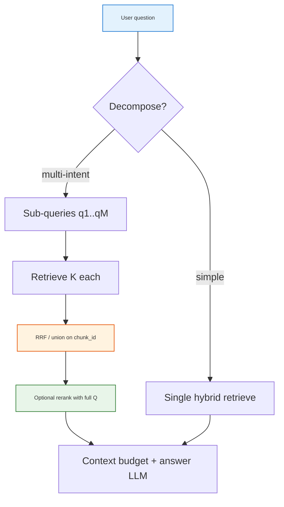

<h1 id="todo-multi-subquery-title" style="color:#0d47a1;font-size:1.5em;font-weight:700;border-bottom:2px solid #90caf9;padding-bottom:0.25em;margin-top:0">TODO — multi-subquery RAG (sentence / intent decomposition)</h1>

**Status:** research + design backlog (not scheduled).  
**Motivation:** Manual M90 questions often bundle **several intents** (e.g. flush duration + replacement interval); a single hybrid top‑5 can rank the “3 minutes” chunk **6th–7th** while still retrieving GE-only paths — see **H08** (`ge_GNE27JYMFS-H08`, gold chunk index **55** at hybrid rank **7**).  
**Related in-repo:** D5 **AgenticRetrievalController** (`scripts/retail/retail_brain/evidence/agentic.py`) — **one** verifier-driven subquery, not per-sentence decomposition.  
**last_updated:** 2026-10-25

<h2 id="todo-multi-subquery-outline" style="color:#1565c0;font-size:1.22em;font-weight:650;border-left:4px solid #42a5f5;padding-left:10px;margin-top:1.1em">Document outline</h2>

1. [Proposal summary](#todo-proposal) — user idea in one place.
2. [Industry practice (2025–2026)](#todo-industry) — names, patterns, citations.
3. [Fusion and ranking (your open questions)](#todo-fusion) — rank‑1 in one leg vs rank‑3 in all legs; dedupe promotion.
4. [Cost, latency, and when *not* to do this](#todo-cost) — production lessons.
5. [Fit for Second Brain / A2 manual RAG](#todo-fit) — vs existing D5, H08, eval.
6. [Recommended design directions](#todo-recommend) — adaptive, not default-on.
7. [Evaluation checklist](#todo-eval) — before shipping.
8. [Decisions / open questions](#todo-decisions) — human gates.
9. [References](#todo-refs) — links.

---

<h2 id="todo-proposal" style="color:#1565c0;font-size:1.22em;font-weight:650;border-left:4px solid #42a5f5;padding-left:10px;margin-top:1.1em">1. Proposal summary</h2>

**Idea (paraphrased):**

1. Split the user question into **sentences** (or sentence-like units).
2. Run **full RAG retrieval** per unit (e.g. **top‑5** each).
3. For **3** sentences → up to **15** raw hits; **dedupe** same `chunk_id`.
4. **Fuse** into a final pool (e.g. take **top‑2 per sentence group**; if a chunk appears in multiple groups, **promote** its fused rank).

**Intent:** Cover questions whose sub-answers live in **different regions** of the manual (different tables/sections), where a **single embedding** of the whole question favors one facet (e.g. “spurt / icemaker”) and **buries** another (troubleshooting row “Water spurting → **3 minutes**”).

**Risk:** Sentence boundaries ≠ **intent** boundaries; extra retrieval calls; fusion rules can amplify noise or duplicate overlapping chunks.

---

<h2 id="todo-industry" style="color:#1565c0;font-size:1.22em;font-weight:650;border-left:4px solid #42a5f5;padding-left:10px;margin-top:1.1em">2. Industry practice (2025–2026)</h2>

The ecosystem uses several **related** patterns; names overlap. Your proposal is closest to **query decomposition + multi-retrieval + fusion**, not to naive “chunk the question text” alone.

<h3 id="todo-industry-map" style="color:#00695c;font-size:1.05em;font-weight:600;margin-top:0.85em">2.1 Pattern map</h3>

<table>
<thead>
<tr style="background:#1565c0;color:white"><th>Pattern</th><th>What it does</th><th>Typical fusion</th><th>Notes</th></tr>
</thead>
<tbody>
<tr><td style="background:#e3f2fd"><strong>Multi-query retrieval</strong></td><td style="background:#e8f5e9">LLM generates <strong>3–5 paraphrases</strong> of the <em>same</em> question; retrieve each; merge.</td><td style="background:#e8f5e9"><strong>RRF</strong> (reciprocal rank fusion)</td><td style="background:#fff3e0">Default “cheap win” in 2026 guides; improves recall when wording ≠ corpus. Not the same as sentence split.</td></tr>
<tr><td style="background:#e3f2fd"><strong>Query decomposition</strong></td><td style="background:#e8f5e9">LLM splits a <strong>multi-fact</strong> or multi-hop question into <strong>sub-questions</strong> (intents); retrieve per sub-question.</td><td style="background:#e8f5e9">Union → <strong>rerank</strong> or RRF → top‑K for context</td><td style="background:#e8f5e9">ACL-style pipelines report strong retrieval gains on multi-hop benchmarks when merged pool is reranked (e.g. MRR@10 +36.7% in one decomposition+RAG study).</td></tr>
<tr><td style="background:#e3f2fd"><strong>RAG-Fusion</strong></td><td style="background:#fff3e0">Multi-query + RRF as a productized pattern (“generate diverse queries → fuse”).</td><td style="background:#e8f5e9">RRF</td><td style="background:#ffebee">2026 industry paper: fusion can <strong>raise raw recall</strong> but gains may <strong>vanish after rerank + fixed top‑K</strong> and add latency — evaluate end-to-end, not recall alone.</td></tr>
<tr><td style="background:#e3f2fd"><strong>Adaptive RAG</strong></td><td style="background:#e8f5e9">Classifier routes <strong>simple</strong> queries to single retrieval; <strong>complex</strong> to decomposition / agentic.</td><td style="background:#fff3e0">Per route</td><td style="background:#e8f5e9">Emerging default recommendation: don’t pay multi-query cost on every turn.</td></tr>
<tr><td style="background:#e3f2fd"><strong>Agentic RAG</strong></td><td style="background:#e8f5e9">Planner emits <strong>tasks/sub-questions</strong>; each task retrieve→answer; optional verify→re-retrieve.</td><td style="background:#fff3e0">Synthesis over task outputs</td><td style="background:#fff3e0">NVIDIA RAG blueprint, LangGraph-style; trades latency for multi-hop/ambiguous queries.</td></tr>
<tr><td style="background:#e3f2fd"><strong>Omni-RAG / LiveRAG-style</strong></td><td style="background:#e8f5e9">Query understanding → <strong>decompose multi-intent</strong> → retrieve per intent → rerank → generate.</td><td style="background:#e8f5e9">Aggregate + reranker (e.g. cross-encoder class)</td><td style="background:#fff3e0">Targets noisy, multi-intent live queries.</td></tr>
<tr><td style="background:#e3f2fd"><strong>ChainRAG / SDRAG</strong></td><td style="background:#e8f5e9">Sub-questions with <strong>dependencies</strong> (order, entity carry-over, graph pruning).</td><td style="background:#fff3e0">Sequential or graph traversal</td><td style="background:#fff3e0">Better when later clauses depend on answers to earlier ones (coreference).</td></tr>
</tbody>
</table>

<h3 id="todo-industry-default" style="color:#00695c;font-size:1.05em;font-weight:600;margin-top:0.85em">2.2 What practitioners treat as “default” vs “complex-only”</h3>

| Tier | When | Mechanism |
|------|------|-----------|
| Baseline | Most production traffic | Hybrid lexical + dense, single query, optional **one** rerank pass |
| First upgrade | Wording mismatch, moderate recall gaps | **Multi-query paraphrase + RRF** (same intent, diverse phrasing) |
| Multi-intent | Compound questions, multi-hop | **LLM intent decomposition** (not raw sentence split) + union + **rerank** |
| Heavy | Ambiguity, cross-doc, verification | **Agentic** plan-and-execute + optional verify loop |

**Sentence-level retrieval** as a fixed rule is **not** a common default: research systems more often use **LLM-derived sub-questions** or **sentence graphs for multi-hop QA**, because a sentence like “when does the manual say to replace the filter again?” lacks anchor tokens and retrieves generic “replace every 6 months” passages instead of the spurting table.

---

<h2 id="todo-fusion" style="color:#1565c0;font-size:1.22em;font-weight:650;border-left:4px solid #42a5f5;padding-left:10px;margin-top:1.1em">3. Fusion and ranking (your open questions)</h2>

<h3 id="todo-fusion-q1" style="color:#00695c;font-size:1.05em;font-weight:600;margin-top:0.85em">3.1 Rank‑1 in one group but absent from others — is it relevant?</h3>

**Usually yes**, if that sub-query was a **deliberate intent slice** (not a random sentence fragment). Industry fusion avoids “must appear in all legs” rules:

- **RRF** rewards documents that rank well in **any** list, with extra mass when the same id appears in **multiple** lists (your “promote if same chunk” idea).
- **Union + cross-encoder rerank** on the pooled candidates (top‑N per leg) lets a **leg‑specific #1** beat a mediocre consensus.

**Caveat:** If decomposition is **naive sentence split**, leg‑1 rank‑1 may be **generic** (e.g. “filter replacement interval”) while the user also needed **symptom-specific** flush time — still “relevant” but **wrong facet** for the full gold answer.

<h3 id="todo-fusion-q2" style="color:#00695c;font-size:1.05em;font-weight:600;margin-top:0.85em">3.2 Rank‑3 in all three groups vs rank‑1 in only one group?</h3>

There is no universal winner; production systems use **score-based fusion**, not manual tie-breaks:

<table>
<thead>
<tr style="background:#1565c0;color:white"><th>Signal</th><th>Interpretation</th><th>Typical treatment</th></tr>
</thead>
<tbody>
<tr><td style="background:#e3f2fd">High rank in <strong>one</strong> leg only</td><td style="background:#fff3e0">Specialist match for one intent</td><td style="background:#e8f5e9">Keep in pool; let <strong>reranker</strong> or RRF score vs full query</td></tr>
<tr><td style="background:#e3f2fd">Moderate rank in <strong>all</strong> legs</td><td style="background:#e8f5e9">Broad overlap / generic section</td><td style="background:#fff3e0">Often boosted by RRF “consistency” but may be <strong>noise</strong> (same boilerplate in many chunks)</td></tr>
<tr><td style="background:#e3f2fd">Appears in ≥2 legs with improving ranks</td><td style="background:#e8f5e9">Strong cross-intent evidence</td><td style="background:#c8e6c9">Promote (your dedupe rule aligns with RRF)</td></tr>
</tbody>
</table>

**Practical rule of thumb:** fuse with **RRF (or weighted RRF)** on chunk ids, then apply **one** listwise or cross-encoder rerank using the **full original question** (and SKU-scoped query prefix). That resolves “rank‑1 in one leg” vs “rank‑3 everywhere” without hand-tuned per-leg quotas like “top‑2 each.”

Your **“top‑2 per group + promote duplicates”** is a **quota + boost** heuristic; it can work as a **budgeted** variant when rerank budget is small, but it may **drop** a leg‑only rank‑1 that never duplicated (e.g. chunk **55** appearing only under a well-phrased “water spurting dispenser flush” sub-query).

<h3 id="todo-fusion-algos" style="color:#00695c;font-size:1.05em;font-weight:600;margin-top:0.85em">3.3 Fusion algorithms (reference)</h3>

| Method | Formula / behavior | Matches your idea? |
|--------|-------------------|---------------------|
| **RRF** | \(\sum_i 1/(k + \text{rank}_i)\) per list | Yes — duplicate ids get automatic boost |
| **Weighted RRF** | Per-leg weights (e.g. symptom leg &gt; boilerplate leg) | Needs intent labels, not raw sentences |
| **Union + dedupe + rerank** | Pool ≤ M×K → cross-encoder on full Q | Recommended in decomposition papers |
| **Top‑t per leg + promote** | Cap per leg; manual promotion count | Your proposal — simpler but brittle |

---

<h2 id="todo-cost" style="color:#1565c0;font-size:1.22em;font-weight:650;border-left:4px solid #42a5f5;padding-left:10px;margin-top:1.1em">4. Cost, latency, and when *not* to do this</h2>

<table>
<thead>
<tr style="background:#1565c0;color:white"><th>Cost driver</th><th>Single-query hybrid (today)</th><th>3× sentence retrieve (example)</th></tr>
</thead>
<tbody>
<tr><td style="background:#e3f2fd">Embedding calls</td><td style="background:#e8f5e9">1× query embed</td><td style="background:#fff3e0">3× (or 1 LLM decompose + 3 embed)</td></tr>
<tr><td style="background:#e3f2fd">Lexical + vector search</td><td style="background:#e8f5e9">1× RRF pool</td><td style="background:#fff3e0">3× (RRF per leg or shared pool with 3 query vectors)</td></tr>
<tr><td style="background:#e3f2fd">Rerank (D5.R)</td><td style="background:#e8f5e9">1× on top‑5–20</td><td style="background:#fff3e0">1× on fused pool (15–30+) — **budget matters**</td></tr>
<tr><td style="background:#e3f2fd">LLM decomposition</td><td style="background:#e8f5e9">0</td><td style="background:#fff3e0">+1 call if LLM-based (preferred over sentence split)</td></tr>
</tbody>
</table>

**Production caution (2026):** Fusion that increases **candidate recall** may **not** improve **Hit@10 after rerank** or final answer accuracy under fixed context limits — measure **end-to-end** on M90, not “did chunk 55 enter the union pool.”

**When to skip multi-retrieval:**

- Single-facet easy questions (M90 **easy** stratum).
- Queries already short and keyword-dense with SKU prefix.
- Latency SLO &lt; ~2 s mean on Lane B (Phase 1 **R14**).

---

<h2 id="todo-fit" style="color:#1565c0;font-size:1.22em;font-weight:650;border-left:4px solid #42a5f5;padding-left:10px;margin-top:1.1em">5. Fit for Second Brain / A2 manual RAG</h2>

<h3 id="todo-fit-h08" style="color:#00695c;font-size:1.05em;font-weight:600;margin-top:0.85em">5.1 H08 as a testcase</h3>

| Fact | Implication for decomposition |
|------|------------------------------|
| Gold chunk **55** was hybrid rank **7** on full query | Increasing **K** to 7–8 or better fusion might fix H08 **without** decomposition |
| Question has **two intents**: (A) flush volume/time after spurting, (B) replacement interval | Ideal decomposition: **two sub-queries**, not three grammatical sentences |
| Sub-query (A) should stress **“water spurting at dispenser newly installed filter”** | Sentence 1 alone may still rank icemaker spurt chunks ahead of table row **55** |

**Spike hypothesis:** Intent decomposition + RRF with M=2 and K=10 each → union → rerank → top‑5 context; compare to **K=10 single query** and to **D5 rerank** alone on v4 baseline.

<h3 id="todo-fit-existing" style="color:#00695c;font-size:1.05em;font-weight:600;margin-top:0.85em">5.2 Overlap with existing D5 stack</h3>

| Component | Today | vs multi-subquery idea |
|-----------|--------|-------------------------|
| **D5.R** listwise rerank | Reorders **one** candidate list | Still needed **after** fusion on pooled ids |
| **D5.V** verifier | Lexical coverage / missing terms | Could **trigger** decomposition or second leg (related to agentic) |
| **D5.A** agentic | **One** subquery from missing terms | Strict subset of full decomposition; cheaper |

**Suggested layering:** extend agentic from “missing term subquery” to “**intent split** when verifier sees multiple question facets” rather than default 3× sentence retrieve on every row.

---

<h2 id="todo-recommend" style="color:#1565c0;font-size:1.22em;font-weight:650;border-left:4px solid #42a5f5;padding-left:10px;margin-top:1.1em">6. Recommended design directions</h2>

1. **Do not default to grammatical sentence chunking.** Prefer **LLM intent decomposition** (2–4 sub-queries) or **verifier-triggered** second query — aligned with Omni-RAG / decomposition RAG papers and agentic blueprints.
2. **Prefer RRF (or union + rerank)** over fixed “top‑2 per leg” unless ablation shows rerank budget is too tight.
3. **Adaptive gate:** run multi-retrieval only when **complexity signals** fire: multiple `?`, conjunctions (“and”, “when … and …”), hard tier, low verifier coverage, or low top‑1 / top‑3 RRF score margin.
4. **Keep SKU scope per sub-query** (`sku_scope.resolve_retrieval_sku` on each leg text + shared suite SKU fallback).
5. **Context budget unchanged:** fused pool → same `page_prefix_chars` + `context_max_chars_per_chunk`; fusion increases **candidate** count, not necessarily **prompt** size.
6. **Cheaper experiments first:** raise **K** to 8–10 + listwise rerank on full Q; log rank of gold chunk ids on M90 hard rows before adding 3× retrieval.

recommended **Phase A spike:** offline script on M90 **hard** only — compare (baseline top‑5), (top‑10), (2-intent decompose + RRF + top‑5), (3-sentence split + your top‑2/leg rule).

---

<h2 id="todo-eval" style="color:#1565c0;font-size:1.22em;font-weight:650;border-left:4px solid #42a5f5;padding-left:10px;margin-top:1.1em">7. Evaluation checklist</h2>

Before promoting any multi-subquery path to a run profile:

- [ ] **Gold chunk rank:** % of hard M90 rows where reference chunk id ∈ fused top‑5 / top‑10 (per-question log like H08).
- [ ] **Answerable /60** vs `a2-hybrid-rerank-b-v4` baseline (judge contract unchanged).
- [ ] **Latency p50/p95** on full Lane B (stay within **R14** &lt; 2 s mean if claiming Phase 1 compliance).
- [ ] **Cost:** embedding + LLM decompose calls per row.
- [ ] **Regression on easy** stratum (avoid hurting rows that single-query already passes).
- [ ] **Ablation table:** sentence split vs LLM intent vs multi-query paraphrase only.

---

<h2 id="todo-decisions" style="color:#1565c0;font-size:1.22em;font-weight:650;border-left:4px solid #42a5f5;padding-left:10px;margin-top:1.1em">8. Decisions / open questions</h2>

| ID | Question | Provisional stance |
|----|----------|-------------------|
| **D-MSQ-1** | Sentence split vs LLM intent decomposition? | **Intent decomposition** (or verifier-triggered legs); sentence split is baseline ablation only. |
| **D-MSQ-2** | Fusion: RRF vs top‑2/leg + promote? | **RRF + full-query rerank** first; user heuristic as labeled ablation. |
| **D-MSQ-3** | Default on vs adaptive? | **Adaptive** (agentic/verifier or complexity classifier). |
| **D-MSQ-4** | Plan home if implemented? | Extend **REFACTOR_FURTHER_ENHANCEMENT_GPT.md** Phase 1.x or A2 spec; new run profile e.g. `MANUAL_B_RAW_HYBRID_DECOMPOSE`. |
| **D-MSQ-5** | Relation to D5.A budget (**R4** one loop)? | Multi-intent may need **≤2 retrieve legs** cap, not unbounded M sentences. |

---

<h2 id="todo-refs" style="color:#1565c0;font-size:1.22em;font-weight:650;border-left:4px solid #42a5f5;padding-left:10px;margin-top:1.1em">9. References</h2>

| Resource | URL |
|----------|-----|
| Anyscale — retrieval strategies (multi-query, decomposition) | https://docs.anyscale.com/rag/quality-improvement/retrieval-strategies |
| Omni-RAG (multi-intent decompose + aggregate + rerank) | https://arxiv.org/abs/2506.21384 |
| RAG techniques guide 2026 (adaptive RAG, multi-query + RRF default) | https://blog.starmorph.com/blog/rag-techniques-compared-best-practices-guide |
| Question decomposition for RAG (ACL SRW 2025) | https://doi.org/10.18653/v1/2025.acl-srw.32 |
| ChainRAG — progressive sub-question + sentence retrieval | https://arxiv.org/html/2502.14245v1 |
| SDRAG — dependency-aware sub-questions (EMNLP 2026 findings) | https://aclanthology.org/2026.findings-emnlp.1468/ |
| RAG Fusion — industry deployment / diminishing returns after rerank | https://arxiv.org/html/2603.02153 |
| NVIDIA — Agentic RAG blueprint | https://docs.nvidia.com/rag/latest/agentic-rag.html |
| In-repo: D5 agentic (single subquery) | `scripts/retail/retail_brain/evidence/agentic.py` |
| In-repo: hybrid + RRF | `tests/retail_multi_profiles/lib/raw_hybrid_search.py` |

**Source prompt:** User proposed sentence-level multi-retrieval (3× top‑5 → 15 chunks, top‑2 per group with duplicate promotion), asked for industry best practice analysis and complexity tradeoffs (rank asymmetry across groups, consensus vs specialist, compute cost).
