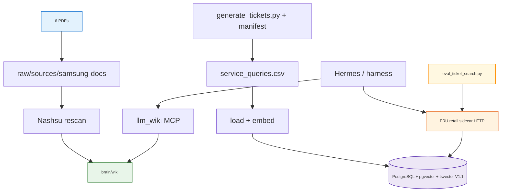
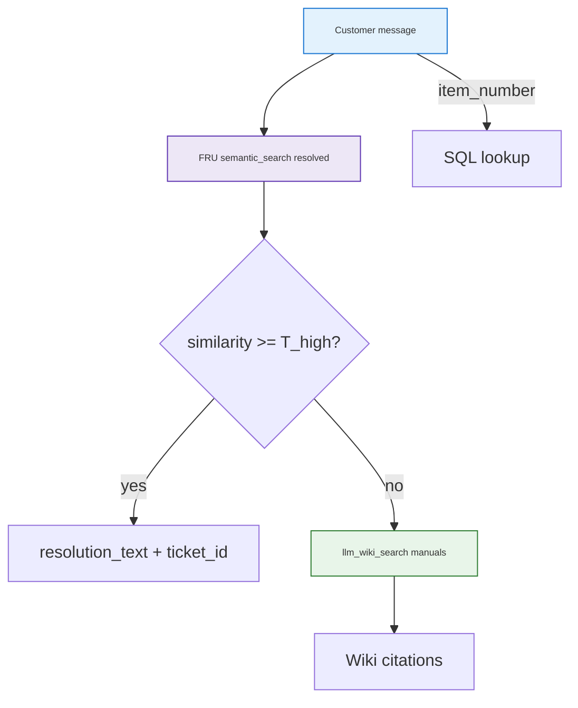

<h1 id="todo-samsung-title" style="color:#0d47a1;font-size:1.5em;font-weight:700;border-bottom:2px solid #90caf9;padding-bottom:0.25em;margin-top:0">TODO: Samsung Brazil retail — service Second Brain (PDFs + PostgreSQL + LLM Wiki)</h1>

**Status:** design / spec (not implemented)  
**Domain:** nationwide Brazil retail — sales + **after-sales service** for **Galaxy A15 5G**, **Galaxy A16 5G**, **Galaxy A25 5G** only.  
**Extends:** [`second-brain-llm-wiki-architecture.md`](../second-brain-llm-wiki-architecture.md) · [`nu_llm_wiki`](../../nu_llm_wiki) MCP · FRU pattern [`ultra-fru-genai-analytics-new`](../../ultra-fru-genai-analytics-new).  
**last_aligned:** 2026-10-09 — **V1** (FRU ticket plane) + **V1.1** (optional PG hybrid + A/B) + **V2** (automation only); see **§1**.

<h2 id="todo-samsung-outline" style="color:#1565c0;font-size:1.22em;font-weight:650;border-left:4px solid #42a5f5;padding-left:10px;margin-top:1.1em">Document outline</h2>

1. [Requirement alignment](#1-decisions) — V1, V1.1, V2 slices.
2. [Feasibility](#2-feasibility) — structured DB + LLM Wiki split.
3. [Industry alignment](#3-industry) — two planes; PG hybrid is V1.1 not wiki.
4. [Target architecture](#4-architecture) — FRU sidecar + wiki.
5. [Ingestion sources A–C](#5-sources) — PDFs + PG.
6. [Refresh model](#6-refresh) — manual V1; cron V2.
7. [Query routing](#7-query-routing) — customer + manager paths.
8. [Ticket retrieval eval & A/B](#8-eval) — gold set + flag flip V1 vs V1.1.
9. [Implementation phases](#9-phases) — P1–P5 + V2.
10. [References](#10-references).

---

<h2 id="1-decisions" style="color:#1565c0;font-size:1.22em;font-weight:650;border-left:4px solid #42a5f5;padding-left:10px;margin-top:1.1em">1. Requirement alignment</h2>

<h3 id="1-1-version-slices" style="color:#00695c;font-size:1.05em;font-weight:600;margin-top:0.85em">1.1 Version slices</h3>

<table>
<thead>
<tr style="background:#1565c0;color:white"><th>Slice</th><th>Ticket search</th><th>Wiki / exports</th></tr>
</thead>
<tbody>
<tr><td style="background:#e3f2fd"><strong>V1</strong></td><td style="background:#e8f5e9"><strong>FRU sidecar</strong> (or retail wrapper): pgvector <code>semantic_search</code> + SQL tools; filters + similarity threshold</td><td style="background:#e8f5e9">LLM Wiki = <strong>6 PDFs only</strong>; no DB→wiki</td></tr>
<tr><td style="background:#e3f2fd"><strong>V1.1</strong></td><td style="background:#fff3e0">Same sidecar + <strong>tsvector + RRF</strong> fused with vector leg; gated by env <code>RETAIL_TICKET_HYBRID_SEARCH=1</code> (default <code>0</code> = V1 behavior)</td><td style="background:#e8f5e9">Unchanged from V1</td></tr>
<tr><td style="background:#e3f2fd"><strong>V2</strong></td><td style="background:#e8f5e9">Same PG schema; retrieval unchanged unless V1.1 promoted by A/B</td><td style="background:#fff3e0">Theme clustering → <code>db-exports/</code> → wiki playbooks; sales summary MD; watermark + <code>flock</code> + cron; optional rescan after export — <strong>automation only</strong></td></tr>
</tbody>
</table>

**Note:** Stock FRU <code>semantic_search</code> is vector-only. V1.1 requires **retail-sidecar extension** (tsvector column + GIN + RRF in one code path), not a flag on upstream FRU alone.

<h3 id="1-2-v1-locked" style="color:#00695c;font-size:1.05em;font-weight:600;margin-top:0.85em">1.2 V1 locked (approved)</h3>

| ID | Decision |
|----|----------|
| **D1** | **Hybrid tools:** LLM Wiki for **PDF manuals only**; **PostgreSQL + pgvector + SQL** for tickets and sales — **no DB→wiki export** in V1/V1.1. |
| **D2** | **Prior-case reuse:** FRU <code>semantic_search</code> on **resolved** tickets (threshold + model filter) → else <code>llm_wiki_search</code> — **no playbook/theme fallback** until V2. |
| **D3** | **Synthetic LGPD-safe data** in CSV/PG; full ticket text in PG (read-only DB role). |
| **D4** | **No cron / schedulers** in V1/V1.1 — manual CSV load, one-shot embed, manual LLM Wiki rescan when PDFs change. |
| **D5** | **Ticket plane default:** FRU sidecar for V1 ship; Postgres MCP alone is fallback for dev smoke only. |
| **D6** | **V1.1 promotion:** Enable hybrid by default only if **§8 A/B** shows predeclared wins without higher false-reuse rate (see **§8.4**). |

<h3 id="1-3-v2-deferred" style="color:#00695c;font-size:1.05em;font-weight:600;margin-top:0.85em">1.3 V2 deferred (optional later)</h3>

Theme clustering → `raw/sources/db-exports/` → wiki playbooks; sales summary MD exports; watermark + `flock` + cron; optional `POST …/sources/rescan` after export. **Same PG schema — automation and derived KB content only** (orthogonal to V1 vs V1.1 retrieval).

---

<h2 id="2-feasibility" style="color:#1565c0;font-size:1.22em;font-weight:650;border-left:4px solid #42a5f5;padding-left:10px;margin-top:1.1em">2. Feasibility</h2>

<table>
<thead>
<tr style="background:#1565c0;color:white"><th>Question</th><th>Answer</th></tr>
</thead>
<tbody>
<tr><td style="background:#e3f2fd">Ingest 100k ticket rows into Nashsu wiki?</td><td style="background:#ffebee"><span style="background:#ffcdd2;padding:2px 4px">No</span> — query **PG** at runtime; wiki = **PDFs**.</td></tr>
<tr><td style="background:#e3f2fd">Can we skip theme/export jobs in V1?</td><td style="background:#e8f5e9"><span style="background:#c8e6c9;padding:2px 4px">Yes</span> — no <code>scripts/retail/export/</code> until V2.</td></tr>
<tr><td style="background:#e3f2fd"><code>llm_wiki</code> MCP hits Postgres?</td><td style="background:#fff3e0"><span style="background:#fff9c4;padding:2px 4px">No</span> — **FRU sidecar** (V1) or Postgres MCP for smoke.</td></tr>
<tr><td style="background:#e3f2fd">Wiki hybrid BM25 + vector?</td><td style="background:#e8f5e9">Already <strong>Nashsu</strong> over <code>brain/wiki/</code> — independent of ticket plane.</td></tr>
<tr><td style="background:#e3f2fd">V1 effort</td><td style="background:#e8f5e9"><span style="background:#2e7d32;color:white;padding:1px 4px">Moderate</span> — seed scripts, sidecar wiring, skill, eval harness baseline.</td></tr>
</tbody>
</table>

---

<h2 id="3-industry" style="color:#1565c0;font-size:1.22em;font-weight:650;border-left:4px solid #42a5f5;padding-left:10px;margin-top:1.1em">3. Industry alignment (2024–2026)</h2>

Two **retrieval planes**: compiled manuals (LLM Wiki) vs operational tickets (Postgres). Do not conflate PG hybrid with V2 wiki exports.

<table>
<thead>
<tr style="background:#1565c0;color:white"><th>Practice</th><th>Plane</th><th>Our stack</th><th>On track?</th></tr>
</thead>
<tbody>
<tr><td style="background:#e3f2fd"><strong>Curated document RAG</strong></td><td style="background:#fff3e0">Wiki / KB</td><td style="background:#e8f5e9">LLM Wiki → 6 PDFs → <code>brain/wiki/</code>; Nashsu hybrid on <strong>.md</strong></td><td style="background:#e8f5e9"><span style="background:#c8e6c9;padding:2px 4px">✓</span> V1</td></tr>
<tr><td style="background:#e3f2fd"><strong>Ticket / case retrieval</strong></td><td style="background:#fff3e0">Postgres</td><td style="background:#e8f5e9">pgvector + FRU <code>semantic_search</code>; <code>status = resolved</code></td><td style="background:#e8f5e9"><span style="background:#c8e6c9;padding:2px 4px">✓</span> V1</td></tr>
<tr><td style="background:#e3f2fd"><strong>Analytics / BI</strong></td><td style="background:#fff3e0">Postgres</td><td style="background:#e8f5e9">FRU <code>generate_sql</code> / <code>execute_sql</code></td><td style="background:#e8f5e9"><span style="background:#c8e6c9;padding:2px 4px">✓</span> V1</td></tr>
<tr><td style="background:#e3f2fd"><strong>No OLTP mirror into doc KB</strong></td><td style="background:#fff3e0">Boundary</td><td style="background:#e8f5e9">Tickets in PG; V2 optional theme MD only</td><td style="background:#e8f5e9"><span style="background:#c8e6c9;padding:2px 4px">✓</span></td></tr>
<tr><td style="background:#e3f2fd"><strong>PG tsvector + pgvector + RRF</strong></td><td style="background:#fff3e0">Postgres</td><td style="background:#fff3e0"><strong>V1.1</strong> optional; env flag + A/B before default</td><td style="background:#fff3e0"><span style="background:#fff9c4;padding:2px 4px">V1.1</span></td></tr>
<tr><td style="background:#e3f2fd"><strong>Cross-encoder rerank</strong></td><td style="background:#fff3e0">Either</td><td style="background:#fff3e0">Not planned; V1/V1.1 use **threshold** + wiki fallback</td><td style="background:#fff3e0"><span style="background:#fff9c4;padding:2px 4px">optional later</span></td></tr>
<tr><td style="background:#e3f2fd"><strong>Managed KB (Bedrock etc.)</strong></td><td style="background:#fff3e0">Ops tradeoff</td><td style="background:#e8f5e9">Self-managed Nashsu + PG</td><td style="background:#e8f5e9"><span style="background:#c8e6c9;padding:2px 4px">✓</span> conscious</td></tr>
</tbody>
</table>

**Verdict:** V1 + FRU sidecar matches mainstream Postgres-native support agents. V1.1 is **quality tuning on the ticket plane**, not a prerequisite for architecture fit. V2 is **ops/content**, not retrieval maturity.

---

<h2 id="4-architecture" style="color:#1565c0;font-size:1.22em;font-weight:650;border-left:4px solid #42a5f5;padding-left:10px;margin-top:1.1em">4. Target architecture (V1 / V1.1)</h2>



**Env (ticket hybrid):**

```bash
# 0 = V1 vector-only (default); 1 = V1.1 tsvector + RRF fusion
RETAIL_TICKET_HYBRID_SEARCH=0
```

**MCP:** `llm_wiki` unchanged; ticket tools via **sidecar** (preferred) or read-only Postgres MCP for dev.

V2 adds **PG → export → raw/db-exports → SW** (not in diagram above).

---

<h2 id="5-sources" style="color:#1565c0;font-size:1.22em;font-weight:650;border-left:4px solid #42a5f5;padding-left:10px;margin-top:1.1em">5. Ingestion sources A–C</h2>

<h3 id="5-1-source-a" style="color:#00695c;font-size:1.05em;font-weight:600;margin-top:0.85em">5.1 Source A — Samsung PDFs</h3>

| Item | V1 / V1.1 |
|------|-----------|
| **Content** | User + repair guide × **A15 / A16 / A25 5G** → **6 PDFs** |
| **Placement** | `brain/raw/sources/samsung-docs/{a15,a16,a25}/` |
| **Update** | Manual rescan in LLM Wiki |

<h3 id="5-2-source-b" style="color:#00695c;font-size:1.05em;font-weight:600;margin-top:0.85em">5.2 Source B — Sales (PostgreSQL)</h3>

`scripts/retail/seed/sales_*.csv` → `load_sales_csv.py` → `retail_sales`. Not exported to wiki.

<h3 id="5-3-source-c" style="color:#00695c;font-size:1.05em;font-weight:600;margin-top:0.85em">5.3 Source C — Service query history (~100k+ rows)</h3>

```text
ticket_id, item_number, store_id, city, model,
status,  # received | resolving | resolved | resolution_rejected
customer_query_text, resolution_text,
opened_at, updated_at, closed_at
```

| Plane | Mechanism |
|-------|-----------|
| **Prior-case reuse** | FRU <code>semantic_search</code> (V1 vector; V1.1 fused rank) on <code>customer_query_text</code>; <code>status = resolved</code>; threshold gate |
| **Wiki** | PDF-derived pages only |

**Synthetic data generation (one agent, deterministic scripts):** A **written spec** in-repo (e.g. `docs/specs/samsung-retail-synthetic-data.md` or plan under `seed_grow/plans/`) defines schema, LGPD rules, holdout policy, and eval manifest format. **One implementation agent** runs a **one-shot phase** that adds:

- `scripts/retail/seed/generate_tickets.py` — corpus + `ticket_manifest.jsonl` (every row has stable `ticket_id`).
- `scripts/retail/seed/generate_eval_from_manifest.py` — **objective** gold rows from manifest (no verbatim copy of `customer_query_text` into eval queries).

Scripts must be **re-runnable** so tests stay valid without chat context.

**V2 only:** theme/playbook MD under `raw/sources/db-exports/`.

---

<h2 id="6-refresh" style="color:#1565c0;font-size:1.22em;font-weight:650;border-left:4px solid #42a5f5;padding-left:10px;margin-top:1.1em">6. Refresh model</h2>

<table>
<thead>
<tr style="background:#1565c0;color:white"><th>Source</th><th>V1 / V1.1 (manual)</th><th>V2</th></tr>
</thead>
<tbody>
<tr><td style="background:#e3f2fd">PDFs</td><td style="background:#e8f5e9">Replace → rescan</td><td style="background:#fff3e0">Watch + rescan hook</td></tr>
<tr><td style="background:#e3f2fd">Sales / tickets PG</td><td style="background:#e8f5e9">Re-run gen + load + embed; rebuild eval if manifest version bumps</td><td style="background:#fff3e0">Incremental + cron</td></tr>
<tr><td style="background:#e3f2fd">Themes / wiki from DB</td><td style="background:#ffebee">N/A</td><td style="background:#fff3e0"><code>service_themes.py</code> + flock + cron</td></tr>
</tbody>
</table>

---

<h2 id="7-query-routing" style="color:#1565c0;font-size:1.22em;font-weight:650;border-left:4px solid #42a5f5;padding-left:10px;margin-top:1.1em">7. Query routing</h2>

<h3 id="7-1-customer" style="color:#00695c;font-size:1.05em;font-weight:600;margin-top:0.85em">7.1 Online customer</h3>



<h3 id="7-2-manager" style="color:#00695c;font-size:1.05em;font-weight:600;margin-top:0.85em">7.2 Store manager / GM</h3>

**SQL-first** via FRU tools. “Top themes” in V1 = SQL aggregates on ticket fields/text — not wiki playbooks until V2.

<h3 id="7-3-skill" style="color:#00695c;font-size:1.05em;font-weight:600;margin-top:0.85em">7.3 Skill contract (`query-retail-brain`)</h3>

```text
1. item_number / ticket_id → SQL (read-only).
2. Customer troubleshooting → FRU semantic_search(resolved) THEN llm_wiki (manuals).
3. Manager metrics → generate_sql / execute_sql; cite counts.
4. No resolution or count without tool output; escalate if both paths fail.
```

**E2E eval (optional, separate file):** `query → ticket_hit | wiki_paths[]` — not mixed into ticket-only A/B (**§8**).

---

<h2 id="8-eval" style="color:#1565c0;font-size:1.22em;font-weight:650;border-left:4px solid #42a5f5;padding-left:10px;margin-top:1.1em">8. Ticket retrieval eval & A/B (V1 vs V1.1)</h2>

<h3 id="8-1-artifacts" style="color:#00695c;font-size:1.05em;font-weight:600;margin-top:0.85em">8.1 Artifacts</h3>

| Artifact | Role |
|----------|------|
| `ticket_manifest.jsonl` | Provenance: `ticket_id`, model, status, seed for paraphrase |
| `eval/ticket_retrieval.jsonl` | Gold cases for **ticket plane only** |
| `scripts/retail/eval/eval_ticket_search.py` | Deterministic harness (not conversational agent) |
| Frozen PG snapshot + embedding model | Same DB + model for both flag runs |

**Gold row shape (illustrative):**

```text
eval_id, query, model_filter, expected_ticket_ids[], stratum, source_ticket_id
```

- **`expected_ticket_ids[]`:** one id or small **any-of** set from manifest linkage (multiple valid resolutions allowed).
- **`stratum`:** e.g. `paraphrase` | `literal_token` | `sql_routed` (excluded from semantic A/B or labeled separately).
- **`source_ticket_id`:** manifest row used to generate **paraphrase** query — query text must **not** be verbatim `customer_query_text` (anti-leakage).

<h3 id="8-2-objective-tests" style="color:#00695c;font-size:1.05em;font-weight:600;margin-top:0.85em">8.2 Objectively valid test cases (single agent)</h3>

Validity rules the spec + `generate_eval_from_manifest.py` must enforce:

1. Every eval row links to **`source_ticket_id`** present in manifest with **`status = resolved`**.
2. Queries are **paraphrases** (template or LLM-assisted **inside the script** with fixed seed), stored in JSONL — not hand-wavy chat output.
3. **Holdout:** eval ids disjoint from any tuning set used to pick similarity threshold.
4. **Stratified quotas** so V1.1 can win on `literal_token` without gaming overall average.
5. **Size:** hundreds+ labeled rows total across strata (exact N in spec at implement time).

One coding agent may author spec + scripts in one delivery pass; **regression value** comes from **deterministic regeneration**, not from subagent isolation.

<h3 id="8-3-ab-protocol" style="color:#00695c;font-size:1.05em;font-weight:600;margin-top:0.85em">8.3 A/B protocol</h3>

1. Load **frozen** retail DB (docker volume or dump checksum pinned in test).
2. Run `eval_ticket_search.py` twice: `RETAIL_TICKET_HYBRID_SEARCH=0` then `=1`.
3. Log per case: mode, top-k ids, distances / ranks.
4. Aggregate **by stratum:** Recall@k, MRR@k, false reuse (wrong top-1 above threshold).

<h3 id="8-4-promotion" style="color:#00695c;font-size:1.05em;font-weight:600;margin-top:0.85em">8.4 Promotion rule (D6)</h3>

Default hybrid **on** only if V1.1 beats V1 on predeclared strata (e.g. Recall@5 on `literal_token`) **and** does not increase false reuse on `paraphrase` stratum. Otherwise ship V1 vector-only as default; keep V1.1 flag for experiments.

---

<h2 id="9-phases" style="color:#1565c0;font-size:1.22em;font-weight:650;border-left:4px solid #42a5f5;padding-left:10px;margin-top:1.1em">9. Implementation phases</h2>

<h3 id="9-1-v1-v11" style="color:#00695c;font-size:1.05em;font-weight:600;margin-top:0.85em">9.1 V1 and V1.1</h3>

<table>
<thead>
<tr style="background:#1565c0;color:white"><th>Phase</th><th>Deliverable</th><th>Verify</th></tr>
</thead>
<tbody>
<tr><td style="background:#e3f2fd"><strong>P1 Corpus</strong></td><td><code>brain/purpose.md</code>; <code>samsung-docs/</code>; synthetic data **spec** stub</td><td><code>tests/test_retail_corpus_layout.py</code></td></tr>
<tr><td style="background:#e3f2fd"><strong>P2 Data</strong></td><td><code>generate_tickets.py</code>; load + embed; <code>generate_eval_from_manifest.py</code> → <code>eval/ticket_retrieval.jsonl</code></td><td>Row counts; manifest↔eval linkage pytest</td></tr>
<tr><td style="background:#e3f2fd"><strong>P3 Sidecar + skill</strong></td><td>FRU retail sidecar; <code>query-retail-brain</code>; catalog entry</td><td>Smoke: prior-case + wiki + SQL aggregate</td></tr>
<tr><td style="background:#e3f2fd"><strong>P4 Eval baseline</strong></td><td><code>eval_ticket_search.py</code>; V1 metrics on CI with <code>HYBRID_SEARCH=0</code></td><td>Baseline report artifact; threshold frozen</td></tr>
<tr><td style="background:#fff3e0"><strong>P5 V1.1 hybrid</strong></td><td>tsvector + GIN + RRF; <code>RETAIL_TICKET_HYBRID_SEARCH</code>; A/B script in CI or manual gate</td><td>§8.4 promotion checklist</td></tr>
</tbody>
</table>

<h3 id="9-2-v2" style="color:#00695c;font-size:1.05em;font-weight:600;margin-top:0.85em">9.2 V2 (deferred)</h3>

Export/themes → `db-exports/`; cron; optional rescan after export. **Does not** block P1–P4.

**Out of scope V1/V1.1:** Nashsu ingest of ticket rows; OpenClaw live channels; theme/playbook generation; schedulers.

---

<h2 id="10-references" style="color:#1565c0;font-size:1.22em;font-weight:650;border-left:4px solid #42a5f5;padding-left:10px;margin-top:1.1em">10. References</h2>

| Resource | Path / URL |
|----------|------------|
| FRU ReAct + SQL + semantic | [`ultra-fru-genai-analytics-new/README.md`](../../ultra-fru-genai-analytics-new/README.md) |
| LLM Wiki MCP | [`MORE_SECOND_BRAIN_QUERY_HERMES_MCP.md`](../MORE_SECOND_BRAIN_QUERY_HERMES_MCP.md) |
| MCP catalog | [`config/second-brain.mcp-servers.yaml`](../../config/second-brain.mcp-servers.yaml) |
| Postgres support agent | [Powabase — AI support on Postgres](https://powabase.ai/blog/build-an-ai-customer-support-agent-on-postgres/) |
| pgvector + tsvector in production | [Jacar — RAG with Postgres](https://jacar.es/en/rag-with-postgres-and-pgvector-in-production-from-poc-to-slo/) |

**Next:** `specify-feature` → `docs/specs/samsung-retail-synthetic-data.md` (or plan) → `seed_grow/plans/samsung-retail-service-brain-plan.md` → **P1–P4** (V1 ship), then **P5** if A/B warrants.
