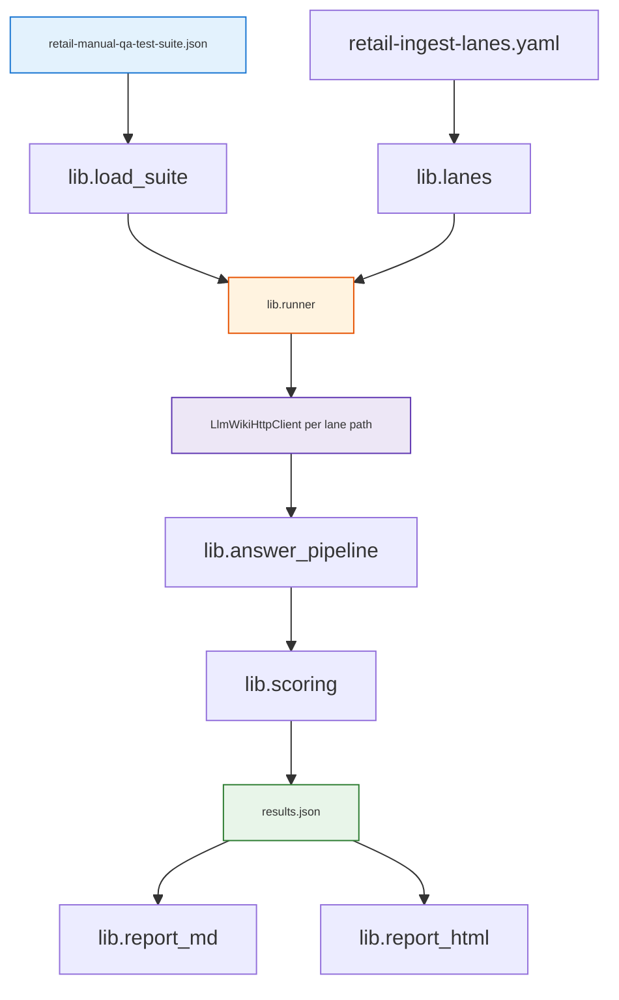

<h1 id="rmp-arch-title" style="color:#0d47a1;font-size:1.5em;font-weight:700;border-bottom:2px solid #90caf9;padding-bottom:0.25em;margin-top:0">Lane benchmark — architecture</h1>

<h2 id="rmp-arch-outline" style="color:#1565c0;font-size:1.22em;font-weight:650;border-left:4px solid #42a5f5;padding-left:10px;margin-top:1.1em">Document outline</h2>

1. [Flow](#rmp-arch-flow) — end-to-end.
2. [Modules](#rmp-arch-modules) — `lib/` responsibilities.
3. [Future DB](#rmp-arch-db) — JSON as data layer v1.

---

<h2 id="rmp-arch-flow" style="color:#1565c0;font-size:1.22em;font-weight:650;border-left:4px solid #42a5f5;padding-left:10px;margin-top:1.1em">1. Flow</h2>

Each lane uses **`POST /api/v1/projects/{absolute-path}/search`** — no UI project switch.

---

<h2 id="rmp-arch-modules" style="color:#1565c0;font-size:1.22em;font-weight:650;border-left:4px solid #42a5f5;padding-left:10px;margin-top:1.1em">2. Modules</h2>

| Module | Role |
|--------|------|
| `lib/load_suite.py` | Validate schema; iterate questions with SKU context |
| `lib/lanes.py` | Load A–D registry; preflight wiki + API |
| `lib/answer_pipeline.py` | Search → read → answer LLM → optional polish |
| `lib/scoring.py` | Negative exact match; LLM judge for easy/hard |
| `lib/runner.py` | Checkpointed multi-lane driver |
| `lib/report_md.py` / `lib/report_html.py` | Scoreboards from `results.json` |

---

<h2 id="rmp-arch-db" style="color:#1565c0;font-size:1.22em;font-weight:650;border-left:4px solid #42a5f5;padding-left:10px;margin-top:1.1em">3. Future DB</h2>

`results.json` schema is versioned (`schema_version`) so rows can migrate into Postgres/SQLite without changing report generators.
