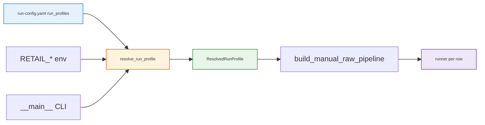

<h1 id="run-profiles-title" style="color:#0d47a1;font-size:1.5em;font-weight:700;border-bottom:2px solid #90caf9;padding-bottom:0.25em;margin-top:0">Run profiles — dimensions, config, and terminology</h1>

**D6 eval suites (short id → long name):** `TYPE_A_M90` → **M90-technical-singlefact** · `TYPE_B_B20` → **B20-technical-compound** · `TYPE_C_C20` → **C20-insight-orientation** (`tests/retail_multi_profiles/lib/eval_suites.py`).

**Canonical dimension definitions:** [`REALIGNMENT_DIMENSIONS.md`](../../../../docs_manual_gen/artifacts/aggregated/REALIGNMENT_DIMENSIONS.md).  
**Implementation plan:** [`REFACTOR_PLAN_MAIN_1_FURTHER_ENHANCEMENT_GPT.md`](../../../../docs_manual_gen/ref_plan/new/REFACTOR_PLAN_MAIN_1_FURTHER_ENHANCEMENT_GPT.md) Phase 1 (P1.0b–P1.5b).

<h2 id="run-profiles-outline" style="color:#1565c0;font-size:1.22em;font-weight:650;border-left:4px solid #42a5f5;padding-left:10px;margin-top:1.1em">Document outline</h2>

1. [Vocabulary](#vocab) — D3 vs D5; avoid ambiguous mode names.
2. [Single source of truth](#ssot) — YAML profile → resolved profile → runner.
3. [D5 rerank backends](#d5-rerank) — `enabled` + `backend`, not three overlapping env names.
4. [D5 verifier and agentic](#d5-va) — profile-owned flags.
5. [Env overrides](#env) — optional runtime overrides.
6. [Profile catalog (Lane B raw)](#catalog) — informal ids and dimension tuples.
7. [Pre-flight and artifacts](#preflight) — what must be true before a judged run.

---

<h2 id="vocab" style="color:#1565c0;font-size:1.22em;font-weight:650;border-left:4px solid #42a5f5;padding-left:10px;margin-top:1.1em">1. Vocabulary</h2>

Use these terms **consistently** in code comments, logs, YAML, and analysis docs.

| Term | Dimension | Meaning |
|------|-----------|---------|
| **D3 retrieval engine** | D3 | How candidate chunks are **found and fused** (e.g. `vector`, `hybrid_rrf`). Does **not** imply rerank. |
| **D5 post-retrieval stack** | D5 | What happens **after** top-k candidates exist: rerank (**D5.R**), verifier (**D5.V**), agentic re-search (**D5.A**). |
| **`hybrid_rrf`** | D3 only | SKU-filtered lexical + vector → **RRF** (reciprocal rank fusion). **D5.0** unless profile adds D5. |
| **`hybrid_rrf_rerank`** | D3 label (legacy) | Same D3 pool as `hybrid_rrf`; name suggests D5.R — **misleading until** `d5.rerank.enabled` is true and a backend is wired. Prefer **`resolved.d3_engine` + `resolved.d5_stack`** in new code. |
| **`listwise_rerank`** | D5.R implementation | Function in `retail_brain/rerank.py` that reorders rows given a **`rank_fn`**. Not a backend name. |
| **`rank_fn`** | D5.R hook | Callable: `(query, candidates) → LLM text` parsed into ordered chunk ids. Required for **`llm_listwise`** backend. |
| **`llm_listwise`** | D5.R **backend** | Listwise LLM rerank (**R5** default for manual raw). |
| **`cross_encoder`** | D5.R **backend** | Local MiniLM cross-encoder (`cross-encoder/ms-marco-MiniLM-L-6-v2`). TYPE_B_B20 hybrid profile stays off; a bundled row opts in with `manual_rerank`. |
| **`ResolvedRunProfile`** | harness | Immutable struct after merge: profile YAML + env + CLI; sole input to retrieval pipeline factory. |

**Do not** use env names like `LIST_WISE_RANK_FN` vs `LLM_RANK_FN` — both describe the same **llm_listwise** backend. Use **`d5.rerank.enabled`** (boolean) and **`d5.rerank.backend`** (enum).

---

<h2 id="ssot" style="color:#1565c0;font-size:1.22em;font-weight:650;border-left:4px solid #42a5f5;padding-left:10px;margin-top:1.1em">2. Single source of truth</h2>

**Precedence (highest wins):** CLI flags → environment variables → **`run_profiles.<id>`** block → `retail_raw_rag` defaults → code defaults.

**Flow:**

**Target module:** `tests/retail_multi_profiles/lib/run_profiles.py` (extend) — **`resolve_effective_profile(...)`** returns **`ResolvedRunProfile`** with:

- `profile_id`, `dimension_tuple` (human string for analysis)
- `d2_lanes`, `d3_engine`, `d5_rerank_enabled`, `d5_rerank_backend`, `d5_verifier`, `d5_agentic`, `d5_agentic_max_loops`
- `retrieval_mode` (`raw_rag` / `llm_wiki`) for harness routing

**Runner rule:** `runner.py` must **not** re-interpret YAML strings with `bool("false")` or OR together global agentic + CLI; it only reads **`ResolvedRunProfile`**.

**HG-P1 default (when CLI omits `--profile`):** If **`--retrieval-mode raw_rag`**, the harness resolves **`run-config.yaml` → `default_run_profile`** (currently **`MANUAL_B_RAW_PG_HYBRID_RERANK`**). Manual D3 is **Postgres-only** (`manual_d3_backend: pg`; Lance removed on **evo-17**). Wiki runs (`llm_wiki`, the CLI default) are **unchanged**. **Eval anchor** for vector baseline remains **`MANUAL_B_RAW_VECTOR`** / **`abcd-raw-full-openai-v1`**.

---

<h2 id="d5-rerank" style="color:#1565c0;font-size:1.22em;font-weight:650;border-left:4px solid #42a5f5;padding-left:10px;margin-top:1.1em">3. D5 rerank — `enabled` + `backend`</h2>

<table>
<thead>
<tr style="background:#1565c0;color:white"><th>Field</th><th>Type</th><th>Values</th></tr>
</thead>
<tbody>
<tr><td style="background:#e3f2fd"><code>d5.rerank.enabled</code></td><td>boolean (YAML <code>true</code>/<code>false</code>, coerced at load)</td><td><strong>Off switch.</strong> When false, skip rerank; <code>backend</code> is ignored.</td></tr>
<tr><td style="background:#e3f2fd"><code>d5.rerank.backend</code></td><td>string enum (only when enabled)</td><td><code>llm_listwise</code> (default if omitted) · <code>cross_encoder</code> (<code>cross-encoder/ms-marco-MiniLM-L-6-v2</code>, local). No <code>none</code> — use <code>enabled: false</code>.</td></tr>
</tbody>
</table>

**Rules:**

- If **`enabled: true`**, default **`backend`** to **`llm_listwise`** when unset; harness must wire **`rank_fn`**. **Pre-flight:** abort if `rank_fn` would be no-op.
- If **`backend: cross_encoder`**, the harness builds a local MiniLM rank_fn. Preflight still aborts when that rank_fn is missing. TYPE_B_B20 profile `MANUAL_B_RAW_PG_HYBRID` leaves rerank off; the bundled probe selects the backend per row via `manual_rerank`.
- **`d3_engine: hybrid_rrf_rerank`** alone is **not** sufficient for D5.R; prefer explicit **`d5.rerank`** on the profile (legacy alias may map `hybrid_rrf_rerank` → `enabled: true`, `backend: llm_listwise` once resolver lands).

**Factory:** `retail_brain/rerank_registry.py` (planned) — **`build_rank_fn(backend, cfg) -> RankFn | None`**.

---

<h2 id="d5-va" style="color:#1565c0;font-size:1.22em;font-weight:650;border-left:4px solid #42a5f5;padding-left:10px;margin-top:1.1em">4. D5 verifier and agentic</h2>

| Field | Type | Meaning |
|-------|------|---------|
| **`d5.verifier.enabled`** | boolean | Run **`verify_manual_coverage`** and attach JSON to row **`search_meta.verifier`**. |
| **`d5.agentic.enabled`** | boolean | Use **`AgenticRetrievalController`** (verifier + up to **`max_loops`** extra retrieve). |
| **`d5.agentic.max_loops`** | int | **R4:** default **1** for manual raw. |

**Profile examples:**

- **D5.0:** `verifier: false`, `agentic: false` — pure retrieve → answer.
- **D5.V:** verifier on, agentic off — observability only.
- **D5.V+A:** verifier + agentic (typical “full stack” arm with D5.R optional).

---

<h2 id="env" style="color:#1565c0;font-size:1.22em;font-weight:650;border-left:4px solid #42a5f5;padding-left:10px;margin-top:1.1em">5. Environment overrides (optional)</h2>

| Variable | Overrides | Values |
|----------|-----------|--------|
| **`RETAIL_D5_RERANK_ENABLED`** | `d5.rerank.enabled` | `1`/`0`, `true`/`false` (strict parse) |
| **`RETAIL_D5_RERANK_BACKEND`** | `d5.rerank.backend` (only if enabled) | `llm_listwise`, `cross_encoder` |
| **`RETAIL_D5_AGENTIC_ENABLED`** | `d5.agentic.enabled` | `1`/`0`, `true`/`false` |

Document any override in **`results.json`** → **`config_snapshot.resolved_profile`**.

---

<h2 id="catalog" style="color:#1565c0;font-size:1.22em;font-weight:650;border-left:4px solid #42a5f5;padding-left:10px;margin-top:1.1em">6. Profile catalog (Lane B raw)</h2>

| YAML `run_profiles` id | Dimension tuple (informal) | D3 | D5 |
|------------------------|----------------------------|----|----|
| **`MANUAL_B_RAW_VECTOR`** | `MANUAL\|M\|D2.B\|D3.R-V\|LC\|0\|TYPE_A_M90\|B` | `vector` | **0** |
| **`MANUAL_B_RAW_HYBRID`** | `MANUAL\|M\|D2.B\|D3.R-H\|LC\|0\|TYPE_A_M90\|B` | `hybrid_rrf` + **`manual_d3_backend: pg`** | **0** |
| **`MANUAL_B_RAW_HYBRID_RERANK`** | `MANUAL\|M\|D2.B\|D3.R-H\|LC\|R+V+A\|TYPE_A_M90\|B` | `hybrid_rrf` + **`manual_d3_backend: pg`** | **R+V+A** (`llm_listwise`) |
| **`MANUAL_B_RAW_PG_HYBRID`** | `MANUAL\|M\|D2.B\|D3.R-H\|LC\|0\|TYPE_A_M90\|B` (PG store) | `hybrid_rrf` + **`manual_d3_backend: pg`** | **0** |
| **`MANUAL_B_RAW_PG_HYBRID_RERANK`** | `MANUAL\|M\|D2.B\|D3.R-H\|LC\|R+V+A\|TYPE_A_M90\|B` (PG store) | `hybrid_rrf` + **`manual_d3_backend: pg`** | **R+V+A** |

**Manual raw path:** requires **`RETAIL_DATABASE_URL`**; preflight **`ensure_manual_pg_fresh`** (or **`--ingest-manual-pg --lanes B`**).

**Fair compare (Phase 1 exit):** run **`MANUAL_B_RAW_HYBRID`** vs **`MANUAL_B_RAW_HYBRID_RERANK`** with **only D5** changing; D3 engine for both should be **`hybrid_rrf`** once resolver removes the misleading `hybrid_rrf_rerank` D3-only mode (or alias with explicit D5).

---

<h2 id="preflight" style="color:#1565c0;font-size:1.22em;font-weight:650;border-left:4px solid #42a5f5;padding-left:10px;margin-top:1.1em">7. Pre-flight and artifacts</h2>

Before **`--full`** judged runs:

1. Log **`resolved_profile`** (dimensions + backends) at run start.
2. If **`d5.rerank.enabled`** and backend **`llm_listwise`**, assert **`rank_fn`** is non-null (smoke test reorders at least one fixture row).
3. Persist on each row: **`search_meta.resolved_d5`**, **`search_meta.verifier`**, **`search_meta.agentic`** (`subquery_used`, `loops`).

**Interim runs (2026-10-24):** `a2-hybrid-rrf-b-v1` / `a2-hybrid-rerank-b-v1` are **not** fair D5 compares — see [`TEST_ANALYSIS_A2_MANUAL_RAG.md`](../../../../docs_manual_gen/artifacts/TEST_ANALYSIS_A2_MANUAL_RAG.md) § Interim.
