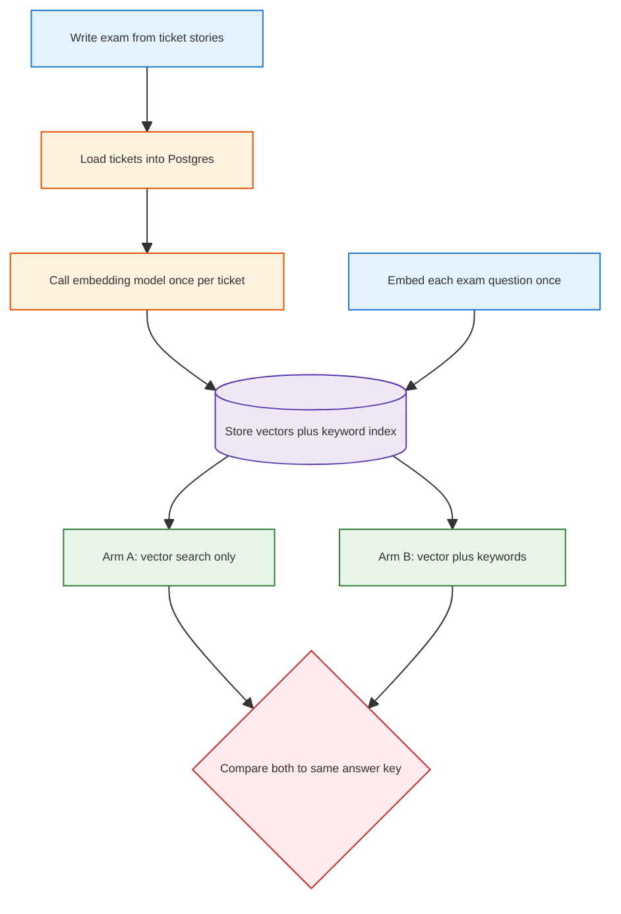
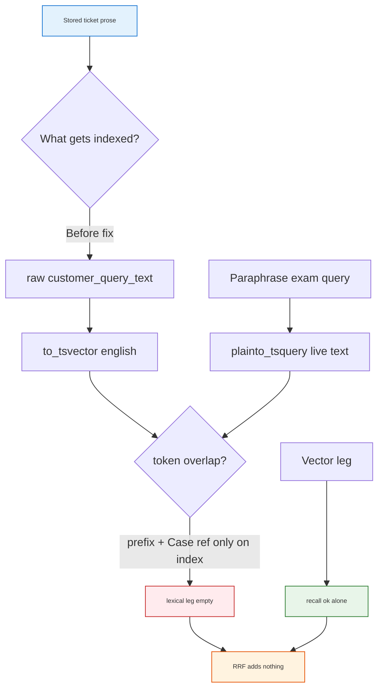
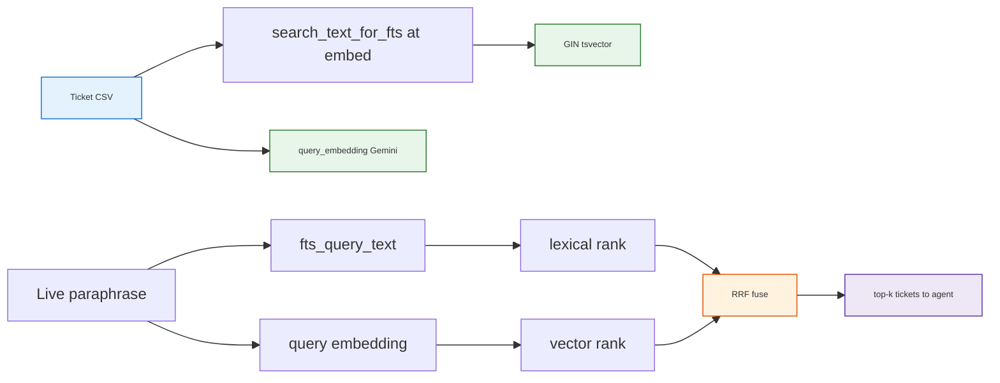
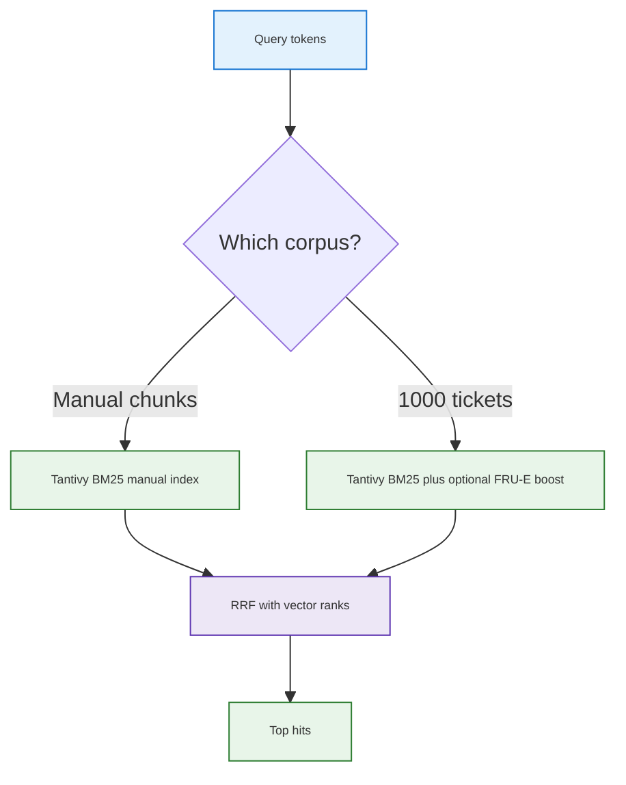
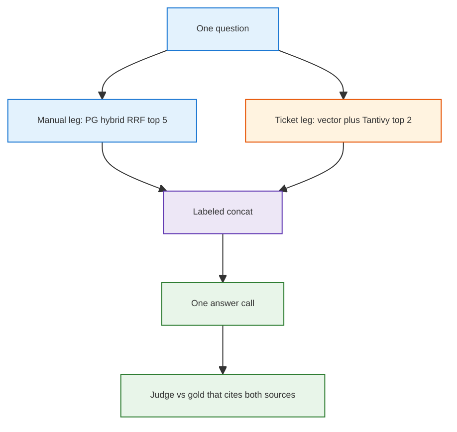
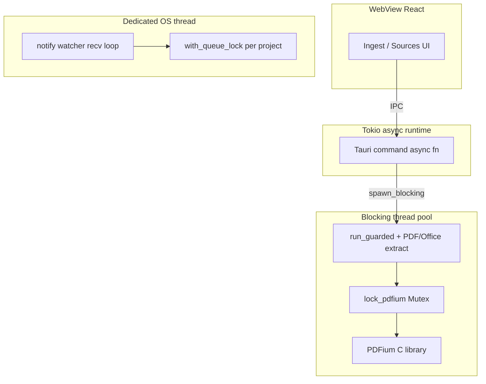

<h1 id="war-stories-title" style="color:#0d47a1;font-size:1.5em;font-weight:700;border-bottom:2px solid #90caf9;padding-bottom:0.25em;margin-top:0">War stories — portable collection</h1>

Lessons that travel across projects (RAG, eval, agent UX). Project-specific Samsung wiring also references **`docs_manual_gen/ref_plan/completed/REFACTOR_SAMSUNG_RETAIL_SERVICE_BRAIN.md`**.

<h2 id="war-stories-outline" style="color:#1565c0;font-size:1.22em;font-weight:650;border-left:4px solid #42a5f5;padding-left:10px;margin-top:1.1em">Document outline</h2>

1. [Story index](#story-index)
2. [Story 1 — Ticket vs wiki planes + D6 A/B gates](#war-story-1)
3. [Story 2 — Embed once, share vectors for A/B](#war-story-2)
4. [Story 3 — Operator load: empty CSV timestamps and eval `.env` parity](#war-story-3)
5. [Story 4 — Hybrid RRF beside RAG: BM25-class lexical + dense + fuse, not overlap hacks](#war-story-4)
6. [Story 5 — Pin python3.12; do not call python3](#war-story-5)
7. [Story 6 — One keyword switch, external engines stay optional](#war-story-6)
8. [Story 7 — Split a corpus into profiles: derive paths from one switch](#war-story-7)
9. [Story 8 — Long ticket text found no manual page: score only matchable words](#war-story-8)
10. [Story 9 — "Garbage" PDF text was a shifted font, not noise](#war-story-9)
11. [Story 10 — An inherited env default silently disabled the fault-code boost](#war-story-10)
12. [Story 11 — Three lexical arms: overlap, Postgres FTS, Tantivy](#war-story-11)
13. [Story 12 — Bundled answers keep separate legs](#war-story-12)
14. [Story 13 — Rerank the deep list, then keep five per ask](#war-story-13)
15. [Story 14 — Rust “fearless concurrency” still needs PDFium fences](#war-story-14)
16. [Story 15 — Map large PDFs before cross-document synthesis](#war-story-15)
17. [Story 16 — Let the judge describe quality; let code compute the score](#war-story-16)

---

<h2 id="story-index" style="color:#1565c0;font-size:1.22em;font-weight:650;border-left:4px solid #42a5f5;padding-left:10px;margin-top:1.1em">Story index</h2>

<table>
<thead>
<tr style="background:#1565c0;color:white"><th>#</th><th>Title</th><th>Gist</th></tr>
</thead>
<tbody>
<tr><td style="background:#e3f2fd">1</td><td><a href="#war-story-1">Split ticket PG from manual wiki; promote hybrid search only on recall + precision</a></td><td>Two indexes; D6 needs literal recall up and wrong-fix reuse flat.</td></tr>
<tr><td style="background:#e3f2fd">2</td><td><a href="#war-story-2">Embed the cabinet once; both A and B read the same stored vectors</a></td><td>Live models jitter; freeze docs and queries. Hash mock is for CI only.</td></tr>
<tr><td style="background:#e3f2fd">3</td><td><a href="#war-story-3">Operator PG load: CSV null timestamps and eval `.env` parity</a></td><td>Empty CSV cells ≠ SQL NULL; embed script and eval must load the same `.env`.</td></tr>
<tr><td style="background:#e3f2fd">4</td><td><a href="#war-story-4">Hybrid RRF beside RAG: inverted lexical + dense + fuse</a></td><td>Normalize index text once; vectors for paraphrase; reject O(n) overlap on condensed strings.</td></tr>
<tr><td style="background:#e3f2fd">5</td><td><a href="#war-story-5">Pin python3.12; do not call python3</a></td><td>System python3 stays 3.9. A word-boundary match also hits python3.12.</td></tr>
<tr><td style="background:#e3f2fd">6</td><td><a href="#war-story-6">One keyword switch, external engines stay optional</a></td><td>Default verify runs the embedded index. ParadeDB and OpenSearch are faked unless their URL is set.</td></tr>
<tr><td style="background:#e3f2fd">7</td><td><a href="#war-story-7">Split a corpus into profiles: derive paths from one switch</a></td><td>Local config kept old paths; anchored gitignore patterns changed meaning after the move.</td></tr>
<tr><td style="background:#e3f2fd">8</td><td><a href="#war-story-8">Long ticket text found no manual page: score only words the pages can match</a></td><td>Unseen words got max IDF and zeroed every page; gold from author anchors, not the scorer.</td></tr>
<tr><td style="background:#e3f2fd">9</td><td><a href="#war-story-9">"Garbage" PDF text was a shifted font, not noise</a></td><td>GE glyphs sit 29 code points low; decode before collapsing whitespace.</td></tr>
<tr><td style="background:#e3f2fd">10</td><td><a href="#war-story-10">An inherited env default silently disabled the fault-code boost</a></td><td>Phone-era SAM-E prefix default; new entry points read the domain config.</td></tr>
<tr><td style="background:#e3f2fd">11</td><td><a href="#war-story-11">Three lexical arms: overlap, Postgres FTS, Tantivy</a></td><td>Cheap overlap stayed fast but failed relevance: common words supplied 66% of a gold chunk’s score.</td></tr>
<tr><td style="background:#e3f2fd">12</td><td><a href="#war-story-12">Bundled answers keep separate legs</a></td><td>Manuals and past tickets stay different indexes; concat a fixed top-k, do not pretend chunks share one score.</td></tr>
<tr><td style="background:#e3f2fd">13</td><td><a href="#war-story-13">Rerank the deep list, then keep five per ask</a></td><td>A reranker that only sees the already-cut top 5 cannot recover a hit at fused rank 12.</td></tr>
<tr><td style="background:#e3f2fd">14</td><td><a href="#war-story-14">Rust “fearless concurrency” still needs PDFium fences</a></td><td>LLM Wiki Tauri backend: `spawn_blocking`, global PDFium mutex, `catch_unwind`, per-project queue locks—Java analogues named.</td></tr>
<tr><td style="background:#e3f2fd">15</td><td><a href="#war-story-15">Map large PDFs before cross-document synthesis</a></td><td>Four complete manuals overflowed one context; extract bounded evidence per PDF, then synthesize with hashes and resumable artifacts.</td></tr>
<tr><td style="background:#e3f2fd">16</td><td><a href="#war-story-16">Let the judge describe quality; let code compute the score</a></td><td>Replace harsh binary rubrics with blinded dimensions, deterministic weights and caps, and independent-provider review flags.</td></tr>
</tbody>
</table>

---

<h2 id="war-story-1" style="color:#1565c0;margin-top:1.35em;margin-bottom:0.5em;font-weight:650;border-left:4px solid #42a5f5;padding-left:10px">1. Split ticket PG from manual wiki; promote hybrid search only on recall + precision</h2>

**creation:** 261010-131600  
**last_updated:** 261010-131600  
**keywords:** rag, pgvector, tsvector, eval, ab-test, llm-wiki, second-brain, design, retrieval  
**difficulty:** 5  
**significance:** 8  

<h3 id="war-story-1-sec-1" style="color:#00695c;margin-top:1.05em;margin-bottom:0.4em;font-weight:600">1.1 Context</h3>

A retail “Second Brain” needed **~100k service tickets** plus **six PDF manuals** for three phone models. The temptation was one search index over everything, or exporting ticket themes into the same wiki compiler used for PDFs.

<h3 id="war-story-1-sec-2" style="color:#00695c;margin-top:1.05em;margin-bottom:0.4em;font-weight:600">1.2 Root Cause</h3>

**Tickets** and **manuals** differ in shape and risk: tickets are OLTP rows with statuses and PII boundaries; manuals are curated documents. Mixing them in one vector index blurs **“reuse a past resolution”** vs **“read the official guide”** and makes eval ambiguous.

<h3 id="war-story-1-sec-3" style="color:#00695c;margin-top:1.05em;margin-bottom:0.4em;font-weight:600">1.3 Key Insight</h3>

Use **two retrieval planes**: PostgreSQL (+ pgvector, optional tsvector + RRF) for tickets; Nashsu LLM Wiki hybrid search for compiled **`brain/retail/wiki/`** PDFs only. The agent routes: **semantic ticket search → else wiki**—not a third “theme playbook” layer in V1.

Promotion of **V1.1 hybrid ticket search** (decision **D6**) must pass **both**:

- **Recall (right ticket in top results)** — especially **literal-token** queries (SKU, model code, copied error text) where the lexical leg earns its keep.
- **Precision (don’t confidently wrong-fix)** — **false reuse** (applying another case’s resolution) must not **increase** on **paraphrase** eval rows; falling back to manuals is acceptable when similarity is weak.

A **50-row smoke corpus** validates plumbing; it is **not** enough to flip D6 defaults—need larger held-out gold and frozen DB before production promotion.

<h3 id="war-story-1-sec-4" style="color:#00695c;margin-top:1.05em;margin-bottom:0.4em;font-weight:600">1.4 Resolution</h3>

- Locked **D1–D7** in `docs_manual_gen/todos/TODO_SAMSUNG_RETAIL_STRUCTURED_DATA_AND_WIKI.md` and **`REFACTOR_SAMSUNG_RETAIL_SERVICE_BRAIN.md`**.
- **Eval anti-leakage:** `generate_eval_from_manifest.py` builds **paraphrase** queries linked to `source_ticket_id`; pytest rejects verbatim copy of stored ticket text.
- **Prep scripts** under `cursor_gen/retail_v11_prep/` (Docker PG, load, embed, `--postgres` A/B)—external deps **stop + prompt** via `lib/require_external.sh`.
- **Phased corpus:** **50** tickets for implementation shakeout; **90** total (`COUNT=90`, same seed preserves first 50) immediately before A/B—not for D6 promotion at that size.
- **User-facing prose rule:** `.cursor/rules/abbr-first-use-expand.mdc` — plain language + glosses for abbreviations and jargon.

```text
# Phased generation (repo root)
COUNT=50  bash cursor_gen/retail_v11_prep/02_generate_corpus.sh   # implement / wire
COUNT=90  bash cursor_gen/retail_v11_prep/02_generate_corpus.sh   # pre-A/B (superset)
bash cursor_gen/retail_v11_prep/03_pg_up_and_load.sh
bash cursor_gen/retail_v11_prep/04_run_ab_postgres.sh
```

<h3 id="war-story-1-sec-5" style="color:#00695c;margin-top:1.05em;margin-bottom:0.4em;font-weight:600">1.5 Takeaway</h3>

When OLTP history and document KB coexist, **split indexes and split eval suites**; promote retrieval upgrades only when **recall gains on literal queries** do not buy **more wrong confident answers** on paraphrases. Generate eval gold with **deterministic scripts**, not chat tuned to the ranker you hope to pass.

---

<h2 id="war-story-2" style="color:#1565c0;margin-top:1.35em;margin-bottom:0.5em;font-weight:650;border-left:4px solid #42a5f5;padding-left:10px">2. Embed the cabinet once; both A and B read the same stored vectors</h2>

**creation:** 261010-143500  
**last_updated:** 261010-143500  
**keywords:** design, system design, embeddings, pgvector, ab-test, eval, determinism, hash-mock  
**difficulty:** 4  
**significance:** 8  

<h3 id="war-story-2-sec-1" style="color:#00695c;margin-top:1.05em;margin-bottom:0.4em;font-weight:600">2.1 Context</h3>

A ticket-search A/B compared **vector-only** search (arm A) with **vector plus keyword blend** (arm B). Live embedding APIs (for example Gemini embedding models) are built to capture **meaning**, not to promise bit-identical floats on every HTTP call. A checksum-style **hash mock** (`hash_embed`) already existed so continuous integration could run without API keys. The open question was whether a **real** model could still support a fair, repeatable A/B—or whether only the mock was “deterministic enough.”

<h3 id="war-story-2-sec-2" style="color:#00695c;margin-top:1.05em;margin-bottom:0.4em;font-weight:600">2.2 Root Cause</h3>

Nondeterminism is not “embeddings cannot be used in tests.” It is **calling the model again** between arms, or letting each arm embed the **question** on its own. Two nearly identical vectors still change neighbor order on close calls. A hash mock removes that jitter by ignoring meaning entirely, so a green A/B on the mock does **not** answer whether paraphrases retrieve the right past ticket.

A second, separate failure mode: writing the exam answer key from “whoever is nearest after embedding.” That makes the test agree with the current vectors by construction. Fair vectors do not fix a rewritten answer key.

<h3 id="war-story-2-sec-3" style="color:#00695c;margin-top:1.05em;margin-bottom:0.4em;font-weight:600">2.3 Key Insight</h3>

**Embed once, store, share.** Turn each stored ticket into numbers **one time**, write them into Postgres, and pin the model id and dimension. Run arm A and arm B against **those same rows**. Also embed each **exam question once** and feed **that same question vector** into both arms. Keyword search (the extra leg in arm B) does not need embeddings; only the vector leg must be frozen.

The hash function is a **mock embedding**: same interface (a list of floats, cosine distance), **no semantic model**. Use it for plumbing tests. Use the frozen real cabinet for any decision about whether hybrid search should become the default.

<table>
<thead>
<tr style="background:#1565c0;color:white"><th>Approach</th><th>Same numbers every rerun?</th><th>Tests real “similar meaning”?</th><th>Use for</th></tr>
</thead>
<tbody>
<tr><td style="background:#e3f2fd">Re-call API on every search</td><td style="background:#ffebee">No — small float drift</td><td style="background:#fff3e0">Yes, but A and B may not see the same question vector</td><td style="background:#ffebee">Not for A/B</td></tr>
<tr><td style="background:#e3f2fd">Hash mock (<code>hash_embed</code>)</td><td style="background:#e8f5e9">Yes</td><td style="background:#ffebee">No — barcode of the text</td><td style="background:#fff3e0">CI / offline wiring</td></tr>
<tr><td style="background:#e3f2fd"><strong>Real embed once, shared</strong></td><td style="background:#e8f5e9">Yes, if docs <em>and</em> queries stay stored</td><td style="background:#e8f5e9">Yes</td><td style="background:#e8f5e9"><span style="background:#2e7d32;color:white;padding:1px 4px">recommended</span> operator A/B</td></tr>
</tbody>
</table>

**Caveats (the shared cabinet is effective only if these hold):**

- **Questions too.** Document vectors alone are not enough if each arm re-embeds the user question live.
- **One model generation.** Pin model id, dimension, and normalization. Do not fill `NULL` rows later with a newer model.
- **Text prep frozen.** Changing lowercase/strip rules after storage makes new questions disagree with old tickets.
- **Answer key stays independent.** Gold ticket ids come from the scenario, not from “top neighbor after embed.”
- **Incomplete batches.** A failed API run must not leave half the table on model A and half on model B.
- **Vendor and privacy.** Text leaves the machine; synthetic data still needs a pinned vendor contract. Cost scales with corpus size, not with how many times you rerun A vs B.

<h3 id="war-story-2-sec-4" style="color:#00695c;margin-top:1.05em;margin-bottom:0.4em;font-weight:600">2.4 Resolution</h3>



**Continuous integration mock** — **`second_brain`** · `scripts/retail/retail_brain/embeddings.py` (hash stand-in, not a meaning model):

```python
def hash_embed(text: str, dims: int = 32) -> List[float]:
    """Same text always yields the same floats. Not a semantic embedding."""
    digest = hashlib.sha256(text.strip().lower().encode("utf-8")).digest()
    vals: List[float] = []
    for i in range(dims):
        b = digest[i % len(digest)]
        vals.append((b / 127.5) - 1.0)
    norm = math.sqrt(sum(v * v for v in vals)) or 1.0
    return [v / norm for v in vals]
```

**Operator protocol** (real model; both arms read storage):

```text
1. Generate tickets + exam JSONL (answer key from stories, fixed seed).
2. Load Postgres. Embed each ticket once; store vector + model id.
   Embed each exam question once; store that vector beside the exam row.
3. Arm A and arm B: never call the embedding API.
   Vector leg uses stored ticket vectors and the stored question vector.
   Arm B additionally uses the keyword index built from the same text.
4. Score both arms against the unchanged answer key.
5. Re-run is deterministic until model id, text prep, or stored vectors change.
```

Today’s loader (`scripts/retail/embed_service_queries.py`) still calls `hash_embed` so local smoke tests need no API. **Promotion A/B** switches that step to a pinned live model with the store-once rule above; the hash path stays for tests that only prove wiring. Plan: `docs_manual_gen/ref_plan/completed/REFACTOR_SAMSUNG_RETAIL_SERVICE_BRAIN.md` (decision on shared embeddings; role split of exam author vs search coder deferred to a later slice).

<h3 id="war-story-2-sec-5" style="color:#00695c;margin-top:1.05em;margin-bottom:0.4em;font-weight:600">2.5 Takeaway</h3>

Freeze **document and question** vectors from **one** embedding pass and point both A/B arms at that cabinet; keep checksum mocks for CI and keep the answer key independent of neighbor lists.

---

<h2 id="war-story-3" style="color:#1565c0;margin-top:1.35em;margin-bottom:0.5em;font-weight:650;border-left:4px solid #42a5f5;padding-left:10px">3. Operator PG load: CSV null timestamps and eval `.env` parity</h2>

**creation:** 261010-164800  
**last_updated:** 261010-164800  
**keywords:** postgres, csv, operator, embeddings, eval, second-brain  
**difficulty:** 3  
**significance:** 5  

<h3 id="war-story-3-sec-1" style="color:#00695c;margin-top:1.05em;margin-bottom:0.4em;font-weight:600">3.1 Context</h3>

Phase 6 loaded synthetic tickets from CSV into Postgres, embedded rows with Gemini, then ran `--postgres` eval for V1 vs V1.1.

<h3 id="war-story-3-sec-2" style="color:#00695c;margin-top:1.05em;margin-bottom:0.4em;font-weight:600">3.2 Root Cause</h3>

Open tickets used an **empty string** for `closed_at` in CSV. Postgres rejected `''` for `timestamptz`. Separately, `embed_service_queries.py` loaded repo `.env` but `eval_ticket_search.py` did not—query embeddings failed at runtime despite a successful embed step. A third issue: **language drift** — Portuguese ticket text with hard-coded `'english'` tsvector left the hybrid lexical leg empty.

<h3 id="war-story-3-sec-3" style="color:#00695c;margin-top:1.05em;margin-bottom:0.4em;font-weight:600">3.3 Resolution</h3>

Map blank timestamp fields to **SQL NULL** in `load_service_queries.py`. Call `load_repo_env(ROOT)` in the Postgres eval entrypoint so **load, embed, and search** share the same embedding config. Introduce **`RETAIL_MARKET`** (`retail_brain/market.py`) so seed copy, eval paraphrases, `to_tsvector`, and `plainto_tsquery` share one Postgres text config (default **AU** / `english`).

<h3 id="war-story-3-sec-4" style="color:#00695c;margin-top:1.05em;margin-bottom:0.4em;font-weight:600">3.4 Takeaway</h3>

Operator scripts are part of the product surface: treat CSV edge cases, `.env` loading, and **market locale** as **one contract** across every path that embeds or full-text searches tickets.

---

<h2 id="war-story-4" style="color:#1565c0;margin-top:1.35em;margin-bottom:0.5em;font-weight:650;border-left:4px solid #42a5f5;padding-left:10px">4. Hybrid RRF beside RAG: inverted lexical + dense + fuse (not overlap hacks)</h2>

**Payoff (read this first):** Ticket **RAG (retrieval-augmented generation: fetch similar past cases before the model answers)** needs **two retrieval legs** in production: **dense vectors** for customer paraphrase, and an **inverted lexical index** (BM25-class full-text, e.g. Postgres `tsvector` + GIN) on **index text you control once per ticket**. Fuse ranked lists with **RRF (reciprocal rank fusion: add scores from rank position, not raw similarity)**—optionally **rerank** top candidates with a cross-encoder. Do **not** scan every row counting **% token overlap** on LLM-condensed strings at query time; that is neither best practice nor scalable. Batch LLM enrichment of index copy is fine **offline**; infinite live boilerplate stripping is not the whole answer.

**creation:** 261010-234500  
**last_updated:** 261010-234500  
**keywords:** rag, hybrid-search, rrf, bm25, pgvector, tsvector, eval, design, retrieval, second-brain  
**difficulty:** 6  
**significance:** 9  

<h3 id="war-story-4-sec-1" style="color:#00695c;margin-top:1.05em;margin-bottom:0.4em;font-weight:600">4.1 Context</h3>

Samsung retail **Second Brain** stores ~90–100k-scale **service tickets** in Postgres with **pgvector** embeddings and an optional **V1.1** mode: vector leg + lexical leg + **RRF**. Manual PDFs stay on a **separate wiki plane** (story #1). Eval uses **paraphrase questions** (anti-leakage): stored tickets carry `"Customer reports: … Case ref ITM-… / T-…"`, while exam queries sound like live callers and omit case refs.

After Phase 6 A/B with real Gemini embeddings, **strict recall@1** was ~95% on vectors—but **every eval row reported an empty lexical leg**, so **hybrid top-1 identical to vector-only**. Hybrid was wired; it was not **contributing**.

<h3 id="war-story-4-sec-2" style="color:#00695c;margin-top:1.05em;margin-bottom:0.4em;font-weight:600">4.2 What industry practice actually looks like</h3>

Modern **hybrid retrieval** stacks (Elasticsearch/OpenSearch **RRF**, Azure AI Search hybrid, Vespa, many RAG tutorials) converge on the same shape:

<table>
<thead>
<tr style="background:#1565c0;color:white"><th>Stage</th><th>Role</th><th>Typical tech</th></tr>
</thead>
<tbody>
<tr><td style="background:#e3f2fd">① Lexical</td><td style="background:#e8f5e9">Exact/rare tokens, SKUs, error codes, product strings</td><td style="background:#e8f5e9">Inverted index — BM25 or Postgres FTS (`tsvector`, GIN)</td></tr>
<tr><td style="background:#e3f2fd">② Dense</td><td style="background:#e8f5e9">Paraphrase, vague customer wording</td><td style="background:#e8f5e9">Embedding + ANN (pgvector, HNSW, etc.)</td></tr>
<tr><td style="background:#e3f2fd">③ Fuse</td><td style="background:#fff3e0">Merge two rank lists without calibrating scores</td><td style="background:#fff3e0">RRF (Cormack et al.; widely adopted in OpenSearch 2.x+)</td></tr>
<tr><td style="background:#e3f2fd">④ Rerank (optional)</td><td style="background:#ede7f6">Precision on top 20–50</td><td style="background:#ede7f6">Cross-encoder or LTR model</td></tr>
</tbody>
</table>

**References (external):**

- [OpenSearch — Reciprocal rank fusion](https://opensearch.org/docs/latest/search-plugins/search-relevance/rrf/) — productized RRF over lexical + neural legs.
- [Azure AI Search — Hybrid search (BM25 + vectors)](https://learn.microsoft.com/en-us/azure/search/hybrid-search-overview) — official hybrid overview.
- [Cormack, Clarke, Büttcher — Reciprocal Rank Fusion outperforms Condorcet (2009)](https://plg.uwaterloo.ca/~gvcormac/cormacksigir09-rrf.pdf) — original RRF paper.

**RAG** here means: retrieve ticket (or wiki) chunks **before** the agent composes an answer—not “vectors only.” Hybrid is how you keep **both** “SM-A156” keyword signal **and** “my phone gets hot and dies by lunch” semantic signal.

<h3 id="war-story-4-sec-3" style="color:#00695c;margin-top:1.05em;margin-bottom:0.4em;font-weight:600">4.3 Root cause in our stack</h3>



Three reinforcing bugs:

1. **Index/query asymmetry** — FTS built from boilerplate-heavy stored text; exams omit `"Customer reports:"` and `"Case ref …"`.
2. **Weak query parser** — `plainto_tsquery` on unnormalized paraphrase vs `websearch_to_tsquery` on normalized text.
3. **Corpus twins** — cyclic issue templates produced duplicate `(model, body)` rows; strict gold expects a single ticket id (vectors tie).

<h3 id="war-story-4-sec-4" style="color:#00695c;margin-top:1.05em;margin-bottom:0.4em;font-weight:600">4.4 Anti-pattern we rejected</h3>

A tempting shortcut: **LLM-condense every ticket to a short string**, then at query time **scan all rows** and pick max **% word overlap**.

| Approach | Verdict |
|----------|---------|
| O(n) overlap on condensed strings | <span style="background:#ffcdd2;padding:2px 4px">⚠</span> No inverted index; latency scales with cabinet size; brittle to live prefixes |
| Infinite regex strip at query time | <span style="background:#ffcdd2;padding:2px 4px">⚠</span> Cannot enumerate all future boilerplate |
| Batch LLM `search_text` at ingest | <span style="background:#c8e6c9;padding:2px 4px">✓</span> Valid **offline** enrichment (controlled once per ticket) |
| FTS on normalized `search_text` + dense + RRF | <span style="background:#c8e6c9;padding:2px 4px">✓</span> Matches industry hybrid shape |

<h3 id="war-story-4-sec-5" style="color:#00695c;margin-top:1.05em;margin-bottom:0.4em;font-weight:600">4.5 Resolution (code anchors)</h3>

**Finite normalize at embed time** (`scripts/retail/retail_brain/text_normalize.py`):

```python
def search_text_for_fts(raw: str, *, market: str | None = None) -> str:
    """Index/query text for the lexical leg: drop prefix and case-ref trailer."""
    core = strip_market_prefix(raw or "", market=market)
    return strip_case_ref_suffix(core)
```

**Embed path** writes both vector (full prose for semantics) and lexical index (normalized body):

```python
fts_body = search_text_for_fts(text or "")
cur.execute(
    """
    UPDATE service_queries
    SET query_embedding = %s::vector,
        search_text = %s,
        query_tsv = to_tsvector(%s, coalesce(%s, ''))
    WHERE ticket_id = %s
    """,
    (emb_literal, fts_body, ts_cfg, fts_body, tid),
)
```

**Search path** — same normalize on the live query; inverted lookup via Postgres:

```python
q = fts_query_text(query)
# ...
AND query_tsv @@ websearch_to_tsquery(%s, %s)
ORDER BY ts_rank_cd(query_tsv, websearch_to_tsquery(%s, %s)) DESC
```

**RRF** unchanged in spirit — fuse vector rank list with lexical rank list (`retail_brain/rrf.py`):

```python
def reciprocal_rank_fusion(ranked_lists: Sequence[Sequence[str]], k: int = 60) -> List[Tuple[str, float]]:
    scores: Dict[str, float] = {}
    for ranked in ranked_lists:
        for rank, doc_id in enumerate(ranked, start=1):
            scores[doc_id] = scores.get(doc_id, 0.0) + 1.0 / (k + rank)
    return sorted(scores.items(), key=lambda x: (-x[1], x[0]))
```

**Seed** adds store/city so strict eval ids are not confounded by identical templates.



**Plan + parent link:** [`REFACTOR_RETAIL_RRF_STRIP_FLUFF.md`](../docs_manual_gen/ref_plan/completed/REFACTOR_RETAIL_RRF_STRIP_FLUFF.md) under [`REFACTOR_SAMSUNG_RETAIL_SERVICE_BRAIN.md`](../docs_manual_gen/ref_plan/completed/REFACTOR_SAMSUNG_RETAIL_SERVICE_BRAIN.md) Phase 5.1.

<h3 id="war-story-4-sec-6" style="color:#00695c;margin-top:1.05em;margin-bottom:0.4em;font-weight:600">4.6 Promotion rule (D6) unchanged</h3>

Turning hybrid on by default still requires **D6 (promotion rule: don’t enable hybrid search by default until tests show a clear upside)** evidence: literal **recall@1 (does the right ticket rank first?)** up or flat, and **false reuse (confidently applying another customer’s wrong answer)** not worse on paraphrase stratum (test questions worded differently from stored ticket text). Phase 5.1 makes the lexical leg **measurable**; operator must **re-embed** (`03_pg_up_and_load.sh`) before the next A/B.

<h3 id="war-story-4-sec-7" style="color:#00695c;margin-top:1.05em;margin-bottom:0.4em;font-weight:600">4.7 Takeaway</h3>

**RAG over tickets is hybrid by default in mature systems:** dense for language variation, inverted lexical for tokens that actually appear, **RRF** to combine ranks without score calibration. Control **index text once** (finite strip + optional offline LLM enrich); let **vectors** carry live paraphrase. That is the course we ship on `feature/rrf-strip-fluff`—not query-time LLM fluff stripping and not O(n) overlap scans.

---

<h2 id="war-story-5" style="color:#1565c0;margin-top:1.35em;margin-bottom:0.5em;font-weight:650;border-left:4px solid #42a5f5;padding-left:10px">5. Pin python3.12; do not call python3</h2>

**creation:** 261012-192500  
**last_updated:** 261012-192500  
**keywords:** python, cpython, abi, wheels, macos, path, scripts  
**difficulty:** 4  
**significance:** 7  

<h3 id="war-story-5-sec-1" style="color:#00695c;margin-top:1.05em;margin-bottom:0.4em;font-weight:600">5.1 Context</h3>

A native search library published wheels for CPython 3.12 only. The Mac's `python3` was Apple's 3.9.6. Homebrew could not install 3.12: it saw an ancient Xcode and no longer ships Intel bottles.

<h3 id="war-story-5-sec-2" style="color:#00695c;margin-top:1.05em;margin-bottom:0.4em;font-weight:600">5.2 Root Cause</h3>

`python3` is not a version pin. It is whatever is first on `PATH`, often the OS interpreter. A scanner that looks for the token `python3` with a word boundary also matches the start of `python3.12`, so a rename to the longer name still looks like the old command.

<h3 id="war-story-5-sec-3" style="color:#00695c;margin-top:1.05em;margin-bottom:0.4em;font-weight:600">5.3 Key Insight</h3>

Call the minor version by name (`python3.12`) through one wrapper, and leave the system `python3` untouched. Install a relocatable CPython build when the package manager cannot bottle that ABI.

<h3 id="war-story-5-sec-4" style="color:#00695c;margin-top:1.05em;margin-bottom:0.4em;font-weight:600">5.4 Resolution</h3>

`scripts/py` execs `python3.12` from `PATH` or `~/.local/bin`. Product shell scripts and shebangs use that wrapper or `python3.12`. The 3.12 tree is a python-build-standalone install under `~/.local/share/cpython-3.12`, not a replacement of `/usr/bin/python3`.

```bash
# second-brain · scripts/py
exec python3.12 "$@"
```

Verified with `python3.12 -m pytest -q tests/` (64 passed before the keyword-index tests, then the full suite including them).

<h3 id="war-story-5-sec-5" style="color:#00695c;margin-top:1.05em;margin-bottom:0.4em;font-weight:600">5.5 Takeaway</h3>

When a wheel exists for one ABI only, pin that interpreter by its full name and do not treat `python3` as “the Python we installed.”

---

<h2 id="war-story-6" style="color:#1565c0;margin-top:1.35em;margin-bottom:0.5em;font-weight:650;border-left:4px solid #42a5f5;padding-left:10px">6. One keyword switch, external engines stay optional</h2>

**creation:** 261012-193000  
**last_updated:** 261012-193000  
**keywords:** design, system design, search, bm25, tantivy, opensearch, postgres  
**difficulty:** 5  
**significance:** 7  

<h3 id="war-story-6-sec-1" style="color:#00695c;margin-top:1.05em;margin-bottom:0.4em;font-weight:600">6.1 Context</h3>

Ticket search needed several keyword engines (embedded Tantivy and bm25x, plus ParadeDB and OpenSearch) so production can change later and the repo can teach the differences. Postgres had to remain the ticket store.

<h3 id="war-story-6-sec-2" style="color:#00695c;margin-top:1.05em;margin-bottom:0.4em;font-weight:600">6.2 Root Cause</h3>

An environment variable feels like a pure code switch, but ParadeDB is a different database image and OpenSearch is a separate Java process. Pointing the retail Postgres container at them would drop pgvector or add an always-on JVM. A doc sketch of a native library is also not a stable API until the installed wheel is inspected.

<h3 id="war-story-6-sec-3" style="color:#00695c;margin-top:1.05em;margin-bottom:0.4em;font-weight:600">6.3 Key Insight</h3>

One protocol (`rebuild` + `search_ids`) can hide four clients. Default tests run only the in-process engine. External clients are real code paths with a fake cursor or fake HTTP transport. Missing index or URL raises; it does not fall back to full-text search and pretend the leg worked.

<h3 id="war-story-6-sec-4" style="color:#00695c;margin-top:1.05em;margin-bottom:0.4em;font-weight:600">6.4 Resolution</h3>

`RETAIL_LEXICAL_BACKEND` defaults to `tantivy`. `lexical_ids()` delegates and no longer sends a tsquery. bm25x 0.3.1 accepts `BM25(index=..., method="lucene")` and `search(..., k=, subset=)`; ticket ids are stored beside the index in `tickets.json` because the extension's `load` does not return them. ParadeDB uses `RETAIL_PARADEDB_URL`. OpenSearch uses `RETAIL_OPENSEARCH_URL`.

<table>
<thead>
<tr style="background:#1565c0;color:white"><th>Backend</th><th>Unit test</th><th>Live service in verify</th></tr>
</thead>
<tbody>
<tr><td style="background:#e3f2fd">tantivy, bm25x</td><td style="background:#e8f5e9">Temp directory</td><td style="background:#e8f5e9">No</td></tr>
<tr><td style="background:#e3f2fd">parade_db, open_search</td><td style="background:#fff3e0">Fake cursor / fake HTTP</td><td style="background:#ffebee">No, unless the URL is set outside verify</td></tr>
</tbody>
</table>

<h3 id="war-story-6-sec-5" style="color:#00695c;margin-top:1.05em;margin-bottom:0.4em;font-weight:600">6.5 Takeaway</h3>

A config switch is honest only when the default path runs without the optional daemons, and a missing daemon fails loudly instead of silently searching the system of record with a different algorithm.

---

<h2 id="war-story-7" style="color:#1565c0;margin-top:1.35em;margin-bottom:0.5em;font-weight:650;border-left:4px solid #42a5f5;padding-left:10px">7. Split a corpus into profiles: derive paths from one switch</h2>

**creation:** 261015-050000  
**last_updated:** 261015-050000  
**keywords:** design, config, migration, gitignore, multi-tenant, llm wiki  
**difficulty:** 4  
**significance:** 6  

<h3 id="war-story-7-sec-1" style="color:#00695c;margin-top:1.05em;margin-bottom:0.4em;font-weight:600">7.1 Context</h3>

`brain/` held the personal LLM Wiki project at its root, with a retail project nested at `brain/retail/`. The goal was two sibling brain-profiles (`brain/personal`, `brain/retail`), one active at a time via `BRAIN_PROFILE`, default retail.

<h3 id="war-story-7-sec-2" style="color:#00695c;margin-top:1.05em;margin-bottom:0.4em;font-weight:600">7.2 Root Cause</h3>

Two silent traps. (1) The gitignored machine config `config/brain-stack.yaml` still set `wiki_vault: "brain/wiki"` and `obsidian.vault_path: "brain/wiki"`; a loader that merges local over example would keep pointing tools at a folder that no longer exists. (2) In `.gitignore`, a pattern with a slash in the middle is **anchored** to the file's directory: `raw/sources/**/*.pdf` in `brain/.gitignore` only ever matched `brain/raw/…`. That is why nested retail PDFs were committable — moving the personal tree would have silently started committing personal binaries.

<h3 id="war-story-7-sec-3" style="color:#00695c;margin-top:1.05em;margin-bottom:0.4em;font-weight:600">7.3 Key Insight</h3>

Make the profile the **only** input: `brains_dir` + profile → `brain_root` → `wiki_vault` → Obsidian vault, all derived and never read from local overrides. Treat the legacy `brain_root: "brain"` as the parent dir. Rewrite ignore rules per profile (`personal/raw/sources/**/*.pdf`) and check `git status` shows only renames after the move.

<h3 id="war-story-7-sec-4" style="color:#00695c;margin-top:1.05em;margin-bottom:0.4em;font-weight:600">7.4 Resolution</h3>

`scripts/brain/brain_stack.py` gained `resolve_brain_profile()` (env → yaml `active_brain_profile` → `retail`; unknown names raise) and a side-effect-free `profile-env` CLI; shell scripts `source scripts/brain/brain-profile-env.sh`. Hermes pid/log moved to repo `.cache/hermes/` so switching profiles between start and stop cannot lose the pid. Desktop app state (LLM Wiki `app-state.json`, Obsidian `obsidian.json`) is re-pointed by hand after the move.

<h3 id="war-story-7-sec-5" style="color:#00695c;margin-top:1.05em;margin-bottom:0.4em;font-weight:600">7.5 Takeaway</h3>

When one folder becomes several, every dependent path must be computed from the single switch, and every ignore pattern must be re-read with its anchor in mind.

---

<h2 id="war-story-8" style="color:#1565c0;margin-top:1.35em;margin-bottom:0.5em;font-weight:650;border-left:4px solid #42a5f5;padding-left:10px">8. Long ticket text found no manual page: score only words the pages can match</h2>

**creation:** 261015-053000  
**last_updated:** 261015-053000  
**keywords:** retrieval, scoring, idf, pdf, eval, gold  
**difficulty:** 5  
**significance:** 7  

<h3 id="war-story-8-sec-1" style="color:#00695c;margin-top:1.05em;margin-bottom:0.4em;font-weight:600">8.1 Context</h3>

The answer bundle's manual leg searches a page index of the fridge PDFs with the new ticket's text. Unit tests on short synthetic queries passed; the first run over 32 real FRU tickets returned **no manual hit at all** for 21 rows.

<h3 id="war-story-8-sec-2" style="color:#00695c;margin-top:1.05em;margin-bottom:0.4em;font-weight:600">8.2 Root Cause</h3>

Page score = IDF-weighted share of query words present on the page. Words on **no** page (city names, `FRU-E406`, "Ticket context") received the *highest* IDF, so every page's share fell under the 0.2 floor. Secondary noise: fault-code sentences ("Display showed … on the service menu") pulled ranking toward display pages, and "drips" never matched "dripping".

<h3 id="war-story-8-sec-3" style="color:#00695c;margin-top:1.05em;margin-bottom:0.4em;font-weight:600">8.3 Key Insight</h3>

A word that appears on no page cannot tell pages apart — drop it from the denominator instead of treating it as maximally important. Gold must be independent of the scorer: author-owned `manual_anchors` per issue (phrases a correct page contains), not pages the search itself returned.

<h3 id="war-story-8-sec-4" style="color:#00695c;margin-top:1.05em;margin-bottom:0.4em;font-weight:600">8.4 Resolution</h3>

`pdf_pages._score` counts only indexed tokens; `tokenize` applies a light suffix stemmer; ties break on query bigrams then term density (TOC pages contain every word). `answer_bundle.manual_query` drops fault-code sentences; `manual_leg` drops the model code. Manual gold@±1 page went 9/30 → 27/30 with the fixture wiki.

<h3 id="war-story-8-sec-5" style="color:#00695c;margin-top:1.05em;margin-bottom:0.4em;font-weight:600">8.5 Takeaway</h3>

Test retrieval on the real query shape early; synthetic short queries hide denominator effects that long, noisy inputs expose immediately.

---

<h2 id="war-story-9" style="color:#1565c0;margin-top:1.35em;margin-bottom:0.5em;font-weight:650;border-left:4px solid #42a5f5;padding-left:10px">9. "Garbage" PDF text was a shifted font, not noise</h2>

**creation:** 261015-053000  
**last_updated:** 261015-053000  
**keywords:** pdf, extraction, encoding, data quality  
**difficulty:** 4  
**significance:** 5  

<h3 id="war-story-9-sec-1" style="color:#00695c;margin-top:1.05em;margin-bottom:0.4em;font-weight:600">9.1 Context</h3>

`pypdf` extracted the GE manual with runs like `$XWRPDWLF,FHPDNHU` — exactly the troubleshooting headings ("Interior light does not work", "Door not closing properly") the answer bundle needs.

<h3 id="war-story-9-sec-2" style="color:#00695c;margin-top:1.05em;margin-bottom:0.4em;font-weight:600">9.2 Root Cause</h3>

An embedded font maps glyphs 29 code points below their characters (`$`+29 = `A`; space → `\x03`). The bytes were intact; 19,190 `\x03` "spaces" survived extraction. Collapsing whitespace first would have destroyed `\x1c`–`\x1f` (the digit 9, `:`, `;`).

<h3 id="war-story-9-sec-3" style="color:#00695c;margin-top:1.05em;margin-bottom:0.4em;font-weight:600">9.3 Resolution</h3>

`build_pdf_page_index.repair_shifted_glyphs` decodes before cleaning: runs containing a shifted control char always decode; bare one-word runs decode only if the result is a manual word and the original is not (keeps `TROUBLESHOOTING`, part numbers). Test pins both cases; the committed index asserts no `\x03` remains.

<h3 id="war-story-9-sec-4" style="color:#00695c;margin-top:1.05em;margin-bottom:0.4em;font-weight:600">9.4 Takeaway</h3>

Before discarding unreadable extraction, count the control characters — a constant offset is a cipher you can undo, and the clean step must run after the repair.

---

<h2 id="war-story-10" style="color:#1565c0;margin-top:1.35em;margin-bottom:0.5em;font-weight:650;border-left:4px solid #42a5f5;padding-left:10px">10. An inherited env default silently disabled the fault-code boost</h2>

**creation:** 261015-053000  
**last_updated:** 261015-053000  
**keywords:** config, defaults, hybrid search, live test  
**difficulty:** 3  
**significance:** 6  

<h3 id="war-story-10-sec-1" style="color:#00695c;margin-top:1.05em;margin-bottom:0.4em;font-weight:600">10.1 Context</h3>

The first live answer run (Postgres + Gemini) showed `code_in_query` rows no better in `rrf_term_boosted` than in `vector_only`, although the ABC ladder had shown mode C lifting them from 0.15 to 0.65.

<h3 id="war-story-10-sec-2" style="color:#00695c;margin-top:1.05em;margin-bottom:0.4em;font-weight:600">10.2 Root Cause</h3>

`RETAIL_FAULT_CODE_PREFIX` defaults to the phone-era `SAM-E`. The ops scripts export `FRU-E`; the new CLI and live test did not, and `.env` had no entry — so no FRU code was ever recognised and the boost never fired, with no error.

<h3 id="war-story-10-sec-3" style="color:#00695c;margin-top:1.05em;margin-bottom:0.4em;font-weight:600">10.3 Resolution</h3>

The answer CLI and live test default the prefix from the company profile (`fault_code_prefix: FRU-E`); the bundle's own `fault_code` field reads the profile directly. Same-issue@2 on `code_in_query` went 3/9 → 5/9.

<h3 id="war-story-10-sec-4" style="color:#00695c;margin-top:1.05em;margin-bottom:0.4em;font-weight:600">10.4 Takeaway</h3>

When a domain moves (phones → fridges), grep every env default for the old domain; a new entry point must take domain constants from the domain config, not from whatever the shell happened to export.

---

<h2 id="war-story-11" style="color:#1565c0;margin-top:1.35em;margin-bottom:0.5em;font-weight:650;border-left:4px solid #42a5f5;padding-left:10px">11. Three lexical arms: overlap, Postgres FTS, Tantivy</h2>

**creation:** 261026-201800  
**last_updated:** 261027-172100  
**keywords:** design, system design, bm25, tantivy, tsvector, lexical search, rrf, postgres  
**difficulty:** 6  
**significance:** 8  

<h3 id="war-story-11-sec-1" style="color:#00695c;margin-top:1.05em;margin-bottom:0.4em;font-weight:600">11.1 Context</h3>

Hybrid search always has a **keyword leg** beside vectors. Story 4 already says that leg should be an inverted index, not a scan of every row. This stack then grew **two** keyword implementations at once:

- Manual chunks (about **200** rows per lane after SKU filter) score tokens in Python (`raw_lexical.py`).
- Historical tickets (**1000** rows, FRU profile) score keywords with **Tantivy** on disk, then fuse with pgvector using reciprocal rank fusion. Mode C also boosts fault codes such as `FRU-E###`.

Postgres already stores `tsvector` columns (`manual_chunks.chunk_tsv`, ticket `query_tsv`) but the live rankers do not use them for the hybrid keyword list. A restest on 2026-10-26 of the 100-row FRU eval reproduced the published ladder: **recall@1 0.25 → 0.44 → 0.54** for vector-only, normal fusion, and term-boosted fusion. The lexical leg was nonempty on **100/100** hybrid rows. Dropping Tantivy “to match the manuals” would throw away that ladder without a new measurement.

The small-pool exception then failed on a bundled Samsung question. The expected page-27 installation chunk really contained **50–110°F (10–43°C)** as searchable text, but ranked **48th of 59** lexically. Its fused full-pool diagnostic rank was **45**; production admitted only the top 20 lexical and vector candidates, so the gold chunk never reached reciprocal rank fusion.

<h3 id="war-story-11-sec-2" style="color:#00695c;margin-top:1.05em;margin-bottom:0.4em;font-weight:600">11.2 Root Cause</h3>

The manual pool is small enough that an O(pool) overlap score is cheap and easy to debug. Ticket search was tuned against a **BM25-class** index plus a code boost. Those constraints are different. Treating “we already wrote a Python scorer” as a reason to delete Tantivy confuses **implementation convenience** with **the metric the ticket contract cares about** (strict top-1 ticket id, especially `code_in_query`, which only moves under the boost: **0.15 → 0.65**).

The Python scorer is not BM25. It sums, per query token, `1 + log(1 + hits − 1)` inside one chunk. It does **not** divide by document length, use inverse document frequency across the corpus, remove stop words, or deduplicate repeated query tokens. Rare codes and common words compete on the same scale.

For the failed Samsung chunk, **`the` contributed 18.20 points**, **`a` 5.89**, and **`and` 5.58**: those three words supplied about **66%** of its 44.68-point lexical score. The loop visits every occurrence in the query, so five copies of `the` score the same chunk term five times. A troubleshooting chunk containing repeated common words plus `food`, `warm`, `room`, and `temperature` reached **60.54** and ranked first, even though it did not contain the requested operating range.

**second_brain** · `tests/retail_multi_profiles/lib/raw_lexical.py`

```python
def lexical_score(query: str, chunk_text: str) -> float:
    """Sum of query term hits in chunk (log-damped repeat hits)."""
    # Repeated query terms score repeatedly; there is no IDF, stop-list, or length norm.
    q_tokens = tokenize(query)
    c_tokens = tokenize(chunk_text)
    freq: dict[str, int] = {}
    for t in c_tokens:
        freq[t] = freq.get(t, 0) + 1
    score = 0.0
    for qt in q_tokens:
        hits = freq.get(qt, 0)
        if hits:
            score += 1.0 + math.log1p(hits - 1)
    return score
```

<h3 id="war-story-11-sec-3" style="color:#00695c;margin-top:1.05em;margin-bottom:0.4em;font-weight:600">11.3 Key Insight</h3>

Pick the lexical arm from **ranking quality, token rarity, corpus size, and the eval you refuse to regress**—not from how many services you wish you had.

<span style="background:#ffebee;padding:2px 4px">A small pool makes an O(n) scan cheap; it does not make naive relevance scoring correct.</span>
<span style="background:#fff3e0;padding:2px 4px">One database, need SQL filters → Postgres full-text is the middle step.</span>
<span style="background:#e3f2fd;padding:2px 4px">Proven BM25 + field boosts on a larger set → keep the sidecar until an A/B replaces it.</span>

<h3 id="war-story-11-sec-4" style="color:#00695c;margin-top:1.05em;margin-bottom:0.4em;font-weight:600">11.4 Resolution</h3>

<table>
<thead>
<tr style="background:#1565c0;color:white"><th>Arm</th><th>What it computes</th><th>Where this repo uses it</th><th>Keep when</th><th>Risk</th></tr>
</thead>
<tbody>
<tr><td style="background:#e3f2fd"><strong>In-process overlap</strong></td><td>Token hits inside one string, log-damped repeats</td><td style="background:#ffebee">Current manual PG hybrid (`rank_chunks_lexical`)</td><td>Only deterministic fixtures where ranking quality is not being evaluated</td><td style="background:#ffebee">Common and repeated words dominate even in a 59-chunk product pool</td></tr>
<tr><td style="background:#e3f2fd"><strong>Postgres <code>tsvector</code></strong></td><td>Document vectors + <code>tsquery</code>, optional <code>ts_rank</code>, GIN index ([Postgres text search](https://www.postgresql.org/docs/current/textsearch-intro.html))</td><td style="background:#fff3e0">Columns exist; hybrid rank path does not read them</td><td>You want keyword search in the same database as vectors and row filters, and you will retune</td><td style="background:#fff3e0">English config, ranking defaults, and phrase behavior differ from Tantivy BM25</td></tr>
<tr><td style="background:#e3f2fd"><strong>Tantivy</strong></td><td>On-disk inverted index, BM25-class scores ([Tantivy](https://github.com/quickwit-oss/tantivy))</td><td style="background:#e8f5e9">Ticket keyword leg; recommended manual keyword leg</td><td>The ABC ladder (0.25 / 0.44 / 0.54) must stay and manuals need real relevance scoring</td><td style="background:#fff3e0">Separate ticket/manual indexes must be rebuilt and synchronized from Postgres</td></tr>
</tbody>
</table>



**Updated decision after the Samsung failure:** keep separate physical indexes but reuse one Tantivy backend contract. The ticket index stores `ticket_id`, model, and ticket text. The manual index stores **`manual_chunk_id`**, brand, OEM model, source path, and chunk text. Postgres remains authoritative; each disposable index rebuilds from its own rows. This unifies BM25 behavior without pretending tickets and manual passages share one schema or one score.

Background on why fusion uses ranks rather than raw scores: [Cormack, Clarke, and Büttcher, Reciprocal Rank Fusion (SIGIR 2009)](https://plg.uwaterloo.ca/~gvcormac/cormacksigir09-rrf.pdf). Story 4 covers the empty-lexical-leg failure mode; this story covers **which index** is allowed to be “simple.”

<h3 id="war-story-11-sec-5" style="color:#00695c;margin-top:1.05em;margin-bottom:0.4em;font-weight:600">11.5 Takeaway</h3>

A cheap token-overlap loop can prove wiring, but it cannot stand in for relevance: even 59 filtered chunks need rarity weighting, length normalization, and a measured BM25 regression.

---

<h2 id="war-story-12" style="color:#1565c0;margin-top:1.35em;margin-bottom:0.5em;font-weight:650;border-left:4px solid #42a5f5;padding-left:10px">12. Bundled answers keep separate legs</h2>

**creation:** 261026-201800  
**last_updated:** 261026-201800  
**keywords:** design, system design, rag, hybrid search, orchestration, eval  
**difficulty:** 7  
**significance:** 9  

<h3 id="war-story-12-sec-1" style="color:#00695c;margin-top:1.05em;margin-bottom:0.4em;font-weight:600">12.1 Context</h3>

A support question often needs **two kinds of evidence**: what the **manual** says (temperatures, pressures, button sequences) and what a **past ticket** actually did (which part was replaced). The product already runs those as separate searches and stores both hit lists in one JSON document (`retail_answer.v1` from `build_answer_bundle`). It does **not** yet generate one judged answer from both lists, and it does **not** put manual chunks and ticket rows in one ranked index.

Two designs compete:

- **Separate legs.** Each corpus keeps its own ingest, filters, and ranker. An orchestrator takes a fixed top-k from each leg and builds one prompt.
- **One chunk index.** Convert every source to chunks in Postgres and run one hybrid query, hoping scores are comparable.

Vendor write-ups of multi-source assistants describe the first shape: route or fan out to **specialized stores**, then synthesize. Examples: [LangChain multi-source router](https://docs.langchain.com/oss/python/langchain/multi-agent/router-knowledge-base), [Azure agentic RAG](https://learn.microsoft.com/en-us/azure/architecture/ai-ml/guide/rag/rag-agentic) (the agent chooses indexes instead of one fixed corpus), [AWS Bedrock multi knowledge-base routing](https://aws.amazon.com/blogs/machine-learning/build-observable-enterprise-agentic-retrieval-using-managed-amazon-bedrock-knowledge-base-with-aws-cloudformation/), and [Pinecone multi-knowledge-base orchestration](https://docs.pinecone.io/guides/marketplace/kat-overview).

<h3 id="war-story-12-sec-2" style="color:#00695c;margin-top:1.05em;margin-bottom:0.4em;font-weight:600">12.2 Root Cause</h3>

Chunks from different legs are **not** interchangeable units:

| Difference | Manual chunk | Historical ticket |
|------------|--------------|-------------------|
| Source | PDF or markdown guide | A closed service row |
| Text | Procedure prose | Customer wording plus a short resolution |
| Filter | Model / SKU on the file | `model_filter` plus optional fault-code boost |
| Success metric | Judge pass on a gold sentence (M90) | recall@1 on a ticket id (T100 / ABC) |
| Score meaning | Rank inside the manual pool | Rank inside the ticket pool |

A single reciprocal-rank list across both pools would compare those ranks as if they were the same kind of relevance. They are not. A shared embedding dimension does not fix that.

Per-leg LLM listwise rerank made this worse for manuals: three M90 reruns of the same Postgres hybrid-plus-rerank profile scored **36, 34, then 35** out of 60 answerable questions, with retrieval sets often identical and only order or judge text moving. That is a poor control for a bundled experiment.

<h3 id="war-story-12-sec-3" style="color:#00695c;margin-top:1.05em;margin-bottom:0.4em;font-weight:600">12.3 Key Insight</h3>

Unify at **context assembly**, not at **the index**. Keep leg-specific scoring (including a fault-code boost that manuals do not need). Send a **boring, fixed packet** to the answer model: top **5** manual hits (same as the manual benchmark) and top **2** ticket hits (the bundle default already in code).

<span style="background:#e8f5e9;padding:2px 4px">Same math (RRF) may be reused. Same index must not be.</span>

<h3 id="war-story-12-sec-4" style="color:#00695c;margin-top:1.05em;margin-bottom:0.4em;font-weight:600">12.4 Resolution</h3>



<table>
<thead>
<tr style="background:#1565c0;color:white"><th>Choice</th><th>Separate legs + fixed concat</th><th>One homogeneous chunk index</th></tr>
</thead>
<tbody>
<tr><td style="background:#e3f2fd"><strong>Leg-specific rules</strong></td><td style="background:#e8f5e9">Fault-code boost, SKU filter, wiki vs raw manuals stay local</td><td style="background:#ffebee">Boosts and filters become special cases inside one ranker</td></tr>
<tr><td style="background:#e3f2fd"><strong>Regression</strong></td><td style="background:#e8f5e9">M90 and ticket recall@1 stay valid controls</td><td style="background:#fff3e0">A blended score hides which corpus regressed</td></tr>
<tr><td style="background:#e3f2fd"><strong>Later rerank</strong></td><td style="background:#e8f5e9">Optional profiles: inside one leg, on the merged packet, or both — after a baseline</td><td style="background:#fff3e0">Rerank has nothing stable to compare against</td></tr>
<tr><td style="background:#e3f2fd"><strong>Industry fit</strong></td><td style="background:#e8f5e9">Matches multi-knowledge-base orchestration in the references above</td><td style="background:#fff3e0">Fits when every document is the same genre</td></tr>
</tbody>
</table>

What “deterministic merge” means **today** is narrower than an answer. `bundle_to_json` sorts keys so the **evidence** document is stable. It does not write the customer-facing paragraph. The next implementation step is the concat prompt and a 20-row gold file whose answers each require **one ticket resolution and one manual fact**. That file is `tests/retail_multi_profiles/data/retail-bundled-qa-b20.json`. Per-leg LLM rerank stays off for that baseline. Unified rerank of the merged packet is a later profile, not the first one.

Wiki-based manual retrieval remains a **different manual engine** (compiled pages over HTTP). It is another manual leg, not a reason to chunk tickets into the wiki.

<h3 id="war-story-12-sec-5" style="color:#00695c;margin-top:1.05em;margin-bottom:0.4em;font-weight:600">12.5 Takeaway</h3>

Bundle search by concatenating fixed tops from separate indexes; do not rank a manual paragraph against a ticket resolution on one fused list until each leg has its own regression score.

---

<h2 id="war-story-13" style="color:#1565c0;margin-top:1.35em;margin-bottom:0.5em;font-weight:650;border-left:4px solid #42a5f5;padding-left:10px">13. Rerank the deep list, then keep five per ask</h2>

**Payoff (read this first):** If the right manual chunk is fused rank 12, a reranker that only reads the top 5 never sees it. Retrieve about 20, rerank that list, keep 5 for that subquery, and do not fuse those keeps back into one global 5.

**creation:** 261030-033700  
**last_updated:** 261030-033700  
**keywords:** rerank, cross-encoder, listwise, rrf, manual-rag, second-brain  
**difficulty:** 4  
**significance:** 7  

<h3 id="war-story-13-sec-1" style="color:#00695c;margin-top:1.05em;margin-bottom:0.4em;font-weight:600">13.1 Context</h3>

A Samsung user-guide sentence (“Select a site … 50 °F … 110 °F”) sat at fused rank 12 for an ambient-temperature paraphrase. Production kept 5 chunks per file-capped hybrid list, then RRF-merged subqueries down to 5 again.

<h3 id="war-story-13-sec-2" style="color:#00695c;margin-top:1.05em;margin-bottom:0.4em;font-weight:600">13.2 Root Cause</h3>

The listwise helper can read the question and the snippets, but the manual caller invoked it only after `top_k` had already dropped rank 12. A second global merge then let the other subquery’s chunks crowd the temperature hit out of the answer packet.

<h3 id="war-story-13-sec-3" style="color:#00695c;margin-top:1.05em;margin-bottom:0.4em;font-weight:600">13.3 Resolution</h3>

For a probe row, hybrid search uses depth 20, then either a local cross-encoder or the existing listwise chat call reorders that 20, and each subquery keeps its own 5. Those lists are unioned. The default bundled profile still searches at depth 5 with no manual rerank.

<h3 id="war-story-13-sec-4" style="color:#00695c;margin-top:1.05em;margin-bottom:0.4em;font-weight:600">13.4 Takeaway</h3>

Rerank the candidate pool you hope contains the answer. A second cutoff after that can delete the win. On the 2026-10-30 probe, listwise moved page 27 from rank 12 to rank 1, and the MiniLM cross-encoder left it outside the five. The answer packet still missed the sentence because an 8000-character manual budget filled first.

---

<h2 id="war-story-14" style="color:#1565c0;margin-top:1.35em;margin-bottom:0.5em;font-weight:650;border-left:4px solid #42a5f5;padding-left:10px">14. Rust “fearless concurrency” still needs PDFium fences</h2>

**Payoff (read this first):** Memory-safe Rust does not make PDFium thread-safe. After Tauri commands went `async` on Tokio’s multi-thread runtime, concurrent `read_file` calls could interleave in C and crash with `EXC_BAD_ACCESS`; the fix is explicit fences—`spawn_blocking`, a global PDFium mutex, panic guards, and per-wiki queue locks—not the slogan.

**creation:** 261018-194500  
**last_updated:** 261018-201200  
**keywords:** rust, concurrency, tauri, tokio, pdfium, mutex, spawn_blocking, panic, java, ffi, design, llm-wiki, nu_llm_wiki  
**difficulty:** 6  
**significance:** 8  

<h3 id="war-story-14-sec-1" style="color:#00695c;margin-top:1.05em;margin-bottom:0.4em;font-weight:600">14.1 Context</h3>

**LLM Wiki** (`nu_llm_wiki`) is the React ingest wiki in this ecosystem; its **desktop shell** is **Tauri 2** with a **Rust** backend (`nu_llm_wiki/src-tauri/`) that reads PDFs, watches `raw/sources/`, runs subprocess CLIs, and serves a local API. Python eval and Second Brain RAG live elsewhere—this story is about the **process boundary** where native I/O meets a multi-threaded async runtime.

**Java mapping (where this code would live):** Think **Electron/Swing UI + a local Spring Boot or embedded Jetty** sidecar, except the “sidecar” is one OS process: the WebView is the frontend, Rust is the **controller/service layer**, and PDFium is **JNI into a vendor `.dylib`**. You would not run `Files.readAllBytes` + PDF parse on a **Netty event-loop thread**; you would not share one JNI handle across threads without a lock; you would register **WatchService** listeners that enqueue work instead of doing disk writes in the callback.

Rust’s **fearless concurrency** is often misread as “concurrency is easy.” For a Java reader the accurate reading is: **`Send` / `Sync` + ownership** catch many bugs the JVM only catches at runtime (or never, with data races on non-`volatile` fields). **`unsafe` C**, **`Executor` vs event loop**, and **`Error` you cannot catch** (native crash) still need the same fences you already use—`synchronized`, bounded pools, poison handling, generation counters—not a different religion.

<h3 id="war-story-14-sec-2" style="color:#00695c;margin-top:1.05em;margin-bottom:0.4em;font-weight:600">14.2 Root Cause</h3>

Three forces collided in production-shaped dev on macOS ARM64—each has a direct Java-shaped reading:

1. **Tauri commands became `async fn`** on Tokio’s **multi-thread** runtime → like marking a **Spring `@Async` or WebFlux** handler async but still running a **blocking** `PDDocument.load` on the **same worker pool** that serves other requests. Two concurrent `read_file` calls can land on **different threads** (not the old “single command thread” mental model).
2. **PDFium via `pdfium-render`** → same class of bug as a **non-thread-safe JNI wrapper** around a C PDF library: two `synchronized`-free calls from different threads → **SIGSEGV** / **`EXC_BAD_ACCESS`**, not a tidy `IOException`.
3. **Parser panics** on bad bytes → morally similar to native code faulting, or to a library throwing **`AssertionError`** / **`OutOfMemoryError`** you did not anticipate: if it escapes the RPC boundary, the **whole JVM** (here: whole desktop app) is at risk unless you **isolate** or **fence**.

None of that is fixed by “Rust is memory safe.” **Safe Rust cannot make unsafe C thread-safe**—exactly as **the JVM cannot make a broken JNI library thread-safe** without your lock discipline.

<h3 id="war-story-14-sec-3" style="color:#00695c;margin-top:1.05em;margin-bottom:0.4em;font-weight:600">14.3 Key Insight</h3>

<table>
<thead>
<tr style="background:#1565c0;color:white"><th>Java habit</th><th>What Rust adds in LLM Wiki</th><th>Where</th></tr>
</thead>
<tbody>
<tr><td style="background:#e3f2fd"><code>ExecutorService.submit()</code> for blocking work</td><td><strong><code>spawn_blocking</code></strong></td><td><code>read_file</code>, writes in <code>fs.rs</code></td></tr>
<tr><td style="background:#e3f2fd"><code>synchronized(pdfium)</code></td><td>Global <code>Mutex&lt;()&gt;</code> + poison recovery</td><td><code>lock_pdfium()</code> in <code>fs.rs</code></td></tr>
<tr><td style="background:#e3f2fd">Per-tenant <code>ReentrantLock</code></td><td><code>OnceLock&lt;BTreeMap&lt;…, Arc&lt;Mutex&lt;()&gt;&gt;&gt;&gt;</code></td><td><code>with_queue_lock</code> in <code>file_sync.rs</code></td></tr>
<tr><td style="background:#e3f2fd"><code>ConcurrentHashMap&lt;String, Process&gt;</code></td><td><code>Arc&lt;Mutex&lt;HashMap&lt;…, Child&gt;&gt;&gt;</code> + <code>tokio::spawn</code></td><td><code>ClaudeCliState</code> in <code>claude_cli.rs</code></td></tr>
<tr><td style="background:#e3f2fd">Fence around JNI</td><td><code>catch_unwind</code> → <code>Err(String)</code></td><td><code>panic_guard.rs</code>, watcher worker</td></tr>
<tr><td style="background:#e3f2fd"><code>volatile</code> generation stamp</td><td><code>AtomicU64</code> watcher generation</td><td><code>file_sync.rs</code></td></tr>
</tbody>
</table>

**Mental model for Java readers:**

- **`Arc<Mutex<T>>`** ≈ shared object behind a **`ReentrantLock`** (or `Collections.synchronizedMap` when the critical section is tiny)—`Arc` is reference counting like **many handles to one heap object**; the mutex is still yours to order correctly.
- **`spawn_blocking`** ≈ **`executor.submit(Runnable)`** on a **fixed blocking pool**, while the “reactor” thread goes back to polling I/O—same reason Netty uses **`BlockingTaskExecutor`** or you offload to **`ForkJoinPool.commonPool()`** for CPU/blocking work (with care).
- **`OnceLock`** ≈ **`static volatile boolean initialized` + `synchronized` init-once** (safe publication of the PDFium bind)—like **double-checked locking done once** for a native library handle.
- **`catch_unwind` → `Result::Err`** ≈ there is **no** `catch (Throwable)` that saves you from JNI segfault; this is the closest Rust gets to turning **unexpected failure** into an **API error string**—still weaker than **`ProcessBuilder` in a child JVM** for untrusted PDFs.

Ownership is **compile-time thread confinement**: sharing mutable state without `Arc<Mutex<_>>` / channels usually **does not compile**—where Java might let you pass the same `ArrayList` into two threads and fail later at runtime.



Read the diagram left-to-right like a **Java desktop app**: UI thread posts to a **service**; the service must **`executor.submit`** blocking JNI work; file events go to a **queue + worker**, not the `WatchService` callback thread.

<h3 id="war-story-14-sec-4" style="color:#00695c;margin-top:1.05em;margin-bottom:0.4em;font-weight:600">14.4 Resolution</h3>

Each subsection below is **Rust mechanism → Java habit you already know**. Snippets add `// Java:` comments at the decision points.

#### 14.4.1 Async surface, blocking guts (`read_file`)

**Pattern:** public API stays **non-blocking** (`async` / `Future`); heavy I/O runs on a **blocking pool**. In Java you would write `return CompletableFuture.supplyAsync(() -> parsePdf(path), blockingExecutor);` and never touch PDF bytes on the thread that runs **WebSocket ping/pong** or **SSE flush**.

```rust
// nu_llm_wiki/src-tauri/src/commands/fs.rs (opening of read_file)
#[tauri::command]
pub async fn read_file(path: String, extract_images: Option<bool>) -> Result<String, String> {
    // Java: same reason you don't call PDDocument.load on the Netty EventLoop —
    // async fn only *looks* non-blocking; the body still runs on a tokio worker.
    tauri::async_runtime::spawn_blocking(move || {
        // Java: like wrapping the whole service method in try/catch for
        // AssertionError from a bad library — see panic_guard (14.4.3).
        run_guarded("read_file", || {
            let p = Path::new(&path);
            // Java: Optional cache → ifPresent return; else switch on extension.
            // ... cache hit, then match ext: "pdf" => extract_pdf_text(...), etc.
        })
    })
    .await // Java: future.get() / join() — wait for blocking pool, not for PDF on event loop
    .map_err(|e| format!("read_file blocking task join error: {e}"))? // pool/task failed to run
}
```

#### 14.4.2 Serialize every PDFium entry (C rules beat the type system)

**Pattern:** one **static native binding** + **one monitor** for all JNI/C entry. Java would use `private static final Object PDFIUM_LOCK = new Object();` and `synchronized (PDFIUM_LOCK) { nativeExtract(...); }` around **every** call—including page loops—because the vendor library documents **no concurrent use**.

Why **`std::sync::Mutex`** here and **`tokio::sync::Mutex`** elsewhere: this lock is taken **only inside `spawn_blocking`**, never held while **awaiting** I/O—Java equivalent: **never call `wait()` while holding a lock** you need for another thread’s JNI call.

```rust
// nu_llm_wiki/src-tauri/src/commands/fs.rs
// Java: static native library handle — initialize once (Initialization-on-demand holder idiom).
static PDFIUM: OnceLock<Result<Pdfium, String>> = OnceLock::new();

// Java: global monitor for all pdfium JNI — without it, two @Async workers = segfault.
static PDFIUM_LOCK: Mutex<()> = Mutex::new(());

pub(crate) fn lock_pdfium() -> MutexGuard<'static, ()> {
    // Java: ReentrantLock after unexpected Error — here "poisoned" mutex after panic.
    // Team judged pdfium has no cross-call Java-style static mutable state to corrupt.
    PDFIUM_LOCK
        .lock()
        .unwrap_or_else(|poisoned| poisoned.into_inner())
}
```

```rust
// nu_llm_wiki/src-tauri/src/commands/extract_images.rs (extract_pdf_images)
pub fn extract_pdf_images(path: &str, options: &ExtractOptions)
    -> Result<Vec<ExtractedImage>, String>
{
    // Java: synchronized (PDFIUM_LOCK) { try (PDDocument doc = load...) { iterate pages } }
    // Guard must cover *entire* native session, not just load_pdf_from_file().
    let _guard = crate::commands::fs::lock_pdfium();
    let pdfium = crate::commands::fs::pdfium()?;
    let doc = pdfium.load_pdf_from_file(path, None)
        .map_err(|e| format!("Failed to open PDF '{path}': {e}"))?;
    // ... walk pages / image objects ...
}
```

#### 14.4.3 Panic fence at the Tauri command boundary

**Pattern:** turn **Rust panic** (unwind) into **`Result::Err`** at the RPC edge—closest Java analogy is catching **`Exception`** at the controller and returning **400/500 JSON**, **not** catching **`Error`** from broken JNI (segfault still kills the process).

```rust
// nu_llm_wiki/src-tauri/src/panic_guard.rs
pub fn run_guarded<T, F>(label: &str, f: F) -> Result<T, String>
where
    F: FnOnce() -> Result<T, String>,
{
    match catch_unwind(AssertUnwindSafe(f)) {
        Ok(r) => r, // Java: normal return or thrown IOException → handled Result::Err
        Err(payload) => Err(report(label, payload)), // Java: catch (Exception e) → error DTO
    }
}

fn report(label: &str, payload: Box<dyn Any + Send>) -> String {
    // Java: e.getMessage() when panic payload is a String; else generic error id.
    let msg = if let Some(s) = payload.downcast_ref::<String>() {
        s.clone()
    } else if let Some(s) = payload.downcast_ref::<&str>() {
        (*s).to_string()
    } else {
        "(non-string panic payload)".to_string()
    };
    eprintln!("[panic_guard] command '{label}' panicked: {msg}"); // Java: log.error + MDC
    format!("Internal error in {label}: {msg}") // Java: ProblemDetail / @ControllerAdvice body
}
```

**Limitation (honest “fearless”):** `AssertUnwindSafe` is a **team assertion** the closure leaves no broken **Rust** invariants—like documenting “this `synchronized` block is re-entrant safe.” Panic **inside PDFium FFI** can still corrupt C heaps (**JNI segfault class**). Stronger Java pattern: **spawn a short-lived child process** to parse untrusted PDFs; LLM Wiki chose in-process fences for desktop latency.

#### 14.4.4 Source watch: channel, OS thread, per-project locks, generation stamp

**Pattern:** **WatchService / inotify callback thread** does almost nothing—`try_send` into a **bounded queue**; one **consumer thread** batches paths and writes queue JSON under a **per-tenant lock**. **Generation stamp** ≈ `volatile long listenerEpoch` checked before commit so a **restarted watcher** does not apply stale events (like invalidating an old `Future` after `shutdownNow()`).

```rust
// nu_llm_wiki/src-tauri/src/commands/file_sync.rs (abbreviated)
// Java: private static final AtomicLong WATCHER_EPOCH = new AtomicLong();
static WATCHER_GENERATION: AtomicU64 = AtomicU64::new(0);

let watcher_generation = WATCHER_GENERATION.fetch_add(1, Ordering::SeqCst) + 1;
// Java: synchronized(projectRootLock) { reset queue state } before registering new WatchKey
with_queue_lock(&root, || reset_processing_tasks(&root, &project_id))?;

// Java: new ArrayBlockingQueue<>(8192) — drop/backpressure if UI saves flood the watcher
let (tx, rx) = mpsc::sync_channel::<PathBuf>(8_192);
std::thread::spawn(move || {
    // Java: single-threaded consumer Runnable — NOT the WatchService callback thread
    let mut pending = BTreeSet::<PathBuf>::new();
    loop {
        match rx.recv_timeout(Duration::from_millis(700)) {
            Ok(path) => { pending.insert(path); /* coalesce burst like draining queue.drainTo */ }
            Err(RecvTimeoutError::Timeout) => { /* idle: periodic full rescan */ }
            Err(RecvTimeoutError::Disconnected) => break,
        }
        // Java: try { handleChanges(); } catch (Throwable t) { log; keep consumer alive; }
        let result = catch_unwind(AssertUnwindSafe(|| {
            handle_changed_paths(/* … */, watcher_generation, paths)
        }));
    }
});

fn is_active_watcher_generation(generation: u64) -> bool {
    // Java: if (epoch != WATCHER_EPOCH.get()) return; // stale watch registration
    WATCHER_GENERATION.load(Ordering::SeqCst) == generation
}
```

```rust
// nu_llm_wiki/src-tauri/src/commands/file_sync.rs
fn queue_lock_for(root: &Path) -> Arc<Mutex<()>> {
    let key = path_key(root); // Java: tenantId = canonicalPath.toString()
    let mut locks = QUEUE_LOCKS
        .get_or_init(|| Mutex::new(BTreeMap::new()))
        .lock()
        .unwrap_or_else(|poisoned| poisoned.into_inner());
    // Java: short synchronized(registry) { locks.computeIfAbsent(tenantId, k -> new ReentrantLock()) }
    locks.entry(key).or_insert_with(|| Arc::new(Mutex::new(()))).clone()
}

fn with_queue_lock<T>(root: &Path, f: impl FnOnce() -> Result<T, String>) -> Result<T, String> {
    let lock = queue_lock_for(root);
    let _guard = lock.lock().unwrap_or_else(|poisoned| poisoned.into_inner());
    // Java: lock.lock(); try { readJsonQueue(); mutate(); writeJsonQueue(); } finally { unlock }
    f()
}
```

#### 14.4.5 Async subprocess registry (Claude CLI)

**Pattern:** **`ProcessBuilder` + `ConcurrentHashMap<String, Process>`** for cancel-by-id; **async stdout** on helper tasks (like **`process.getInputStream()` on an executor**). Critical detail: **do not hold the map lock across `Process.waitFor()`**—same as not holding `synchronized(children)` while blocking on exit, or **`claude_cli_kill`** cannot remove the process.

```rust
// nu_llm_wiki/src-tauri/src/commands/claude_cli.rs (abbreviated)
#[derive(Default)]
pub struct ClaudeCliState {
    // Java: ConcurrentHashMap<String, Process> but async: lock().await = await mutex
    children: Arc<Mutex<HashMap<String, Child>>>,
}

state.children.lock().await.insert(stream_id.clone(), child);
// Java: executor.submit(() -> IOUtils.lineIterator(stdout, UTF_8).forEachRemaining(emit))

tokio::spawn(async move {
    // … emit stdout lines to webview …
    // Java: Process p = map.remove(id); then p.waitFor() — never waitFor inside map sync
    let child_opt = children.lock().await.remove(&stream_id_task);
    let exit_code = if let Some(mut child) = child_opt {
        child.wait().await.ok().and_then(|s| s.code())
    } else {
        None // claude_cli_kill won the race — like destroyForcibly() already called
    };
});
```

#### 14.4.6 What Rust did not solve in this app

| Problem | Rust fence | Java-shaped equivalent |
| --- | --- | --- |
| PDFium thread safety | Global `lock_pdfium` | `synchronized(PDFIUM_MONITOR)` on every JNI call |
| Parser panics | `run_guarded` / watcher `catch_unwind` | `@ControllerAdvice` for `Exception`; child process for untrusted parse |
| Stale watcher after rebind | `WATCHER_GENERATION` | `AtomicLong epoch` checked before applying events |
| Disk-full failed rebuild | Ops / monitoring | Same — no language fixes full disk |
| TS ingest orchestration | `withProjectLock` in JS | Per-tenant `Lock` in JavaScript — same idea, no `Send`/`Sync` |

<h3 id="war-story-14-sec-5" style="color:#00695c;margin-top:1.05em;margin-bottom:0.4em;font-weight:600">14.5 Takeaway</h3>

For a Java reader auditing **`nu_llm_wiki`’s Rust`, read it as **a desktop service layer you already know**, with sharper compile-time rules:

| If you see… | Think Java… |
| --- | --- |
| `async fn` + `spawn_blocking` | WebFlux/Netty handler + `supplyAsync` on blocking executor |
| `lock_pdfium` | Global monitor around non-thread-safe JNI |
| `run_guarded` | Controller boundary catching `Exception` → error JSON (not segfault) |
| `with_queue_lock` | Per-tenant `ReentrantLock` around queue file |
| `WATCHER_GENERATION` | Invalidation generation on listener re-register |
| `ClaudeCliState` | `ConcurrentHashMap` of `Process` + stream pump executors |

**Fearless concurrency** = fewer **silent shared-mutation** bugs at compile time. **Fearful concurrency** = still yours wherever **C, blocking, and panics** meet **many threads**—document the fences in `spawn_blocking`, `lock_pdfium`, `panic_guard`, and `with_queue_lock` instead of hiding behind the slogan. Eval/RAG concurrency stays in **Python**; this story is only the **desktop native** layer.

---

<h2 id="war-story-15" style="color:#1565c0;margin-top:1.35em;margin-bottom:0.5em;font-weight:650;border-left:4px solid #42a5f5;padding-left:10px">15. Map large PDFs before cross-document synthesis</h2>

**creation:** 261111-220300<br>
**last_updated:** 261111-220300<br>
**keywords:** design, system design, PDF, LLM, context window, map-reduce, evaluation, provenance, resume<br>
**difficulty:** 6<br>
**significance:** 8

<h3 id="war-story-15-sec-1" style="color:#00695c;margin-top:1.05em;margin-bottom:0.4em;font-weight:600">15.1 Context</h3>

An evaluation author needed to create 20 broad, cross-brand questions from four original refrigerator manuals. A strong multimodal model was asked to read all four PDFs in one structured-output request so every gold answer stayed grounded in the original documents.

<h3 id="war-story-15-sec-2" style="color:#00695c;margin-top:1.05em;margin-bottom:0.4em;font-weight:600">15.2 Root Cause</h3>

The PDFs totaled tens of megabytes and included long, multilingual manuals. The request passed file-upload validation but failed with `context_length_exceeded`. File attachments do not remove context limits: PDF extraction, layout interpretation, and repeated language pages still consume the model’s input budget.

A second trap appeared after the staged run succeeded: a substring guard intended to reject questions mentioning “RAG” also rejected the ordinary word “storage.” Safety validation must use token boundaries, not raw substring membership.

<h3 id="war-story-15-sec-3" style="color:#00695c;margin-top:1.05em;margin-bottom:0.4em;font-weight:600">15.3 Key Insight</h3>

For large cross-document authoring, separate **source reading** from **cross-source reasoning**. Map each original PDF into a bounded, source-addressable evidence packet; then reduce those packets into the final structured artifact. Preserve raw responses and hashes at both stages so retrying synthesis does not repeat expensive PDF reads.

<h3 id="war-story-15-sec-4" style="color:#00695c;margin-top:1.05em;margin-bottom:0.4em;font-weight:600">15.4 Resolution</h3>


The authoring module records source SHA-256 hashes, versioned prompts, provider response ids, raw responses, compact packets, and append-only progress. A `--resume` path reuses the four packets and repeats only final synthesis. Stable source ids are injected from repository paths instead of trusting model-generated document titles.

The validator uses word-boundary matching for forbidden architecture labels, so `RAG` is rejected while `storage` remains valid. Mocked tests cover one-PDF request boundaries, four-packet synthesis, safe overwrite, resume artifacts, and schema distribution before live calls.

<h3 id="war-story-15-sec-5" style="color:#00695c;margin-top:1.05em;margin-bottom:0.4em;font-weight:600">15.5 Takeaway</h3>

When source documents can overflow one model context, **map first, reduce second, and checkpoint between them**. Treat source identity, hashes, and retry boundaries as part of correctness—not merely as operator convenience.

---

<h2 id="war-story-16" style="color:#1565c0;margin-top:1.35em;margin-bottom:0.5em;font-weight:650;border-left:4px solid #42a5f5;padding-left:10px">16. Let the judge describe quality; let code compute the score</h2>

**creation:** 261111-232800<br>
**last_updated:** 261111-232800<br>
**keywords:** design, system design, evaluation, LLM judge, rubric, partial credit, blinding, calibration<br>
**difficulty:** 5<br>
**significance:** 8

<h3 id="war-story-16-sec-1" style="color:#00695c;margin-top:1.05em;margin-bottom:0.4em;font-weight:600">16.1 Context</h3>

A retrieval comparison used one binary judge decision per answer. Semantically close answers failed whenever they omitted one rubric bullet, while citation formatting and factual correctness were mixed into the same result.

<h3 id="war-story-16-sec-2" style="color:#00695c;margin-top:1.05em;margin-bottom:0.4em;font-weight:600">16.2 Root Cause</h3>

The model was asked to perform three jobs at once: interpret criteria, choose pass/fail severity, and aggregate the result. Any strict interpretation of one bullet could erase otherwise useful evidence. The same model family that authored the answer key could also introduce self-preference, and arm labels could create position or architecture bias.

<h3 id="war-story-16-sec-3" style="color:#00695c;margin-top:1.05em;margin-bottom:0.4em;font-weight:600">16.3 Key Insight</h3>

Use the model for the qualitative task it handles well—classifying dimensions and explaining criterion coverage. Keep weights, thresholds, critical-claim caps, and compatibility decisions in deterministic code. The model’s confidence remains a review signal, not a calibrated probability.

<h3 id="war-story-16-sec-4" style="color:#00695c;margin-top:1.05em;margin-bottom:0.4em;font-weight:600">16.4 Resolution</h3>

The judge now returns 0–4 correctness, completeness, grounding, unsupported-claim, and citation dimensions plus per-criterion `met`, `partly_met`, or `not_met`. Code computes the frozen 0–100 score:

- correctness: 40%;
- completeness: 25%;
- manual grounding: 25%;
- supported-claims component: 10%.

A non-critical omission only lowers dimensions. A missed critical claim caps the score at 69; a direct critical contradiction caps it at 49. Citation quality stays outside the semantic score. Low-confidence and borderline rows are flagged for review.

Candidates receive opaque deterministic ids, arm labels never enter prompts, task order is seeded, and the question-author provider must differ from the judge provider. A live gold-equals-candidate smoke returned 100/100 from the independent judge.

<h3 id="war-story-16-sec-5" style="color:#00695c;margin-top:1.05em;margin-bottom:0.4em;font-weight:600">16.5 Takeaway</h3>

Ask an LLM judge for **structured observations**, not final policy. Deterministic code should own arithmetic and gates; humans should own uncertain or consequential adjudication.
