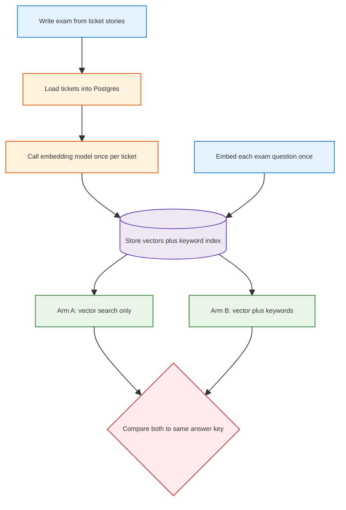
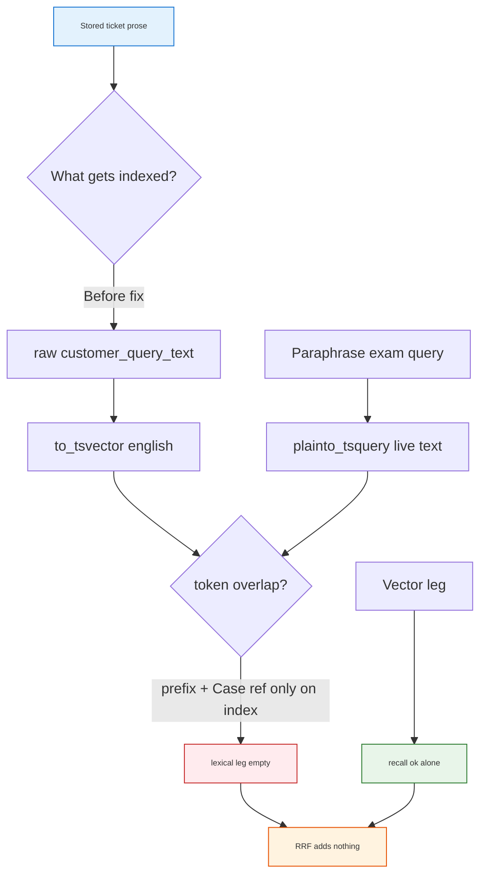
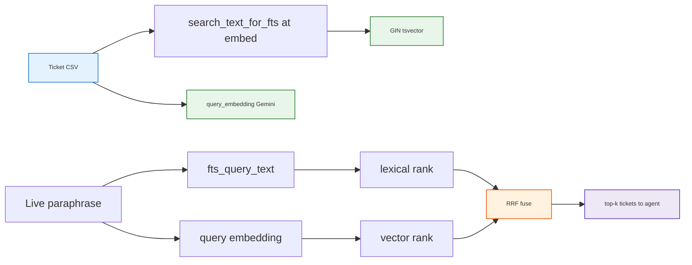

<h1 id="war-stories-title" style="color:#0d47a1;font-size:1.5em;font-weight:700;border-bottom:2px solid #90caf9;padding-bottom:0.25em;margin-top:0">War stories — portable collection</h1>

Lessons that travel across projects (RAG, eval, agent UX). Project-specific Samsung wiring also references **`docs_manual_gen/ref_plan/wip/REFACTOR_SAMSUNG_RETAIL_SERVICE_BRAIN.md`**.

<h2 id="war-stories-outline" style="color:#1565c0;font-size:1.22em;font-weight:650;border-left:4px solid #42a5f5;padding-left:10px;margin-top:1.1em">Document outline</h2>

1. [Story index](#story-index)
2. [Story 1 — Ticket vs wiki planes + D6 A/B gates](#war-story-1)
3. [Story 2 — Embed once, share vectors for A/B](#war-story-2)
4. [Story 3 — Operator load: empty CSV timestamps and eval `.env` parity](#war-story-3)
5. [Story 4 — Hybrid RRF beside RAG: BM25-class lexical + dense + fuse, not overlap hacks](#war-story-4)
6. [Story 5 — Pin python3.12; do not call python3](#war-story-5)
7. [Story 6 — One keyword switch, external engines stay optional](#war-story-6)

---

<h2 id="story-index" style="color:#1565c0;font-size:1.22em;font-weight:650;border-left:4px solid #42a5f5;padding-left:10px;margin-top:1.1em">Story index</h2>

<table>
<thead>
<tr style="background:#1565c0;color:white"><th>#</th><th>Title</th><th>Gist</th></tr>
</thead>
<tbody>
<tr><td style="background:#e3f2fd">1</td><td><a href="#war-story-1">Split ticket PG from manual wiki; promote hybrid search only on recall + precision</a></td><td>Two indexes; D6 needs literal recall up and wrong-fix reuse flat.</td></tr>
<tr><td style="background:#e3f2fd">2</td><td><a href="#war-story-2">Embed the cabinet once; both A and B read the same stored vectors</a></td><td>Live models jitter; freeze docs and queries. Hash mock is for CI only.</td></tr>
<tr><td style="background:#e3f2fd">3</td><td><a href="#war-story-3">Operator PG load: CSV null timestamps and eval `.env` parity</a></td><td>Empty CSV cells ≠ SQL NULL; embed script and eval must load the same `.env`.</td></tr>
<tr><td style="background:#e3f2fd">4</td><td><a href="#war-story-4">Hybrid RRF beside RAG: inverted lexical + dense + fuse</a></td><td>Normalize index text once; vectors for paraphrase; reject O(n) overlap on condensed strings.</td></tr>
<tr><td style="background:#e3f2fd">5</td><td><a href="#war-story-5">Pin python3.12; do not call python3</a></td><td>System python3 stays 3.9. A word-boundary match also hits python3.12.</td></tr>
<tr><td style="background:#e3f2fd">6</td><td><a href="#war-story-6">One keyword switch, external engines stay optional</a></td><td>Default verify runs the embedded index. ParadeDB and OpenSearch are faked unless their URL is set.</td></tr>
</tbody>
</table>

---

<h2 id="war-story-1" style="color:#1565c0;margin-top:1.35em;margin-bottom:0.5em;font-weight:650;border-left:4px solid #42a5f5;padding-left:10px">1. Split ticket PG from manual wiki; promote hybrid search only on recall + precision</h2>

**creation:** 261010-131600  
**last_updated:** 261010-131600  
**keywords:** rag, pgvector, tsvector, eval, ab-test, llm-wiki, second-brain, design, retrieval  
**difficulty:** 5  
**significance:** 8  

<h3 id="war-story-1-sec-1" style="color:#00695c;margin-top:1.05em;margin-bottom:0.4em;font-weight:600">1.1 Context</h3>

A retail “Second Brain” needed **~100k service tickets** plus **six PDF manuals** for three phone models. The temptation was one search index over everything, or exporting ticket themes into the same wiki compiler used for PDFs.

<h3 id="war-story-1-sec-2" style="color:#00695c;margin-top:1.05em;margin-bottom:0.4em;font-weight:600">1.2 Root Cause</h3>

**Tickets** and **manuals** differ in shape and risk: tickets are OLTP rows with statuses and PII boundaries; manuals are curated documents. Mixing them in one vector index blurs **“reuse a past resolution”** vs **“read the official guide”** and makes eval ambiguous.

<h3 id="war-story-1-sec-3" style="color:#00695c;margin-top:1.05em;margin-bottom:0.4em;font-weight:600">1.3 Key Insight</h3>

Use **two retrieval planes**: PostgreSQL (+ pgvector, optional tsvector + RRF) for tickets; Nashsu LLM Wiki hybrid search for compiled **`brain/retail/wiki/`** PDFs only. The agent routes: **semantic ticket search → else wiki**—not a third “theme playbook” layer in V1.

Promotion of **V1.1 hybrid ticket search** (decision **D6**) must pass **both**:

- **Recall (right ticket in top results)** — especially **literal-token** queries (SKU, model code, copied error text) where the lexical leg earns its keep.
- **Precision (don’t confidently wrong-fix)** — **false reuse** (applying another case’s resolution) must not **increase** on **paraphrase** eval rows; falling back to manuals is acceptable when similarity is weak.

A **50-row smoke corpus** validates plumbing; it is **not** enough to flip D6 defaults—need larger held-out gold and frozen DB before production promotion.

<h3 id="war-story-1-sec-4" style="color:#00695c;margin-top:1.05em;margin-bottom:0.4em;font-weight:600">1.4 Resolution</h3>

- Locked **D1–D7** in `docs_manual_gen/todos/TODO_SAMSUNG_RETAIL_STRUCTURED_DATA_AND_WIKI.md` and **`REFACTOR_SAMSUNG_RETAIL_SERVICE_BRAIN.md`**.
- **Eval anti-leakage:** `generate_eval_from_manifest.py` builds **paraphrase** queries linked to `source_ticket_id`; pytest rejects verbatim copy of stored ticket text.
- **Prep scripts** under `cursor_gen/retail_v11_prep/` (Docker PG, load, embed, `--postgres` A/B)—external deps **stop + prompt** via `lib/require_external.sh`.
- **Phased corpus:** **50** tickets for implementation shakeout; **90** total (`COUNT=90`, same seed preserves first 50) immediately before A/B—not for D6 promotion at that size.
- **User-facing prose rule:** `.cursor/rules/abbr-first-use-expand.mdc` — plain language + glosses for abbreviations and jargon.

```text
# Phased generation (repo root)
COUNT=50  bash cursor_gen/retail_v11_prep/02_generate_corpus.sh   # implement / wire
COUNT=90  bash cursor_gen/retail_v11_prep/02_generate_corpus.sh   # pre-A/B (superset)
bash cursor_gen/retail_v11_prep/03_pg_up_and_load.sh
bash cursor_gen/retail_v11_prep/04_run_ab_postgres.sh
```

<h3 id="war-story-1-sec-5" style="color:#00695c;margin-top:1.05em;margin-bottom:0.4em;font-weight:600">1.5 Takeaway</h3>

When OLTP history and document KB coexist, **split indexes and split eval suites**; promote retrieval upgrades only when **recall gains on literal queries** do not buy **more wrong confident answers** on paraphrases. Generate eval gold with **deterministic scripts**, not chat tuned to the ranker you hope to pass.

---

<h2 id="war-story-2" style="color:#1565c0;margin-top:1.35em;margin-bottom:0.5em;font-weight:650;border-left:4px solid #42a5f5;padding-left:10px">2. Embed the cabinet once; both A and B read the same stored vectors</h2>

**creation:** 261010-143500  
**last_updated:** 261010-143500  
**keywords:** design, system design, embeddings, pgvector, ab-test, eval, determinism, hash-mock  
**difficulty:** 4  
**significance:** 8  

<h3 id="war-story-2-sec-1" style="color:#00695c;margin-top:1.05em;margin-bottom:0.4em;font-weight:600">2.1 Context</h3>

A ticket-search A/B compared **vector-only** search (arm A) with **vector plus keyword blend** (arm B). Live embedding APIs (for example Gemini embedding models) are built to capture **meaning**, not to promise bit-identical floats on every HTTP call. A checksum-style **hash mock** (`hash_embed`) already existed so continuous integration could run without API keys. The open question was whether a **real** model could still support a fair, repeatable A/B—or whether only the mock was “deterministic enough.”

<h3 id="war-story-2-sec-2" style="color:#00695c;margin-top:1.05em;margin-bottom:0.4em;font-weight:600">2.2 Root Cause</h3>

Nondeterminism is not “embeddings cannot be used in tests.” It is **calling the model again** between arms, or letting each arm embed the **question** on its own. Two nearly identical vectors still change neighbor order on close calls. A hash mock removes that jitter by ignoring meaning entirely, so a green A/B on the mock does **not** answer whether paraphrases retrieve the right past ticket.

A second, separate failure mode: writing the exam answer key from “whoever is nearest after embedding.” That makes the test agree with the current vectors by construction. Fair vectors do not fix a rewritten answer key.

<h3 id="war-story-2-sec-3" style="color:#00695c;margin-top:1.05em;margin-bottom:0.4em;font-weight:600">2.3 Key Insight</h3>

**Embed once, store, share.** Turn each stored ticket into numbers **one time**, write them into Postgres, and pin the model id and dimension. Run arm A and arm B against **those same rows**. Also embed each **exam question once** and feed **that same question vector** into both arms. Keyword search (the extra leg in arm B) does not need embeddings; only the vector leg must be frozen.

The hash function is a **mock embedding**: same interface (a list of floats, cosine distance), **no semantic model**. Use it for plumbing tests. Use the frozen real cabinet for any decision about whether hybrid search should become the default.

<table>
<thead>
<tr style="background:#1565c0;color:white"><th>Approach</th><th>Same numbers every rerun?</th><th>Tests real “similar meaning”?</th><th>Use for</th></tr>
</thead>
<tbody>
<tr><td style="background:#e3f2fd">Re-call API on every search</td><td style="background:#ffebee">No — small float drift</td><td style="background:#fff3e0">Yes, but A and B may not see the same question vector</td><td style="background:#ffebee">Not for A/B</td></tr>
<tr><td style="background:#e3f2fd">Hash mock (<code>hash_embed</code>)</td><td style="background:#e8f5e9">Yes</td><td style="background:#ffebee">No — barcode of the text</td><td style="background:#fff3e0">CI / offline wiring</td></tr>
<tr><td style="background:#e3f2fd"><strong>Real embed once, shared</strong></td><td style="background:#e8f5e9">Yes, if docs <em>and</em> queries stay stored</td><td style="background:#e8f5e9">Yes</td><td style="background:#e8f5e9"><span style="background:#2e7d32;color:white;padding:1px 4px">recommended</span> operator A/B</td></tr>
</tbody>
</table>

**Caveats (the shared cabinet is effective only if these hold):**

- **Questions too.** Document vectors alone are not enough if each arm re-embeds the user question live.
- **One model generation.** Pin model id, dimension, and normalization. Do not fill `NULL` rows later with a newer model.
- **Text prep frozen.** Changing lowercase/strip rules after storage makes new questions disagree with old tickets.
- **Answer key stays independent.** Gold ticket ids come from the scenario, not from “top neighbor after embed.”
- **Incomplete batches.** A failed API run must not leave half the table on model A and half on model B.
- **Vendor and privacy.** Text leaves the machine; synthetic data still needs a pinned vendor contract. Cost scales with corpus size, not with how many times you rerun A vs B.

<h3 id="war-story-2-sec-4" style="color:#00695c;margin-top:1.05em;margin-bottom:0.4em;font-weight:600">2.4 Resolution</h3>



**Continuous integration mock** — **`second_brain`** · `scripts/retail/retail_brain/embeddings.py` (hash stand-in, not a meaning model):

```python
def hash_embed(text: str, dims: int = 32) -> List[float]:
    """Same text always yields the same floats. Not a semantic embedding."""
    digest = hashlib.sha256(text.strip().lower().encode("utf-8")).digest()
    vals: List[float] = []
    for i in range(dims):
        b = digest[i % len(digest)]
        vals.append((b / 127.5) - 1.0)
    norm = math.sqrt(sum(v * v for v in vals)) or 1.0
    return [v / norm for v in vals]
```

**Operator protocol** (real model; both arms read storage):

```text
1. Generate tickets + exam JSONL (answer key from stories, fixed seed).
2. Load Postgres. Embed each ticket once; store vector + model id.
   Embed each exam question once; store that vector beside the exam row.
3. Arm A and arm B: never call the embedding API.
   Vector leg uses stored ticket vectors and the stored question vector.
   Arm B additionally uses the keyword index built from the same text.
4. Score both arms against the unchanged answer key.
5. Re-run is deterministic until model id, text prep, or stored vectors change.
```

Today’s loader (`scripts/retail/embed_service_queries.py`) still calls `hash_embed` so local smoke tests need no API. **Promotion A/B** switches that step to a pinned live model with the store-once rule above; the hash path stays for tests that only prove wiring. Plan: `docs_manual_gen/ref_plan/wip/REFACTOR_SAMSUNG_RETAIL_SERVICE_BRAIN.md` (decision on shared embeddings; role split of exam author vs search coder deferred to a later slice).

<h3 id="war-story-2-sec-5" style="color:#00695c;margin-top:1.05em;margin-bottom:0.4em;font-weight:600">2.5 Takeaway</h3>

Freeze **document and question** vectors from **one** embedding pass and point both A/B arms at that cabinet; keep checksum mocks for CI and keep the answer key independent of neighbor lists.

---

<h2 id="war-story-3" style="color:#1565c0;margin-top:1.35em;margin-bottom:0.5em;font-weight:650;border-left:4px solid #42a5f5;padding-left:10px">3. Operator PG load: CSV null timestamps and eval `.env` parity</h2>

**creation:** 261010-164800  
**last_updated:** 261010-164800  
**keywords:** postgres, csv, operator, embeddings, eval, second-brain  
**difficulty:** 3  
**significance:** 5  

<h3 id="war-story-3-sec-1" style="color:#00695c;margin-top:1.05em;margin-bottom:0.4em;font-weight:600">3.1 Context</h3>

Phase 6 loaded synthetic tickets from CSV into Postgres, embedded rows with Gemini, then ran `--postgres` eval for V1 vs V1.1.

<h3 id="war-story-3-sec-2" style="color:#00695c;margin-top:1.05em;margin-bottom:0.4em;font-weight:600">3.2 Root Cause</h3>

Open tickets used an **empty string** for `closed_at` in CSV. Postgres rejected `''` for `timestamptz`. Separately, `embed_service_queries.py` loaded repo `.env` but `eval_ticket_search.py` did not—query embeddings failed at runtime despite a successful embed step. A third issue: **language drift** — Portuguese ticket text with hard-coded `'english'` tsvector left the hybrid lexical leg empty.

<h3 id="war-story-3-sec-3" style="color:#00695c;margin-top:1.05em;margin-bottom:0.4em;font-weight:600">3.3 Resolution</h3>

Map blank timestamp fields to **SQL NULL** in `load_service_queries.py`. Call `load_repo_env(ROOT)` in the Postgres eval entrypoint so **load, embed, and search** share the same embedding config. Introduce **`RETAIL_MARKET`** (`retail_brain/market.py`) so seed copy, eval paraphrases, `to_tsvector`, and `plainto_tsquery` share one Postgres text config (default **AU** / `english`).

<h3 id="war-story-3-sec-4" style="color:#00695c;margin-top:1.05em;margin-bottom:0.4em;font-weight:600">3.4 Takeaway</h3>

Operator scripts are part of the product surface: treat CSV edge cases, `.env` loading, and **market locale** as **one contract** across every path that embeds or full-text searches tickets.

---

<h2 id="war-story-4" style="color:#1565c0;margin-top:1.35em;margin-bottom:0.5em;font-weight:650;border-left:4px solid #42a5f5;padding-left:10px">4. Hybrid RRF beside RAG: inverted lexical + dense + fuse (not overlap hacks)</h2>

**Payoff (read this first):** Ticket **RAG (retrieval-augmented generation: fetch similar past cases before the model answers)** needs **two retrieval legs** in production: **dense vectors** for customer paraphrase, and an **inverted lexical index** (BM25-class full-text, e.g. Postgres `tsvector` + GIN) on **index text you control once per ticket**. Fuse ranked lists with **RRF (reciprocal rank fusion: add scores from rank position, not raw similarity)**—optionally **rerank** top candidates with a cross-encoder. Do **not** scan every row counting **% token overlap** on LLM-condensed strings at query time; that is neither best practice nor scalable. Batch LLM enrichment of index copy is fine **offline**; infinite live boilerplate stripping is not the whole answer.

**creation:** 261010-234500  
**last_updated:** 261010-234500  
**keywords:** rag, hybrid-search, rrf, bm25, pgvector, tsvector, eval, design, retrieval, second-brain  
**difficulty:** 6  
**significance:** 9  

<h3 id="war-story-4-sec-1" style="color:#00695c;margin-top:1.05em;margin-bottom:0.4em;font-weight:600">4.1 Context</h3>

Samsung retail **Second Brain** stores ~90–100k-scale **service tickets** in Postgres with **pgvector** embeddings and an optional **V1.1** mode: vector leg + lexical leg + **RRF**. Manual PDFs stay on a **separate wiki plane** (story #1). Eval uses **paraphrase questions** (anti-leakage): stored tickets carry `"Customer reports: … Case ref ITM-… / T-…"`, while exam queries sound like live callers and omit case refs.

After Phase 6 A/B with real Gemini embeddings, **strict recall@1** was ~95% on vectors—but **every eval row reported an empty lexical leg**, so **hybrid top-1 identical to vector-only**. Hybrid was wired; it was not **contributing**.

<h3 id="war-story-4-sec-2" style="color:#00695c;margin-top:1.05em;margin-bottom:0.4em;font-weight:600">4.2 What industry practice actually looks like</h3>

Modern **hybrid retrieval** stacks (Elasticsearch/OpenSearch **RRF**, Azure AI Search hybrid, Vespa, many RAG tutorials) converge on the same shape:

<table>
<thead>
<tr style="background:#1565c0;color:white"><th>Stage</th><th>Role</th><th>Typical tech</th></tr>
</thead>
<tbody>
<tr><td style="background:#e3f2fd">① Lexical</td><td style="background:#e8f5e9">Exact/rare tokens, SKUs, error codes, product strings</td><td style="background:#e8f5e9">Inverted index — BM25 or Postgres FTS (`tsvector`, GIN)</td></tr>
<tr><td style="background:#e3f2fd">② Dense</td><td style="background:#e8f5e9">Paraphrase, vague customer wording</td><td style="background:#e8f5e9">Embedding + ANN (pgvector, HNSW, etc.)</td></tr>
<tr><td style="background:#e3f2fd">③ Fuse</td><td style="background:#fff3e0">Merge two rank lists without calibrating scores</td><td style="background:#fff3e0">RRF (Cormack et al.; widely adopted in OpenSearch 2.x+)</td></tr>
<tr><td style="background:#e3f2fd">④ Rerank (optional)</td><td style="background:#ede7f6">Precision on top 20–50</td><td style="background:#ede7f6">Cross-encoder or LTR model</td></tr>
</tbody>
</table>

**References (external):**

- [OpenSearch — Reciprocal rank fusion](https://opensearch.org/docs/latest/search-plugins/search-relevance/rrf/) — productized RRF over lexical + neural legs.
- [Azure AI Search — Hybrid search (BM25 + vectors)](https://learn.microsoft.com/en-us/azure/search/hybrid-search-overview) — official hybrid overview.
- [Cormack, Clarke, Büttcher — Reciprocal Rank Fusion outperforms Condorcet (2009)](https://plg.uwaterloo.ca/~gvcormac/cormacksigir09-rrf.pdf) — original RRF paper.

**RAG** here means: retrieve ticket (or wiki) chunks **before** the agent composes an answer—not “vectors only.” Hybrid is how you keep **both** “SM-A156” keyword signal **and** “my phone gets hot and dies by lunch” semantic signal.

<h3 id="war-story-4-sec-3" style="color:#00695c;margin-top:1.05em;margin-bottom:0.4em;font-weight:600">4.3 Root cause in our stack</h3>



Three reinforcing bugs:

1. **Index/query asymmetry** — FTS built from boilerplate-heavy stored text; exams omit `"Customer reports:"` and `"Case ref …"`.
2. **Weak query parser** — `plainto_tsquery` on unnormalized paraphrase vs `websearch_to_tsquery` on normalized text.
3. **Corpus twins** — cyclic issue templates produced duplicate `(model, body)` rows; strict gold expects a single ticket id (vectors tie).

<h3 id="war-story-4-sec-4" style="color:#00695c;margin-top:1.05em;margin-bottom:0.4em;font-weight:600">4.4 Anti-pattern we rejected</h3>

A tempting shortcut: **LLM-condense every ticket to a short string**, then at query time **scan all rows** and pick max **% word overlap**.

| Approach | Verdict |
|----------|---------|
| O(n) overlap on condensed strings | <span style="background:#ffcdd2;padding:2px 4px">⚠</span> No inverted index; latency scales with cabinet size; brittle to live prefixes |
| Infinite regex strip at query time | <span style="background:#ffcdd2;padding:2px 4px">⚠</span> Cannot enumerate all future boilerplate |
| Batch LLM `search_text` at ingest | <span style="background:#c8e6c9;padding:2px 4px">✓</span> Valid **offline** enrichment (controlled once per ticket) |
| FTS on normalized `search_text` + dense + RRF | <span style="background:#c8e6c9;padding:2px 4px">✓</span> Matches industry hybrid shape |

<h3 id="war-story-4-sec-5" style="color:#00695c;margin-top:1.05em;margin-bottom:0.4em;font-weight:600">4.5 Resolution (code anchors)</h3>

**Finite normalize at embed time** (`scripts/retail/retail_brain/text_normalize.py`):

```python
def search_text_for_fts(raw: str, *, market: str | None = None) -> str:
    """Index/query text for the lexical leg: drop prefix and case-ref trailer."""
    core = strip_market_prefix(raw or "", market=market)
    return strip_case_ref_suffix(core)
```

**Embed path** writes both vector (full prose for semantics) and lexical index (normalized body):

```python
fts_body = search_text_for_fts(text or "")
cur.execute(
    """
    UPDATE service_queries
    SET query_embedding = %s::vector,
        search_text = %s,
        query_tsv = to_tsvector(%s, coalesce(%s, ''))
    WHERE ticket_id = %s
    """,
    (emb_literal, fts_body, ts_cfg, fts_body, tid),
)
```

**Search path** — same normalize on the live query; inverted lookup via Postgres:

```python
q = fts_query_text(query)
# ...
AND query_tsv @@ websearch_to_tsquery(%s, %s)
ORDER BY ts_rank_cd(query_tsv, websearch_to_tsquery(%s, %s)) DESC
```

**RRF** unchanged in spirit — fuse vector rank list with lexical rank list (`retail_brain/rrf.py`):

```python
def reciprocal_rank_fusion(ranked_lists: Sequence[Sequence[str]], k: int = 60) -> List[Tuple[str, float]]:
    scores: Dict[str, float] = {}
    for ranked in ranked_lists:
        for rank, doc_id in enumerate(ranked, start=1):
            scores[doc_id] = scores.get(doc_id, 0.0) + 1.0 / (k + rank)
    return sorted(scores.items(), key=lambda x: (-x[1], x[0]))
```

**Seed** adds store/city so strict eval ids are not confounded by identical templates.



**Plan + parent link:** [`REFACTOR_RETAIL_RRF_STRIP_FLUFF.md`](../docs_manual_gen/ref_plan/completed/REFACTOR_RETAIL_RRF_STRIP_FLUFF.md) under [`REFACTOR_SAMSUNG_RETAIL_SERVICE_BRAIN.md`](../docs_manual_gen/ref_plan/wip/REFACTOR_SAMSUNG_RETAIL_SERVICE_BRAIN.md) Phase 5.1.

<h3 id="war-story-4-sec-6" style="color:#00695c;margin-top:1.05em;margin-bottom:0.4em;font-weight:600">4.6 Promotion rule (D6) unchanged</h3>

Turning hybrid on by default still requires **D6 (promotion rule: don’t enable hybrid search by default until tests show a clear upside)** evidence: literal **recall@1 (does the right ticket rank first?)** up or flat, and **false reuse (confidently applying another customer’s wrong answer)** not worse on paraphrase stratum (test questions worded differently from stored ticket text). Phase 5.1 makes the lexical leg **measurable**; operator must **re-embed** (`03_pg_up_and_load.sh`) before the next A/B.

<h3 id="war-story-4-sec-7" style="color:#00695c;margin-top:1.05em;margin-bottom:0.4em;font-weight:600">4.7 Takeaway</h3>

**RAG over tickets is hybrid by default in mature systems:** dense for language variation, inverted lexical for tokens that actually appear, **RRF** to combine ranks without score calibration. Control **index text once** (finite strip + optional offline LLM enrich); let **vectors** carry live paraphrase. That is the course we ship on `feature/rrf-strip-fluff`—not query-time LLM fluff stripping and not O(n) overlap scans.

---

<h2 id="war-story-5" style="color:#1565c0;margin-top:1.35em;margin-bottom:0.5em;font-weight:650;border-left:4px solid #42a5f5;padding-left:10px">5. Pin python3.12; do not call python3</h2>

**creation:** 261012-192500  
**last_updated:** 261012-192500  
**keywords:** python, cpython, abi, wheels, macos, path, scripts  
**difficulty:** 4  
**significance:** 7  

<h3 id="war-story-5-sec-1" style="color:#00695c;margin-top:1.05em;margin-bottom:0.4em;font-weight:600">5.1 Context</h3>

A native search library published wheels for CPython 3.12 only. The Mac's `python3` was Apple's 3.9.6. Homebrew could not install 3.12: it saw an ancient Xcode and no longer ships Intel bottles.

<h3 id="war-story-5-sec-2" style="color:#00695c;margin-top:1.05em;margin-bottom:0.4em;font-weight:600">5.2 Root Cause</h3>

`python3` is not a version pin. It is whatever is first on `PATH`, often the OS interpreter. A scanner that looks for the token `python3` with a word boundary also matches the start of `python3.12`, so a rename to the longer name still looks like the old command.

<h3 id="war-story-5-sec-3" style="color:#00695c;margin-top:1.05em;margin-bottom:0.4em;font-weight:600">5.3 Key Insight</h3>

Call the minor version by name (`python3.12`) through one wrapper, and leave the system `python3` untouched. Install a relocatable CPython build when the package manager cannot bottle that ABI.

<h3 id="war-story-5-sec-4" style="color:#00695c;margin-top:1.05em;margin-bottom:0.4em;font-weight:600">5.4 Resolution</h3>

`scripts/py` execs `python3.12` from `PATH` or `~/.local/bin`. Product shell scripts and shebangs use that wrapper or `python3.12`. The 3.12 tree is a python-build-standalone install under `~/.local/share/cpython-3.12`, not a replacement of `/usr/bin/python3`.

```bash
# second-brain · scripts/py
exec python3.12 "$@"
```

Verified with `python3.12 -m pytest -q tests/` (64 passed before the keyword-index tests, then the full suite including them).

<h3 id="war-story-5-sec-5" style="color:#00695c;margin-top:1.05em;margin-bottom:0.4em;font-weight:600">5.5 Takeaway</h3>

When a wheel exists for one ABI only, pin that interpreter by its full name and do not treat `python3` as “the Python we installed.”

---

<h2 id="war-story-6" style="color:#1565c0;margin-top:1.35em;margin-bottom:0.5em;font-weight:650;border-left:4px solid #42a5f5;padding-left:10px">6. One keyword switch, external engines stay optional</h2>

**creation:** 261012-193000  
**last_updated:** 261012-193000  
**keywords:** design, system design, search, bm25, tantivy, opensearch, postgres  
**difficulty:** 5  
**significance:** 7  

<h3 id="war-story-6-sec-1" style="color:#00695c;margin-top:1.05em;margin-bottom:0.4em;font-weight:600">6.1 Context</h3>

Ticket search needed several keyword engines (embedded Tantivy and bm25x, plus ParadeDB and OpenSearch) so production can change later and the repo can teach the differences. Postgres had to remain the ticket store.

<h3 id="war-story-6-sec-2" style="color:#00695c;margin-top:1.05em;margin-bottom:0.4em;font-weight:600">6.2 Root Cause</h3>

An environment variable feels like a pure code switch, but ParadeDB is a different database image and OpenSearch is a separate Java process. Pointing the retail Postgres container at them would drop pgvector or add an always-on JVM. A doc sketch of a native library is also not a stable API until the installed wheel is inspected.

<h3 id="war-story-6-sec-3" style="color:#00695c;margin-top:1.05em;margin-bottom:0.4em;font-weight:600">6.3 Key Insight</h3>

One protocol (`rebuild` + `search_ids`) can hide four clients. Default tests run only the in-process engine. External clients are real code paths with a fake cursor or fake HTTP transport. Missing index or URL raises; it does not fall back to full-text search and pretend the leg worked.

<h3 id="war-story-6-sec-4" style="color:#00695c;margin-top:1.05em;margin-bottom:0.4em;font-weight:600">6.4 Resolution</h3>

`RETAIL_LEXICAL_BACKEND` defaults to `tantivy`. `lexical_ids()` delegates and no longer sends a tsquery. bm25x 0.3.1 accepts `BM25(index=..., method="lucene")` and `search(..., k=, subset=)`; ticket ids are stored beside the index in `tickets.json` because the extension's `load` does not return them. ParadeDB uses `RETAIL_PARADEDB_URL`. OpenSearch uses `RETAIL_OPENSEARCH_URL`.

<table>
<thead>
<tr style="background:#1565c0;color:white"><th>Backend</th><th>Unit test</th><th>Live service in verify</th></tr>
</thead>
<tbody>
<tr><td style="background:#e3f2fd">tantivy, bm25x</td><td style="background:#e8f5e9">Temp directory</td><td style="background:#e8f5e9">No</td></tr>
<tr><td style="background:#e3f2fd">parade_db, open_search</td><td style="background:#fff3e0">Fake cursor / fake HTTP</td><td style="background:#ffebee">No, unless the URL is set outside verify</td></tr>
</tbody>
</table>

<h3 id="war-story-6-sec-5" style="color:#00695c;margin-top:1.05em;margin-bottom:0.4em;font-weight:600">6.5 Takeaway</h3>

A config switch is honest only when the default path runs without the optional daemons, and a missing daemon fails loudly instead of silently searching the system of record with a different algorithm.
