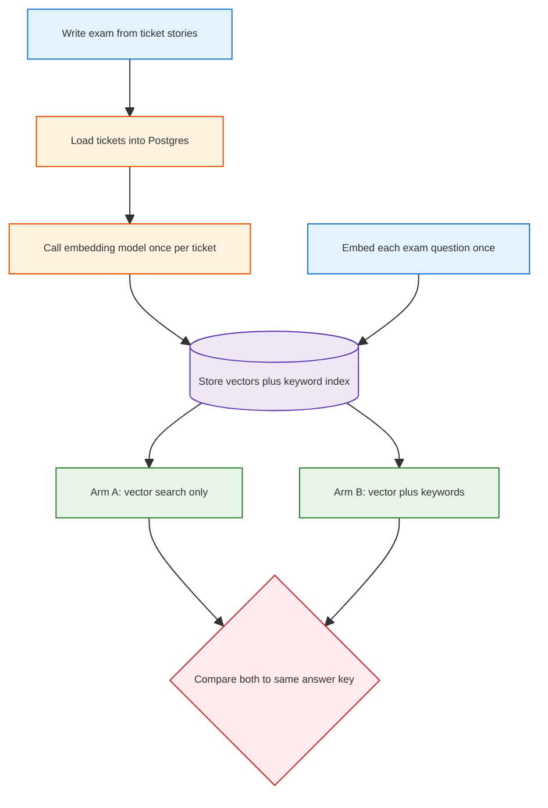

<h1 id="war-stories-title" style="color:#0d47a1;font-size:1.5em;font-weight:700;border-bottom:2px solid #90caf9;padding-bottom:0.25em;margin-top:0">War stories — portable collection</h1>

Lessons that travel across projects (RAG, eval, agent UX). Project-specific Samsung wiring also references **`docs_manual_gen/REFACTOR_SAMSUNG_RETAIL_SERVICE_BRAIN.md`**.

<h2 id="war-stories-outline" style="color:#1565c0;font-size:1.22em;font-weight:650;border-left:4px solid #42a5f5;padding-left:10px;margin-top:1.1em">Document outline</h2>

1. [Story index](#story-index)
2. [Story 1 — Ticket vs wiki planes + D6 A/B gates](#war-story-1)
3. [Story 2 — Embed once, share vectors for A/B](#war-story-2)
4. [Story 3 — Operator load: empty CSV timestamps and eval `.env` parity](#war-story-3)

---

<h2 id="story-index" style="color:#1565c0;font-size:1.22em;font-weight:650;border-left:4px solid #42a5f5;padding-left:10px;margin-top:1.1em">Story index</h2>

<table>
<thead>
<tr style="background:#1565c0;color:white"><th>#</th><th>Title</th><th>Gist</th></tr>
</thead>
<tbody>
<tr><td style="background:#e3f2fd">1</td><td><a href="#war-story-1">Split ticket PG from manual wiki; promote hybrid search only on recall + precision</a></td><td>Two indexes; D6 needs literal recall up and wrong-fix reuse flat.</td></tr>
<tr><td style="background:#e3f2fd">2</td><td><a href="#war-story-2">Embed the cabinet once; both A and B read the same stored vectors</a></td><td>Live models jitter; freeze docs and queries. Hash mock is for CI only.</td></tr>
<tr><td style="background:#e3f2fd">3</td><td><a href="#war-story-3">Operator PG load: CSV null timestamps and eval `.env` parity</a></td><td>Empty CSV cells ≠ SQL NULL; embed script and eval must load the same `.env`.</td></tr>
</tbody>
</table>

---

<h2 id="war-story-1" style="color:#1565c0;margin-top:1.35em;margin-bottom:0.5em;font-weight:650;border-left:4px solid #42a5f5;padding-left:10px">1. Split ticket PG from manual wiki; promote hybrid search only on recall + precision</h2>

**creation:** 261010-131600  
**last_updated:** 261010-131600  
**keywords:** rag, pgvector, tsvector, eval, ab-test, llm-wiki, second-brain, design, retrieval  
**difficulty:** 5  
**significance:** 8  

<h3 id="war-story-1-sec-1" style="color:#00695c;margin-top:1.05em;margin-bottom:0.4em;font-weight:600">1.1 Context</h3>

A retail “Second Brain” needed **~100k service tickets** plus **six PDF manuals** for three phone models. The temptation was one search index over everything, or exporting ticket themes into the same wiki compiler used for PDFs.

<h3 id="war-story-1-sec-2" style="color:#00695c;margin-top:1.05em;margin-bottom:0.4em;font-weight:600">1.2 Root Cause</h3>

**Tickets** and **manuals** differ in shape and risk: tickets are OLTP rows with statuses and PII boundaries; manuals are curated documents. Mixing them in one vector index blurs **“reuse a past resolution”** vs **“read the official guide”** and makes eval ambiguous.

<h3 id="war-story-1-sec-3" style="color:#00695c;margin-top:1.05em;margin-bottom:0.4em;font-weight:600">1.3 Key Insight</h3>

Use **two retrieval planes**: PostgreSQL (+ pgvector, optional tsvector + RRF) for tickets; Nashsu LLM Wiki hybrid search for compiled **`brain/retail/wiki/`** PDFs only. The agent routes: **semantic ticket search → else wiki**—not a third “theme playbook” layer in V1.

Promotion of **V1.1 hybrid ticket search** (decision **D6**) must pass **both**:

- **Recall (right ticket in top results)** — especially **literal-token** queries (SKU, model code, copied error text) where the lexical leg earns its keep.
- **Precision (don’t confidently wrong-fix)** — **false reuse** (applying another case’s resolution) must not **increase** on **paraphrase** eval rows; falling back to manuals is acceptable when similarity is weak.

A **50-row smoke corpus** validates plumbing; it is **not** enough to flip D6 defaults—need larger held-out gold and frozen DB before production promotion.

<h3 id="war-story-1-sec-4" style="color:#00695c;margin-top:1.05em;margin-bottom:0.4em;font-weight:600">1.4 Resolution</h3>

- Locked **D1–D7** in `docs_manual_gen/todos/TODO_SAMSUNG_RETAIL_STRUCTURED_DATA_AND_WIKI.md` and **`REFACTOR_SAMSUNG_RETAIL_SERVICE_BRAIN.md`**.
- **Eval anti-leakage:** `generate_eval_from_manifest.py` builds **paraphrase** queries linked to `source_ticket_id`; pytest rejects verbatim copy of stored ticket text.
- **Prep scripts** under `cursor_gen/retail_v11_prep/` (Docker PG, load, embed, `--postgres` A/B)—external deps **stop + prompt** via `lib/require_external.sh`.
- **Phased corpus:** **50** tickets for implementation shakeout; **90** total (`COUNT=90`, same seed preserves first 50) immediately before A/B—not for D6 promotion at that size.
- **User-facing prose rule:** `.cursor/rules/abbr-first-use-expand.mdc` — plain language + glosses for abbreviations and jargon.

```text
# Phased generation (repo root)
COUNT=50  bash cursor_gen/retail_v11_prep/02_generate_corpus.sh   # implement / wire
COUNT=90  bash cursor_gen/retail_v11_prep/02_generate_corpus.sh   # pre-A/B (superset)
bash cursor_gen/retail_v11_prep/03_pg_up_and_load.sh
bash cursor_gen/retail_v11_prep/04_run_ab_postgres.sh
```

<h3 id="war-story-1-sec-5" style="color:#00695c;margin-top:1.05em;margin-bottom:0.4em;font-weight:600">1.5 Takeaway</h3>

When OLTP history and document KB coexist, **split indexes and split eval suites**; promote retrieval upgrades only when **recall gains on literal queries** do not buy **more wrong confident answers** on paraphrases. Generate eval gold with **deterministic scripts**, not chat tuned to the ranker you hope to pass.

---

<h2 id="war-story-2" style="color:#1565c0;margin-top:1.35em;margin-bottom:0.5em;font-weight:650;border-left:4px solid #42a5f5;padding-left:10px">2. Embed the cabinet once; both A and B read the same stored vectors</h2>

**creation:** 261010-143500  
**last_updated:** 261010-143500  
**keywords:** design, system design, embeddings, pgvector, ab-test, eval, determinism, hash-mock  
**difficulty:** 4  
**significance:** 8  

<h3 id="war-story-2-sec-1" style="color:#00695c;margin-top:1.05em;margin-bottom:0.4em;font-weight:600">2.1 Context</h3>

A ticket-search A/B compared **vector-only** search (arm A) with **vector plus keyword blend** (arm B). Live embedding APIs (for example Gemini embedding models) are built to capture **meaning**, not to promise bit-identical floats on every HTTP call. A checksum-style **hash mock** (`hash_embed`) already existed so continuous integration could run without API keys. The open question was whether a **real** model could still support a fair, repeatable A/B—or whether only the mock was “deterministic enough.”

<h3 id="war-story-2-sec-2" style="color:#00695c;margin-top:1.05em;margin-bottom:0.4em;font-weight:600">2.2 Root Cause</h3>

Nondeterminism is not “embeddings cannot be used in tests.” It is **calling the model again** between arms, or letting each arm embed the **question** on its own. Two nearly identical vectors still change neighbor order on close calls. A hash mock removes that jitter by ignoring meaning entirely, so a green A/B on the mock does **not** answer whether paraphrases retrieve the right past ticket.

A second, separate failure mode: writing the exam answer key from “whoever is nearest after embedding.” That makes the test agree with the current vectors by construction. Fair vectors do not fix a rewritten answer key.

<h3 id="war-story-2-sec-3" style="color:#00695c;margin-top:1.05em;margin-bottom:0.4em;font-weight:600">2.3 Key Insight</h3>

**Embed once, store, share.** Turn each stored ticket into numbers **one time**, write them into Postgres, and pin the model id and dimension. Run arm A and arm B against **those same rows**. Also embed each **exam question once** and feed **that same question vector** into both arms. Keyword search (the extra leg in arm B) does not need embeddings; only the vector leg must be frozen.

The hash function is a **mock embedding**: same interface (a list of floats, cosine distance), **no semantic model**. Use it for plumbing tests. Use the frozen real cabinet for any decision about whether hybrid search should become the default.

<table>
<thead>
<tr style="background:#1565c0;color:white"><th>Approach</th><th>Same numbers every rerun?</th><th>Tests real “similar meaning”?</th><th>Use for</th></tr>
</thead>
<tbody>
<tr><td style="background:#e3f2fd">Re-call API on every search</td><td style="background:#ffebee">No — small float drift</td><td style="background:#fff3e0">Yes, but A and B may not see the same question vector</td><td style="background:#ffebee">Not for A/B</td></tr>
<tr><td style="background:#e3f2fd">Hash mock (<code>hash_embed</code>)</td><td style="background:#e8f5e9">Yes</td><td style="background:#ffebee">No — barcode of the text</td><td style="background:#fff3e0">CI / offline wiring</td></tr>
<tr><td style="background:#e3f2fd"><strong>Real embed once, shared</strong></td><td style="background:#e8f5e9">Yes, if docs <em>and</em> queries stay stored</td><td style="background:#e8f5e9">Yes</td><td style="background:#e8f5e9"><span style="background:#2e7d32;color:white;padding:1px 4px">recommended</span> operator A/B</td></tr>
</tbody>
</table>

**Caveats (the shared cabinet is effective only if these hold):**

- **Questions too.** Document vectors alone are not enough if each arm re-embeds the user question live.
- **One model generation.** Pin model id, dimension, and normalization. Do not fill `NULL` rows later with a newer model.
- **Text prep frozen.** Changing lowercase/strip rules after storage makes new questions disagree with old tickets.
- **Answer key stays independent.** Gold ticket ids come from the scenario, not from “top neighbor after embed.”
- **Incomplete batches.** A failed API run must not leave half the table on model A and half on model B.
- **Vendor and privacy.** Text leaves the machine; synthetic data still needs a pinned vendor contract. Cost scales with corpus size, not with how many times you rerun A vs B.

<h3 id="war-story-2-sec-4" style="color:#00695c;margin-top:1.05em;margin-bottom:0.4em;font-weight:600">2.4 Resolution</h3>



**Continuous integration mock** — **`second_brain`** · `scripts/retail/retail_brain/embeddings.py` (hash stand-in, not a meaning model):

```python
def hash_embed(text: str, dims: int = 32) -> List[float]:
    """Same text always yields the same floats. Not a semantic embedding."""
    digest = hashlib.sha256(text.strip().lower().encode("utf-8")).digest()
    vals: List[float] = []
    for i in range(dims):
        b = digest[i % len(digest)]
        vals.append((b / 127.5) - 1.0)
    norm = math.sqrt(sum(v * v for v in vals)) or 1.0
    return [v / norm for v in vals]
```

**Operator protocol** (real model; both arms read storage):

```text
1. Generate tickets + exam JSONL (answer key from stories, fixed seed).
2. Load Postgres. Embed each ticket once; store vector + model id.
   Embed each exam question once; store that vector beside the exam row.
3. Arm A and arm B: never call the embedding API.
   Vector leg uses stored ticket vectors and the stored question vector.
   Arm B additionally uses the keyword index built from the same text.
4. Score both arms against the unchanged answer key.
5. Re-run is deterministic until model id, text prep, or stored vectors change.
```

Today’s loader (`scripts/retail/embed_service_queries.py`) still calls `hash_embed` so local smoke tests need no API. **Promotion A/B** switches that step to a pinned live model with the store-once rule above; the hash path stays for tests that only prove wiring. Plan: `docs_manual_gen/REFACTOR_SAMSUNG_RETAIL_SERVICE_BRAIN.md` (decision on shared embeddings; role split of exam author vs search coder deferred to a later slice).

<h3 id="war-story-2-sec-5" style="color:#00695c;margin-top:1.05em;margin-bottom:0.4em;font-weight:600">2.5 Takeaway</h3>

Freeze **document and question** vectors from **one** embedding pass and point both A/B arms at that cabinet; keep checksum mocks for CI and keep the answer key independent of neighbor lists.

---

<h2 id="war-story-3" style="color:#1565c0;margin-top:1.35em;margin-bottom:0.5em;font-weight:650;border-left:4px solid #42a5f5;padding-left:10px">3. Operator PG load: CSV null timestamps and eval `.env` parity</h2>

**creation:** 261010-164800  
**last_updated:** 261010-164800  
**keywords:** postgres, csv, operator, embeddings, eval, second-brain  
**difficulty:** 3  
**significance:** 5  

<h3 id="war-story-3-sec-1" style="color:#00695c;margin-top:1.05em;margin-bottom:0.4em;font-weight:600">3.1 Context</h3>

Phase 6 loaded synthetic tickets from CSV into Postgres, embedded rows with Gemini, then ran `--postgres` eval for V1 vs V1.1.

<h3 id="war-story-3-sec-2" style="color:#00695c;margin-top:1.05em;margin-bottom:0.4em;font-weight:600">3.2 Root Cause</h3>

Open tickets used an **empty string** for `closed_at` in CSV. Postgres rejected `''` for `timestamptz`. Separately, `embed_service_queries.py` loaded repo `.env` but `eval_ticket_search.py` did not—query embeddings failed at runtime despite a successful embed step. A third issue: **language drift** — Portuguese ticket text with hard-coded `'english'` tsvector left the hybrid lexical leg empty.

<h3 id="war-story-3-sec-3" style="color:#00695c;margin-top:1.05em;margin-bottom:0.4em;font-weight:600">3.3 Resolution</h3>

Map blank timestamp fields to **SQL NULL** in `load_service_queries.py`. Call `load_repo_env(ROOT)` in the Postgres eval entrypoint so **load, embed, and search** share the same embedding config. Introduce **`RETAIL_MARKET`** (`retail_brain/market.py`) so seed copy, eval paraphrases, `to_tsvector`, and `plainto_tsquery` share one Postgres text config (default **AU** / `english`).

<h3 id="war-story-3-sec-4" style="color:#00695c;margin-top:1.05em;margin-bottom:0.4em;font-weight:600">3.4 Takeaway</h3>

Operator scripts are part of the product surface: treat CSV edge cases, `.env` loading, and **market locale** as **one contract** across every path that embeds or full-text searches tickets.
